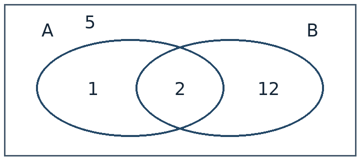
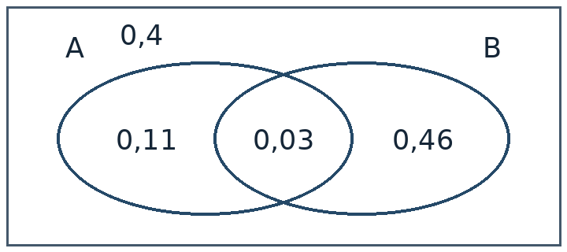
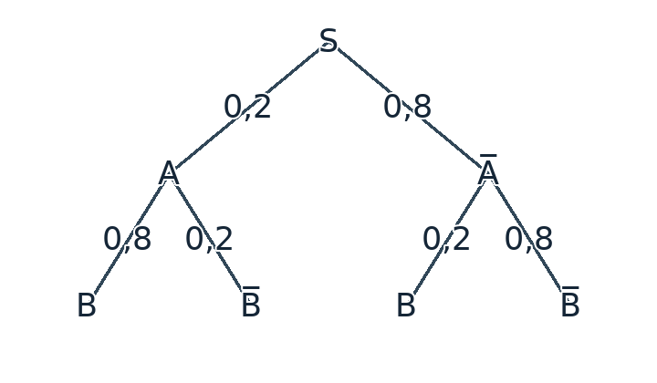
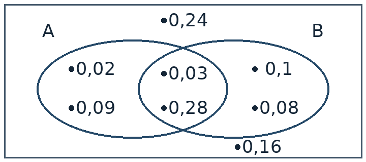
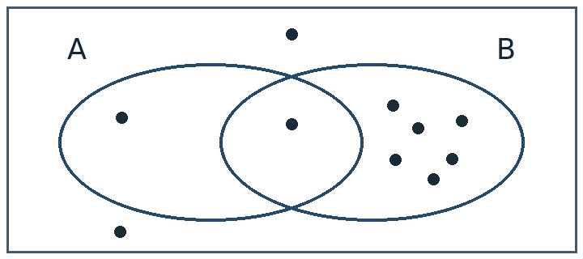

# №10 · Вероятность

[← Атлас №1–25](../README.md)

11 семейств или режимов в выдаче. [Источники и структуры](../oge10_reference_structures.json).

- [Один случайный выбор: один отмеченный класс исходов](#oge10-f001-draw-category) · `OGE10-F001-DRAW-CATEGORY`
- [Противоположное событие при одном случайном выборе](#oge10-f002-complement) · `OGE10-F002-COMPLEMENT`
- [Остаточная категория при выборе одного объекта](#oge10-f008-remainder-category) · `OGE10-F008-REMAINDER-CATEGORY`
- [Остаток партии, разделённый между категориями, и объединение несовместимых событий](#oge10-f007-disjoint-union-residual) · `OGE10-F007-DISJOINT-UNION-RESIDUAL`
- [Вероятность объединённой группы с пересечением признаков](#oge10-f009-overlapping-groups) · `OGE10-F009-OVERLAPPING-GROUPS`
- [Частоты и вероятность по наблюдениям](#oge10-f006-empirical-frequency) · `OGE10-F006-EMPIRICAL-FREQUENCY`
- [Диаграмма Эйлера: количества](#oge10-f005-euler-counts) · `OGE10-F005-EULER-COUNTS`
- [Диаграмма Эйлера: вероятности областей](#oge10-f005-euler-masses) · `OGE10-F005-EULER-MASSES`
- [Дерево вероятностей](#oge10-f005-tree) · `OGE10-F005-TREE`
- [Диаграмма Эйлера: вероятности точек](#oge10-f005-weighted-points) · `OGE10-F005-WEIGHTED-POINTS`
- [Диаграммы с равновозможными точками](#oge10-f005-equal-points) · `OGE10-F005-EQUAL-POINTS`

## Один случайный выбор: один отмеченный класс исходов

В наборе 25 фишек: 15 красных фишек, 2 синие фишки и 8 зелёных фишек. Наугад выбирают одну фишку. Найдите вероятность выбрать красную фишку.

Подсказка 1

Определите число всех фишек и число фишек нужного цвета.

Подсказка 2

Событию благоприятствуют только фишки выбранного цвета.

Ответ и разбор

**Ответ** · 0,6

1. Всего равновозможных исходов: 25.

2. Подходящих исходов: 15 красных фишек.

3. Вероятность равна 15/25 = 0,6.

`OGE10-F001-DRAW-CATEGORY` · seed `2027` · версия `0.1.0`

## Противоположное событие при одном случайном выборе

На экзамене 60 билетов; ученик не выучил 54 из них. Билет выбирают наугад. Найдите вероятность того, что билет выучен.

Подсказка 1

Событие «билет выучен» противоположно событию «билет не выучен».

Подсказка 2

Сначала найдите число выученных билетов как дополнение до общего количества.

Ответ и разбор

**Ответ** · 0,1

1. Всего 60 билетов; не выучено 54.

2. Выучено 60 − 54 = 6 билетов.

3. Вероятность равна 6/60 = 0,1.

`OGE10-F002-COMPLEMENT` · seed `2027` · версия `0.1.0`

## Остаточная категория при выборе одного объекта

На колесе обозрения 100 кабинок: 31 синяя кабинка, 23 зелёные кабинки, остальные красные. Кабинку выбирают наугад. Найдите вероятность попасть в красную кабинку.

Подсказка 1

Количество красных кабинок не дано напрямую.

Подсказка 2

Вычтите из общего количества кабинки двух известных цветов.

Ответ и разбор

**Ответ** · 0,46

1. Красных кабинок 100 − 31 − 23 = 46 красных кабинок.

2. Всего равновозможных кабинок 100.

3. Вероятность равна 46/100 = 0,46.

`OGE10-F008-REMAINDER-CATEGORY` · seed `2027` · версия `0.1.0`

## Остаток партии, разделённый между категориями, и объединение несовместимых событий

В ящике 40 маркеров: 8 красных маркеров, 1 зелёный маркер, 1 фиолетовый маркер. Синих и чёрных поровну; других маркеров нет. Один маркер выбирают наугад. Найдите вероятность выбрать красный или чёрный маркер.

Подсказка 1

Сначала вычислите остаток после подсчёта известных цветов.

Подсказка 2

Остаток делится поровну между синими и чёрными; нужные цвета не пересекаются.

Ответ и разбор

**Ответ** · 0,575

1. Остаток: 40 − 8 − 1 − 1 = 30.

2. Чёрных маркеров 15 чёрных маркеров; благоприятных 8 + 15 = 23 маркера.

3. Вероятность равна 23/40 = 0,575.

`OGE10-F007-DISJOINT-UNION-RESIDUAL` · seed `2027` · версия `0.1.0`

## Вероятность объединённой группы с пересечением признаков

В группе 25 человек: 4 знают только английский, 1 — только французский, а 1 знают оба языка. Найдите вероятность того, что случайно выбранный человек знает французский.

Подсказка 1

Человек, знающий оба языка, тоже входит в группу знающих французский.

Подсказка 2

Сложите только число знающих французский и число знающих оба языка.

Ответ и разбор

**Ответ** · 0,08

1. Знают французский 1 человек + 1 человек = 2 человека.

2. Всего равновозможных выборов 25.

3. Вероятность равна 2/25 = 0,08.

`OGE10-F009-OVERLAPPING-GROUPS` · seed `2027` · версия `0.1.0`

## Частоты и вероятность по наблюдениям

В партии 20 фонариков. Количество исправных фонариков — 5. Оцените по относительной частоте вероятность выбрать неисправный фонарик.

Подсказка 1

Используйте данные наблюдений как относительную частоту.

Подсказка 2

Найдите число нужных предметов как дополнение до размера всей партии.

Ответ и разбор

**Ответ** · 0,75

1. Нужных фонариков 20 − 5 = 15 фонариков.

2. Относительная частота равна 15/20.

3. Вероятность равна 0,75.

`OGE10-F006-EMPIRICAL-FREQUENCY` · seed `2027` · версия `0.1.0`

## Диаграмма Эйлера: количества

В областях диаграммы указаны количества равновозможных исходов. Найдите вероятность события A̅ ∪ B.

Подсказка 1

Определите, какие области удовлетворяют условию события.

Подсказка 2

Разделите число благоприятных исходов на общее число исходов.

Ответ и разбор

**Ответ** · 0,95

1. Подходят все области, кроме части A вне B.

2. Благоприятных исходов: 2 + 12 + 5 = 19.

3. Всего: 1 + 2 + 12 + 5 = 20. Вероятность: 19/20 = 0,95.

`OGE10-F005-EULER-COUNTS` · seed `2027` · версия `0.1.0`

## Диаграмма Эйлера: вероятности областей

В каждой области диаграммы указана её вероятность. Найдите вероятность события A.

Подсказка 1

Определите, какие области удовлетворяют условию события.

Подсказка 2

Сложите вероятности выбранных непересекающихся областей.

Ответ и разбор

**Ответ** · 0,14

1. В A входят его собственная часть и пересечение с B.

2. Складываем вероятности: 0,11 + 0,03 = 0,14.

`OGE10-F005-EULER-MASSES` · seed `2027` · версия `0.1.0`

## Дерево вероятностей

На рисунке изображено дерево случайного опыта. Найдите вероятность события B.

Подсказка 1

Найдите все пути от начала дерева к исходу B.

Подсказка 2

Для каждого пути перемножьте вероятности ветвей, затем сложите произведения.

Ответ и разбор

**Ответ** · 0,32

1. Через A: 2/10 · 8/10 = 16/100.

2. Через противоположное событие: 8/10 · 2/10 = 16/100.

3. Пути несовместны. Складываем: 32/100 = 0,32.

`OGE10-F005-TREE` · seed `2027` · версия `0.1.0`

## Диаграмма Эйлера: вероятности точек

На диаграмме показаны все исходы опыта. У каждой точки указана её вероятность. Найдите вероятность события A ∩ B̅.

Подсказка 1

Выберите точки, принадлежащие указанному событию.

Подсказка 2

Вероятности исходов различны. Сложите вероятности выбранных точек.

Ответ и разбор

**Ответ** · 0,11

1. Берём точки внутри A, лежащие вне B.

2. Складываем вероятности: 0,02 + 0,09 = 0,11.

`OGE10-F005-WEIGHTED-POINTS` · seed `2027` · версия `0.1.0`

## Диаграммы с равновозможными точками

Точками показаны все равновозможные исходы опыта. Найдите вероятность события B.

Подсказка 1

Определите, какие точки входят в событие.

Подсказка 2

Разделите число подходящих точек на общее число точек.

Ответ и разбор

**Ответ** · 0,7

1. Считаем все точки внутри B, включая пересечение с A.

2. Подходящих точек: 7, всего точек: 10. Вероятность равна 7/10 = 0,7.

`OGE10-F005-EQUAL-POINTS` · seed `2027` · версия `0.1.0`
