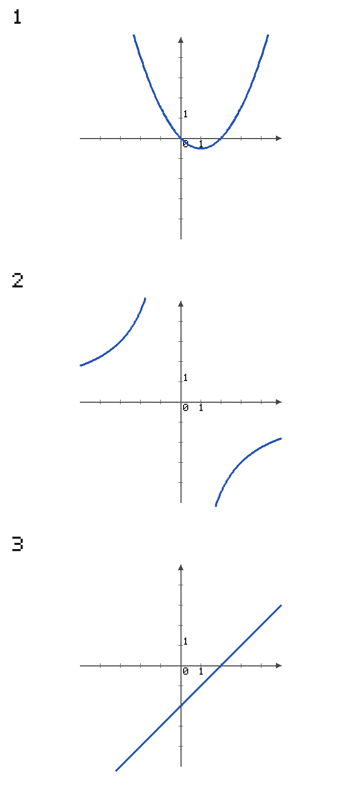
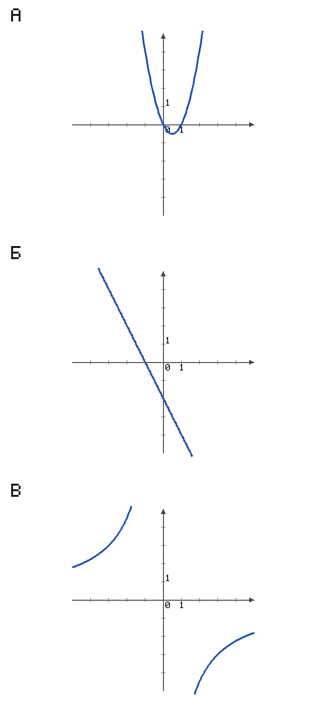
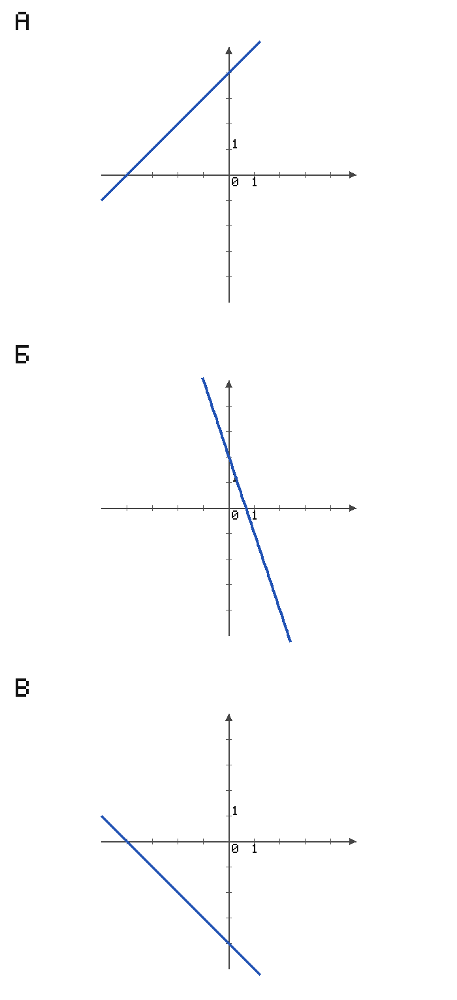
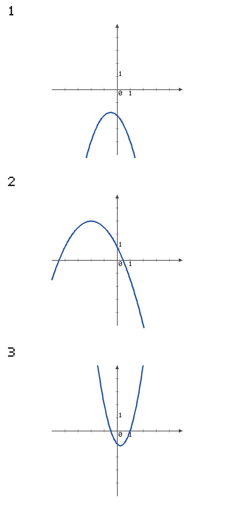
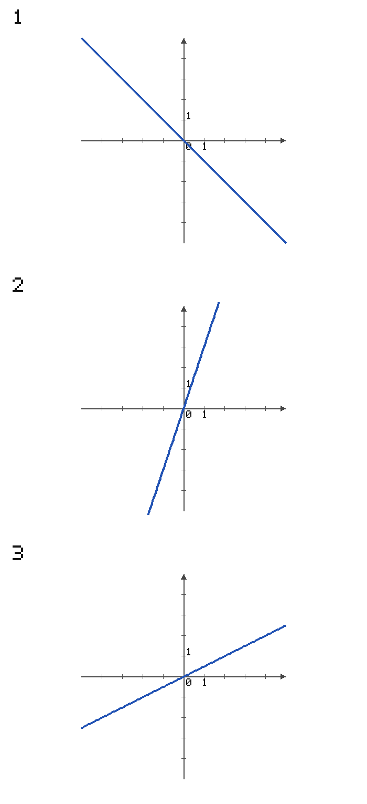
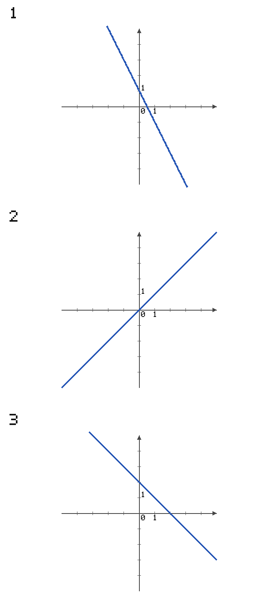
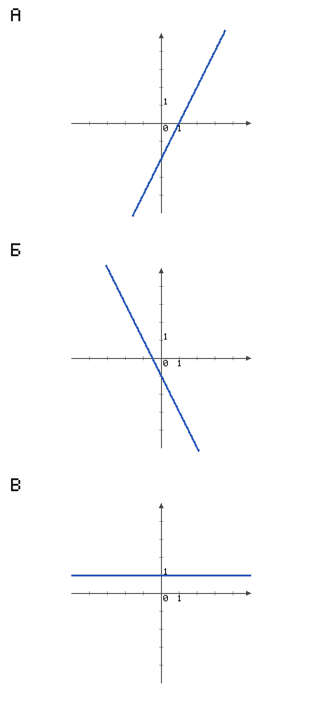
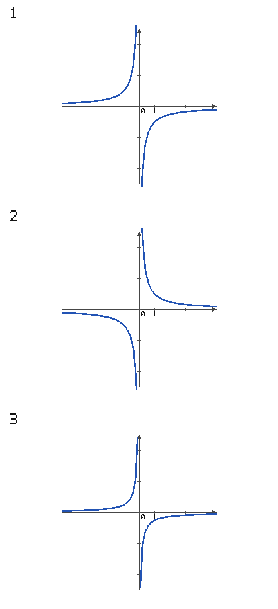

# №11 · Графики функций

[← Атлас №1–25](../README.md)

8 семейств или режимов в выдаче. [Источники и структуры](../oge11_reference_structures.json).

- [Разнородные функции: формулы АБВ → графики 123](#oge11-f01) · `OGE11-F01`
- [Разнородные функции: графики АБВ → формулы 123](#oge11-f02) · `OGE11-F02`
- [Прямые: признаки k и b](#oge11-f03) · `OGE11-F03`
- [Параболы: знаки a и c](#oge11-f04) · `OGE11-F04`
- [Прямые через начало координат: направление и крутизна](#oge11-f05) · `OGE11-F05`
- [Линейные функции со сдвигом, равные/противоположные наклоны](#oge11-f06) · `OGE11-F06`
- [Горизонтальная постоянная функция в сравнении с прямыми](#oge11-f07) · `OGE11-F07`
- [Гиперболы: знак и масштаб k/x](#oge11-f08) · `OGE11-F08`

## Разнородные функции: формулы АБВ → графики 123

Соотнесите формулы А, Б, В с графиками 1, 2, 3: 
А) y=1/2x²-x+0 
Б) y=x-2 
В) y=-9/x

Подсказка 1

Сначала определите вид графика или формулы.

Подсказка 2

Проверьте контрольные точки и внесите соответствия по порядку А, Б, В.

Ответ и разбор

**Ответ** · 132

1. А) y=1/2x²-x+0 задаёт график 1; контрольные значения соответствуют виду quadratic.

2. Б) y=x-2 задаёт график 3; контрольные значения соответствуют виду linear.

3. В) y=-9/x задаёт график 2; контрольные значения соответствуют виду inverse.

4. Запишите номера соответствующих объектов в порядке А, Б, В.

`OGE11-F01` · seed `2027` · версия `0.2.0`

## Разнородные функции: графики АБВ → формулы 123

Соотнесите графики А, Б, В с формулами из списка 1, 2, 3: 
1) y=-9/x 
2) y=2x²-2x+0 
3) y=-2x-2

Подсказка 1

Сначала определите вид каждого графика.

Подсказка 2

Проверьте контрольные точки и внесите соответствия по порядку А, Б, В.

Ответ и разбор

**Ответ** · 231

1. А: график quadratic подтверждает формулу 2) y=2x²-2x+0.

2. Б: график linear подтверждает формулу 3) y=-2x-2.

3. В: график inverse подтверждает формулу 1) y=-9/x.

4. Запишите номера соответствующих объектов в порядке А, Б, В.

`OGE11-F02` · seed `2027` · версия `0.2.0`

## Прямые: признаки k и b

Соотнесите графики А, Б, В со знаками коэффициентов k и b: 
1) k −, b + 
2) k −, b − 
3) k +, b +

Подсказка 1

Знак k задаёт направление прямой; знак b — её пересечение с Oy, то есть y(0).

Подсказка 2

Сопоставьте графики А, Б, В с вариантами знаков 1, 2, 3.

Ответ и разбор

**Ответ** · 312

1. А: k=+ по направлению прямой, b=+ по y(0); это вариант 3.

2. Б: k=− по направлению прямой, b=+ по y(0); это вариант 1.

3. В: k=− по направлению прямой, b=− по y(0); это вариант 2.

4. Запишите номера соответствующих объектов в порядке А, Б, В.

`OGE11-F03` · seed `2027` · версия `0.2.0`

## Параболы: знаки a и c

Соотнесите знаки коэффициентов с графиками 1, 2, 3: 
А) a < 0, c < 0 
Б) a > 0, c < 0 
В) a < 0, c > 0

Подсказка 1

Знак a задаёт направление ветвей; c — значение y(0), точка пересечения с Oy.

Подсказка 2

Сопоставьте пары знаков с параболами и запишите номера графиков в порядке А, Б, В.

Ответ и разбор

**Ответ** · 132

1. А: a < 0 по ветвям, c < 0 по y(0); это график 1.

2. Б: a > 0 по ветвям, c < 0 по y(0); это график 3.

3. В: a < 0 по ветвям, c > 0 по y(0); это график 2.

4. Запишите номера соответствующих объектов в порядке А, Б, В.

`OGE11-F04` · seed `2027` · версия `0.2.0`

## Прямые через начало координат: направление и крутизна

Соотнесите формулы А, Б, В с графиками 1, 2, 3: 
А) y=-x+0 
Б) y=1/2x+0 
В) y=3x+0

Подсказка 1

У прямой через начало координат знак и величину наклона показывает её направление.

Подсказка 2

Сопоставьте формулы А, Б, В с графиками 1, 2, 3.

Ответ и разбор

**Ответ** · 132

1. А) y=-x+0 задаёт график 1; контрольные значения соответствуют виду linear.

2. Б) y=1/2x+0 задаёт график 3; контрольные значения соответствуют виду linear.

3. В) y=3x+0 задаёт график 2; контрольные значения соответствуют виду linear.

4. Запишите номера соответствующих объектов в порядке А, Б, В.

`OGE11-F05` · seed `2027` · версия `0.2.0`

## Линейные функции со сдвигом, равные/противоположные наклоны

Соотнесите формулы А, Б, В с графиками 1, 2, 3: 
А) y=-x+2 
Б) y=-2x+1 
В) y=x+0

Подсказка 1

Сравните наклон прямой и её значение y(0).

Подсказка 2

Сопоставьте формулы А, Б, В с графиками 1, 2, 3.

Ответ и разбор

**Ответ** · 312

1. А) y=-x+2 задаёт график 3; контрольные значения соответствуют виду linear.

2. Б) y=-2x+1 задаёт график 1; контрольные значения соответствуют виду linear.

3. В) y=x+0 задаёт график 2; контрольные значения соответствуют виду linear.

4. Запишите номера соответствующих объектов в порядке А, Б, В.

`OGE11-F06` · seed `2027` · версия `0.2.0`

## Горизонтальная постоянная функция в сравнении с прямыми

Соотнесите графики А, Б, В с формулами из списка 1, 2, 3: 
1) y=-2x-1 
2) y=2x-2 
3) y=1

Подсказка 1

Горизонтальный график задаёт постоянную функцию.

Подсказка 2

Сопоставьте графики А, Б, В с формулами 1, 2, 3.

Ответ и разбор

**Ответ** · 213

1. А: график linear подтверждает формулу 2) y=2x-2.

2. Б: график linear подтверждает формулу 1) y=-2x-1.

3. В: график constant подтверждает формулу 3) y=1.

4. Запишите номера соответствующих объектов в порядке А, Б, В.

`OGE11-F07` · seed `2027` · версия `0.2.0`

## Гиперболы: знак и масштаб k/x

Соотнесите формулы А, Б, В с графиками 1, 2, 3: 
А) y=1/x 
Б) y=-1/(2x) 
В) y=-1/x

Подсказка 1

У y=q/x ветви лежат в I и III четвертях при q>0, во II и IV при q<0.

Подсказка 2

Сравните четверти и контрольные точки, затем сопоставьте формулы А, Б, В с графиками 1, 2, 3.

Ответ и разбор

**Ответ** · 231

1. А) y=1/x задаёт график 2; контрольные значения соответствуют виду inverse.

2. Б) y=-1/(2x) задаёт график 3; контрольные значения соответствуют виду inverse.

3. В) y=-1/x задаёт график 1; контрольные значения соответствуют виду inverse.

4. Запишите номера соответствующих объектов в порядке А, Б, В.

`OGE11-F08` · seed `2027` · версия `0.2.0`
