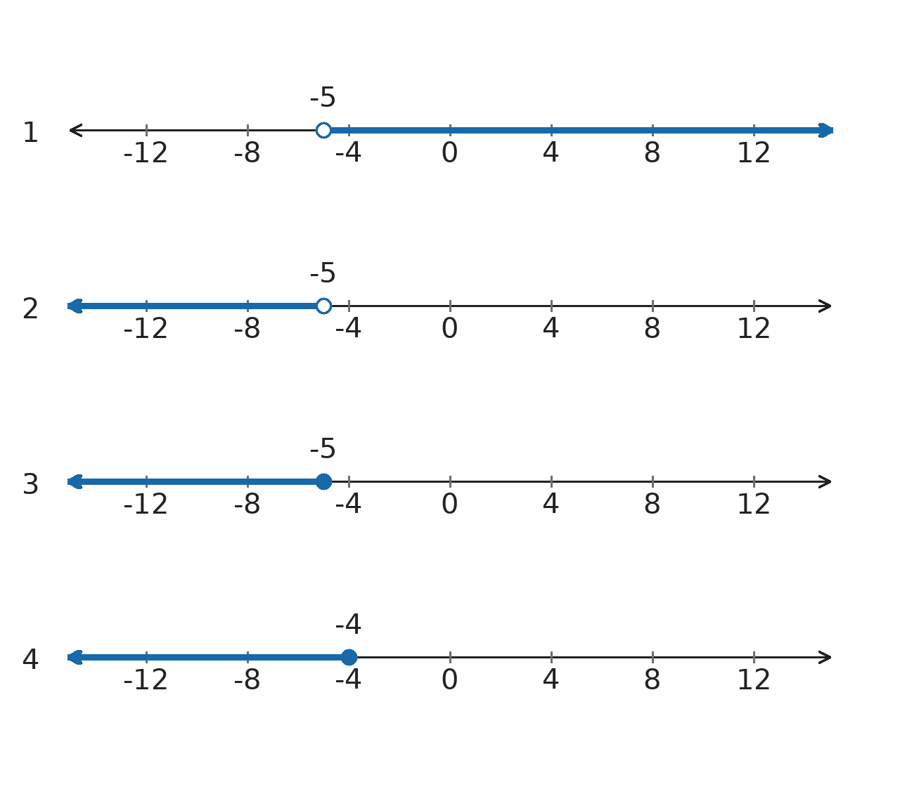
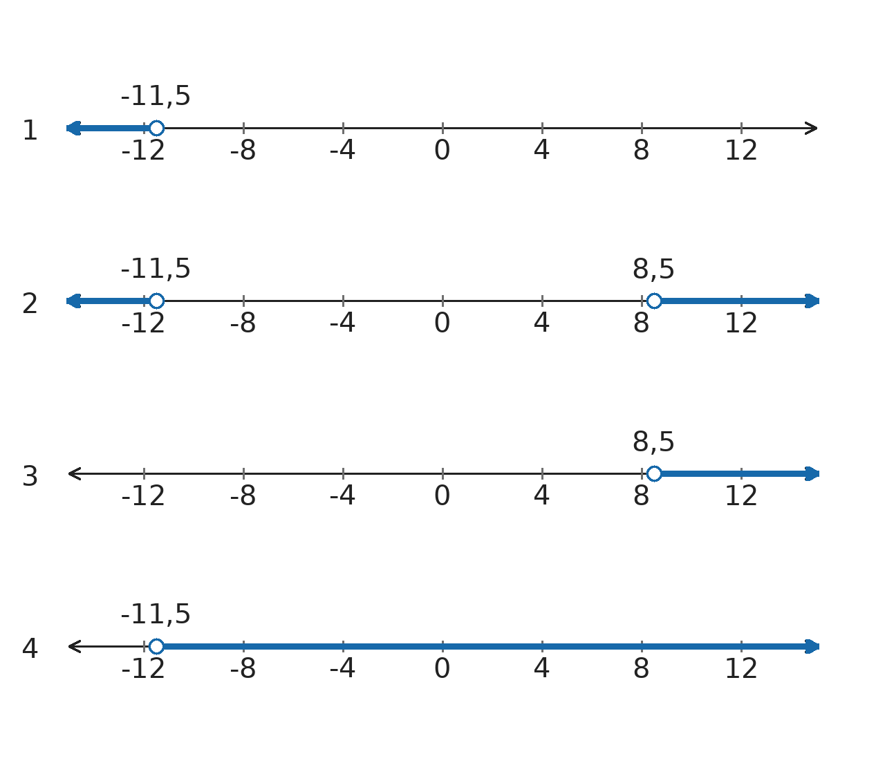
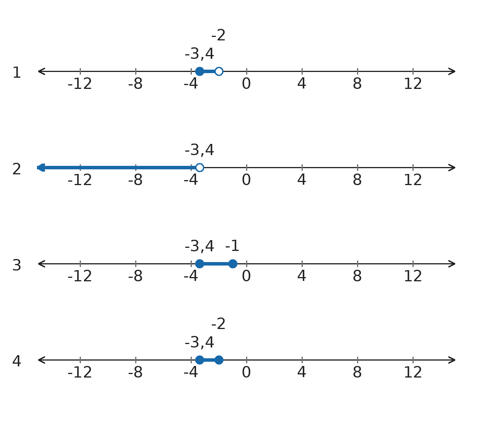
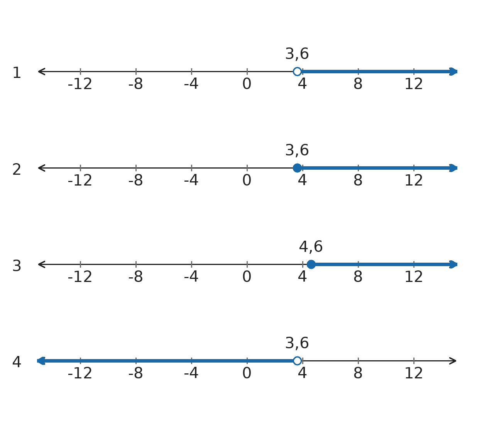
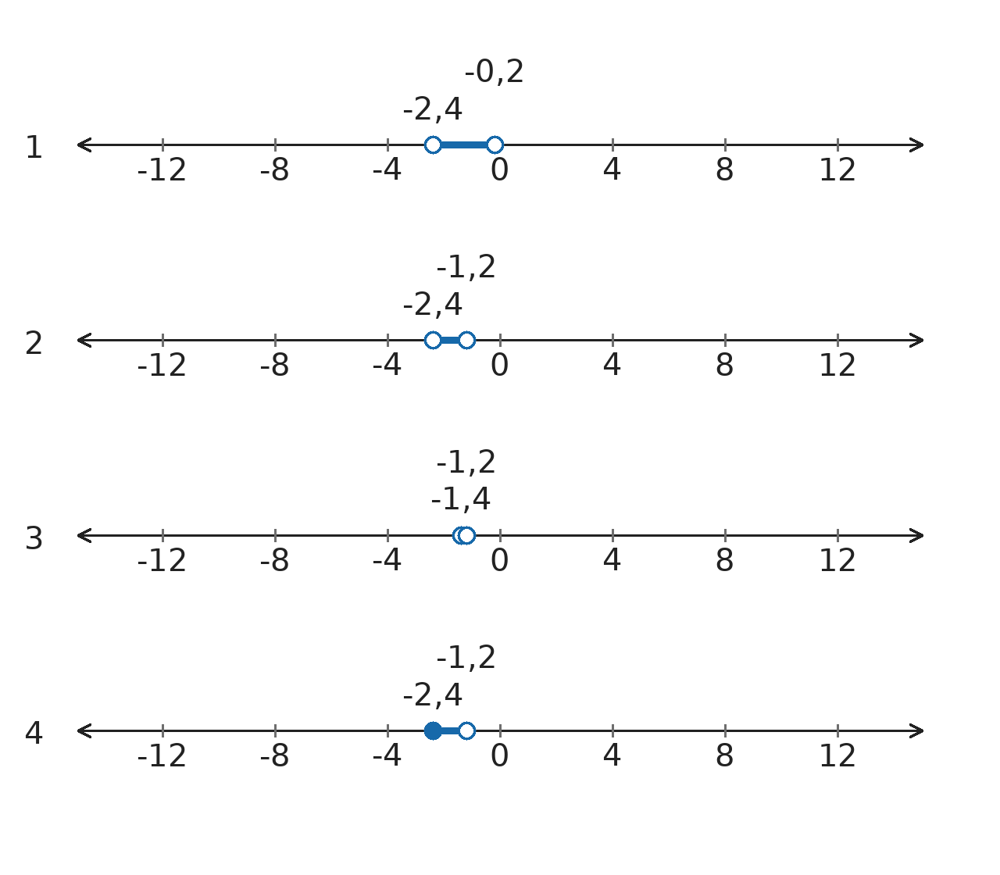

# №13 · Неравенства

[← Атлас №1–25](../README.md)

9 семейств или режимов в выдаче. [Источники и структуры](../oge13_reference_structures.json).

- [Решить линейное неравенство, выбрать текстовый промежуток](#oge13-l01) · `OGE13-L01`
- [Линейное неравенство, четыре изображения лучей](#oge13-l02) · `OGE13-L02`
- [Квадратное неравенство с корнем 0, строгий промежуток](#oge13-q01) · `OGE13-Q01`
- [Произведение x и x+r, нестрогое объединение лучей](#oge13-q02) · `OGE13-Q02`
- [Отрицательный старший коэффициент, нестрогое сравнение](#oge13-q03) · `OGE13-Q03`
- [Разложенное произведение двух линейных множителей](#oge13-q04) · `OGE13-Q04`
- [Система двух линейных неравенств: ограниченный отрезок](#oge13-s01) · `OGE13-S01`
- [Пересечение двух однонаправленных лучей](#oge13-s02) · `OGE13-S02`
- [Система двух строгих границ: открытый интервал](#oge13-s03) · `OGE13-S03`

## Решить линейное неравенство, выбрать текстовый промежуток

-x - 2 > x - 14 
 
1. (−∞;6] 
2. (−∞;7) 
3. (6;+∞) 
4. (−∞;6)

Подсказка 1

Решите неравенство; учтите знак сравнения и граничные точки.

Ответ и разбор

**Ответ** · 4

1. Исходное неравенство: -x - 2 > x - 14.

2. Переносим слагаемые: -2x > -12.

3. Делим обе части на -2 (<0), знак меняется: x < 6.

4. Ответ: (−∞;6).

`OGE13-L01` · seed `2027` · версия `0.2.0`

## Линейное неравенство, четыре изображения лучей

2x + 5 <= x + 0

Подсказка 1

Решите неравенство; учтите знак сравнения и граничные точки.

Ответ и разбор

**Ответ** · 3

1. Исходное неравенство: 2x + 5 <= x + 0.

2. Переносим слагаемые: x <= -5.

3. Делим обе части на 1 (>0), знак сохраняется: x <= -5.

4. Ответ: (−∞;-5].

`OGE13-L02` · seed `2027` · версия `0.2.0`

## Квадратное неравенство с корнем 0, строгий промежуток

x² - 3,93x < 0 
 
1. [0;3,93) 
2. (1;3,93) 
3. (−∞;0) 
4. (0;3,93)

Подсказка 1

Решите неравенство; учтите знак сравнения и граничные точки.

Ответ и разбор

**Ответ** · 4

1. Раскладываем: x² - 3,93x = x(x - 3,93); корни: x = 0 и x = 3,93.

2. Знаки выражения на промежутках: (−∞;0): +; (0;3,93): −; (3,93;+∞): +.

3. Для условия < 0 выбираем подходящие промежутки; корни не включаем, так как неравенство строгое.

4. Ответ: (0;3,93).

`OGE13-Q01` · seed `2027` · версия `0.2.0`

## Произведение x и x+r, нестрогое объединение лучей

x² + 3,82x >= 0 
 
1. (-3,82;+∞) 
2. (−∞;-3,82] ∪ [0;+∞) 
3. (−∞;-3,82] 
4. [0;+∞)

Подсказка 1

Решите неравенство; учтите знак сравнения и граничные точки.

Ответ и разбор

**Ответ** · 2

1. Раскладываем: x² + 3,82x = x(x + 3,82); корни: x = -3,82 и x = 0.

2. Знаки выражения на промежутках: (−∞;-3,82): +; (-3,82;0): −; (0;+∞): +.

3. Для условия >= 0 выбираем подходящие промежутки; корни включаем, так как знак неравенства нестрогий.

4. Ответ: (−∞;-3,82] ∪ [0;+∞).

`OGE13-Q02` · seed `2027` · версия `0.2.0`

## Отрицательный старший коэффициент, нестрогое сравнение

-x² - 0,16x <= 0 
 
1. (−∞;-0,16] ∪ [0;+∞) 
2. [1;+∞) 
3. (−∞;-0,16] 
4. (−∞;0,84]

Подсказка 1

Решите неравенство; учтите знак сравнения и граничные точки.

Ответ и разбор

**Ответ** · 1

1. Раскладываем: −x² − 0,16x = −x(x + 0,16); корни: x = -0,16 и x = 0.

2. Знаки выражения на промежутках: (−∞;-0,16): −; (-0,16;0): +; (0;+∞): −.

3. Для условия <= 0 выбираем подходящие промежутки; корни включаем, так как знак неравенства нестрогий.

4. Ответ: (−∞;-0,16] ∪ [0;+∞).

`OGE13-Q03` · seed `2027` · версия `0.2.0`

## Разложенное произведение двух линейных множителей

(x + 11,5)(x - 8,5) > 0

Подсказка 1

Решите неравенство; учтите знак сравнения и граничные точки.

Ответ и разбор

**Ответ** · 2

1. Выражение уже разложено на множители: (x + 11,5)(x - 8,5); корни: x = -11,5 и x = 8,5.

2. Знаки выражения на промежутках: (−∞;-11,5): +; (-11,5;8,5): −; (8,5;+∞): +.

3. Для условия > 0 выбираем подходящие промежутки; корни не включаем, так как неравенство строгое.

4. Ответ: (−∞;-11,5) ∪ (8,5;+∞).

`OGE13-Q04` · seed `2027` · версия `0.2.0`

## Система двух линейных неравенств: ограниченный отрезок

3x - 1,2 <= -7,2 
2x + 1,5 >= -5,3

Подсказка 1

Решите неравенство; учтите знак сравнения и граничные точки.

Ответ и разбор

**Ответ** · 4

1. 1) 3x - 1,2 <= -7,2 ⇒ (−∞;-2]

2. 2) 2x + 1,5 >= -5,3 ⇒ [-3,4;+∞)

3. Пересечение полученных множеств: [-3,4;-2]

`OGE13-S01` · seed `2027` · версия `0.2.0`

## Пересечение двух однонаправленных лучей

x + 0,3 >= 3,9 
4x - 1,7 >= -16,1

Подсказка 1

Решите неравенство; учтите знак сравнения и граничные точки.

Ответ и разбор

**Ответ** · 2

1. 1) x + 0,3 >= 3,9 ⇒ [3,6;+∞)

2. 2) 4x - 1,7 >= -16,1 ⇒ [-3,6;+∞)

3. Пересечение полученных множеств: [3,6;+∞)

`OGE13-S02` · seed `2027` · версия `0.2.0`

## Система двух строгих границ: открытый интервал

x > -2,4 
-6,3 - 4x > -1,5

Подсказка 1

Решите неравенство; учтите знак сравнения и граничные точки.

Ответ и разбор

**Ответ** · 2

1. 1) x > -2,4 ⇒ (-2,4;+∞)

2. 2) -6,3 - 4x > -1,5 ⇒ (−∞;-1,2)

3. Пересечение полученных множеств: (-2,4;-1,2)

`OGE13-S03` · seed `2027` · версия `0.2.0`
