# №15 · Треугольники

[← Атлас №1–25](../README.md)

22 семейств или режимов в выдаче. [Источники и структуры](../oge15_reference_structures.json).

- [Сумма углов треугольника](#oge15-f01) · `OGE15-F01`
- [Биссектриса угла](#oge15-f02) · `OGE15-F02`
- [Внешний угол треугольника](#oge15-f03) · `OGE15-F03`
- [Высота и углы](#oge15-f04) · `OGE15-F04`
- [Внешний угол равнобедренного треугольника](#oge15-f05) · `OGE15-F05`
- [Медиана равностороннего треугольника](#oge15-f06) · `OGE15-F06`
- [Медиана, равная половине стороны](#oge15-f07) · `OGE15-F07`
- [Медиана, высота и отрезки](#oge15-f08) · `OGE15-F08`
- [Медиана, высота и углы](#oge15-f09) · `OGE15-F09`
- [Биссектриса и равные отрезки](#oge15-f10) · `OGE15-F10`
- [Средняя линия треугольника](#oge15-f11) · `OGE15-F11`
- [Средняя линия и площади](#oge15-f12) · `OGE15-F12`
- [Подобие и площади](#oge15-f13) · `OGE15-F13`
- [Теорема Пифагора](#oge15-f14) · `OGE15-F14`
- [Тригонометрические отношения по сторонам](#oge15-f15) · `OGE15-F15`
- [Сторона по синусу](#oge15-f16) · `OGE15-F16`
- [Сторона по тангенсу](#oge15-f17) · `OGE15-F17`
- [Острые углы прямоугольного треугольника](#oge15-f18) · `OGE15-F18`
- [Площадь прямоугольного треугольника](#oge15-f19) · `OGE15-F19`
- [Площадь по основанию и высоте](#oge15-f20) · `OGE15-F20`
- [Площадь через синус](#oge15-f21) · `OGE15-F21`
- [Высота к гипотенузе и синус](#oge15-f22) · `OGE15-F22`

## Сумма углов треугольника

Два угла треугольника равны 31° и 83°. Найдите третий угол. Ответ дайте в градусах.

Подсказка 1

Сумма внутренних углов треугольника равна 180°.

Ответ и разбор

**Ответ** · 66

1. Третий угол: 180° − 31° − 83° = 66°.

`OGE15-F01` · seed `2027` · версия `oge15-triangles-2`

## Биссектриса угла

В треугольнике ABC угол BAC равен 54°, AD — биссектриса. Найдите угол BAD. Ответ дайте в градусах.

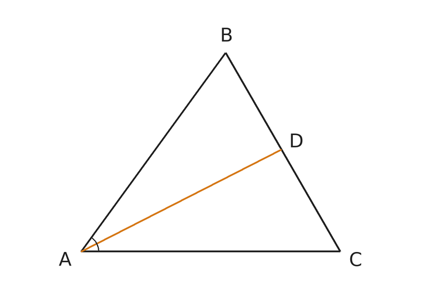

Подсказка 1

Биссектриса делит угол на две равные части.

Ответ и разбор

**Ответ** · 27

1. ∠BAD = ∠DAC = 54° / 2 = 27°.

`OGE15-F02` · seed `2027` · версия `oge15-triangles-2`

## Внешний угол треугольника

В треугольнике ABC угол C равен 132°. Найдите внешний угол при вершине C. Ответ дайте в градусах.

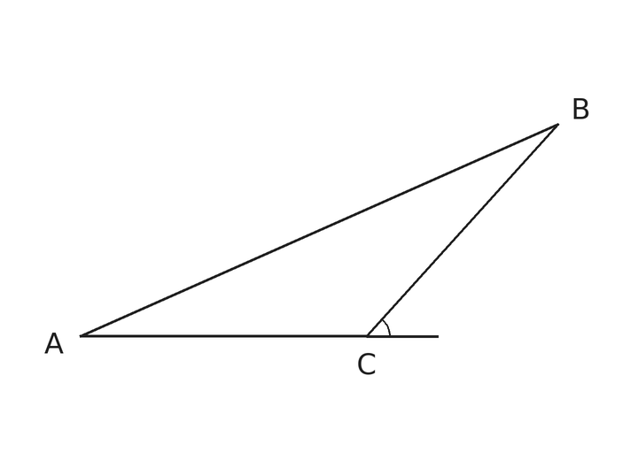

Подсказка 1

Внешний угол смежен с внутренним углом при той же вершине.

Ответ и разбор

**Ответ** · 48

1. Внешний угол: 180° − 132° = 48°.

`OGE15-F03` · seed `2027` · версия `oge15-triangles-2`

## Высота и углы

В остроугольном треугольнике ABC проведена высота BH, угол BAC равен 38°. Найдите угол ABH. Ответ дайте в градусах.

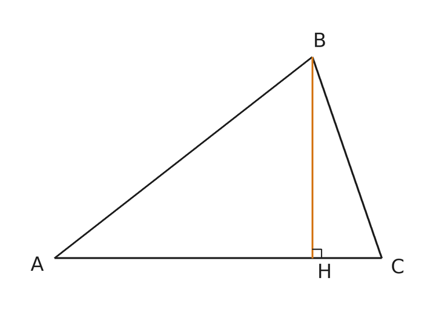

Подсказка 1

Рассмотрите прямоугольный треугольник ABH.

Ответ и разбор

**Ответ** · 52

1. BH ⟂ AC, поэтому ∠AHB = 90°.

2. ∠ABH = 180° − 90° − 38° = 52°.

`OGE15-F04` · seed `2027` · версия `oge15-triangles-2`

## Внешний угол равнобедренного треугольника

В равнобедренном треугольнике ABC с основанием AC внешний угол при вершине C равен 126°. Найдите угол ABC. Ответ дайте в градусах.

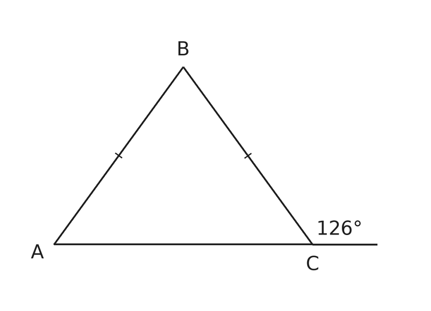

Подсказка 1

Углы при основании равнобедренного треугольника равны.

Ответ и разбор

**Ответ** · 72

1. ∠A = ∠C = 180° − 126° = 54°.

2. ∠B = 180° − 2 · 54° = 72°.

`OGE15-F05` · seed `2027` · версия `oge15-triangles-2`

## Медиана равностороннего треугольника

Медиана равностороннего треугольника равна 21√3. Найдите сторону треугольника.

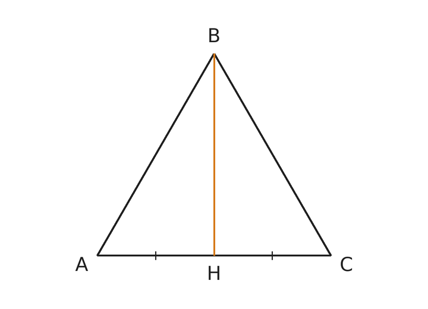

Подсказка 1

Медиана равностороннего треугольника является также высотой.

Ответ и разбор

**Ответ** · 42

1. Высота равностороннего треугольника равна a√3 / 2.

2. a = 2 · 21√3 / √3 = 42.

`OGE15-F06` · seed `2027` · версия `oge15-triangles-2`

## Медиана, равная половине стороны

В треугольнике ABC проведена медиана BM. Найдите угол A, если угол C равен 63° и BM = AM = MC. Ответ дайте в градусах.

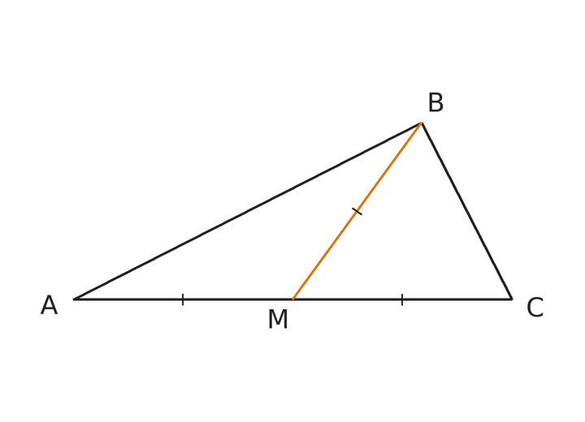

Подсказка 1

Рассмотрите равнобедренные треугольники ABM и CBM.

Ответ и разбор

**Ответ** · 27

1. Пусть ∠A = x. Тогда ∠ABM = x, а ∠MBC = ∠C.

2. 2x + 2 · 63° = 180°. Значит, x = 90° − 63° = 27°.

`OGE15-F07` · seed `2027` · версия `oge15-triangles-2`

## Медиана, высота и отрезки

В треугольнике ABC проведены медиана BM и высота BH. AC = 92, BC = BM. Найдите AH.

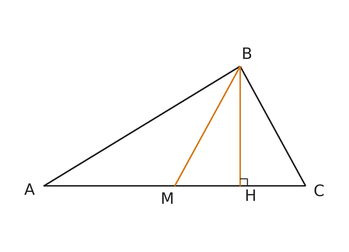

Подсказка 1

Треугольник BMC равнобедренный. Его высота является медианой.

Ответ и разбор

**Ответ** · 69

1. AM = MC = 92 / 2 = 46.

2. MH = HC = 46 / 2 = 23.

3. AH = AM + MH = 46 + 23 = 69.

`OGE15-F08` · seed `2027` · версия `oge15-triangles-2`

## Медиана, высота и углы

В треугольнике ABC проведены медиана BM и высота BH. AC = 24, HC = 6, угол ACB равен 61°. Найдите угол AMB. Ответ дайте в градусах.

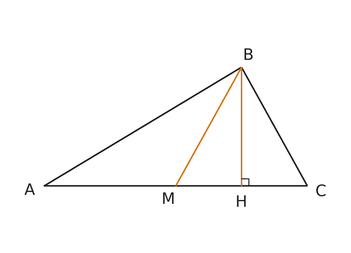

Подсказка 1

Сравните отрезки MH и HC, затем треугольники BHM и BHC.

Ответ и разбор

**Ответ** · 119

1. MC = 24 / 2 = 12, MH = 12 − 6 = 6 = HC.

2. Прямоугольные треугольники BHM и BHC равны по катетам. Поэтому ∠BMC = ∠C = 61°.

3. ∠AMB = 180° − 61° = 119°.

`OGE15-F09` · seed `2027` · версия `oge15-triangles-2`

## Биссектриса и равные отрезки

В треугольнике ABC проведена биссектриса AK. Найдите угол B, если угол C равен 42° и AK = KC. Ответ дайте в градусах.

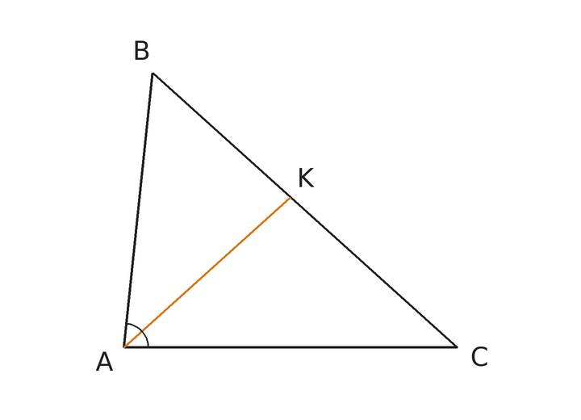

Подсказка 1

Треугольник AKC равнобедренный. Используйте также свойство биссектрисы.

Ответ и разбор

**Ответ** · 54

1. AK = KC, поэтому ∠KAC = ∠C = 42°.

2. AK — биссектриса, значит ∠A = 2 · 42° = 84°.

3. ∠B = 180° − 84° − 42° = 54°.

`OGE15-F10` · seed `2027` · версия `oge15-triangles-2`

## Средняя линия треугольника

Точки M и N — середины сторон AB и BC треугольника ABC. AB = 14, BC = 12, AC = 15. Найдите MN.

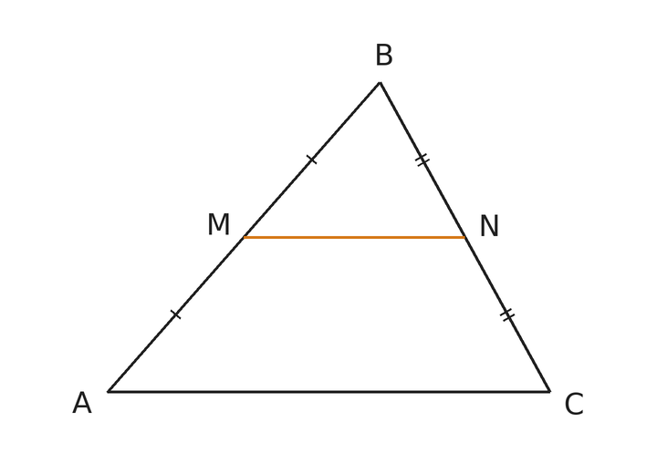

Подсказка 1

Отрезок, соединяющий середины двух сторон, — средняя линия треугольника.

Ответ и разбор

**Ответ** · 7.5

1. MN = AC / 2 = 15 / 2 = 7,5.

`OGE15-F11` · seed `2027` · версия `oge15-triangles-2`

## Средняя линия и площади

В треугольнике ABC отрезок DE — средняя линия. Площадь треугольника CDE равна 62. Найдите площадь треугольника ABC.

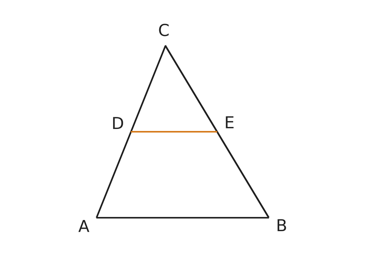

Подсказка 1

Площади подобных треугольников относятся как квадраты соответствующих сторон.

Ответ и разбор

**Ответ** · 248

1. DE = AB / 2. Отношение площадей ABC и CDE равно 2² = 4.

2. S = 4 · 62 = 248.

`OGE15-F12` · seed `2027` · версия `oge15-triangles-2`

## Подобие и площади

Прямая, параллельная стороне AC треугольника ABC, пересекает AB и BC в точках M и N. AC = 18, MN = 12. Площадь ABC равна 81. Найдите площадь MBN.

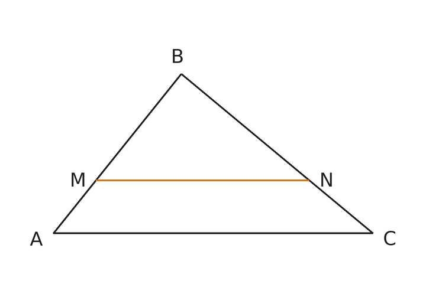

Подсказка 1

Треугольники MBN и ABC подобны. Найдите отношение их соответствующих сторон.

Ответ и разбор

**Ответ** · 36

1. Коэффициент подобия: MN / AC = 12 / 18.

2. S_MBN = 81 · (12 / 18)² = 36.

`OGE15-F13` · seed `2027` · версия `oge15-triangles-2`

## Теорема Пифагора

В прямоугольном треугольнике катет и гипотенуза равны 12 и 20. Найдите другой катет.

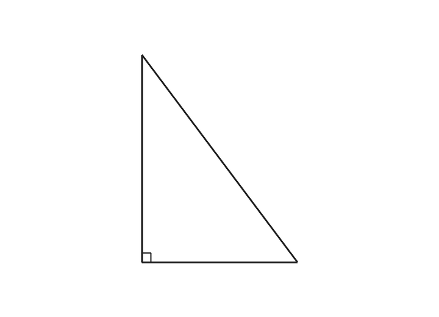

Подсказка 1

Квадрат гипотенузы равен сумме квадратов катетов.

Ответ и разбор

**Ответ** · 16

1. b² = 20² − 12² = 256.

2. b = 16.

`OGE15-F14` · seed `2027` · версия `oge15-triangles-2`

## Тригонометрические отношения по сторонам

В треугольнике ABC угол C равен 90°, AC = 3, AB = 5. Найдите sin B.

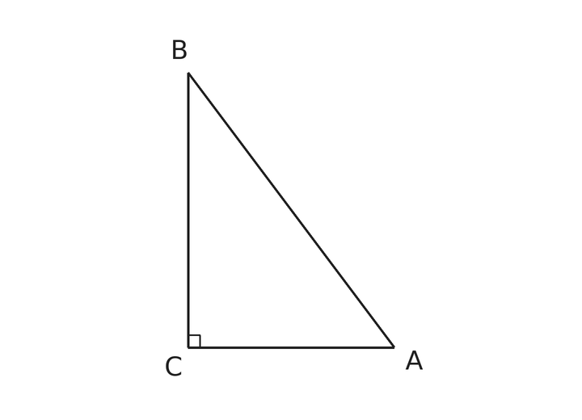

Подсказка 1

Синус — отношение противолежащего катета к гипотенузе.

Ответ и разбор

**Ответ** · 0.6

1. sin B = AC / AB = 3 / 5 = 0,6.

`OGE15-F15` · seed `2027` · версия `oge15-triangles-2`

## Сторона по синусу

В треугольнике ABC угол C прямой, BC = 40, sin A = 0,8. Найдите AB.

Подсказка 1

Запишите синус угла A как отношение противолежащего катета к гипотенузе.

Ответ и разбор

**Ответ** · 50

1. sin A = BC / AB.

2. AB = 40 / 0,8 = 50.

`OGE15-F16` · seed `2027` · версия `oge15-triangles-2`

## Сторона по тангенсу

В треугольнике ABC угол C равен 90°, AC = 11, tg A = 2. Найдите BC.

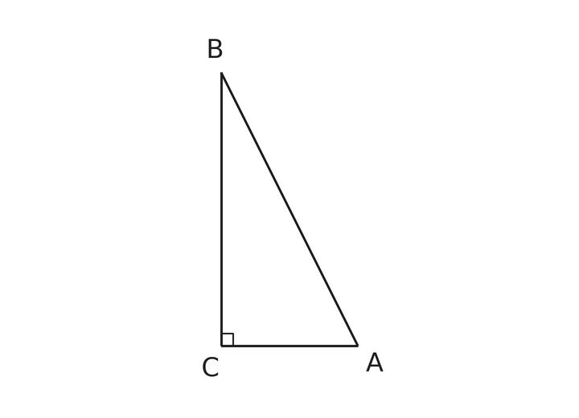

Подсказка 1

Тангенс — отношение противолежащего катета к прилежащему.

Ответ и разбор

**Ответ** · 22

1. tg A = BC / AC.

2. BC = 11 · 2 = 22.

`OGE15-F17` · seed `2027` · версия `oge15-triangles-2`

## Острые углы прямоугольного треугольника

Один из острых углов прямоугольного треугольника равен 46°. Найдите другой острый угол. Ответ дайте в градусах.

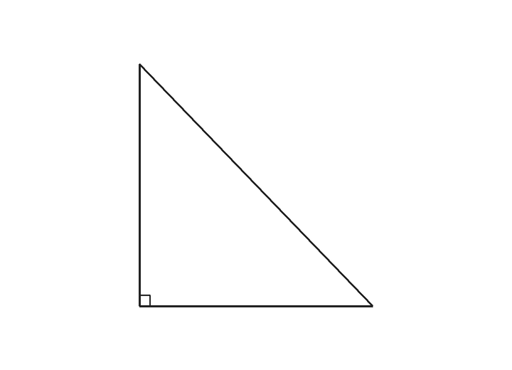

Подсказка 1

Сумма острых углов прямоугольного треугольника равна 90°.

Ответ и разбор

**Ответ** · 44

1. Другой угол: 90° − 46° = 44°.

`OGE15-F18` · seed `2027` · версия `oge15-triangles-2`

## Площадь прямоугольного треугольника

Катеты прямоугольного треугольника равны 9 и 8. Найдите его площадь.

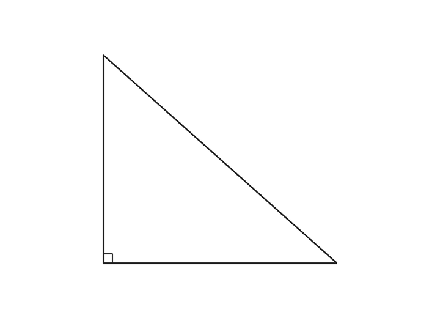

Подсказка 1

Площадь треугольника — половина произведения основания на высоту.

Ответ и разбор

**Ответ** · 36

1. S = 9 · 8 / 2 = 36.

`OGE15-F19` · seed `2027` · версия `oge15-triangles-2`

## Площадь по основанию и высоте

Сторона треугольника равна 25, а проведённая к ней высота равна 26. Найдите площадь треугольника.

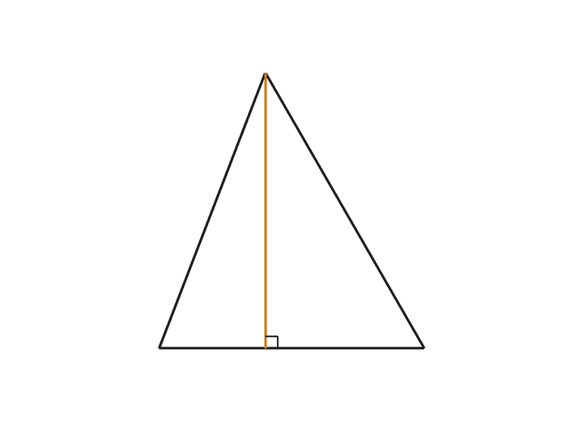

Подсказка 1

Площадь треугольника — половина произведения основания на высоту.

Ответ и разбор

**Ответ** · 325

1. S = 25 · 26 / 2 = 325.

`OGE15-F20` · seed `2027` · версия `oge15-triangles-2`

## Площадь через синус

В треугольнике ABC AB = 10, BC = 19, sin ∠ABC = 0,8. Найдите площадь ABC.

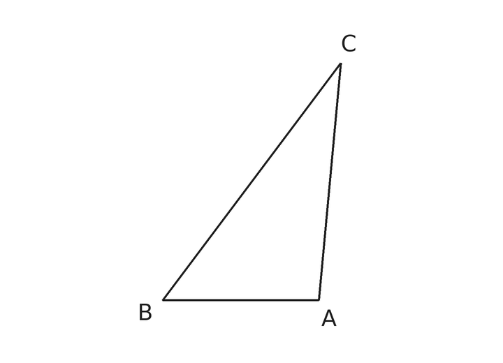

Подсказка 1

Используйте площадь через две стороны и синус угла между ними.

Ответ и разбор

**Ответ** · 76

1. S = AB · BC · sin B / 2 = 10 · 19 · 0,8 / 2 = 76.

`OGE15-F21` · seed `2027` · версия `oge15-triangles-2`

## Высота к гипотенузе и синус

В прямоугольном треугольнике ABC катет AC = 20, а высота CH, опущенная на гипотенузу, равна 12. Найдите sin ∠ABC.

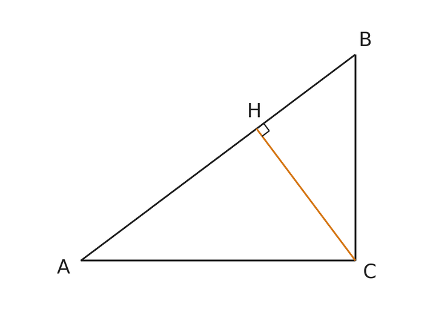

Подсказка 1

Найдите AH по теореме Пифагора в треугольнике ACH. Сравните углы ABC и ACH.

Ответ и разбор

**Ответ** · 0.8

1. AH² = AC² − CH² = 20² − (12)² = 256. Значит, AH = 16.

2. ∠ABC = ∠ACH: их стороны соответственно перпендикулярны.

3. sin B = AH / AC = 16 / 20 = 0,8.

`OGE15-F22` · seed `2027` · версия `oge15-triangles-2`
