# №16 · Окружности

[← Атлас №1–25](../README.md)

23 семейств или режимов в выдаче. [Источники и структуры](../oge16_reference_structures.json).

- [Два диаметра: равные углы при основаниях](#oge16-a01) · `OGE16-A01`
- [Центральный и вписанный углы](#oge16-a02) · `OGE16-A02`
- [Два диаметра: прямой и обратный вопрос](#oge16-a03) · `OGE16-A03`
- [Точки по разные стороны диаметра](#oge16-a04) · `OGE16-A04`
- [Центр на стороне треугольника: угол](#oge16-a05) · `OGE16-A05`
- [Центр на стороне треугольника: длина](#oge16-a06) · `OGE16-A06`
- [Касательная по радиусу и внешнему отрезку](#oge16-b01) · `OGE16-B01`
- [Угол между двумя касательными](#oge16-b02) · `OGE16-B02`
- [Хорда по радиусу и расстоянию до центра](#oge16-b03) · `OGE16-B03`
- [Касательная и секущая: степень точки](#oge16-b04) · `OGE16-B04`
- [Угол касательной с хордой](#oge16-b05) · `OGE16-B05`
- [Окружность в квадрате: площадь, диагональ, радиус](#oge16-c01) · `OGE16-C01`
- [Окружность в трапеции: высота](#oge16-c02) · `OGE16-C02`
- [Окружность в треугольнике: площадь](#oge16-c03) · `OGE16-C03`
- [Равносторонний треугольник: r, h, a](#oge16-c04) · `OGE16-C04`
- [Описанные четырёхугольник и трапеция: сторона](#oge16-c05) · `OGE16-C05`
- [Ромб: диагональ, тангенс и радиус](#oge16-c06) · `OGE16-C06`
- [Вписанные четырёхугольник и трапеция: угол](#oge16-d01) · `OGE16-D01`
- [Описанная окружность равностороннего треугольника](#oge16-d02) · `OGE16-D02`
- [Описанная окружность квадрата](#oge16-d03) · `OGE16-D03`
- [Радиус по теореме синусов](#oge16-d04) · `OGE16-D04`
- [Центр окружности в середине стороны квадрата](#oge16-d05) · `OGE16-D05`
- [Прямоугольник: диаметр и синус угла](#oge16-d06) · `OGE16-D06`

## Два диаметра: равные углы при основаниях

В окружности с центром O проведены диаметры AD и BC. Угол OAB равен 75°. Найдите угол OCD. Ответ дайте в градусах.

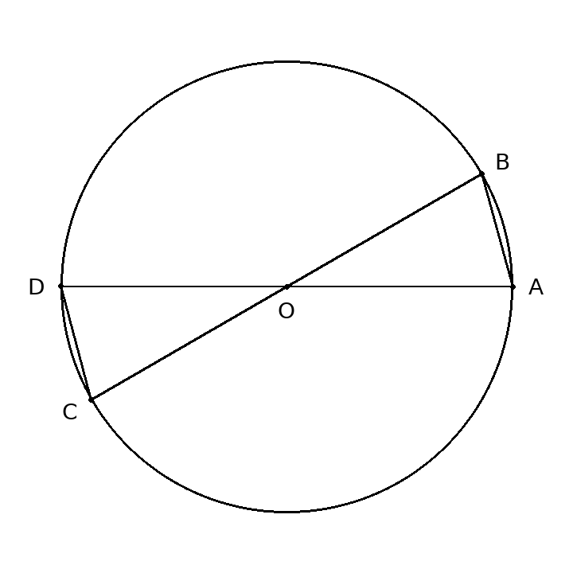

Подсказка 1

Треугольники AOB и COD равнобедренные, а углы AOB и COD вертикальные. Их углы при основаниях равны.

Ответ и разбор

**Ответ** · 75

1. Треугольники AOB и COD равнобедренные, а углы AOB и COD вертикальные. Их углы при основаниях равны.

2. Углы при основаниях равны: искомый угол = 75.

`OGE16-A01` · seed `2027` · версия `oge16-circles-3`

## Центральный и вписанный углы

Треугольник ABC вписан в окружность с центром O. Угол AOB равен 90°. Найдите угол ACB. Ответ дайте в градусах.

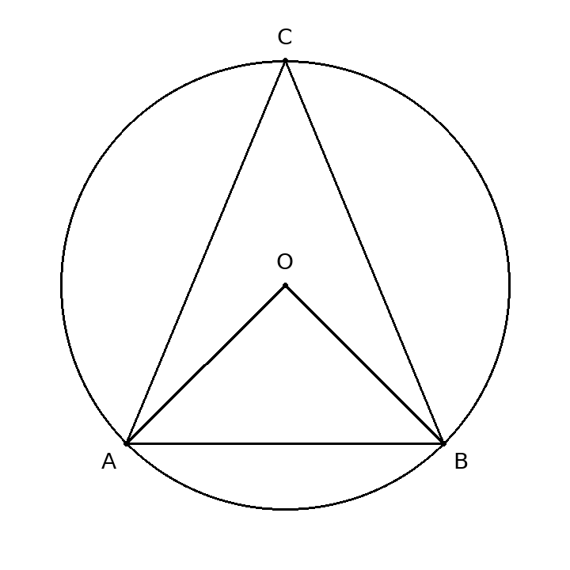

Подсказка 1

Вписанный угол равен половине центрального угла, опирающегося на ту же дугу.

Ответ и разбор

**Ответ** · 45

1. Вписанный угол равен половине центрального угла, опирающегося на ту же дугу.

2. ∠ACB = 90/2 = 45.

`OGE16-A02` · seed `2027` · версия `oge16-circles-3`

## Два диаметра: прямой и обратный вопрос

В окружности с центром O отрезки AC и BD — диаметры. Угол ACB равен 42°. Найдите угол AOD. Ответ дайте в градусах.

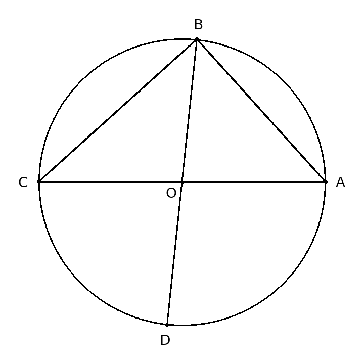

Подсказка 1

Углы AOB и AOD в сумме равны 180°. Угол ACB равен половине угла AOB.

Ответ и разбор

**Ответ** · 96

1. Углы AOB и AOD в сумме равны 180°. Угол ACB равен половине угла AOB.

2. ∠AOD = 180 − 2 · 42 = 96.

`OGE16-A03` · seed `2027` · версия `oge16-circles-3`

## Точки по разные стороны диаметра

На окружности по разные стороны от диаметра AB взяты точки M и N. Угол NBA равен 45°. Найдите угол NMB. Ответ дайте в градусах.

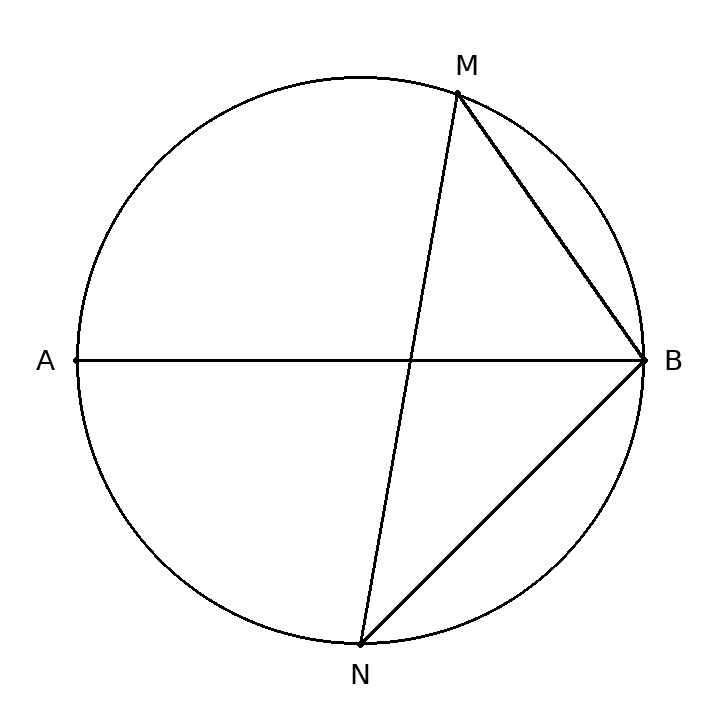

Подсказка 1

Угол ANB опирается на диаметр и равен 90°. Углы NAB и NMB опираются на одну дугу NB.

Ответ и разбор

**Ответ** · 45

1. Угол ANB опирается на диаметр и равен 90°. Углы NAB и NMB опираются на одну дугу NB.

2. ∠NMB = 90 − 45 = 45.

`OGE16-A04` · seed `2027` · версия `oge16-circles-3`

## Центр на стороне треугольника: угол

Центр окружности, описанной около треугольника ABC, лежит на стороне AC. Угол BAC равен 50°. Найдите угол C. Ответ дайте в градусах.

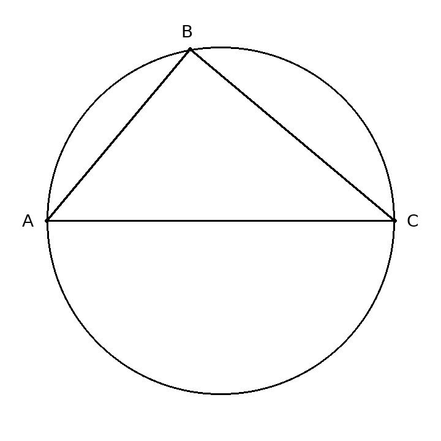

Подсказка 1

Угол, опирающийся на диаметр, прямой. Острые углы прямоугольного треугольника в сумме равны 90°.

Ответ и разбор

**Ответ** · 40

1. Угол, опирающийся на диаметр, прямой. Острые углы прямоугольного треугольника в сумме равны 90°.

2. Искомый угол = 90 − 50 = 40.

`OGE16-A05` · seed `2027` · версия `oge16-circles-3`

## Центр на стороне треугольника: длина

Центр окружности, описанной около треугольника ABC, лежит на стороне AB. Радиус окружности равен 52. Найдите AC, если BC = 96.

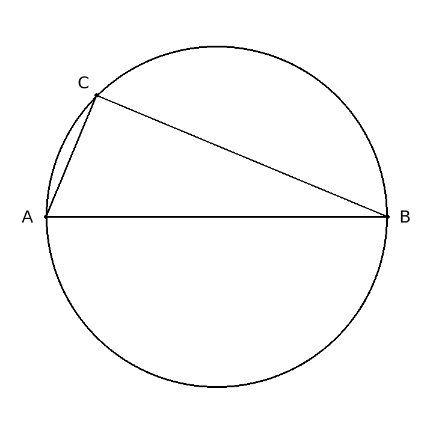

Подсказка 1

AB — диаметр; угол ACB прямой. По теореме Пифагора AC² = (2R)² − BC².

Ответ и разбор

**Ответ** · 40

1. AB — диаметр; угол ACB прямой. По теореме Пифагора AC² = (2R)² − BC².

2. AC = √((2 · 52)² − 96²) = 40.

`OGE16-A06` · seed `2027` · версия `oge16-circles-3`

## Касательная по радиусу и внешнему отрезку

На отрезке AB выбрана точка C так, что AC = 600, BC = 80. Окружность с центром A проходит через C. Найдите длину касательной, проведённой из точки B к этой окружности.

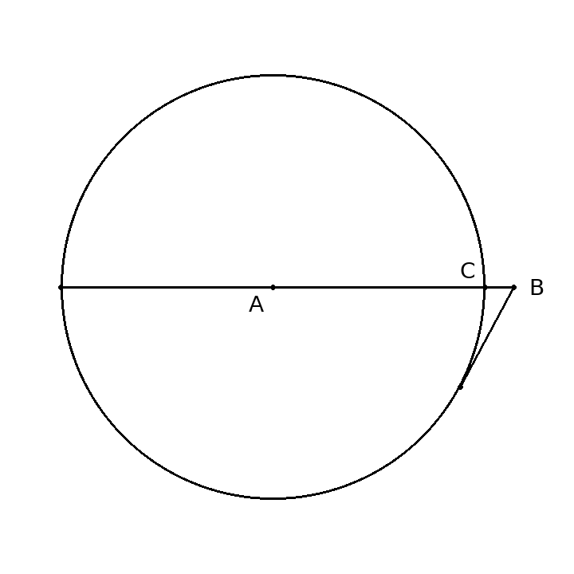

Подсказка 1

Радиус в точке касания перпендикулярен касательной. Её длина находится по теореме Пифагора.

Ответ и разбор

**Ответ** · 320

1. Радиус в точке касания перпендикулярен касательной. Её длина находится по теореме Пифагора.

2. Длина касательной = √((600 + 80)² − 600²) = 320.

`OGE16-B01` · seed `2027` · версия `oge16-circles-3`

## Угол между двумя касательными

Касательные в точках A и B к окружности с центром O пересекаются под углом 86°. Найдите угол ABO. Ответ дайте в градусах.

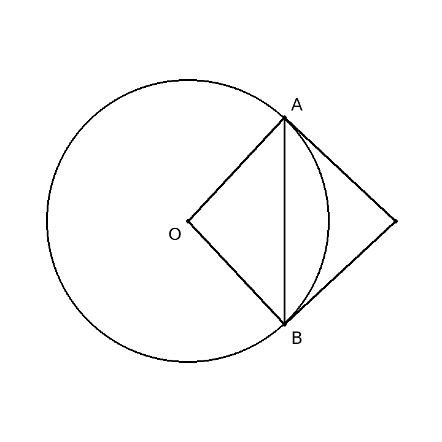

Подсказка 1

Сумма углов между касательными и радиусами равна 180°. В равнобедренном треугольнике AOB угол ABO равен половине угла между касательными.

Ответ и разбор

**Ответ** · 43

1. Сумма углов между касательными и радиусами равна 180°. В равнобедренном треугольнике AOB угол ABO равен половине угла между касательными.

2. ∠ABO = 86/2 = 43.

`OGE16-B02` · seed `2027` · версия `oge16-circles-3`

## Хорда по радиусу и расстоянию до центра

Найдите длину хорды окружности радиусом 104, если расстояние от центра окружности до хорды равно 40.

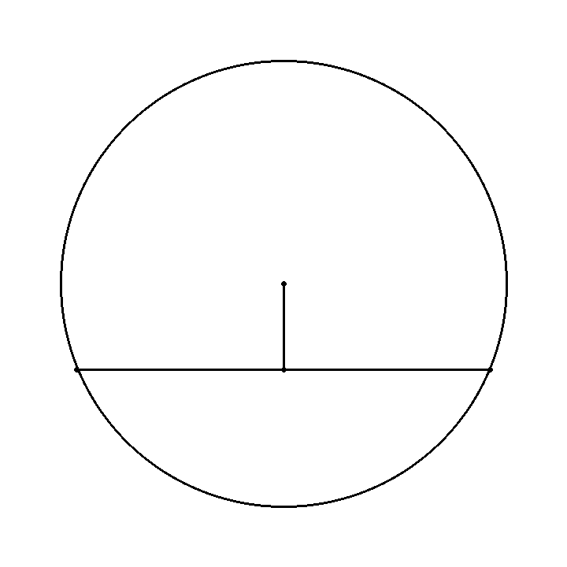

Подсказка 1

Перпендикуляр из центра делит хорду пополам; половина хорды равна √(R² − d²).

Ответ и разбор

**Ответ** · 192

1. Перпендикуляр из центра делит хорду пополам; половина хорды равна √(R² − d²).

2. Длина хорды = 2√(104² − 40²) = 192.

`OGE16-B03` · seed `2027` · версия `oge16-circles-3`

## Касательная и секущая: степень точки

Через точку A вне окружности проведены касательная AK и секущая ABC. AB = 16, AC = 64. Найдите AK.

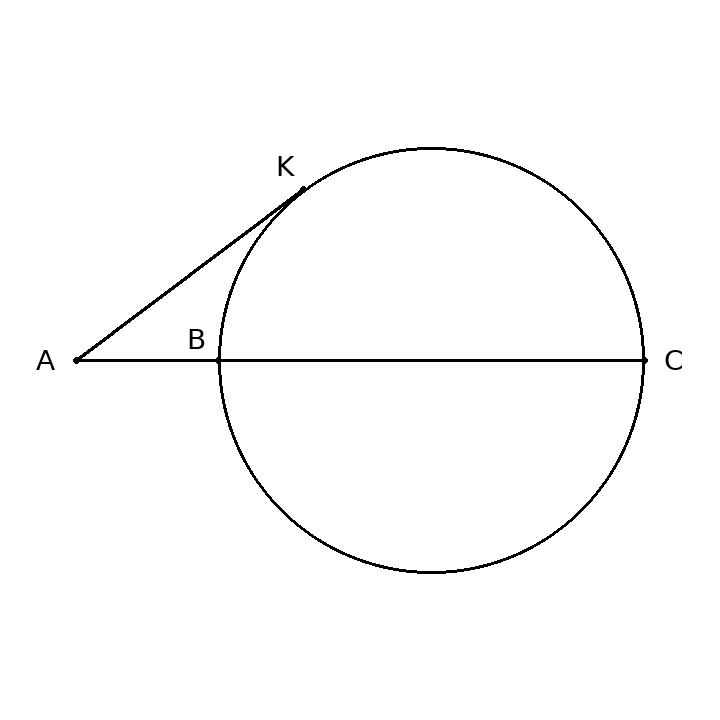

Подсказка 1

Квадрат касательной равен произведению внешней части секущей на всю секущую: AK² = AB · AC.

Ответ и разбор

**Ответ** · 32

1. Квадрат касательной равен произведению внешней части секущей на всю секущую: AK² = AB · AC.

2. AK = √(16 · 64) = 32.

`OGE16-B04` · seed `2027` · версия `oge16-circles-3`

## Угол касательной с хордой

На окружности отмечены точки A и B так, что меньшая дуга AB равна 86°. Прямая BC касается окружности в точке B так, что угол ABC острый. Найдите угол ABC. Ответ дайте в градусах.

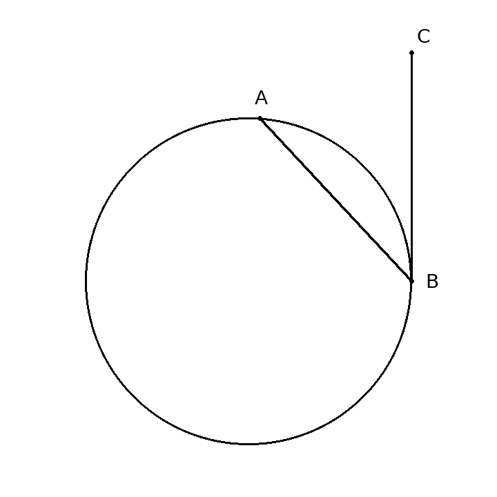

Подсказка 1

Угол между касательной и хордой равен половине градусной меры заключённой между ними дуги.

Ответ и разбор

**Ответ** · 43

1. Угол между касательной и хордой равен половине градусной меры заключённой между ними дуги.

2. ∠ABC = 86/2 = 43.

`OGE16-B05` · seed `2027` · версия `oge16-circles-3`

## Окружность в квадрате: площадь, диагональ, радиус

Сторона квадрата равна 42. Найдите радиус окружности, вписанной в этот квадрат.

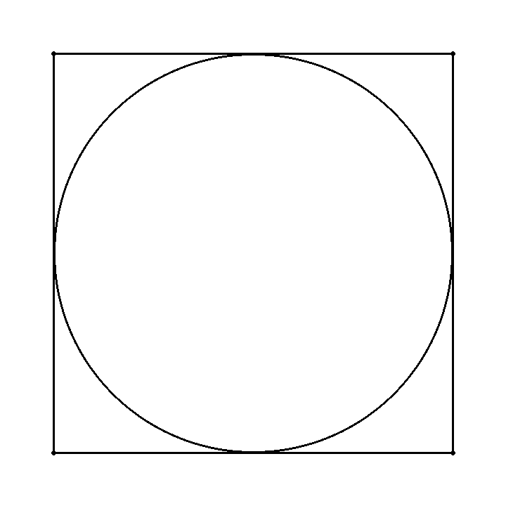

Подсказка 1

Сторона квадрата равна диаметру вписанной окружности; диагональ равна стороне, умноженной на √2.

Ответ и разбор

**Ответ** · 21

1. Сторона квадрата равна диаметру вписанной окружности; диагональ равна стороне, умноженной на √2.

2. r = 42/2 = 21.

`OGE16-C01` · seed `2027` · версия `oge16-circles-3`

## Окружность в трапеции: высота

Радиус окружности, вписанной в равнобедренную трапецию, равен 48. Найдите высоту этой трапеции.

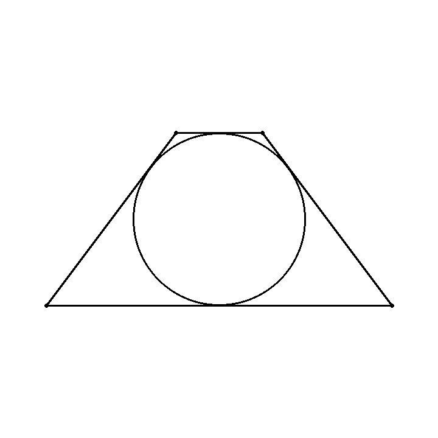

Подсказка 1

Расстояние между параллельными основаниями равно диаметру вписанной окружности.

Ответ и разбор

**Ответ** · 96

1. Расстояние между параллельными основаниями равно диаметру вписанной окружности.

2. h = 2 · 48 = 96.

`OGE16-C02` · seed `2027` · версия `oge16-circles-3`

## Окружность в треугольнике: площадь

Периметр треугольника равен 400, одна из сторон равна 160, а радиус вписанной в него окружности равен 32. Найдите площадь этого треугольника.

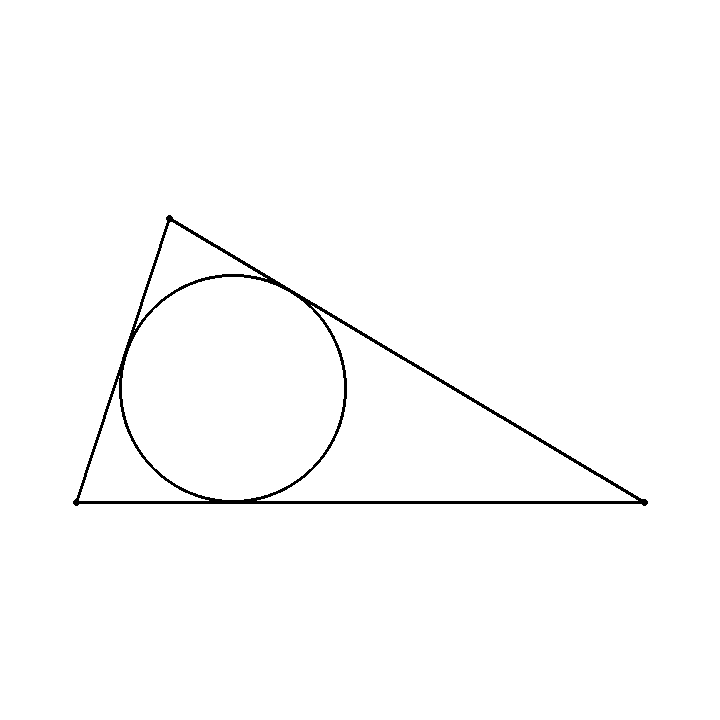

Подсказка 1

Площадь треугольника равна произведению полупериметра на радиус вписанной окружности.

Ответ и разбор

**Ответ** · 6400

1. Площадь треугольника равна произведению полупериметра на радиус вписанной окружности.

2. S = (400/2) · 32 = 6400.

`OGE16-C03` · seed `2027` · версия `oge16-circles-3`

## Равносторонний треугольник: r, h, a

В окружность с центром O вписан равносторонний треугольник. Расстояние от точки O до сторон треугольника равно 7√3/2. Найдите длину стороны треугольника.

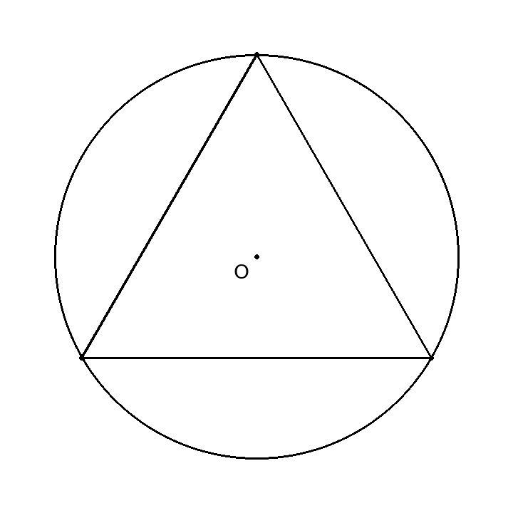

Подсказка 1

Для равностороннего треугольника R = 2r, h = 3r, a = 2r√3 = R√3.

Ответ и разбор

**Ответ** · 21

1. Для равностороннего треугольника R = 2r, h = 3r, a = 2r√3 = R√3.

2. a = 2√3 · (7√3/2) = 21.

`OGE16-C04` · seed `2027` · версия `oge16-circles-3`

## Описанные четырёхугольник и трапеция: сторона

Трапеция ABCD с основаниями AD и BC описана около окружности. AB = 66, BC = 36, CD = 54. Найдите AD.

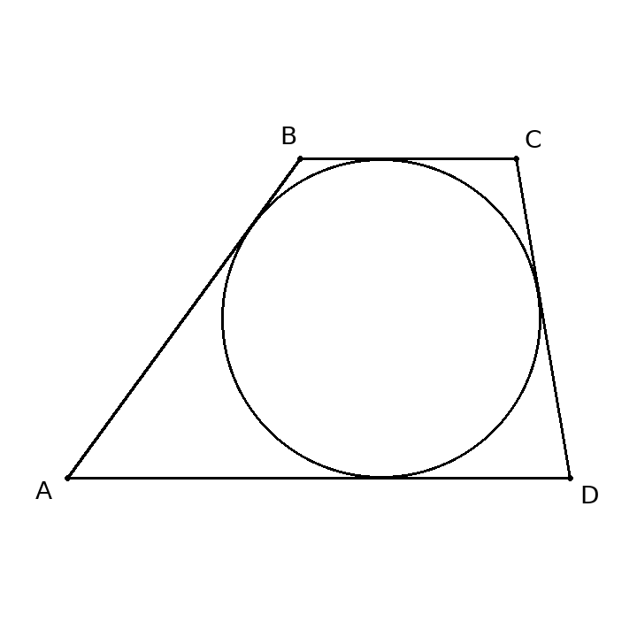

Подсказка 1

В описанном четырёхугольнике суммы противоположных сторон равны: AB + CD = BC + AD.

Ответ и разбор

**Ответ** · 84

1. В описанном четырёхугольнике суммы противоположных сторон равны: AB + CD = BC + AD.

2. AD = 66 + 54 − 36 = 84.

`OGE16-C05` · seed `2027` · версия `oge16-circles-3`

## Ромб: диагональ, тангенс и радиус

Диагональ AC ромба ABCD равна 384, а тангенс угла BCA равен 7/24. Найдите радиус окружности, вписанной в ромб.

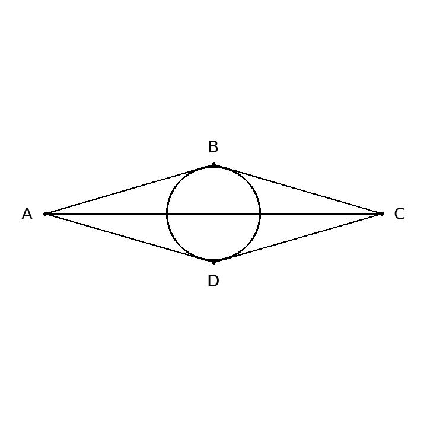

Подсказка 1

Диагонали ромба перпендикулярны, а AC делит угол C пополам. Радиус равен (AC/2) · sin(∠BCA); sin = 7/25.

Ответ и разбор

**Ответ** · 53,76

1. Диагонали ромба перпендикулярны, а AC делит угол C пополам. Радиус равен (AC/2) · sin(∠BCA); sin = 7/25.

2. r = (384/2) · 7/25 = 53,76.

`OGE16-C06` · seed `2027` · версия `oge16-circles-3`

## Вписанные четырёхугольник и трапеция: угол

Трапеция ABCD с основаниями AD и BC вписана в окружность. Угол A равен 84°. Найдите угол C. Ответ дайте в градусах.

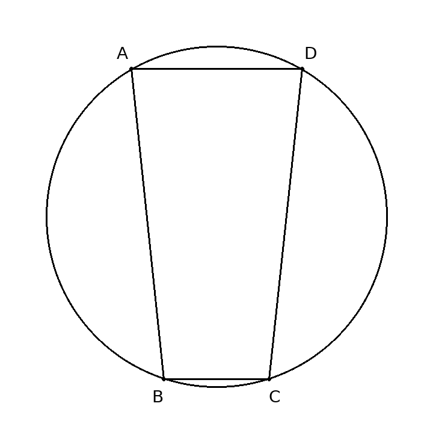

Подсказка 1

Сумма противоположных углов вписанного четырёхугольника равна 180°.

Ответ и разбор

**Ответ** · 96

1. Сумма противоположных углов вписанного четырёхугольника равна 180°.

2. ∠C = 180 − 84 = 96.

`OGE16-D01` · seed `2027` · версия `oge16-circles-3`

## Описанная окружность равностороннего треугольника

Радиус окружности, описанной около равностороннего треугольника, равен 16√3. Найдите длину стороны этого треугольника.

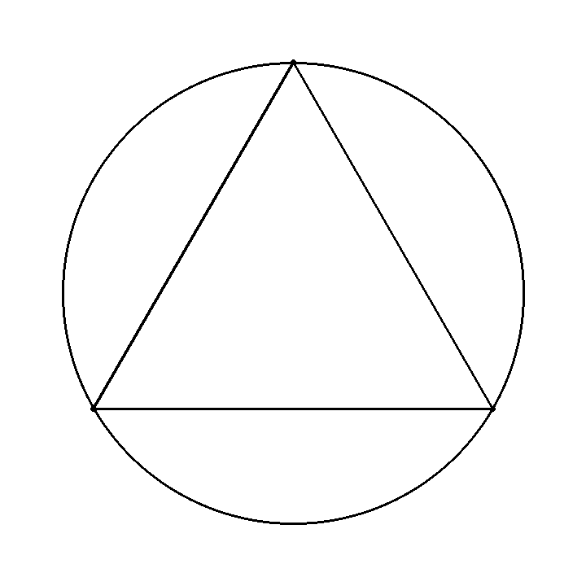

Подсказка 1

Для равностороннего треугольника R = 2r, h = 3r, a = 2r√3 = R√3.

Ответ и разбор

**Ответ** · 48

1. Для равностороннего треугольника R = 2r, h = 3r, a = 2r√3 = R√3.

2. a = 16√3 · √3 = 48.

`OGE16-D02` · seed `2027` · версия `oge16-circles-3`

## Описанная окружность квадрата

Радиус окружности, описанной около квадрата, равен 128√2. Найдите длину стороны этого квадрата.

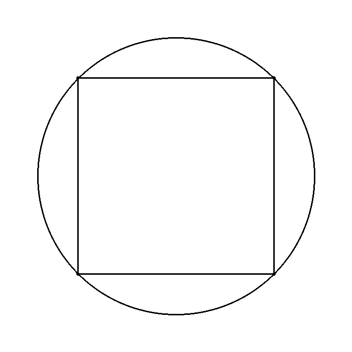

Подсказка 1

Диагональ квадрата равна диаметру окружности, а сторона равна R√2.

Ответ и разбор

**Ответ** · 256

1. Диагональ квадрата равна диаметру окружности, а сторона равна R√2.

2. a = 128√2 · √2 = 256.

`OGE16-D03` · seed `2027` · версия `oge16-circles-3`

## Радиус по теореме синусов

В треугольнике ABC угол C равен 45°, AB = 48√2. Найдите радиус окружности, описанной около этого треугольника.

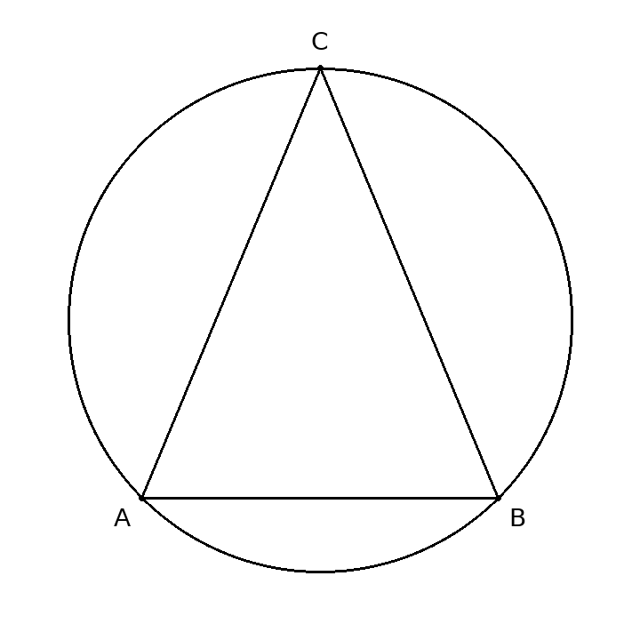

Подсказка 1

По теореме синусов AB = 2R · sin C, значит R = AB/(2 sin C).

Ответ и разбор

**Ответ** · 48

1. По теореме синусов AB = 2R · sin C, значит R = AB/(2 sin C).

2. R = 48√2/(2 · sin 45°) = 48.

`OGE16-D04` · seed `2027` · версия `oge16-circles-3`

## Центр окружности в середине стороны квадрата

Точка O является серединой стороны CD квадрата ABCD. Радиус окружности с центром O, проходящей через вершину A, равен 40. Найдите площадь квадрата ABCD.

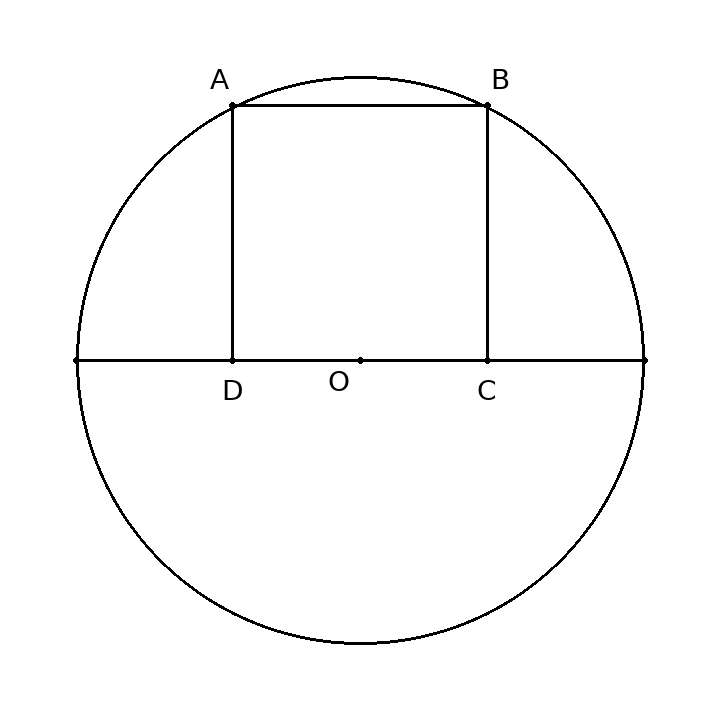

Подсказка 1

Если сторона квадрата a, то OA² = a² + (a/2)² = 5a²/4. Поэтому S = 4R²/5.

Ответ и разбор

**Ответ** · 1280

1. Если сторона квадрата a, то OA² = a² + (a/2)² = 5a²/4. Поэтому S = 4R²/5.

2. S = 4 · 40²/5 = 1280.

`OGE16-D05` · seed `2027` · версия `oge16-circles-3`

## Прямоугольник: диаметр и синус угла

Синус угла между стороной и диагональю прямоугольника равен 0,6. Диаметр описанной около него окружности равен 80. Найдите площадь прямоугольника.

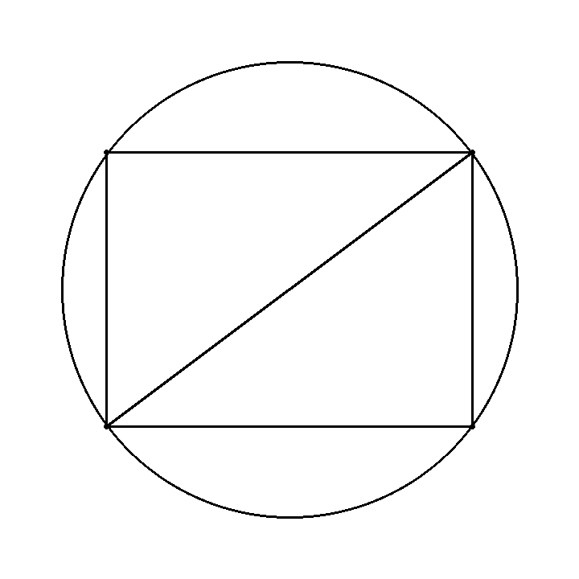

Подсказка 1

Диагональ — диаметр окружности. Стороны равны d · sin α и d · cos α; cos α = 0,8.

Ответ и разбор

**Ответ** · 3072

1. Диагональ — диаметр окружности. Стороны равны d · sin α и d · cos α; cos α = 0,8.

2. S = 80² · 0,6 · 0,8 = 3072.

`OGE16-D06` · seed `2027` · версия `oge16-circles-3`
