# №17 · Четырёхугольники

[← Атлас №1–25](../README.md)

16 семейств или режимов в выдаче. [Источники и структуры](../oge17_reference_structures.json).

- [Ромб: смежный угол и биссектриса](#oge17-r03) · `OGE17-R03`
- [Прямоугольник: полная диагональ по BO](#oge17-e03) · `OGE17-E03`
- [Площадь параллелограмма с составным основанием](#oge17-p01) · `OGE17-P01`
- [Параллелограмм: половина BD](#oge17-p07) · `OGE17-P07`
- [Больший отрезок средней линии трапеции](#oge17-t04) · `OGE17-T04`
- [Площадь трапеции](#oge17-t06) · `OGE17-T06`
- [Больший угол ромба](#oge17-r02) · `OGE17-R02`
- [Больший угол параллелограмма](#oge17-p06) · `OGE17-P06`
- [Высота ромба](#oge17-r04) · `OGE17-R04`
- [Угол диагоналей прямоугольника](#oge17-e01) · `OGE17-E01`
- [Диагональ квадрата](#oge17-e02) · `OGE17-E02`
- [Площадь части параллелограмма](#oge17-p03) · `OGE17-P03`
- [Сумма углов трапеции](#oge17-t02) · `OGE17-T02`
- [Средняя линия трапеции](#oge17-t05) · `OGE17-T05`
- [Больший угол равнобедренной трапеции](#oge17-t07) · `OGE17-T07`
- [Больший угол прямоугольной трапеции](#oge17-t08) · `OGE17-T08`

## Ромб: смежный угол и биссектриса

В ромбе ABCD угол ABC равен 62°. Найдите угол ACD. Ответ дайте в градусах.

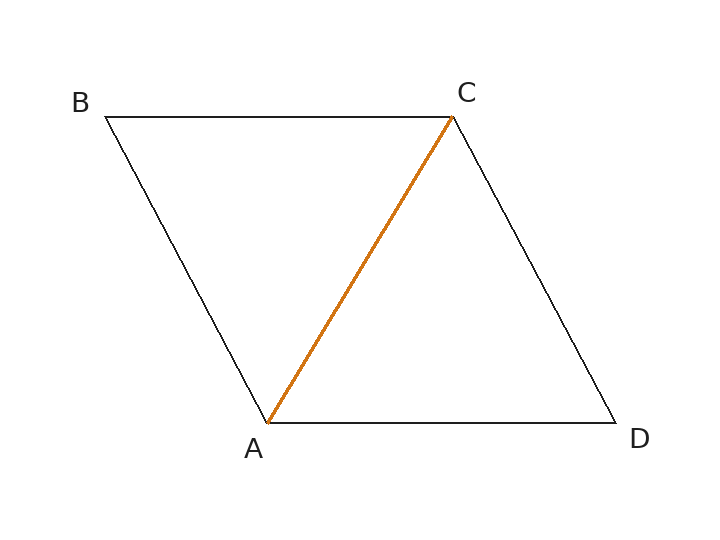

Подсказка 1

Соседние углы ромба в сумме дают 180°.

Подсказка 2

Диагональ ромба делит угол при своей вершине пополам.

Ответ и разбор

**Ответ** · 59

1. ∠BCD = 180° − 62° = 118°.

2. ∠ACD = 118° / 2 = 59°.

`OGE17-R03` · seed `2027` · версия `oge17-quadrilaterals-1`

## Прямоугольник: полная диагональ по BO

Диагонали AC и BD прямоугольника ABCD пересекаются в точке O, BO = 15,5, AB = 17. Найдите AC.

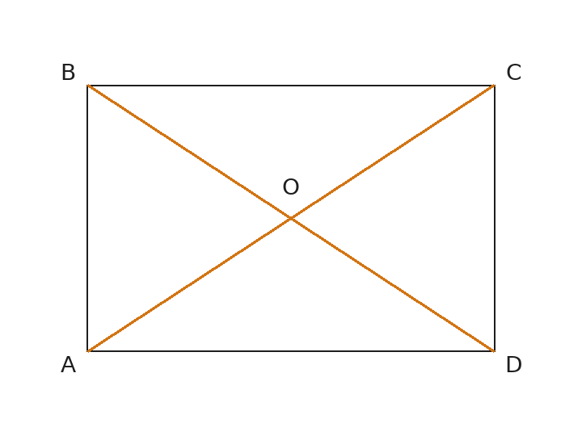

Подсказка 1

Диагонали прямоугольника равны и делятся точкой пересечения пополам.

Ответ и разбор

**Ответ** · 31

1. AC = BD = 2 · BO = 2 · 15,5 = 31.

`OGE17-E03` · seed `2027` · версия `oge17-quadrilaterals-1`

## Площадь параллелограмма с составным основанием

Найдите площадь параллелограмма, изображённого на рисунке.

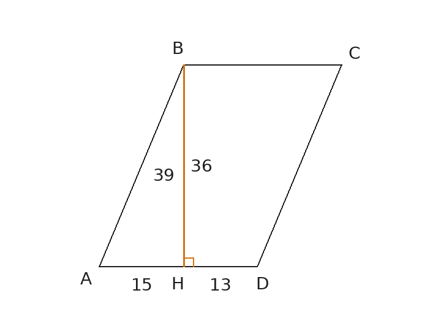

Подсказка 1

Сложите два отрезка основания, затем используйте высоту.

Ответ и разбор

**Ответ** · 1008

1. AD = 15 + 13 = 28.

2. S = AD · BH = 28 · 36 = 1008.

`OGE17-P01` · seed `2027` · версия `oge17-quadrilaterals-1`

## Параллелограмм: половина BD

Диагонали AC и BD параллелограмма ABCD пересекаются в точке O, AC = 58, BD = 64, AB = 29. Найдите DO.

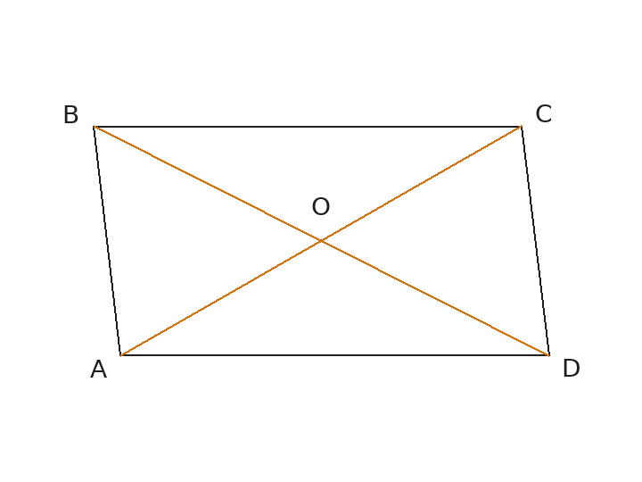

Подсказка 1

Диагонали параллелограмма делятся точкой пересечения пополам.

Ответ и разбор

**Ответ** · 32

1. DO = BD / 2 = 64 / 2 = 32.

`OGE17-P07` · seed `2027` · версия `oge17-quadrilaterals-1`

## Больший отрезок средней линии трапеции

Основания трапеции ABCD равны 7 и 10. MN — средняя линия, K — точка её пересечения с диагональю BD. Найдите больший из отрезков MK и KN.

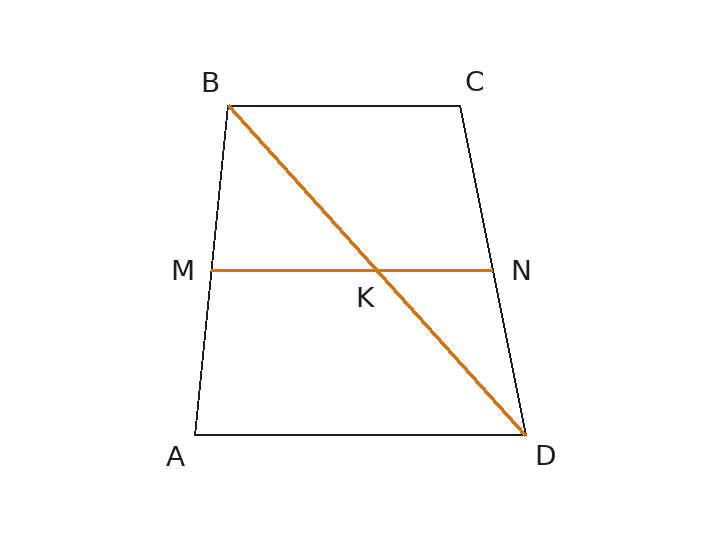

Подсказка 1

Отрезки средней линии являются средними линиями двух треугольников.

Ответ и разбор

**Ответ** · 5

1. MK = AD / 2 = 5; KN = BC / 2 = 3,5.

2. Больший отрезок MK равен 5.

`OGE17-T04` · seed `2027` · версия `oge17-quadrilaterals-1`

## Площадь трапеции

Основания трапеции ABCD равны 22 и 34, а высота BH равна 14. Найдите площадь этой трапеции.

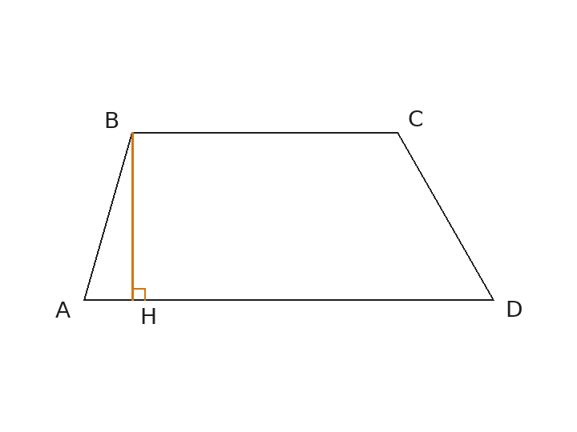

Подсказка 1

Площадь трапеции равна произведению полусуммы оснований на высоту.

Ответ и разбор

**Ответ** · 392

1. S = (22 + 34) · 14 / 2 = 392.

`OGE17-T06` · seed `2027` · версия `oge17-quadrilaterals-1`

## Больший угол ромба

Один из углов ромба равен 43°. Найдите больший угол этого ромба. Ответ дайте в градусах.

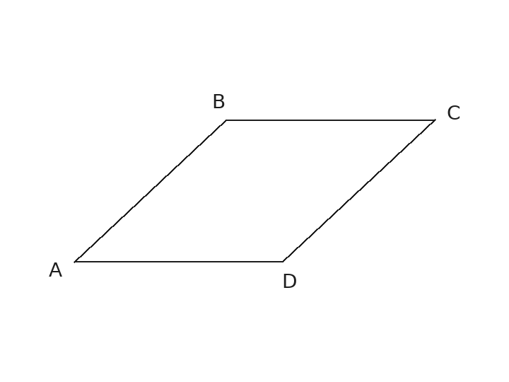

Подсказка 1

Сумма углов, прилежащих к одной стороне, равна 180°.

Ответ и разбор

**Ответ** · 137

1. Больший угол равен 180° − 43° = 137°.

`OGE17-R02` · seed `2027` · версия `oge17-quadrilaterals-1`

## Больший угол параллелограмма

Один из углов параллелограмма равен 34°. Найдите больший угол этого параллелограмма. Ответ дайте в градусах.

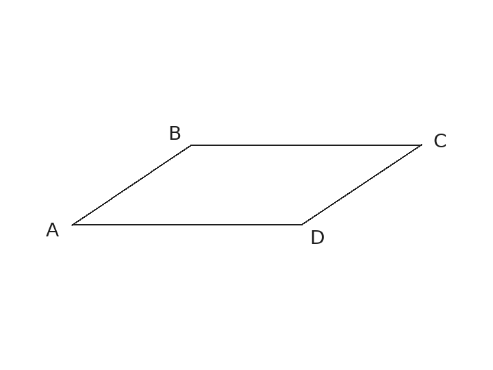

Подсказка 1

Сумма углов, прилежащих к одной стороне, равна 180°.

Ответ и разбор

**Ответ** · 146

1. Больший угол равен 180° − 34° = 146°.

`OGE17-P06` · seed `2027` · версия `oge17-quadrilaterals-1`

## Высота ромба

Сторона ромба равна 78, а один из его углов равен 150°. Найдите высоту ромба.

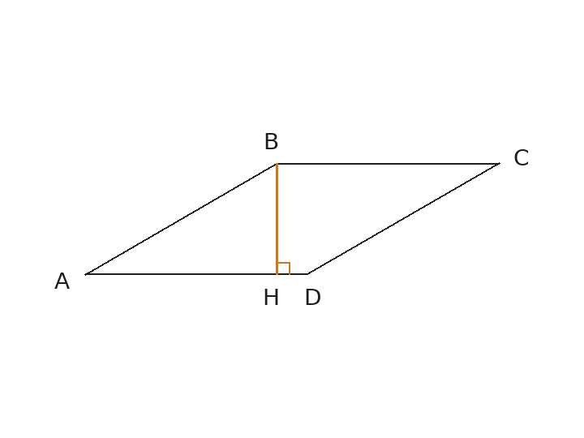

Подсказка 1

Острый угол ромба равен 30°. Рассмотрите прямоугольный треугольник с высотой.

Ответ и разбор

**Ответ** · 39

1. Острый угол: 180° − 150° = 30°.

2. Высота равна 78 · sin 30° = 39.

`OGE17-R04` · seed `2027` · версия `oge17-quadrilaterals-1`

## Угол диагоналей прямоугольника

Диагональ прямоугольника образует угол 56° с одной из его сторон. Найдите острый угол между диагоналями. Ответ дайте в градусах.

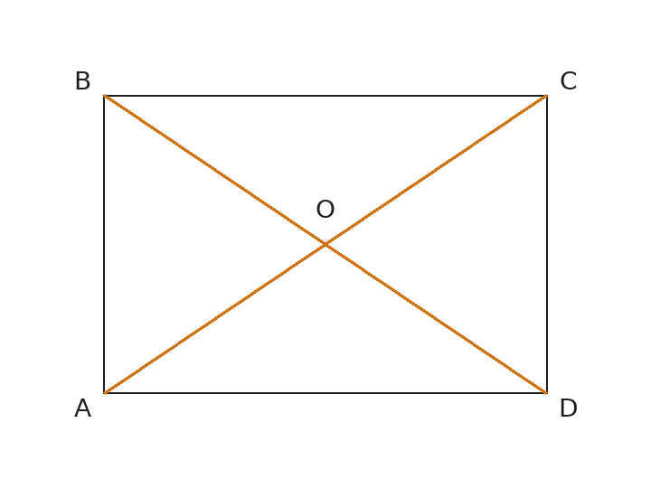

Подсказка 1

Диагонали образуют две пары равных углов. Требуется острый угол.

Ответ и разбор

**Ответ** · 68

1. Углы между диагоналями равны 112° и 68°.

2. Острый угол равен 68°.

`OGE17-E01` · seed `2027` · версия `oge17-quadrilaterals-1`

## Диагональ квадрата

Сторона квадрата равна 8√2. Найдите диагональ квадрата.

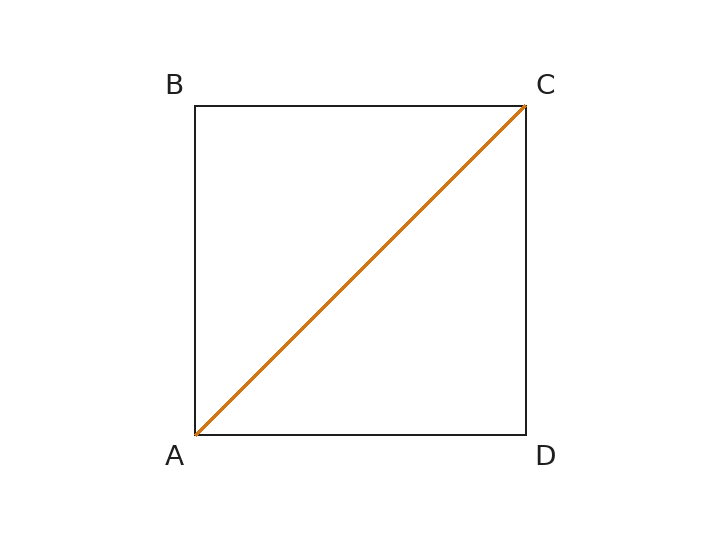

Подсказка 1

Диагональ квадрата в √2 раза больше его стороны.

Ответ и разбор

**Ответ** · 16

1. Диагональ: 8√2 · √2 = 16.

`OGE17-E02` · seed `2027` · версия `oge17-quadrilaterals-1`

## Площадь части параллелограмма

Площадь параллелограмма ABCD равна 108. Точка E — середина стороны CD. Найдите площадь трапеции AECB.

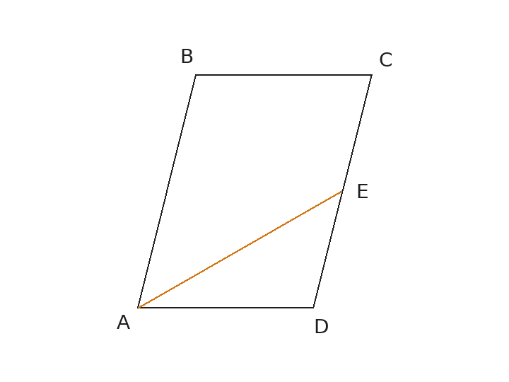

Подсказка 1

Треугольник ADE занимает четверть площади параллелограмма.

Ответ и разбор

**Ответ** · 81

1. S(ADE) = 108 / 4 = 27.

2. S(AECB) = 108 − 27 = 81.

`OGE17-P03` · seed `2027` · версия `oge17-quadrilaterals-1`

## Сумма углов трапеции

Сумма двух углов равнобедренной трапеции равна 74°. Найдите больший угол трапеции. Ответ дайте в градусах.

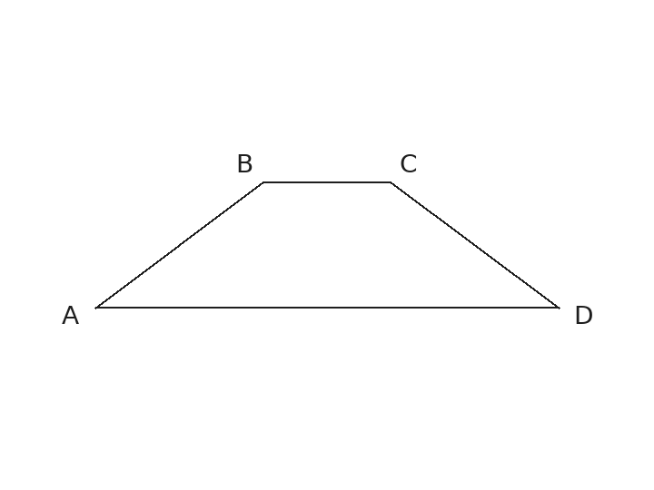

Подсказка 1

Сумма односторонних углов равна 180°. В условии сложены два равных угла при основании.

Ответ и разбор

**Ответ** · 143

1. Меньший угол равен 74° / 2 = 37°.

2. Больший угол: 180° − 37° = 143°.

`OGE17-T02` · seed `2027` · версия `oge17-quadrilaterals-1`

## Средняя линия трапеции

Основания трапеции ABCD равны 18 и 22, а высота равна 19. Найдите среднюю линию MN этой трапеции.

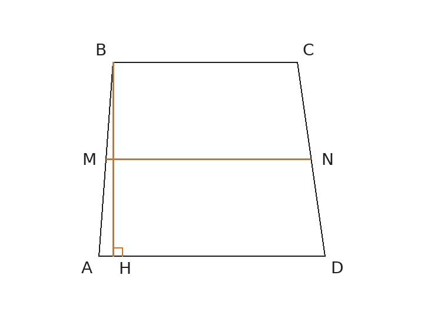

Подсказка 1

Средняя линия соединяет середины боковых сторон и равна полусумме оснований.

Ответ и разбор

**Ответ** · 20

1. MN = (18 + 22) / 2 = 20.

`OGE17-T05` · seed `2027` · версия `oge17-quadrilaterals-1`

## Больший угол равнобедренной трапеции

Один из углов равнобедренной трапеции равен 58°. Найдите больший угол этой трапеции. Ответ дайте в градусах.

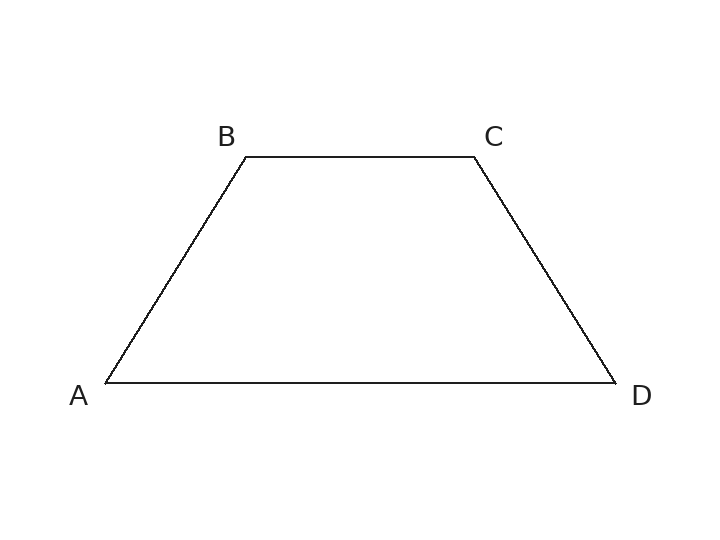

Подсказка 1

Два угла, прилежащие к одной боковой стороне трапеции, дают в сумме 180°.

Ответ и разбор

**Ответ** · 122

1. Больший угол: 180° − 58° = 122°.

`OGE17-T07` · seed `2027` · версия `oge17-quadrilaterals-1`

## Больший угол прямоугольной трапеции

Один из углов прямоугольной трапеции равен 44°. Найдите больший угол этой трапеции. Ответ дайте в градусах.

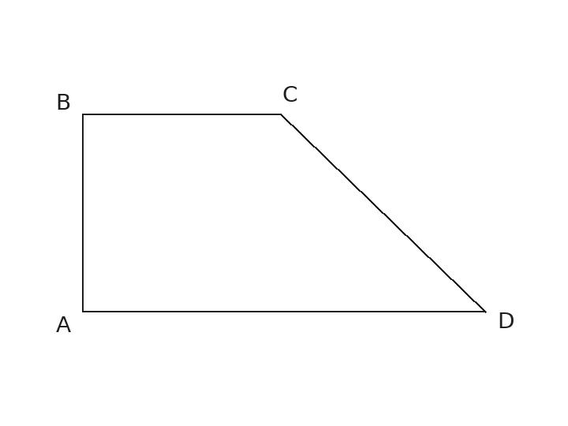

Подсказка 1

Два угла, прилежащие к одной боковой стороне трапеции, дают в сумме 180°.

Ответ и разбор

**Ответ** · 136

1. Больший угол: 180° − 44° = 136°.

`OGE17-T08` · seed `2027` · версия `oge17-quadrilaterals-1`
