# №18 · Фигуры на клетчатой сетке

[← Атлас №1–25](../README.md)

13 семейств или режимов в выдаче. [Источники и структуры](../oge18_reference_structures.json).

- [Средняя линия треугольника](#oge18-m01) · `OGE18-M01`
- [Средняя линия трапеции](#oge18-m02) · `OGE18-M02`
- [Расстояние между двумя точками](#oge18-d05) · `OGE18-D05`
- [Больший катет прямоугольного треугольника](#oge18-l02) · `OGE18-L02`
- [Площадь трапеции](#oge18-a01) · `OGE18-A01`
- [Площадь треугольника](#oge18-a03) · `OGE18-A03`
- [Площадь параллелограмма](#oge18-a04) · `OGE18-A04`
- [Площадь ромба](#oge18-a05) · `OGE18-A05`
- [Большая диагональ ромба](#oge18-l01) · `OGE18-L01`
- [Медиана к гипотенузе по клеткам](#oge18-h01) · `OGE18-H01`
- [Площадь вычитанием двух треугольников](#oge18-a06) · `OGE18-A06`
- [Площадь фигуры с выемкой](#oge18-a07) · `OGE18-A07`
- [Отношение площадей двух кругов](#oge18-c01) · `OGE18-C01`

## Средняя линия треугольника

На клетчатой сетке со стороной клетки 1 изображён треугольник ABC. Найдите длину его средней линии, параллельной AC.

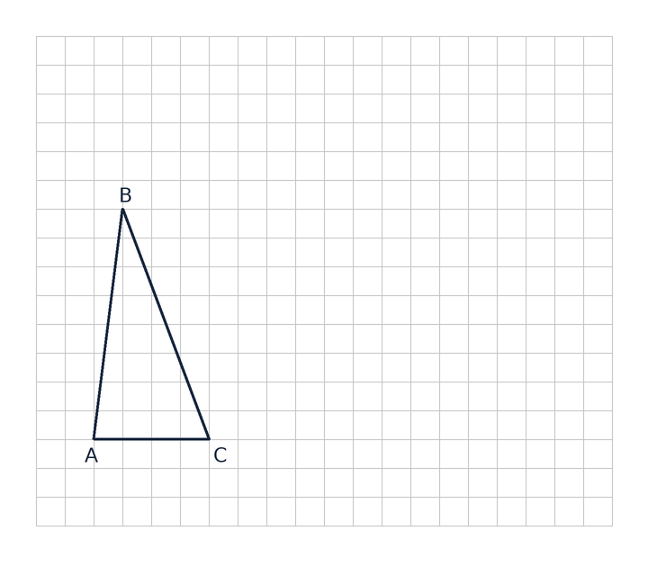

Подсказка 1

Посчитайте клетки вдоль стороны AC.

Подсказка 2

Средняя линия треугольника равна половине параллельной стороны.

Ответ и разбор

**Ответ** · 2

1. Сторона AC занимает 4 клеток.

2. Длина средней линии: 4 : 2 = 2.

`OGE18-M01` · seed `2027` · версия `oge18-grid-1`

## Средняя линия трапеции

На клетчатой сетке со стороной клетки 1 изображена трапеция. Найдите длину её средней линии.

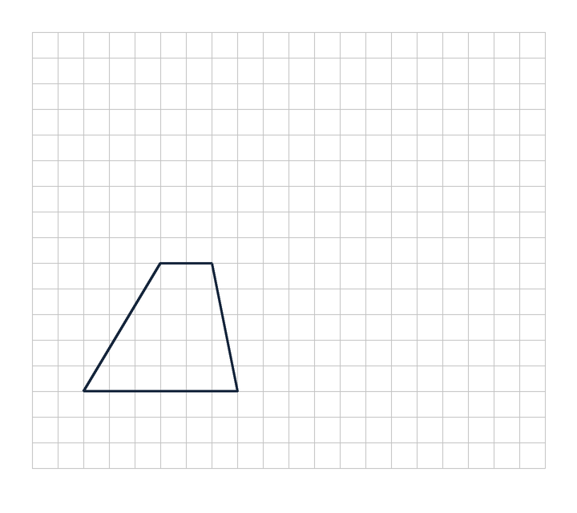

Подсказка 1

Найдите две параллельные стороны и посчитайте клетки вдоль них.

Подсказка 2

Средняя линия трапеции равна полусумме оснований.

Ответ и разбор

**Ответ** · 4

1. Основания занимают 6 и 2 клеток.

2. Длина средней линии: (6 + 2) : 2 = 4.

`OGE18-M02` · seed `2027` · версия `oge18-grid-1`

## Расстояние между двумя точками

На клетчатой бумаге с размером клетки 1 × 1 изображены две точки. Найдите расстояние между ними.

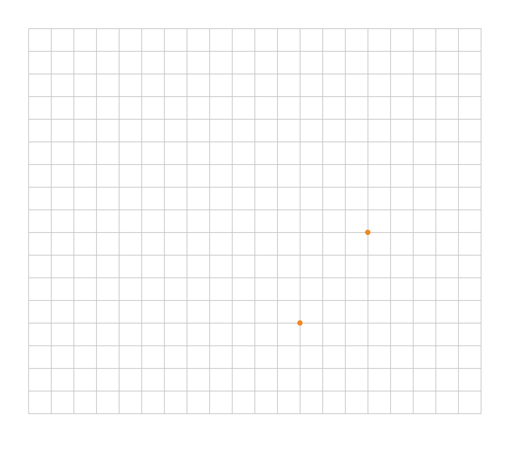

Подсказка 1

Сосчитайте горизонтальное и вертикальное расстояния по клеткам.

Подсказка 2

Используйте теорему Пифагора для расстояния между точками.

Ответ и разбор

**Ответ** · 5

1. По клеткам: Δx = 3, Δy = 4.

2. По теореме Пифагора: d = √(3² + 4²) = 5.

`OGE18-D05` · seed `2027` · версия `oge18-grid-2`

## Больший катет прямоугольного треугольника

На клетчатой бумаге с размером клетки 1 × 1 изображён прямоугольный треугольник. Найдите длину его большего катета.

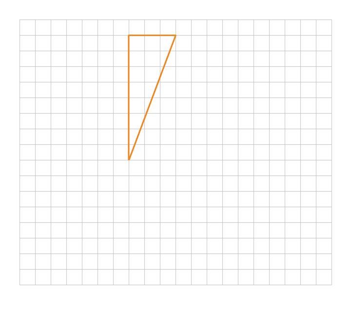

Подсказка 1

Найдите вершину прямого угла.

Подсказка 2

Сосчитайте клетки вдоль каждого катета и сравните длины.

Ответ и разбор

**Ответ** · 8

1. Длины катетов: 3 и 8.

2. Больший катет: 8.

`OGE18-L02` · seed `2027` · версия `oge18-grid-2`

## Площадь трапеции

На клетчатой бумаге с размером клетки 1 × 1 изображена трапеция. Найдите её площадь.

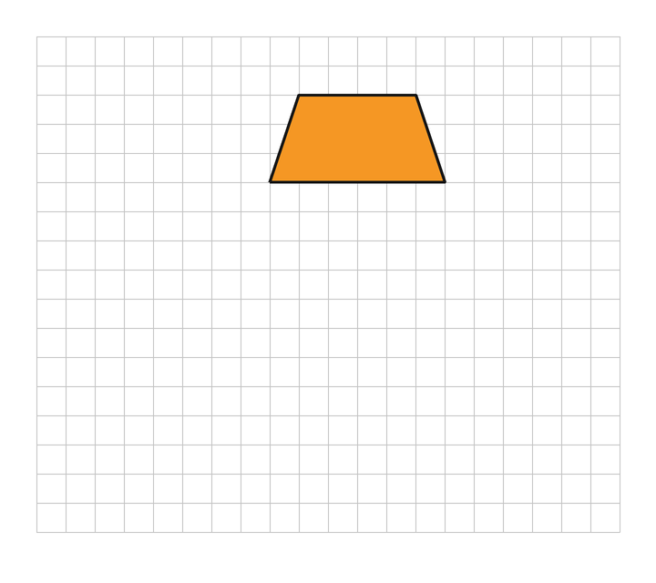

Подсказка 1

Сосчитайте клетки вдоль оснований и найдите высоту трапеции.

Подсказка 2

Подставьте значения в формулу площади трапеции.

Ответ и разбор

**Ответ** · 15

1. Основания: 6 и 4, высота: 3.

2. S = (6 + 4) · 3 / 2 = 15.

`OGE18-A01` · seed `2027` · версия `oge18-grid-2`

## Площадь треугольника

На клетчатой бумаге с размером клетки 1 × 1 изображён треугольник. Найдите его площадь.

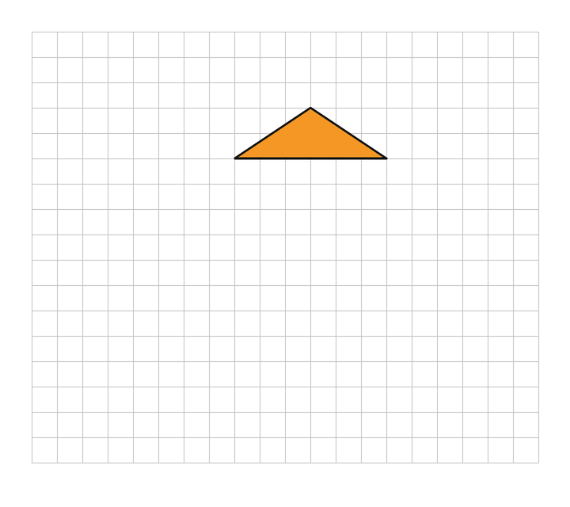

Подсказка 1

Сосчитайте клетки вдоль основания и найдите высоту треугольника.

Подсказка 2

Площадь треугольника равна половине произведения основания на высоту.

Ответ и разбор

**Ответ** · 6

1. Основание: 6, высота: 2.

2. S = 6 · 2 / 2 = 6.

`OGE18-A03` · seed `2027` · версия `oge18-grid-2`

## Площадь параллелограмма

На клетчатой бумаге с размером клетки 1 × 1 изображён параллелограмм. Найдите его площадь.

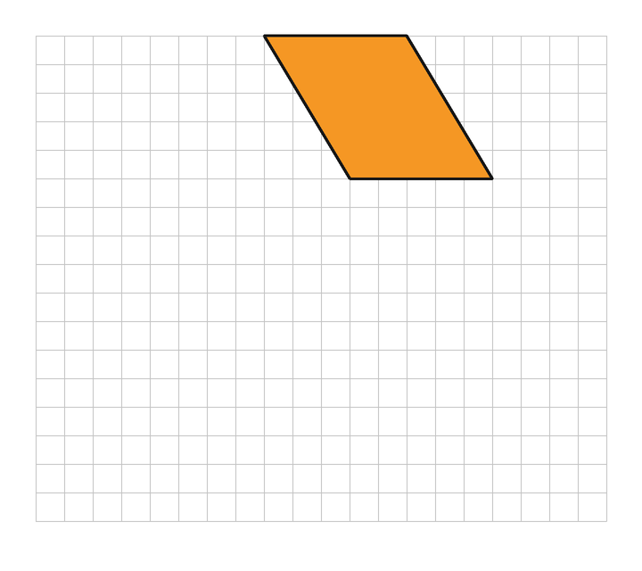

Подсказка 1

Сосчитайте клетки вдоль основания и найдите перпендикулярную высоту.

Подсказка 2

Площадь параллелограмма равна произведению основания на высоту.

Ответ и разбор

**Ответ** · 25

1. Основание: 5, высота: 5.

2. S = 5 · 5 = 25.

`OGE18-A04` · seed `2027` · версия `oge18-grid-2`

## Площадь ромба

На клетчатой бумаге с размером клетки 1 × 1 изображён ромб. Найдите площадь этого ромба.

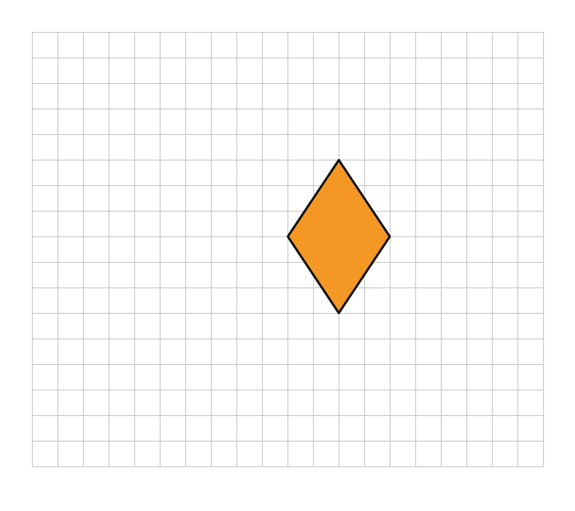

Подсказка 1

Найдите длины диагоналей ромба по клеткам.

Подсказка 2

Площадь ромба равна половине произведения диагоналей.

Ответ и разбор

**Ответ** · 12

1. Диагонали: 4 и 6.

2. S = 4 · 6 / 2 = 12.

`OGE18-A05` · seed `2027` · версия `oge18-grid-2`

## Большая диагональ ромба

На клетчатой бумаге с размером клетки 1 × 1 изображён ромб. Найдите длину его большей диагонали.

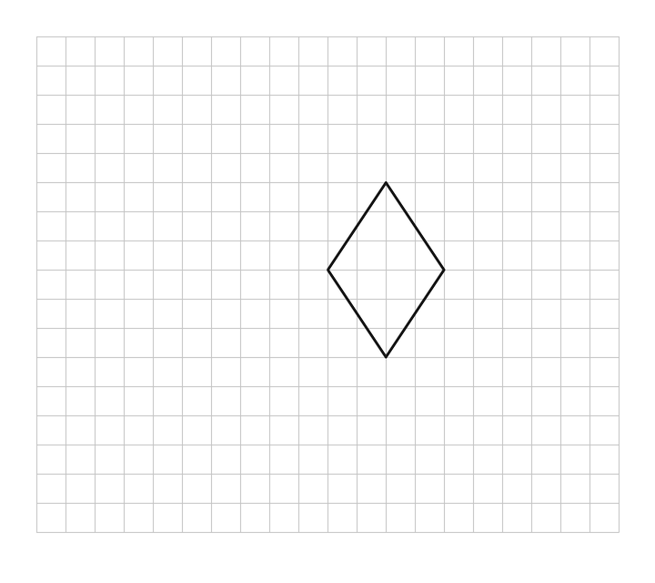

Подсказка 1

Найдите две пары противоположных вершин ромба.

Подсказка 2

По клеткам сравните расстояния между вершинами каждой пары.

Ответ и разбор

**Ответ** · 6

1. Диагонали равны 4 и 6.

2. Длина большей диагонали равна 6.

`OGE18-L01` · seed `2027` · версия `oge18-grid-2`

## Медиана к гипотенузе по клеткам

На клетчатой бумаге с размером клетки 1 × 1 изображён прямоугольный треугольник. Найдите длину медианы, проведённой из вершины прямого угла.

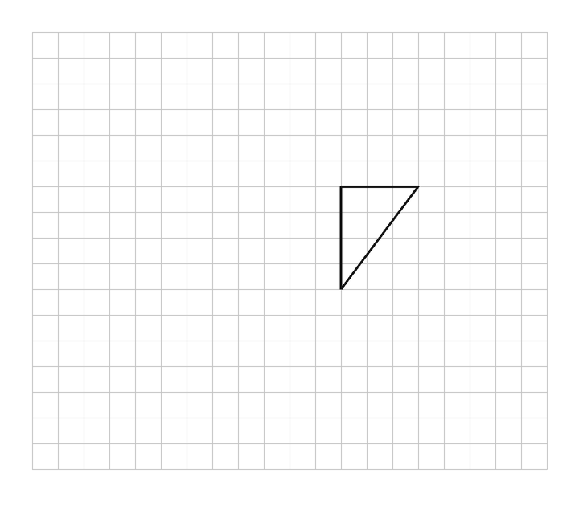

Подсказка 1

Сосчитайте клетки вдоль катетов и найдите гипотенузу.

Подсказка 2

Медиана из прямого угла равна половине гипотенузы.

Ответ и разбор

**Ответ** · 2.5

1. Катеты равны 3 и 4. Гипотенуза равна √(3² + 4²) = 5.

2. Медиана равна 5 : 2 = 2,5.

`OGE18-H01` · seed `2027` · версия `oge18-grid-2`

## Площадь вычитанием двух треугольников

На клетчатой бумаге с размером клетки 1 × 1 изображена фигура. Найдите её площадь.

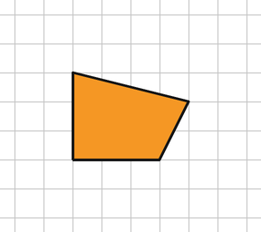

Подсказка 1

Достройте фигуру до прямоугольника по линиям сетки.

Подсказка 2

Рассмотрите два прямоугольных треугольника за наклонными сторонами.

Ответ и разбор

**Ответ** · 9

1. Достроим прямоугольник шириной 4 и высотой 3.

2. У первого внешнего треугольника катеты 1 и 2, у второго — 4 и 1.

3. S = 4 · 3 − 1 · 2 / 2 − 4 · 1 / 2 = 9.

`OGE18-A06` · seed `2027` · версия `oge18-grid-2`

## Площадь фигуры с выемкой

На клетчатой бумаге с размером клетки 1 × 1 изображена фигура. Найдите её площадь.

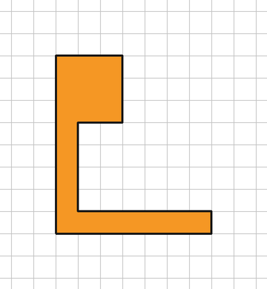

Подсказка 1

Продлите вертикальную сторону выемки вверх и вниз.

Подсказка 2

Сложите площади прямоугольников с общей стороной без наложения.

Ответ и разбор

**Ответ** · 20

1. Слева от выемки получаем прямоугольник 1 × 8.

2. Остаются нижний выступ 6 × 1 и верхний 2 × 3.

3. S = 1 · 8 + 6 · 1 + 2 · 3 = 20.

`OGE18-A07` · seed `2027` · версия `oge18-grid-2`

## Отношение площадей двух кругов

На клетчатой бумаге изображены два круга. Найдите, во сколько раз площадь большего круга больше площади меньшего.

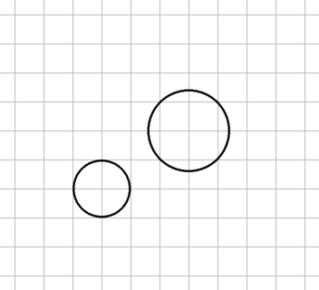

Подсказка 1

Найдите центры кругов по симметрии сетки.

Подсказка 2

Сравните квадраты радиусов: общий множитель π сократится.

Ответ и разбор

**Ответ** · 2

1. Горизонтальный радиус малого круга равен 1.

2. От центра большого круга до узла на его окружности — 1 по горизонтали и 1 по вертикали. По теореме Пифагора квадрат радиуса равен 1² + 1² = 2.

3. Площадь круга равна πr². Отношение площадей равно 2 / 1 = 2.

`OGE18-C01` · seed `2027` · версия `oge18-grid-2`
