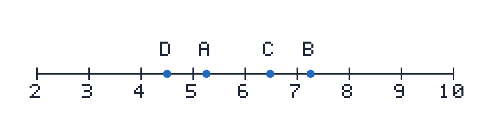
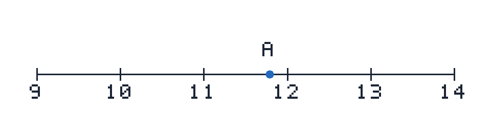

# №7 · Числа и координатная прямая

[← Атлас №1–25](../README.md)

7 семейств или режимов в выдаче. [Источники и структуры](../oge07_reference_structures.json).

- [Отрезок, содержащий дробь](#oge07-c01) · `OGE07-C01`
- [Между какими целыми лежит корень](#oge07-c02) · `OGE07-C02`
- [Какой корень принадлежит отрезку](#oge07-c03) · `OGE07-C03`
- [Какая дробь принадлежит отрезку](#oge07-c04) · `OGE07-C04`
- [Между какими целыми лежит дробь](#oge07-c06) · `OGE07-C06`
- [Какая точка изображает заданный корень](#oge07-n01) · `OGE07-N01`
- [Какой корень изображён точкой A](#oge07-n04) · `OGE07-N04`

## Отрезок, содержащий дробь

Какой из указанных десятичных отрезков содержит число 3/7? 
 
1. [0; 0,1] 
2. [0,2; 0,3] 
3. [0,4; 0,5] 
4. [0,6; 0,7]

Подсказка 1

Сравните дробь с границами отрезков.

Подсказка 2

0,4 < 3/7 < 0,5.

Ответ и разбор

**Ответ** · 3

1. 0,4 < 3/7 < 0,5.

2. Ответ — единственный содержащий число отрезок.

`OGE07-C01` · seed `2027` · версия `0.4.0`

## Между какими целыми лежит корень

Между какими двумя последовательными целыми числами заключено число √3931? 
 
1. между 62 и 63 
2. между 60 и 61 
3. между 61 и 62 
4. между 63 и 64

Подсказка 1

Сравните n с квадратами последовательных целых.

Подсказка 2

62²=3844 < 3931 < 3969=3969.

Ответ и разбор

**Ответ** · 1

1. 3844 < 3931 < 3969, поэтому 62 < √3931 < 63.

2. Ответ: вариант 1.

`OGE07-C02` · seed `2027` · версия `0.4.0`

## Какой корень принадлежит отрезку

Какое из чисел принадлежит отрезку [6; 7]? 
 
1. √40 
2. √51 
3. √35 
4. √34

Подсказка 1

Для неотрицательного √n сравните подкоренное выражение с квадратами концов.

Подсказка 2

36 < n < 49.

Ответ и разбор

**Ответ** · 1

1. Только подкоренное выражение 40 удовлетворяет 36 < n < 49.

2. Ответ: √40.

`OGE07-C03` · seed `2027` · версия `0.4.0`

## Какая дробь принадлежит отрезку

Какая обыкновенная дробь принадлежит отрезку [3; 4]? 
 
1. 41/14 
2. 53/14 
3. 40/14 
4. 58/14

Подсказка 1

У всех дробей общий знаменатель 14.

Подсказка 2

Сравните числители с 42 и 56.

Ответ и разбор

**Ответ** · 2

1. 42 < 53 < 56, поэтому 3 < 53/14 < 4.

2. Ответ: 53/14.

`OGE07-C04` · seed `2027` · версия `0.4.0`

## Между какими целыми лежит дробь

Между какими двумя последовательными целыми числами заключена дробь -23/9? 
 
1. между -3 и -2 
2. между -2 и -1 
3. между -4 и -3 
4. между -5 и -4

Подсказка 1

Используйте целую часть с учётом знака дроби.

Подсказка 2

-3 < -23/9 < -2.

Ответ и разбор

**Ответ** · 1

1. -3 < -23/9 < -2.

2. Ответ: вариант 1.

`OGE07-C06` · seed `2027` · версия `0.4.0`

## Какая точка изображает заданный корень

Какой точке на координатной прямой соответствует число √42? 
 
1. D 
2. A 
3. C 
4. B

Подсказка 1

Сравните подкоренное число с квадратами соседних целых.

Подсказка 2

6² < 42 < 49.

Ответ и разбор

**Ответ** · 3

1. 6 < √42 < 7; найдите точку в этом промежутке.

`OGE07-N01` · seed `2027` · версия `1.2.0`

## Какой корень изображён точкой A

Какое число соответствует отмеченной на координатной прямой точке A? 
 
1. √172 
2. √145 
3. √101 
4. √139

Подсказка 1

Определите между какими целыми расположена точка A.

Подсказка 2

11 < A < 12.

Ответ и разбор

**Ответ** · 4

1. Точка A имеет координату √139; сопоставьте её с вариантами корней.

`OGE07-N04` · seed `2027` · версия `1.2.0`
