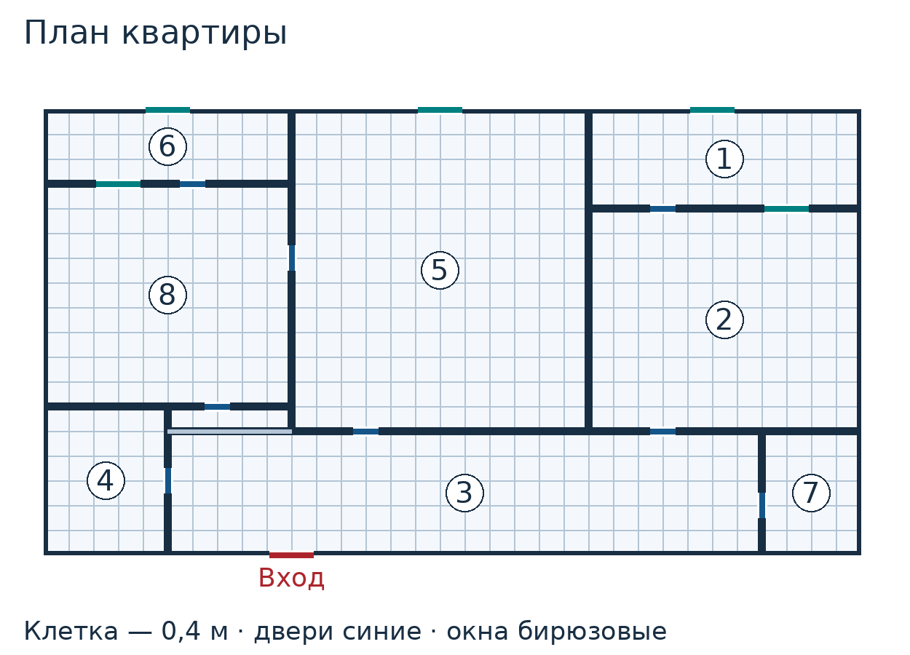
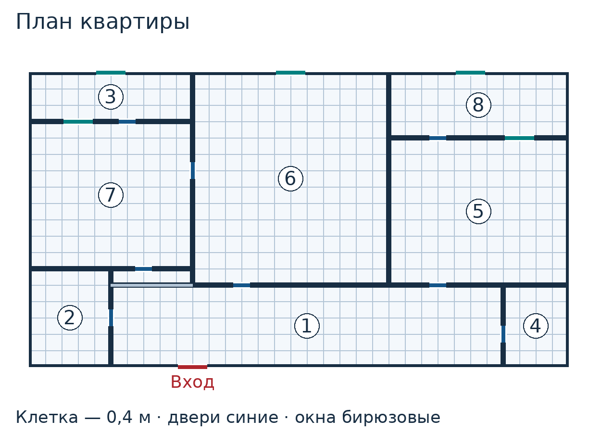

# Квартиры

[← Атлас №1–25](../README.md)

Каждая пятёрка использует общий набор данных. Рисунок остаётся у первого вопроса, в котором он нужен; при смене материала следующий рисунок показан рядом с вопросом.

- №1 · [Комнаты на плане](#q-2027-1) · `FLAT-01-ROOM-MATCH`
- №2 · [Упаковки паркета](#q-2029-2) · `FLAT-02-PARQUET-PACK`
- №2 · [Упаковки плитки](#q-2027-2) · `FLAT-02-TILE-PACK`
- №3 · [Площадь помещения](#q-2027-3) · `FLAT-03-RECT-AREA`
- №4 · [Сравнение площадей в процентах](#q-2027-4) · `FLAT-04-RECT-PERCENT`
- №5 · [Стоимость интернета](#q-2028-5) · `FLAT-05-INTERNET-MIN`
- №5 · [Стоимость стиральной машины](#q-2027-5) · `FLAT-05-WASHER-MIN`

## Комплект 2027

План квартиры: восемь помещений с цифровыми метками; сторона клетки 0,4 м. Коридор у входа; санузел слева от входа, кладовая в противоположном конце. Рядом с кладовой спальня с лоджией. Гостиная соединяет коридор и кухню; кухня выходит на другую лоджию. Гостиная — самое большое помещение. Синие штрихи обозначают двери, бирюзовые — окна, красный — вход. Это собственная SVG/PNG схема фиксированной топологии.

### №1 · `FLAT-01-ROOM-MATCH`

Вход находится в коридоре. Слева от входа — санузел, в противоположном конце коридора — кладовая. Рядом с кладовой находится спальня с выходом на лоджию. Из гостиной можно попасть в коридор и на кухню, из кухни — на другую лоджию. Гостиная — самое большое помещение. Запишите номера в порядке: санузел, кладовая, спальня, гостиная.

Подсказка 1

Начните с коридора у входа и проверьте связи помещений по дверным проёмам.

Подсказка 2

Санузел находится слева от входа, а кладовая — в противоположном конце коридора.

Ответ и разбор

**Ответ** · 4725

1. Определите номера помещений по подписям на плане.

2. В заданном порядке получаем 4725.

### №2 · `FLAT-02-TILE-PACK`

Пол санузла выложен плитками 0,4×0,4 м. В упаковке 10 плиток. Сколько упаковок потребуется? Резка не нужна.

Подсказка 1

Измерьте санузел по клеткам плана и переведите длины в метры.

Подсказка 2

Сравните размеры клетки с плиткой, затем посчитайте упаковки с округлением вверх.

Ответ и разбор

**Ответ** · 3

1. На плане помещение занимает 30 клеток; столько плиток требуется.

2. 30 : 10 с округлением вверх = 3 упаковок.

### №3 · `FLAT-03-RECT-AREA`

Найдите площадь меньшей лоджии, если сторона клетки плана равна 0,4 м. Ответ дайте в квадратных метрах.

Подсказка 1

Найдите ширину и длину лоджии в клетках плана.

Подсказка 2

Сначала умножьте число клеток на площадь одной клетки в квадратных метрах.

Ответ и разбор

**Ответ** · 4,8

1. Меньшая лоджия занимает 3×10 = 30 клеток; вторая — 4×11 = 44 клетки.

2. 30 · 0,16 = 4,8 м².

### №4 · `FLAT-04-RECT-PERCENT`

По плану определите, на сколько процентов площадь санузла больше площади кладовой?

Подсказка 1

Найдите разность площадей санузла и кладовой.

Подсказка 2

Для процента увеличения разделите разность на площадь кладовой.

Ответ и разбор

**Ответ** · 50

1. Разность площадей равна 10 клеткам.

2. 10/20 · 100% = 50%.

### №5 · `FLAT-05-WASHER-MIN`

Нужна машина с вертикальной загрузкой вместимостью не менее 6 кг. Сравните модели с учётом цены, установки и доставки: А: фронтальная, загрузка 6 кг, высота 85 см, цена 28000 руб., установка 1000 руб., доставка 10%; Б: фронтальная, загрузка 7 кг, высота 84 см, цена 31000 руб., установка 0 руб., доставка 0%; В: вертикальная, загрузка 8 кг, высота 86 см, цена 30000 руб., установка 1500 руб., доставка 0%; Г: фронтальная, загрузка 7 кг, высота 82 см, цена 33000 руб., установка 0 руб., доставка 0%; Д: фронтальная, загрузка 8 кг, высота 84 см, цена 31900 руб., установка 500 руб., доставка 15%; Е: вертикальная, загрузка 7 кг, высота 82 см, цена 29500 руб., установка 500 руб., доставка 0%. Доставка указана в процентах от цены машины. Найдите минимальную полную стоимость.

Подсказка 1

Оставьте модели с вертикальной загрузкой и вместимостью не менее 6 кг.

Подсказка 2

К цене каждой подходящей модели прибавьте установку и доставку, рассчитанную от цены машины.

Ответ и разбор

**Ответ** · 30000

1. После ограничений подходят модели В, Е.

2. В: 30000 + 1500 + 30000 · 0 / 100 = 31500 руб.

3. Е: 29500 + 500 + 29500 · 0 / 100 = 30000 руб.

4. Минимальная полная стоимость — 30000 руб.

## Комплект 2028

План квартиры: восемь помещений с цифровыми метками; сторона клетки 0,4 м. Коридор у входа; санузел слева от входа, кладовая в противоположном конце. Рядом с кладовой спальня с лоджией. Гостиная соединяет коридор и кухню; кухня выходит на другую лоджию. Гостиная — самое большое помещение. Синие штрихи обозначают двери, бирюзовые — окна, красный — вход. Это собственная SVG/PNG схема фиксированной топологии.

### №1 · `FLAT-01-ROOM-MATCH`

Вход находится в коридоре. Слева от входа — санузел, в противоположном конце коридора — кладовая. Рядом с кладовой находится спальня с выходом на лоджию. Из гостиной можно попасть в коридор и на кухню, из кухни — на другую лоджию. Гостиная — самое большое помещение. Запишите номера в порядке: санузел, кладовая, спальня, гостиная.

Подсказка 1

Начните с коридора у входа и проверьте связи помещений по дверным проёмам.

Подсказка 2

Санузел находится слева от входа, а кладовая — в противоположном конце коридора.

Ответ и разбор

**Ответ** · 2456

1. Определите номера помещений по подписям на плане.

2. В заданном порядке получаем 2456.

### №2 · `FLAT-02-TILE-PACK`

Пол санузла выложен плитками 0,4×0,4 м. В упаковке 20 плиток. Сколько упаковок потребуется? Резка не нужна.

Подсказка 1

Измерьте санузел по клеткам плана и переведите длины в метры.

Подсказка 2

Сравните размеры клетки с плиткой, затем посчитайте упаковки с округлением вверх.

Ответ и разбор

**Ответ** · 2

1. На плане помещение занимает 30 клеток; столько плиток требуется.

2. 30 : 20 с округлением вверх = 2 упаковок.

### №3 · `FLAT-03-RECT-AREA`

Найдите площадь меньшей лоджии, если сторона клетки плана равна 0,4 м. Ответ дайте в квадратных метрах.

Подсказка 1

Найдите ширину и длину лоджии в клетках плана.

Подсказка 2

Сначала умножьте число клеток на площадь одной клетки в квадратных метрах.

Ответ и разбор

**Ответ** · 4,8

1. Меньшая лоджия занимает 3×10 = 30 клеток; вторая — 4×11 = 44 клетки.

2. 30 · 0,16 = 4,8 м².

### №4 · `FLAT-04-RECT-PERCENT`

По плану определите, на сколько процентов площадь санузла больше площади кладовой?

Подсказка 1

Найдите разность площадей санузла и кладовой.

Подсказка 2

Для процента увеличения разделите разность на площадь кладовой.

Ответ и разбор

**Ответ** · 50

1. Разность площадей равна 10 клеткам.

2. 10/20 · 100% = 50%.

### №5 · `FLAT-05-INTERNET-MIN`

За месяц использовано 1000 МБ. Выберите тариф с наименьшей стоимостью: Базовый: абонплата 650 руб., включено 600 МБ, сверх лимита 2 руб./МБ; Оптимальный: абонплата 820 руб., включено 900 МБ, сверх лимита 1.5 руб./МБ; Безлимитный: абонплата 950 руб., включено безлимит МБ, сверх лимита 0 руб./МБ. Сколько рублей нужно заплатить?

Подсказка 1

Для каждого ограниченного плана найдите объём сверх включённого лимита.

Подсказка 2

Прибавьте плату за превышение к абонентской плате и сравните все три итоговые суммы.

Ответ и разбор

**Ответ** · 950

1. Стоимость тарифов по порядку: 1450, 970, 950 руб.

2. Минимальная стоимость — 950 руб.

## Комплект 2029

План квартиры: восемь помещений с цифровыми метками; сторона клетки 0,4 м. Коридор у входа; санузел слева от входа, кладовая в противоположном конце. Рядом с кладовой спальня с лоджией. Гостиная соединяет коридор и кухню; кухня выходит на другую лоджию. Гостиная — самое большое помещение. Синие штрихи обозначают двери, бирюзовые — окна, красный — вход. Это собственная SVG/PNG схема фиксированной топологии.

### №1 · `FLAT-01-ROOM-MATCH`

Вход находится в коридоре. Слева от входа — санузел, в противоположном конце коридора — кладовая. Рядом с кладовой находится спальня с выходом на лоджию. Из гостиной можно попасть в коридор и на кухню, из кухни — на другую лоджию. Гостиная — самое большое помещение. Запишите номера в порядке: санузел, кладовая, спальня, гостиная.

Подсказка 1

Начните с коридора у входа и проверьте связи помещений по дверным проёмам.

Подсказка 2

Санузел находится слева от входа, а кладовая — в противоположном конце коридора.

Ответ и разбор

**Ответ** · 1348

1. Определите номера помещений по подписям на плане.

2. В заданном порядке получаем 1348.

### №2 · `FLAT-02-PARQUET-PACK`

Пол гостиной покрывают паркетными досками 0,2×0,8 м без распила. В упаковке 12 досок. Сколько упаковок потребуется?

Подсказка 1

Сопоставьте длины гостиной и доски, чтобы определить число рядов.

Подсказка 2

Проверьте, сколько досок войдёт в каждый ряд без распила, затем разделите на размер упаковки.

Ответ и разбор

**Ответ** · 13

1. Гостиная на плане: 12×13 клеток, то есть 4,8×5,2 м.

2. При укладке без распила помещается 6×26 = 156 досок.

3. 156 : 12 с округлением вверх = 13 упаковок.

### №3 · `FLAT-03-RECT-AREA`

Найдите площадь меньшей лоджии, если сторона клетки плана равна 0,4 м. Ответ дайте в квадратных метрах.

Подсказка 1

Найдите ширину и длину лоджии в клетках плана.

Подсказка 2

Сначала умножьте число клеток на площадь одной клетки в квадратных метрах.

Ответ и разбор

**Ответ** · 4,8

1. Меньшая лоджия занимает 3×10 = 30 клеток; вторая — 4×11 = 44 клетки.

2. 30 · 0,16 = 4,8 м².

### №4 · `FLAT-04-RECT-PERCENT`

По плану определите, на сколько процентов площадь санузла больше площади кладовой?

Подсказка 1

Найдите разность площадей санузла и кладовой.

Подсказка 2

Для процента увеличения разделите разность на площадь кладовой.

Ответ и разбор

**Ответ** · 50

1. Разность площадей равна 10 клеткам.

2. 10/20 · 100% = 50%.

### №5 · `FLAT-05-INTERNET-MIN`

За месяц использовано 800 МБ. Выберите тариф с наименьшей стоимостью: Базовый: абонплата 650 руб., включено 600 МБ, сверх лимита 2 руб./МБ; Оптимальный: абонплата 820 руб., включено 900 МБ, сверх лимита 1.5 руб./МБ; Безлимитный: абонплата 950 руб., включено безлимит МБ, сверх лимита 0 руб./МБ. Сколько рублей нужно заплатить?

Подсказка 1

Для каждого ограниченного плана найдите объём сверх включённого лимита.

Подсказка 2

Прибавьте плату за превышение к абонентской плате и сравните все три итоговые суммы.

Ответ и разбор

**Ответ** · 820

1. Стоимость тарифов по порядку: 1050, 820, 950 руб.

2. Минимальная стоимость — 820 руб.

