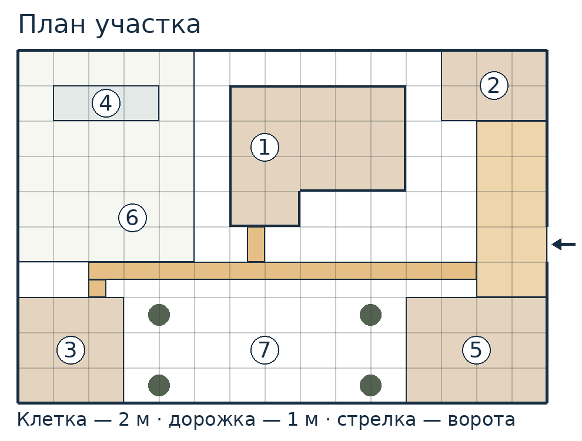
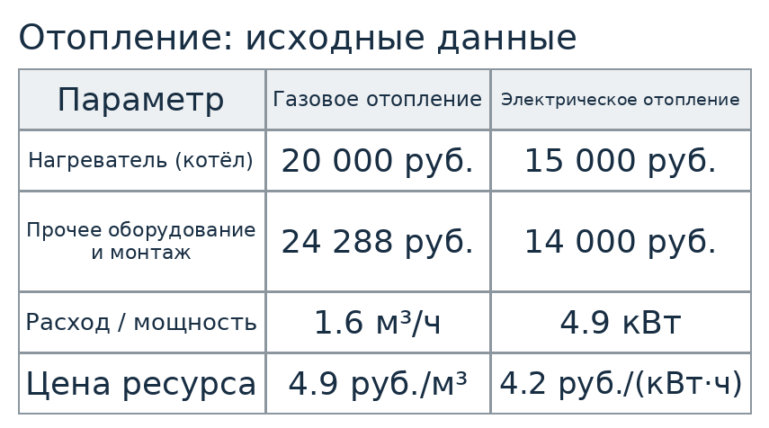

# Участки

[← Атлас №1–25](../README.md)

Каждая пятёрка использует общий набор данных. Рисунок остаётся у первого вопроса, в котором он нужен; при смене материала следующий рисунок показан рядом с вопросом.

- №1 · [Объекты на плане участка](#q-2027-1) · `GARDEN-01-IDENTIFY`
- №2 · [Пачки плитки](#q-2027-2) · `GARDEN-02-TILES-PACKS`
- №3 · [Периметр дома](#q-2027-3) · `GARDEN-04-PERIMETER-POLYGON`
- №4 · [Доля площади под постройками](#q-2027-4) · `GARDEN-07-PERCENT-BUILDINGS`
- №5 · [Окупаемость отопления](#q-2027-5) · `GARDEN-09-HEAT-BREAKEVEN`

## Комплект 2027

План участка: клетка 2 м; дорожки шириной 1 м. Плитка 1×1 м. 
Отопление одного дома (общие данные): 
Газ: котёл 20000 руб., монтаж 24288 руб.; 1.6 м³/ч, 4.9 руб./м³. 
Электричество: котёл 15000 руб., монтаж 14000 руб.; 4.9 кВт, 4.2 руб./(кВт·ч). 
Все пять вопросов относятся к одному плану. Аналог ОГЭ.

### №1 · `GARDEN-01-IDENTIFY`

При входе на участок слева от единственных ворот находится гараж, справа — сарай, а чуть дальше расположен жилой дом. Напротив дома находятся яблоневые посадки; огород отмечен на плане цифрой 6, а теплица расположена внутри огорода. Найдите номера жилого дома, бани, гаража и теплицы и запишите четыре цифры в указанном порядке.

Подсказка 1

Сопоставьте объекты с описанием их расположения на плане.

Ответ и разбор

**Ответ** · 1354

1. В указанном порядке на плане получаем номера 1, 3, 5, 4.

### №2 · `GARDEN-02-TILES-PACKS`

Сколько пачек плитки нужно для дорожек и прямоугольной площадки у ворот? Сторона клетки плана 2 м, ширина дорожки 1 м, размер плитки 1 × 1 м. В пачке 5 плиток. Покрытие укладывают без зазоров.

Подсказка 1

Сложите число плиток и округлите число пачек вверх.

Ответ и разбор

**Ответ** · 13

1. Длины четырёх полос шириной 1 м: 3, 1, 9 и 12 м. Их площадь 25 м².

2. Площадка 8 × 5 м занимает 40 м². Всего нужно 65 плиток по 1 м².

3. Округляем 65 / 5 вверх: нужно 13 пачек.

### №3 · `GARDEN-04-PERIMETER-POLYGON`

Дом имеет ломаную форму по сторонам клеток плана. Найдите периметр его внешнего контура в метрах, если сторона клетки 2 м.

Подсказка 1

Считайте только стороны клеток на внешней границе дома.

Ответ и разбор

**Ответ** · 36

1. Внешний контур состоит из 18 сторон клеток.

2. Периметр: 18 × 2 = 36 м.

### №4 · `GARDEN-07-PERCENT-BUILDINGS`

Найдите по плану, сколько процентов площади участка занимают дом, баня, гараж и сарай. Это четыре бежевых строения. Сторона клетки 2 м. Ответ округлите до целого.

Подсказка 1

Разделите суммарную площадь построек на площадь участка.

Ответ и разбор

**Ответ** · 29

1. Клетка занимает 4 м². На плане дом занимает 17 клеток, баня — 9, гараж — 12, сарай — 6.

2. Постройки занимают (17 + 9 + 12 + 6) × 4 = 176 м².

3. Весь участок занимает 15 × 10 × 4 = 600 м².

4. 176 / 600 × 100 ≈ 29,33 %. После округления получаем 29 %.

### №5 · `GARDEN-09-HEAT-BREAKEVEN`

Для одного и того же дома выбирают отопление газом или электричеством. Стоимость оборудования и установки: газовый котёл 20000 руб. и монтаж 24288 руб.; электрический котёл 15000 руб. и монтаж 14000 руб. Расход газа — 1.6 м³ в час, цена газа — 4.9 руб. за м³; мощность электрического котла — 4.9 кВт, цена электроэнергии — 4.2 руб. за кВт·ч. Через сколько часов суммарные затраты на оборудование, установку и топливо сравняются?

Подсказка 1

Найдите разницу начальных затрат и экономию за один час.

Ответ и разбор

**Ответ** · 1200

1. Начальные затраты: газ 20000 + 24288 = 44288 руб.; электричество 15000 + 14000 = 29000 руб.

2. За час: газ 1.6 × 4.9 = 7.84 руб.; электричество 4.9 × 4.2 = 20.58 руб.

3. Разница начальных затрат — 15288 руб., экономия газа — 12.74 руб./ч. Ответ: 1200 ч.

