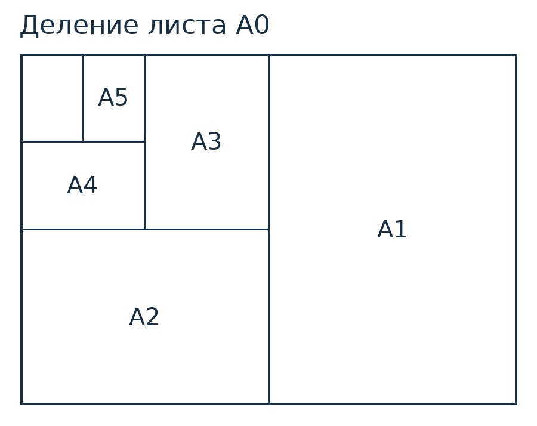
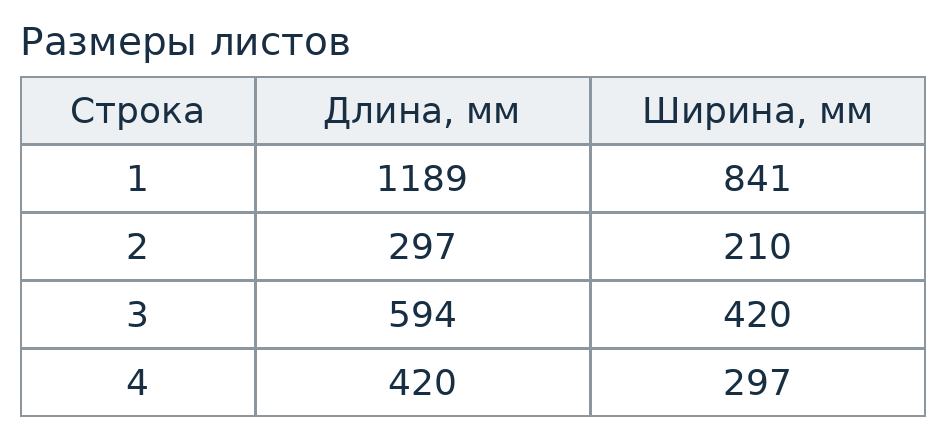
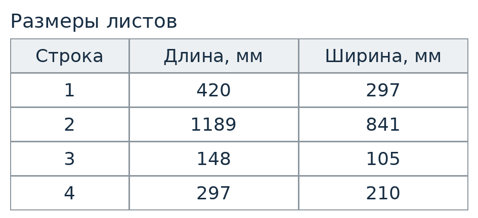

# Бумага

[← Атлас №1–25](../README.md)

Каждая пятёрка использует общий набор данных. Рисунок остаётся у первого вопроса, в котором он нужен; при смене материала следующий рисунок показан рядом с вопросом.

- №1 · [Формат по размерам листа](#q-2027-1) · `PAPER-F01`
- №2 · [Количество листов после разрезания](#q-2027-2) · `PAPER-F02`
- №3 · [Ширина листа](#q-2027-3) · `PAPER-F03`
- №4 · [Отношение сторон](#q-2031-4) · `PAPER-F04`
- №4 · [Диагональ и меньшая сторона](#q-2027-4) · `PAPER-F06`
- №5 · [Масштабирование шрифта](#q-2027-5) · `PAPER-F07`

## Комплект 2027

Форматы бумаги серии A: площадь A0 принята равной 1 м²; при переходе к следующему формату площадь листа делится пополам. Схема показывает последовательное деление A0–A5 и является схемой отношений, а не чертежом в масштабе. 
Таблица размеров (длина × ширина, мм): 
1. A0: 1189 × 841 мм 
2. A4: 297 × 210 мм 
3. A2: 594 × 420 мм 
4. A3: 420 × 297 мм

### №1 · `PAPER-F01`

Соотнесите форматы бумаги с размерами в общей таблице. Форматы в указанном порядке: A2, A0, A3, A4. Запишите номера соответствующих строк четырьмя цифрами, без пробелов.

Подсказка 1

Вспомните, как соседние форматы листа связаны друг с другом.

Подсказка 2

Сначала выпишите нужные размеры и единицы, затем выполните указанное действие.

Ответ и разбор

**Ответ** · 3142

1. Площадь A0 близка к 1 000 000 мм². У каждого следующего формата площадь примерно вдвое меньше.

2. Строка 1: 1189 × 841 = 999949 мм², это формат A0.

3. Строка 2: 297 × 210 = 62370 мм², это формат A4.

4. Строка 3: 594 × 420 = 249480 мм², это формат A2.

5. Строка 4: 420 × 297 = 124740 мм², это формат A3.

6. В заданном порядке номера строк образуют код 3142.

### №2 · `PAPER-F02`

Из одного листа формата A3 последовательно получают листы формата A6. Сколько листов A6 получится из одного листа A3?

Подсказка 1

Вспомните, как соседние форматы листа связаны друг с другом.

Подсказка 2

Сначала выпишите нужные размеры и единицы, затем выполните указанное действие.

Ответ и разбор

**Ответ** · 8

1. От A3 до A6 выполняется 3 последовательных делений пополам.

2. При каждом делении один лист даёт два листа следующего формата: 2^3 = 8.

### №3 · `PAPER-F03`

Найдите ширину листа бумаги формата A0. Ответ дайте в миллиметрах и округлите до ближайшего целого числа, кратного 10.

Подсказка 1

Вспомните, как соседние форматы листа связаны друг с другом.

Подсказка 2

Сначала выпишите нужные размеры и единицы, затем выполните указанное действие.

Ответ и разбор

**Ответ** · 840

1. В общей таблице ширина листа A0 равна 841 мм.

2. Округляем эту ширину до кратного 10: 841 мм → 840 мм.

### №4 · `PAPER-F06`

Найдите отношение длины диагонали листа формата A2 к его меньшей стороне. Ответ округлите до десятых.

Подсказка 1

Вспомните, как соседние форматы листа связаны друг с другом.

Подсказка 2

Сначала выпишите нужные размеры и единицы, затем выполните указанное действие.

Ответ и разбор

**Ответ** · 1,7

1. В общей таблице A3 равен 420 × 297 мм. Поэтому меньшая сторона A2 равна 420 мм, а большая — 2 × 297 = 594 мм.

2. По теореме Пифагора диагональ равна √(594² + 420²) ≈ 727,5 мм.

3. Делим диагональ на меньшую сторону A2 (420 мм): ответ 1,7.

### №5 · `PAPER-F07`

Размер шрифта на листе A4 равен 15 пт. После изменения формата листа на A3 размер шрифта меняют пропорционально соответствующей стороне формата. Округлите новый размер до целого числа пунктов.

Подсказка 1

Вспомните, как соседние форматы листа связаны друг с другом.

Подсказка 2

Сначала выпишите нужные размеры и единицы, затем выполните указанное действие.

Ответ и разбор

**Ответ** · 21

1. В общей таблице длинные стороны A4 и A3 равны 297 и 420 мм. При переходе A4 → A3 масштаб равен 420/297.

2. Новый размер: 15 · 420/297 ≈ 21,21 пт.

3. Округляем до целого пункта: 21.

## Комплект 2031

Форматы бумаги серии A: площадь A0 принята равной 1 м²; при переходе к следующему формату площадь листа делится пополам. Схема показывает последовательное деление A0–A5 и является схемой отношений, а не чертежом в масштабе. 
Таблица размеров (длина × ширина, мм): 
1. A3: 420 × 297 мм 
2. A0: 1189 × 841 мм 
3. A6: 148 × 105 мм 
4. A4: 297 × 210 мм

### №1 · `PAPER-F01`

Соотнесите форматы бумаги с размерами в общей таблице. Форматы в указанном порядке: A4, A0, A6, A3. Запишите номера соответствующих строк четырьмя цифрами, без пробелов.

Подсказка 1

Вспомните, как соседние форматы листа связаны друг с другом.

Подсказка 2

Сначала выпишите нужные размеры и единицы, затем выполните указанное действие.

Ответ и разбор

**Ответ** · 4231

1. Площадь A0 близка к 1 000 000 мм². У каждого следующего формата площадь примерно вдвое меньше.

2. Строка 1: 420 × 297 = 124740 мм², это формат A3.

3. Строка 2: 1189 × 841 = 999949 мм², это формат A0.

4. Строка 3: 148 × 105 = 15540 мм², это формат A6.

5. Строка 4: 297 × 210 = 62370 мм², это формат A4.

6. В заданном порядке номера строк образуют код 4231.

### №2 · `PAPER-F02`

Из одного листа формата A1 последовательно получают листы формата A6. Сколько листов A6 получится из одного листа A1?

Подсказка 1

Вспомните, как соседние форматы листа связаны друг с другом.

Подсказка 2

Сначала выпишите нужные размеры и единицы, затем выполните указанное действие.

Ответ и разбор

**Ответ** · 32

1. От A1 до A6 выполняется 5 последовательных делений пополам.

2. При каждом делении один лист даёт два листа следующего формата: 2^5 = 32.

### №3 · `PAPER-F03`

Найдите ширину листа бумаги формата A0. Ответ дайте в миллиметрах и округлите до ближайшего целого числа, кратного 10.

Подсказка 1

Вспомните, как соседние форматы листа связаны друг с другом.

Подсказка 2

Сначала выпишите нужные размеры и единицы, затем выполните указанное действие.

Ответ и разбор

**Ответ** · 840

1. В общей таблице ширина листа A0 равна 841 мм.

2. Округляем эту ширину до кратного 10: 841 мм → 840 мм.

### №4 · `PAPER-F04`

Найдите отношение длины меньшей стороны листа формата A3 к большей. Ответ округлите до десятых.

Подсказка 1

Вспомните, как соседние форматы листа связаны друг с другом.

Подсказка 2

Сначала выпишите нужные размеры и единицы, затем выполните указанное действие.

Ответ и разбор

**Ответ** · 0,7

1. В общей таблице A3 имеет размеры 420 × 297 мм.

2. Делим короткую сторону на длинную: 297 : 420 ≈ 0,7.

3. Ответ после округления до десятых: 0,7.

### №5 · `PAPER-F07`

Размер шрифта на листе A4 равен 15 пт. После изменения формата листа на A3 размер шрифта меняют пропорционально соответствующей стороне формата. Округлите новый размер до целого числа пунктов.

Подсказка 1

Вспомните, как соседние форматы листа связаны друг с другом.

Подсказка 2

Сначала выпишите нужные размеры и единицы, затем выполните указанное действие.

Ответ и разбор

**Ответ** · 21

1. В общей таблице длинные стороны A4 и A3 равны 297 и 420 мм. При переходе A4 → A3 масштаб равен 420/297.

2. Новый размер: 15 · 420/297 ≈ 21,21 пт.

3. Округляем до целого пункта: 21.

