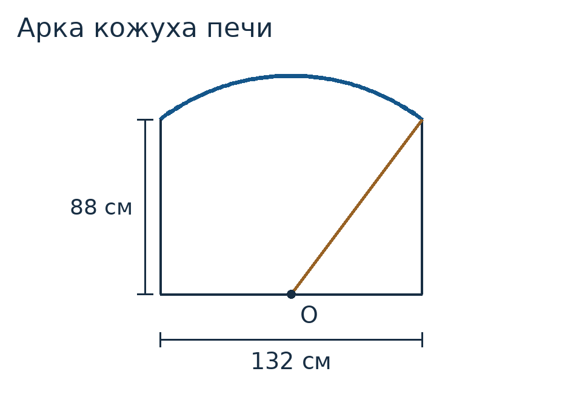
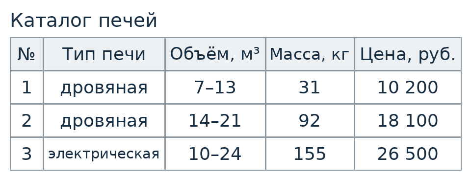
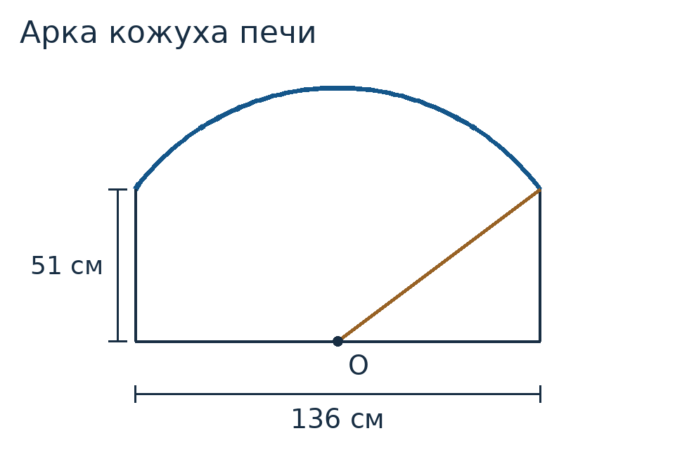
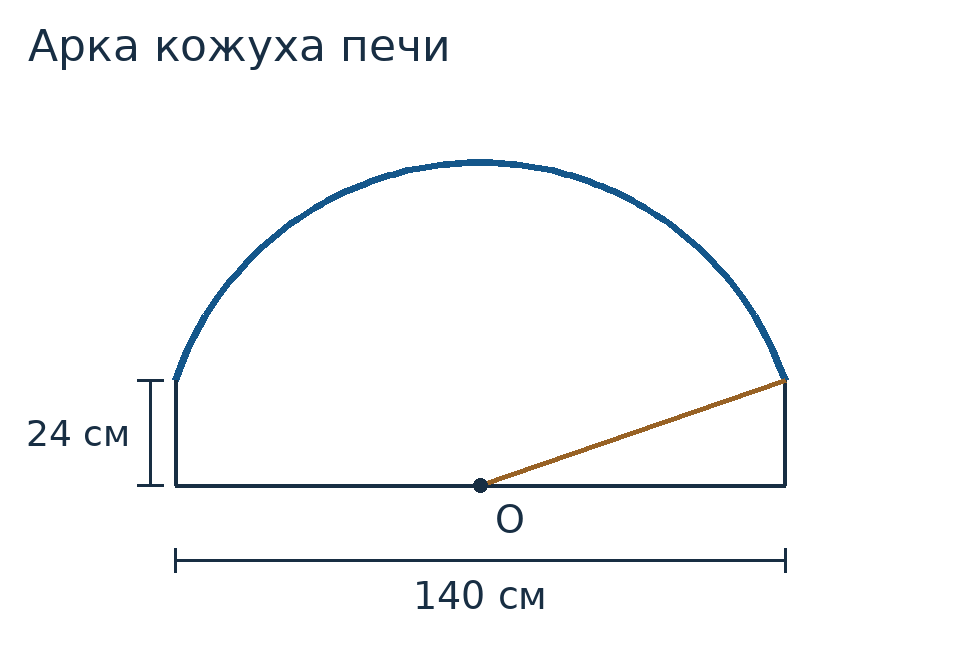
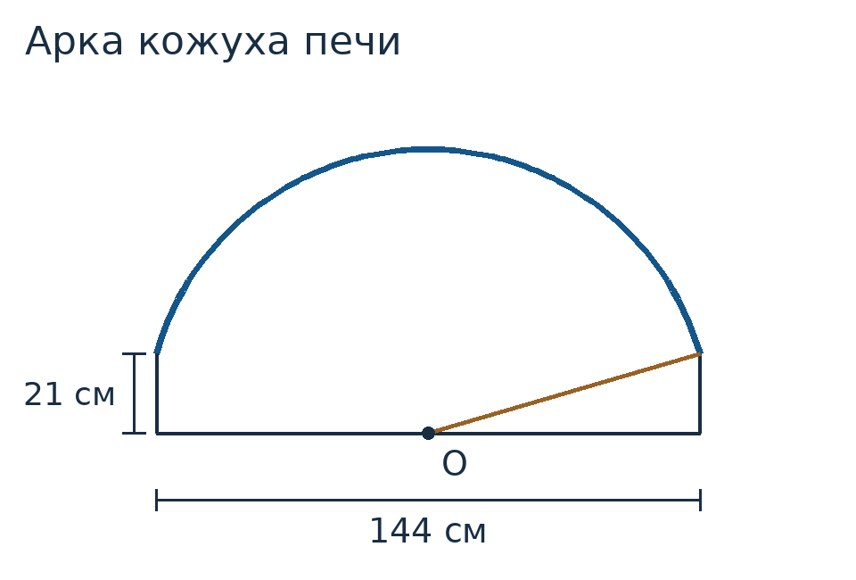
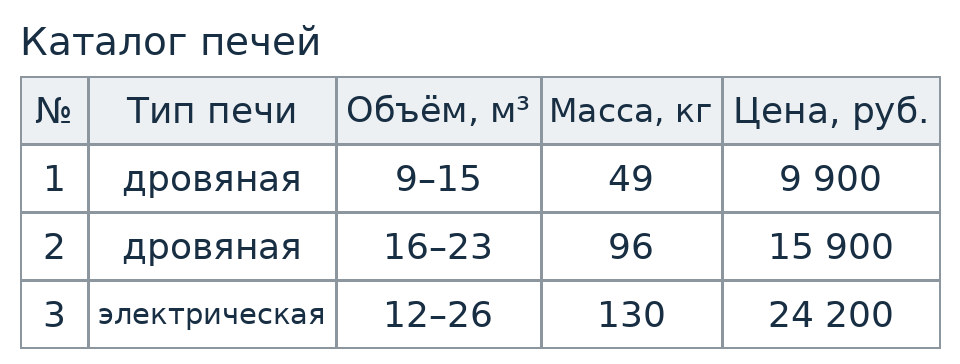
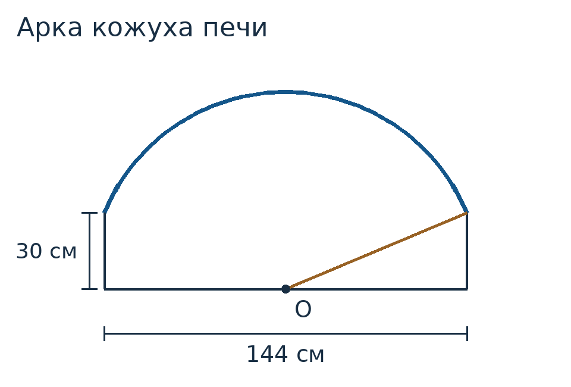
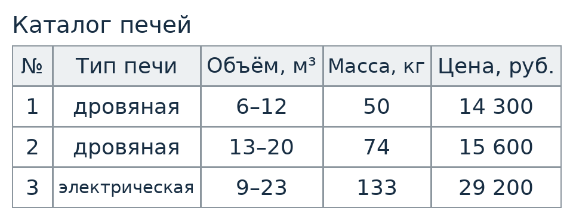
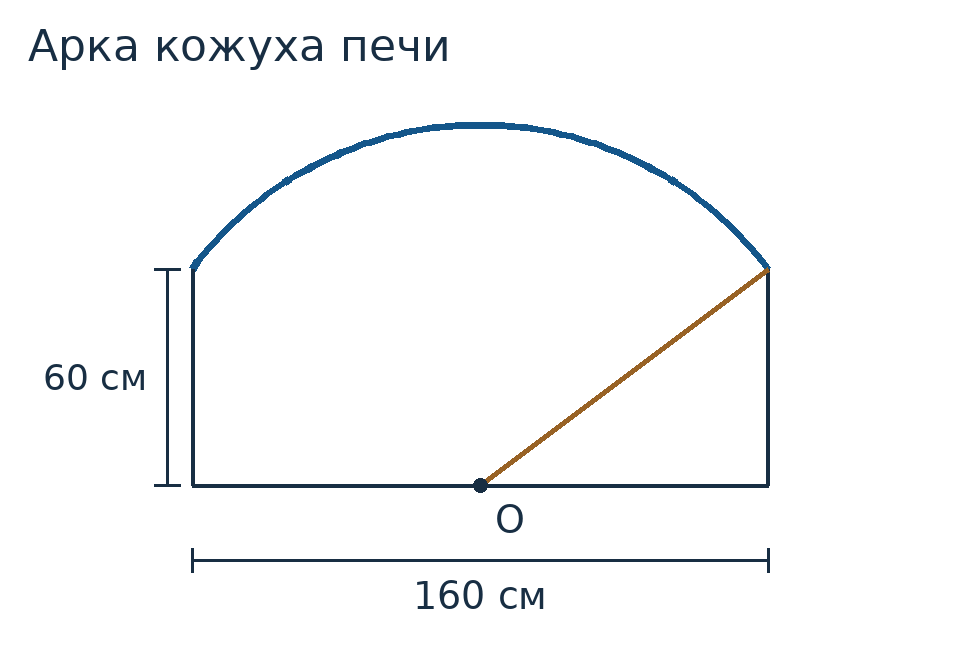

# Печи

[← Атлас №1–25](../README.md)

Каждая пятёрка использует общий набор данных. Рисунок остаётся у первого вопроса, в котором он нужен; при смене материала следующий рисунок показан рядом с вопросом.

- №1 · [Допустимый объём парной](#q-2029-1) · `STOVE-F01-CAPACITY-LIMITS`
- №1 · [Печи по характеристикам](#q-2027-1) · `STOVE-F02-ATTRIBUTE-MATCH`
- №2 · [Объём парной](#q-2027-2) · `STOVE-F03-VOLUME`
- №3 · [Площадь пола](#q-2031-3) · `STOVE-F04-FLOOR-AREA`
- №3 · [Площадь стен с учётом проёмов](#q-2038-3) · `STOVE-F05-WALL-AREA-NET`
- №3 · [Покупка с дополнительными расходами](#q-2028-3) · `STOVE-F06-PURCHASE-EXTRA-COSTS`
- №3 · [Подбор и доставка дровяной печи](#q-2030-3) · `STOVE-F07-FIT-WOOD-DELIVERY`
- №3 · [Сравнение стоимости](#q-2027-3) · `STOVE-F08-COST-COMPARISON`
- №4 · [Цена после скидки](#q-2029-4) · `STOVE-F09-DIRECT-DISCOUNT`
- №4 · [Цена до скидки](#q-2030-4) · `STOVE-F10-REVERSE-DISCOUNT`
- №4 · [Две скидки](#q-2027-4) · `STOVE-F11-CONDITIONAL-TWO-DISCOUNTS`
- №5 · [Радиус арки](#q-2027-5) · `STOVE-F12-ARCH-RADIUS`

## Комплект 2027

Сюжет: печи для бани. Все пять вопросов относятся к одной парной и одному каталогу печей. 
Размеры парной: 2,6 × 2,3 × 2,7 м. Дверь: 89 см × 195 см; окон нет.

Печь | Тип | Объём парной, м³ | Масса, кг | Цена, руб.
---|---|---|---|---
1 | дровяная | 8–14 | 65 | 11 400
2 | дровяная | 15–22 | 76 | 16 300
3 | электрическая | 11–25 | 128 | 25 000

### №1 · `STOVE-F02-ATTRIBUTE-MATCH`

Укажите номера печей, соответствующие значениям цены (руб.) в указанном порядке: 25 000, 11 400, 16 300.

Подсказка 1

Найдите в таблице столбец «цены (руб.)».

Подсказка 2

Для каждого значения запишите номер соответствующей строки.

Ответ и разбор

**Ответ** · 312

1. Сопоставление строк таблицы даёт последовательность 312.

### №2 · `STOVE-F03-VOLUME`

Найдите объём парной. Размеры парной: 2,6 × 2,3 × 2,7 м. Дверь: 89 см × 195 см; окон нет.

Подсказка 1

Объём прямоугольного помещения равен произведению длины, ширины и высоты.

Подсказка 2

Умножьте три размера в метрах.

Ответ и разбор

**Ответ** · 16,146

1. V = 2,6 · 2,3 · 2,7 = 16,146 м³.

### №3 · `STOVE-F08-COST-COMPARISON`

Определите по объёму парной подходящую дровяную печь. На сколько рублей её покупка обойдётся дешевле электрической без учёта установки? Установка электрической печи стоит 4 500 руб.

Подсказка 1

Сначала вычислите объём парной и проверьте диапазоны дровяных печей.

Подсказка 2

Для электрической печи добавьте установку только если это сказано.

Подсказка 3

Из большей стоимости вычтите меньшую.

Ответ и разбор

**Ответ** · 8700

1. Объём парной: 16,146 м³; подходит дровяная печь №2.

2. Стоимость подходящей дровяной печи: 16 300 руб.

3. Стоимость электрической печи без учёта установки: 25 000 руб.

4. Разность равна 8 700 руб.

### №4 · `STOVE-F11-CONDITIONAL-TWO-DISCOUNTS`

Если цена покупки дороже 15 300 руб., на печь действует скидка 5%, а на доставку — скидка 20%. Сколько нужно заплатить за печь №2 с доставкой, если доставка стоит 1 300 руб.?

Подсказка 1

Сравните цену покупки с порогом: условие говорит строго «дороже».

Подсказка 2

Уменьшите цену печи на её скидку.

Подсказка 3

Отдельно уменьшите стоимость доставки на её скидку и сложите.

Ответ и разбор

**Ответ** · 16525

1. Покупка дороже порога: 16 300 > 15 300.

2. Печь после скидки: 16 300 · 95/100 = 15 485 руб.

3. Доставка после скидки: 1 300 · 80/100 = 1 040 руб.

4. Итого: 16 525 руб.

### №5 · `STOVE-F12-ARCH-RADIUS`

Найдите радиус дуги арки кожуха печи. Размеры кожуха указаны на рисунке. Центр окружности находится в середине нижнего основания.

Подсказка 1

Соедините центр окружности с точкой примыкания дуги: получится радиус.

Подсказка 2

Половина ширины основания и высота образуют катеты прямоугольного треугольника.

Подсказка 3

Примените теорему Пифагора.

Ответ и разбор

**Ответ** · 110

1. Половина ширины: 132/2 = 66 см.

2. R² = 66² + 88² = 12100.

3. R = 110 см.

## Комплект 2028

Сюжет: печи для бани. Все пять вопросов относятся к одной парной и одному каталогу печей. 
Размеры парной: 2,5 × 2,8 × 2,2 м. Дверь: 64 см × 202 см; окон нет.

Печь | Тип | Объём парной, м³ | Масса, кг | Цена, руб.
---|---|---|---|---
1 | дровяная | 7–13 | 31 | 10 200
2 | дровяная | 14–21 | 92 | 18 100
3 | электрическая | 10–24 | 155 | 26 500

### №1 · `STOVE-F02-ATTRIBUTE-MATCH`

Укажите номера печей, соответствующие значениям массы (кг) в указанном порядке: 155, 31, 92.

Подсказка 1

Найдите в таблице столбец «массы (кг)».

Подсказка 2

Для каждого значения запишите номер соответствующей строки.

Ответ и разбор

**Ответ** · 312

1. Сопоставление строк таблицы даёт последовательность 312.

### №2 · `STOVE-F03-VOLUME`

Найдите объём парной. Размеры парной: 2,5 × 2,8 × 2,2 м. Дверь: 64 см × 202 см; окон нет.

Подсказка 1

Объём прямоугольного помещения равен произведению длины, ширины и высоты.

Подсказка 2

Умножьте три размера в метрах.

Ответ и разбор

**Ответ** · 15,4

1. V = 2,5 · 2,8 · 2,2 = 15,4 м³.

### №3 · `STOVE-F06-PURCHASE-EXTRA-COSTS`

Сколько рублей будет стоить электрическая печь №3 с установкой и доставкой? Установка стоит 4 600 руб., доставка — 1 400 руб.

Подсказка 1

Возьмите цену электрической печи №3 из таблицы.

Подсказка 2

Прибавьте и установку, и доставку.

Ответ и разбор

**Ответ** · 32500

1. 26 500 + 4 600 + 1 400 = 32 500 руб.

### №4 · `STOVE-F11-CONDITIONAL-TWO-DISCOUNTS`

Если цена покупки дороже 17 100 руб., на печь действует скидка 5%, а на доставку — скидка 20%. Сколько нужно заплатить за печь №2 с доставкой, если доставка стоит 1 400 руб.?

Подсказка 1

Сравните цену покупки с порогом: условие говорит строго «дороже».

Подсказка 2

Уменьшите цену печи на её скидку.

Подсказка 3

Отдельно уменьшите стоимость доставки на её скидку и сложите.

Ответ и разбор

**Ответ** · 18315

1. Покупка дороже порога: 18 100 > 17 100.

2. Печь после скидки: 18 100 · 95/100 = 17 195 руб.

3. Доставка после скидки: 1 400 · 80/100 = 1 120 руб.

4. Итого: 18 315 руб.

### №5 · `STOVE-F12-ARCH-RADIUS`

Найдите радиус дуги арки кожуха печи. Размеры кожуха указаны на рисунке. Центр окружности находится в середине нижнего основания.

Подсказка 1

Соедините центр окружности с точкой примыкания дуги: получится радиус.

Подсказка 2

Половина ширины основания и высота образуют катеты прямоугольного треугольника.

Подсказка 3

Примените теорему Пифагора.

Ответ и разбор

**Ответ** · 85

1. Половина ширины: 136/2 = 68 см.

2. R² = 68² + 51² = 7225.

3. R = 85 см.

## Комплект 2029

Сюжет: печи для бани. Все пять вопросов относятся к одной парной и одному каталогу печей. 
Размеры парной: 3,2 × 2 × 2,2 м. Дверь: 90 см × 196 см; окон нет.

Печь | Тип | Объём парной, м³ | Масса, кг | Цена, руб.
---|---|---|---|---
1 | дровяная | 6–12 | 64 | 10 100
2 | дровяная | 13–20 | 95 | 20 400
3 | электрическая | 9–23 | 133 | 27 600

### №1 · `STOVE-F01-CAPACITY-LIMITS`

Укажите номера печей, соответствующие значениям наибольших границ диапазона объёма, в таком же порядке: 12, 23, 20.

Подсказка 1

Найдите в таблице столбец диапазона объёма.

Подсказка 2

Сопоставьте каждое значение с одной строкой таблицы.

Ответ и разбор

**Ответ** · 132

1. По столбцу верхней границы найдём номера печей: 132.

### №2 · `STOVE-F03-VOLUME`

Найдите объём парной. Размеры парной: 3,2 × 2 × 2,2 м. Дверь: 90 см × 196 см; окон нет.

Подсказка 1

Объём прямоугольного помещения равен произведению длины, ширины и высоты.

Подсказка 2

Умножьте три размера в метрах.

Ответ и разбор

**Ответ** · 14,08

1. V = 3,2 · 2 · 2,2 = 14,08 м³.

### №3 · `STOVE-F06-PURCHASE-EXTRA-COSTS`

Сколько рублей будет стоить электрическая печь №3 с установкой и доставкой? Установка стоит 4 000 руб., доставка — 600 руб.

Подсказка 1

Возьмите цену электрической печи №3 из таблицы.

Подсказка 2

Прибавьте и установку, и доставку.

Ответ и разбор

**Ответ** · 32200

1. 27 600 + 4 000 + 600 = 32 200 руб.

### №4 · `STOVE-F09-DIRECT-DISCOUNT`

На дровяную печь массой 95 кг предоставлена скидка 10%. Сколько будет стоить печь после скидки?

Подсказка 1

После скидки остаётся 90% цены.

Подсказка 2

По массе найдите строку этой печи в таблице, затем умножьте её цену на оставшуюся долю.

Ответ и разбор

**Ответ** · 18360

1. По массе 95 кг находим дровяную печь №2: 20 400 руб.

2. 20 400 · (100 − 10) / 100 = 18 360 руб.

### №5 · `STOVE-F12-ARCH-RADIUS`

Найдите радиус дуги арки кожуха печи. Размеры кожуха указаны на рисунке. Центр окружности находится в середине нижнего основания.

Подсказка 1

Соедините центр окружности с точкой примыкания дуги: получится радиус.

Подсказка 2

Половина ширины основания и высота образуют катеты прямоугольного треугольника.

Подсказка 3

Примените теорему Пифагора.

Ответ и разбор

**Ответ** · 74

1. Половина ширины: 140/2 = 70 см.

2. R² = 70² + 24² = 5476.

3. R = 74 см.

## Комплект 2030

Сюжет: печи для бани. Все пять вопросов относятся к одной парной и одному каталогу печей. 
Размеры парной: 2,4 × 2,8 × 2 м. Дверь: 67 см × 170 см; окон нет.

Печь | Тип | Объём парной, м³ | Масса, кг | Цена, руб.
---|---|---|---|---
1 | дровяная | 5–11 | 49 | 12 700
2 | дровяная | 12–19 | 86 | 16 700
3 | электрическая | 8–22 | 148 | 28 600

### №1 · `STOVE-F01-CAPACITY-LIMITS`

Укажите номера печей, соответствующие значениям наименьших границ диапазона объёма, в таком же порядке: 12, 5, 8.

Подсказка 1

Найдите в таблице столбец диапазона объёма.

Подсказка 2

Сопоставьте каждое значение с одной строкой таблицы.

Ответ и разбор

**Ответ** · 213

1. По столбцу нижней границы найдём номера печей: 213.

### №2 · `STOVE-F03-VOLUME`

Найдите объём парной. Размеры парной: 2,4 × 2,8 × 2 м. Дверь: 67 см × 170 см; окон нет.

Подсказка 1

Объём прямоугольного помещения равен произведению длины, ширины и высоты.

Подсказка 2

Умножьте три размера в метрах.

Ответ и разбор

**Ответ** · 13,44

1. V = 2,4 · 2,8 · 2 = 13,44 м³.

### №3 · `STOVE-F07-FIT-WOOD-DELIVERY`

Для парной из условия выберите подходящую дровяную печь по объёму и найдите её стоимость с доставкой. Доставка стоит 600 руб. Размеры парной: 2,4 × 2,8 × 2 м. Дверь: 67 см × 170 см; окон нет.

Подсказка 1

Сначала вычислите объём парной.

Подсказка 2

Проверьте объём в диапазонах только дровяных печей; границы включаются.

Подсказка 3

К цене единственной подходящей печи прибавьте доставку.

Ответ и разбор

**Ответ** · 17300

1. V = 13,44 м³; подходит дровяная печь №2.

2. 16 700 + 600 = 17 300 руб.

### №4 · `STOVE-F10-REVERSE-DISCOUNT`

В таблице указана нынешняя цена печи №1. По сравнению с прошлым годом она снижена на 20%. Сколько рублей стоила эта печь в прошлом году?

Подсказка 1

После скидки осталось 80% исходной стоимости.

Подсказка 2

Найдите текущую цену этой модели в таблице и разделите на оставшуюся долю.

Ответ и разбор

**Ответ** · 15875

1. C до скидки = 12 700 · 100 / (100 − 20) = 15 875 руб.

### №5 · `STOVE-F12-ARCH-RADIUS`

Найдите радиус дуги арки кожуха печи. Размеры кожуха указаны на рисунке. Центр окружности находится в середине нижнего основания.

Подсказка 1

Соедините центр окружности с точкой примыкания дуги: получится радиус.

Подсказка 2

Половина ширины основания и высота образуют катеты прямоугольного треугольника.

Подсказка 3

Примените теорему Пифагора.

Ответ и разбор

**Ответ** · 75

1. Половина ширины: 144/2 = 72 см.

2. R² = 72² + 21² = 5625.

3. R = 75 см.

## Комплект 2031

Сюжет: печи для бани. Все пять вопросов относятся к одной парной и одному каталогу печей. 
Размеры парной: 2,6 × 2,5 × 2,7 м. Дверь: 57 см × 194 см; окон нет.

Печь | Тип | Объём парной, м³ | Масса, кг | Цена, руб.
---|---|---|---|---
1 | дровяная | 9–15 | 49 | 9 900
2 | дровяная | 16–23 | 96 | 15 900
3 | электрическая | 12–26 | 130 | 24 200

### №1 · `STOVE-F02-ATTRIBUTE-MATCH`

Укажите номера печей, соответствующие значениям цены (руб.) в указанном порядке: 9 900, 15 900, 24 200.

Подсказка 1

Найдите в таблице столбец «цены (руб.)».

Подсказка 2

Для каждого значения запишите номер соответствующей строки.

Ответ и разбор

**Ответ** · 123

1. Сопоставление строк таблицы даёт последовательность 123.

### №2 · `STOVE-F03-VOLUME`

Найдите объём парной. Размеры парной: 2,6 × 2,5 × 2,7 м. Дверь: 57 см × 194 см; окон нет.

Подсказка 1

Объём прямоугольного помещения равен произведению длины, ширины и высоты.

Подсказка 2

Умножьте три размера в метрах.

Ответ и разбор

**Ответ** · 17,55

1. V = 2,6 · 2,5 · 2,7 = 17,55 м³.

### №3 · `STOVE-F04-FLOOR-AREA`

Найдите площадь пола парной. Размеры парной: 2,6 × 2,5 × 2,7 м. Дверь: 57 см × 194 см; окон нет.

Подсказка 1

Площадь прямоугольного пола равна произведению длины на ширину.

Подсказка 2

Высота помещения для площади пола не нужна.

Ответ и разбор

**Ответ** · 6,5

1. S = 2,6 · 2,5 = 6,5 м².

### №4 · `STOVE-F09-DIRECT-DISCOUNT`

На дровяную печь массой 96 кг предоставлена скидка 10%. Сколько будет стоить печь после скидки?

Подсказка 1

После скидки остаётся 90% цены.

Подсказка 2

По массе найдите строку этой печи в таблице, затем умножьте её цену на оставшуюся долю.

Ответ и разбор

**Ответ** · 14310

1. По массе 96 кг находим дровяную печь №2: 15 900 руб.

2. 15 900 · (100 − 10) / 100 = 14 310 руб.

### №5 · `STOVE-F12-ARCH-RADIUS`

Найдите радиус дуги арки кожуха печи. Размеры кожуха указаны на рисунке. Центр окружности находится в середине нижнего основания.

Подсказка 1

Соедините центр окружности с точкой примыкания дуги: получится радиус.

Подсказка 2

Половина ширины основания и высота образуют катеты прямоугольного треугольника.

Подсказка 3

Примените теорему Пифагора.

Ответ и разбор

**Ответ** · 78

1. Половина ширины: 144/2 = 72 см.

2. R² = 72² + 30² = 6084.

3. R = 78 см.

## Комплект 2038

Сюжет: печи для бани. Все пять вопросов относятся к одной парной и одному каталогу печей. 
Размеры парной: 3,2 × 2,2 × 2,1 м. Дверь: 56 см × 181 см; окон нет.

Печь | Тип | Объём парной, м³ | Масса, кг | Цена, руб.
---|---|---|---|---
1 | дровяная | 6–12 | 50 | 14 300
2 | дровяная | 13–20 | 74 | 15 600
3 | электрическая | 9–23 | 133 | 29 200

### №1 · `STOVE-F01-CAPACITY-LIMITS`

Укажите номера печей, соответствующие значениям наименьших границ диапазона объёма, в таком же порядке: 6, 9, 13.

Подсказка 1

Найдите в таблице столбец диапазона объёма.

Подсказка 2

Сопоставьте каждое значение с одной строкой таблицы.

Ответ и разбор

**Ответ** · 132

1. По столбцу нижней границы найдём номера печей: 132.

### №2 · `STOVE-F03-VOLUME`

Найдите объём парной. Размеры парной: 3,2 × 2,2 × 2,1 м. Дверь: 56 см × 181 см; окон нет.

Подсказка 1

Объём прямоугольного помещения равен произведению длины, ширины и высоты.

Подсказка 2

Умножьте три размера в метрах.

Ответ и разбор

**Ответ** · 14,784

1. V = 3,2 · 2,2 · 2,1 = 14,784 м³.

### №3 · `STOVE-F05-WALL-AREA-NET`

Найдите площадь всех стен парной без дверного проёма. Размеры парной: 3,2 × 2,2 × 2,1 м. Дверь: 56 см × 181 см; окон нет.

Подсказка 1

Найдите периметр основания и умножьте его на высоту.

Подсказка 2

Переведите ширину и высоту двери из сантиметров в метры и вычтите её площадь.

Ответ и разбор

**Ответ** · 21,6664

1. S стен = 2 · (3,2 + 2,2) · 2,1 = 22,68 м².

2. S двери = 56 см · 181 см = 1,0136 м².

3. Без проёма: 21,6664 м².

### №4 · `STOVE-F11-CONDITIONAL-TWO-DISCOUNTS`

Если цена покупки дороже 14 600 руб., на печь действует скидка 5%, а на доставку — скидка 20%. Сколько нужно заплатить за печь №2 с доставкой, если доставка стоит 500 руб.?

Подсказка 1

Сравните цену покупки с порогом: условие говорит строго «дороже».

Подсказка 2

Уменьшите цену печи на её скидку.

Подсказка 3

Отдельно уменьшите стоимость доставки на её скидку и сложите.

Ответ и разбор

**Ответ** · 15220

1. Покупка дороже порога: 15 600 > 14 600.

2. Печь после скидки: 15 600 · 95/100 = 14 820 руб.

3. Доставка после скидки: 500 · 80/100 = 400 руб.

4. Итого: 15 220 руб.

### №5 · `STOVE-F12-ARCH-RADIUS`

Найдите радиус дуги арки кожуха печи. Размеры кожуха указаны на рисунке. Центр окружности находится в середине нижнего основания.

Подсказка 1

Соедините центр окружности с точкой примыкания дуги: получится радиус.

Подсказка 2

Половина ширины основания и высота образуют катеты прямоугольного треугольника.

Подсказка 3

Примените теорему Пифагора.

Ответ и разбор

**Ответ** · 100

1. Половина ширины: 160/2 = 80 см.

2. R² = 80² + 60² = 10000.

3. R = 100 см.

