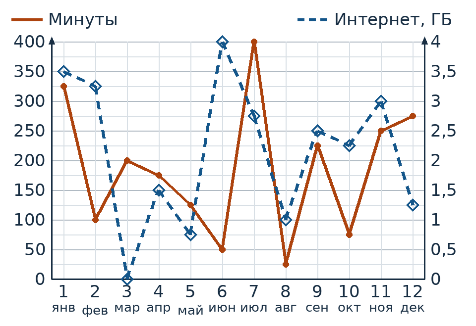
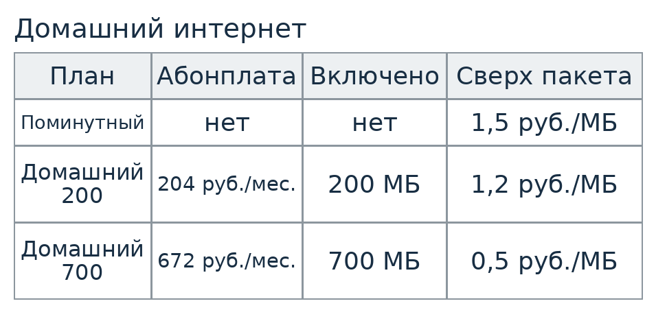

# Тарифы

[← Атлас №1–25](../README.md)

Каждая пятёрка использует общий набор данных. Рисунок остаётся у первого вопроса, в котором он нужен; при смене материала следующий рисунок показан рядом с вопросом.

- №1 · [Месяцы по расходу минут](#q-2027-1) · `TARIFF-F01-MONTHS-MINUTES`
- №2 · [Плата за месяц](#q-2027-2) · `TARIFF-F04-MONTHLY-BILL`
- №3 · [Экстремум расхода по графику](#q-2027-3) · `TARIFF-F05-EXTREMUM`
- №4 · [Изменение абонентской платы](#q-2027-4) · `TARIFF-F09-PERCENT-FEE`
- №5 · [Выбор тарифа домашнего интернета](#q-2027-5) · `TARIFF-F12-HOME-ISP`

## Комплект 2027

За каждый месяц года показаны расход минут исходящих вызовов и мобильного интернета. 
На графике сплошная линия — минуты (левая шкала), пунктирная — интернет в ГБ (правая шкала). 
Тариф «Стандартный»: абонентская плата 350 руб./мес.; включено 300 минут, 3 ГБ и 120 SMS в месяц. 
Сверх пакета: 3 руб./мин.; интернет — 90 руб. за 0.5 ГБ. За год отправлено 110 SMS. 
Таблица вариантов домашнего интернета приведена в задании №5. 
Месяцы указаны в календарном порядке с января по декабрь.

### №1 · `TARIFF-F01-MONTHS-MINUTES`

Определите номера месяцев, в которых израсходовано соответственно 50 мин, 325 мин, 225 мин, 125 мин. Запишите номера подряд, без разделителей.

Подсказка 1

На графике выберите сплошную линию и левую шкалу минут.

Подсказка 2

Для каждого значения найдите месяц; сохраняйте порядок значений в условии.

Ответ и разбор

**Ответ** · 6195

1. 50 мин — июнь (6).

2. 325 мин — январь (1).

3. 225 мин — сентябрь (9).

4. 125 мин — май (5).

5. В указанном порядке получаем код 6195.

### №2 · `TARIFF-F04-MONTHLY-BILL`

Определите плату за услуги связи за февраль при расходе, показанном на графике. Ответ укажите в рублях.

Подсказка 1

Сначала найдите расход минут и ГБ за указанный месяц.

Подсказка 2

Абонплата уже включает пакеты; отдельно посчитайте только превышения. Неполный пакет интернета оплачивается целиком.

Ответ и разбор

**Ответ** · 440

1. Абонплата: 350 руб.

2. Минуты сверх пакета: 0; доплата 0 руб.

3. Пакетов интернета сверх лимита: 1; доплата 90 руб.

4. Итого: 440 руб.

### №3 · `TARIFF-F05-EXTREMUM`

Определите наименьшее количество минут исходящих вызовов за один месяц по графику.

Подсказка 1

Используйте сплошную линию и левую шкалу.

Подсказка 2

Сравните значения для всех двенадцати месяцев и выберите минимальное.

Ответ и разбор

**Ответ** · 25

1. Наименьшая точка ряда минут соответствует август.

2. Минимальный расход равен 25 мин.

### №4 · `TARIFF-F09-PERCENT-FEE`

Абонентская плата выросла с 350 руб. до 490 руб. На сколько процентов она увеличилась?

Подсказка 1

Процент увеличения считают от первоначальной платы.

Подсказка 2

Вычтите старую плату из новой и разделите разность на старую плату.

Ответ и разбор

**Ответ** · 40

1. Изменение платы: 140 руб.

2. 140 / 350 × 100 = 40%.

### №5 · `TARIFF-F12-HOME-ISP`

Месячный расход домашнего интернета составляет 660 МБ. Используйте тарифы в таблице и определите наименьшую плату за месяц. Ответ укажите в рублях.

Подсказка 1

Для каждого плана учтите включённый объём и абонплату.

Подсказка 2

Плату за объём сверх лимита добавляйте только к абонплате этого плана.

Ответ и разбор

**Ответ** · 672

1. Поминутный: сверх пакета 660 МБ; 0 + 660 · 1,5 = 990 руб.

2. Домашний-200: сверх пакета 460 МБ; 204 + 460 · 1,2 = 756 руб.

3. Домашний-700: сверх пакета 0 МБ; 672 + 0 · 0,5 = 672 руб.

4. Наименьшая плата — 672 руб.

