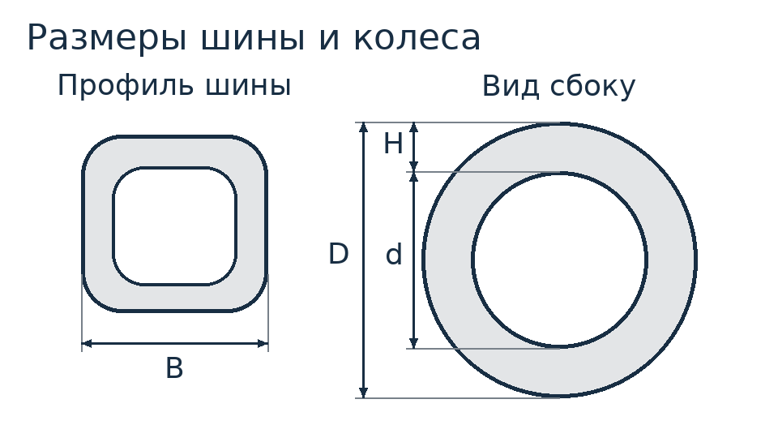
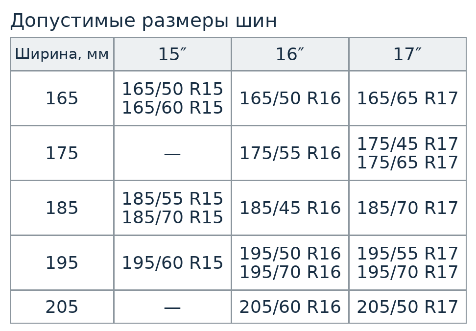

# Шины

[← Атлас №1–25](../README.md)

Каждая пятёрка использует общий набор данных. Рисунок остаётся у первого вопроса, в котором он нужен; при смене материала следующий рисунок показан рядом с вопросом.

- №1 · [Допустимый размер по таблице](#q-2027-1) · `TYRES-TABLE-EXTREME`
- №2 · [Высота боковины](#q-2027-2) · `TYRES-SIDEWALL`
- №3 · [Диаметр колеса](#q-2027-3) · `TYRES-DIAMETER`
- №4 · [Разность радиусов](#q-2027-4) · `TYRES-RADIUS-DELTA`
- №5 · [Изменение пробега за оборот](#q-2027-5) · `TYRES-PERCENT-ROTATION`

## Комплект 2027

**Ситуация.** Завод устанавливает на автомобили шины маркировки **165/60 R18**. Первое число обозначает ширину шины в миллиметрах, второе — высоту боковины в процентах от ширины, а число после R — диаметр диска в дюймах (1 дюйм = 25,4 мм). Диаметр всего колеса равен диаметру диска в миллиметрах плюс две высоты боковины. 
 
В таблице приведены разрешённые размеры шин: 

| Ширина шины (мм) \ Диаметр диска (дюймы) | 15 | 16 | 17 |
|---:|---:|---:|---:|
| 165 | 165/50 R15; 165/60 R15 | 165/50 R16 | 165/65 R17 |
| 175 | — | 175/55 R16 | 175/45 R17; 175/65 R17 |
| 185 | 185/55 R15; 185/70 R15 | 185/45 R16 | 185/70 R17 |
| 195 | 195/60 R15 | 195/50 R16; 195/70 R16 | 195/55 R17; 195/70 R17 |
| 205 | — | 205/60 R16 | 205/50 R17 |

 
Схема показывает величины B, H, d и D. Рисунок условный и не в масштабе.

### №1 · `TYRES-TABLE-EXTREME`

Шины какой наименьшей ширины можно устанавливать на автомобиль, если диаметр диска равен 16 дюймам? Ответ дайте в миллиметрах.

Подсказка 1

Найдите в таблице столбец с указанным диаметром диска.

Подсказка 2

Среди непустых ячеек этого столбца выберите строку с наименьшей шириной.

Ответ и разбор

**Ответ** · 165

1. В столбце 16 дюйма сравниваем ширины из непустых ячеек.

2. Наименьшая ширина равна 165 мм.

### №2 · `TYRES-SIDEWALL`

Сколько миллиметров составляет высота боковины шины маркировки 195/55 R17?

Подсказка 1

Второе число маркировки задаёт долю высоты боковины от ширины.

Подсказка 2

Умножьте ширину шины на процент и разделите на 100.

Ответ и разбор

**Ответ** · 107.25

1. H = 195 · 55 / 100.

2. H = 107.25 мм.

### №3 · `TYRES-DIAMETER`

Найдите диаметр колеса автомобиля, выходящего с завода. Ответ дайте в миллиметрах.

Подсказка 1

Из маркировки 165/60 R18 найдите высоту боковины и диаметр диска.

Подсказка 2

К диаметру диска прибавьте две высоты боковины.

Ответ и разбор

**Ответ** · 655.2

1. Высота боковины: 165 · 60 / 100 = 99 мм.

2. Диаметр диска: 18 · 25,4 = 457.2 мм.

3. D = 457.2 + 2 · 99 = 655.2 мм.

### №4 · `TYRES-RADIUS-DELTA`

На сколько миллиметров радиус колеса с шиной 165/50 R18 меньше, чем радиус колеса с шиной 185/65 R18?

Подсказка 1

Вычислите высоту боковины каждой шины.

Подсказка 2

Радиус равен половине диаметра; сравните радиусы в указанном порядке.

Ответ и разбор

**Ответ** · 37.75

1. Разность диаметров: 75.5 мм.

2. Разность радиусов в заданном направлении: 37.75 мм.

### №5 · `TYRES-PERCENT-ROTATION`

На сколько процентов увеличится пробег автомобиля при одном обороте колеса, если заменить заводские колёса шинами 175/60 R18? Результат округлите до десятых.

Подсказка 1

Путь за один оборот пропорционален длине окружности πD.

Подсказка 2

В относительном изменении множитель π сокращается; сравните диаметры.

Ответ и разбор

**Ответ** · 1.8

1. Dзавод = 655.2 мм; Dнов = 667.2 мм.

2. Изменение = 100 · (Dнов / Dзавод − 1) = 1.8% после округления до десятых.

