# №20 · Уравнения, неравенства и системы

[К сводке](../README.md)

## Целые уравнения · Многочлен и разложение

`OGE20-poly-factor`

### Задача 1 · 438301

Найдите все действительные решения уравнения $x(x^2+2x+1)=2(x+1)$.

Подсказка 1

Сначала собери все слагаемые в одной части. Где можно выделить общий множитель?

Подсказка 2

Запиши отдельное уравнение для каждого множителя.

Ответ для самопроверки

$x\in\{-2,-1,1\}$.

Разбор и критерии

1. Заметим, что $x^2+2x+1=(x+1)^2$.
2. После переноса правой части влево получаем $(x+1)(x(x+1)-2)=0$.
3. Второй множитель — $x^2+x-2=(x+2)(x-1)$.
4. Каждый из трёх множителей может обратиться в ноль, других корней нет.

**Критерии**

- **2 балла.** Есть математически обоснованный верный ответ. Получены и обоснованы все три корня.
- **1 балл.** Решение завершено, но допущена вычислительная ошибка. Все последующие шаги верны с учётом её результата. Разложение и метод верны, но при завершённом решении допущена ошибка в вычислении одного корня, дальнейшие действия согласованы с ней.
- **0 баллов.** Решение не удовлетворяет условиям для 1 или 2 баллов. Деление на x+1 без выделения случая x=−1.

[Источник карточки](https://math-oge.sdamgia.ru/problem?id=438301)

### Задача 2 · 311589

Найдите действительные решения уравнения $x^{3}=x^{2} - 7 x + 7$.

Подсказка 1

Сначала собери все слагаемые в одной части. Где можно выделить общий множитель?

Подсказка 2

Запиши отдельное уравнение для каждого множителя.

Ответ для самопроверки

$x\in\{1\}$

Разбор и критерии

1. Переносим все слагаемые в левую часть, раскрываем скобки там, где это нужно, и приводим подобные.
2. Получаем $\left(x - 1\right) \left(x^{2} + 7\right)=0$. Произведение равно нулю, если хотя бы один множитель равен нулю. Решаем каждое из этих уравнений.

**Критерии**

- **2 балла.** Есть математически обоснованный верный ответ. Группировка или общий множитель с отдельным учётом нулей каждого множителя
- **1 балл.** Решение завершено, но допущена вычислительная ошибка. Все последующие шаги верны с учётом её результата. Обоснованное преобразование и правильный способ применены до конца. После единичного вычислительного сбоя остальные операции согласованы с ним.
- **0 баллов.** Решение не удовлетворяет условиям для 1 или 2 баллов. Искажено равносильное преобразование или потеряна существенная часть допустимых случаев.

[Источник карточки](https://math-oge.sdamgia.ru/problem?id=311589)

### Задача 3 · 338079

Найдите действительные решения уравнения $\left(x - 3\right) \left(x - 4\right) \left(x - 5\right)=\left(x - 2\right) \left(x - 4\right) \left(x - 5\right)$.

Подсказка 1

Сначала собери все слагаемые в одной части. Где можно выделить общий множитель?

Подсказка 2

Запиши отдельное уравнение для каждого множителя.

Ответ для самопроверки

$x\in\{4;5\}$

Разбор и критерии

1. Переносим все слагаемые в левую часть, раскрываем скобки там, где это нужно, и приводим подобные.
2. Получаем $- \left(x - 5\right) \left(x - 4\right)=0$. Произведение равно нулю, если хотя бы один множитель равен нулю. Решаем каждое из этих уравнений.

**Критерии**

- **2 балла.** Есть математически обоснованный верный ответ. Группировка или общий множитель с отдельным учётом нулей каждого множителя
- **1 балл.** Решение завершено, но допущена вычислительная ошибка. Все последующие шаги верны с учётом её результата. Обоснованное преобразование и правильный способ применены до конца. После единичного вычислительного сбоя остальные операции согласованы с ним.
- **0 баллов.** Решение не удовлетворяет условиям для 1 или 2 баллов. Искажено равносильное преобразование или потеряна существенная часть допустимых случаев.

[Источник карточки](https://math-oge.sdamgia.ru/problem?id=338079)

### Задача 4 · 338348

Найдите действительные решения уравнения $\left(x - 2\right) \left(2 x - 2\right)^{2}=\left(x - 2\right)^{2} \left(2 x - 2\right)$.

Подсказка 1

Сначала собери все слагаемые в одной части. Где можно выделить общий множитель?

Подсказка 2

Запиши отдельное уравнение для каждого множителя.

Ответ для самопроверки

$x\in\{0;1;2\}$

Разбор и критерии

1. Переносим все слагаемые в левую часть, раскрываем скобки там, где это нужно, и приводим подобные.
2. Получаем $2 x \left(x - 2\right) \left(x - 1\right)=0$. Произведение равно нулю, если хотя бы один множитель равен нулю. Решаем каждое из этих уравнений.

**Критерии**

- **2 балла.** Есть математически обоснованный верный ответ. Группировка или общий множитель с отдельным учётом нулей каждого множителя
- **1 балл.** Решение завершено, но допущена вычислительная ошибка. Все последующие шаги верны с учётом её результата. Обоснованное преобразование и правильный способ применены до конца. После единичного вычислительного сбоя остальные операции согласованы с ним.
- **0 баллов.** Решение не удовлетворяет условиям для 1 или 2 баллов. Искажено равносильное преобразование или потеряна существенная часть допустимых случаев.

[Источник карточки](https://math-oge.sdamgia.ru/problem?id=338348)

### Задача 5 · 311586

Найдите действительные решения уравнения $x^{3} - 3 x^{2} - 8 x + 24=0$.

Подсказка 1

Сначала собери все слагаемые в одной части. Где можно выделить общий множитель?

Подсказка 2

Запиши отдельное уравнение для каждого множителя.

Ответ для самопроверки

$x\in\{3;- 2 \sqrt{2};2 \sqrt{2}\}$

Разбор и критерии

1. Переносим все слагаемые в левую часть, раскрываем скобки там, где это нужно, и приводим подобные.
2. Получаем $\left(x - 3\right) \left(x^{2} - 8\right)=0$. Произведение равно нулю, если хотя бы один множитель равен нулю. Решаем каждое из этих уравнений.

**Критерии**

- **2 балла.** Есть математически обоснованный верный ответ. Группировка или общий множитель с отдельным учётом нулей каждого множителя
- **1 балл.** Решение завершено, но допущена вычислительная ошибка. Все последующие шаги верны с учётом её результата. Обоснованное преобразование и правильный способ применены до конца. После единичного вычислительного сбоя остальные операции согласованы с ним.
- **0 баллов.** Решение не удовлетворяет условиям для 1 или 2 баллов. Искажено равносильное преобразование или потеряна существенная часть допустимых случаев.

[Источник карточки](https://math-oge.sdamgia.ru/problem?id=311586)

### Задача 6 · 311594

Найдите действительные решения уравнения $x^{3}=4 x^{2} + 5 x$.

Подсказка 1

Сначала собери все слагаемые в одной части. Где можно выделить общий множитель?

Подсказка 2

Запиши отдельное уравнение для каждого множителя.

Ответ для самопроверки

$x\in\{-1;0;5\}$

Разбор и критерии

1. Переносим все слагаемые в левую часть, раскрываем скобки там, где это нужно, и приводим подобные.
2. Получаем $x \left(x - 5\right) \left(x + 1\right)=0$. Произведение равно нулю, если хотя бы один множитель равен нулю. Решаем каждое из этих уравнений.

**Критерии**

- **2 балла.** Есть математически обоснованный верный ответ. Группировка или общий множитель с отдельным учётом нулей каждого множителя
- **1 балл.** Решение завершено, но допущена вычислительная ошибка. Все последующие шаги верны с учётом её результата. Обоснованное преобразование и правильный способ применены до конца. После единичного вычислительного сбоя остальные операции согласованы с ним.
- **0 баллов.** Решение не удовлетворяет условиям для 1 или 2 баллов. Искажено равносильное преобразование или потеряна существенная часть допустимых случаев.

[Источник карточки](https://math-oge.sdamgia.ru/problem?id=311594)

## Целые уравнения · Приведение к квадратному

`OGE20-poly-quadratic`

### Задача 1 · 311591

Найдите действительные решения уравнения $\left(2 x - 3\right)^{2}=\left(1 - 2 x\right)^{2}$.

Подсказка 1

Приведи левую и правую части к стандартному виду.

Подсказка 2

Используй разность квадратов или реши уравнение после приведения подобных.

Ответ для самопроверки

$x\in\{1\}$

Разбор и критерии

1. Переносим все слагаемые в левую часть, раскрываем скобки там, где это нужно, и приводим подобные.
2. Получаем $- 8 \left(x - 1\right)=0$. Решаем линейное уравнение.

**Критерии**

- **2 балла.** Есть математически обоснованный верный ответ. Раскрыть скобки и привести к стандартному виду или разложить разность квадратов
- **1 балл.** Решение завершено, но допущена вычислительная ошибка. Все последующие шаги верны с учётом её результата. Обоснованное преобразование и правильный способ применены до конца. После единичного вычислительного сбоя остальные операции согласованы с ним.
- **0 баллов.** Решение не удовлетворяет условиям для 1 или 2 баллов. Искажено равносильное преобразование или потеряна существенная часть допустимых случаев.

[Источник карточки](https://math-oge.sdamgia.ru/problem?id=311591)

### Задача 2 · 338498

Найдите действительные решения уравнения $- 3 x^{2} - 14 x - 7=\left(x - 1\right)^{2}$.

Подсказка 1

Приведи левую и правую части к стандартному виду.

Подсказка 2

Используй разность квадратов или реши уравнение после приведения подобных.

Ответ для самопроверки

$x\in\{-2;-1\}$

Разбор и критерии

1. Переносим все слагаемые в левую часть, раскрываем скобки там, где это нужно, и приводим подобные.
2. Получаем $- 4 \left(x + 1\right) \left(x + 2\right)=0$. Произведение равно нулю, если хотя бы один множитель равен нулю. Решаем каждое из этих уравнений.

**Критерии**

- **2 балла.** Есть математически обоснованный верный ответ. Раскрыть скобки и привести к стандартному виду или разложить разность квадратов
- **1 балл.** Решение завершено, но допущена вычислительная ошибка. Все последующие шаги верны с учётом её результата. Обоснованное преобразование и правильный способ применены до конца. После единичного вычислительного сбоя остальные операции согласованы с ним.
- **0 баллов.** Решение не удовлетворяет условиям для 1 или 2 баллов. Искажено равносильное преобразование или потеряна существенная часть допустимых случаев.

[Источник карточки](https://math-oge.sdamgia.ru/problem?id=338498)

### Задача 3 · 338632

Найдите действительные решения уравнения $10 x^{2} - 12 x + 1=- 10 x^{2}$.

Подсказка 1

Приведи левую и правую части к стандартному виду.

Подсказка 2

Используй разность квадратов или реши уравнение после приведения подобных.

Ответ для самопроверки

$x\in\{\frac{1}{10};\frac{1}{2}\}$

Разбор и критерии

1. Переносим все слагаемые в левую часть, раскрываем скобки там, где это нужно, и приводим подобные.
2. Получаем $\left(2 x - 1\right) \left(10 x - 1\right)=0$. Произведение равно нулю, если хотя бы один множитель равен нулю. Решаем каждое из этих уравнений.

**Критерии**

- **2 балла.** Есть математически обоснованный верный ответ. Раскрыть скобки и привести к стандартному виду или разложить разность квадратов
- **1 балл.** Решение завершено, но допущена вычислительная ошибка. Все последующие шаги верны с учётом её результата. Обоснованное преобразование и правильный способ применены до конца. После единичного вычислительного сбоя остальные операции согласованы с ним.
- **0 баллов.** Решение не удовлетворяет условиям для 1 или 2 баллов. Искажено равносильное преобразование или потеряна существенная часть допустимых случаев.

[Источник карточки](https://math-oge.sdamgia.ru/problem?id=338632)

### Задача 4 · 338506

Найдите действительные решения уравнения $3 x^{2} - 7 x + 29=\left(x + 4\right)^{2}$.

Подсказка 1

Приведи левую и правую части к стандартному виду.

Подсказка 2

Используй разность квадратов или реши уравнение после приведения подобных.

Ответ для самопроверки

$x\in\{1;\frac{13}{2}\}$

Разбор и критерии

1. Переносим все слагаемые в левую часть, раскрываем скобки там, где это нужно, и приводим подобные.
2. Получаем $\left(x - 1\right) \left(2 x - 13\right)=0$. Произведение равно нулю, если хотя бы один множитель равен нулю. Решаем каждое из этих уравнений.

**Критерии**

- **2 балла.** Есть математически обоснованный верный ответ. Раскрыть скобки и привести к стандартному виду или разложить разность квадратов
- **1 балл.** Решение завершено, но допущена вычислительная ошибка. Все последующие шаги верны с учётом её результата. Обоснованное преобразование и правильный способ применены до конца. После единичного вычислительного сбоя остальные операции согласованы с ним.
- **0 баллов.** Решение не удовлетворяет условиям для 1 или 2 баллов. Искажено равносильное преобразование или потеряна существенная часть допустимых случаев.

[Источник карточки](https://math-oge.sdamgia.ru/problem?id=338506)

### Задача 5 · 338645

Найдите действительные решения уравнения $4 x^{2} - 9 x + 12=\left(x + 6\right)^{2}$.

Подсказка 1

Приведи левую и правую части к стандартному виду.

Подсказка 2

Используй разность квадратов или реши уравнение после приведения подобных.

Ответ для самопроверки

$x\in\{-1;8\}$

Разбор и критерии

1. Переносим все слагаемые в левую часть, раскрываем скобки там, где это нужно, и приводим подобные.
2. Получаем $3 \left(x - 8\right) \left(x + 1\right)=0$. Произведение равно нулю, если хотя бы один множитель равен нулю. Решаем каждое из этих уравнений.

**Критерии**

- **2 балла.** Есть математически обоснованный верный ответ. Раскрыть скобки и привести к стандартному виду или разложить разность квадратов
- **1 балл.** Решение завершено, но допущена вычислительная ошибка. Все последующие шаги верны с учётом её результата. Обоснованное преобразование и правильный способ применены до конца. После единичного вычислительного сбоя остальные операции согласованы с ним.
- **0 баллов.** Решение не удовлетворяет условиям для 1 или 2 баллов. Искажено равносильное преобразование или потеряна существенная часть допустимых случаев.

[Источник карточки](https://math-oge.sdamgia.ru/problem?id=338645)

### Задача 6 · 338662

Найдите действительные решения уравнения $\frac{3 x^{2}}{2} - 2 x - 2=0$.

Подсказка 1

Приведи левую и правую части к стандартному виду.

Подсказка 2

Используй разность квадратов или реши уравнение после приведения подобных.

Ответ для самопроверки

$x\in\{- \frac{2}{3};2\}$

Разбор и критерии

1. Переносим все слагаемые в левую часть, раскрываем скобки там, где это нужно, и приводим подобные.
2. Получаем $\frac{\left(x - 2\right) \left(3 x + 2\right)}{2}=0$. Произведение равно нулю, если хотя бы один множитель равен нулю. Решаем каждое из этих уравнений.

**Критерии**

- **2 балла.** Есть математически обоснованный верный ответ. Раскрыть скобки и привести к стандартному виду или разложить разность квадратов
- **1 балл.** Решение завершено, но допущена вычислительная ошибка. Все последующие шаги верны с учётом её результата. Обоснованное преобразование и правильный способ применены до конца. После единичного вычислительного сбоя остальные операции согласованы с ним.
- **0 баллов.** Решение не удовлетворяет условиям для 1 или 2 баллов. Искажено равносильное преобразование или потеряна существенная часть допустимых случаев.

[Источник карточки](https://math-oge.sdamgia.ru/problem?id=338662)

## Целые уравнения · Замена переменной

`OGE20-poly-substitution`

### Задача 1 · 338951

Найдите все корни уравнения $(x+2)^4-4(x+2)^2-5=0$.

Подсказка 1

Найди выражение, которое повторяется во второй и четвёртой степенях.

Подсказка 2

Если t заменяет квадрат, оно неотрицательно. После решения возвращайся к x с обоими знаками.

Ответ для самопроверки

$x=-2-\sqrt5$ или $x=-2+\sqrt5$.

Разбор и критерии

1. Положим $t=(x+2)^2$, поэтому $t\ge0$.
2. Получаем $t^2-4t-5=(t-5)(t+1)=0$.
3. Значение $t=-1$ невозможно.
4. При $t=5$ имеем $x+2=\pm\sqrt5$, что даёт два корня.

**Критерии**

- **2 балла.** Есть математически обоснованный верный ответ. Установлено ограничение t≥0, выполнена обратная подстановка для обоих знаков.
- **1 балл.** Решение завершено, но допущена вычислительная ошибка. Все последующие шаги верны с учётом её результата. При завершённом верном по методу решении есть вычислительная ошибка, а обратная подстановка после неё выполнена корректно.
- **0 баллов.** Решение не удовлетворяет условиям для 1 или 2 баллов. Отрицательный квадрат принят как допустимое действительное значение или в обратной подстановке потерян один знак без обоснования.

[Источник карточки](https://math-oge.sdamgia.ru/problem?id=338951)

### Задача 2 · 348808

Найдите действительные решения уравнения $\left(x - 4\right)^{4} - 4 \left(x - 4\right)^{2} - 21=0$.

Подсказка 1

Найди выражение, которое повторяется во второй и четвёртой степенях.

Подсказка 2

Если t заменяет квадрат, оно неотрицательно. После решения возвращайся к x с обоими знаками.

Ответ для самопроверки

$x\in\{4 - \sqrt{7};\sqrt{7} + 4\}$

Разбор и критерии

1. Положим $t=\left(x - 4\right)^{2}$, где $t\ge0$. После замены имеем $\left(t - 7\right) \left(t + 3\right)=0$.
2. Решаем уравнение для t и возвращаемся к исходной переменной: $t=-3$ отбрасываем: квадрат неотрицателен; $t=7$ даёт $\{4 - \sqrt{7};\sqrt{7} + 4\}$ после решения $\left(x - 4\right)^{2}=7$.

**Критерии**

- **2 балла.** Есть математически обоснованный верный ответ. Биквадратное или квадрат от выражения, затем обратная подстановка с ограничением
- **1 балл.** Решение завершено, но допущена вычислительная ошибка. Все последующие шаги верны с учётом её результата. Обоснованное преобразование и правильный способ применены до конца. После единичного вычислительного сбоя остальные операции согласованы с ним.
- **0 баллов.** Решение не удовлетворяет условиям для 1 или 2 баллов. Искажено равносильное преобразование или потеряна существенная часть допустимых случаев.

[Источник карточки](https://math-oge.sdamgia.ru/problem?id=348808)

### Задача 3 · 352292

Найдите действительные решения уравнения $\left(x + 1\right)^{4} + \left(x + 1\right)^{2} - 6=0$.

Подсказка 1

Найди выражение, которое повторяется во второй и четвёртой степенях.

Подсказка 2

Если t заменяет квадрат, оно неотрицательно. После решения возвращайся к x с обоими знаками.

Ответ для самопроверки

$x\in\{-1 + \sqrt{2};- \sqrt{2} - 1\}$

Разбор и критерии

1. Положим $t=\left(x + 1\right)^{2}$, где $t\ge0$. После замены имеем $\left(t - 2\right) \left(t + 3\right)=0$.
2. Решаем уравнение для t и возвращаемся к исходной переменной: $t=-3$ отбрасываем: квадрат неотрицателен; $t=2$ даёт $\{-1 + \sqrt{2};- \sqrt{2} - 1\}$ после решения $\left(x + 1\right)^{2}=2$.

**Критерии**

- **2 балла.** Есть математически обоснованный верный ответ. Биквадратное или квадрат от выражения, затем обратная подстановка с ограничением
- **1 балл.** Решение завершено, но допущена вычислительная ошибка. Все последующие шаги верны с учётом её результата. Обоснованное преобразование и правильный способ применены до конца. После единичного вычислительного сбоя остальные операции согласованы с ним.
- **0 баллов.** Решение не удовлетворяет условиям для 1 или 2 баллов. Искажено равносильное преобразование или потеряна существенная часть допустимых случаев.

[Источник карточки](https://math-oge.sdamgia.ru/problem?id=352292)

### Задача 4 · 357246

Найдите действительные решения уравнения $\left(x + 1\right)^{4} - \left(x + 1\right)^{2} - 6=0$.

Подсказка 1

Найди выражение, которое повторяется во второй и четвёртой степенях.

Подсказка 2

Если t заменяет квадрат, оно неотрицательно. После решения возвращайся к x с обоими знаками.

Ответ для самопроверки

$x\in\{-1 + \sqrt{3};- \sqrt{3} - 1\}$

Разбор и критерии

1. Положим $t=\left(x + 1\right)^{2}$, где $t\ge0$. После замены имеем $\left(t - 3\right) \left(t + 2\right)=0$.
2. Решаем уравнение для t и возвращаемся к исходной переменной: $t=-2$ отбрасываем: квадрат неотрицателен; $t=3$ даёт $\{-1 + \sqrt{3};- \sqrt{3} - 1\}$ после решения $\left(x + 1\right)^{2}=3$.

**Критерии**

- **2 балла.** Есть математически обоснованный верный ответ. Биквадратное или квадрат от выражения, затем обратная подстановка с ограничением
- **1 балл.** Решение завершено, но допущена вычислительная ошибка. Все последующие шаги верны с учётом её результата. Обоснованное преобразование и правильный способ применены до конца. После единичного вычислительного сбоя остальные операции согласованы с ним.
- **0 баллов.** Решение не удовлетворяет условиям для 1 или 2 баллов. Искажено равносильное преобразование или потеряна существенная часть допустимых случаев.

[Источник карточки](https://math-oge.sdamgia.ru/problem?id=357246)

### Задача 5 · 357247

Найдите действительные решения уравнения $\left(x + 3\right)^{4} + 2 \left(x + 3\right)^{2} - 8=0$.

Подсказка 1

Найди выражение, которое повторяется во второй и четвёртой степенях.

Подсказка 2

Если t заменяет квадрат, оно неотрицательно. После решения возвращайся к x с обоими знаками.

Ответ для самопроверки

$x\in\{-3 - \sqrt{2};-3 + \sqrt{2}\}$

Разбор и критерии

1. Положим $t=\left(x + 3\right)^{2}$, где $t\ge0$. После замены имеем $\left(t - 2\right) \left(t + 4\right)=0$.
2. Решаем уравнение для t и возвращаемся к исходной переменной: $t=-4$ отбрасываем: квадрат неотрицателен; $t=2$ даёт $\{-3 - \sqrt{2};-3 + \sqrt{2}\}$ после решения $\left(x + 3\right)^{2}=2$.

**Критерии**

- **2 балла.** Есть математически обоснованный верный ответ. Биквадратное или квадрат от выражения, затем обратная подстановка с ограничением
- **1 балл.** Решение завершено, но допущена вычислительная ошибка. Все последующие шаги верны с учётом её результата. Обоснованное преобразование и правильный способ применены до конца. После единичного вычислительного сбоя остальные операции согласованы с ним.
- **0 баллов.** Решение не удовлетворяет условиям для 1 или 2 баллов. Искажено равносильное преобразование или потеряна существенная часть допустимых случаев.

[Источник карточки](https://math-oge.sdamgia.ru/problem?id=357247)

### Задача 6 · 406321

Найдите действительные решения уравнения $\left(x - 2\right)^{4} + 3 \left(x - 2\right)^{2} - 10=0$.

Подсказка 1

Найди выражение, которое повторяется во второй и четвёртой степенях.

Подсказка 2

Если t заменяет квадрат, оно неотрицательно. После решения возвращайся к x с обоими знаками.

Ответ для самопроверки

$x\in\{2 - \sqrt{2};\sqrt{2} + 2\}$

Разбор и критерии

1. Положим $t=\left(x - 2\right)^{2}$, где $t\ge0$. После замены имеем $\left(t - 2\right) \left(t + 5\right)=0$.
2. Решаем уравнение для t и возвращаемся к исходной переменной: $t=-5$ отбрасываем: квадрат неотрицателен; $t=2$ даёт $\{2 - \sqrt{2};\sqrt{2} + 2\}$ после решения $\left(x - 2\right)^{2}=2$.

**Критерии**

- **2 балла.** Есть математически обоснованный верный ответ. Биквадратное или квадрат от выражения, затем обратная подстановка с ограничением
- **1 балл.** Решение завершено, но допущена вычислительная ошибка. Все последующие шаги верны с учётом её результата. Обоснованное преобразование и правильный способ применены до конца. После единичного вычислительного сбоя остальные операции согласованы с ним.
- **0 баллов.** Решение не удовлетворяет условиям для 1 или 2 баллов. Искажено равносильное преобразование или потеряна существенная часть допустимых случаев.

[Источник карточки](https://math-oge.sdamgia.ru/problem?id=406321)

## Целые уравнения · Сумма неотрицательных степеней

`OGE20-power-sums`

### Задача 1 · 311618

Найдите действительные решения уравнения $\left(x^{2} - 25\right)^{2} + \left(x^{2} + 3 x - 10\right)^{2}=0$.

Подсказка 1

Подумай, какие знаки могут иметь квадраты.

Подсказка 2

При сумме, равной нулю, каждый квадрат равен нулю одновременно.

Ответ для самопроверки

$x\in\{-5\}$

Разбор и критерии

1. Квадраты действительных чисел неотрицательны. Их сумма равна нулю ровно тогда, когда каждый из них равен нулю.
2. Из $x^{2} - 25=0$ получаем $\{-5;5\}$, из $x^{2} + 3 x - 10=0$ — $\{-5;2\}$. Берём пересечение двух множеств.

**Критерии**

- **2 балла.** Есть математически обоснованный верный ответ. Нуль суммы квадратов требует одновременного нуля каждого слагаемого
- **1 балл.** Решение завершено, но допущена вычислительная ошибка. Все последующие шаги верны с учётом её результата. Обоснованное преобразование и правильный способ применены до конца. После единичного вычислительного сбоя остальные операции согласованы с ним.
- **0 баллов.** Решение не удовлетворяет условиям для 1 или 2 баллов. Искажено равносильное преобразование или потеряна существенная часть допустимых случаев.

[Источник карточки](https://math-oge.sdamgia.ru/problem?id=311618)

### Задача 2 · 338137

Найдите действительные решения уравнения $\left(x^{2} - 36\right)^{2} + \left(x^{2} + 4 x - 12\right)^{2}=0$.

Подсказка 1

Подумай, какие знаки могут иметь квадраты.

Подсказка 2

При сумме, равной нулю, каждый квадрат равен нулю одновременно.

Ответ для самопроверки

$x\in\{-6\}$

Разбор и критерии

1. Квадраты действительных чисел неотрицательны. Их сумма равна нулю ровно тогда, когда каждый из них равен нулю.
2. Из $x^{2} - 36=0$ получаем $\{-6;6\}$, из $x^{2} + 4 x - 12=0$ — $\{-6;2\}$. Берём пересечение двух множеств.

**Критерии**

- **2 балла.** Есть математически обоснованный верный ответ. Нуль суммы квадратов требует одновременного нуля каждого слагаемого
- **1 балл.** Решение завершено, но допущена вычислительная ошибка. Все последующие шаги верны с учётом её результата. Обоснованное преобразование и правильный способ применены до конца. После единичного вычислительного сбоя остальные операции согласованы с ним.
- **0 баллов.** Решение не удовлетворяет условиям для 1 или 2 баллов. Искажено равносильное преобразование или потеряна существенная часть допустимых случаев.

[Источник карточки](https://math-oge.sdamgia.ru/problem?id=338137)

### Задача 3 · 338228

Найдите действительные решения уравнения $\left(x^{2} - 9\right)^{2} + \left(x^{2} - 2 x - 15\right)^{2}=0$.

Подсказка 1

Подумай, какие знаки могут иметь квадраты.

Подсказка 2

При сумме, равной нулю, каждый квадрат равен нулю одновременно.

Ответ для самопроверки

$x\in\{-3\}$

Разбор и критерии

1. Квадраты действительных чисел неотрицательны. Их сумма равна нулю ровно тогда, когда каждый из них равен нулю.
2. Из $x^{2} - 9=0$ получаем $\{-3;3\}$, из $x^{2} - 2 x - 15=0$ — $\{-3;5\}$. Берём пересечение двух множеств.

**Критерии**

- **2 балла.** Есть математически обоснованный верный ответ. Нуль суммы квадратов требует одновременного нуля каждого слагаемого
- **1 балл.** Решение завершено, но допущена вычислительная ошибка. Все последующие шаги верны с учётом её результата. Обоснованное преобразование и правильный способ применены до конца. После единичного вычислительного сбоя остальные операции согласованы с ним.
- **0 баллов.** Решение не удовлетворяет условиям для 1 или 2 баллов. Искажено равносильное преобразование или потеряна существенная часть допустимых случаев.

[Источник карточки](https://math-oge.sdamgia.ru/problem?id=338228)

### Задача 4 · 338236

Найдите действительные решения уравнения $\left(x^{2} - 49\right)^{2} + \left(x^{2} + 4 x - 21\right)^{2}=0$.

Подсказка 1

Подумай, какие знаки могут иметь квадраты.

Подсказка 2

При сумме, равной нулю, каждый квадрат равен нулю одновременно.

Ответ для самопроверки

$x\in\{-7\}$

Разбор и критерии

1. Квадраты действительных чисел неотрицательны. Их сумма равна нулю ровно тогда, когда каждый из них равен нулю.
2. Из $x^{2} - 49=0$ получаем $\{-7;7\}$, из $x^{2} + 4 x - 21=0$ — $\{-7;3\}$. Берём пересечение двух множеств.

**Критерии**

- **2 балла.** Есть математически обоснованный верный ответ. Нуль суммы квадратов требует одновременного нуля каждого слагаемого
- **1 балл.** Решение завершено, но допущена вычислительная ошибка. Все последующие шаги верны с учётом её результата. Обоснованное преобразование и правильный способ применены до конца. После единичного вычислительного сбоя остальные операции согласованы с ним.
- **0 баллов.** Решение не удовлетворяет условиям для 1 или 2 баллов. Искажено равносильное преобразование или потеряна существенная часть допустимых случаев.

[Источник карточки](https://math-oge.sdamgia.ru/problem?id=338236)

### Задача 5 · 338237

Найдите действительные решения уравнения $\left(x^{2} - 4\right)^{2} + \left(x^{2} - 3 x - 10\right)^{2}=0$.

Подсказка 1

Подумай, какие знаки могут иметь квадраты.

Подсказка 2

При сумме, равной нулю, каждый квадрат равен нулю одновременно.

Ответ для самопроверки

$x\in\{-2\}$

Разбор и критерии

1. Квадраты действительных чисел неотрицательны. Их сумма равна нулю ровно тогда, когда каждый из них равен нулю.
2. Из $x^{2} - 4=0$ получаем $\{-2;2\}$, из $x^{2} - 3 x - 10=0$ — $\{-2;5\}$. Берём пересечение двух множеств.

**Критерии**

- **2 балла.** Есть математически обоснованный верный ответ. Нуль суммы квадратов требует одновременного нуля каждого слагаемого
- **1 балл.** Решение завершено, но допущена вычислительная ошибка. Все последующие шаги верны с учётом её результата. Обоснованное преобразование и правильный способ применены до конца. После единичного вычислительного сбоя остальные операции согласованы с ним.
- **0 баллов.** Решение не удовлетворяет условиям для 1 или 2 баллов. Искажено равносильное преобразование или потеряна существенная часть допустимых случаев.

[Источник карточки](https://math-oge.sdamgia.ru/problem?id=338237)

### Задача 6 · 338250

Найдите действительные решения уравнения $\left(x^{2} - 25\right)^{2} + \left(x^{2} + 2 x - 15\right)^{2}=0$.

Подсказка 1

Подумай, какие знаки могут иметь квадраты.

Подсказка 2

При сумме, равной нулю, каждый квадрат равен нулю одновременно.

Ответ для самопроверки

$x\in\{-5\}$

Разбор и критерии

1. Квадраты действительных чисел неотрицательны. Их сумма равна нулю ровно тогда, когда каждый из них равен нулю.
2. Из $x^{2} - 25=0$ получаем $\{-5;5\}$, из $x^{2} + 2 x - 15=0$ — $\{-5;3\}$. Берём пересечение двух множеств.

**Критерии**

- **2 балла.** Есть математически обоснованный верный ответ. Нуль суммы квадратов требует одновременного нуля каждого слагаемого
- **1 балл.** Решение завершено, но допущена вычислительная ошибка. Все последующие шаги верны с учётом её результата. Обоснованное преобразование и правильный способ применены до конца. После единичного вычислительного сбоя остальные операции согласованы с ним.
- **0 баллов.** Решение не удовлетворяет условиям для 1 или 2 баллов. Искажено равносильное преобразование или потеряна существенная часть допустимых случаев.

[Источник карточки](https://math-oge.sdamgia.ru/problem?id=338250)

## Целые уравнения · Равенство степеней

`OGE20-power-equality`

### Задача 1 · 338860

Найдите действительные решения уравнения $x^{6}=\left(6 x - 5\right)^{3}$.

Подсказка 1

Сравни степени частей и их чётность.

Подсказка 2

Из A²=B² получаются A=B и A=−B. Для нечётной степени достаточно одной ветви.

Ответ для самопроверки

$x\in\{1;5\}$

Разбор и критерии

1. Показатель 3 нечётный, поэтому равенство степеней равносильно $x^{2}=6 x - 5$.
2. Решаем $\left(x - 5\right) \left(x - 1\right)=0$ и получаем $\{1;5\}$.

**Критерии**

- **2 балла.** Есть математически обоснованный верный ответ. Чётная степень даёт две ветви, нечётная позволяет однозначно снять степень
- **1 балл.** Решение завершено, но допущена вычислительная ошибка. Все последующие шаги верны с учётом её результата. Обоснованное преобразование и правильный способ применены до конца. После единичного вычислительного сбоя остальные операции согласованы с ним.
- **0 баллов.** Решение не удовлетворяет условиям для 1 или 2 баллов. Искажено равносильное преобразование или потеряна существенная часть допустимых случаев.

[Источник карточки](https://math-oge.sdamgia.ru/problem?id=338860)

### Задача 2 · 357583

Найдите действительные решения уравнения $x^{4}=\left(4 x - 5\right)^{2}$.

Подсказка 1

Сравни степени частей и их чётность.

Подсказка 2

Из A²=B² получаются A=B и A=−B. Для нечётной степени достаточно одной ветви.

Ответ для самопроверки

$x\in\{-5;1\}$

Разбор и критерии

1. Равенство степеней можно записать как $\left(x^{2}\right)^{2}=\left(4 x - 5\right)^{2}$.
2. Поскольку показатель 2 чётный, основания равны или противоположны. Уравнение $x^{2} - 4 x + 5=0$ даёт $\emptyset$, а $\left(x - 1\right) \left(x + 5\right)=0$ даёт $\{-5;1\}$. Объединяем решения.

**Критерии**

- **2 балла.** Есть математически обоснованный верный ответ. Чётная степень даёт две ветви, нечётная позволяет однозначно снять степень
- **1 балл.** Решение завершено, но допущена вычислительная ошибка. Все последующие шаги верны с учётом её результата. Обоснованное преобразование и правильный способ применены до конца. После единичного вычислительного сбоя остальные операции согласованы с ним.
- **0 баллов.** Решение не удовлетворяет условиям для 1 или 2 баллов. Искажено равносильное преобразование или потеряна существенная часть допустимых случаев.

[Источник карточки](https://math-oge.sdamgia.ru/problem?id=357583)

### Задача 3 · 338991

Найдите действительные решения уравнения $x^{4}=\left(x - 20\right)^{2}$.

Подсказка 1

Сравни степени частей и их чётность.

Подсказка 2

Из A²=B² получаются A=B и A=−B. Для нечётной степени достаточно одной ветви.

Ответ для самопроверки

$x\in\{-5;4\}$

Разбор и критерии

1. Равенство степеней можно записать как $\left(x^{2}\right)^{2}=\left(x - 20\right)^{2}$.
2. Поскольку показатель 2 чётный, основания равны или противоположны. Уравнение $x^{2} - x + 20=0$ даёт $\emptyset$, а $\left(x - 4\right) \left(x + 5\right)=0$ даёт $\{-5;4\}$. Объединяем решения.

**Критерии**

- **2 балла.** Есть математически обоснованный верный ответ. Чётная степень даёт две ветви, нечётная позволяет однозначно снять степень
- **1 балл.** Решение завершено, но допущена вычислительная ошибка. Все последующие шаги верны с учётом её результата. Обоснованное преобразование и правильный способ применены до конца. После единичного вычислительного сбоя остальные операции согласованы с ним.
- **0 баллов.** Решение не удовлетворяет условиям для 1 или 2 баллов. Искажено равносильное преобразование или потеряна существенная часть допустимых случаев.

[Источник карточки](https://math-oge.sdamgia.ru/problem?id=338991)

### Задача 4 · 348378

Найдите действительные решения уравнения $x^{4}=\left(x - 2\right)^{2}$.

Подсказка 1

Сравни степени частей и их чётность.

Подсказка 2

Из A²=B² получаются A=B и A=−B. Для нечётной степени достаточно одной ветви.

Ответ для самопроверки

$x\in\{-2;1\}$

Разбор и критерии

1. Равенство степеней можно записать как $\left(x^{2}\right)^{2}=\left(x - 2\right)^{2}$.
2. Поскольку показатель 2 чётный, основания равны или противоположны. Уравнение $x^{2} - x + 2=0$ даёт $\emptyset$, а $\left(x - 1\right) \left(x + 2\right)=0$ даёт $\{-2;1\}$. Объединяем решения.

**Критерии**

- **2 балла.** Есть математически обоснованный верный ответ. Чётная степень даёт две ветви, нечётная позволяет однозначно снять степень
- **1 балл.** Решение завершено, но допущена вычислительная ошибка. Все последующие шаги верны с учётом её результата. Обоснованное преобразование и правильный способ применены до конца. После единичного вычислительного сбоя остальные операции согласованы с ним.
- **0 баллов.** Решение не удовлетворяет условиям для 1 или 2 баллов. Искажено равносильное преобразование или потеряна существенная часть допустимых случаев.

[Источник карточки](https://math-oge.sdamgia.ru/problem?id=348378)

### Задача 5 · 351751

Найдите действительные решения уравнения $x^{4}=\left(2 x - 8\right)^{2}$.

Подсказка 1

Сравни степени частей и их чётность.

Подсказка 2

Из A²=B² получаются A=B и A=−B. Для нечётной степени достаточно одной ветви.

Ответ для самопроверки

$x\in\{-4;2\}$

Разбор и критерии

1. Равенство степеней можно записать как $\left(x^{2}\right)^{2}=\left(2 x - 8\right)^{2}$.
2. Поскольку показатель 2 чётный, основания равны или противоположны. Уравнение $x^{2} - 2 x + 8=0$ даёт $\emptyset$, а $\left(x - 2\right) \left(x + 4\right)=0$ даёт $\{-4;2\}$. Объединяем решения.

**Критерии**

- **2 балла.** Есть математически обоснованный верный ответ. Чётная степень даёт две ветви, нечётная позволяет однозначно снять степень
- **1 балл.** Решение завершено, но допущена вычислительная ошибка. Все последующие шаги верны с учётом её результата. Обоснованное преобразование и правильный способ применены до конца. После единичного вычислительного сбоя остальные операции согласованы с ним.
- **0 баллов.** Решение не удовлетворяет условиям для 1 или 2 баллов. Искажено равносильное преобразование или потеряна существенная часть допустимых случаев.

[Источник карточки](https://math-oge.sdamgia.ru/problem?id=351751)

### Задача 6 · 480521

Найдите действительные решения уравнения $x^{4}=\left(3 x - 10\right)^{2}$.

Подсказка 1

Сравни степени частей и их чётность.

Подсказка 2

Из A²=B² получаются A=B и A=−B. Для нечётной степени достаточно одной ветви.

Ответ для самопроверки

$x\in\{-5;2\}$

Разбор и критерии

1. Равенство степеней можно записать как $\left(x^{2}\right)^{2}=\left(3 x - 10\right)^{2}$.
2. Поскольку показатель 2 чётный, основания равны или противоположны. Уравнение $x^{2} - 3 x + 10=0$ даёт $\emptyset$, а $\left(x - 2\right) \left(x + 5\right)=0$ даёт $\{-5;2\}$. Объединяем решения.

**Критерии**

- **2 балла.** Есть математически обоснованный верный ответ. Чётная степень даёт две ветви, нечётная позволяет однозначно снять степень
- **1 балл.** Решение завершено, но допущена вычислительная ошибка. Все последующие шаги верны с учётом её результата. Обоснованное преобразование и правильный способ применены до конца. После единичного вычислительного сбоя остальные операции согласованы с ним.
- **0 баллов.** Решение не удовлетворяет условиям для 1 или 2 баллов. Искажено равносильное преобразование или потеряна существенная часть допустимых случаев.

[Источник карточки](https://math-oge.sdamgia.ru/problem?id=480521)

## Уравнения с ограничением области · Дробно-рациональное уравнение

`OGE20-rational-clear`

### Задача 1 · 339026

Решите $\frac{2x^2+7x+3}{x^2-9}=1$.

Подсказка 1

Начни с исходного знаменателя.

Подсказка 2

После получения корней многочлена проверь, что ни один не обращает исходный знаменатель в ноль.

Ответ для самопроверки

$x=-4$.

Разбор и критерии

1. Знаменатель запрещает $x=3$ и $x=-3$.
2. На остальной области можно умножить на $x^2-9$.
3. Получим $x^2+7x+12=(x+3)(x+4)=0$.
4. Кандидат $-3$ исключаем, $-4$ допустим.

**Критерии**

- **2 балла.** Есть математически обоснованный верный ответ. Выписано или явно учтено ОДЗ, исключён корень −3, получен единственный корень −4.
- **1 балл.** Решение завершено, но допущена вычислительная ошибка. Все последующие шаги верны с учётом её результата. При решении до конца допущена вычислительная ошибка, после неё фильтрация по исходному знаменателю выполнена верно.
- **0 баллов.** Решение не удовлетворяет условиям для 1 или 2 баллов. Корень −3 оставлен из-за игнорирования знаменателя.

[Источник карточки](https://math-oge.sdamgia.ru/problem?id=339026)

### Задача 2 · 349122

Найдите действительные решения уравнения $\frac{2 x^{2} + 7 x + 6}{x^{2} - 4}=1$.

Подсказка 1

Начни с исходного знаменателя.

Подсказка 2

После получения корней многочлена проверь, что ни один не обращает исходный знаменатель в ноль.

Ответ для самопроверки

$x\in\{-5\}$

Разбор и критерии

1. Устанавливаем исходную область определения $x\in(-\infty;-2)\cup(-2;2)\cup(2;\infty)$. На ней знаменатели не равны нулю, поэтому приводим к общему знаменателю и решаем уравнение для числителя.
2. Получаем $x + 5=0$. Решаем линейное уравнение.
3. Кандидаты $\{-5\}$. Из них оставляем только значения исходной области определения.

**Критерии**

- **2 балла.** Есть математически обоснованный верный ответ. ОДЗ до умножения на знаменатель, проверка исключённых кандидатов
- **1 балл.** Решение завершено, но допущена вычислительная ошибка. Все последующие шаги верны с учётом её результата. Обоснованное преобразование и правильный способ применены до конца. После единичного вычислительного сбоя остальные операции согласованы с ним.
- **0 баллов.** Решение не удовлетворяет условиям для 1 или 2 баллов. Искажено равносильное преобразование или потеряна существенная часть допустимых случаев.

[Источник карточки](https://math-oge.sdamgia.ru/problem?id=349122)

### Задача 3 · 350263

Найдите действительные решения уравнения $\frac{2 x^{2} + 7 x - 4}{x^{2} - 16}=1$.

Подсказка 1

Начни с исходного знаменателя.

Подсказка 2

После получения корней многочлена проверь, что ни один не обращает исходный знаменатель в ноль.

Ответ для самопроверки

$x\in\{-3\}$

Разбор и критерии

1. Устанавливаем исходную область определения $x\in(-\infty;-4)\cup(-4;4)\cup(4;\infty)$. На ней знаменатели не равны нулю, поэтому приводим к общему знаменателю и решаем уравнение для числителя.
2. Получаем $x + 3=0$. Решаем линейное уравнение.
3. Кандидаты $\{-3\}$. Из них оставляем только значения исходной области определения.

**Критерии**

- **2 балла.** Есть математически обоснованный верный ответ. ОДЗ до умножения на знаменатель, проверка исключённых кандидатов
- **1 балл.** Решение завершено, но допущена вычислительная ошибка. Все последующие шаги верны с учётом её результата. Обоснованное преобразование и правильный способ применены до конца. После единичного вычислительного сбоя остальные операции согласованы с ним.
- **0 баллов.** Решение не удовлетворяет условиям для 1 или 2 баллов. Искажено равносильное преобразование или потеряна существенная часть допустимых случаев.

[Источник карточки](https://math-oge.sdamgia.ru/problem?id=350263)

### Задача 4 · 351135

Найдите действительные решения уравнения $\frac{2 x^{2} + 3 x - 2}{x^{2} - 4}=1$.

Подсказка 1

Начни с исходного знаменателя.

Подсказка 2

После получения корней многочлена проверь, что ни один не обращает исходный знаменатель в ноль.

Ответ для самопроверки

$x\in\{-1\}$

Разбор и критерии

1. Устанавливаем исходную область определения $x\in(-\infty;-2)\cup(-2;2)\cup(2;\infty)$. На ней знаменатели не равны нулю, поэтому приводим к общему знаменателю и решаем уравнение для числителя.
2. Получаем $x + 1=0$. Решаем линейное уравнение.
3. Кандидаты $\{-1\}$. Из них оставляем только значения исходной области определения.

**Критерии**

- **2 балла.** Есть математически обоснованный верный ответ. ОДЗ до умножения на знаменатель, проверка исключённых кандидатов
- **1 балл.** Решение завершено, но допущена вычислительная ошибка. Все последующие шаги верны с учётом её результата. Обоснованное преобразование и правильный способ применены до конца. После единичного вычислительного сбоя остальные операции согласованы с ним.
- **0 баллов.** Решение не удовлетворяет условиям для 1 или 2 баллов. Искажено равносильное преобразование или потеряна существенная часть допустимых случаев.

[Источник карточки](https://math-oge.sdamgia.ru/problem?id=351135)

### Задача 5 · 351788

Найдите действительные решения уравнения $\frac{2 x^{2} + 6 x + 4}{x^{2} - 4}=1$.

Подсказка 1

Начни с исходного знаменателя.

Подсказка 2

После получения корней многочлена проверь, что ни один не обращает исходный знаменатель в ноль.

Ответ для самопроверки

$x\in\{-4\}$

Разбор и критерии

1. Устанавливаем исходную область определения $x\in(-\infty;-2)\cup(-2;2)\cup(2;\infty)$. На ней знаменатели не равны нулю, поэтому приводим к общему знаменателю и решаем уравнение для числителя.
2. Получаем $x + 4=0$. Решаем линейное уравнение.
3. Кандидаты $\{-4\}$. Из них оставляем только значения исходной области определения.

**Критерии**

- **2 балла.** Есть математически обоснованный верный ответ. ОДЗ до умножения на знаменатель, проверка исключённых кандидатов
- **1 балл.** Решение завершено, но допущена вычислительная ошибка. Все последующие шаги верны с учётом её результата. Обоснованное преобразование и правильный способ применены до конца. После единичного вычислительного сбоя остальные операции согласованы с ним.
- **0 баллов.** Решение не удовлетворяет условиям для 1 или 2 баллов. Искажено равносильное преобразование или потеряна существенная часть допустимых случаев.

[Источник карточки](https://math-oge.sdamgia.ru/problem?id=351788)

### Задача 6 · 352739

Найдите действительные решения уравнения $\frac{2 x^{2} + 5 x - 3}{x^{2} - 9}=1$.

Подсказка 1

Начни с исходного знаменателя.

Подсказка 2

После получения корней многочлена проверь, что ни один не обращает исходный знаменатель в ноль.

Ответ для самопроверки

$x\in\{-2\}$

Разбор и критерии

1. Устанавливаем исходную область определения $x\in(-\infty;-3)\cup(-3;3)\cup(3;\infty)$. На ней знаменатели не равны нулю, поэтому приводим к общему знаменателю и решаем уравнение для числителя.
2. Получаем $x + 2=0$. Решаем линейное уравнение.
3. Кандидаты $\{-2\}$. Из них оставляем только значения исходной области определения.

**Критерии**

- **2 балла.** Есть математически обоснованный верный ответ. ОДЗ до умножения на знаменатель, проверка исключённых кандидатов
- **1 балл.** Решение завершено, но допущена вычислительная ошибка. Все последующие шаги верны с учётом её результата. Обоснованное преобразование и правильный способ применены до конца. После единичного вычислительного сбоя остальные операции согласованы с ним.
- **0 баллов.** Решение не удовлетворяет условиям для 1 или 2 баллов. Искажено равносильное преобразование или потеряна существенная часть допустимых случаев.

[Источник карточки](https://math-oge.sdamgia.ru/problem?id=352739)

## Уравнения с ограничением области · Дробная замена

`OGE20-rational-substitution`

### Задача 1 · 338757

Найдите действительные решения уравнения $\left(-1\right) 6 + 1 \frac{1}{\left(x - 2\right)^{2}} - 1 \frac{1}{x - 2}=0$.

Подсказка 1

Какая дробь встречается и в первой, и во второй степени?

Подсказка 2

Вырази x через найденное значение новой переменной, учитывая ОДЗ.

Ответ для самопроверки

$x\in\{\frac{3}{2};\frac{7}{3}\}$

Разбор и критерии

1. Учитываем ОДЗ $x\in(-\infty;2)\cup(2;\infty)$. Повторяющуюся дробь заменяем новой переменной $t=\frac{1}{x - 2}$. Тогда $t\ne0$ и $\left(t - 3\right) \left(t + 2\right)=0$.
2. Уравнение для t даёт $\{-2;3\}$. Для каждого из этих значений восстанавливаем $x=2 + \frac{1}{t}$ и проверяем ОДЗ.

**Критерии**

- **2 балла.** Есть математически обоснованный верный ответ. Замена обратной величиной и восстановление x без нарушения ОДЗ
- **1 балл.** Решение завершено, но допущена вычислительная ошибка. Все последующие шаги верны с учётом её результата. Обоснованное преобразование и правильный способ применены до конца. После единичного вычислительного сбоя остальные операции согласованы с ним.
- **0 баллов.** Решение не удовлетворяет условиям для 1 или 2 баллов. Искажено равносильное преобразование или потеряна существенная часть допустимых случаев.

[Источник карточки](https://math-oge.sdamgia.ru/problem?id=338757)

### Задача 2 · 338713

Найдите действительные решения уравнения $\left(-1\right) 12 + 1 \frac{1}{x^{2}} + \frac{4}{x}=0$.

Подсказка 1

Какая дробь встречается и в первой, и во второй степени?

Подсказка 2

Вырази x через найденное значение новой переменной, учитывая ОДЗ.

Ответ для самопроверки

$x\in\{- \frac{1}{6};\frac{1}{2}\}$

Разбор и критерии

1. Учитываем ОДЗ $x\in(-\infty;0)\cup(0;\infty)$. Повторяющуюся дробь заменяем новой переменной $t=\frac{1}{x}$. Тогда $t\ne0$ и $\left(t - 2\right) \left(t + 6\right)=0$.
2. Уравнение для t даёт $\{-6;2\}$. Для каждого из этих значений восстанавливаем $x=\frac{1}{t}$ и проверяем ОДЗ.

**Критерии**

- **2 балла.** Есть математически обоснованный верный ответ. Замена обратной величиной и восстановление x без нарушения ОДЗ
- **1 балл.** Решение завершено, но допущена вычислительная ошибка. Все последующие шаги верны с учётом её результата. Обоснованное преобразование и правильный способ применены до конца. После единичного вычислительного сбоя остальные операции согласованы с ним.
- **0 баллов.** Решение не удовлетворяет условиям для 1 или 2 баллов. Искажено равносильное преобразование или потеряна существенная часть допустимых случаев.

[Источник карточки](https://math-oge.sdamgia.ru/problem?id=338713)

### Задача 3 · DA1518

Найдите действительные решения уравнения $\left(-1\right) 10 + 1 \frac{1}{x^{2}} + \frac{3}{x}=0$.

Подсказка 1

Какая дробь встречается и в первой, и во второй степени?

Подсказка 2

Вырази x через найденное значение новой переменной, учитывая ОДЗ.

Ответ для самопроверки

$x\in\{- \frac{1}{5};\frac{1}{2}\}$

Разбор и критерии

1. Учитываем ОДЗ $x\in(-\infty;0)\cup(0;\infty)$. Повторяющуюся дробь заменяем новой переменной $t=\frac{1}{x}$. Тогда $t\ne0$ и $\left(t - 2\right) \left(t + 5\right)=0$.
2. Уравнение для t даёт $\{-5;2\}$. Для каждого из этих значений восстанавливаем $x=\frac{1}{t}$ и проверяем ОДЗ.

**Критерии**

- **2 балла.** Есть математически обоснованный верный ответ. Замена обратной величиной и восстановление x без нарушения ОДЗ
- **1 балл.** Решение завершено, но допущена вычислительная ошибка. Все последующие шаги верны с учётом её результата. Обоснованное преобразование и правильный способ применены до конца. После единичного вычислительного сбоя остальные операции согласованы с ним.
- **0 баллов.** Решение не удовлетворяет условиям для 1 или 2 баллов. Искажено равносильное преобразование или потеряна существенная часть допустимых случаев.

[Источник карточки](https://sdamgia.online/oge/matematika/zadanie-20/drobnoe-uravnenie-zamena-obratnoj-velichiny-fipi-da1518) · Код DA1518 по каталогу sdamgia.online

### Задача 4 · 74F954

Найдите действительные решения уравнения $\left(-1\right) 4 + 1 \frac{1}{x^{2}} - \frac{3}{x}=0$.

Подсказка 1

Какая дробь встречается и в первой, и во второй степени?

Подсказка 2

Вырази x через найденное значение новой переменной, учитывая ОДЗ.

Ответ для самопроверки

$x\in\{-1;\frac{1}{4}\}$

Разбор и критерии

1. Учитываем ОДЗ $x\in(-\infty;0)\cup(0;\infty)$. Повторяющуюся дробь заменяем новой переменной $t=\frac{1}{x}$. Тогда $t\ne0$ и $\left(t - 4\right) \left(t + 1\right)=0$.
2. Уравнение для t даёт $\{-1;4\}$. Для каждого из этих значений восстанавливаем $x=\frac{1}{t}$ и проверяем ОДЗ.

**Критерии**

- **2 балла.** Есть математически обоснованный верный ответ. Замена обратной величиной и восстановление x без нарушения ОДЗ
- **1 балл.** Решение завершено, но допущена вычислительная ошибка. Все последующие шаги верны с учётом её результата. Обоснованное преобразование и правильный способ применены до конца. После единичного вычислительного сбоя остальные операции согласованы с ним.
- **0 баллов.** Решение не удовлетворяет условиям для 1 или 2 баллов. Искажено равносильное преобразование или потеряна существенная часть допустимых случаев.

[Источник карточки](https://sdamgia.online/oge/matematika/zadanie-20/drobnoe-uravnenie-zamena-obratnoj-velichiny-fipi-74f954) · Код 74F954 по каталогу sdamgia.online

### Задача 5 · 7033CA

Найдите действительные решения уравнения $\left(-1\right) 6 + 1 \frac{1}{x^{2}} - 1 \frac{1}{x}=0$.

Подсказка 1

Какая дробь встречается и в первой, и во второй степени?

Подсказка 2

Вырази x через найденное значение новой переменной, учитывая ОДЗ.

Ответ для самопроверки

$x\in\{- \frac{1}{2};\frac{1}{3}\}$

Разбор и критерии

1. Учитываем ОДЗ $x\in(-\infty;0)\cup(0;\infty)$. Повторяющуюся дробь заменяем новой переменной $t=\frac{1}{x}$. Тогда $t\ne0$ и $\left(t - 3\right) \left(t + 2\right)=0$.
2. Уравнение для t даёт $\{-2;3\}$. Для каждого из этих значений восстанавливаем $x=\frac{1}{t}$ и проверяем ОДЗ.

**Критерии**

- **2 балла.** Есть математически обоснованный верный ответ. Замена обратной величиной и восстановление x без нарушения ОДЗ
- **1 балл.** Решение завершено, но допущена вычислительная ошибка. Все последующие шаги верны с учётом её результата. Обоснованное преобразование и правильный способ применены до конца. После единичного вычислительного сбоя остальные операции согласованы с ним.
- **0 баллов.** Решение не удовлетворяет условиям для 1 или 2 баллов. Искажено равносильное преобразование или потеряна существенная часть допустимых случаев.

[Источник карточки](https://sdamgia.online/oge/matematika/zadanie-20/drobnoe-uravnenie-zamena-obratnoj-velichiny-fipi-7033ca) · Код 7033CA по каталогу sdamgia.online

### Задача 6 · C0319F

Найдите действительные решения уравнения $\left(-1\right) 4 + 1 \frac{1}{\left(x - 3\right)^{2}} - \frac{3}{x - 3}=0$.

Подсказка 1

Какая дробь встречается и в первой, и во второй степени?

Подсказка 2

Вырази x через найденное значение новой переменной, учитывая ОДЗ.

Ответ для самопроверки

$x\in\{2;\frac{13}{4}\}$

Разбор и критерии

1. Учитываем ОДЗ $x\in(-\infty;3)\cup(3;\infty)$. Повторяющуюся дробь заменяем новой переменной $t=\frac{1}{x - 3}$. Тогда $t\ne0$ и $\left(t - 4\right) \left(t + 1\right)=0$.
2. Уравнение для t даёт $\{-1;4\}$. Для каждого из этих значений восстанавливаем $x=3 + \frac{1}{t}$ и проверяем ОДЗ.

**Критерии**

- **2 балла.** Есть математически обоснованный верный ответ. Замена обратной величиной и восстановление x без нарушения ОДЗ
- **1 балл.** Решение завершено, но допущена вычислительная ошибка. Все последующие шаги верны с учётом её результата. Обоснованное преобразование и правильный способ применены до конца. После единичного вычислительного сбоя остальные операции согласованы с ним.
- **0 баллов.** Решение не удовлетворяет условиям для 1 или 2 баллов. Искажено равносильное преобразование или потеряна существенная часть допустимых случаев.

[Источник карточки](https://sdamgia.online/oge/matematika/zadanie-20/drobnoe-uravnenie-zamena-obratnoj-velichiny-fipi-c0319f) · Код C0319F по каталогу sdamgia.online

## Уравнения с ограничением области · Сокращение одинаковых радикалов

`OGE20-radical-cancel`

### Задача 1 · 338086

Найдите действительные решения уравнения $x^{2} - 2 x + \sqrt{3 - x}=\sqrt{3 - x} + 8$.

Подсказка 1

Выпиши, при каких x подкоренное выражение неотрицательно.

Подсказка 2

Сократи общий радикал и пересеки корни оставшегося уравнения с ОДЗ.

Ответ для самопроверки

$x\in\{-2\}$

Разбор и критерии

1. Сначала устанавливаем область определения $x\in(-\infty;3]$. Одинаковый радикал можно вычесть из обеих частей на этой области.
2. Получаем $\left(x - 4\right) \left(x + 2\right)=0$. Произведение равно нулю, если хотя бы один множитель равен нулю. Решаем каждое из этих уравнений.
3. Кандидаты $\{-2;4\}$. Из них оставляем только значения исходной области определения.

**Критерии**

- **2 балла.** Есть математически обоснованный верный ответ. Радикал исчезает из равенства, но ограничение его области остаётся
- **1 балл.** Решение завершено, но допущена вычислительная ошибка. Все последующие шаги верны с учётом её результата. Обоснованное преобразование и правильный способ применены до конца. После единичного вычислительного сбоя остальные операции согласованы с ним.
- **0 баллов.** Решение не удовлетворяет условиям для 1 или 2 баллов. Искажено равносильное преобразование или потеряна существенная часть допустимых случаев.

[Источник карточки](https://math-oge.sdamgia.ru/problem?id=338086)

### Задача 2 · 338167

Найдите действительные решения уравнения $x^{2} - 3 x + \sqrt{6 - x}=\sqrt{6 - x} + 28$.

Подсказка 1

Выпиши, при каких x подкоренное выражение неотрицательно.

Подсказка 2

Сократи общий радикал и пересеки корни оставшегося уравнения с ОДЗ.

Ответ для самопроверки

$x\in\{-4\}$

Разбор и критерии

1. Сначала устанавливаем область определения $x\in(-\infty;6]$. Одинаковый радикал можно вычесть из обеих частей на этой области.
2. Получаем $\left(x - 7\right) \left(x + 4\right)=0$. Произведение равно нулю, если хотя бы один множитель равен нулю. Решаем каждое из этих уравнений.
3. Кандидаты $\{-4;7\}$. Из них оставляем только значения исходной области определения.

**Критерии**

- **2 балла.** Есть математически обоснованный верный ответ. Радикал исчезает из равенства, но ограничение его области остаётся
- **1 балл.** Решение завершено, но допущена вычислительная ошибка. Все последующие шаги верны с учётом её результата. Обоснованное преобразование и правильный способ применены до конца. После единичного вычислительного сбоя остальные операции согласованы с ним.
- **0 баллов.** Решение не удовлетворяет условиям для 1 или 2 баллов. Искажено равносильное преобразование или потеряна существенная часть допустимых случаев.

[Источник карточки](https://math-oge.sdamgia.ru/problem?id=338167)

### Задача 3 · 338210

Найдите действительные решения уравнения $x^{2} - 3 x + \sqrt{6 - x}=\sqrt{6 - x} + 40$.

Подсказка 1

Выпиши, при каких x подкоренное выражение неотрицательно.

Подсказка 2

Сократи общий радикал и пересеки корни оставшегося уравнения с ОДЗ.

Ответ для самопроверки

$x\in\{-5\}$

Разбор и критерии

1. Сначала устанавливаем область определения $x\in(-\infty;6]$. Одинаковый радикал можно вычесть из обеих частей на этой области.
2. Получаем $\left(x - 8\right) \left(x + 5\right)=0$. Произведение равно нулю, если хотя бы один множитель равен нулю. Решаем каждое из этих уравнений.
3. Кандидаты $\{-5;8\}$. Из них оставляем только значения исходной области определения.

**Критерии**

- **2 балла.** Есть математически обоснованный верный ответ. Радикал исчезает из равенства, но ограничение его области остаётся
- **1 балл.** Решение завершено, но допущена вычислительная ошибка. Все последующие шаги верны с учётом её результата. Обоснованное преобразование и правильный способ применены до конца. После единичного вычислительного сбоя остальные операции согласованы с ним.
- **0 баллов.** Решение не удовлетворяет условиям для 1 или 2 баллов. Искажено равносильное преобразование или потеряна существенная часть допустимых случаев.

[Источник карточки](https://math-oge.sdamgia.ru/problem?id=338210)

### Задача 4 · 338230

Найдите действительные решения уравнения $x^{2} - 3 x + \sqrt{3 - x}=\sqrt{3 - x} + 10$.

Подсказка 1

Выпиши, при каких x подкоренное выражение неотрицательно.

Подсказка 2

Сократи общий радикал и пересеки корни оставшегося уравнения с ОДЗ.

Ответ для самопроверки

$x\in\{-2\}$

Разбор и критерии

1. Сначала устанавливаем область определения $x\in(-\infty;3]$. Одинаковый радикал можно вычесть из обеих частей на этой области.
2. Получаем $\left(x - 5\right) \left(x + 2\right)=0$. Произведение равно нулю, если хотя бы один множитель равен нулю. Решаем каждое из этих уравнений.
3. Кандидаты $\{-2;5\}$. Из них оставляем только значения исходной области определения.

**Критерии**

- **2 балла.** Есть математически обоснованный верный ответ. Радикал исчезает из равенства, но ограничение его области остаётся
- **1 балл.** Решение завершено, но допущена вычислительная ошибка. Все последующие шаги верны с учётом её результата. Обоснованное преобразование и правильный способ применены до конца. После единичного вычислительного сбоя остальные операции согласованы с ним.
- **0 баллов.** Решение не удовлетворяет условиям для 1 или 2 баллов. Искажено равносильное преобразование или потеряна существенная часть допустимых случаев.

[Источник карточки](https://math-oge.sdamgia.ru/problem?id=338230)

### Задача 5 · 338287

Найдите действительные решения уравнения $x^{2} - 3 x + \sqrt{5 - x}=\sqrt{5 - x} + 18$.

Подсказка 1

Выпиши, при каких x подкоренное выражение неотрицательно.

Подсказка 2

Сократи общий радикал и пересеки корни оставшегося уравнения с ОДЗ.

Ответ для самопроверки

$x\in\{-3\}$

Разбор и критерии

1. Сначала устанавливаем область определения $x\in(-\infty;5]$. Одинаковый радикал можно вычесть из обеих частей на этой области.
2. Получаем $\left(x - 6\right) \left(x + 3\right)=0$. Произведение равно нулю, если хотя бы один множитель равен нулю. Решаем каждое из этих уравнений.
3. Кандидаты $\{-3;6\}$. Из них оставляем только значения исходной области определения.

**Критерии**

- **2 балла.** Есть математически обоснованный верный ответ. Радикал исчезает из равенства, но ограничение его области остаётся
- **1 балл.** Решение завершено, но допущена вычислительная ошибка. Все последующие шаги верны с учётом её результата. Обоснованное преобразование и правильный способ применены до конца. После единичного вычислительного сбоя остальные операции согласованы с ним.
- **0 баллов.** Решение не удовлетворяет условиям для 1 или 2 баллов. Искажено равносильное преобразование или потеряна существенная часть допустимых случаев.

[Источник карточки](https://math-oge.sdamgia.ru/problem?id=338287)

### Задача 6 · 338334

Найдите действительные решения уравнения $x^{2} - 2 x + \sqrt{2 - x}=\sqrt{2 - x} + 3$.

Подсказка 1

Выпиши, при каких x подкоренное выражение неотрицательно.

Подсказка 2

Сократи общий радикал и пересеки корни оставшегося уравнения с ОДЗ.

Ответ для самопроверки

$x\in\{-1\}$

Разбор и критерии

1. Сначала устанавливаем область определения $x\in(-\infty;2]$. Одинаковый радикал можно вычесть из обеих частей на этой области.
2. Получаем $\left(x - 3\right) \left(x + 1\right)=0$. Произведение равно нулю, если хотя бы один множитель равен нулю. Решаем каждое из этих уравнений.
3. Кандидаты $\{-1;3\}$. Из них оставляем только значения исходной области определения.

**Критерии**

- **2 балла.** Есть математически обоснованный верный ответ. Радикал исчезает из равенства, но ограничение его области остаётся
- **1 балл.** Решение завершено, но допущена вычислительная ошибка. Все последующие шаги верны с учётом её результата. Обоснованное преобразование и правильный способ применены до конца. После единичного вычислительного сбоя остальные операции согласованы с ним.
- **0 баллов.** Решение не удовлетворяет условиям для 1 или 2 баллов. Искажено равносильное преобразование или потеряна существенная часть допустимых случаев.

[Источник карточки](https://math-oge.sdamgia.ru/problem?id=338334)

## Неравенства · Целое квадратное или факторизуемое

`OGE20-poly-inequality`

### Задача 1 · 314563

Укажите множество действительных решений неравенства $\left(x - 3\right) \left(2 x + 3\right)<-7$.

Подсказка 1

Перенеси всё влево и поищи разложение на множители.

Подсказка 2

Проверь знак выражения между соседними корнями и отдельно в корнях.

Ответ для самопроверки

$(- \frac{1}{2};2)$

Разбор и критерии

1. Переносим правую часть влево. Для этого выражения все действительные x допустимы.
2. На этой области получаем $\left(x - 2\right) \left(2 x + 1\right)<0$. Нули выражения: $\{- \frac{1}{2};2\}$.
3. Проверяем по одной точке в каждом интервале. Слева направо знаки такие: +, −, +. Выбираем интервалы со знаком минус. Знак неравенства строгий, поэтому нули не включаем.

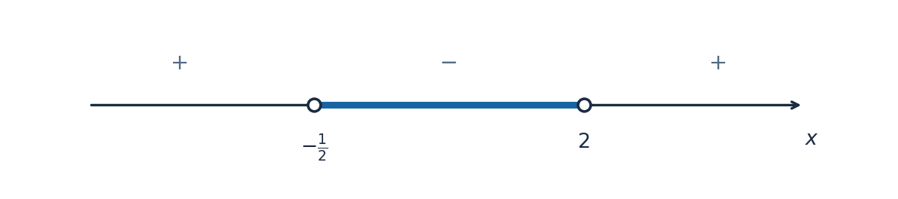

**Критерии**

- **2 балла.** Есть математически обоснованный верный ответ. Разложение на множители и метод интервалов, отдельно кратные корни и строгие границы
- **1 балл.** Решение завершено, но допущена вычислительная ошибка. Все последующие шаги верны с учётом её результата. Обоснованное преобразование и правильный способ применены до конца. После единичного вычислительного сбоя остальные операции согласованы с ним.
- **0 баллов.** Решение не удовлетворяет условиям для 1 или 2 баллов. Искажено равносильное преобразование или потеряна существенная часть допустимых случаев.

[Источник карточки](https://math-oge.sdamgia.ru/problem?id=314563)

### Задача 2 · 338566

Укажите множество действительных решений неравенства $\left(x - 7\right)^{2}<\sqrt{11} \left(x - 7\right)$.

Подсказка 1

Перенеси всё влево и поищи разложение на множители.

Подсказка 2

Проверь знак выражения между соседними корнями и отдельно в корнях.

Ответ для самопроверки

$(7;\sqrt{11} + 7)$

Разбор и критерии

1. Переносим правую часть влево. Для этого выражения все действительные x допустимы.
2. На этой области получаем $\left(x - 7\right) \left(x - 7 - \sqrt{11}\right)<0$. Нули выражения: $\{7;\sqrt{11} + 7\}$.
3. Проверяем по одной точке в каждом интервале. Слева направо знаки такие: +, −, +. Выбираем интервалы со знаком минус. Знак неравенства строгий, поэтому нули не включаем.

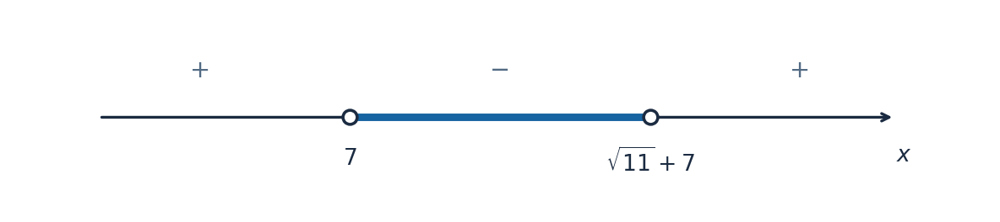

**Критерии**

- **2 балла.** Есть математически обоснованный верный ответ. Разложение на множители и метод интервалов, отдельно кратные корни и строгие границы
- **1 балл.** Решение завершено, но допущена вычислительная ошибка. Все последующие шаги верны с учётом её результата. Обоснованное преобразование и правильный способ применены до конца. После единичного вычислительного сбоя остальные операции согласованы с ним.
- **0 баллов.** Решение не удовлетворяет условиям для 1 или 2 баллов. Искажено равносильное преобразование или потеряна существенная часть допустимых случаев.

[Источник карточки](https://math-oge.sdamgia.ru/problem?id=338566)

### Задача 3 · 472395

Укажите множество действительных решений неравенства $\left(x^{2} - 2 x - 15\right) \left(x^{2} - 7 x + 10\right)\le0$.

Подсказка 1

Перенеси всё влево и поищи разложение на множители.

Подсказка 2

Проверь знак выражения между соседними корнями и отдельно в корнях.

Ответ для самопроверки

$[-3;2]\cup\{5\}$

Разбор и критерии

1. Переносим правую часть влево. Для этого выражения все действительные x допустимы.
2. На этой области получаем $\left(x - 5\right)^{2} \left(x - 2\right) \left(x + 3\right)\le0$. Нули выражения: $\{-3;2;5\}$.
3. Проверяем по одной точке в каждом интервале. Слева направо знаки такие: +, −, +, +. Выбираем интервалы со знаком минус. Граничные значения, которые входят в ответ: $\{-3;2;5\}$.

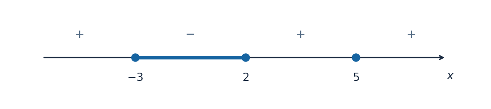

**Критерии**

- **2 балла.** Есть математически обоснованный верный ответ. Разложение на множители и метод интервалов, отдельно кратные корни и строгие границы
- **1 балл.** Решение завершено, но допущена вычислительная ошибка. Все последующие шаги верны с учётом её результата. Обоснованное преобразование и правильный способ применены до конца. После единичного вычислительного сбоя остальные операции согласованы с ним.
- **0 баллов.** Решение не удовлетворяет условиям для 1 или 2 баллов. Искажено равносильное преобразование или потеряна существенная часть допустимых случаев.

[Источник карточки](https://math-oge.sdamgia.ru/problem?id=472395)

### Задача 4 · 472398

Укажите множество действительных решений неравенства $\left(3 - x\right) \left(x^{2} + 4 x - 21\right)\ge0$.

Подсказка 1

Перенеси всё влево и поищи разложение на множители.

Подсказка 2

Проверь знак выражения между соседними корнями и отдельно в корнях.

Ответ для самопроверки

$(-\infty;-7]\cup\{3\}$

Разбор и критерии

1. Переносим правую часть влево. Для этого выражения все действительные x допустимы.
2. На этой области получаем $- \left(x - 3\right)^{2} \left(x + 7\right)\ge0$. Нули выражения: $\{-7;3\}$.
3. Проверяем по одной точке в каждом интервале. Слева направо знаки такие: +, −, −. Выбираем интервалы со знаком плюс. Граничные значения, которые входят в ответ: $\{-7;3\}$.

**Критерии**

- **2 балла.** Есть математически обоснованный верный ответ. Разложение на множители и метод интервалов, отдельно кратные корни и строгие границы
- **1 балл.** Решение завершено, но допущена вычислительная ошибка. Все последующие шаги верны с учётом её результата. Обоснованное преобразование и правильный способ применены до конца. После единичного вычислительного сбоя остальные операции согласованы с ним.
- **0 баллов.** Решение не удовлетворяет условиям для 1 или 2 баллов. Искажено равносильное преобразование или потеряна существенная часть допустимых случаев.

[Источник карточки](https://math-oge.sdamgia.ru/problem?id=472398)

### Задача 5 · 472412

Укажите множество действительных решений неравенства $\left(8 - x\right) \left(x^{2} - 64\right)\ge0$.

Подсказка 1

Перенеси всё влево и поищи разложение на множители.

Подсказка 2

Проверь знак выражения между соседними корнями и отдельно в корнях.

Ответ для самопроверки

$(-\infty;-8]\cup\{8\}$

Разбор и критерии

1. Переносим правую часть влево. Для этого выражения все действительные x допустимы.
2. На этой области получаем $- \left(x - 8\right)^{2} \left(x + 8\right)\ge0$. Нули выражения: $\{-8;8\}$.
3. Проверяем по одной точке в каждом интервале. Слева направо знаки такие: +, −, −. Выбираем интервалы со знаком плюс. Граничные значения, которые входят в ответ: $\{-8;8\}$.

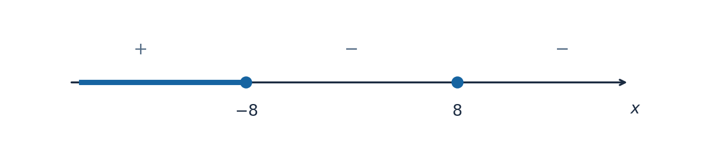

**Критерии**

- **2 балла.** Есть математически обоснованный верный ответ. Разложение на множители и метод интервалов, отдельно кратные корни и строгие границы
- **1 балл.** Решение завершено, но допущена вычислительная ошибка. Все последующие шаги верны с учётом её результата. Обоснованное преобразование и правильный способ применены до конца. После единичного вычислительного сбоя остальные операции согласованы с ним.
- **0 баллов.** Решение не удовлетворяет условиям для 1 или 2 баллов. Искажено равносильное преобразование или потеряна существенная часть допустимых случаев.

[Источник карточки](https://math-oge.sdamgia.ru/problem?id=472412)

### Задача 6 · 151

Укажите множество действительных решений неравенства $\left(x - 1\right) \left(3 x - 5\right)<1$.

Подсказка 1

Перенеси всё влево и поищи разложение на множители.

Подсказка 2

Проверь знак выражения между соседними корнями и отдельно в корнях.

Ответ для самопроверки

$(\frac{2}{3};2)$

Разбор и критерии

1. Переносим правую часть влево. Для этого выражения все действительные x допустимы.
2. На этой области получаем $\left(x - 2\right) \left(3 x - 2\right)<0$. Нули выражения: $\{\frac{2}{3};2\}$.
3. Проверяем по одной точке в каждом интервале. Слева направо знаки такие: +, −, +. Выбираем интервалы со знаком минус. Знак неравенства строгий, поэтому нули не включаем.

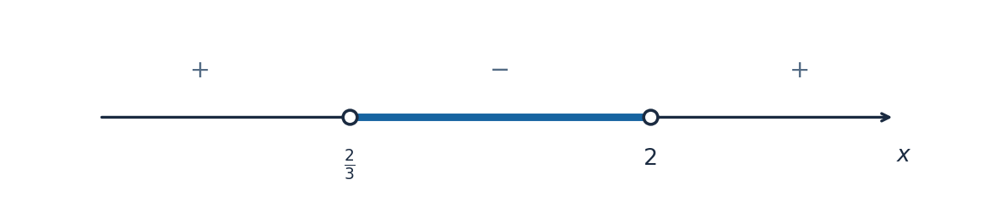

**Критерии**

- **2 балла.** Есть математически обоснованный верный ответ. Разложение на множители и метод интервалов, отдельно кратные корни и строгие границы
- **1 балл.** Решение завершено, но допущена вычислительная ошибка. Все последующие шаги верны с учётом её результата. Обоснованное преобразование и правильный способ применены до конца. После единичного вычислительного сбоя остальные операции согласованы с ним.
- **0 баллов.** Решение не удовлетворяет условиям для 1 или 2 баллов. Искажено равносильное преобразование или потеряна существенная часть допустимых случаев.

[Источник карточки](https://math-oge.sdamgia.ru/problem?id=151)

## Неравенства · Рациональная дробь

`OGE20-rational-inequality`

### Задача 1 · D20-2027

Решите неравенство $x\le\frac9x$.

Подсказка 1

Выпиши запрещённые значения до сокращений.

Подсказка 2

Приведи к одной дроби и отметь на прямой корни числителя и знаменателя.

Ответ для самопроверки

$(-\infty;-3]\cup(0;3]$.

Разбор и критерии

1. Допустимы все $x\ne0$.
2. Перенесём правую часть влево и приведём к общему знаменателю.
3. Получим $\frac{(x-3)(x+3)}x\le0$.
4. Критические точки — $-3,0,3$.
5. На четырёх интервалах слева направо знаки равны $-,+,-,+$.
6. Значения $-3$ и $3$ обращают числитель в ноль и входят в ответ.
7. При $x=0$ дробь не определена.

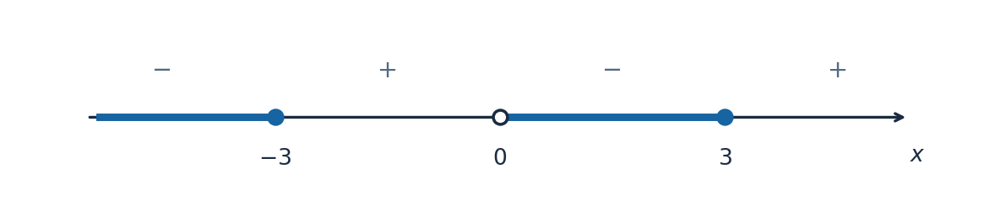

**Критерии**

- **2 балла.** Есть математически обоснованный верный ответ. Получены обе части множества решений, учтены знак знаменателя и запрет x=0.
- **1 балл.** Решение завершено, но допущена вычислительная ошибка. Все последующие шаги верны с учётом её результата. Метод интервалов применён до конца, но допущена вычислительная ошибка, после которой шаги согласованы с ошибочным результатом.
- **0 баллов.** Решение не удовлетворяет условиям для 1 или 2 баллов. Умножение на x без разбора знака или включение нуля вследствие потери ОДЗ.

[Источник карточки](https://doc.fipi.ru/oge/demoversii-specifikacii-kodifikatory/2027/ma_9_2027.zip) · МА-9 ОГЭ 2027_ДЕМО.pdf, печатная стр. 14, решение и шкала на стр. 16

### Задача 2 · 472402

Найдите множество решений неравенства $\frac{x^2-8x+15}{x-3}\le0$.

Подсказка 1

Выпиши запрещённые значения до сокращений.

Подсказка 2

Приведи к одной дроби и отметь на прямой корни числителя и знаменателя.

Ответ для самопроверки

$(-\infty;3)\cup(3;5]$.

Разбор и критерии

1. Сначала фиксируем $x\ne3$.
2. Числитель равен $(x-3)(x-5)$, так что на ОДЗ дробь равна $x-5$.
3. Неравенство даёт $x\le5$, но точку $3$ возвращать в область нельзя.

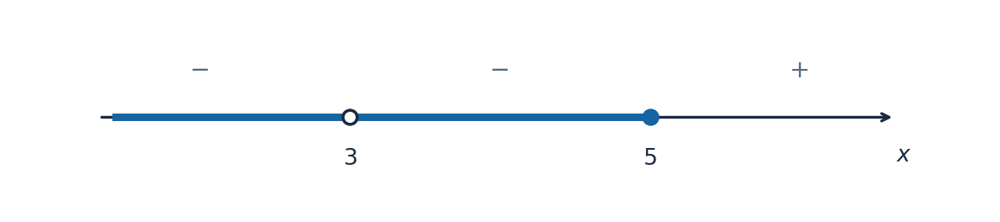

**Критерии**

- **2 балла.** Есть математически обоснованный верный ответ. После сокращения сохранена выколотая точка x=3 и включена граница x=5.
- **1 балл.** Решение завершено, но допущена вычислительная ошибка. Все последующие шаги верны с учётом её результата. Завершённое решение с вычислительной ошибкой, дальнейшее решение линейного неравенства и исключение запрещённой точки верны.
- **0 баллов.** Решение не удовлетворяет условиям для 1 или 2 баллов. Ответ x≤5, в который попало x=3.

[Источник карточки](https://math-oge.sdamgia.ru/problem?id=472402)

### Задача 3 · 338512

Укажите множество действительных решений неравенства $- \frac{10}{\left(x - 3\right)^{2} - 5}\ge0$.

Подсказка 1

Выпиши запрещённые значения до сокращений.

Подсказка 2

Приведи к одной дроби и отметь на прямой корни числителя и знаменателя.

Ответ для самопроверки

$(3 - \sqrt{5};\sqrt{5} + 3)$

Разбор и критерии

1. Исходный знаменатель запрещает значения $\{3 - \sqrt{5};\sqrt{5} + 3\}$.
2. На этой области получаем $\frac{-10}{x^{2} - 6 x + 4}\ge0$. Числитель не обращается в ноль. Запрещённые значения тоже делят прямую, но их нельзя включить в ответ.
3. Проверяем по одной точке в каждом интервале. Слева направо знаки такие: −, +, −. Выбираем интервалы со знаком плюс. Равенство на допустимой области здесь не достигается.

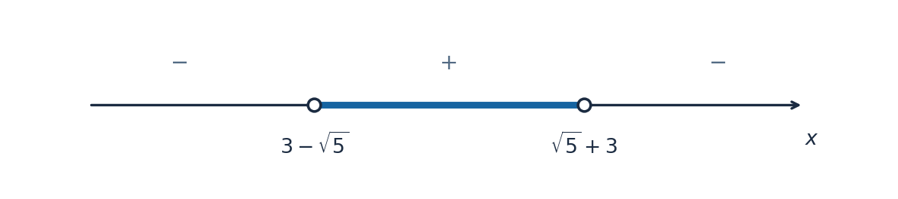

**Критерии**

- **2 балла.** Есть математически обоснованный верный ответ. Привести к дроби, отметить нули числителя и запрещённые точки, включая сократившиеся
- **1 балл.** Решение завершено, но допущена вычислительная ошибка. Все последующие шаги верны с учётом её результата. Обоснованное преобразование и правильный способ применены до конца. После единичного вычислительного сбоя остальные операции согласованы с ним.
- **0 баллов.** Решение не удовлетворяет условиям для 1 или 2 баллов. Искажено равносильное преобразование или потеряна существенная часть допустимых случаев.

[Источник карточки](https://math-oge.sdamgia.ru/problem?id=338512)

### Задача 4 · 472401

Укажите множество действительных решений неравенства $\frac{2 x^{2} - 16 x + 32}{x + 6}\le0$.

Подсказка 1

Выпиши запрещённые значения до сокращений.

Подсказка 2

Приведи к одной дроби и отметь на прямой корни числителя и знаменателя.

Ответ для самопроверки

$(-\infty;-6)\cup\{4\}$

Разбор и критерии

1. Исходный знаменатель запрещает значения $\{-6\}$.
2. На этой области получаем $\frac{2 \left(x - 4\right)^{2}}{x + 6}\le0$. Корни числителя: $\{4\}$. Запрещённые значения тоже делят прямую, но их нельзя включить в ответ.
3. Проверяем по одной точке в каждом интервале. Слева направо знаки такие: −, +, +. Выбираем интервалы со знаком минус. Граничные значения, которые входят в ответ: $\{4\}$.

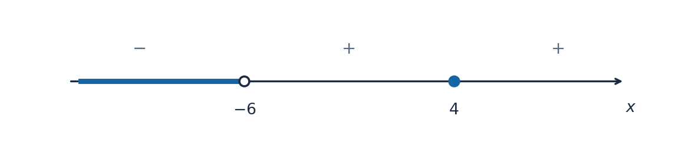

**Критерии**

- **2 балла.** Есть математически обоснованный верный ответ. Привести к дроби, отметить нули числителя и запрещённые точки, включая сократившиеся
- **1 балл.** Решение завершено, но допущена вычислительная ошибка. Все последующие шаги верны с учётом её результата. Обоснованное преобразование и правильный способ применены до конца. После единичного вычислительного сбоя остальные операции согласованы с ним.
- **0 баллов.** Решение не удовлетворяет условиям для 1 или 2 баллов. Искажено равносильное преобразование или потеряна существенная часть допустимых случаев.

[Источник карточки](https://math-oge.sdamgia.ru/problem?id=472401)

### Задача 5 · 472406

Укажите множество действительных решений неравенства $\frac{x^{2}}{x - 3}\le x$.

Подсказка 1

Выпиши запрещённые значения до сокращений.

Подсказка 2

Приведи к одной дроби и отметь на прямой корни числителя и знаменателя.

Ответ для самопроверки

$[0;3)$

Разбор и критерии

1. Исходный знаменатель запрещает значения $\{3\}$.
2. На этой области получаем $\frac{3 x}{x - 3}\le0$. Корни числителя: $\{0\}$. Запрещённые значения тоже делят прямую, но их нельзя включить в ответ.
3. Проверяем по одной точке в каждом интервале. Слева направо знаки такие: +, −, +. Выбираем интервалы со знаком минус. Граничные значения, которые входят в ответ: $\{0\}$.

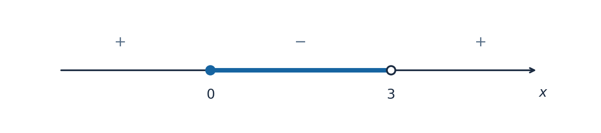

**Критерии**

- **2 балла.** Есть математически обоснованный верный ответ. Привести к дроби, отметить нули числителя и запрещённые точки, включая сократившиеся
- **1 балл.** Решение завершено, но допущена вычислительная ошибка. Все последующие шаги верны с учётом её результата. Обоснованное преобразование и правильный способ применены до конца. После единичного вычислительного сбоя остальные операции согласованы с ним.
- **0 баллов.** Решение не удовлетворяет условиям для 1 или 2 баллов. Искажено равносильное преобразование или потеряна существенная часть допустимых случаев.

[Источник карточки](https://math-oge.sdamgia.ru/problem?id=472406)

### Задача 6 · 472409

Укажите множество действительных решений неравенства $1 \frac{1}{x}\ge1 \frac{1}{x - 4}$.

Подсказка 1

Выпиши запрещённые значения до сокращений.

Подсказка 2

Приведи к одной дроби и отметь на прямой корни числителя и знаменателя.

Ответ для самопроверки

$(0;4)$

Разбор и критерии

1. Исходный знаменатель запрещает значения $\{0;4\}$.
2. На этой области получаем $\frac{-4}{x \left(x - 4\right)}\ge0$. Числитель не обращается в ноль. Запрещённые значения тоже делят прямую, но их нельзя включить в ответ.
3. Проверяем по одной точке в каждом интервале. Слева направо знаки такие: −, +, −. Выбираем интервалы со знаком плюс. Равенство на допустимой области здесь не достигается.

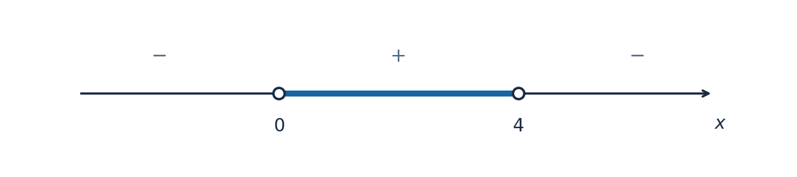

**Критерии**

- **2 балла.** Есть математически обоснованный верный ответ. Привести к дроби, отметить нули числителя и запрещённые точки, включая сократившиеся
- **1 балл.** Решение завершено, но допущена вычислительная ошибка. Все последующие шаги верны с учётом её результата. Обоснованное преобразование и правильный способ применены до конца. После единичного вычислительного сбоя остальные операции согласованы с ним.
- **0 баллов.** Решение не удовлетворяет условиям для 1 или 2 баллов. Искажено равносильное преобразование или потеряна существенная часть допустимых случаев.

[Источник карточки](https://math-oge.sdamgia.ru/problem?id=472409)

## Системы · Исключение переменной или квадрата

`OGE20-system-elimination`

### Задача 1 · 338577

Решите систему $\begin{cases}5x^2+y^2=36,\\10x^2+2y^2=36x.\end{cases}$

Подсказка 1

Посмотри, какая часть выражений в уравнениях совпадает с точностью до множителя.

Подсказка 2

Сложи или вычти подходящую кратную комбинацию. Затем восстанови вторую координату.

Ответ для самопроверки

$(2;-4)$ и $(2;4)$.

Разбор и критерии

1. Удвоенная левая часть первого уравнения совпадает с левой частью второго.
2. Поэтому $72=36x$, откуда $x=2$.
3. Подстановка в первое уравнение даёт $y^2=36-20=16$.
4. Оба значения $y=\pm4$ подходят и ко второму уравнению, поскольку при $x=2$ оно получается удвоением первого.

**Критерии**

- **2 балла.** Есть математически обоснованный верный ответ. Устранение общей комбинации обосновано, найдены обе упорядоченные пары.
- **1 балл.** Решение завершено, но допущена вычислительная ошибка. Все последующие шаги верны с учётом её результата. Верный способ доведён до конца с арифметической ошибкой, следующие операции верны для ошибочного результата.
- **0 баллов.** Решение не удовлетворяет условиям для 1 или 2 баллов. Одно уравнение отброшено без логического основания или при извлечении корня потерян один знак.

[Источник карточки](https://math-oge.sdamgia.ru/problem?id=338577)

### Задача 2 · 338545

Найдите все действительные пары $(x;y)$, удовлетворяющие системе $\begin{cases}x^{2} + y=5,\\6 x^{2} - y=2.\end{cases}$

Подсказка 1

Посмотри, какая часть выражений в уравнениях совпадает с точностью до множителя.

Подсказка 2

Сложи или вычти подходящую кратную комбинацию. Затем восстанови вторую координату.

Ответ для самопроверки

$\{\left( -1, \  4\right);\left( 1, \  4\right)\}$

Разбор и критерии

1. Сложим уравнения. Слагаемые с $y$ уничтожатся.
2. Для первой координаты получаем $7 \left(x - 1\right) \left(x + 1\right)=0$.
3. Возвращаем найденные значения в первое уравнение: при $x=-1$ имеем $y - 4=0$ и получаем $y\in\{4\}$; при $x=1$ имеем $y - 4=0$ и получаем $y\in\{4\}$. Поскольку исключение второго уравнения было равносильным, эти пары решают систему.

**Критерии**

- **2 балла.** Есть математически обоснованный верный ответ. Сложение или вычитание уравнений, затем восстановление всех пар
- **1 балл.** Решение завершено, но допущена вычислительная ошибка. Все последующие шаги верны с учётом её результата. Обоснованное преобразование и правильный способ применены до конца. После единичного вычислительного сбоя остальные операции согласованы с ним.
- **0 баллов.** Решение не удовлетворяет условиям для 1 или 2 баллов. Искажено равносильное преобразование или потеряна существенная часть допустимых случаев.

[Источник карточки](https://math-oge.sdamgia.ru/problem?id=338545)

### Задача 3 · 341340

Найдите все действительные пары $(x;y)$, удовлетворяющие системе $\begin{cases}2 x^{2} + 3 y^{2}=11,\\4 x^{2} + 6 y^{2}=11 x.\end{cases}$

Подсказка 1

Посмотри, какая часть выражений в уравнениях совпадает с точностью до множителя.

Подсказка 2

Сложи или вычти подходящую кратную комбинацию. Затем восстанови вторую координату.

Ответ для самопроверки

$\{\left( 2, \  -1\right);\left( 2, \  1\right)\}$

Разбор и критерии

1. Вычтем из второго уравнения первое, умноженное на $2$. Слагаемые с $y^{2}$ сократятся.
2. Для первой координаты получаем $- 11 \left(x - 2\right)=0$.
3. Возвращаем найденные значения в первое уравнение: при $x=2$ имеем $3 y^{2} - 3=0$ и получаем $y\in\{-1;1\}$. Поскольку исключение второго уравнения было равносильным, эти пары решают систему.

**Критерии**

- **2 балла.** Есть математически обоснованный верный ответ. Сложение или вычитание уравнений, затем восстановление всех пар
- **1 балл.** Решение завершено, но допущена вычислительная ошибка. Все последующие шаги верны с учётом её результата. Обоснованное преобразование и правильный способ применены до конца. После единичного вычислительного сбоя остальные операции согласованы с ним.
- **0 баллов.** Решение не удовлетворяет условиям для 1 или 2 баллов. Искажено равносильное преобразование или потеряна существенная часть допустимых случаев.

[Источник карточки](https://math-oge.sdamgia.ru/problem?id=341340)

### Задача 4 · 338594

Найдите все действительные пары $(x;y)$, удовлетворяющие системе $\begin{cases}2 x^{2} + y=4,\\4 x^{2} - y=2.\end{cases}$

Подсказка 1

Посмотри, какая часть выражений в уравнениях совпадает с точностью до множителя.

Подсказка 2

Сложи или вычти подходящую кратную комбинацию. Затем восстанови вторую координату.

Ответ для самопроверки

$\{\left( -1, \  2\right);\left( 1, \  2\right)\}$

Разбор и критерии

1. Сложим уравнения. Слагаемые с $y$ уничтожатся.
2. Для первой координаты получаем $6 \left(x - 1\right) \left(x + 1\right)=0$.
3. Возвращаем найденные значения в первое уравнение: при $x=-1$ имеем $y - 2=0$ и получаем $y\in\{2\}$; при $x=1$ имеем $y - 2=0$ и получаем $y\in\{2\}$. Поскольку исключение второго уравнения было равносильным, эти пары решают систему.

**Критерии**

- **2 балла.** Есть математически обоснованный верный ответ. Сложение или вычитание уравнений, затем восстановление всех пар
- **1 балл.** Решение завершено, но допущена вычислительная ошибка. Все последующие шаги верны с учётом её результата. Обоснованное преобразование и правильный способ применены до конца. После единичного вычислительного сбоя остальные операции согласованы с ним.
- **0 баллов.** Решение не удовлетворяет условиям для 1 или 2 баллов. Искажено равносильное преобразование или потеряна существенная часть допустимых случаев.

[Источник карточки](https://math-oge.sdamgia.ru/problem?id=338594)

### Задача 5 · 338617

Найдите все действительные пары $(x;y)$, удовлетворяющие системе $\begin{cases}2 x^{2} + y^{2}=36,\\8 x^{2} + 4 y^{2}=36 x.\end{cases}$

Подсказка 1

Посмотри, какая часть выражений в уравнениях совпадает с точностью до множителя.

Подсказка 2

Сложи или вычти подходящую кратную комбинацию. Затем восстанови вторую координату.

Ответ для самопроверки

$\{\left( 4, \  -2\right);\left( 4, \  2\right)\}$

Разбор и критерии

1. Вычтем из второго уравнения первое, умноженное на $4$. Слагаемые с $y^{2}$ сократятся.
2. Для первой координаты получаем $- 36 \left(x - 4\right)=0$.
3. Возвращаем найденные значения в первое уравнение: при $x=4$ имеем $y^{2} - 4=0$ и получаем $y\in\{-2;2\}$. Поскольку исключение второго уравнения было равносильным, эти пары решают систему.

**Критерии**

- **2 балла.** Есть математически обоснованный верный ответ. Сложение или вычитание уравнений, затем восстановление всех пар
- **1 балл.** Решение завершено, но допущена вычислительная ошибка. Все последующие шаги верны с учётом её результата. Обоснованное преобразование и правильный способ применены до конца. После единичного вычислительного сбоя остальные операции согласованы с ним.
- **0 баллов.** Решение не удовлетворяет условиям для 1 или 2 баллов. Искажено равносильное преобразование или потеряна существенная часть допустимых случаев.

[Источник карточки](https://math-oge.sdamgia.ru/problem?id=338617)

### Задача 6 · 338664

Найдите все действительные пары $(x;y)$, удовлетворяющие системе $\begin{cases}5 x^{2} + y^{2}=61,\\15 x^{2} + 3 y^{2}=61 x.\end{cases}$

Подсказка 1

Посмотри, какая часть выражений в уравнениях совпадает с точностью до множителя.

Подсказка 2

Сложи или вычти подходящую кратную комбинацию. Затем восстанови вторую координату.

Ответ для самопроверки

$\{\left( 3, \  -4\right);\left( 3, \  4\right)\}$

Разбор и критерии

1. Вычтем из второго уравнения первое, умноженное на $3$. Слагаемые с $y^{2}$ сократятся.
2. Для первой координаты получаем $- 61 \left(x - 3\right)=0$.
3. Возвращаем найденные значения в первое уравнение: при $x=3$ имеем $y^{2} - 16=0$ и получаем $y\in\{-4;4\}$. Поскольку исключение второго уравнения было равносильным, эти пары решают систему.

**Критерии**

- **2 балла.** Есть математически обоснованный верный ответ. Сложение или вычитание уравнений, затем восстановление всех пар
- **1 балл.** Решение завершено, но допущена вычислительная ошибка. Все последующие шаги верны с учётом её результата. Обоснованное преобразование и правильный способ применены до конца. После единичного вычислительного сбоя остальные операции согласованы с ним.
- **0 баллов.** Решение не удовлетворяет условиям для 1 или 2 баллов. Искажено равносильное преобразование или потеряна существенная часть допустимых случаев.

[Источник карточки](https://math-oge.sdamgia.ru/problem?id=338664)

## Системы · Два выражения для одной переменной

`OGE20-system-substitution`

### Задача 1 · 338650

Найдите все действительные пары $(x;y)$, удовлетворяющие системе $\begin{cases}3 x^{2} - 2 x=y,\\3 x - 2=y.\end{cases}$

Подсказка 1

Вырази одну переменную из обоих уравнений.

Подсказка 2

Приравняй полученные выражения, потом вычисли вторую координату каждой пары.

Ответ для самопроверки

$\{\left( \frac{2}{3}, \  0\right);\left( 1, \  1\right)\}$

Разбор и критерии

1. Из первого уравнения получаем $y=x \left(3 x - 2\right)$, из второго — $y=3 x - 2$.
2. Приравниваем правые части. После переноса и разложения выходит $\left(x - 1\right) \left(3 x - 2\right)=0$.
3. Возвращаем найденные значения в первое уравнение: при $x=\frac{2}{3}$ имеем $- y=0$ и получаем $y\in\{0\}$; при $x=1$ имеем $1 - y=0$ и получаем $y\in\{1\}$. Поскольку исключение второго уравнения было равносильным, эти пары решают систему.

**Критерии**

- **2 балла.** Есть математически обоснованный верный ответ. Приравнять правые части и вернуть каждую найденную абсциссу в одно из уравнений
- **1 балл.** Решение завершено, но допущена вычислительная ошибка. Все последующие шаги верны с учётом её результата. Обоснованное преобразование и правильный способ применены до конца. После единичного вычислительного сбоя остальные операции согласованы с ним.
- **0 баллов.** Решение не удовлетворяет условиям для 1 или 2 баллов. Искажено равносильное преобразование или потеряна существенная часть допустимых случаев.

[Источник карточки](https://math-oge.sdamgia.ru/problem?id=338650)

### Задача 2 · 338690

Найдите все действительные пары $(x;y)$, удовлетворяющие системе $\begin{cases}9 x^{2} - 14 x=y,\\9 x - 14=y.\end{cases}$

Подсказка 1

Вырази одну переменную из обоих уравнений.

Подсказка 2

Приравняй полученные выражения, потом вычисли вторую координату каждой пары.

Ответ для самопроверки

$\{\left( 1, \  -5\right);\left( \frac{14}{9}, \  0\right)\}$

Разбор и критерии

1. Из первого уравнения получаем $y=x \left(9 x - 14\right)$, из второго — $y=9 x - 14$.
2. Приравниваем правые части. После переноса и разложения выходит $\left(x - 1\right) \left(9 x - 14\right)=0$.
3. Возвращаем найденные значения в первое уравнение: при $x=1$ имеем $- y - 5=0$ и получаем $y\in\{-5\}$; при $x=\frac{14}{9}$ имеем $- y=0$ и получаем $y\in\{0\}$. Поскольку исключение второго уравнения было равносильным, эти пары решают систему.

**Критерии**

- **2 балла.** Есть математически обоснованный верный ответ. Приравнять правые части и вернуть каждую найденную абсциссу в одно из уравнений
- **1 балл.** Решение завершено, но допущена вычислительная ошибка. Все последующие шаги верны с учётом её результата. Обоснованное преобразование и правильный способ применены до конца. После единичного вычислительного сбоя остальные операции согласованы с ним.
- **0 баллов.** Решение не удовлетворяет условиям для 1 или 2 баллов. Искажено равносильное преобразование или потеряна существенная часть допустимых случаев.

[Источник карточки](https://math-oge.sdamgia.ru/problem?id=338690)

### Задача 3 · 338732

Найдите все действительные пары $(x;y)$, удовлетворяющие системе $\begin{cases}4 x^{2} - 3 x=y,\\8 x - 6=y.\end{cases}$

Подсказка 1

Вырази одну переменную из обоих уравнений.

Подсказка 2

Приравняй полученные выражения, потом вычисли вторую координату каждой пары.

Ответ для самопроверки

$\{\left( \frac{3}{4}, \  0\right);\left( 2, \  10\right)\}$

Разбор и критерии

1. Из первого уравнения получаем $y=x \left(4 x - 3\right)$, из второго — $y=8 x - 6$.
2. Приравниваем правые части. После переноса и разложения выходит $\left(x - 2\right) \left(4 x - 3\right)=0$.
3. Возвращаем найденные значения в первое уравнение: при $x=\frac{3}{4}$ имеем $- y=0$ и получаем $y\in\{0\}$; при $x=2$ имеем $10 - y=0$ и получаем $y\in\{10\}$. Поскольку исключение второго уравнения было равносильным, эти пары решают систему.

**Критерии**

- **2 балла.** Есть математически обоснованный верный ответ. Приравнять правые части и вернуть каждую найденную абсциссу в одно из уравнений
- **1 балл.** Решение завершено, но допущена вычислительная ошибка. Все последующие шаги верны с учётом её результата. Обоснованное преобразование и правильный способ применены до конца. После единичного вычислительного сбоя остальные операции согласованы с ним.
- **0 баллов.** Решение не удовлетворяет условиям для 1 или 2 баллов. Искажено равносильное преобразование или потеряна существенная часть допустимых случаев.

[Источник карточки](https://math-oge.sdamgia.ru/problem?id=338732)

### Задача 4 · 338779

Найдите все действительные пары $(x;y)$, удовлетворяющие системе $\begin{cases}\left(2 x + 3\right)^{2}=5 y,\\\left(3 x + 2\right)^{2}=5 y.\end{cases}$

Подсказка 1

Вырази одну переменную из обоих уравнений.

Подсказка 2

Приравняй полученные выражения, потом вычисли вторую координату каждой пары.

Ответ для самопроверки

$\{\left( -1, \  \frac{1}{5}\right);\left( 1, \  5\right)\}$

Разбор и критерии

1. Из первого уравнения получаем $y=\frac{4 x^{2}}{5} + \frac{12 x}{5} + \frac{9}{5}$, из второго — $y=\frac{9 x^{2}}{5} + \frac{12 x}{5} + \frac{4}{5}$.
2. Приравниваем правые части. После переноса и разложения выходит $- \left(x - 1\right) \left(x + 1\right)=0$.
3. Возвращаем найденные значения в первое уравнение: при $x=-1$ имеем $1 - 5 y=0$ и получаем $y\in\{\frac{1}{5}\}$; при $x=1$ имеем $25 - 5 y=0$ и получаем $y\in\{5\}$. Поскольку исключение второго уравнения было равносильным, эти пары решают систему.

**Критерии**

- **2 балла.** Есть математически обоснованный верный ответ. Приравнять правые части и вернуть каждую найденную абсциссу в одно из уравнений
- **1 балл.** Решение завершено, но допущена вычислительная ошибка. Все последующие шаги верны с учётом её результата. Обоснованное преобразование и правильный способ применены до конца. После единичного вычислительного сбоя остальные операции согласованы с ним.
- **0 баллов.** Решение не удовлетворяет условиям для 1 или 2 баллов. Искажено равносильное преобразование или потеряна существенная часть допустимых случаев.

[Источник карточки](https://math-oge.sdamgia.ru/problem?id=338779)

### Задача 5 · 338821

Найдите все действительные пары $(x;y)$, удовлетворяющие системе $\begin{cases}5 x^{2} - 9 x=y,\\5 x - 9=y.\end{cases}$

Подсказка 1

Вырази одну переменную из обоих уравнений.

Подсказка 2

Приравняй полученные выражения, потом вычисли вторую координату каждой пары.

Ответ для самопроверки

$\{\left( 1, \  -4\right);\left( \frac{9}{5}, \  0\right)\}$

Разбор и критерии

1. Из первого уравнения получаем $y=x \left(5 x - 9\right)$, из второго — $y=5 x - 9$.
2. Приравниваем правые части. После переноса и разложения выходит $\left(x - 1\right) \left(5 x - 9\right)=0$.
3. Возвращаем найденные значения в первое уравнение: при $x=1$ имеем $- y - 4=0$ и получаем $y\in\{-4\}$; при $x=\frac{9}{5}$ имеем $- y=0$ и получаем $y\in\{0\}$. Поскольку исключение второго уравнения было равносильным, эти пары решают систему.

**Критерии**

- **2 балла.** Есть математически обоснованный верный ответ. Приравнять правые части и вернуть каждую найденную абсциссу в одно из уравнений
- **1 балл.** Решение завершено, но допущена вычислительная ошибка. Все последующие шаги верны с учётом её результата. Обоснованное преобразование и правильный способ применены до конца. После единичного вычислительного сбоя остальные операции согласованы с ним.
- **0 баллов.** Решение не удовлетворяет условиям для 1 или 2 баллов. Искажено равносильное преобразование или потеряна существенная часть допустимых случаев.

[Источник карточки](https://math-oge.sdamgia.ru/problem?id=338821)

### Задача 6 · 338923

Найдите все действительные пары $(x;y)$, удовлетворяющие системе $\begin{cases}3 x^{2} - 4 x=y,\\3 x - 4=y.\end{cases}$

Подсказка 1

Вырази одну переменную из обоих уравнений.

Подсказка 2

Приравняй полученные выражения, потом вычисли вторую координату каждой пары.

Ответ для самопроверки

$\{\left( 1, \  -1\right);\left( \frac{4}{3}, \  0\right)\}$

Разбор и критерии

1. Из первого уравнения получаем $y=x \left(3 x - 4\right)$, из второго — $y=3 x - 4$.
2. Приравниваем правые части. После переноса и разложения выходит $\left(x - 1\right) \left(3 x - 4\right)=0$.
3. Возвращаем найденные значения в первое уравнение: при $x=1$ имеем $- y - 1=0$ и получаем $y\in\{-1\}$; при $x=\frac{4}{3}$ имеем $- y=0$ и получаем $y\in\{0\}$. Поскольку исключение второго уравнения было равносильным, эти пары решают систему.

**Критерии**

- **2 балла.** Есть математически обоснованный верный ответ. Приравнять правые части и вернуть каждую найденную абсциссу в одно из уравнений
- **1 балл.** Решение завершено, но допущена вычислительная ошибка. Все последующие шаги верны с учётом её результата. Обоснованное преобразование и правильный способ применены до конца. После единичного вычислительного сбоя остальные операции согласованы с ним.
- **0 баллов.** Решение не удовлетворяет условиям для 1 или 2 баллов. Искажено равносильное преобразование или потеряна существенная часть допустимых случаев.

[Источник карточки](https://math-oge.sdamgia.ru/problem?id=338923)
