# №22 · Графики и параметры

[К сводке](../README.md)

## Сокращение и выколотые точки · Парабола и горизонталь y=m

`OGE22-hole-parabola-level`

### Задача 1 · 338295

Постройте $y=\frac{(x^2+7x+12)(x^2-x-2)}{x^2+5x+4}$. Найдите все $m$, для которых у $y=m$ с этим графиком ровно одна общая точка.

Подсказка 1

Выпиши запрещённые абсциссы исходной дроби.

Подсказка 2

После сокращения проверь уровни вершины и выколотых точек.

Ответ для самопроверки

$m\in\{-25/4,-6,6\}$.

Разбор и критерии

1. В знаменателе $(x+1)(x+4)$, запреты $x=-1,-4$.
2. Числитель равен $(x+3)(x+4)(x+1)(x-2)$.
3. После сокращения получаем параболу $y=(x+3)(x-2)=(x+1/2)^2-25/4$ с двумя выколотыми точками $(-1;-6)$ и $(-4;6)$.
4. Горизонталь через вершину касательная.
5. На каждом из двух уровней отверстий исчезает одно из двух пересечений, второе имеет соответственно абсциссу $0$ и $3$.
6. Выше вершины остальные уровни дают два пересечения, ниже — ни одного.

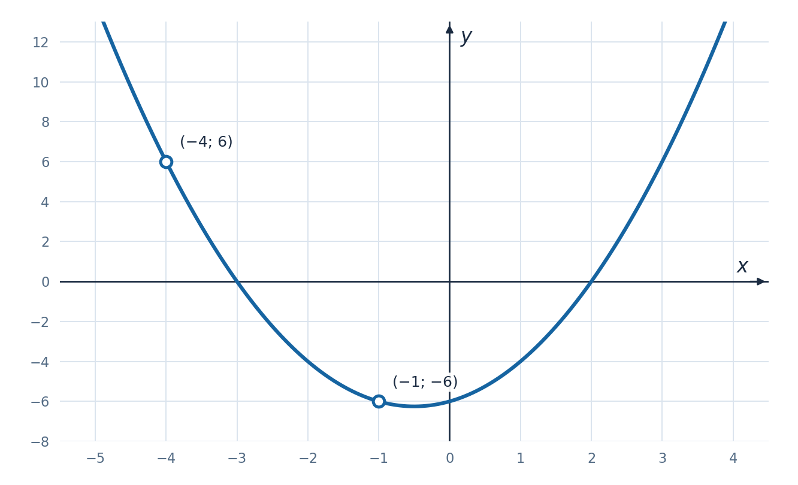

**Критерии**

- **2 балла.** График и результат по параметру либо числу пересечений верны. Построена парабола с обеими выколотыми точками; перечислены все три значения.
- **1 балл.** График верен, параметр или число пересечений найдены неправильно или отсутствуют. График с двумя отверстиями верен, но потерян хотя бы один из трёх уровней или добавлен лишний.
- **0 баллов.** График отсутствует или неверен. Остальные случаи, не удовлетворяющие условиям для 1 или 2 баллов. Сокращённые множители удалены вместе с запретами, поэтому график построен без отверстий.

[Источник карточки](https://math-oge.sdamgia.ru/problem?id=338295)

### Задача 2 · 338288

Постройте график функции $y=\frac{\left(x + 4\right) \left(x^{2} + 3 x + 2\right)}{x + 1}$. При каких значениях $m$ прямая $y=m$ имеет с графиком ровно одну общую точку?

Подсказка 1

Выпиши запрещённые абсциссы исходной дроби.

Подсказка 2

После сокращения проверь уровни вершины и выколотых точек.

Ответ для самопроверки

$m\in\{-1;3\}$

Разбор и критерии

1. Делить на ноль нельзя. Знаменатель $x + 1$ обращается в ноль при $x=-1$.
2. В числителе разложим квадратный трёхчлен. Числа 1 и 2 в сумме дают 3, а в произведении 2, поэтому $x^2+3x+2=(x+1)(x+2)$. При x ≠ −1 сокращаем x+1. Остаётся $y=(x+4)(x+2)=x^2+6x+8$.
3. Выделим квадрат. При раскрытии $(x + 3)^{2}$ получится $x^{2} + 6 x + 9$. Чтобы вернуть свободный член $8$, нужна поправка $-1$. Поэтому $y=(x + 3)^{2} - 1$. Квадрат равен нулю при $x=-3$, вершина — $(-3;-1)$.
4. Если подставить $x=-1$ в продолжение ветви, получим $y=3$. В исходной функции эта точка исключена: ставим пустой кружок в $(-1;3)$.
5. У полной параболы одна точка на высоте вершины −1, две выше и ни одной ниже. Исключение выше вершины возможно только на высоте 3: там мы убрали одну точку.
6. Проверим, что на высоте 3 осталась другая точка. Из $(x+3)^2-1=3$ следует $x+3=2$ или $x+3=-2$. Первое даёт запрещённое x = −1, второе — допустимое x = −5. Поэтому ровно одна точка есть при m = −1 и при m = 3.

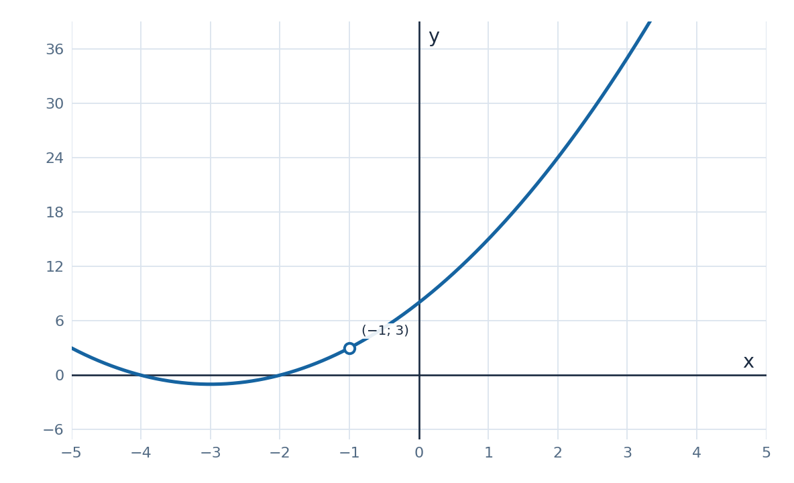

**Критерии**

- **2 балла.** График и результат по параметру либо числу пересечений верны. Отдельно посчитать вершину и уровни каждой выколотой точки
- **1 балл.** График верен, параметр или число пересечений найдены неправильно или отсутствуют. График верно передаёт формулы и принадлежность граничных точек, но ответ по прямой неверен или пропущен.
- **0 баллов.** График отсутствует или неверен. Остальные случаи, не удовлетворяющие условиям для 1 или 2 баллов. График отсутствует, неверно заданы ветви или пропущена существенно важная точка.

[Источник карточки](https://math-oge.sdamgia.ru/problem?id=338288)

### Задача 3 · 340600

Постройте график функции $y=\frac{x^{4} - 13 x^{2} + 36}{\left(x + 2\right) \left(x - 3\right)}$. При каких значениях $m$ прямая $y=m$ имеет с графиком ровно одну общую точку?

Подсказка 1

Выпиши запрещённые абсциссы исходной дроби.

Подсказка 2

После сокращения проверь уровни вершины и выколотых точек.

Ответ для самопроверки

$m\in\{- \frac{25}{4};-4;6\}$

Разбор и критерии

1. Делить на ноль нельзя. Знаменатель $(x - 3) (x + 2)$ обращается в ноль при $x=-2$, $x=3$.
2. В числителе есть четвёртая и вторая степени. Положим t=x². Тогда $t^2-13t+36=(t-4)(t-9)$, потому что 4+9=13 и 4·9=36.
3. Возвращаем x² вместо t. Каждый множитель — разность квадратов: $x^2-4=(x-2)(x+2)$ и $x^2-9=(x-3)(x+3)$. При x ≠ −2 и x ≠ 3 сокращаем x+2 и x−3. Остаётся $y=(x-2)(x+3)=x^2+x-6$.
4. Выделим квадрат. При раскрытии $(x + \frac{1}{2})^{2}$ получится $x^{2} + x + \frac{1}{4}$. Чтобы вернуть свободный член $-6$, нужна поправка $- \frac{25}{4}$. Поэтому $y=(x + \frac{1}{2})^{2} - \frac{25}{4}$. Квадрат равен нулю при $x=- \frac{1}{2}$, вершина — $(- \frac{1}{2};- \frac{25}{4})$.
5. Если подставить $x=-2$ в продолжение ветви, получим $y=-4$. В исходной функции эта точка исключена: ставим пустой кружок в $(-2;-4)$.
6. Если подставить $x=3$ в продолжение ветви, получим $y=6$. В исходной функции эта точка исключена: ставим пустой кружок в $(3;6)$.
7. Горизонталь на высоте вершины касается параболы один раз. Со стороны раскрытия ветвей у неё две точки, с другой стороны ни одной. На высоте пустого кружка вычитаем отсутствующую точку.
8. Число пересечений по промежуткам и граничным значениям: $(-\infty;- \frac{25}{4})$ — 0; $\{- \frac{25}{4}\}$ — 1; $(- \frac{25}{4};-4)$ — 2; $\{-4\}$ — 1; $(-4;6)$ — 2; $\{6\}$ — 1; $(6;\infty)$ — 2.
9. Выбираем из подсчёта значения, при которых получается нужное число точек. $m\in\{- \frac{25}{4};-4;6\}$

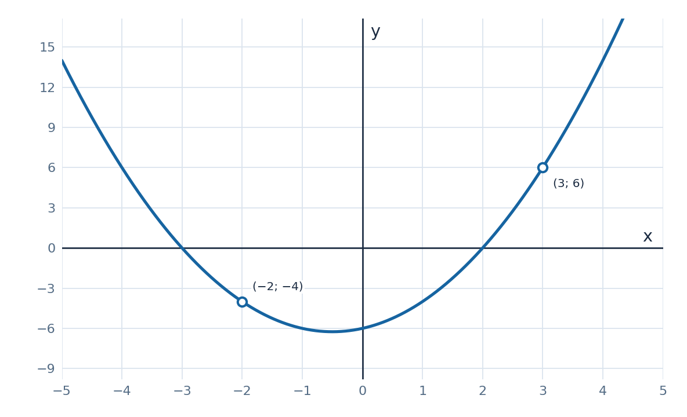

**Критерии**

- **2 балла.** График и результат по параметру либо числу пересечений верны. Отдельно посчитать вершину и уровни каждой выколотой точки
- **1 балл.** График верен, параметр или число пересечений найдены неправильно или отсутствуют. График верно передаёт формулы и принадлежность граничных точек, но ответ по прямой неверен или пропущен.
- **0 баллов.** График отсутствует или неверен. Остальные случаи, не удовлетворяющие условиям для 1 или 2 баллов. График отсутствует, неверно заданы ветви или пропущена существенно важная точка.

[Источник карточки](https://math-oge.sdamgia.ru/problem?id=340600)

### Задача 4 · 341129

Постройте график функции $y=\frac{\left(x + 1\right) \left(x^{2} + 7 x + 10\right)}{x + 2}$. При каких значениях $m$ прямая $y=m$ имеет с графиком ровно одну общую точку?

Подсказка 1

Выпиши запрещённые абсциссы исходной дроби.

Подсказка 2

После сокращения проверь уровни вершины и выколотых точек.

Ответ для самопроверки

$m\in\{-4;-3\}$

Разбор и критерии

1. Делить на ноль нельзя. Знаменатель $x + 2$ обращается в ноль при $x=-2$.
2. Разложим числитель: $(x + 1) ((x^{2} + 7 x) + 10)=(x + 1) (x + 2) (x + 5)$. Разделив числитель и знаменатель на общий множитель, получим $y=x^{2} + 6 x + 5$. Исключённые значения x по-прежнему нельзя подставлять.
3. Выделим квадрат. При раскрытии $(x + 3)^{2}$ получится $x^{2} + 6 x + 9$. Чтобы вернуть свободный член $5$, нужна поправка $-4$. Поэтому $y=(x + 3)^{2} - 4$. Квадрат равен нулю при $x=-3$, вершина — $(-3;-4)$.
4. Если подставить $x=-2$ в продолжение ветви, получим $y=-3$. В исходной функции эта точка исключена: ставим пустой кружок в $(-2;-3)$.
5. Горизонталь на высоте вершины касается параболы один раз. Со стороны раскрытия ветвей у неё две точки, с другой стороны ни одной. На высоте пустого кружка вычитаем отсутствующую точку.
6. Число пересечений по промежуткам и граничным значениям: $(-\infty;-4)$ — 0; $\{-4\}$ — 1; $(-4;-3)$ — 2; $\{-3\}$ — 1; $(-3;\infty)$ — 2.
7. Выбираем из подсчёта значения, при которых получается нужное число точек. $m\in\{-4;-3\}$

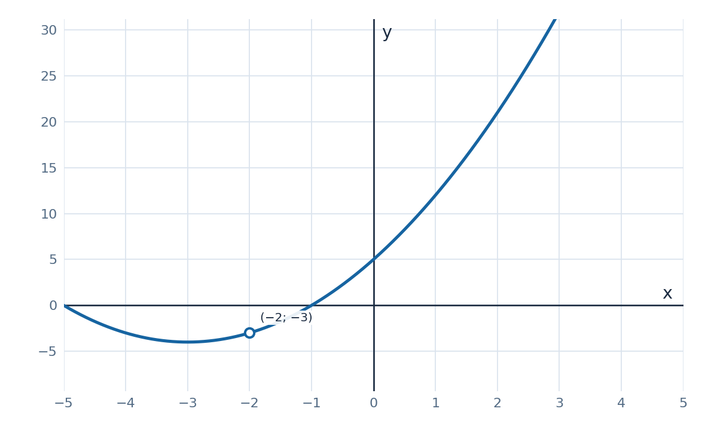

**Критерии**

- **2 балла.** График и результат по параметру либо числу пересечений верны. Отдельно посчитать вершину и уровни каждой выколотой точки
- **1 балл.** График верен, параметр или число пересечений найдены неправильно или отсутствуют. График верно передаёт формулы и принадлежность граничных точек, но ответ по прямой неверен или пропущен.
- **0 баллов.** График отсутствует или неверен. Остальные случаи, не удовлетворяющие условиям для 1 или 2 баллов. График отсутствует, неверно заданы ветви или пропущена существенно важная точка.

[Источник карточки](https://math-oge.sdamgia.ru/problem?id=341129)

### Задача 5 · 341159

Постройте график функции $y=\frac{\left(x + 1\right) \left(x^{2} + 7 x + 12\right)}{x + 3}$. При каких значениях $m$ прямая $y=m$ имеет с графиком ровно одну общую точку?

Подсказка 1

Выпиши запрещённые абсциссы исходной дроби.

Подсказка 2

После сокращения проверь уровни вершины и выколотых точек.

Ответ для самопроверки

$m\in\{- \frac{9}{4};-2\}$

Разбор и критерии

1. Делить на ноль нельзя. Знаменатель $x + 3$ обращается в ноль при $x=-3$.
2. Разложим числитель: $(x + 1) ((x^{2} + 7 x) + 12)=(x + 1) (x + 3) (x + 4)$. Разделив числитель и знаменатель на общий множитель, получим $y=x^{2} + 5 x + 4$. Исключённые значения x по-прежнему нельзя подставлять.
3. Выделим квадрат. При раскрытии $(x + \frac{5}{2})^{2}$ получится $x^{2} + 5 x + \frac{25}{4}$. Чтобы вернуть свободный член $4$, нужна поправка $- \frac{9}{4}$. Поэтому $y=(x + \frac{5}{2})^{2} - \frac{9}{4}$. Квадрат равен нулю при $x=- \frac{5}{2}$, вершина — $(- \frac{5}{2};- \frac{9}{4})$.
4. Если подставить $x=-3$ в продолжение ветви, получим $y=-2$. В исходной функции эта точка исключена: ставим пустой кружок в $(-3;-2)$.
5. Горизонталь на высоте вершины касается параболы один раз. Со стороны раскрытия ветвей у неё две точки, с другой стороны ни одной. На высоте пустого кружка вычитаем отсутствующую точку.
6. Число пересечений по промежуткам и граничным значениям: $(-\infty;- \frac{9}{4})$ — 0; $\{- \frac{9}{4}\}$ — 1; $(- \frac{9}{4};-2)$ — 2; $\{-2\}$ — 1; $(-2;\infty)$ — 2.
7. Выбираем из подсчёта значения, при которых получается нужное число точек. $m\in\{- \frac{9}{4};-2\}$

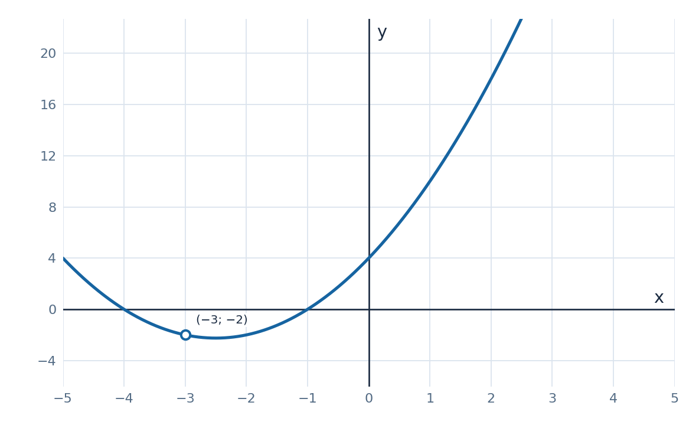

**Критерии**

- **2 балла.** График и результат по параметру либо числу пересечений верны. Отдельно посчитать вершину и уровни каждой выколотой точки
- **1 балл.** График верен, параметр или число пересечений найдены неправильно или отсутствуют. График верно передаёт формулы и принадлежность граничных точек, но ответ по прямой неверен или пропущен.
- **0 баллов.** График отсутствует или неверен. Остальные случаи, не удовлетворяющие условиям для 1 или 2 баллов. График отсутствует, неверно заданы ветви или пропущена существенно важная точка.

[Источник карточки](https://math-oge.sdamgia.ru/problem?id=341159)

### Задача 6 · 341535

Постройте график функции $y=5 - \frac{x^{4} - x^{3}}{x^{2} - x}$. При каких значениях $m$ прямая $y=m$ имеет с графиком ровно две общие точки?

Подсказка 1

Выпиши запрещённые абсциссы исходной дроби.

Подсказка 2

После сокращения проверь уровни вершины и выколотых точек.

Ответ для самопроверки

$m\in(-\infty;4)\cup(4;5)$

Разбор и критерии

1. Делить на ноль нельзя. Знаменатель $x^{2} - x=x (x - 1)$ обращается в ноль при $x=0$, $x=1$.
2. Оставим $5$ без изменения. Дробное слагаемое можно записать как $\frac{- x^{3} (x - 1)}{x (x - 1)}=- x^{2}$. Поэтому $y=5 - x^{2}$.
3. Для параболы $y=5 - x^{2}$ ось проходит через $x=-b/(2a)=0$. Подставляем это x и получаем вершину $(0;5)$. Уравнение с той же вершиной: $y=5 - x^{2}$.
4. Если подставить $x=1$ в продолжение ветви, получим $y=4$. В исходной функции эта точка исключена: ставим пустой кружок в $(1;4)$.
5. Если подставить $x=0$ в продолжение ветви, получим $y=5$. В исходной функции эта точка исключена: ставим пустой кружок в $(0;5)$.
6. Горизонталь на высоте вершины касается параболы один раз. Со стороны раскрытия ветвей у неё две точки, с другой стороны ни одной. На высоте пустого кружка вычитаем отсутствующую точку.
7. Число пересечений по промежуткам и граничным значениям: $(-\infty;4)$ — 2; $\{4\}$ — 1; $(4;5)$ — 2; $\{5\}$ — 0; $(5;\infty)$ — 0.
8. Выбираем из подсчёта значения, при которых получается нужное число точек. $m\in(-\infty;4)\cup(4;5)$

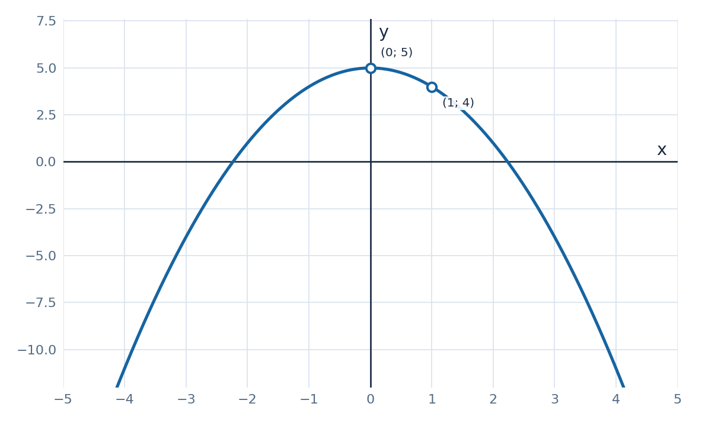

**Критерии**

- **2 балла.** График и результат по параметру либо числу пересечений верны. Отдельно посчитать вершину и уровни каждой выколотой точки
- **1 балл.** График верен, параметр или число пересечений найдены неправильно или отсутствуют. График верно передаёт формулы и принадлежность граничных точек, но ответ по прямой неверен или пропущен.
- **0 баллов.** График отсутствует или неверен. Остальные случаи, не удовлетворяющие условиям для 1 или 2 баллов. График отсутствует, неверно заданы ветви или пропущена существенно важная точка.

[Источник карточки](https://math-oge.sdamgia.ru/problem?id=341535)

## Сокращение и выколотые точки · Парабола и пучок y=kx

`OGE22-hole-parabola-slope`

### Задача 1 · 338408

Постройте $y=\frac{(x^2+2{,}25)(x-1)}{1-x}$. Найдите $k$, при которых прямая $y=kx$ и график имеют ровно одну общую точку.

Подсказка 1

Сократи дробь, отдельно сохранив исходные запреты.

Подсказка 2

Проверь и касание, и случай, когда один из двух корней попадает в выколотую точку.

Ответ для самопроверки

$k\in\{-13/4,-3,3\}$.

Разбор и критерии

1. График — парабола $y=-x^2-9/4$ с выколотой точкой $(1;-13/4)$.
2. Пересечения удовлетворяют $x^2+kx+9/4=0$, $x\ne1$.
3. Дискриминант $k^2-9$ равен нулю при $k=\pm3$.
4. Тогда единственная абсцисса $-k/2$ допустима.
5. При положительном дискриминанте остаётся ровно один корень только если другой равен $1$.
6. Подстановка $x=1$ даёт $k=-13/4$, оставшийся корень $9/4$ допустим.
7. При отрицательном дискриминанте пересечений нет.

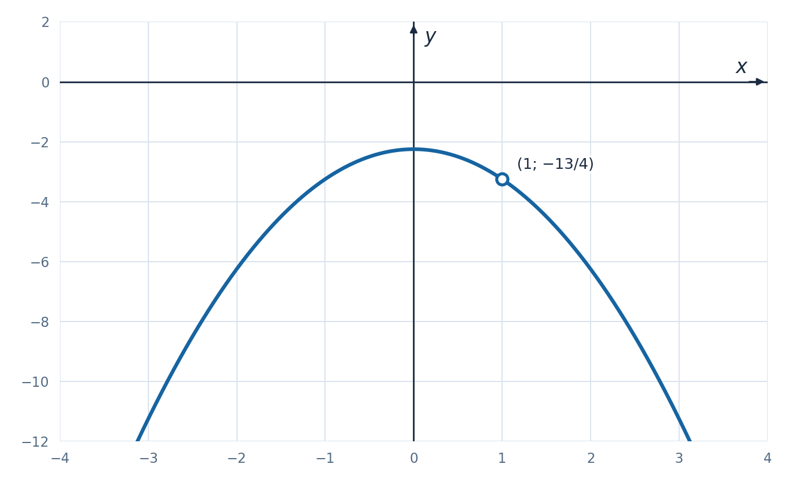

**Критерии**

- **2 балла.** График и результат по параметру либо числу пересечений верны. Верно нарисована парабола с отверстием и разобраны одновременно касание и потеря одного корня.
- **1 балл.** График верен, параметр или число пересечений найдены неправильно или отсутствуют. График верен, а значение k=−13/4 пропущено либо множество параметров неверно по иной причине.
- **0 баллов.** График отсутствует или неверен. Остальные случаи, не удовлетворяющие условиям для 1 или 2 баллов. Нарисована парабола без выколотой точки или ошибочно выбран знак ветвей.

[Источник карточки](https://math-oge.sdamgia.ru/problem?id=338408)

### Задача 2 · 341686

Постройте график функции $y=\frac{\left(x - 1\right) \left(x^{2} + 4\right)}{1 - x}$. При каких значениях $k$ прямая $y=kx$ имеет с графиком ровно одну общую точку?

Подсказка 1

Сократи дробь, отдельно сохранив исходные запреты.

Подсказка 2

Проверь и касание, и случай, когда один из двух корней попадает в выколотую точку.

Ответ для самопроверки

$k\in\{-5;-4;4\}$

Разбор и критерии

1. Делить на ноль нельзя. Знаменатель $1 - x$ обращается в ноль при $x=1$.
2. В числителе есть множитель $x - 1$, а знаменатель равен $-(x - 1)$. Их отношение равно −1 при $x\ne 1$. Поэтому $y=- x^{2} - 4$.
3. Для параболы $y=- x^{2} - 4$ ось проходит через $x=-b/(2a)=0$. Подставляем это x и получаем вершину $(0;-4)$. Уравнение с той же вершиной: $y=- x^{2} - 4$.
4. Если подставить $x=1$ в продолжение ветви, получим $y=-5$. В исходной функции эта точка исключена: ставим пустой кружок в $(1;-5)$.
5. В точке пересечения высоты равны: $- x^{2} - 4=kx$. Перенесём все члены влево: $x^2+kx+4=0$. Дискриминант $D=k^2-16$. При D=0 есть один корень, при D>0 два, при D<0 ни одного.
6. Прямая проходит через пустой кружок, когда $k=-5$: делим его ординату $-5$ на абсциссу $1$. В этом случае одно пересечение исчезает.
7. Число пересечений по промежуткам и граничным значениям: $(-\infty;-5)$ — 2; $\{-5\}$ — 1; $(-5;-4)$ — 2; $\{-4\}$ — 1; $(-4;4)$ — 0; $\{4\}$ — 1; $(4;\infty)$ — 2.
8. Выбираем из подсчёта значения, при которых получается нужное число точек. $k\in\{-5;-4;4\}$

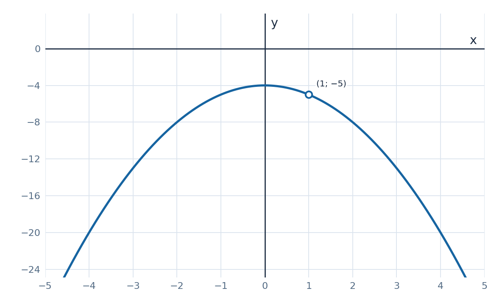

**Критерии**

- **2 балла.** График и результат по параметру либо числу пересечений верны. Касание по дискриминанту и потеря одного допустимого корня на выколотой точке
- **1 балл.** График верен, параметр или число пересечений найдены неправильно или отсутствуют. График верно передаёт формулы и принадлежность граничных точек, но ответ по прямой неверен или пропущен.
- **0 баллов.** График отсутствует или неверен. Остальные случаи, не удовлетворяющие условиям для 1 или 2 баллов. График отсутствует, неверно заданы ветви или пропущена существенно важная точка.

[Источник карточки](https://math-oge.sdamgia.ru/problem?id=341686)

### Задача 3 · 348483

Постройте график функции $y=\frac{\left(x - 2\right) \left(x^{2} + 1\right)}{2 - x}$. При каких значениях $k$ прямая $y=kx$ имеет с графиком ровно одну общую точку?

Подсказка 1

Сократи дробь, отдельно сохранив исходные запреты.

Подсказка 2

Проверь и касание, и случай, когда один из двух корней попадает в выколотую точку.

Ответ для самопроверки

$k\in\{- \frac{5}{2};-2;2\}$

Разбор и критерии

1. Делить на ноль нельзя. Знаменатель $2 - x$ обращается в ноль при $x=2$.
2. В числителе есть множитель $x - 2$, а знаменатель равен $-(x - 2)$. Их отношение равно −1 при $x\ne 2$. Поэтому $y=- x^{2} - 1$.
3. Для параболы $y=- x^{2} - 1$ ось проходит через $x=-b/(2a)=0$. Подставляем это x и получаем вершину $(0;-1)$. Уравнение с той же вершиной: $y=- x^{2} - 1$.
4. Если подставить $x=2$ в продолжение ветви, получим $y=-5$. В исходной функции эта точка исключена: ставим пустой кружок в $(2;-5)$.
5. В точке пересечения высоты равны: $- x^{2} - 1=kx$. Перенесём все члены влево: $x^2+kx+1=0$. Дискриминант $D=k^2-4$. При D=0 есть один корень, при D>0 два, при D<0 ни одного.
6. Прямая проходит через пустой кружок, когда $k=- \frac{5}{2}$: делим его ординату $-5$ на абсциссу $2$. В этом случае одно пересечение исчезает.
7. Число пересечений по промежуткам и граничным значениям: $(-\infty;- \frac{5}{2})$ — 2; $\{- \frac{5}{2}\}$ — 1; $(- \frac{5}{2};-2)$ — 2; $\{-2\}$ — 1; $(-2;2)$ — 0; $\{2\}$ — 1; $(2;\infty)$ — 2.
8. Выбираем из подсчёта значения, при которых получается нужное число точек. $k\in\{- \frac{5}{2};-2;2\}$

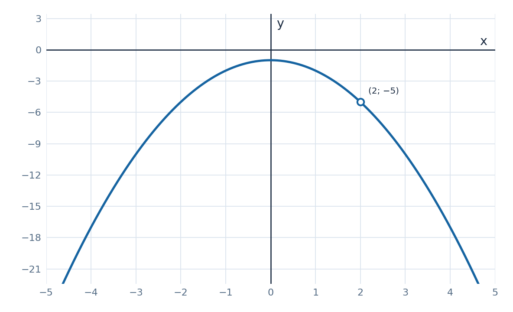

**Критерии**

- **2 балла.** График и результат по параметру либо числу пересечений верны. Касание по дискриминанту и потеря одного допустимого корня на выколотой точке
- **1 балл.** График верен, параметр или число пересечений найдены неправильно или отсутствуют. График верно передаёт формулы и принадлежность граничных точек, но ответ по прямой неверен или пропущен.
- **0 баллов.** График отсутствует или неверен. Остальные случаи, не удовлетворяющие условиям для 1 или 2 баллов. График отсутствует, неверно заданы ветви или пропущена существенно важная точка.

[Источник карточки](https://math-oge.sdamgia.ru/problem?id=348483)

### Задача 4 · 348845

Постройте график функции $y=\frac{\left(x + 1\right) \left(x^{2} + \frac{25}{4}\right)}{- x - 1}$. При каких значениях $k$ прямая $y=kx$ имеет с графиком ровно одну общую точку?

Подсказка 1

Сократи дробь, отдельно сохранив исходные запреты.

Подсказка 2

Проверь и касание, и случай, когда один из двух корней попадает в выколотую точку.

Ответ для самопроверки

$k\in\{-5;5;\frac{29}{4}\}$

Разбор и критерии

1. Делить на ноль нельзя. Знаменатель $- x - 1$ обращается в ноль при $x=-1$.
2. В числителе есть множитель $x + 1$, а знаменатель равен $-(x + 1)$. Их отношение равно −1 при $x\ne -1$. Поэтому $y=- x^{2} - \frac{25}{4}$.
3. Для параболы $y=- x^{2} - \frac{25}{4}$ ось проходит через $x=-b/(2a)=0$. Подставляем это x и получаем вершину $(0;- \frac{25}{4})$. Уравнение с той же вершиной: $y=- x^{2} - \frac{25}{4}$.
4. Если подставить $x=-1$ в продолжение ветви, получим $y=- \frac{29}{4}$. В исходной функции эта точка исключена: ставим пустой кружок в $(-1;- \frac{29}{4})$.
5. В точке пересечения высоты равны: $- x^{2} - \frac{25}{4}=kx$. Перенесём все члены влево: $x^2+kx+\frac{25}{4}=0$. Дискриминант $D=k^2-25$. При D=0 есть один корень, при D>0 два, при D<0 ни одного.
6. Прямая проходит через пустой кружок, когда $k=\frac{29}{4}$: делим его ординату $- \frac{29}{4}$ на абсциссу $-1$. В этом случае одно пересечение исчезает.
7. Число пересечений по промежуткам и граничным значениям: $(-\infty;-5)$ — 2; $\{-5\}$ — 1; $(-5;5)$ — 0; $\{5\}$ — 1; $(5;\frac{29}{4})$ — 2; $\{\frac{29}{4}\}$ — 1; $(\frac{29}{4};\infty)$ — 2.
8. Выбираем из подсчёта значения, при которых получается нужное число точек. $k\in\{-5;5;\frac{29}{4}\}$

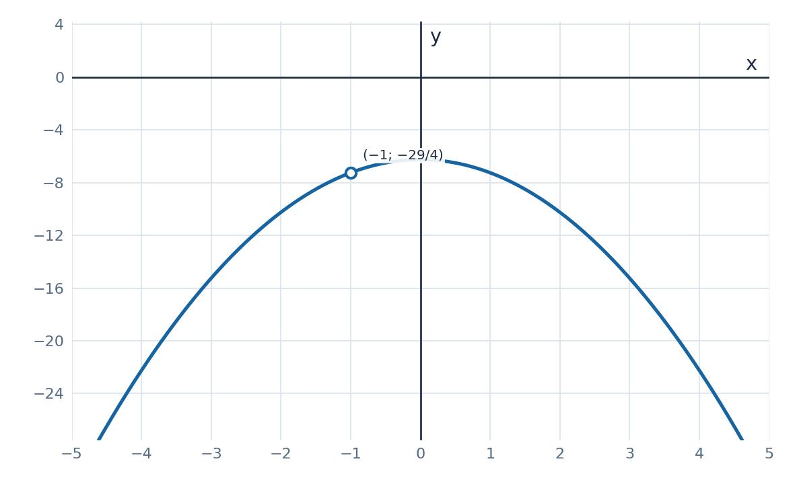

**Критерии**

- **2 балла.** График и результат по параметру либо числу пересечений верны. Касание по дискриминанту и потеря одного допустимого корня на выколотой точке
- **1 балл.** График верен, параметр или число пересечений найдены неправильно или отсутствуют. График верно передаёт формулы и принадлежность граничных точек, но ответ по прямой неверен или пропущен.
- **0 баллов.** График отсутствует или неверен. Остальные случаи, не удовлетворяющие условиям для 1 или 2 баллов. График отсутствует, неверно заданы ветви или пропущена существенно важная точка.

[Источник карточки](https://math-oge.sdamgia.ru/problem?id=348845)

### Задача 5 · 348865

Постройте график функции $y=\frac{\left(x + 1\right) \left(x^{2} + 4\right)}{- x - 1}$. При каких значениях $k$ прямая $y=kx$ имеет с графиком ровно одну общую точку?

Подсказка 1

Сократи дробь, отдельно сохранив исходные запреты.

Подсказка 2

Проверь и касание, и случай, когда один из двух корней попадает в выколотую точку.

Ответ для самопроверки

$k\in\{-4;4;5\}$

Разбор и критерии

1. Делить на ноль нельзя. Знаменатель $- x - 1$ обращается в ноль при $x=-1$.
2. В числителе есть множитель $x + 1$, а знаменатель равен $-(x + 1)$. Их отношение равно −1 при $x\ne -1$. Поэтому $y=- x^{2} - 4$.
3. Для параболы $y=- x^{2} - 4$ ось проходит через $x=-b/(2a)=0$. Подставляем это x и получаем вершину $(0;-4)$. Уравнение с той же вершиной: $y=- x^{2} - 4$.
4. Если подставить $x=-1$ в продолжение ветви, получим $y=-5$. В исходной функции эта точка исключена: ставим пустой кружок в $(-1;-5)$.
5. В точке пересечения высоты равны: $- x^{2} - 4=kx$. Перенесём все члены влево: $x^2+kx+4=0$. Дискриминант $D=k^2-16$. При D=0 есть один корень, при D>0 два, при D<0 ни одного.
6. Прямая проходит через пустой кружок, когда $k=5$: делим его ординату $-5$ на абсциссу $-1$. В этом случае одно пересечение исчезает.
7. Число пересечений по промежуткам и граничным значениям: $(-\infty;-4)$ — 2; $\{-4\}$ — 1; $(-4;4)$ — 0; $\{4\}$ — 1; $(4;5)$ — 2; $\{5\}$ — 1; $(5;\infty)$ — 2.
8. Выбираем из подсчёта значения, при которых получается нужное число точек. $k\in\{-4;4;5\}$

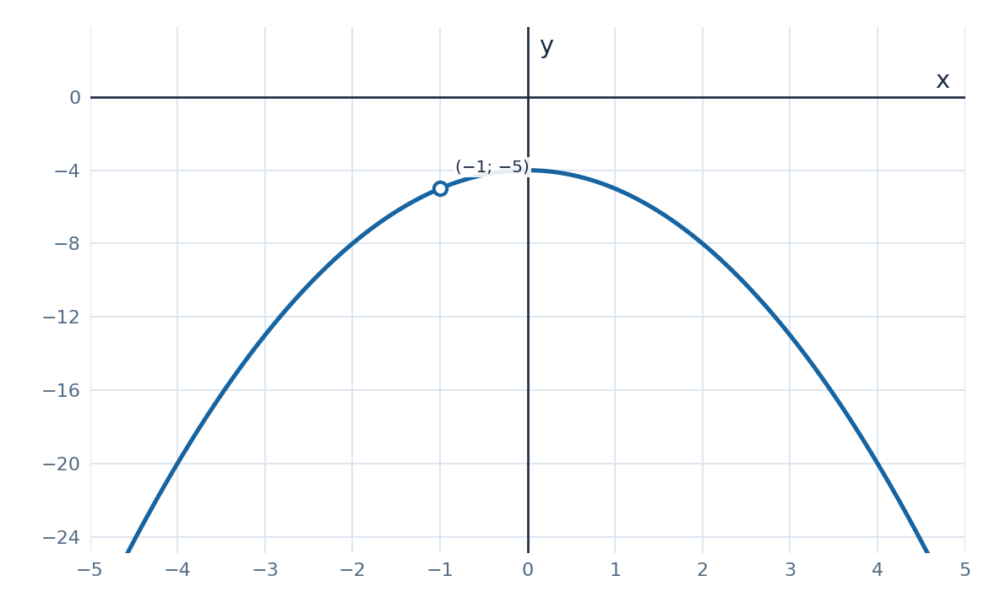

**Критерии**

- **2 балла.** График и результат по параметру либо числу пересечений верны. Касание по дискриминанту и потеря одного допустимого корня на выколотой точке
- **1 балл.** График верен, параметр или число пересечений найдены неправильно или отсутствуют. График верно передаёт формулы и принадлежность граничных точек, но ответ по прямой неверен или пропущен.
- **0 баллов.** График отсутствует или неверен. Остальные случаи, не удовлетворяющие условиям для 1 или 2 баллов. График отсутствует, неверно заданы ветви или пропущена существенно важная точка.

[Источник карточки](https://math-oge.sdamgia.ru/problem?id=348865)

### Задача 6 · 349984

Постройте график функции $y=\frac{\left(x - 1\right) \left(x^{2} + 1 \cdot \frac{1}{4}\right)}{1 - x}$. При каких значениях $k$ прямая $y=kx$ имеет с графиком ровно одну общую точку?

Подсказка 1

Сократи дробь, отдельно сохранив исходные запреты.

Подсказка 2

Проверь и касание, и случай, когда один из двух корней попадает в выколотую точку.

Ответ для самопроверки

$k\in\{- \frac{5}{4};-1;1\}$

Разбор и критерии

1. Делить на ноль нельзя. Знаменатель $1 - x$ обращается в ноль при $x=1$.
2. В числителе есть множитель $x - 1$, а знаменатель равен $-(x - 1)$. Их отношение равно −1 при $x\ne 1$. Поэтому $y=- x^{2} - \frac{1}{4}$.
3. Для параболы $y=- x^{2} - \frac{1}{4}$ ось проходит через $x=-b/(2a)=0$. Подставляем это x и получаем вершину $(0;- \frac{1}{4})$. Уравнение с той же вершиной: $y=- x^{2} - \frac{1}{4}$.
4. Если подставить $x=1$ в продолжение ветви, получим $y=- \frac{5}{4}$. В исходной функции эта точка исключена: ставим пустой кружок в $(1;- \frac{5}{4})$.
5. В точке пересечения высоты равны: $- x^{2} - \frac{1}{4}=kx$. Перенесём все члены влево: $x^2+kx+\frac{1}{4}=0$. Дискриминант $D=k^2-1$. При D=0 есть один корень, при D>0 два, при D<0 ни одного.
6. Прямая проходит через пустой кружок, когда $k=- \frac{5}{4}$: делим его ординату $- \frac{5}{4}$ на абсциссу $1$. В этом случае одно пересечение исчезает.
7. Число пересечений по промежуткам и граничным значениям: $(-\infty;- \frac{5}{4})$ — 2; $\{- \frac{5}{4}\}$ — 1; $(- \frac{5}{4};-1)$ — 2; $\{-1\}$ — 1; $(-1;1)$ — 0; $\{1\}$ — 1; $(1;\infty)$ — 2.
8. Выбираем из подсчёта значения, при которых получается нужное число точек. $k\in\{- \frac{5}{4};-1;1\}$

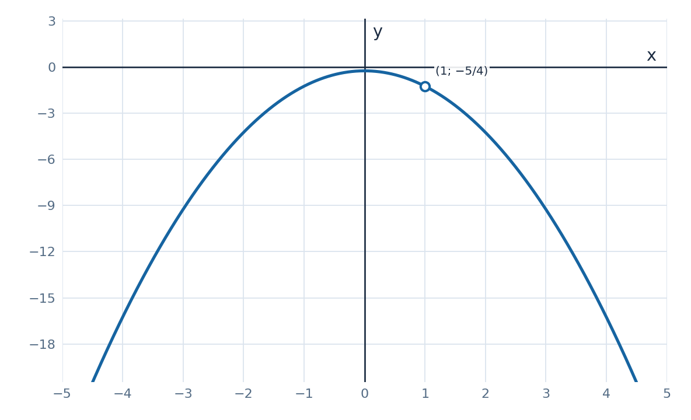

**Критерии**

- **2 балла.** График и результат по параметру либо числу пересечений верны. Касание по дискриминанту и потеря одного допустимого корня на выколотой точке
- **1 балл.** График верен, параметр или число пересечений найдены неправильно или отсутствуют. График верно передаёт формулы и принадлежность граничных точек, но ответ по прямой неверен или пропущен.
- **0 баллов.** График отсутствует или неверен. Остальные случаи, не удовлетворяющие условиям для 1 или 2 баллов. График отсутствует, неверно заданы ветви или пропущена существенно важная точка.

[Источник карточки](https://math-oge.sdamgia.ru/problem?id=349984)

## Сокращение и выколотые точки · Гипербола и пучок y=kx

`OGE22-hole-hyperbola-slope`

### Задача 1 · 314799

Постройте $y=\frac{x-2}{2x-x^2}$. При каком $k$ прямая $y=kx$ имеет с этим графиком ровно одну общую точку?

Подсказка 1

Разложи знаменатель на множители.

Подсказка 2

На допустимой области приравняй упрощённую функцию к kx и исключи выколотые точки.

Ответ для самопроверки

$k=-1/4$.

Разбор и критерии

1. Так как $2x-x^2=-x(x-2)$, получаем $y=-1/x$ на $x\ne0,2$.
2. Строим ветви во второй и четвёртой четвертях, точку $(2;-1/2)$ выкалываем.
3. Из $kx=-1/x$ следует $kx^2=-1$.
4. При $k\ge0$ решений нет, а при $k<0$ обычно две противоположные абсциссы.
5. Ровно одна останется, когда положительная абсцисса равна $2$, то есть $k=-1/4$.
6. Абсцисса $-2$ остаётся допустимой.

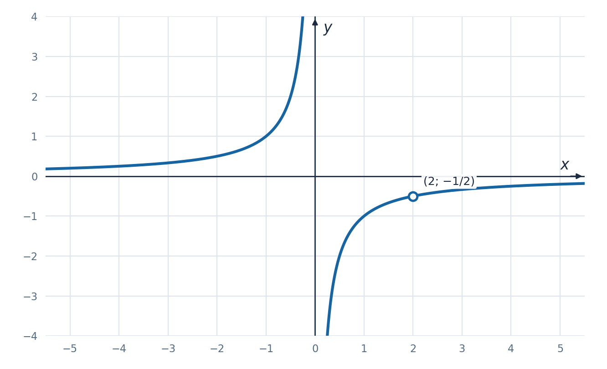

**Критерии**

- **2 балла.** График и результат по параметру либо числу пересечений верны. Правильные ветви, запреты и отверстие, доказана единственность значения k.
- **1 балл.** График верен, параметр или число пересечений найдены неправильно или отсутствуют. График верен, но k не найдено или найдено неверно.
- **0 баллов.** График отсутствует или неверен. Остальные случаи, не удовлетворяющие условиям для 1 или 2 баллов. Нарисованы ветви y=1/x либо отверстие (2;−1/2) показано как часть графика.

[Источник карточки](https://math-oge.sdamgia.ru/problem?id=314799)

### Задача 2 · 153

Постройте график функции $y=\frac{2 x + 1}{2 x^{2} + x}$. При каких значениях $k$ прямая $y=kx$ имеет с графиком ровно одну общую точку?

Подсказка 1

Разложи знаменатель на множители.

Подсказка 2

На допустимой области приравняй упрощённую функцию к kx и исключи выколотые точки.

Ответ для самопроверки

$k\in\{4\}$

Разбор и критерии

1. Делить на ноль нельзя. Знаменатель $2 x^{2} + x=x (2 x + 1)$ обращается в ноль при $x=- \frac{1}{2}$, $x=0$.
2. Разложим числитель: $2 x + 1$. Разделив числитель и знаменатель на общий множитель, получим $y=\frac{1}{x}$. Исключённые значения x по-прежнему нельзя подставлять.
3. Если подставить $x=- \frac{1}{2}$ в продолжение ветви, получим $y=-2$. В исходной функции эта точка исключена: ставим пустой кружок в $(- \frac{1}{2};-2)$.
4. Приравняем $kx=\frac{1}{x}$. Умножив на ненулевой x, получим $kx^2=1$. Когда квадрат положителен, есть два противоположных корня. Поэтому одна точка останется только тогда, когда вторая попадёт в отверстие.
5. Прямая проходит через пустой кружок, когда $k=4$: делим его ординату $-2$ на абсциссу $- \frac{1}{2}$. В этом случае одно пересечение исчезает.
6. Число пересечений по промежуткам и граничным значениям: $(-\infty;0)$ — 0; $\{0\}$ — 0; $(0;4)$ — 2; $\{4\}$ — 1; $(4;\infty)$ — 2.
7. Выбираем из подсчёта значения, при которых получается нужное число точек. $k\in\{4\}$

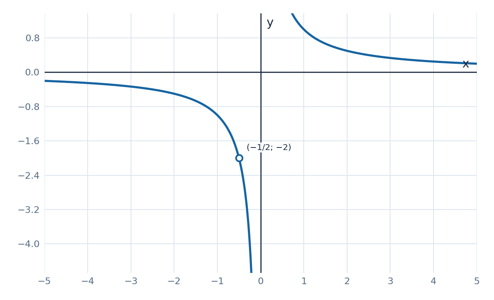

**Критерии**

- **2 балла.** График и результат по параметру либо числу пересечений верны. Уравнение kx²=c, затем фильтр отверстия по исходному знаменателю
- **1 балл.** График верен, параметр или число пересечений найдены неправильно или отсутствуют. График верно передаёт формулы и принадлежность граничных точек, но ответ по прямой неверен или пропущен.
- **0 баллов.** График отсутствует или неверен. Остальные случаи, не удовлетворяющие условиям для 1 или 2 баллов. График отсутствует, неверно заданы ветви или пропущена существенно важная точка.

[Источник карточки](https://math-oge.sdamgia.ru/problem?id=153)

### Задача 3 · 314804

Постройте график функции $y=\frac{1 - 2 x}{2 x^{2} - x}$. При каких значениях $k$ прямая $y=kx$ имеет с графиком ровно одну общую точку?

Подсказка 1

Разложи знаменатель на множители.

Подсказка 2

На допустимой области приравняй упрощённую функцию к kx и исключи выколотые точки.

Ответ для самопроверки

$k\in\{-4\}$

Разбор и критерии

1. Делить на ноль нельзя. Знаменатель $2 x^{2} - x=x (2 x - 1)$ обращается в ноль при $x=0$, $x=\frac{1}{2}$.
2. Разложим числитель: $1 - 2 x$. Разделив числитель и знаменатель на общий множитель, получим $y=- \frac{1}{x}$. Исключённые значения x по-прежнему нельзя подставлять.
3. Если подставить $x=\frac{1}{2}$ в продолжение ветви, получим $y=-2$. В исходной функции эта точка исключена: ставим пустой кружок в $(\frac{1}{2};-2)$.
4. Приравняем $kx=- \frac{1}{x}$. Умножив на ненулевой x, получим $kx^2=-1$. Когда квадрат положителен, есть два противоположных корня. Поэтому одна точка останется только тогда, когда вторая попадёт в отверстие.
5. Прямая проходит через пустой кружок, когда $k=-4$: делим его ординату $-2$ на абсциссу $\frac{1}{2}$. В этом случае одно пересечение исчезает.
6. Число пересечений по промежуткам и граничным значениям: $(-\infty;-4)$ — 2; $\{-4\}$ — 1; $(-4;0)$ — 2; $\{0\}$ — 0; $(0;\infty)$ — 0.
7. Выбираем из подсчёта значения, при которых получается нужное число точек. $k\in\{-4\}$

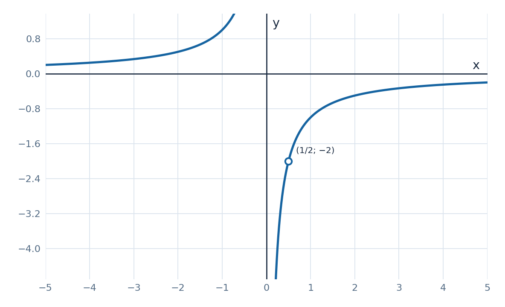

**Критерии**

- **2 балла.** График и результат по параметру либо числу пересечений верны. Уравнение kx²=c, затем фильтр отверстия по исходному знаменателю
- **1 балл.** График верен, параметр или число пересечений найдены неправильно или отсутствуют. График верно передаёт формулы и принадлежность граничных точек, но ответ по прямой неверен или пропущен.
- **0 баллов.** График отсутствует или неверен. Остальные случаи, не удовлетворяющие условиям для 1 или 2 баллов. График отсутствует, неверно заданы ветви или пропущена существенно важная точка.

[Источник карточки](https://math-oge.sdamgia.ru/problem?id=314804)

### Задача 4 · 338300

Постройте график функции $y=\frac{3 x + 5}{3 x^{2} + 5 x}$. При каких значениях $k$ прямая $y=kx$ имеет с графиком ровно одну общую точку?

Подсказка 1

Разложи знаменатель на множители.

Подсказка 2

На допустимой области приравняй упрощённую функцию к kx и исключи выколотые точки.

Ответ для самопроверки

$k\in\{\frac{9}{25}\}$

Разбор и критерии

1. Делить на ноль нельзя. Знаменатель $3 x^{2} + 5 x=x (3 x + 5)$ обращается в ноль при $x=- \frac{5}{3}$, $x=0$.
2. Разложим числитель: $3 x + 5$. Разделив числитель и знаменатель на общий множитель, получим $y=\frac{1}{x}$. Исключённые значения x по-прежнему нельзя подставлять.
3. Если подставить $x=- \frac{5}{3}$ в продолжение ветви, получим $y=- \frac{3}{5}$. В исходной функции эта точка исключена: ставим пустой кружок в $(- \frac{5}{3};- \frac{3}{5})$.
4. Приравняем $kx=\frac{1}{x}$. Умножив на ненулевой x, получим $kx^2=1$. Когда квадрат положителен, есть два противоположных корня. Поэтому одна точка останется только тогда, когда вторая попадёт в отверстие.
5. Прямая проходит через пустой кружок, когда $k=\frac{9}{25}$: делим его ординату $- \frac{3}{5}$ на абсциссу $- \frac{5}{3}$. В этом случае одно пересечение исчезает.
6. Число пересечений по промежуткам и граничным значениям: $(-\infty;0)$ — 0; $\{0\}$ — 0; $(0;\frac{9}{25})$ — 2; $\{\frac{9}{25}\}$ — 1; $(\frac{9}{25};\infty)$ — 2.
7. Выбираем из подсчёта значения, при которых получается нужное число точек. $k\in\{\frac{9}{25}\}$

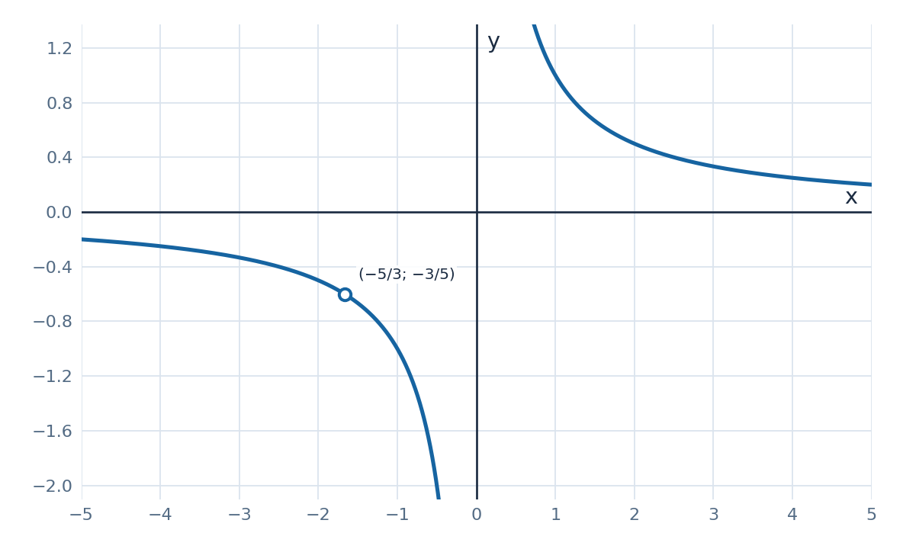

**Критерии**

- **2 балла.** График и результат по параметру либо числу пересечений верны. Уравнение kx²=c, затем фильтр отверстия по исходному знаменателю
- **1 балл.** График верен, параметр или число пересечений найдены неправильно или отсутствуют. График верно передаёт формулы и принадлежность граничных точек, но ответ по прямой неверен или пропущен.
- **0 баллов.** График отсутствует или неверен. Остальные случаи, не удовлетворяющие условиям для 1 или 2 баллов. График отсутствует, неверно заданы ветви или пропущена существенно важная точка.

[Источник карточки](https://math-oge.sdamgia.ru/problem?id=338300)

### Задача 5 · 314796

Постройте график функции $y=\frac{x + 2}{x^{2} + 2 x}$. При каких значениях $k$ прямая $y=kx$ имеет с графиком ровно одну общую точку?

Подсказка 1

Разложи знаменатель на множители.

Подсказка 2

На допустимой области приравняй упрощённую функцию к kx и исключи выколотые точки.

Ответ для самопроверки

$k\in\{\frac{1}{4}\}$

Разбор и критерии

1. Делить на ноль нельзя. Знаменатель $x^{2} + 2 x=x (x + 2)$ обращается в ноль при $x=-2$, $x=0$.
2. Разложим числитель: $x + 2$. Разделив числитель и знаменатель на общий множитель, получим $y=\frac{1}{x}$. Исключённые значения x по-прежнему нельзя подставлять.
3. Если подставить $x=-2$ в продолжение ветви, получим $y=- \frac{1}{2}$. В исходной функции эта точка исключена: ставим пустой кружок в $(-2;- \frac{1}{2})$.
4. Приравняем $kx=\frac{1}{x}$. Умножив на ненулевой x, получим $kx^2=1$. Когда квадрат положителен, есть два противоположных корня. Поэтому одна точка останется только тогда, когда вторая попадёт в отверстие.
5. Прямая проходит через пустой кружок, когда $k=\frac{1}{4}$: делим его ординату $- \frac{1}{2}$ на абсциссу $-2$. В этом случае одно пересечение исчезает.
6. Число пересечений по промежуткам и граничным значениям: $(-\infty;0)$ — 0; $\{0\}$ — 0; $(0;\frac{1}{4})$ — 2; $\{\frac{1}{4}\}$ — 1; $(\frac{1}{4};\infty)$ — 2.
7. Выбираем из подсчёта значения, при которых получается нужное число точек. $k\in\{\frac{1}{4}\}$

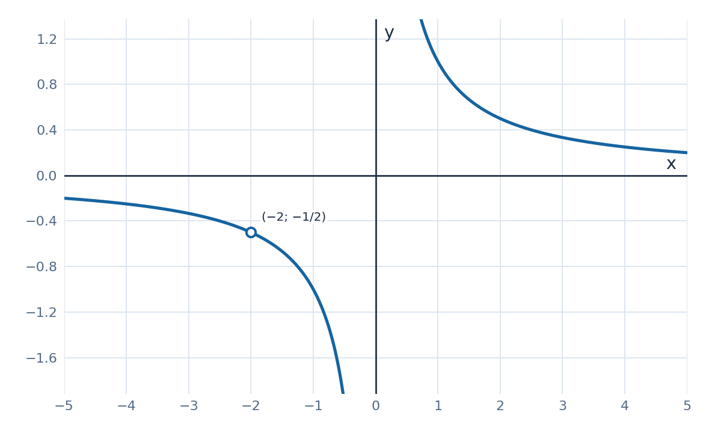

**Критерии**

- **2 балла.** График и результат по параметру либо числу пересечений верны. Уравнение kx²=c, затем фильтр отверстия по исходному знаменателю
- **1 балл.** График верен, параметр или число пересечений найдены неправильно или отсутствуют. График верно передаёт формулы и принадлежность граничных точек, но ответ по прямой неверен или пропущен.
- **0 баллов.** График отсутствует или неверен. Остальные случаи, не удовлетворяющие условиям для 1 или 2 баллов. График отсутствует, неверно заданы ветви или пропущена существенно важная точка.

[Источник карточки](https://math-oge.sdamgia.ru/problem?id=314796)

### Задача 6 · 349016

Постройте график функции $y=\frac{7 x - 5}{7 x^{2} - 5 x}$. При каких значениях $k$ прямая $y=kx$ имеет с графиком ровно одну общую точку?

Подсказка 1

Разложи знаменатель на множители.

Подсказка 2

На допустимой области приравняй упрощённую функцию к kx и исключи выколотые точки.

Ответ для самопроверки

$k\in\{\frac{49}{25}\}$

Разбор и критерии

1. Делить на ноль нельзя. Знаменатель $7 x^{2} - 5 x=x (7 x - 5)$ обращается в ноль при $x=0$, $x=\frac{5}{7}$.
2. Разложим числитель: $7 x - 5$. Разделив числитель и знаменатель на общий множитель, получим $y=\frac{1}{x}$. Исключённые значения x по-прежнему нельзя подставлять.
3. Если подставить $x=\frac{5}{7}$ в продолжение ветви, получим $y=\frac{7}{5}$. В исходной функции эта точка исключена: ставим пустой кружок в $(\frac{5}{7};\frac{7}{5})$.
4. Приравняем $kx=\frac{1}{x}$. Умножив на ненулевой x, получим $kx^2=1$. Когда квадрат положителен, есть два противоположных корня. Поэтому одна точка останется только тогда, когда вторая попадёт в отверстие.
5. Прямая проходит через пустой кружок, когда $k=\frac{49}{25}$: делим его ординату $\frac{7}{5}$ на абсциссу $\frac{5}{7}$. В этом случае одно пересечение исчезает.
6. Число пересечений по промежуткам и граничным значениям: $(-\infty;0)$ — 0; $\{0\}$ — 0; $(0;\frac{49}{25})$ — 2; $\{\frac{49}{25}\}$ — 1; $(\frac{49}{25};\infty)$ — 2.
7. Выбираем из подсчёта значения, при которых получается нужное число точек. $k\in\{\frac{49}{25}\}$

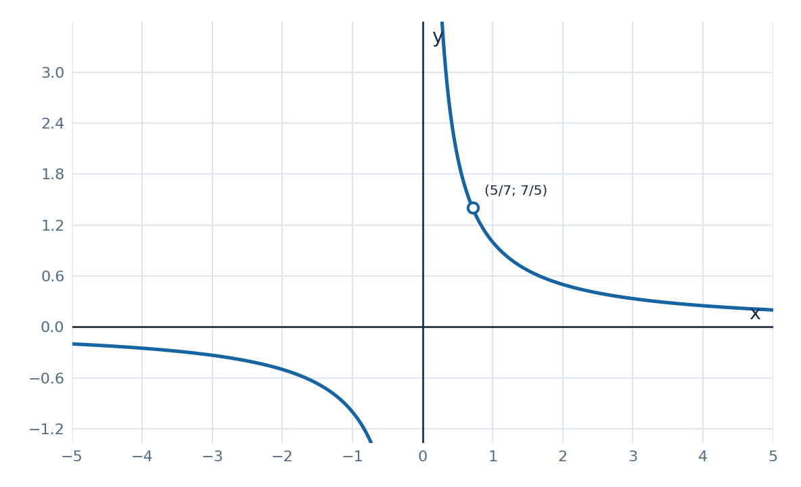

**Критерии**

- **2 балла.** График и результат по параметру либо числу пересечений верны. Уравнение kx²=c, затем фильтр отверстия по исходному знаменателю
- **1 балл.** График верен, параметр или число пересечений найдены неправильно или отсутствуют. График верно передаёт формулы и принадлежность граничных точек, но ответ по прямой неверен или пропущен.
- **0 баллов.** График отсутствует или неверен. Остальные случаи, не удовлетворяющие условиям для 1 или 2 баллов. График отсутствует, неверно заданы ветви или пропущена существенно важная точка.

[Источник карточки](https://math-oge.sdamgia.ru/problem?id=349016)

## Сокращение и выколотые точки · Сдвинутая гипербола и горизонталь

`OGE22-hole-hyperbola-level`

### Задача 1 · 340933

Постройте график $y=3-\frac{x+5}{x^2+5x}$. При каких $m$ у горизонтали $y=m$ и этого графика нет общих точек?

Подсказка 1

Отметь, что исключается из области определения.

Подсказка 2

Сравни уровень горизонтальной асимптоты с ординатой выколотой точки.

Ответ для самопроверки

$m\in\{3;16/5\}$.

Разбор и критерии

1. На ОДЗ $x\ne0,-5$ имеем $y=3-1/x$.
2. Асимптоты — $x=0$ и $y=3$, выколотая точка $(-5;16/5)$.
3. При $m=3$ равенство $-1/x=m-3$ невозможно.
4. При $m\ne3$ решение единственно и равно $x=1/(3-m)$.
5. Оно запрещено ровно для $m=16/5$, когда $x=-5$.

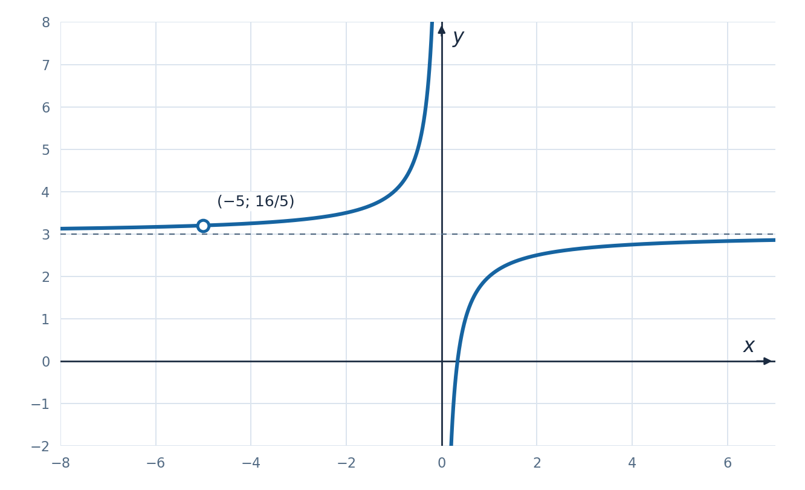

**Критерии**

- **2 балла.** График и результат по параметру либо числу пересечений верны. График учитывает обе асимптоты и отверстие; найдены оба уровня без пересечений.
- **1 балл.** График верен, параметр или число пересечений найдены неправильно или отсутствуют. График верен, но найден только один из уровней или допущена иная ошибка в параметре.
- **0 баллов.** График отсутствует или неверен. Остальные случаи, не удовлетворяющие условиям для 1 или 2 баллов. Гипербола не сдвинута вверх либо отсутствует отверстие при x=−5.

[Источник карточки](https://math-oge.sdamgia.ru/problem?id=340933)

### Задача 2 · 341420

Постройте график функции $y=3 - \frac{x + 2}{x^{2} + 2 x}$. При каких значениях $m$ прямая $y=m$ и график не имеют общих точек?

Подсказка 1

Отметь, что исключается из области определения.

Подсказка 2

Сравни уровень горизонтальной асимптоты с ординатой выколотой точки.

Ответ для самопроверки

$m\in\{3;\frac{7}{2}\}$

Разбор и критерии

1. Делить на ноль нельзя. Знаменатель $x^{2} + 2 x=x (x + 2)$ обращается в ноль при $x=-2$, $x=0$.
2. Оставим $3$ без изменения. Дробное слагаемое можно записать как $\frac{- x - 2}{x (x + 2)}=- \frac{1}{x}$. Поэтому $y=3 - \frac{1}{x}$.
3. Если подставить $x=-2$ в продолжение ветви, получим $y=\frac{7}{2}$. В исходной функции эта точка исключена: ставим пустой кружок в $(-2;\frac{7}{2})$.
4. Мысленно ведём горизонтальную прямую снизу вверх. Чтобы посчитать пересечения, посмотрим, какие высоты проходит каждая часть графика.
5. При $x<-2$ слева направо высота меняется так: $3\to \frac{7}{2}$.
6. При $-2<x<0$ слева направо высота меняется так: $\frac{7}{2}\to \infty$.
7. При $x>0$ слева направо высота меняется так: $-\infty\to 3$.
8. Между соседними высотами каждая проходящая через этот уровень ветвь даёт одну точку. Общий конец двух ветвей считаем один раз, пустой кружок пропускаем.
9. Число пересечений по промежуткам и граничным значениям: $(-\infty;3)$ — 1; $\{3\}$ — 0; $(3;\frac{7}{2})$ — 1; $\{\frac{7}{2}\}$ — 0; $(\frac{7}{2};\infty)$ — 1.
10. Выбираем из подсчёта значения, при которых получается нужное число точек. $m\in\{3;\frac{7}{2}\}$

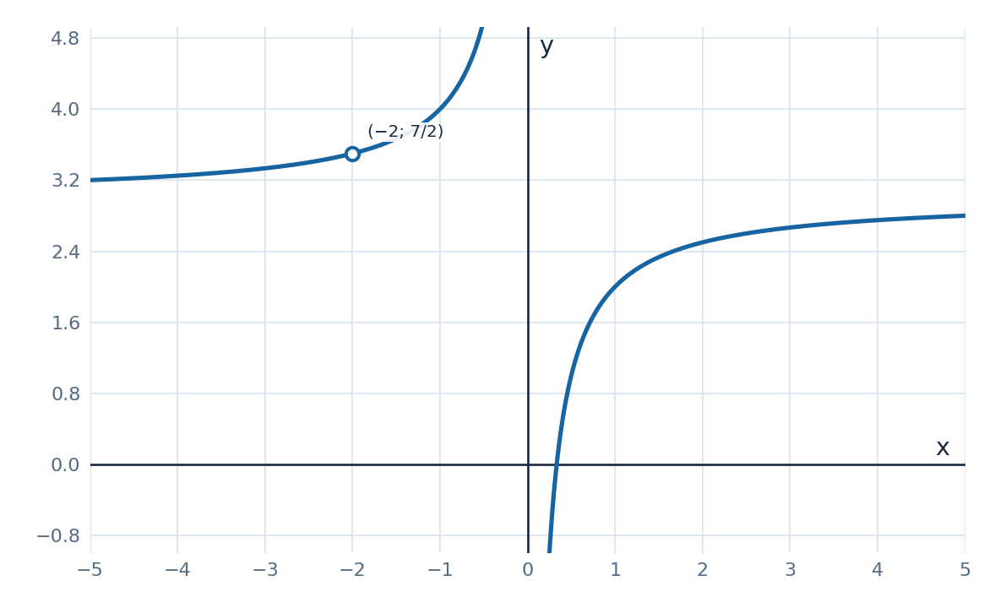

**Критерии**

- **2 балла.** График и результат по параметру либо числу пересечений верны. Горизонтальная асимптота и потеря единственной точки на выколотом уровне
- **1 балл.** График верен, параметр или число пересечений найдены неправильно или отсутствуют. График верно передаёт формулы и принадлежность граничных точек, но ответ по прямой неверен или пропущен.
- **0 баллов.** График отсутствует или неверен. Остальные случаи, не удовлетворяющие условиям для 1 или 2 баллов. График отсутствует, неверно заданы ветви или пропущена существенно важная точка.

[Источник карточки](https://math-oge.sdamgia.ru/problem?id=341420)

### Задача 3 · 338224

Постройте график функции $y=- \frac{x + 1}{x^{2} + x} - 4$. При каких значениях $m$ прямая $y=m$ и график не имеют общих точек?

Подсказка 1

Отметь, что исключается из области определения.

Подсказка 2

Сравни уровень горизонтальной асимптоты с ординатой выколотой точки.

Ответ для самопроверки

$m\in\{-4;-3\}$

Разбор и критерии

1. Делить на ноль нельзя. Знаменатель $x^{2} + x=x (x + 1)$ обращается в ноль при $x=-1$, $x=0$.
2. Оставим $-4$ без изменения. Дробное слагаемое можно записать как $\frac{- x - 1}{x (x + 1)}=- \frac{1}{x}$. Поэтому $y=-4 - \frac{1}{x}$.
3. Если подставить $x=-1$ в продолжение ветви, получим $y=-3$. В исходной функции эта точка исключена: ставим пустой кружок в $(-1;-3)$.
4. Мысленно ведём горизонтальную прямую снизу вверх. Чтобы посчитать пересечения, посмотрим, какие высоты проходит каждая часть графика.
5. При $x<-1$ слева направо высота меняется так: $-4\to -3$.
6. При $-1<x<0$ слева направо высота меняется так: $-3\to \infty$.
7. При $x>0$ слева направо высота меняется так: $-\infty\to -4$.
8. Между соседними высотами каждая проходящая через этот уровень ветвь даёт одну точку. Общий конец двух ветвей считаем один раз, пустой кружок пропускаем.
9. Число пересечений по промежуткам и граничным значениям: $(-\infty;-4)$ — 1; $\{-4\}$ — 0; $(-4;-3)$ — 1; $\{-3\}$ — 0; $(-3;\infty)$ — 1.
10. Выбираем из подсчёта значения, при которых получается нужное число точек. $m\in\{-4;-3\}$

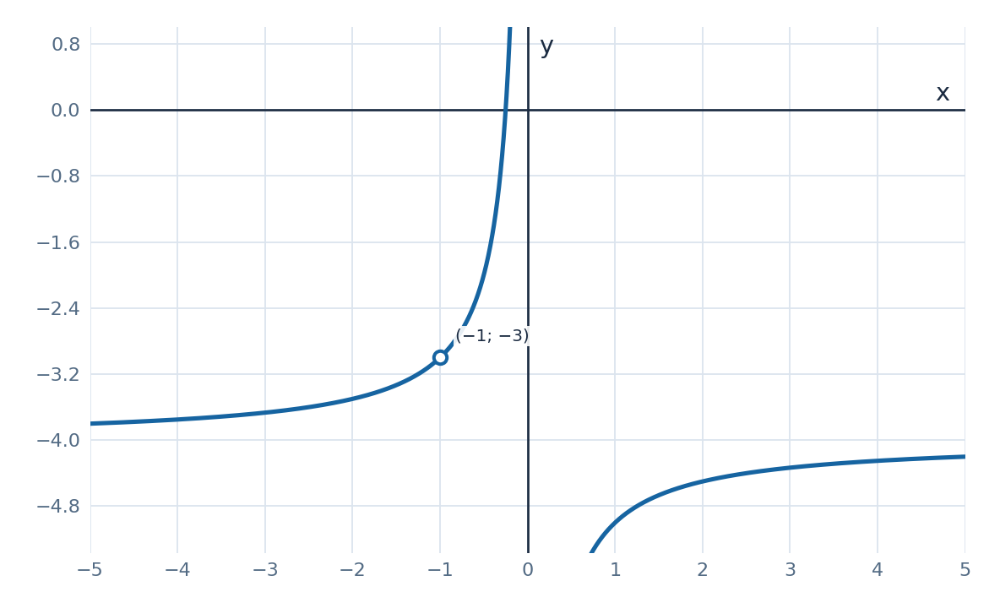

**Критерии**

- **2 балла.** График и результат по параметру либо числу пересечений верны. Горизонтальная асимптота и потеря единственной точки на выколотом уровне
- **1 балл.** График верен, параметр или число пересечений найдены неправильно или отсутствуют. График верно передаёт формулы и принадлежность граничных точек, но ответ по прямой неверен или пропущен.
- **0 баллов.** График отсутствует или неверен. Остальные случаи, не удовлетворяющие условиям для 1 или 2 баллов. График отсутствует, неверно заданы ветви или пропущена существенно важная точка.

[Источник карточки](https://math-oge.sdamgia.ru/problem?id=338224)

### Задача 4 · 341509

Постройте график функции $y=1 - \frac{x + 5}{x^{2} + 5 x}$. При каких значениях $m$ прямая $y=m$ и график не имеют общих точек?

Подсказка 1

Отметь, что исключается из области определения.

Подсказка 2

Сравни уровень горизонтальной асимптоты с ординатой выколотой точки.

Ответ для самопроверки

$m\in\{1;\frac{6}{5}\}$

Разбор и критерии

1. Делить на ноль нельзя. Знаменатель $x^{2} + 5 x=x (x + 5)$ обращается в ноль при $x=-5$, $x=0$.
2. Оставим $1$ без изменения. Дробное слагаемое можно записать как $\frac{- x - 5}{x (x + 5)}=- \frac{1}{x}$. Поэтому $y=1 - \frac{1}{x}$.
3. Если подставить $x=-5$ в продолжение ветви, получим $y=\frac{6}{5}$. В исходной функции эта точка исключена: ставим пустой кружок в $(-5;\frac{6}{5})$.
4. Мысленно ведём горизонтальную прямую снизу вверх. Чтобы посчитать пересечения, посмотрим, какие высоты проходит каждая часть графика.
5. При $x<-5$ слева направо высота меняется так: $1\to \frac{6}{5}$.
6. При $-5<x<0$ слева направо высота меняется так: $\frac{6}{5}\to \infty$.
7. При $x>0$ слева направо высота меняется так: $-\infty\to 1$.
8. Между соседними высотами каждая проходящая через этот уровень ветвь даёт одну точку. Общий конец двух ветвей считаем один раз, пустой кружок пропускаем.
9. Число пересечений по промежуткам и граничным значениям: $(-\infty;1)$ — 1; $\{1\}$ — 0; $(1;\frac{6}{5})$ — 1; $\{\frac{6}{5}\}$ — 0; $(\frac{6}{5};\infty)$ — 1.
10. Выбираем из подсчёта значения, при которых получается нужное число точек. $m\in\{1;\frac{6}{5}\}$

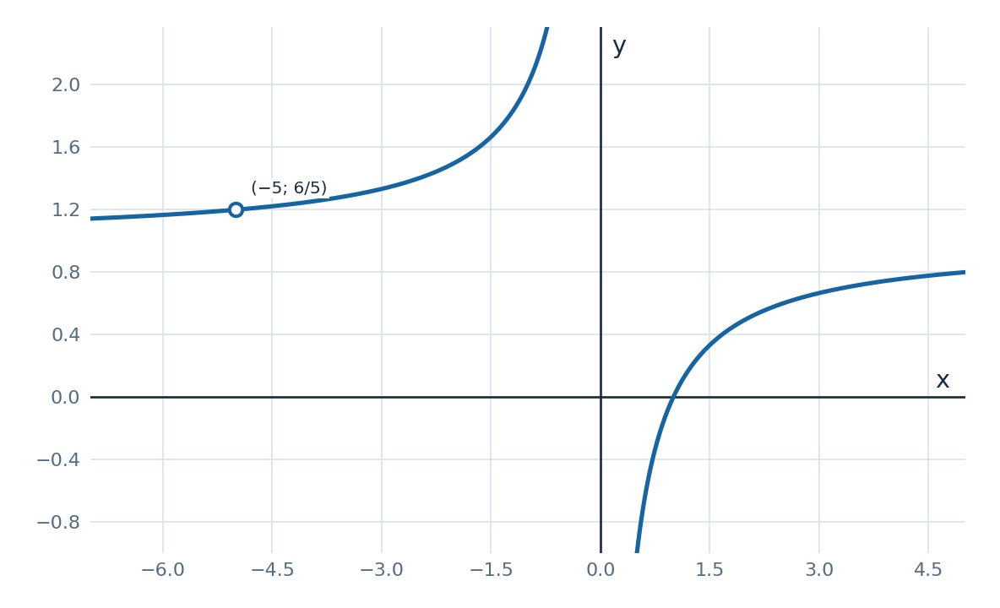

**Критерии**

- **2 балла.** График и результат по параметру либо числу пересечений верны. Горизонтальная асимптота и потеря единственной точки на выколотом уровне
- **1 балл.** График верен, параметр или число пересечений найдены неправильно или отсутствуют. График верно передаёт формулы и принадлежность граничных точек, но ответ по прямой неверен или пропущен.
- **0 баллов.** График отсутствует или неверен. Остальные случаи, не удовлетворяющие условиям для 1 или 2 баллов. График отсутствует, неверно заданы ветви или пропущена существенно важная точка.

[Источник карточки](https://math-oge.sdamgia.ru/problem?id=341509)

### Задача 5 · 353123

Постройте график функции $y=- \frac{x + 4}{x^{2} + 4 x} - 2$. При каких значениях $m$ прямая $y=m$ и график не имеют общих точек?

Подсказка 1

Отметь, что исключается из области определения.

Подсказка 2

Сравни уровень горизонтальной асимптоты с ординатой выколотой точки.

Ответ для самопроверки

$m\in\{-2;- \frac{7}{4}\}$

Разбор и критерии

1. Делить на ноль нельзя. Знаменатель $x^{2} + 4 x=x (x + 4)$ обращается в ноль при $x=-4$, $x=0$.
2. Оставим $-2$ без изменения. Дробное слагаемое можно записать как $\frac{- x - 4}{x (x + 4)}=- \frac{1}{x}$. Поэтому $y=-2 - \frac{1}{x}$.
3. Если подставить $x=-4$ в продолжение ветви, получим $y=- \frac{7}{4}$. В исходной функции эта точка исключена: ставим пустой кружок в $(-4;- \frac{7}{4})$.
4. Мысленно ведём горизонтальную прямую снизу вверх. Чтобы посчитать пересечения, посмотрим, какие высоты проходит каждая часть графика.
5. При $x<-4$ слева направо высота меняется так: $-2\to - \frac{7}{4}$.
6. При $-4<x<0$ слева направо высота меняется так: $- \frac{7}{4}\to \infty$.
7. При $x>0$ слева направо высота меняется так: $-\infty\to -2$.
8. Между соседними высотами каждая проходящая через этот уровень ветвь даёт одну точку. Общий конец двух ветвей считаем один раз, пустой кружок пропускаем.
9. Число пересечений по промежуткам и граничным значениям: $(-\infty;-2)$ — 1; $\{-2\}$ — 0; $(-2;- \frac{7}{4})$ — 1; $\{- \frac{7}{4}\}$ — 0; $(- \frac{7}{4};\infty)$ — 1.
10. Выбираем из подсчёта значения, при которых получается нужное число точек. $m\in\{-2;- \frac{7}{4}\}$

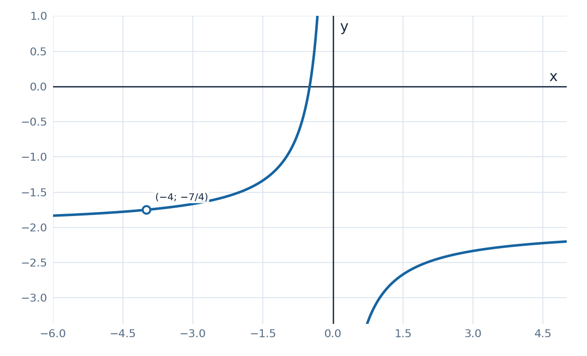

**Критерии**

- **2 балла.** График и результат по параметру либо числу пересечений верны. Горизонтальная асимптота и потеря единственной точки на выколотом уровне
- **1 балл.** График верен, параметр или число пересечений найдены неправильно или отсутствуют. График верно передаёт формулы и принадлежность граничных точек, но ответ по прямой неверен или пропущен.
- **0 баллов.** График отсутствует или неверен. Остальные случаи, не удовлетворяющие условиям для 1 или 2 баллов. График отсутствует, неверно заданы ветви или пропущена существенно важная точка.

[Источник карточки](https://math-oge.sdamgia.ru/problem?id=353123)

### Задача 6 · 392855

Постройте график функции $y=- \frac{x - 4}{x^{2} - 4 x} - 1$. При каких значениях $m$ прямая $y=m$ и график не имеют общих точек?

Подсказка 1

Отметь, что исключается из области определения.

Подсказка 2

Сравни уровень горизонтальной асимптоты с ординатой выколотой точки.

Ответ для самопроверки

$m\in\{- \frac{5}{4};-1\}$

Разбор и критерии

1. Делить на ноль нельзя. Знаменатель $x^{2} - 4 x=x (x - 4)$ обращается в ноль при $x=0$, $x=4$.
2. Оставим $-1$ без изменения. Дробное слагаемое можно записать как $\frac{4 - x}{x (x - 4)}=- \frac{1}{x}$. Поэтому $y=-1 - \frac{1}{x}$.
3. Если подставить $x=4$ в продолжение ветви, получим $y=- \frac{5}{4}$. В исходной функции эта точка исключена: ставим пустой кружок в $(4;- \frac{5}{4})$.
4. Мысленно ведём горизонтальную прямую снизу вверх. Чтобы посчитать пересечения, посмотрим, какие высоты проходит каждая часть графика.
5. При $x<0$ слева направо высота меняется так: $-1\to \infty$.
6. При $0<x<4$ слева направо высота меняется так: $-\infty\to - \frac{5}{4}$.
7. При $x>4$ слева направо высота меняется так: $- \frac{5}{4}\to -1$.
8. Между соседними высотами каждая проходящая через этот уровень ветвь даёт одну точку. Общий конец двух ветвей считаем один раз, пустой кружок пропускаем.
9. Число пересечений по промежуткам и граничным значениям: $(-\infty;- \frac{5}{4})$ — 1; $\{- \frac{5}{4}\}$ — 0; $(- \frac{5}{4};-1)$ — 1; $\{-1\}$ — 0; $(-1;\infty)$ — 1.
10. Выбираем из подсчёта значения, при которых получается нужное число точек. $m\in\{- \frac{5}{4};-1\}$

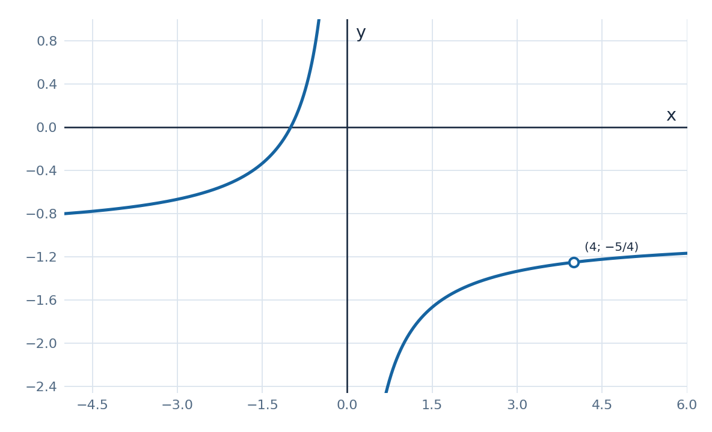

**Критерии**

- **2 балла.** График и результат по параметру либо числу пересечений верны. Горизонтальная асимптота и потеря единственной точки на выколотом уровне
- **1 балл.** График верен, параметр или число пересечений найдены неправильно или отсутствуют. График верно передаёт формулы и принадлежность граничных точек, но ответ по прямой неверен или пропущен.
- **0 баллов.** График отсутствует или неверен. Остальные случаи, не удовлетворяющие условиям для 1 или 2 баллов. График отсутствует, неверно заданы ветви или пропущена существенно важная точка.

[Источник карточки](https://math-oge.sdamgia.ru/problem?id=392855)

## Сокращение и выколотые точки · Сокращение вместе с модулем

`OGE22-hole-modulus`

### Задача 1 · 338420

Постройте $y=\frac{(x^2+3x)|x|}{x+3}$. Найдите $m$, при которых горизонталь $y=m$ не встречается с графиком.

Подсказка 1

Сохрани запреты до сокращения.

Подсказка 2

Раскрой модуль по знаку, а потом считай пересечения отдельно на каждой ветви.

Ответ для самопроверки

$m=-9$.

Разбор и критерии

1. При $x\ne-3$ сокращение даёт $y=x|x|$.
2. Ветви равны $-x^2$ при $x<0$ и $x^2$ при $x\ge0$.
3. Вместе они строго возрастают и без ограничения по $x$ принимают каждое действительное значение по одному разу.
4. Запрет $x=-3$ удаляет именно значение $y=-9$.
5. На рисунке выколота точка $(-3;-9)$, начало координат принадлежит графику.

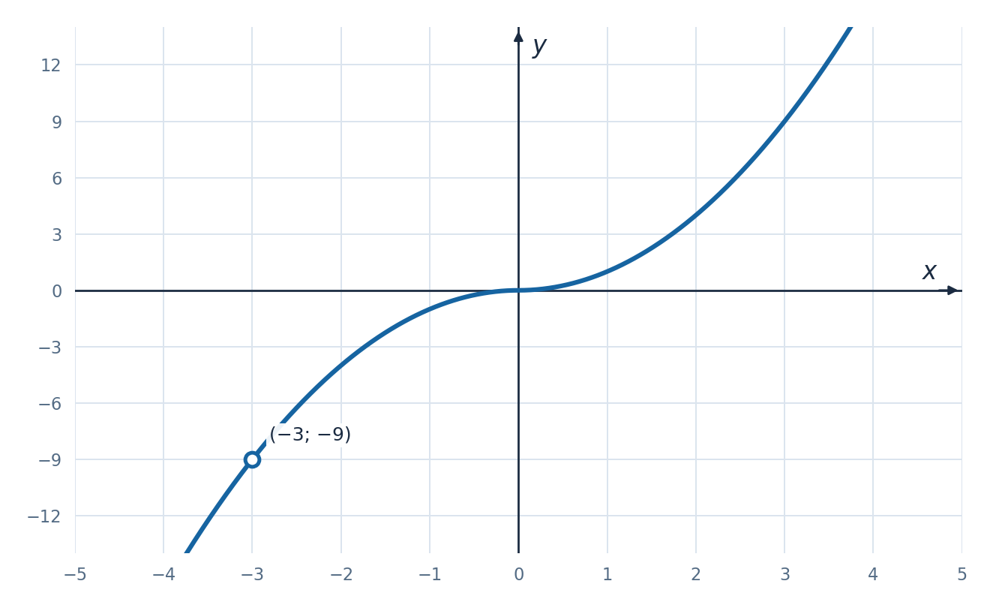

**Критерии**

- **2 балла.** График и результат по параметру либо числу пересечений верны. Верны знак обеих ветвей и отверстие, обосновано отсутствие других пропущенных уровней.
- **1 балл.** График верен, параметр или число пересечений найдены неправильно или отсутствуют. График верен, но m не найдено или найдено неверно.
- **0 баллов.** График отсутствует или неверен. Остальные случаи, не удовлетворяющие условиям для 1 или 2 баллов. Потеряна выколотая точка или обе ветви нарисованы как y=x².

[Источник карточки](https://math-oge.sdamgia.ru/problem?id=338420)

### Задача 2 · 311662

Постройте график функции $y=\frac{\left|{x}\right| - 4}{x^{2} - 4 \left|{x}\right|}$. При каких значениях $k$ прямая $y=kx$ и график не имеют общих точек?

Подсказка 1

Сохрани запреты до сокращения.

Подсказка 2

Раскрой модуль по знаку, а потом считай пересечения отдельно на каждой ветви.

Ответ для самопроверки

$k\in\{- \frac{1}{16};0;\frac{1}{16}\}$

Разбор и критерии

1. Положим t=|x|. Тогда x²=t², знаменатель равен $t (t - 4)$. Приравняем множители к нулю: $t=0$, $t=4$. Так как t=|x|, исключаем значения x: $-4$, $0$, $4$. После сокращения $y=\frac{1}{t}$.
2. Модуль — расстояние от нуля. Справа от нуля |x|=x, слева |x|=−x, а при x=0 обе записи дают 0.
3. При $x<-4$ под модулем неположительное число, поэтому $|x|=- x$. Строим $y=- \frac{1}{x}$.
4. При $-4<x<0$ под модулем неположительное число, поэтому $|x|=- x$. Строим $y=- \frac{1}{x}$.
5. При $0<x<4$ под модулем неотрицательное число, поэтому $|x|=x$. Строим $y=\frac{1}{x}$.
6. При $x>4$ под модулем неотрицательное число, поэтому $|x|=x$. Строим $y=\frac{1}{x}$.
7. Если подставить $x=-4$ в продолжение ветви, получим $y=\frac{1}{4}$. В исходной функции эта точка исключена: ставим пустой кружок в $(-4;\frac{1}{4})$.
8. Если подставить $x=4$ в продолжение ветви, получим $y=\frac{1}{4}$. В исходной функции эта точка исключена: ставим пустой кружок в $(4;\frac{1}{4})$.
9. На каждой стороне от нуля приравняем высоту графика к kx и умножим на x. Слева получим $kx^2=-1$, справа $kx^2=1$. На каждой стороне берём только корень своего знака; при k=0 корней нет.
10. Прямая проходит через пустой кружок, когда $k=- \frac{1}{16}$: делим его ординату $\frac{1}{4}$ на абсциссу $-4$. В этом случае одно пересечение исчезает.
11. Прямая проходит через пустой кружок, когда $k=\frac{1}{16}$: делим его ординату $\frac{1}{4}$ на абсциссу $4$. В этом случае одно пересечение исчезает.
12. Число пересечений по промежуткам и граничным значениям: $(-\infty;- \frac{1}{16})$ — 1; $\{- \frac{1}{16}\}$ — 0; $(- \frac{1}{16};0)$ — 1; $\{0\}$ — 0; $(0;\frac{1}{16})$ — 1; $\{\frac{1}{16}\}$ — 0; $(\frac{1}{16};\infty)$ — 1.
13. Выбираем из подсчёта значения, при которых получается нужное число точек. $k\in\{- \frac{1}{16};0;\frac{1}{16}\}$

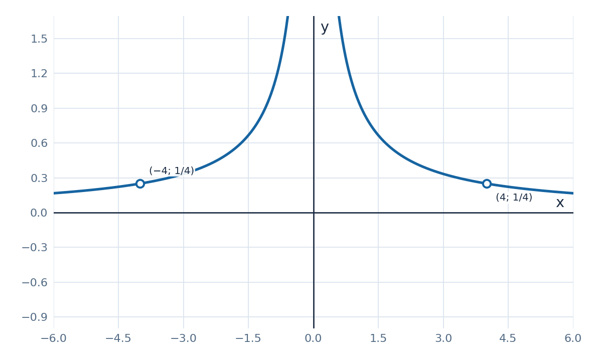

**Критерии**

- **2 балла.** График и результат по параметру либо числу пересечений верны. Учитывать исходные запреты и раскрытие модуля; монотонные половины или неодинаковый знак наклона
- **1 балл.** График верен, параметр или число пересечений найдены неправильно или отсутствуют. График верно передаёт формулы и принадлежность граничных точек, но ответ по прямой неверен или пропущен.
- **0 баллов.** График отсутствует или неверен. Остальные случаи, не удовлетворяющие условиям для 1 или 2 баллов. График отсутствует, неверно заданы ветви или пропущена существенно важная точка.

[Источник карточки](https://math-oge.sdamgia.ru/problem?id=311662)

### Задача 3 · 338162

Постройте график функции $y=\frac{3 \left|{x}\right| - 1}{- 3 x^{2} + \left|{x}\right|}$. При каких значениях $k$ прямая $y=kx$ и график не имеют общих точек?

Подсказка 1

Сохрани запреты до сокращения.

Подсказка 2

Раскрой модуль по знаку, а потом считай пересечения отдельно на каждой ветви.

Ответ для самопроверки

$k\in\{-9;0;9\}$

Разбор и критерии

1. Положим t=|x|. Тогда x²=t², знаменатель равен $- t (3 t - 1)$. Приравняем множители к нулю: $t=0$, $t=\frac{1}{3}$. Так как t=|x|, исключаем значения x: $- \frac{1}{3}$, $0$, $\frac{1}{3}$. После сокращения $y=- \frac{1}{t}$.
2. Модуль — расстояние от нуля. Справа от нуля |x|=x, слева |x|=−x, а при x=0 обе записи дают 0.
3. При $x<- \frac{1}{3}$ под модулем неположительное число, поэтому $|x|=- x$. Строим $y=\frac{1}{x}$.
4. При $- \frac{1}{3}<x<0$ под модулем неположительное число, поэтому $|x|=- x$. Строим $y=\frac{1}{x}$.
5. При $0<x<\frac{1}{3}$ под модулем неотрицательное число, поэтому $|x|=x$. Строим $y=- \frac{1}{x}$.
6. При $x>\frac{1}{3}$ под модулем неотрицательное число, поэтому $|x|=x$. Строим $y=- \frac{1}{x}$.
7. Если подставить $x=\frac{1}{3}$ в продолжение ветви, получим $y=-3$. В исходной функции эта точка исключена: ставим пустой кружок в $(\frac{1}{3};-3)$.
8. Если подставить $x=- \frac{1}{3}$ в продолжение ветви, получим $y=-3$. В исходной функции эта точка исключена: ставим пустой кружок в $(- \frac{1}{3};-3)$.
9. На каждой стороне от нуля приравняем высоту графика к kx и умножим на x. Слева получим $kx^2=1$, справа $kx^2=-1$. На каждой стороне берём только корень своего знака; при k=0 корней нет.
10. Прямая проходит через пустой кружок, когда $k=-9$: делим его ординату $-3$ на абсциссу $\frac{1}{3}$. В этом случае одно пересечение исчезает.
11. Прямая проходит через пустой кружок, когда $k=9$: делим его ординату $-3$ на абсциссу $- \frac{1}{3}$. В этом случае одно пересечение исчезает.
12. Число пересечений по промежуткам и граничным значениям: $(-\infty;-9)$ — 1; $\{-9\}$ — 0; $(-9;0)$ — 1; $\{0\}$ — 0; $(0;9)$ — 1; $\{9\}$ — 0; $(9;\infty)$ — 1.
13. Выбираем из подсчёта значения, при которых получается нужное число точек. $k\in\{-9;0;9\}$

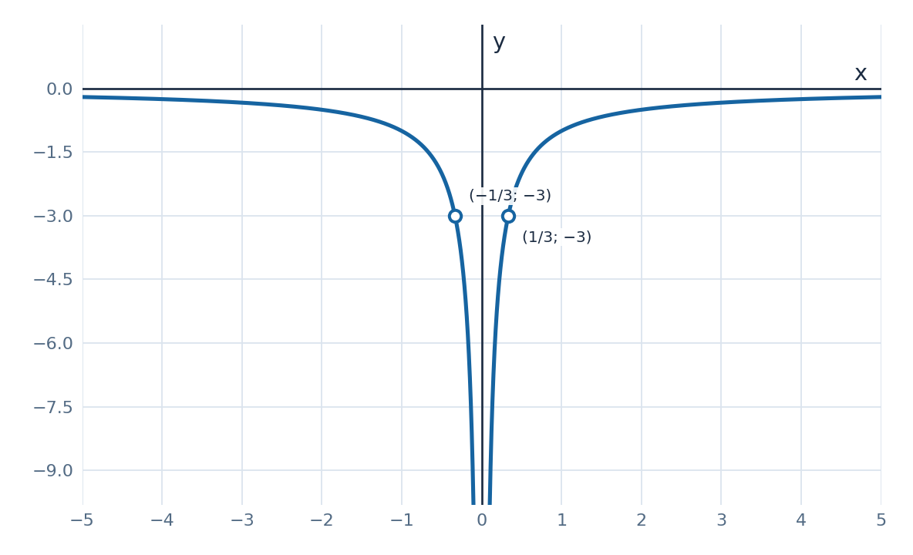

**Критерии**

- **2 балла.** График и результат по параметру либо числу пересечений верны. Учитывать исходные запреты и раскрытие модуля; монотонные половины или неодинаковый знак наклона
- **1 балл.** График верен, параметр или число пересечений найдены неправильно или отсутствуют. График верно передаёт формулы и принадлежность граничных точек, но ответ по прямой неверен или пропущен.
- **0 баллов.** График отсутствует или неверен. Остальные случаи, не удовлетворяющие условиям для 1 или 2 баллов. График отсутствует, неверно заданы ветви или пропущена существенно важная точка.

[Источник карточки](https://math-oge.sdamgia.ru/problem?id=338162)

### Задача 4 · 338435

Постройте график функции $y=\frac{\left(x^{2} - 3 x\right) \left|{x}\right|}{x - 3}$. При каких значениях $m$ прямая $y=m$ и график не имеют общих точек?

Подсказка 1

Сохрани запреты до сокращения.

Подсказка 2

Раскрой модуль по знаку, а потом считай пересечения отдельно на каждой ветви.

Ответ для самопроверки

$m\in\{9\}$

Разбор и критерии

1. Знаменатель $x - 3$ равен нулю при $3$. Эти значения нужно исключить до сокращения.
2. Модуль — расстояние от нуля. Справа от нуля |x|=x, слева |x|=−x, а при x=0 обе записи дают 0.
3. При $x<0$ под модулем неположительное число, поэтому $|x|=- x$. Подставляем в исходную формулу: $y=- \frac{x (x^{2} - 3 x)}{x - 3}=- x^{2}$.
4. При $0\le x<3$ под модулем неотрицательное число, поэтому $|x|=x$. Подставляем в исходную формулу: $y=\frac{x (x^{2} - 3 x)}{x - 3}=x^{2}$.
5. При $x>3$ под модулем неотрицательное число, поэтому $|x|=x$. Подставляем в исходную формулу: $y=\frac{x (x^{2} - 3 x)}{x - 3}=x^{2}$.
6. Если подставить $x=3$ в продолжение ветви, получим $y=9$. В исходной функции эта точка исключена: ставим пустой кружок в $(3;9)$.
7. Левая половина параболы лежит ниже оси x, правая — выше. Вместе они проходят каждую высоту ровно один раз, в том числе ноль. Если убрать точку, горизонталь на её высоте больше нигде не встретится с графиком.
8. Число пересечений по промежуткам и граничным значениям: $(-\infty;0)$ — 1; $\{0\}$ — 1; $(0;9)$ — 1; $\{9\}$ — 0; $(9;\infty)$ — 1.
9. Выбираем из подсчёта значения, при которых получается нужное число точек. $m\in\{9\}$

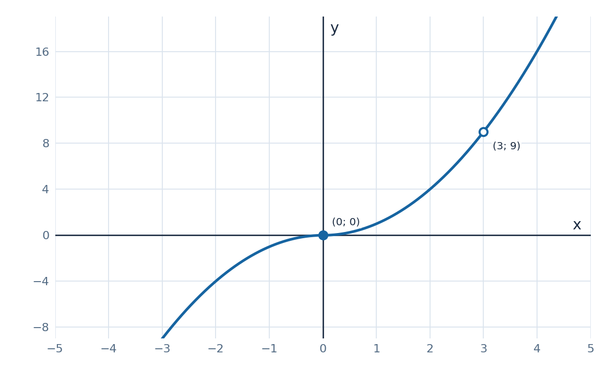

**Критерии**

- **2 балла.** График и результат по параметру либо числу пересечений верны. Учитывать исходные запреты и раскрытие модуля; монотонные половины или неодинаковый знак наклона
- **1 балл.** График верен, параметр или число пересечений найдены неправильно или отсутствуют. График верно передаёт формулы и принадлежность граничных точек, но ответ по прямой неверен или пропущен.
- **0 баллов.** График отсутствует или неверен. Остальные случаи, не удовлетворяющие условиям для 1 или 2 баллов. График отсутствует, неверно заданы ветви или пропущена существенно важная точка.

[Источник карточки](https://math-oge.sdamgia.ru/problem?id=338435)

### Задача 5 · 341342

Постройте график функции $y=\frac{\left(1 \cdot \frac{1}{2} x^{2} - 2 x\right) \left|{x}\right|}{x - 4}$. При каких значениях $m$ прямая $y=m$ и график не имеют общих точек?

Подсказка 1

Сохрани запреты до сокращения.

Подсказка 2

Раскрой модуль по знаку, а потом считай пересечения отдельно на каждой ветви.

Ответ для самопроверки

$m\in\{8\}$

Разбор и критерии

1. Знаменатель $x - 4$ равен нулю при $4$. Эти значения нужно исключить до сокращения.
2. Модуль — расстояние от нуля. Справа от нуля |x|=x, слева |x|=−x, а при x=0 обе записи дают 0.
3. При $x<0$ под модулем неположительное число, поэтому $|x|=- x$. Подставляем в исходную формулу: $y=- \frac{x (1 \frac{x^{2}}{2} - 2 x)}{x - 4}=- \frac{x^{2}}{2}$.
4. При $0\le x<4$ под модулем неотрицательное число, поэтому $|x|=x$. Подставляем в исходную формулу: $y=\frac{x (1 \frac{x^{2}}{2} - 2 x)}{x - 4}=\frac{x^{2}}{2}$.
5. При $x>4$ под модулем неотрицательное число, поэтому $|x|=x$. Подставляем в исходную формулу: $y=\frac{x (1 \frac{x^{2}}{2} - 2 x)}{x - 4}=\frac{x^{2}}{2}$.
6. Если подставить $x=4$ в продолжение ветви, получим $y=8$. В исходной функции эта точка исключена: ставим пустой кружок в $(4;8)$.
7. Левая половина параболы лежит ниже оси x, правая — выше. Вместе они проходят каждую высоту ровно один раз, в том числе ноль. Если убрать точку, горизонталь на её высоте больше нигде не встретится с графиком.
8. Число пересечений по промежуткам и граничным значениям: $(-\infty;0)$ — 1; $\{0\}$ — 1; $(0;8)$ — 1; $\{8\}$ — 0; $(8;\infty)$ — 1.
9. Выбираем из подсчёта значения, при которых получается нужное число точек. $m\in\{8\}$

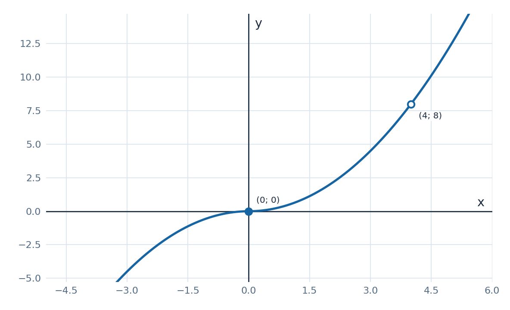

**Критерии**

- **2 балла.** График и результат по параметру либо числу пересечений верны. Учитывать исходные запреты и раскрытие модуля; монотонные половины или неодинаковый знак наклона
- **1 балл.** График верен, параметр или число пересечений найдены неправильно или отсутствуют. График верно передаёт формулы и принадлежность граничных точек, но ответ по прямой неверен или пропущен.
- **0 баллов.** График отсутствует или неверен. Остальные случаи, не удовлетворяющие условиям для 1 или 2 баллов. График отсутствует, неверно заданы ветви или пропущена существенно важная точка.

[Источник карточки](https://math-oge.sdamgia.ru/problem?id=341342)

### Задача 6 · 353416

Постройте график функции $y=\frac{\left(\frac{3 x^{2}}{4} - \frac{3 x}{4}\right) \left|{x}\right|}{x - 1}$. При каких значениях $m$ прямая $y=m$ и график не имеют общих точек?

Подсказка 1

Сохрани запреты до сокращения.

Подсказка 2

Раскрой модуль по знаку, а потом считай пересечения отдельно на каждой ветви.

Ответ для самопроверки

$m\in\{\frac{3}{4}\}$

Разбор и критерии

1. Знаменатель $x - 1$ равен нулю при $1$. Эти значения нужно исключить до сокращения.
2. Модуль — расстояние от нуля. Справа от нуля |x|=x, слева |x|=−x, а при x=0 обе записи дают 0.
3. При $x<0$ под модулем неположительное число, поэтому $|x|=- x$. Подставляем в исходную формулу: $y=- \frac{x (- \frac{3 x}{4} + \frac{3 x^{2}}{4})}{x - 1}=- \frac{3 x^{2}}{4}$.
4. При $0\le x<1$ под модулем неотрицательное число, поэтому $|x|=x$. Подставляем в исходную формулу: $y=\frac{x (- \frac{3 x}{4} + \frac{3 x^{2}}{4})}{x - 1}=\frac{3 x^{2}}{4}$.
5. При $x>1$ под модулем неотрицательное число, поэтому $|x|=x$. Подставляем в исходную формулу: $y=\frac{x (- \frac{3 x}{4} + \frac{3 x^{2}}{4})}{x - 1}=\frac{3 x^{2}}{4}$.
6. Если подставить $x=1$ в продолжение ветви, получим $y=\frac{3}{4}$. В исходной функции эта точка исключена: ставим пустой кружок в $(1;\frac{3}{4})$.
7. Левая половина параболы лежит ниже оси x, правая — выше. Вместе они проходят каждую высоту ровно один раз, в том числе ноль. Если убрать точку, горизонталь на её высоте больше нигде не встретится с графиком.
8. Число пересечений по промежуткам и граничным значениям: $(-\infty;0)$ — 1; $\{0\}$ — 1; $(0;\frac{3}{4})$ — 1; $\{\frac{3}{4}\}$ — 0; $(\frac{3}{4};\infty)$ — 1.
9. Выбираем из подсчёта значения, при которых получается нужное число точек. $m\in\{\frac{3}{4}\}$

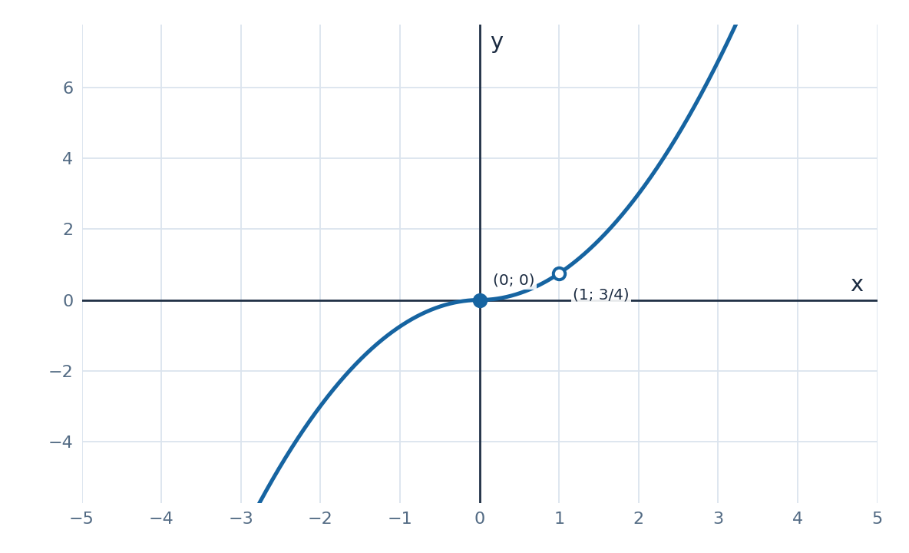

**Критерии**

- **2 балла.** График и результат по параметру либо числу пересечений верны. Учитывать исходные запреты и раскрытие модуля; монотонные половины или неодинаковый знак наклона
- **1 балл.** График верен, параметр или число пересечений найдены неправильно или отсутствуют. График верно передаёт формулы и принадлежность граничных точек, но ответ по прямой неверен или пропущен.
- **0 баллов.** График отсутствует или неверен. Остальные случаи, не удовлетворяющие условиям для 1 или 2 баллов. График отсутствует, неверно заданы ветви или пропущена существенно важная точка.

[Источник карточки](https://math-oge.sdamgia.ru/problem?id=353416)

## Кусочно заданные функции · Ломаная из кусочно-линейных ветвей

`OGE22-piecewise-lines`

### Задача 1 · 311619

Постройте $y=\begin{cases}2x+1,&x<0,\\1-\frac32x,&0\le x<2,\\x-4,&x\ge2.\end{cases}$ Для каких $c$ горизонталь $y=c$ имеет с графиком ровно две общие точки?

Подсказка 1

Строй каждую прямую только на её промежутке.

Подсказка 2

Сосчитай пересечения по диапазонам трёх ветвей, общую точку стыка учитывай один раз.

Ответ для самопроверки

$c\in\{-2;1\}$.

Разбор и критерии

1. Строим три части прямых.
2. Точка $(0;1)$ входит через среднюю ветвь, точка $(2;-2)$ — через правую.
3. Левая ветвь даёт одно пересечение при $c<1$, средняя при $-2<c\le1$, правая при $c\ge-2$.
4. Сложим эти количества.
5. Внутри $(-2;1)$ получается три пересечения, на каждом из краёв ровно два, вне отрезка ровно одно.

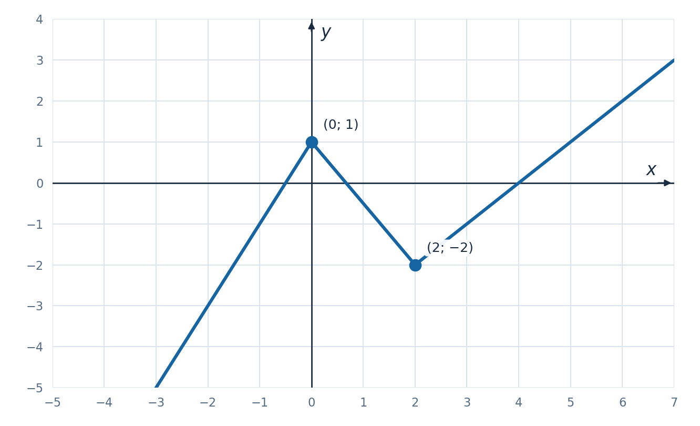

**Критерии**

- **2 балла.** График и результат по параметру либо числу пересечений верны. Три отрезанные ветви построены верно, обе точки стыка посчитаны ровно один раз, найдены c=−2 и c=1.
- **1 балл.** График верен, параметр или число пересечений найдены неправильно или отсутствуют. График верен, но ответ по c неверен или отсутствует.
- **0 баллов.** График отсутствует или неверен. Остальные случаи, не удовлетворяющие условиям для 1 или 2 баллов. Стык удалён из графика либо формулы продолжены за свои области.

[Источник карточки](https://math-oge.sdamgia.ru/problem?id=311619)

### Задача 2 · 339148

Постройте график функции $y=\begin{cases}x - 3,&x<3\\- \frac{3}{2} x + \frac{9}{2},&3\le x\le 4\\\frac{3 x}{2} - \frac{15}{2},&x>4\end{cases}$. При каких значениях $m$ прямая $y=m$ имеет с графиком ровно две общие точки?

Подсказка 1

Строй каждую прямую только на её промежутке.

Подсказка 2

Сосчитай пересечения по диапазонам трёх ветвей, общую точку стыка учитывай один раз.

Ответ для самопроверки

$m\in\{- \frac{3}{2};0\}$

Разбор и критерии

1. В условии у каждой строки своя граница по x. Для построения возьмём две точки каждой ветви.
2. При $x<3$ Строим $y=x - 3$. Две точки: $(2;-1)$ и $(1;-2)$.
3. При $3\le x\le 4$ Строим $y=\frac{9}{2} - \frac{3 x}{2}$. Две точки: $(3;0)$ и $(4;- \frac{3}{2})$.
4. При $x>4$ Строим $y=\frac{3 x}{2} - \frac{15}{2}$. Две точки: $(5;0)$ и $(6;\frac{3}{2})$.
5. Точку на границе включаем там, где в условии допускается равенство. Входят в график граничные точки $(3;0)$, $(4;- \frac{3}{2})$.
6. Мысленно ведём горизонтальную прямую снизу вверх. Чтобы посчитать пересечения, посмотрим, какие высоты проходит каждая часть графика.
7. При $x<3$ слева направо высота меняется так: $-\infty\to 0$.
8. При $3\le x\le 4$ слева направо высота меняется так: $0\to - \frac{3}{2}$.
9. При $x>4$ слева направо высота меняется так: $- \frac{3}{2}\to \infty$.
10. Между соседними высотами каждая проходящая через этот уровень ветвь даёт одну точку. Общий конец двух ветвей считаем один раз, пустой кружок пропускаем.
11. Число пересечений по промежуткам и граничным значениям: $(-\infty;- \frac{3}{2})$ — 1; $\{- \frac{3}{2}\}$ — 2; $(- \frac{3}{2};0)$ — 3; $\{0\}$ — 2; $(0;\infty)$ — 1.
12. Выбираем из подсчёта значения, при которых получается нужное число точек. $m\in\{- \frac{3}{2};0\}$

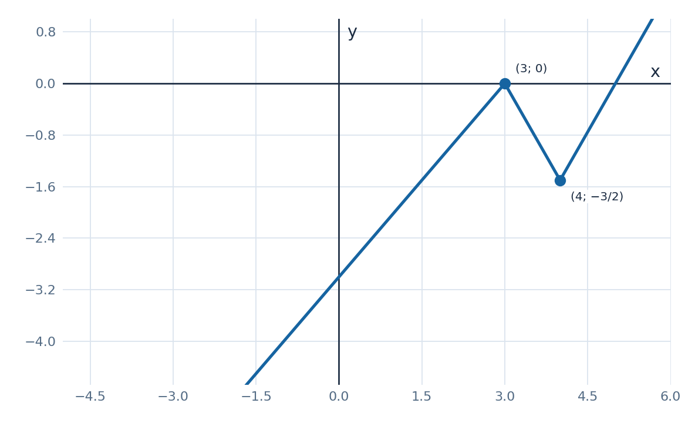

**Критерии**

- **2 балла.** График и результат по параметру либо числу пересечений верны. Сложить количества пересечений по диапазонам ветвей, не задвоить общий конец
- **1 балл.** График верен, параметр или число пересечений найдены неправильно или отсутствуют. График верно передаёт формулы и принадлежность граничных точек, но ответ по прямой неверен или пропущен.
- **0 баллов.** График отсутствует или неверен. Остальные случаи, не удовлетворяющие условиям для 1 или 2 баллов. График отсутствует, неверно заданы ветви или пропущена существенно важная точка.

[Источник карточки](https://math-oge.sdamgia.ru/problem?id=339148)

### Задача 3 · 340993

Постройте график функции $y=\begin{cases}\frac{5 x}{2} - 1,&x<1\\- \frac{5}{2} x + 4,&1\le x\le 3\\\frac{3 x}{2} - 8,&x>3\end{cases}$. При каких значениях $m$ прямая $y=m$ имеет с графиком ровно две общие точки?

Подсказка 1

Строй каждую прямую только на её промежутке.

Подсказка 2

Сосчитай пересечения по диапазонам трёх ветвей, общую точку стыка учитывай один раз.

Ответ для самопроверки

$m\in\{- \frac{7}{2};\frac{3}{2}\}$

Разбор и критерии

1. В условии у каждой строки своя граница по x. Для построения возьмём две точки каждой ветви.
2. При $x<1$ Строим $y=\frac{5 x}{2} - 1$. Две точки: $(0;-1)$ и $(-1;- \frac{7}{2})$.
3. При $1\le x\le 3$ Строим $y=4 - \frac{5 x}{2}$. Две точки: $(2;-1)$ и $(1;\frac{3}{2})$.
4. При $x>3$ Строим $y=\frac{3 x}{2} - 8$. Две точки: $(4;-2)$ и $(5;- \frac{1}{2})$.
5. Точку на границе включаем там, где в условии допускается равенство. Входят в график граничные точки $(1;\frac{3}{2})$, $(3;- \frac{7}{2})$.
6. Мысленно ведём горизонтальную прямую снизу вверх. Чтобы посчитать пересечения, посмотрим, какие высоты проходит каждая часть графика.
7. При $x<1$ слева направо высота меняется так: $-\infty\to \frac{3}{2}$.
8. При $1\le x\le 3$ слева направо высота меняется так: $\frac{3}{2}\to - \frac{7}{2}$.
9. При $x>3$ слева направо высота меняется так: $- \frac{7}{2}\to \infty$.
10. Между соседними высотами каждая проходящая через этот уровень ветвь даёт одну точку. Общий конец двух ветвей считаем один раз, пустой кружок пропускаем.
11. Число пересечений по промежуткам и граничным значениям: $(-\infty;- \frac{7}{2})$ — 1; $\{- \frac{7}{2}\}$ — 2; $(- \frac{7}{2};\frac{3}{2})$ — 3; $\{\frac{3}{2}\}$ — 2; $(\frac{3}{2};\infty)$ — 1.
12. Выбираем из подсчёта значения, при которых получается нужное число точек. $m\in\{- \frac{7}{2};\frac{3}{2}\}$

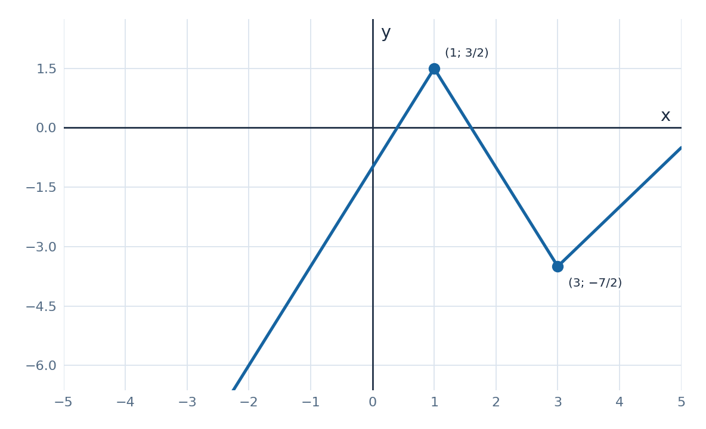

**Критерии**

- **2 балла.** График и результат по параметру либо числу пересечений верны. Сложить количества пересечений по диапазонам ветвей, не задвоить общий конец
- **1 балл.** График верен, параметр или число пересечений найдены неправильно или отсутствуют. График верно передаёт формулы и принадлежность граничных точек, но ответ по прямой неверен или пропущен.
- **0 баллов.** График отсутствует или неверен. Остальные случаи, не удовлетворяющие условиям для 1 или 2 баллов. График отсутствует, неверно заданы ветви или пропущена существенно важная точка.

[Источник карточки](https://math-oge.sdamgia.ru/problem?id=340993)

### Задача 4 · 341025

Постройте график функции $y=\begin{cases}3 x - \frac{7}{2},&x<2\\- 3 x + \frac{17}{2},&2\le x\le 3\\\frac{7 x}{2} - 11,&x>3\end{cases}$. При каких значениях $m$ прямая $y=m$ имеет с графиком ровно две общие точки?

Подсказка 1

Строй каждую прямую только на её промежутке.

Подсказка 2

Сосчитай пересечения по диапазонам трёх ветвей, общую точку стыка учитывай один раз.

Ответ для самопроверки

$m\in\{- \frac{1}{2};\frac{5}{2}\}$

Разбор и критерии

1. В условии у каждой строки своя граница по x. Для построения возьмём две точки каждой ветви.
2. При $x<2$ Строим $y=3 x - \frac{7}{2}$. Две точки: $(1;- \frac{1}{2})$ и $(0;- \frac{7}{2})$.
3. При $2\le x\le 3$ Строим $y=\frac{17}{2} - 3 x$. Две точки: $(2;\frac{5}{2})$ и $(3;- \frac{1}{2})$.
4. При $x>3$ Строим $y=\frac{7 x}{2} - 11$. Две точки: $(4;3)$ и $(5;\frac{13}{2})$.
5. Точку на границе включаем там, где в условии допускается равенство. Входят в график граничные точки $(2;\frac{5}{2})$, $(3;- \frac{1}{2})$.
6. Мысленно ведём горизонтальную прямую снизу вверх. Чтобы посчитать пересечения, посмотрим, какие высоты проходит каждая часть графика.
7. При $x<2$ слева направо высота меняется так: $-\infty\to \frac{5}{2}$.
8. При $2\le x\le 3$ слева направо высота меняется так: $\frac{5}{2}\to - \frac{1}{2}$.
9. При $x>3$ слева направо высота меняется так: $- \frac{1}{2}\to \infty$.
10. Между соседними высотами каждая проходящая через этот уровень ветвь даёт одну точку. Общий конец двух ветвей считаем один раз, пустой кружок пропускаем.
11. Число пересечений по промежуткам и граничным значениям: $(-\infty;- \frac{1}{2})$ — 1; $\{- \frac{1}{2}\}$ — 2; $(- \frac{1}{2};\frac{5}{2})$ — 3; $\{\frac{5}{2}\}$ — 2; $(\frac{5}{2};\infty)$ — 1.
12. Выбираем из подсчёта значения, при которых получается нужное число точек. $m\in\{- \frac{1}{2};\frac{5}{2}\}$

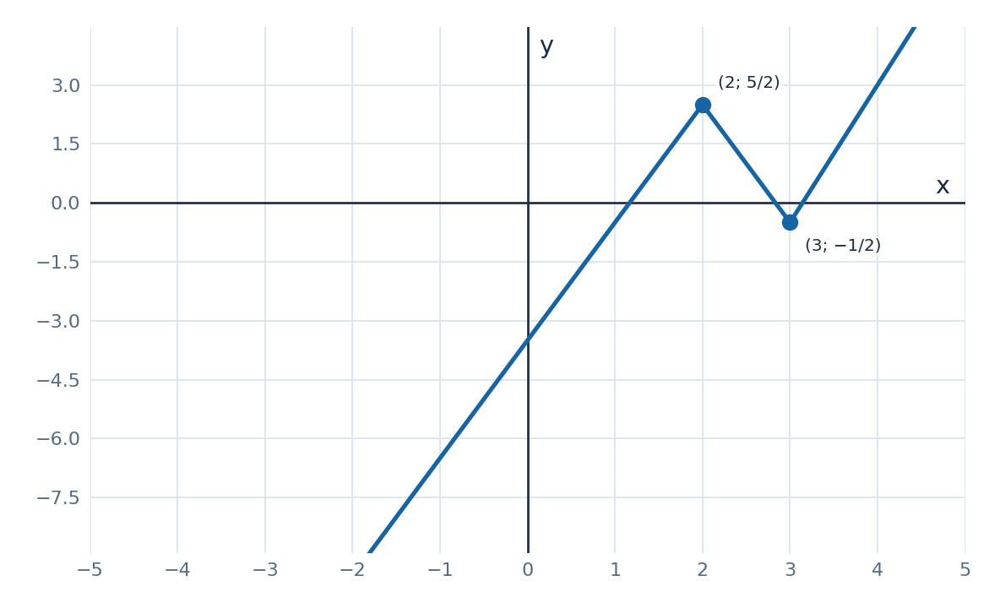

**Критерии**

- **2 балла.** График и результат по параметру либо числу пересечений верны. Сложить количества пересечений по диапазонам ветвей, не задвоить общий конец
- **1 балл.** График верен, параметр или число пересечений найдены неправильно или отсутствуют. График верно передаёт формулы и принадлежность граничных точек, но ответ по прямой неверен или пропущен.
- **0 баллов.** График отсутствует или неверен. Остальные случаи, не удовлетворяющие условиям для 1 или 2 баллов. График отсутствует, неверно заданы ветви или пропущена существенно важная точка.

[Источник карточки](https://math-oge.sdamgia.ru/problem?id=341025)

### Задача 5 · 341057

Постройте график функции $y=\begin{cases}\frac{5 x}{2} - \frac{7}{2},&x<2\\- 3 x + \frac{15}{2},&2\le x\le 3\\x - \frac{9}{2},&x>3\end{cases}$. При каких значениях $m$ прямая $y=m$ имеет с графиком ровно две общие точки?

Подсказка 1

Строй каждую прямую только на её промежутке.

Подсказка 2

Сосчитай пересечения по диапазонам трёх ветвей, общую точку стыка учитывай один раз.

Ответ для самопроверки

$m\in\{- \frac{3}{2};\frac{3}{2}\}$

Разбор и критерии

1. В условии у каждой строки своя граница по x. Для построения возьмём две точки каждой ветви.
2. При $x<2$ Строим $y=\frac{5 x}{2} - \frac{7}{2}$. Две точки: $(1;-1)$ и $(0;- \frac{7}{2})$.
3. При $2\le x\le 3$ Строим $y=\frac{15}{2} - 3 x$. Две точки: $(2;\frac{3}{2})$ и $(3;- \frac{3}{2})$.
4. При $x>3$ Строим $y=x - \frac{9}{2}$. Две точки: $(4;- \frac{1}{2})$ и $(5;\frac{1}{2})$.
5. Точку на границе включаем там, где в условии допускается равенство. Входят в график граничные точки $(2;\frac{3}{2})$, $(3;- \frac{3}{2})$.
6. Мысленно ведём горизонтальную прямую снизу вверх. Чтобы посчитать пересечения, посмотрим, какие высоты проходит каждая часть графика.
7. При $x<2$ слева направо высота меняется так: $-\infty\to \frac{3}{2}$.
8. При $2\le x\le 3$ слева направо высота меняется так: $\frac{3}{2}\to - \frac{3}{2}$.
9. При $x>3$ слева направо высота меняется так: $- \frac{3}{2}\to \infty$.
10. Между соседними высотами каждая проходящая через этот уровень ветвь даёт одну точку. Общий конец двух ветвей считаем один раз, пустой кружок пропускаем.
11. Число пересечений по промежуткам и граничным значениям: $(-\infty;- \frac{3}{2})$ — 1; $\{- \frac{3}{2}\}$ — 2; $(- \frac{3}{2};\frac{3}{2})$ — 3; $\{\frac{3}{2}\}$ — 2; $(\frac{3}{2};\infty)$ — 1.
12. Выбираем из подсчёта значения, при которых получается нужное число точек. $m\in\{- \frac{3}{2};\frac{3}{2}\}$

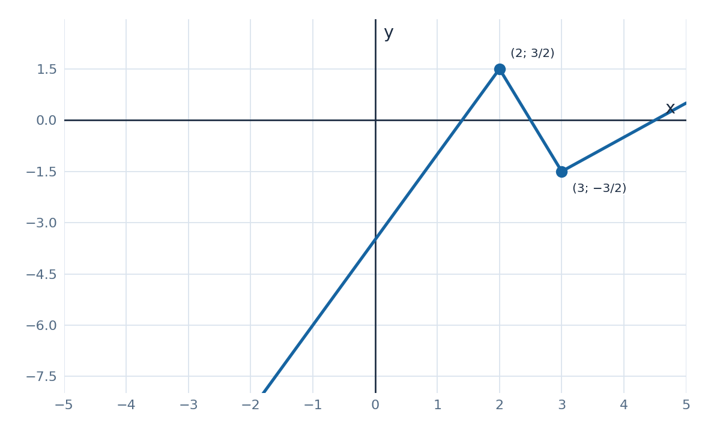

**Критерии**

- **2 балла.** График и результат по параметру либо числу пересечений верны. Сложить количества пересечений по диапазонам ветвей, не задвоить общий конец
- **1 балл.** График верен, параметр или число пересечений найдены неправильно или отсутствуют. График верно передаёт формулы и принадлежность граничных точек, но ответ по прямой неверен или пропущен.
- **0 баллов.** График отсутствует или неверен. Остальные случаи, не удовлетворяющие условиям для 1 или 2 баллов. График отсутствует, неверно заданы ветви или пропущена существенно важная точка.

[Источник карточки](https://math-oge.sdamgia.ru/problem?id=341057)

### Задача 6 · 349086

Постройте график функции $y=\begin{cases}x - 1 \cdot \frac{1}{2},&x<-2\\- 2 x - \frac{13}{2},&-2\le x\le -1\\x - \frac{7}{2},&x>-1\end{cases}$. При каких значениях $m$ прямая $y=m$ имеет с графиком ровно две общие точки?

Подсказка 1

Строй каждую прямую только на её промежутке.

Подсказка 2

Сосчитай пересечения по диапазонам трёх ветвей, общую точку стыка учитывай один раз.

Ответ для самопроверки

$m\in\{- \frac{9}{2};- \frac{5}{2}\}$

Разбор и критерии

1. В условии у каждой строки своя граница по x. Для построения возьмём две точки каждой ветви.
2. При $x<-2$ Строим $y=x - \frac{1}{2}$. Две точки: $(-3;- \frac{7}{2})$ и $(-4;- \frac{9}{2})$.
3. При $-2\le x\le -1$ Строим $y=- 2 x - \frac{13}{2}$. Две точки: $(-2;- \frac{5}{2})$ и $(-1;- \frac{9}{2})$.
4. При $x>-1$ Строим $y=x - \frac{7}{2}$. Две точки: $(0;- \frac{7}{2})$ и $(1;- \frac{5}{2})$.
5. Точку на границе включаем там, где в условии допускается равенство. Входят в график граничные точки $(-2;- \frac{5}{2})$, $(-1;- \frac{9}{2})$.
6. Мысленно ведём горизонтальную прямую снизу вверх. Чтобы посчитать пересечения, посмотрим, какие высоты проходит каждая часть графика.
7. При $x<-2$ слева направо высота меняется так: $-\infty\to - \frac{5}{2}$.
8. При $-2\le x\le -1$ слева направо высота меняется так: $- \frac{5}{2}\to - \frac{9}{2}$.
9. При $x>-1$ слева направо высота меняется так: $- \frac{9}{2}\to \infty$.
10. Между соседними высотами каждая проходящая через этот уровень ветвь даёт одну точку. Общий конец двух ветвей считаем один раз, пустой кружок пропускаем.
11. Число пересечений по промежуткам и граничным значениям: $(-\infty;- \frac{9}{2})$ — 1; $\{- \frac{9}{2}\}$ — 2; $(- \frac{9}{2};- \frac{5}{2})$ — 3; $\{- \frac{5}{2}\}$ — 2; $(- \frac{5}{2};\infty)$ — 1.
12. Выбираем из подсчёта значения, при которых получается нужное число точек. $m\in\{- \frac{9}{2};- \frac{5}{2}\}$

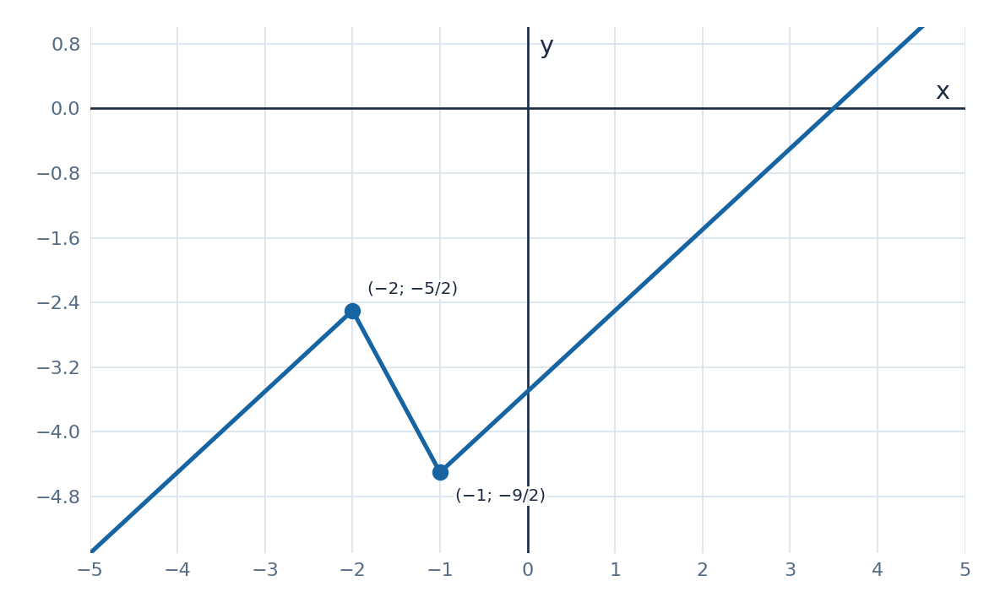

**Критерии**

- **2 балла.** График и результат по параметру либо числу пересечений верны. Сложить количества пересечений по диапазонам ветвей, не задвоить общий конец
- **1 балл.** График верен, параметр или число пересечений найдены неправильно или отсутствуют. График верно передаёт формулы и принадлежность граничных точек, но ответ по прямой неверен или пропущен.
- **0 баллов.** График отсутствует или неверен. Остальные случаи, не удовлетворяющие условиям для 1 или 2 баллов. График отсутствует, неверно заданы ветви или пропущена существенно важная точка.

[Источник карточки](https://math-oge.sdamgia.ru/problem?id=349086)

## Кусочно заданные функции · Парабола и прямая

`OGE22-piecewise-parabola-line`

### Задача 1 · D22-2027

Постройте график $y=\begin{cases}x^2+2x+1,&x\ge-2,\\x+6,&x<-2.\end{cases}$ При каких $m$ горизонталь $y=m$ пересекает его ровно в двух точках?

Подсказка 1

Отметь границу областей и вершину параболы.

Подсказка 2

Сравни, сколько пересечений даёт каждая ветвь на критических уровнях и между ними.

Ответ для самопроверки

$m\in\{0\}\cup(1;4)$.

Разбор и критерии

1. При $x<-2$ рисуем часть прямой $y=x+6$ с пустой точкой $(-2;4)$.
2. Эта ветвь даёт одно пересечение при $m<4$.
3. При $x\ge-2$ строим часть параболы $y=(x+1)^2$ с вершиной $(-1;0)$ и включённой точкой $(-2;1)$.
4. Парабола даёт 0 точек при $m<0$, 1 при $m=0$, 2 при $0<m\le1$, 1 при $m>1$.
5. Суммирование даёт два пересечения при $m=0$ и $1<m<4$.
6. На уровнях $1$ и $4$ получаем соответственно 3 и 1 точку.

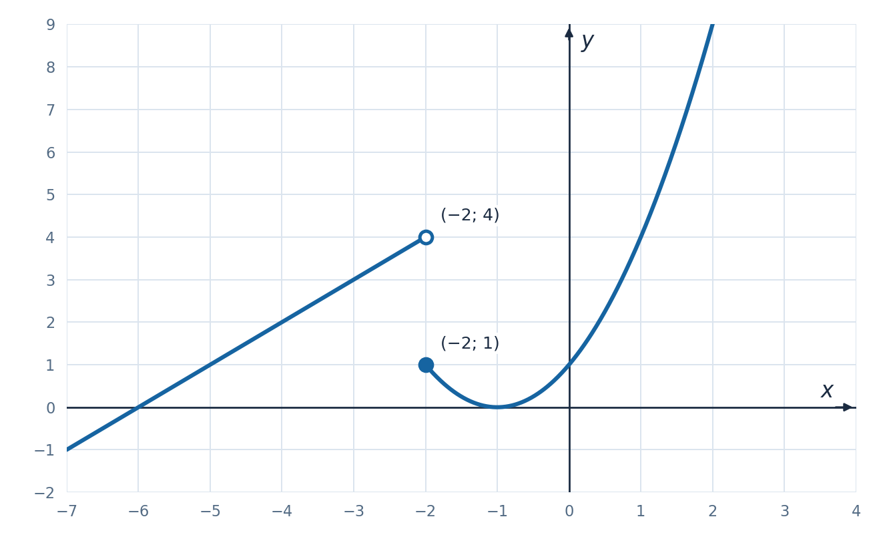

**Критерии**

- **2 балла.** График и результат по параметру либо числу пересечений верны. График верен с обеими точками на x=−2, найдено полное множество m.
- **1 балл.** График верен, параметр или число пересечений найдены неправильно или отсутствуют. График верен, но множество m указано с ошибкой или отсутствует.
- **0 баллов.** График отсутствует или неверен. Остальные случаи, не удовлетворяющие условиям для 1 или 2 баллов. Включена точка (−2;4), исключена (−2;1) или построены полные парабола и прямая без ограничений.

[Источник карточки](https://doc.fipi.ru/oge/demoversii-specifikacii-kodifikatory/2027/ma_9_2027.zip) · МА-9 ОГЭ 2027_ДЕМО.pdf, печатная стр. 14, решение и шкала на стр. 18

### Задача 2 · 333129

Постройте график функции $y=\begin{cases}x + 9,&x<-3\\x^{2} + 2 x + 3,&x\ge -3\end{cases}$. При каких значениях $m$ прямая $y=m$ имеет с графиком ровно две общие точки?

Подсказка 1

Отметь границу областей и вершину параболы.

Подсказка 2

Сравни, сколько пересечений даёт каждая ветвь на критических уровнях и между ними.

Ответ для самопроверки

$m\in\{2;6\}$

Разбор и критерии

1. В условии у каждой строки своя граница по x. Для построения возьмём две точки каждой ветви.
2. При $x<-3$ Строим $y=x + 9$. Две точки: $(-4;5)$ и $(-5;4)$.
3. При $x\ge -3$ Строим $y=x^{2} + 2 x + 3$. Две точки: $(-2;3)$ и $(-3;6)$.
4. Выделим квадрат. При раскрытии $(x + 1)^{2}$ получится $x^{2} + 2 x + 1$. Чтобы вернуть свободный член $3$, нужна поправка $2$. Поэтому $y=(x + 1)^{2} + 2$. Квадрат равен нулю при $x=-1$, вершина — $(-1;2)$.
5. Точку на границе включаем там, где в условии допускается равенство. Входят в график граничные точки $(-3;6)$. Отмечаем точки поворота $(-1;2)$.
6. Мысленно ведём горизонтальную прямую снизу вверх. Чтобы посчитать пересечения, посмотрим, какие высоты проходит каждая часть графика.
7. При $x<-3$ слева направо высота меняется так: $-\infty\to 6$.
8. При $x\ge -3$ слева направо высота меняется так: $6\to 2$, затем $2\to \infty$.
9. Между соседними высотами каждая проходящая через этот уровень ветвь даёт одну точку. Общий конец двух ветвей считаем один раз, пустой кружок пропускаем.
10. Число пересечений по промежуткам и граничным значениям: $(-\infty;2)$ — 1; $\{2\}$ — 2; $(2;6)$ — 3; $\{6\}$ — 2; $(6;\infty)$ — 1.
11. Выбираем из подсчёта значения, при которых получается нужное число точек. $m\in\{2;6\}$

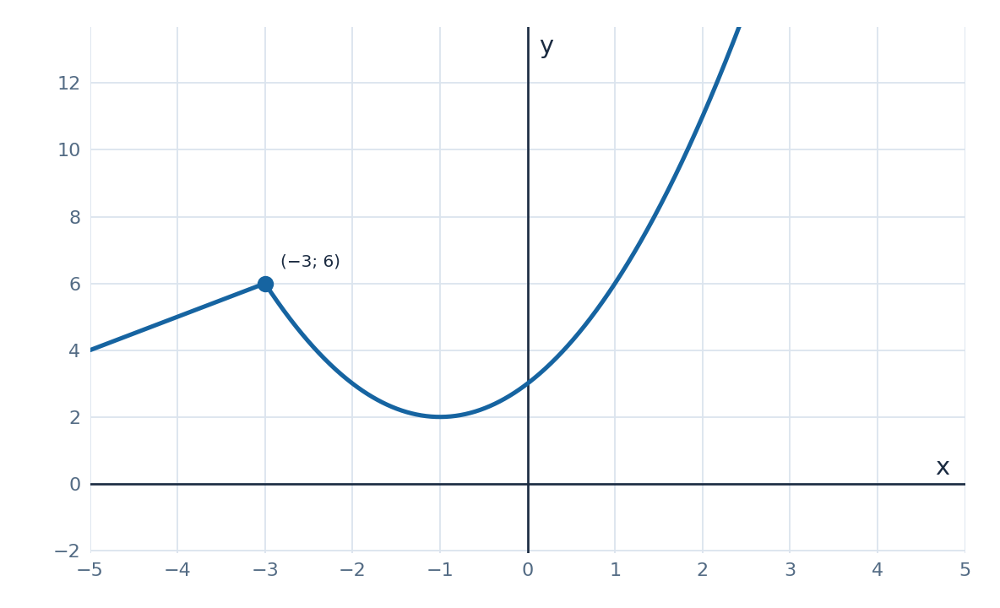

**Критерии**

- **2 балла.** График и результат по параметру либо числу пересечений верны. Вершина, уровень ветви на стыке и предел другой ветви; отмечать начало и конец раздельно
- **1 балл.** График верен, параметр или число пересечений найдены неправильно или отсутствуют. График верно передаёт формулы и принадлежность граничных точек, но ответ по прямой неверен или пропущен.
- **0 баллов.** График отсутствует или неверен. Остальные случаи, не удовлетворяющие условиям для 1 или 2 баллов. График отсутствует, неверно заданы ветви или пропущена существенно важная точка.

[Источник карточки](https://math-oge.sdamgia.ru/problem?id=333129)

### Задача 3 · 333024

Постройте график функции $y=\begin{cases}7 - x,&x<2\\- x^{2} + 6 x - 3,&x\ge 2\end{cases}$. При каких значениях $m$ прямая $y=m$ имеет с графиком ровно две общие точки?

Подсказка 1

Отметь границу областей и вершину параболы.

Подсказка 2

Сравни, сколько пересечений даёт каждая ветвь на критических уровнях и между ними.

Ответ для самопроверки

$m\in\{5;6\}$

Разбор и критерии

1. В условии у каждой строки своя граница по x. Для построения возьмём две точки каждой ветви.
2. При $x<2$ Строим $y=7 - x$. Две точки: $(1;6)$ и $(0;7)$.
3. При $x\ge 2$ Строим $y=- x^{2} + 6 x - 3$. Две точки: $(3;6)$ и $(2;5)$.
4. Выделим квадрат. При раскрытии $- (x - 3)^{2}$ получится $- x^{2} + 6 x - 9$. Чтобы вернуть свободный член $-3$, нужна поправка $6$. Поэтому $y=6 - (x - 3)^{2}$. Квадрат равен нулю при $x=3$, вершина — $(3;6)$.
5. Точку на границе включаем там, где в условии допускается равенство. Входят в график граничные точки $(2;5)$. Отмечаем точки поворота $(3;6)$.
6. Мысленно ведём горизонтальную прямую снизу вверх. Чтобы посчитать пересечения, посмотрим, какие высоты проходит каждая часть графика.
7. При $x<2$ слева направо высота меняется так: $\infty\to 5$.
8. При $x\ge 2$ слева направо высота меняется так: $5\to 6$, затем $6\to -\infty$.
9. Между соседними высотами каждая проходящая через этот уровень ветвь даёт одну точку. Общий конец двух ветвей считаем один раз, пустой кружок пропускаем.
10. Число пересечений по промежуткам и граничным значениям: $(-\infty;5)$ — 1; $\{5\}$ — 2; $(5;6)$ — 3; $\{6\}$ — 2; $(6;\infty)$ — 1.
11. Выбираем из подсчёта значения, при которых получается нужное число точек. $m\in\{5;6\}$

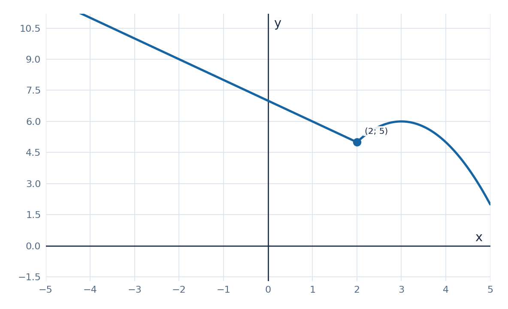

**Критерии**

- **2 балла.** График и результат по параметру либо числу пересечений верны. Вершина, уровень ветви на стыке и предел другой ветви; отмечать начало и конец раздельно
- **1 балл.** График верен, параметр или число пересечений найдены неправильно или отсутствуют. График верно передаёт формулы и принадлежность граничных точек, но ответ по прямой неверен или пропущен.
- **0 баллов.** График отсутствует или неверен. Остальные случаи, не удовлетворяющие условиям для 1 или 2 баллов. График отсутствует, неверно заданы ветви или пропущена существенно важная точка.

[Источник карточки](https://math-oge.sdamgia.ru/problem?id=333024)

### Задача 4 · 333103

Постройте график функции $y=\begin{cases}- x - 7,&x<-5\\- x^{2} - 2 x + 13,&x\ge -5\end{cases}$. При каких значениях $m$ прямая $y=m$ имеет с графиком ровно две общие точки?

Подсказка 1

Отметь границу областей и вершину параболы.

Подсказка 2

Сравни, сколько пересечений даёт каждая ветвь на критических уровнях и между ними.

Ответ для самопроверки

$m\in\{-2;14\}$

Разбор и критерии

1. В условии у каждой строки своя граница по x. Для построения возьмём две точки каждой ветви.
2. При $x<-5$ Строим $y=- x - 7$. Две точки: $(-6;-1)$ и $(-7;0)$.
3. При $x\ge -5$ Строим $y=- x^{2} - 2 x + 13$. Две точки: $(-4;5)$ и $(-5;-2)$.
4. Выделим квадрат. При раскрытии $- (x + 1)^{2}$ получится $- x^{2} - 2 x - 1$. Чтобы вернуть свободный член $13$, нужна поправка $14$. Поэтому $y=14 - (x + 1)^{2}$. Квадрат равен нулю при $x=-1$, вершина — $(-1;14)$.
5. Точку на границе включаем там, где в условии допускается равенство. Входят в график граничные точки $(-5;-2)$. Отмечаем точки поворота $(-1;14)$.
6. Мысленно ведём горизонтальную прямую снизу вверх. Чтобы посчитать пересечения, посмотрим, какие высоты проходит каждая часть графика.
7. При $x<-5$ слева направо высота меняется так: $\infty\to -2$.
8. При $x\ge -5$ слева направо высота меняется так: $-2\to 14$, затем $14\to -\infty$.
9. Между соседними высотами каждая проходящая через этот уровень ветвь даёт одну точку. Общий конец двух ветвей считаем один раз, пустой кружок пропускаем.
10. Число пересечений по промежуткам и граничным значениям: $(-\infty;-2)$ — 1; $\{-2\}$ — 2; $(-2;14)$ — 3; $\{14\}$ — 2; $(14;\infty)$ — 1.
11. Выбираем из подсчёта значения, при которых получается нужное число точек. $m\in\{-2;14\}$

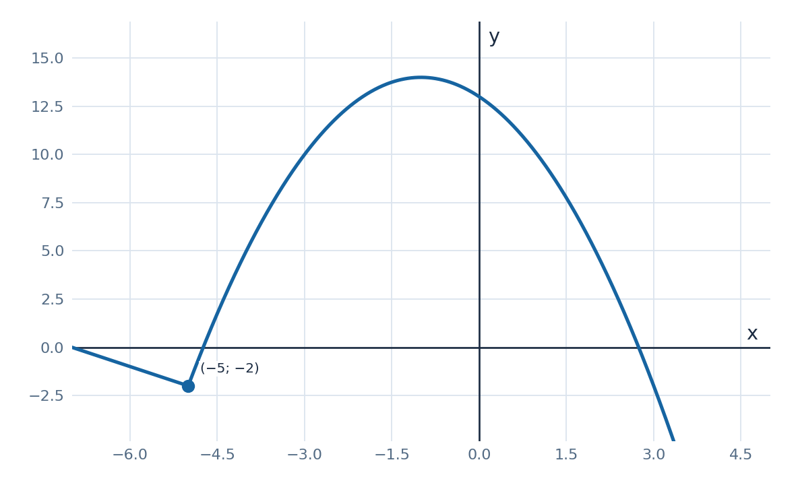

**Критерии**

- **2 балла.** График и результат по параметру либо числу пересечений верны. Вершина, уровень ветви на стыке и предел другой ветви; отмечать начало и конец раздельно
- **1 балл.** График верен, параметр или число пересечений найдены неправильно или отсутствуют. График верно передаёт формулы и принадлежность граничных точек, но ответ по прямой неверен или пропущен.
- **0 баллов.** График отсутствует или неверен. Остальные случаи, не удовлетворяющие условиям для 1 или 2 баллов. График отсутствует, неверно заданы ветви или пропущена существенно важная точка.

[Источник карточки](https://math-oge.sdamgia.ru/problem?id=333103)

### Задача 5 · 333156

Постройте график функции $y=\begin{cases}x - 5,&x<3\\x^{2} - 8 x + 13,&x\ge 3\end{cases}$. При каких значениях $m$ прямая $y=m$ имеет с графиком ровно две общие точки?

Подсказка 1

Отметь границу областей и вершину параболы.

Подсказка 2

Сравни, сколько пересечений даёт каждая ветвь на критических уровнях и между ними.

Ответ для самопроверки

$m\in\{-3;-2\}$

Разбор и критерии

1. В условии у каждой строки своя граница по x. Для построения возьмём две точки каждой ветви.
2. При $x<3$ Строим $y=x - 5$. Две точки: $(2;-3)$ и $(1;-4)$.
3. При $x\ge 3$ Строим $y=x^{2} - 8 x + 13$. Две точки: $(4;-3)$ и $(3;-2)$.
4. Выделим квадрат. При раскрытии $(x - 4)^{2}$ получится $x^{2} - 8 x + 16$. Чтобы вернуть свободный член $13$, нужна поправка $-3$. Поэтому $y=(x - 4)^{2} - 3$. Квадрат равен нулю при $x=4$, вершина — $(4;-3)$.
5. Точку на границе включаем там, где в условии допускается равенство. Входят в график граничные точки $(3;-2)$. Отмечаем точки поворота $(4;-3)$.
6. Мысленно ведём горизонтальную прямую снизу вверх. Чтобы посчитать пересечения, посмотрим, какие высоты проходит каждая часть графика.
7. При $x<3$ слева направо высота меняется так: $-\infty\to -2$.
8. При $x\ge 3$ слева направо высота меняется так: $-2\to -3$, затем $-3\to \infty$.
9. Между соседними высотами каждая проходящая через этот уровень ветвь даёт одну точку. Общий конец двух ветвей считаем один раз, пустой кружок пропускаем.
10. Число пересечений по промежуткам и граничным значениям: $(-\infty;-3)$ — 1; $\{-3\}$ — 2; $(-3;-2)$ — 3; $\{-2\}$ — 2; $(-2;\infty)$ — 1.
11. Выбираем из подсчёта значения, при которых получается нужное число точек. $m\in\{-3;-2\}$

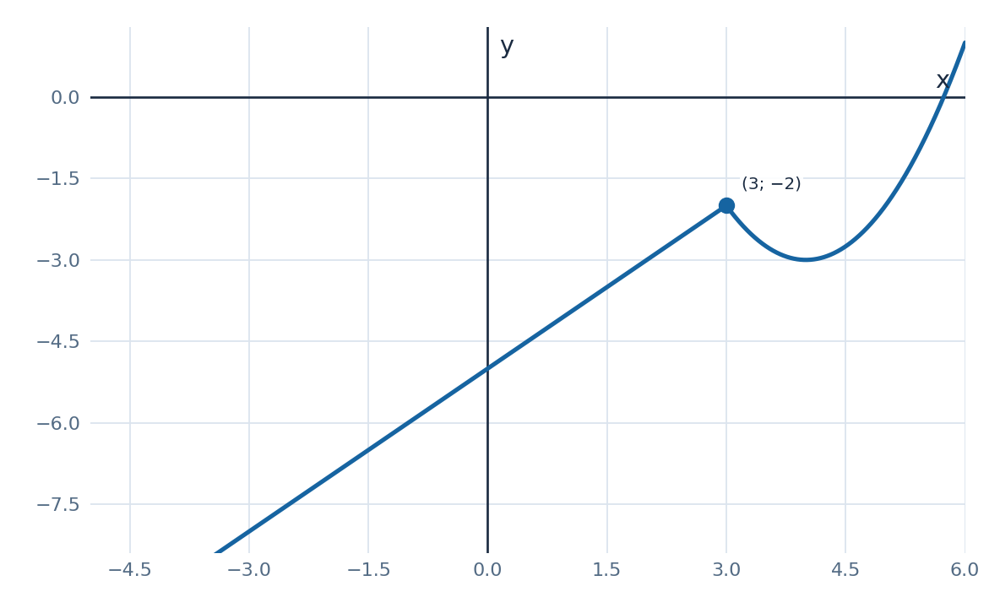

**Критерии**

- **2 балла.** График и результат по параметру либо числу пересечений верны. Вершина, уровень ветви на стыке и предел другой ветви; отмечать начало и конец раздельно
- **1 балл.** График верен, параметр или число пересечений найдены неправильно или отсутствуют. График верно передаёт формулы и принадлежность граничных точек, но ответ по прямой неверен или пропущен.
- **0 баллов.** График отсутствует или неверен. Остальные случаи, не удовлетворяющие условиям для 1 или 2 баллов. График отсутствует, неверно заданы ветви или пропущена существенно важная точка.

[Источник карточки](https://math-oge.sdamgia.ru/problem?id=333156)

### Задача 6 · 339278

Постройте график функции $y=\begin{cases}- x - 4,&x<-3\\- x^{2} - 2 x + 2,&x\ge -3\end{cases}$. При каких значениях $m$ прямая $y=m$ имеет с графиком ровно две общие точки?

Подсказка 1

Отметь границу областей и вершину параболы.

Подсказка 2

Сравни, сколько пересечений даёт каждая ветвь на критических уровнях и между ними.

Ответ для самопроверки

$m\in\{-1;3\}$

Разбор и критерии

1. В условии у каждой строки своя граница по x. Для построения возьмём две точки каждой ветви.
2. При $x<-3$ Строим $y=- x - 4$. Две точки: $(-4;0)$ и $(-5;1)$.
3. При $x\ge -3$ Строим $y=- x^{2} - 2 x + 2$. Две точки: $(-2;2)$ и $(-3;-1)$.
4. Выделим квадрат. При раскрытии $- (x + 1)^{2}$ получится $- x^{2} - 2 x - 1$. Чтобы вернуть свободный член $2$, нужна поправка $3$. Поэтому $y=3 - (x + 1)^{2}$. Квадрат равен нулю при $x=-1$, вершина — $(-1;3)$.
5. Точку на границе включаем там, где в условии допускается равенство. Входят в график граничные точки $(-3;-1)$. Отмечаем точки поворота $(-1;3)$.
6. Мысленно ведём горизонтальную прямую снизу вверх. Чтобы посчитать пересечения, посмотрим, какие высоты проходит каждая часть графика.
7. При $x<-3$ слева направо высота меняется так: $\infty\to -1$.
8. При $x\ge -3$ слева направо высота меняется так: $-1\to 3$, затем $3\to -\infty$.
9. Между соседними высотами каждая проходящая через этот уровень ветвь даёт одну точку. Общий конец двух ветвей считаем один раз, пустой кружок пропускаем.
10. Число пересечений по промежуткам и граничным значениям: $(-\infty;-1)$ — 1; $\{-1\}$ — 2; $(-1;3)$ — 3; $\{3\}$ — 2; $(3;\infty)$ — 1.
11. Выбираем из подсчёта значения, при которых получается нужное число точек. $m\in\{-1;3\}$

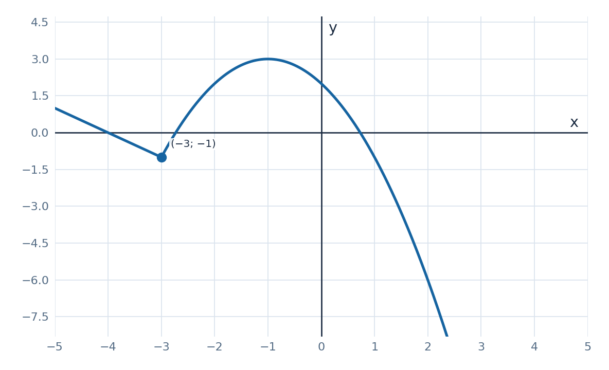

**Критерии**

- **2 балла.** График и результат по параметру либо числу пересечений верны. Вершина, уровень ветви на стыке и предел другой ветви; отмечать начало и конец раздельно
- **1 балл.** График верен, параметр или число пересечений найдены неправильно или отсутствуют. График верно передаёт формулы и принадлежность граничных точек, но ответ по прямой неверен или пропущен.
- **0 баллов.** График отсутствует или неверен. Остальные случаи, не удовлетворяющие условиям для 1 или 2 баллов. График отсутствует, неверно заданы ветви или пропущена существенно важная точка.

[Источник карточки](https://math-oge.sdamgia.ru/problem?id=339278)

## Кусочно заданные функции · Парабола и гипербола

`OGE22-piecewise-parabola-hyperbola`

### Задача 1 · 338465

Постройте $y=\begin{cases}(x+2)^2,&x\ge-4,\\-16/x,&x<-4.\end{cases}$ Укажите все $m$, для которых горизонталь $y=m$ имеет с графиком одну или две общие точки.

Подсказка 1

Сначала запиши допустимые промежутки каждой формулы.

Подсказка 2

Проверь отдельно уровень вершины, диапазон гиперболы и принадлежность стыка.

Ответ для самопроверки

$m\in\{0\}\cup[4;+\infty)$.

Разбор и критерии

1. Для $x<-4$ ветвь гиперболы имеет значения $0<y<4$, поэтому даёт ровно одну точку только на этих уровнях.
2. У части параболы вершина $(-2;0)$, начало $(-4;4)$ включено.
3. Она даёт одну точку при $m=0$, две при $0<m\le4$ и одну при $m>4$.
4. Суммарно выходит 0 при $m<0$, 1 при $m=0$, 3 при $0<m<4$, 2 при $m=4$, 1 при $m>4$.
5. Предел гиперболы в точке стыка совпадает с закрашенной начальной точкой параболы; это одна точка графика.

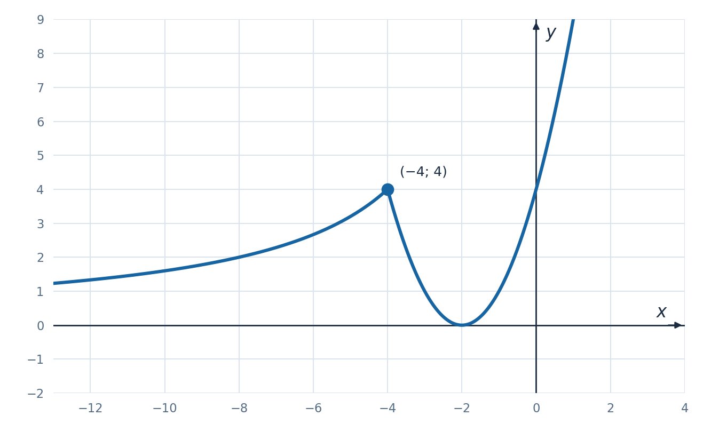

**Критерии**

- **2 балла.** График и результат по параметру либо числу пересечений верны. Построены обе ветви и правильно разобраны граничные уровни 0 и 4.
- **1 балл.** График верен, параметр или число пересечений найдены неправильно или отсутствуют. График верен, а множество m ошибочно или отсутствует.
- **0 баллов.** График отсутствует или неверен. Остальные случаи, не удовлетворяющие условиям для 1 или 2 баллов. Нарисована вся гипербола либо потеряна точка (−4;4), принадлежащая параболе.

[Источник карточки](https://math-oge.sdamgia.ru/problem?id=338465)

### Задача 2 · 333346

Постройте график функции $y=\begin{cases}- \frac{18}{x},&x<-2\\x^{2} - 2 x + 1,&x\ge -2\end{cases}$. При каких значениях $m$ прямая $y=m$ имеет с графиком одну или две общие точки?

Подсказка 1

Сначала запиши допустимые промежутки каждой формулы.

Подсказка 2

Проверь отдельно уровень вершины, диапазон гиперболы и принадлежность стыка.

Ответ для самопроверки

$m\in\{0\}\cup[9;\infty)$

Разбор и критерии

1. В условии у каждой строки своя граница по x. Для построения возьмём две точки каждой ветви.
2. При $x<-2$ Строим $y=- \frac{18}{x}$. Две точки: $(-3;6)$ и $(-4;\frac{9}{2})$.
3. При $x\ge -2$ Строим $y=x^{2} - 2 x + 1$. Две точки: $(-1;4)$ и $(-2;9)$.
4. Выделим квадрат. При раскрытии $(x - 1)^{2}$ получится $x^{2} - 2 x + 1$. Чтобы вернуть свободный член $1$, нужна поправка $0$. Поэтому $y=(x - 1)^{2}$. Квадрат равен нулю при $x=1$, вершина — $(1;0)$.
5. Точку на границе включаем там, где в условии допускается равенство. Входят в график граничные точки $(-2;9)$. Отмечаем точки поворота $(1;0)$.
6. Мысленно ведём горизонтальную прямую снизу вверх. Чтобы посчитать пересечения, посмотрим, какие высоты проходит каждая часть графика.
7. При $x<-2$ слева направо высота меняется так: $0\to 9$.
8. При $x\ge -2$ слева направо высота меняется так: $9\to 0$, затем $0\to \infty$.
9. Между соседними высотами каждая проходящая через этот уровень ветвь даёт одну точку. Общий конец двух ветвей считаем один раз, пустой кружок пропускаем.
10. Число пересечений по промежуткам и граничным значениям: $(-\infty;0)$ — 0; $\{0\}$ — 1; $(0;9)$ — 3; $\{9\}$ — 2; $(9;\infty)$ — 1.
11. Выбираем из подсчёта значения, при которых получается нужное число точек. $m\in\{0\}\cup[9;\infty)$

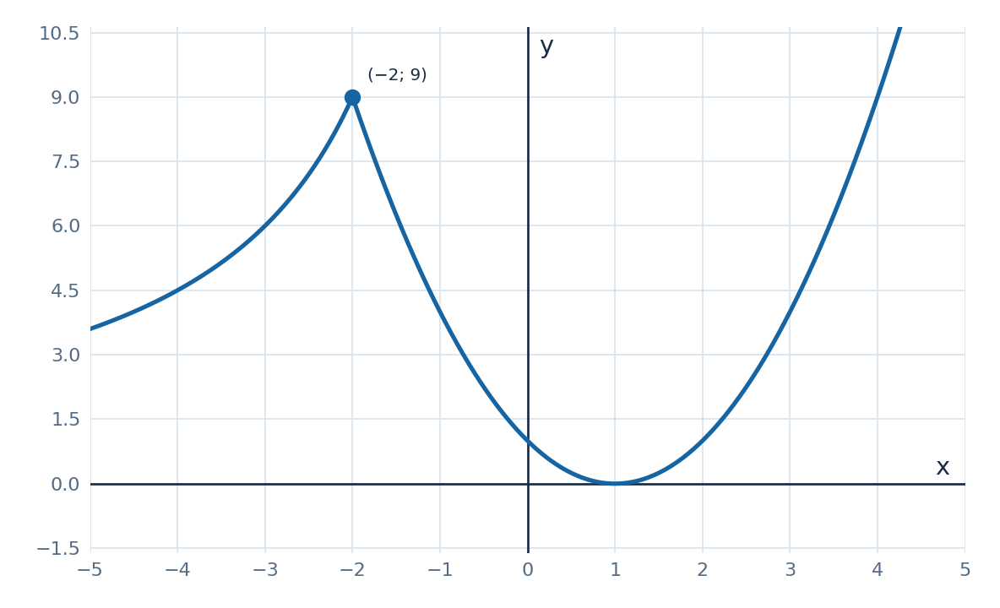

**Критерии**

- **2 балла.** График и результат по параметру либо числу пересечений верны. Сравнить диапазоны ветвей, уровень стыка и горизонтальную асимптоту
- **1 балл.** График верен, параметр или число пересечений найдены неправильно или отсутствуют. График верно передаёт формулы и принадлежность граничных точек, но ответ по прямой неверен или пропущен.
- **0 баллов.** График отсутствует или неверен. Остальные случаи, не удовлетворяющие условиям для 1 или 2 баллов. График отсутствует, неверно заданы ветви или пропущена существенно важная точка.

[Источник карточки](https://math-oge.sdamgia.ru/problem?id=333346)

### Задача 3 · 341394

Постройте график функции $y=\begin{cases}- \frac{5}{x},&x<-5\\x^{2} + 8 x + 16,&x\ge -5\end{cases}$. При каких значениях $m$ прямая $y=m$ имеет с графиком одну или две общие точки?

Подсказка 1

Сначала запиши допустимые промежутки каждой формулы.

Подсказка 2

Проверь отдельно уровень вершины, диапазон гиперболы и принадлежность стыка.

Ответ для самопроверки

$m\in\{0\}\cup[1;\infty)$

Разбор и критерии

1. В условии у каждой строки своя граница по x. Для построения возьмём две точки каждой ветви.
2. При $x<-5$ Строим $y=- \frac{5}{x}$. Две точки: $(-6;\frac{5}{6})$ и $(-7;\frac{5}{7})$.
3. При $x\ge -5$ Строим $y=x^{2} + 8 x + 16$. Две точки: $(-4;0)$ и $(-5;1)$.
4. Выделим квадрат. При раскрытии $(x + 4)^{2}$ получится $x^{2} + 8 x + 16$. Чтобы вернуть свободный член $16$, нужна поправка $0$. Поэтому $y=(x + 4)^{2}$. Квадрат равен нулю при $x=-4$, вершина — $(-4;0)$.
5. Точку на границе включаем там, где в условии допускается равенство. Входят в график граничные точки $(-5;1)$. Отмечаем точки поворота $(-4;0)$.
6. Мысленно ведём горизонтальную прямую снизу вверх. Чтобы посчитать пересечения, посмотрим, какие высоты проходит каждая часть графика.
7. При $x<-5$ слева направо высота меняется так: $0\to 1$.
8. При $x\ge -5$ слева направо высота меняется так: $1\to 0$, затем $0\to \infty$.
9. Между соседними высотами каждая проходящая через этот уровень ветвь даёт одну точку. Общий конец двух ветвей считаем один раз, пустой кружок пропускаем.
10. Число пересечений по промежуткам и граничным значениям: $(-\infty;0)$ — 0; $\{0\}$ — 1; $(0;1)$ — 3; $\{1\}$ — 2; $(1;\infty)$ — 1.
11. Выбираем из подсчёта значения, при которых получается нужное число точек. $m\in\{0\}\cup[1;\infty)$

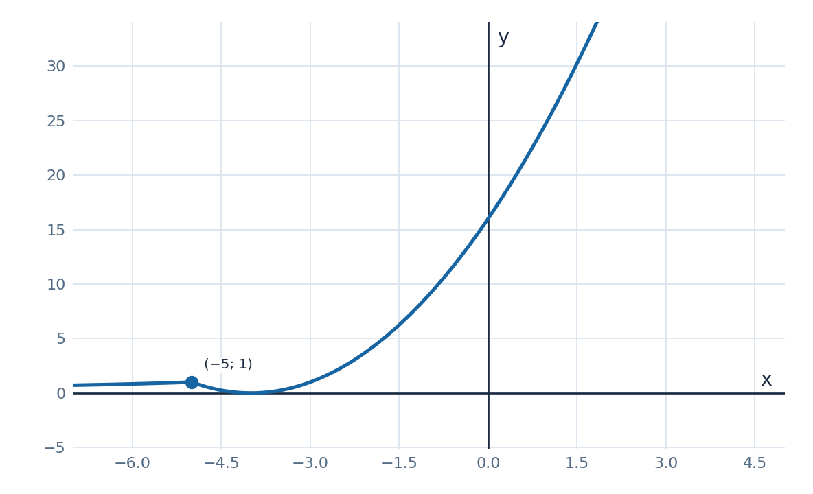

**Критерии**

- **2 балла.** График и результат по параметру либо числу пересечений верны. Сравнить диапазоны ветвей, уровень стыка и горизонтальную асимптоту
- **1 балл.** График верен, параметр или число пересечений найдены неправильно или отсутствуют. График верно передаёт формулы и принадлежность граничных точек, но ответ по прямой неверен или пропущен.
- **0 баллов.** График отсутствует или неверен. Остальные случаи, не удовлетворяющие условиям для 1 или 2 баллов. График отсутствует, неверно заданы ветви или пропущена существенно важная точка.

[Источник карточки](https://math-oge.sdamgia.ru/problem?id=341394)

### Задача 4 · 370480

Постройте график функции $y=\begin{cases}- \frac{20}{x},&x<-5\\x^{2} + 4 x + 5,&x\ge -5\end{cases}$. При каких значениях $m$ прямая $y=m$ имеет с графиком ровно одну общую точку?

Подсказка 1

Сначала запиши допустимые промежутки каждой формулы.

Подсказка 2

Проверь отдельно уровень вершины, диапазон гиперболы и принадлежность стыка.

Ответ для самопроверки

$m\in(0;1)\cup(10;\infty)$

Разбор и критерии

1. В условии у каждой строки своя граница по x. Для построения возьмём две точки каждой ветви.
2. При $x<-5$ Строим $y=- \frac{20}{x}$. Две точки: $(-6;\frac{10}{3})$ и $(-7;\frac{20}{7})$.
3. При $x\ge -5$ Строим $y=x^{2} + 4 x + 5$. Две точки: $(-4;5)$ и $(-5;10)$.
4. Выделим квадрат. При раскрытии $(x + 2)^{2}$ получится $x^{2} + 4 x + 4$. Чтобы вернуть свободный член $5$, нужна поправка $1$. Поэтому $y=(x + 2)^{2} + 1$. Квадрат равен нулю при $x=-2$, вершина — $(-2;1)$.
5. Точку на границе включаем там, где в условии допускается равенство. Пустыми кружками отмечаем $(-5;4)$. Входят в график граничные точки $(-5;10)$. Отмечаем точки поворота $(-2;1)$.
6. Мысленно ведём горизонтальную прямую снизу вверх. Чтобы посчитать пересечения, посмотрим, какие высоты проходит каждая часть графика.
7. При $x<-5$ слева направо высота меняется так: $0\to 4$.
8. При $x\ge -5$ слева направо высота меняется так: $10\to 1$, затем $1\to \infty$.
9. Между соседними высотами каждая проходящая через этот уровень ветвь даёт одну точку. Общий конец двух ветвей считаем один раз, пустой кружок пропускаем.
10. Число пересечений по промежуткам и граничным значениям: $(-\infty;0)$ — 0; $\{0\}$ — 0; $(0;1)$ — 1; $\{1\}$ — 2; $(1;4)$ — 3; $\{4\}$ — 2; $(4;10)$ — 2; $\{10\}$ — 2; $(10;\infty)$ — 1.
11. Выбираем из подсчёта значения, при которых получается нужное число точек. $m\in(0;1)\cup(10;\infty)$

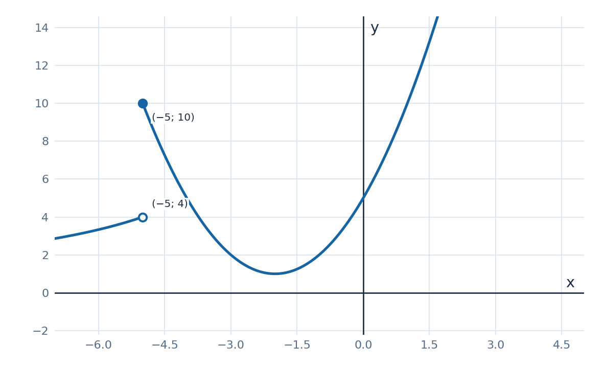

**Критерии**

- **2 балла.** График и результат по параметру либо числу пересечений верны. Сравнить диапазоны ветвей, уровень стыка и горизонтальную асимптоту
- **1 балл.** График верен, параметр или число пересечений найдены неправильно или отсутствуют. График верно передаёт формулы и принадлежность граничных точек, но ответ по прямой неверен или пропущен.
- **0 баллов.** График отсутствует или неверен. Остальные случаи, не удовлетворяющие условиям для 1 или 2 баллов. График отсутствует, неверно заданы ветви или пропущена существенно важная точка.

[Источник карточки](https://math-oge.sdamgia.ru/problem?id=370480)

### Задача 5 · 392124

Постройте график функции $y=\begin{cases}- \frac{9}{x},&x<-1\\x^{2} - 2 x + 4,&x\ge -1\end{cases}$. При каких значениях $m$ прямая $y=m$ имеет с графиком ровно одну общую точку?

Подсказка 1

Сначала запиши допустимые промежутки каждой формулы.

Подсказка 2

Проверь отдельно уровень вершины, диапазон гиперболы и принадлежность стыка.

Ответ для самопроверки

$m\in(0;3)\cup[9;\infty)$

Разбор и критерии

1. В условии у каждой строки своя граница по x. Для построения возьмём две точки каждой ветви.
2. При $x<-1$ Строим $y=- \frac{9}{x}$. Две точки: $(-2;\frac{9}{2})$ и $(-3;3)$.
3. При $x\ge -1$ Строим $y=x^{2} - 2 x + 4$. Две точки: $(0;4)$ и $(-1;7)$.
4. Выделим квадрат. При раскрытии $(x - 1)^{2}$ получится $x^{2} - 2 x + 1$. Чтобы вернуть свободный член $4$, нужна поправка $3$. Поэтому $y=(x - 1)^{2} + 3$. Квадрат равен нулю при $x=1$, вершина — $(1;3)$.
5. Точку на границе включаем там, где в условии допускается равенство. Пустыми кружками отмечаем $(-1;9)$. Входят в график граничные точки $(-1;7)$. Отмечаем точки поворота $(1;3)$.
6. Мысленно ведём горизонтальную прямую снизу вверх. Чтобы посчитать пересечения, посмотрим, какие высоты проходит каждая часть графика.
7. При $x<-1$ слева направо высота меняется так: $0\to 9$.
8. При $x\ge -1$ слева направо высота меняется так: $7\to 3$, затем $3\to \infty$.
9. Между соседними высотами каждая проходящая через этот уровень ветвь даёт одну точку. Общий конец двух ветвей считаем один раз, пустой кружок пропускаем.
10. Число пересечений по промежуткам и граничным значениям: $(-\infty;0)$ — 0; $\{0\}$ — 0; $(0;3)$ — 1; $\{3\}$ — 2; $(3;7)$ — 3; $\{7\}$ — 3; $(7;9)$ — 2; $\{9\}$ — 1; $(9;\infty)$ — 1.
11. Выбираем из подсчёта значения, при которых получается нужное число точек. $m\in(0;3)\cup[9;\infty)$

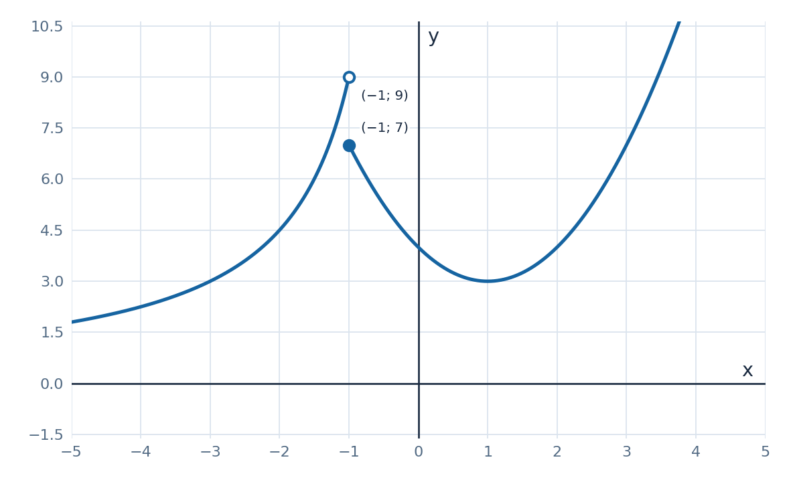

**Критерии**

- **2 балла.** График и результат по параметру либо числу пересечений верны. Сравнить диапазоны ветвей, уровень стыка и горизонтальную асимптоту
- **1 балл.** График верен, параметр или число пересечений найдены неправильно или отсутствуют. График верно передаёт формулы и принадлежность граничных точек, но ответ по прямой неверен или пропущен.
- **0 баллов.** График отсутствует или неверен. Остальные случаи, не удовлетворяющие условиям для 1 или 2 баллов. График отсутствует, неверно заданы ветви или пропущена существенно важная точка.

[Источник карточки](https://math-oge.sdamgia.ru/problem?id=392124)

### Задача 6 · 392674

Постройте график функции $y=\begin{cases}- \frac{4}{x},&x<-1\\x^{2} + 1,&x\ge -1\end{cases}$. При каких значениях $m$ прямая $y=m$ имеет с графиком ровно одну общую точку?

Подсказка 1

Сначала запиши допустимые промежутки каждой формулы.

Подсказка 2

Проверь отдельно уровень вершины, диапазон гиперболы и принадлежность стыка.

Ответ для самопроверки

$m\in(0;1)\cup[4;\infty)$

Разбор и критерии

1. В условии у каждой строки своя граница по x. Для построения возьмём две точки каждой ветви.
2. При $x<-1$ Строим $y=- \frac{4}{x}$. Две точки: $(-2;2)$ и $(-3;\frac{4}{3})$.
3. При $x\ge -1$ Строим $y=x^{2} + 1$. Две точки: $(0;1)$ и $(-1;2)$.
4. Для параболы $y=x^{2} + 1$ ось проходит через $x=-b/(2a)=0$. Подставляем это x и получаем вершину $(0;1)$. Уравнение с той же вершиной: $y=x^{2} + 1$.
5. Точку на границе включаем там, где в условии допускается равенство. Пустыми кружками отмечаем $(-1;4)$. Входят в график граничные точки $(-1;2)$. Отмечаем точки поворота $(0;1)$.
6. Мысленно ведём горизонтальную прямую снизу вверх. Чтобы посчитать пересечения, посмотрим, какие высоты проходит каждая часть графика.
7. При $x<-1$ слева направо высота меняется так: $0\to 4$.
8. При $x\ge -1$ слева направо высота меняется так: $2\to 1$, затем $1\to \infty$.
9. Между соседними высотами каждая проходящая через этот уровень ветвь даёт одну точку. Общий конец двух ветвей считаем один раз, пустой кружок пропускаем.
10. Число пересечений по промежуткам и граничным значениям: $(-\infty;0)$ — 0; $\{0\}$ — 0; $(0;1)$ — 1; $\{1\}$ — 2; $(1;2)$ — 3; $\{2\}$ — 3; $(2;4)$ — 2; $\{4\}$ — 1; $(4;\infty)$ — 1.
11. Выбираем из подсчёта значения, при которых получается нужное число точек. $m\in(0;1)\cup[4;\infty)$

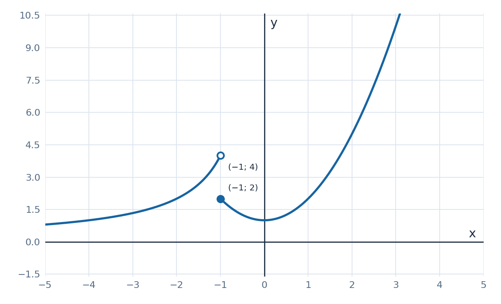

**Критерии**

- **2 балла.** График и результат по параметру либо числу пересечений верны. Сравнить диапазоны ветвей, уровень стыка и горизонтальную асимптоту
- **1 балл.** График верен, параметр или число пересечений найдены неправильно или отсутствуют. График верно передаёт формулы и принадлежность граничных точек, но ответ по прямой неверен или пропущен.
- **0 баллов.** График отсутствует или неверен. Остальные случаи, не удовлетворяющие условиям для 1 или 2 баллов. График отсутствует, неверно заданы ветви или пропущена существенно важная точка.

[Источник карточки](https://math-oge.sdamgia.ru/problem?id=392674)

## Построение через модуль · Модуль линейного выражения в формуле

`OGE22-modulus-inside`

### Задача 1 · 338409

Постройте $y=x^2-6|x|+8$. Сколько общих точек с горизонтальной прямой этот график может иметь самое большее?

Подсказка 1

Найди, где подмодульное выражение меняет знак.

Подсказка 2

Построй две части, затем сравни уровни их вершин и точки стыка.

Ответ для самопроверки

$4$.

Разбор и критерии

1. Перепишем формулу как $y=(|x|-3)^2-1$.
2. Справа рисуем параболу с вершиной $(3;-1)$, слева отражаем её относительно оси $Oy$.
3. Они сходятся в $(0;8)$.
4. При $-1<m<8$ уравнение $|x|=3\pm\sqrt{m+1}$ даёт два различных положительных значения $|x|$, по два $x$ на каждое.
5. Горизонталь не может дать больше четырёх точек, поскольку каждая половина параболы даёт не больше двух.
6. Например, $y=0$ пересекает график при $x=\pm2,\pm4$.

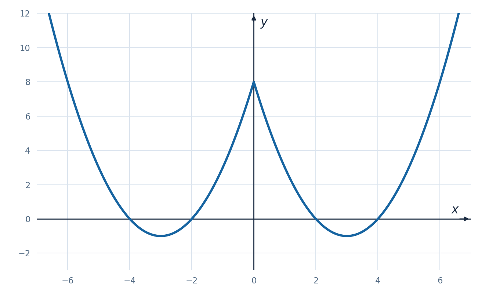

**Критерии**

- **2 балла.** График и результат по параметру либо числу пересечений верны. График обеих половин верен, максимум 4 обоснован и достижим.
- **1 балл.** График верен, параметр или число пересечений найдены неправильно или отсутствуют. График верен, но максимум не установлен или ошибочен.
- **0 баллов.** График отсутствует или неверен. Остальные случаи, не удовлетворяющие условиям для 1 или 2 баллов. Модуль отброшен и построена только одна парабола.

[Источник карточки](https://math-oge.sdamgia.ru/problem?id=338409)

### Задача 2 · 338160

Постройте график функции $y=- 6 x + \left(x + 1\right) \left|{x}\right|$. При каких значениях $m$ прямая $y=m$ имеет с графиком ровно две общие точки?

Подсказка 1

Найди, где подмодульное выражение меняет знак.

Подсказка 2

Построй две части, затем сравни уровни их вершин и точки стыка.

Ответ для самопроверки

$m\in\{- \frac{25}{4};\frac{49}{4}\}$

Разбор и критерии

1. Модуль — расстояние от нуля. Справа от нуля |x|=x, слева |x|=−x, а при x=0 обе записи дают 0.
2. При $x<0$ под модулем неположительное число, поэтому $|x|=- x$. Подставляем в исходную формулу: $y=- x (x + 1) - 6 x=- x^{2} - 7 x$.
3. При $x\ge 0$ под модулем неотрицательное число, поэтому $|x|=x$. Подставляем в исходную формулу: $y=x (x + 1) - 6 x=x^{2} - 5 x$.
4. Выделим квадрат. При раскрытии $- (x + \frac{7}{2})^{2}$ получится $- x^{2} - 7 x - \frac{49}{4}$. Чтобы вернуть свободный член $0$, нужна поправка $\frac{49}{4}$. Поэтому $y=\frac{49}{4} - (x + \frac{7}{2})^{2}$. Квадрат равен нулю при $x=- \frac{7}{2}$, вершина — $(- \frac{7}{2};\frac{49}{4})$.
5. Выделим квадрат. При раскрытии $(x - \frac{5}{2})^{2}$ получится $x^{2} - 5 x + \frac{25}{4}$. Чтобы вернуть свободный член $0$, нужна поправка $- \frac{25}{4}$. Поэтому $y=(x - \frac{5}{2})^{2} - \frac{25}{4}$. Квадрат равен нулю при $x=\frac{5}{2}$, вершина — $(\frac{5}{2};- \frac{25}{4})$.
6. Мысленно ведём горизонтальную прямую снизу вверх. Чтобы посчитать пересечения, посмотрим, какие высоты проходит каждая часть графика.
7. При $x<0$ слева направо высота меняется так: $-\infty\to \frac{49}{4}$, затем $\frac{49}{4}\to 0$.
8. При $x\ge 0$ слева направо высота меняется так: $0\to - \frac{25}{4}$, затем $- \frac{25}{4}\to \infty$.
9. Между соседними высотами каждая проходящая через этот уровень ветвь даёт одну точку. Общий конец двух ветвей считаем один раз, пустой кружок пропускаем.
10. Число пересечений по промежуткам и граничным значениям: $(-\infty;- \frac{25}{4})$ — 1; $\{- \frac{25}{4}\}$ — 2; $(- \frac{25}{4};0)$ — 3; $\{0\}$ — 3; $(0;\frac{49}{4})$ — 3; $\{\frac{49}{4}\}$ — 2; $(\frac{49}{4};\infty)$ — 1.
11. Выбираем из подсчёта значения, при которых получается нужное число точек. $m\in\{- \frac{25}{4};\frac{49}{4}\}$

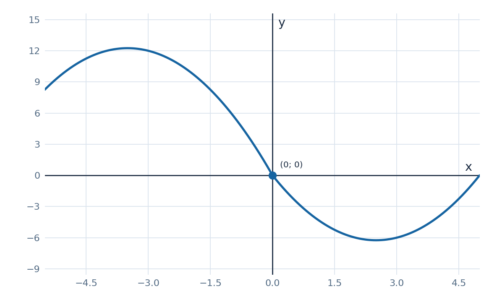

**Критерии**

- **2 балла.** График и результат по параметру либо числу пересечений верны. Раскрыть модуль по знаку, учесть вершины обеих парабол и стык
- **1 балл.** График верен, параметр или число пересечений найдены неправильно или отсутствуют. График верно передаёт формулы и принадлежность граничных точек, но ответ по прямой неверен или пропущен.
- **0 баллов.** График отсутствует или неверен. Остальные случаи, не удовлетворяющие условиям для 1 или 2 баллов. График отсутствует, неверно заданы ветви или пропущена существенно важная точка.

[Источник карточки](https://math-oge.sdamgia.ru/problem?id=338160)

### Задача 3 · 338253

Постройте график функции $y=x^{2} - \left|{4 x + 3}\right|$. При каких значениях $m$ прямая $y=m$ имеет с графиком ровно три общие точки?

Подсказка 1

Найди, где подмодульное выражение меняет знак.

Подсказка 2

Построй две части, затем сравни уровни их вершин и точки стыка.

Ответ для самопроверки

$m\in\{-1;\frac{9}{16}\}$

Разбор и критерии

1. Модуль стоит у выражения 4x+3. Решим 4x+3=0: получаем x=−3/4. Например, при x=−1 внутри модуля получается −1, а при x=0 получается 3. Значит, левее границы знак минус, правее — плюс.
2. Слева $|4x+3|=-(4x+3)$. Перед модулем в условии стоит ещё один минус. Поэтому $y=x^2+(4x+3)=(x+2)^2-1$. Рисуем левую часть графика до x=−3/4. Её вершина (−2; −1).
3. Справа $|4x+3|=4x+3$, поэтому $y=x^2-(4x+3)=(x-2)^2-7$. Эта часть проходит через вершину (2; −7). На границе модуль равен нулю, и обе формулы дают $y=(-3/4)^2=9/16$. Соединяем части в этой точке.
4. На высоте −1 горизонталь касается левой параболы в вершине и дважды пересекает правую. Получаются три точки. На высоте 9/16 горизонталь проходит через стык графиков и ещё по разу через крайние ветви. Стык считается один раз — снова три точки.
5. Проверим остальные высоты. Ниже −7 точек нет, на −7 одна, между −7 и −1 две на правой параболе. Между −1 и 9/16 каждая парабола даёт по две точки. Выше стыка остаются только две крайние ветви.

**Критерии**

- **2 балла.** График и результат по параметру либо числу пересечений верны. Раскрыть модуль по знаку, учесть вершины обеих парабол и стык
- **1 балл.** График верен, параметр или число пересечений найдены неправильно или отсутствуют. График верно передаёт формулы и принадлежность граничных точек, но ответ по прямой неверен или пропущен.
- **0 баллов.** График отсутствует или неверен. Остальные случаи, не удовлетворяющие условиям для 1 или 2 баллов. График отсутствует, неверно заданы ветви или пропущена существенно важная точка.

[Источник карточки](https://math-oge.sdamgia.ru/problem?id=338253)

### Задача 4 · 341230

Постройте график функции $y=x^{2} + 11 x - 4 \left|{x + 6}\right| + 30$. При каких значениях $m$ прямая $y=m$ имеет с графиком ровно три общие точки?

Подсказка 1

Найди, где подмодульное выражение меняет знак.

Подсказка 2

Построй две части, затем сравни уровни их вершин и точки стыка.

Ответ для самопроверки

$m\in\{- \frac{9}{4};0\}$

Разбор и критерии

1. Модуль оставляет положительное число как есть и меняет знак отрицательного. Найдём границу из $x + 6=0$. Получаем $x=-6$. Между соседними нулями знак не меняется; подставим по одному x из каждого промежутка.
2. При $x<-6$ например, при $x=-7$ выражение под модулем равно $-1$. На этом промежутке под модулем неположительное число, поэтому $|x + 6|=- x - 6$. Строим $y=x^{2} + 15 x + 54$.
3. При $x\ge -6$ например, при $x=-5$ выражение под модулем равно $1$. На этом промежутке под модулем неотрицательное число, поэтому $|x + 6|=x + 6$. Строим $y=x^{2} + 7 x + 6$.
4. Выделим квадрат. При раскрытии $(x + \frac{15}{2})^{2}$ получится $x^{2} + 15 x + \frac{225}{4}$. Чтобы вернуть свободный член $54$, нужна поправка $- \frac{9}{4}$. Поэтому $y=(x + \frac{15}{2})^{2} - \frac{9}{4}$. Квадрат равен нулю при $x=- \frac{15}{2}$, вершина — $(- \frac{15}{2};- \frac{9}{4})$.
5. Выделим квадрат. При раскрытии $(x + \frac{7}{2})^{2}$ получится $x^{2} + 7 x + \frac{49}{4}$. Чтобы вернуть свободный член $6$, нужна поправка $- \frac{25}{4}$. Поэтому $y=(x + \frac{7}{2})^{2} - \frac{25}{4}$. Квадрат равен нулю при $x=- \frac{7}{2}$, вершина — $(- \frac{7}{2};- \frac{25}{4})$.
6. Мысленно ведём горизонтальную прямую снизу вверх. Чтобы посчитать пересечения, посмотрим, какие высоты проходит каждая часть графика.
7. При $x<-6$ слева направо высота меняется так: $\infty\to - \frac{9}{4}$, затем $- \frac{9}{4}\to 0$.
8. При $x\ge -6$ слева направо высота меняется так: $0\to - \frac{25}{4}$, затем $- \frac{25}{4}\to \infty$.
9. Между соседними высотами каждая проходящая через этот уровень ветвь даёт одну точку. Общий конец двух ветвей считаем один раз, пустой кружок пропускаем.
10. Число пересечений по промежуткам и граничным значениям: $(-\infty;- \frac{25}{4})$ — 0; $\{- \frac{25}{4}\}$ — 1; $(- \frac{25}{4};- \frac{9}{4})$ — 2; $\{- \frac{9}{4}\}$ — 3; $(- \frac{9}{4};0)$ — 4; $\{0\}$ — 3; $(0;\infty)$ — 2.
11. Выбираем из подсчёта значения, при которых получается нужное число точек. $m\in\{- \frac{9}{4};0\}$

**Критерии**

- **2 балла.** График и результат по параметру либо числу пересечений верны. Раскрыть модуль по знаку, учесть вершины обеих парабол и стык
- **1 балл.** График верен, параметр или число пересечений найдены неправильно или отсутствуют. График верно передаёт формулы и принадлежность граничных точек, но ответ по прямой неверен или пропущен.
- **0 баллов.** График отсутствует или неверен. Остальные случаи, не удовлетворяющие условиям для 1 или 2 баллов. График отсутствует, неверно заданы ветви или пропущена существенно важная точка.

[Источник карточки](https://math-oge.sdamgia.ru/problem?id=341230)

### Задача 5 · 316358

Постройте график функции $y=x^{2} - 5 x - 3 \left|{x - 2}\right| + 10$. При каких значениях $a$ прямая $y=a+3$ имеет с графиком ровно три общие точки?

Подсказка 1

Найди, где подмодульное выражение меняет знак.

Подсказка 2

Построй две части, затем сравни уровни их вершин и точки стыка.

Ответ для самопроверки

$a\in\{0;1\}$

Разбор и критерии

1. Модуль оставляет положительное число как есть и меняет знак отрицательного. Найдём границу из $x - 2=0$. Получаем $x=2$. Между соседними нулями знак не меняется; подставим по одному x из каждого промежутка.
2. При $x<2$ например, при $x=1$ выражение под модулем равно $-1$. На этом промежутке под модулем неположительное число, поэтому $|x - 2|=2 - x$. Подставляем в исходную формулу: $y=x^{2} - 5 x + 3 x + 4=x^{2} - 2 x + 4$.
3. При $x\ge 2$ например, при $x=3$ выражение под модулем равно $1$. На этом промежутке под модулем неотрицательное число, поэтому $|x - 2|=x - 2$. Подставляем в исходную формулу: $y=x^{2} - 5 x - 3 x + 16=x^{2} - 8 x + 16$.
4. Выделим квадрат. При раскрытии $(x - 1)^{2}$ получится $x^{2} - 2 x + 1$. Чтобы вернуть свободный член $4$, нужна поправка $3$. Поэтому $y=(x - 1)^{2} + 3$. Квадрат равен нулю при $x=1$, вершина — $(1;3)$.
5. Выделим квадрат. При раскрытии $(x - 4)^{2}$ получится $x^{2} - 8 x + 16$. Чтобы вернуть свободный член $16$, нужна поправка $0$. Поэтому $y=(x - 4)^{2}$. Квадрат равен нулю при $x=4$, вершина — $(4;0)$.
6. Высота прямой равна $a+3$. Для перехода от высоты к a вычитаем 3.
7. Мысленно ведём горизонтальную прямую снизу вверх. Чтобы посчитать пересечения, посмотрим, какие высоты проходит каждая часть графика.
8. При $x<2$ слева направо высота меняется так: $\infty\to 3$, затем $3\to 4$.
9. При $x\ge 2$ слева направо высота меняется так: $4\to 0$, затем $0\to \infty$.
10. Между соседними высотами каждая проходящая через этот уровень ветвь даёт одну точку. Общий конец двух ветвей считаем один раз, пустой кружок пропускаем.
11. Число пересечений по промежуткам и граничным значениям: $(-\infty;-3)$ — 0; $\{-3\}$ — 1; $(-3;0)$ — 2; $\{0\}$ — 3; $(0;1)$ — 4; $\{1\}$ — 3; $(1;\infty)$ — 2.
12. Выбираем из подсчёта значения, при которых получается нужное число точек. $a\in\{0;1\}$

**Критерии**

- **2 балла.** График и результат по параметру либо числу пересечений верны. Раскрыть модуль по знаку, учесть вершины обеих парабол и стык
- **1 балл.** График верен, параметр или число пересечений найдены неправильно или отсутствуют. График верно передаёт формулы и принадлежность граничных точек, но ответ по прямой неверен или пропущен.
- **0 баллов.** График отсутствует или неверен. Остальные случаи, не удовлетворяющие условиям для 1 или 2 баллов. График отсутствует, неверно заданы ветви или пропущена существенно важная точка.

[Источник карточки](https://math-oge.sdamgia.ru/problem?id=316358)

### Задача 6 · 316384

Постройте график функции $y=x^{2} - x - 3 \left|{x}\right| + 3$. При каких значениях $a$ прямая $y=a-4$ имеет с графиком ровно три общие точки?

Подсказка 1

Найди, где подмодульное выражение меняет знак.

Подсказка 2

Построй две части, затем сравни уровни их вершин и точки стыка.

Ответ для самопроверки

$a\in\{6;7\}$

Разбор и критерии

1. Модуль — расстояние от нуля. Справа от нуля |x|=x, слева |x|=−x, а при x=0 обе записи дают 0.
2. При $x<0$ под модулем неположительное число, поэтому $|x|=- x$. Строим $y=x^{2} + 2 x + 3$.
3. При $x\ge 0$ под модулем неотрицательное число, поэтому $|x|=x$. Строим $y=x^{2} - 4 x + 3$.
4. Выделим квадрат. При раскрытии $(x + 1)^{2}$ получится $x^{2} + 2 x + 1$. Чтобы вернуть свободный член $3$, нужна поправка $2$. Поэтому $y=(x + 1)^{2} + 2$. Квадрат равен нулю при $x=-1$, вершина — $(-1;2)$.
5. Выделим квадрат. При раскрытии $(x - 2)^{2}$ получится $x^{2} - 4 x + 4$. Чтобы вернуть свободный член $3$, нужна поправка $-1$. Поэтому $y=(x - 2)^{2} - 1$. Квадрат равен нулю при $x=2$, вершина — $(2;-1)$.
6. Высота прямой равна $a-4$. Для перехода от высоты к a прибавляем 4.
7. Мысленно ведём горизонтальную прямую снизу вверх. Чтобы посчитать пересечения, посмотрим, какие высоты проходит каждая часть графика.
8. При $x<0$ слева направо высота меняется так: $\infty\to 2$, затем $2\to 3$.
9. При $x\ge 0$ слева направо высота меняется так: $3\to -1$, затем $-1\to \infty$.
10. Между соседними высотами каждая проходящая через этот уровень ветвь даёт одну точку. Общий конец двух ветвей считаем один раз, пустой кружок пропускаем.
11. Число пересечений по промежуткам и граничным значениям: $(-\infty;3)$ — 0; $\{3\}$ — 1; $(3;6)$ — 2; $\{6\}$ — 3; $(6;7)$ — 4; $\{7\}$ — 3; $(7;\infty)$ — 2.
12. Выбираем из подсчёта значения, при которых получается нужное число точек. $a\in\{6;7\}$

**Критерии**

- **2 балла.** График и результат по параметру либо числу пересечений верны. Раскрыть модуль по знаку, учесть вершины обеих парабол и стык
- **1 балл.** График верен, параметр или число пересечений найдены неправильно или отсутствуют. График верно передаёт формулы и принадлежность граничных точек, но ответ по прямой неверен или пропущен.
- **0 баллов.** График отсутствует или неверен. Остальные случаи, не удовлетворяющие условиям для 1 или 2 баллов. График отсутствует, неверно заданы ветви или пропущена существенно важная точка.

[Источник карточки](https://math-oge.sdamgia.ru/problem?id=316384)

## Построение через модуль · Внешний модуль квадратной функции

`OGE22-modulus-outside`

### Задача 1 · 353274

Постройте $y=|x^2+4x-5|$. Найдите максимальное число общих точек этого графика с горизонталью.

Подсказка 1

Вычисли нули выражения под внешним модулем.

Подсказка 2

Отрази относительно оси Ox только ту часть, которая находится ниже оси.

Ответ для самопроверки

$4$.

Разбор и критерии

1. Исходная парабола $q(x)=(x+2)^2-9$ имеет нули $-5$ и $1$, вершину $(-2;-9)$.
2. Между нулями отражаем её отрицательную часть вверх, за пределами оставляем как есть.
3. Получается центральная дуга с вершиной $(-2;9)$ и две внешние ветви.
4. При $0<m<9$ решения $q(x)=m$ и $q(x)=-m$ дают по два различных $x$.
5. Всего не больше четырёх, поскольку каждое из двух квадратных уравнений имеет не больше двух корней.

**Критерии**

- **2 балла.** График и результат по параметру либо числу пересечений верны. Отражена ровно отрицательная часть и обоснованы достижимость и максимум 4.
- **1 балл.** График верен, параметр или число пересечений найдены неправильно или отсутствуют. График верен, но максимум указан неверно или ответ отсутствует.
- **0 баллов.** График отсутствует или неверен. Остальные случаи, не удовлетворяющие условиям для 1 или 2 баллов. Построена исходная парабола с отрицательным участком вместо отражённой дуги.

[Источник карточки](https://math-oge.sdamgia.ru/problem?id=353274)

### Задача 2 · 338455

Постройте график функции $y=\left|{x^{2} - x - 2}\right|$. Каково наибольшее число общих точек этого графика с горизонтальной прямой?

Подсказка 1

Вычисли нули выражения под внешним модулем.

Подсказка 2

Отрази относительно оси Ox только ту часть, которая находится ниже оси.

Ответ для самопроверки

$4$

Разбор и критерии

1. Модуль оставляет положительное число как есть и меняет знак отрицательного. Найдём границу из $(x - 2) (x + 1)=0$. Получаем $x=-1$, $x=2$. Между соседними нулями знак не меняется; подставим по одному x из каждого промежутка.
2. При $x<-1$ например, при $x=-2$ выражение под модулем равно $4$. На этом промежутке под модулем неотрицательное число, поэтому $|(x^{2} - x) - 2|=(x^{2} - x) - 2$. Подставляем в исходную формулу: $y=(x^{2} - x) - 2=x^{2} - x - 2$.
3. При $-1\le x<2$ например, при $x=\frac{1}{2}$ выражение под модулем равно $- \frac{9}{4}$. На этом промежутке под модулем неположительное число, поэтому $|(x^{2} - x) - 2|=- x^{2} + x + 2$. Строим $y=- x^{2} + x + 2$.
4. При $x\ge 2$ например, при $x=3$ выражение под модулем равно $4$. На этом промежутке под модулем неотрицательное число, поэтому $|(x^{2} - x) - 2|=(x^{2} - x) - 2$. Подставляем в исходную формулу: $y=(x^{2} - x) - 2=x^{2} - x - 2$.
5. Выделим квадрат. При раскрытии $- (x - \frac{1}{2})^{2}$ получится $- x^{2} + x - \frac{1}{4}$. Чтобы вернуть свободный член $2$, нужна поправка $\frac{9}{4}$. Поэтому $y=\frac{9}{4} - (x - \frac{1}{2})^{2}$. Квадрат равен нулю при $x=\frac{1}{2}$, вершина — $(\frac{1}{2};\frac{9}{4})$.
6. Мысленно ведём горизонтальную прямую снизу вверх. Чтобы посчитать пересечения, посмотрим, какие высоты проходит каждая часть графика.
7. При $x<-1$ слева направо высота меняется так: $\infty\to 0$.
8. При $-1\le x<2$ слева направо высота меняется так: $0\to \frac{9}{4}$, затем $\frac{9}{4}\to 0$.
9. При $x\ge 2$ слева направо высота меняется так: $0\to \infty$.
10. Между соседними высотами каждая проходящая через этот уровень ветвь даёт одну точку. Общий конец двух ветвей считаем один раз, пустой кружок пропускаем.
11. Число пересечений по промежуткам и граничным значениям: $(-\infty;0)$ — 0; $\{0\}$ — 2; $(0;\frac{9}{4})$ — 4; $\{\frac{9}{4}\}$ — 3; $(\frac{9}{4};\infty)$ — 2.
12. Наибольшее число точек $4$. Оно достижимо при $m\in(0;\frac{9}{4})$, где m — уровень горизонтальной прямой.

**Критерии**

- **2 балла.** График и результат по параметру либо числу пересечений верны. Отразить отрицательную часть параболы; сверить экстремумы и кратные пересечения
- **1 балл.** График верен, параметр или число пересечений найдены неправильно или отсутствуют. График верно передаёт формулы и принадлежность граничных точек, но ответ по прямой неверен или пропущен.
- **0 баллов.** График отсутствует или неверен. Остальные случаи, не удовлетворяющие условиям для 1 или 2 баллов. График отсутствует, неверно заданы ветви или пропущена существенно важная точка.

[Источник карточки](https://math-oge.sdamgia.ru/problem?id=338455)

### Задача 3 · 348457

Постройте график функции $y=\left|{x^{2} + 5 x + 4}\right|$. Каково наибольшее число общих точек этого графика с горизонтальной прямой?

Подсказка 1

Вычисли нули выражения под внешним модулем.

Подсказка 2

Отрази относительно оси Ox только ту часть, которая находится ниже оси.

Ответ для самопроверки

$4$

Разбор и критерии

1. Модуль оставляет положительное число как есть и меняет знак отрицательного. Найдём границу из $(x + 1) (x + 4)=0$. Получаем $x=-4$, $x=-1$. Между соседними нулями знак не меняется; подставим по одному x из каждого промежутка.
2. При $x<-4$ например, при $x=-5$ выражение под модулем равно $4$. На этом промежутке под модулем неотрицательное число, поэтому $|(x^{2} + 5 x) + 4|=(x^{2} + 5 x) + 4$. Подставляем в исходную формулу: $y=(x^{2} + 5 x) + 4=x^{2} + 5 x + 4$.
3. При $-4\le x<-1$ например, при $x=- \frac{5}{2}$ выражение под модулем равно $- \frac{9}{4}$. На этом промежутке под модулем неположительное число, поэтому $|(x^{2} + 5 x) + 4|=- x^{2} - 5 x - 4$. Строим $y=- x^{2} - 5 x - 4$.
4. При $x\ge -1$ например, при $x=0$ выражение под модулем равно $4$. На этом промежутке под модулем неотрицательное число, поэтому $|(x^{2} + 5 x) + 4|=(x^{2} + 5 x) + 4$. Подставляем в исходную формулу: $y=(x^{2} + 5 x) + 4=x^{2} + 5 x + 4$.
5. Выделим квадрат. При раскрытии $- (x + \frac{5}{2})^{2}$ получится $- x^{2} - 5 x - \frac{25}{4}$. Чтобы вернуть свободный член $-4$, нужна поправка $\frac{9}{4}$. Поэтому $y=\frac{9}{4} - (x + \frac{5}{2})^{2}$. Квадрат равен нулю при $x=- \frac{5}{2}$, вершина — $(- \frac{5}{2};\frac{9}{4})$.
6. Мысленно ведём горизонтальную прямую снизу вверх. Чтобы посчитать пересечения, посмотрим, какие высоты проходит каждая часть графика.
7. При $x<-4$ слева направо высота меняется так: $\infty\to 0$.
8. При $-4\le x<-1$ слева направо высота меняется так: $0\to \frac{9}{4}$, затем $\frac{9}{4}\to 0$.
9. При $x\ge -1$ слева направо высота меняется так: $0\to \infty$.
10. Между соседними высотами каждая проходящая через этот уровень ветвь даёт одну точку. Общий конец двух ветвей считаем один раз, пустой кружок пропускаем.
11. Число пересечений по промежуткам и граничным значениям: $(-\infty;0)$ — 0; $\{0\}$ — 2; $(0;\frac{9}{4})$ — 4; $\{\frac{9}{4}\}$ — 3; $(\frac{9}{4};\infty)$ — 2.
12. Наибольшее число точек $4$. Оно достижимо при $m\in(0;\frac{9}{4})$, где m — уровень горизонтальной прямой.

**Критерии**

- **2 балла.** График и результат по параметру либо числу пересечений верны. Отразить отрицательную часть параболы; сверить экстремумы и кратные пересечения
- **1 балл.** График верен, параметр или число пересечений найдены неправильно или отсутствуют. График верно передаёт формулы и принадлежность граничных точек, но ответ по прямой неверен или пропущен.
- **0 баллов.** График отсутствует или неверен. Остальные случаи, не удовлетворяющие условиям для 1 или 2 баллов. График отсутствует, неверно заданы ветви или пропущена существенно важная точка.

[Источник карточки](https://math-oge.sdamgia.ru/problem?id=348457)

### Задача 4 · 349264

Постройте график функции $y=\left|{x^{2} - 4 x + 3}\right|$. Каково наибольшее число общих точек этого графика с горизонтальной прямой?

Подсказка 1

Вычисли нули выражения под внешним модулем.

Подсказка 2

Отрази относительно оси Ox только ту часть, которая находится ниже оси.

Ответ для самопроверки

$4$

Разбор и критерии

1. Модуль оставляет положительное число как есть и меняет знак отрицательного. Найдём границу из $(x - 3) (x - 1)=0$. Получаем $x=1$, $x=3$. Между соседними нулями знак не меняется; подставим по одному x из каждого промежутка.
2. При $x<1$ например, при $x=0$ выражение под модулем равно $3$. На этом промежутке под модулем неотрицательное число, поэтому $|x^{2} - 4 x + 3|=x^{2} - 4 x + 3$. Подставляем в исходную формулу: $y=(x^{2} - 4 x) + 3=x^{2} - 4 x + 3$.
3. При $1\le x<3$ например, при $x=2$ выражение под модулем равно $-1$. На этом промежутке под модулем неположительное число, поэтому $|x^{2} - 4 x + 3|=- x^{2} + 4 x - 3$. Строим $y=- x^{2} + 4 x - 3$.
4. При $x\ge 3$ например, при $x=4$ выражение под модулем равно $3$. На этом промежутке под модулем неотрицательное число, поэтому $|x^{2} - 4 x + 3|=x^{2} - 4 x + 3$. Подставляем в исходную формулу: $y=(x^{2} - 4 x) + 3=x^{2} - 4 x + 3$.
5. Выделим квадрат. При раскрытии $- (x - 2)^{2}$ получится $- x^{2} + 4 x - 4$. Чтобы вернуть свободный член $-3$, нужна поправка $1$. Поэтому $y=1 - (x - 2)^{2}$. Квадрат равен нулю при $x=2$, вершина — $(2;1)$.
6. Мысленно ведём горизонтальную прямую снизу вверх. Чтобы посчитать пересечения, посмотрим, какие высоты проходит каждая часть графика.
7. При $x<1$ слева направо высота меняется так: $\infty\to 0$.
8. При $1\le x<3$ слева направо высота меняется так: $0\to 1$, затем $1\to 0$.
9. При $x\ge 3$ слева направо высота меняется так: $0\to \infty$.
10. Между соседними высотами каждая проходящая через этот уровень ветвь даёт одну точку. Общий конец двух ветвей считаем один раз, пустой кружок пропускаем.
11. Число пересечений по промежуткам и граничным значениям: $(-\infty;0)$ — 0; $\{0\}$ — 2; $(0;1)$ — 4; $\{1\}$ — 3; $(1;\infty)$ — 2.
12. Наибольшее число точек $4$. Оно достижимо при $m\in(0;1)$, где m — уровень горизонтальной прямой.

**Критерии**

- **2 балла.** График и результат по параметру либо числу пересечений верны. Отразить отрицательную часть параболы; сверить экстремумы и кратные пересечения
- **1 балл.** График верен, параметр или число пересечений найдены неправильно или отсутствуют. График верно передаёт формулы и принадлежность граничных точек, но ответ по прямой неверен или пропущен.
- **0 баллов.** График отсутствует или неверен. Остальные случаи, не удовлетворяющие условиям для 1 или 2 баллов. График отсутствует, неверно заданы ветви или пропущена существенно важная точка.

[Источник карточки](https://math-oge.sdamgia.ru/problem?id=349264)

### Задача 5 · 349717

Постройте график функции $y=\left|{x^{2} + 2 x - 3}\right|$. Каково наибольшее число общих точек этого графика с горизонтальной прямой?

Подсказка 1

Вычисли нули выражения под внешним модулем.

Подсказка 2

Отрази относительно оси Ox только ту часть, которая находится ниже оси.

Ответ для самопроверки

$4$

Разбор и критерии

1. Модуль оставляет положительное число как есть и меняет знак отрицательного. Найдём границу из $(x - 1) (x + 3)=0$. Получаем $x=-3$, $x=1$. Между соседними нулями знак не меняется; подставим по одному x из каждого промежутка.
2. При $x<-3$ например, при $x=-4$ выражение под модулем равно $5$. На этом промежутке под модулем неотрицательное число, поэтому $|(x^{2} + 2 x) - 3|=(x^{2} + 2 x) - 3$. Подставляем в исходную формулу: $y=(x^{2} + 2 x) - 3=x^{2} + 2 x - 3$.
3. При $-3\le x<1$ например, при $x=-1$ выражение под модулем равно $-4$. На этом промежутке под модулем неположительное число, поэтому $|(x^{2} + 2 x) - 3|=- x^{2} - 2 x + 3$. Строим $y=- x^{2} - 2 x + 3$.
4. При $x\ge 1$ например, при $x=2$ выражение под модулем равно $5$. На этом промежутке под модулем неотрицательное число, поэтому $|(x^{2} + 2 x) - 3|=(x^{2} + 2 x) - 3$. Подставляем в исходную формулу: $y=(x^{2} + 2 x) - 3=x^{2} + 2 x - 3$.
5. Выделим квадрат. При раскрытии $- (x + 1)^{2}$ получится $- x^{2} - 2 x - 1$. Чтобы вернуть свободный член $3$, нужна поправка $4$. Поэтому $y=4 - (x + 1)^{2}$. Квадрат равен нулю при $x=-1$, вершина — $(-1;4)$.
6. Мысленно ведём горизонтальную прямую снизу вверх. Чтобы посчитать пересечения, посмотрим, какие высоты проходит каждая часть графика.
7. При $x<-3$ слева направо высота меняется так: $\infty\to 0$.
8. При $-3\le x<1$ слева направо высота меняется так: $0\to 4$, затем $4\to 0$.
9. При $x\ge 1$ слева направо высота меняется так: $0\to \infty$.
10. Между соседними высотами каждая проходящая через этот уровень ветвь даёт одну точку. Общий конец двух ветвей считаем один раз, пустой кружок пропускаем.
11. Число пересечений по промежуткам и граничным значениям: $(-\infty;0)$ — 0; $\{0\}$ — 2; $(0;4)$ — 4; $\{4\}$ — 3; $(4;\infty)$ — 2.
12. Наибольшее число точек $4$. Оно достижимо при $m\in(0;4)$, где m — уровень горизонтальной прямой.

**Критерии**

- **2 балла.** График и результат по параметру либо числу пересечений верны. Отразить отрицательную часть параболы; сверить экстремумы и кратные пересечения
- **1 балл.** График верен, параметр или число пересечений найдены неправильно или отсутствуют. График верно передаёт формулы и принадлежность граничных точек, но ответ по прямой неверен или пропущен.
- **0 баллов.** График отсутствует или неверен. Остальные случаи, не удовлетворяющие условиям для 1 или 2 баллов. График отсутствует, неверно заданы ветви или пропущена существенно важная точка.

[Источник карточки](https://math-oge.sdamgia.ru/problem?id=349717)

### Задача 6 · 349723

Постройте график функции $y=\left|{x^{2} + 5 x + 6}\right|$. Каково наибольшее число общих точек этого графика с горизонтальной прямой?

Подсказка 1

Вычисли нули выражения под внешним модулем.

Подсказка 2

Отрази относительно оси Ox только ту часть, которая находится ниже оси.

Ответ для самопроверки

$4$

Разбор и критерии

1. Модуль оставляет положительное число как есть и меняет знак отрицательного. Найдём границу из $(x + 2) (x + 3)=0$. Получаем $x=-3$, $x=-2$. Между соседними нулями знак не меняется; подставим по одному x из каждого промежутка.
2. При $x<-3$ например, при $x=-4$ выражение под модулем равно $2$. На этом промежутке под модулем неотрицательное число, поэтому $|(x^{2} + 5 x) + 6|=(x^{2} + 5 x) + 6$. Подставляем в исходную формулу: $y=(x^{2} + 5 x) + 6=x^{2} + 5 x + 6$.
3. При $-3\le x<-2$ например, при $x=- \frac{5}{2}$ выражение под модулем равно $- \frac{1}{4}$. На этом промежутке под модулем неположительное число, поэтому $|(x^{2} + 5 x) + 6|=- x^{2} - 5 x - 6$. Строим $y=- x^{2} - 5 x - 6$.
4. При $x\ge -2$ например, при $x=-1$ выражение под модулем равно $2$. На этом промежутке под модулем неотрицательное число, поэтому $|(x^{2} + 5 x) + 6|=(x^{2} + 5 x) + 6$. Подставляем в исходную формулу: $y=(x^{2} + 5 x) + 6=x^{2} + 5 x + 6$.
5. Выделим квадрат. При раскрытии $- (x + \frac{5}{2})^{2}$ получится $- x^{2} - 5 x - \frac{25}{4}$. Чтобы вернуть свободный член $-6$, нужна поправка $\frac{1}{4}$. Поэтому $y=\frac{1}{4} - (x + \frac{5}{2})^{2}$. Квадрат равен нулю при $x=- \frac{5}{2}$, вершина — $(- \frac{5}{2};\frac{1}{4})$.
6. Мысленно ведём горизонтальную прямую снизу вверх. Чтобы посчитать пересечения, посмотрим, какие высоты проходит каждая часть графика.
7. При $x<-3$ слева направо высота меняется так: $\infty\to 0$.
8. При $-3\le x<-2$ слева направо высота меняется так: $0\to \frac{1}{4}$, затем $\frac{1}{4}\to 0$.
9. При $x\ge -2$ слева направо высота меняется так: $0\to \infty$.
10. Между соседними высотами каждая проходящая через этот уровень ветвь даёт одну точку. Общий конец двух ветвей считаем один раз, пустой кружок пропускаем.
11. Число пересечений по промежуткам и граничным значениям: $(-\infty;0)$ — 0; $\{0\}$ — 2; $(0;\frac{1}{4})$ — 4; $\{\frac{1}{4}\}$ — 3; $(\frac{1}{4};\infty)$ — 2.
12. Наибольшее число точек $4$. Оно достижимо при $m\in(0;\frac{1}{4})$, где m — уровень горизонтальной прямой.

**Критерии**

- **2 балла.** График и результат по параметру либо числу пересечений верны. Отразить отрицательную часть параболы; сверить экстремумы и кратные пересечения
- **1 балл.** График верен, параметр или число пересечений найдены неправильно или отсутствуют. График верно передаёт формулы и принадлежность граничных точек, но ответ по прямой неверен или пропущен.
- **0 баллов.** График отсутствует или неверен. Остальные случаи, не удовлетворяющие условиям для 1 или 2 баллов. График отсутствует, неверно заданы ветви или пропущена существенно важная точка.

[Источник карточки](https://math-oge.sdamgia.ru/problem?id=349723)

## Построение через модуль · Полусумма с модулем разности

`OGE22-max-form`

### Задача 1 · 338314

Постройте график функции $y=1 \cdot \frac{1}{2} \left(\frac{x}{7 \cdot \frac{1}{2}} + \left|{\frac{x}{7 \cdot \frac{1}{2}} - \frac{7}{2 x}}\right| + \frac{7}{2 x}\right)$. При каких значениях $m$ прямая $y=m$ имеет с графиком ровно одну общую точку?

Подсказка 1

Проверь полусумму с модулем разности для случаев u≥v и u<v.

Подсказка 2

Найди равенство u=v и разметь, какая из двух функций больше на каждом промежутке.

Ответ для самопроверки

$m\in\{-1;1\}$

Разбор и критерии

1. Обозначим $u=\frac{2 x}{7}$, $v=\frac{7}{2 x}$. Деление на x исключает ноль. Если u больше v, то |u−v|=u−v и полусумма равна u. Если v больше u, полусумма равна v. Значит, рисуем верхнюю из двух линий.
2. Сравним высоты по знаку $u-v=\frac{(2 x - 7) (2 x + 7)}{14 x}$. Числитель обращается в ноль при $- \frac{7}{2}$, $\frac{7}{2}$. В этих точках линии встречаются. При переходе через ноль меняется знак знаменателя.
3. При $x<- \frac{7}{2}$ выше ветвь гиперболы (на границе равенства высоты совпадают). Строим $y=\frac{7}{2 x}$.
4. При $- \frac{7}{2}\le x<0$ выше прямая (на границе равенства высоты совпадают). Строим $y=\frac{2 x}{7}$.
5. При $0<x<\frac{7}{2}$ выше ветвь гиперболы (на границе равенства высоты совпадают). Строим $y=\frac{7}{2 x}$.
6. При $x\ge \frac{7}{2}$ выше прямая (на границе равенства высоты совпадают). Строим $y=\frac{2 x}{7}$.
7. Точку на границе включаем там, где в условии допускается равенство. Пустыми кружками отмечаем $(0;0)$. Входят в график граничные точки $(- \frac{7}{2};-1)$, $(\frac{7}{2};1)$.
8. Мысленно ведём горизонтальную прямую снизу вверх. Чтобы посчитать пересечения, посмотрим, какие высоты проходит каждая часть графика.
9. При $x<- \frac{7}{2}$ слева направо высота меняется так: $0\to -1$.
10. При $- \frac{7}{2}\le x<0$ слева направо высота меняется так: $-1\to 0$.
11. При $0<x<\frac{7}{2}$ слева направо высота меняется так: $\infty\to 1$.
12. При $x\ge \frac{7}{2}$ слева направо высота меняется так: $1\to \infty$.
13. Между соседними высотами каждая проходящая через этот уровень ветвь даёт одну точку. Общий конец двух ветвей считаем один раз, пустой кружок пропускаем.
14. Число пересечений по промежуткам и граничным значениям: $(-\infty;-1)$ — 0; $\{-1\}$ — 1; $(-1;0)$ — 2; $\{0\}$ — 0; $(0;1)$ — 0; $\{1\}$ — 1; $(1;\infty)$ — 2.
15. Выбираем из подсчёта значения, при которых получается нужное число точек. $m\in\{-1;1\}$

**Критерии**

- **2 балла.** График и результат по параметру либо числу пересечений верны. Распознать max(a,b) и разметить смену доминирующей ветви на всей ОДЗ
- **1 балл.** График верен, параметр или число пересечений найдены неправильно или отсутствуют. График верно передаёт формулы и принадлежность граничных точек, но ответ по прямой неверен или пропущен.
- **0 баллов.** График отсутствует или неверен. Остальные случаи, не удовлетворяющие условиям для 1 или 2 баллов. График отсутствует, неверно заданы ветви или пропущена существенно важная точка.

[Источник карточки](https://math-oge.sdamgia.ru/problem?id=338314)

### Задача 2 · 341284

Постройте график функции $y=1 \cdot \frac{1}{2} \left(\frac{x}{3} + \left|{\frac{x}{3} - \frac{3}{x}}\right| + \frac{3}{x}\right)$. При каких значениях $m$ прямая $y=m$ имеет с графиком ровно одну общую точку?

Подсказка 1

Проверь полусумму с модулем разности для случаев u≥v и u<v.

Подсказка 2

Найди равенство u=v и разметь, какая из двух функций больше на каждом промежутке.

Ответ для самопроверки

$m\in\{-1;1\}$

Разбор и критерии

1. Обозначим $u=\frac{x}{3}$, $v=\frac{3}{x}$. Деление на x исключает ноль. Если u больше v, то |u−v|=u−v и полусумма равна u. Если v больше u, полусумма равна v. Значит, рисуем верхнюю из двух линий.
2. Сравним высоты по знаку $u-v=\frac{(x - 3) (x + 3)}{3 x}$. Числитель обращается в ноль при $-3$, $3$. В этих точках линии встречаются. При переходе через ноль меняется знак знаменателя.
3. При $x<-3$ выше ветвь гиперболы (на границе равенства высоты совпадают). Строим $y=\frac{3}{x}$.
4. При $-3\le x<0$ выше прямая (на границе равенства высоты совпадают). Строим $y=\frac{x}{3}$.
5. При $0<x<3$ выше ветвь гиперболы (на границе равенства высоты совпадают). Строим $y=\frac{3}{x}$.
6. При $x\ge 3$ выше прямая (на границе равенства высоты совпадают). Строим $y=\frac{x}{3}$.
7. Точку на границе включаем там, где в условии допускается равенство. Пустыми кружками отмечаем $(0;0)$. Входят в график граничные точки $(-3;-1)$, $(3;1)$.
8. Мысленно ведём горизонтальную прямую снизу вверх. Чтобы посчитать пересечения, посмотрим, какие высоты проходит каждая часть графика.
9. При $x<-3$ слева направо высота меняется так: $0\to -1$.
10. При $-3\le x<0$ слева направо высота меняется так: $-1\to 0$.
11. При $0<x<3$ слева направо высота меняется так: $\infty\to 1$.
12. При $x\ge 3$ слева направо высота меняется так: $1\to \infty$.
13. Между соседними высотами каждая проходящая через этот уровень ветвь даёт одну точку. Общий конец двух ветвей считаем один раз, пустой кружок пропускаем.
14. Число пересечений по промежуткам и граничным значениям: $(-\infty;-1)$ — 0; $\{-1\}$ — 1; $(-1;0)$ — 2; $\{0\}$ — 0; $(0;1)$ — 0; $\{1\}$ — 1; $(1;\infty)$ — 2.
15. Выбираем из подсчёта значения, при которых получается нужное число точек. $m\in\{-1;1\}$

**Критерии**

- **2 балла.** График и результат по параметру либо числу пересечений верны. Распознать max(a,b) и разметить смену доминирующей ветви на всей ОДЗ
- **1 балл.** График верен, параметр или число пересечений найдены неправильно или отсутствуют. График верно передаёт формулы и принадлежность граничных точек, но ответ по прямой неверен или пропущен.
- **0 баллов.** График отсутствует или неверен. Остальные случаи, не удовлетворяющие условиям для 1 или 2 баллов. График отсутствует, неверно заданы ветви или пропущена существенно важная точка.

[Источник карточки](https://math-oge.sdamgia.ru/problem?id=341284)

### Задача 3 · 341289

Постройте график функции $y=1 \cdot \frac{1}{2} \left(\frac{x}{2} + \left|{\frac{x}{2} - \frac{2}{x}}\right| + \frac{2}{x}\right)$. При каких значениях $m$ прямая $y=m$ имеет с графиком ровно одну общую точку?

Подсказка 1

Проверь полусумму с модулем разности для случаев u≥v и u<v.

Подсказка 2

Найди равенство u=v и разметь, какая из двух функций больше на каждом промежутке.

Ответ для самопроверки

$m\in\{-1;1\}$

Разбор и критерии

1. Обозначим $u=\frac{x}{2}$, $v=\frac{2}{x}$. Деление на x исключает ноль. Если u больше v, то |u−v|=u−v и полусумма равна u. Если v больше u, полусумма равна v. Значит, рисуем верхнюю из двух линий.
2. Сравним высоты по знаку $u-v=\frac{(x - 2) (x + 2)}{2 x}$. Числитель обращается в ноль при $-2$, $2$. В этих точках линии встречаются. При переходе через ноль меняется знак знаменателя.
3. При $x<-2$ выше ветвь гиперболы (на границе равенства высоты совпадают). Строим $y=\frac{2}{x}$.
4. При $-2\le x<0$ выше прямая (на границе равенства высоты совпадают). Строим $y=\frac{x}{2}$.
5. При $0<x<2$ выше ветвь гиперболы (на границе равенства высоты совпадают). Строим $y=\frac{2}{x}$.
6. При $x\ge 2$ выше прямая (на границе равенства высоты совпадают). Строим $y=\frac{x}{2}$.
7. Точку на границе включаем там, где в условии допускается равенство. Пустыми кружками отмечаем $(0;0)$. Входят в график граничные точки $(-2;-1)$, $(2;1)$.
8. Мысленно ведём горизонтальную прямую снизу вверх. Чтобы посчитать пересечения, посмотрим, какие высоты проходит каждая часть графика.
9. При $x<-2$ слева направо высота меняется так: $0\to -1$.
10. При $-2\le x<0$ слева направо высота меняется так: $-1\to 0$.
11. При $0<x<2$ слева направо высота меняется так: $\infty\to 1$.
12. При $x\ge 2$ слева направо высота меняется так: $1\to \infty$.
13. Между соседними высотами каждая проходящая через этот уровень ветвь даёт одну точку. Общий конец двух ветвей считаем один раз, пустой кружок пропускаем.
14. Число пересечений по промежуткам и граничным значениям: $(-\infty;-1)$ — 0; $\{-1\}$ — 1; $(-1;0)$ — 2; $\{0\}$ — 0; $(0;1)$ — 0; $\{1\}$ — 1; $(1;\infty)$ — 2.
15. Выбираем из подсчёта значения, при которых получается нужное число точек. $m\in\{-1;1\}$

**Критерии**

- **2 балла.** График и результат по параметру либо числу пересечений верны. Распознать max(a,b) и разметить смену доминирующей ветви на всей ОДЗ
- **1 балл.** График верен, параметр или число пересечений найдены неправильно или отсутствуют. График верно передаёт формулы и принадлежность граничных точек, но ответ по прямой неверен или пропущен.
- **0 баллов.** График отсутствует или неверен. Остальные случаи, не удовлетворяющие условиям для 1 или 2 баллов. График отсутствует, неверно заданы ветви или пропущена существенно важная точка.

[Источник карточки](https://math-oge.sdamgia.ru/problem?id=341289)

### Задача 4 · 401321

Постройте график функции $y=1 \cdot \frac{1}{2} \left(\frac{x}{9 \cdot \frac{1}{2}} + \left|{\frac{x}{9 \cdot \frac{1}{2}} - \frac{9}{2 x}}\right| + \frac{9}{2 x}\right)$. При каких значениях $m$ прямая $y=m$ имеет с графиком ровно одну общую точку?

Подсказка 1

Проверь полусумму с модулем разности для случаев u≥v и u<v.

Подсказка 2

Найди равенство u=v и разметь, какая из двух функций больше на каждом промежутке.

Ответ для самопроверки

$m\in\{-1;1\}$

Разбор и критерии

1. Обозначим $u=\frac{2 x}{9}$, $v=\frac{9}{2 x}$. Деление на x исключает ноль. Если u больше v, то |u−v|=u−v и полусумма равна u. Если v больше u, полусумма равна v. Значит, рисуем верхнюю из двух линий.
2. Сравним высоты по знаку $u-v=\frac{(2 x - 9) (2 x + 9)}{18 x}$. Числитель обращается в ноль при $- \frac{9}{2}$, $\frac{9}{2}$. В этих точках линии встречаются. При переходе через ноль меняется знак знаменателя.
3. При $x<- \frac{9}{2}$ выше ветвь гиперболы (на границе равенства высоты совпадают). Строим $y=\frac{9}{2 x}$.
4. При $- \frac{9}{2}\le x<0$ выше прямая (на границе равенства высоты совпадают). Строим $y=\frac{2 x}{9}$.
5. При $0<x<\frac{9}{2}$ выше ветвь гиперболы (на границе равенства высоты совпадают). Строим $y=\frac{9}{2 x}$.
6. При $x\ge \frac{9}{2}$ выше прямая (на границе равенства высоты совпадают). Строим $y=\frac{2 x}{9}$.
7. Точку на границе включаем там, где в условии допускается равенство. Пустыми кружками отмечаем $(0;0)$. Входят в график граничные точки $(- \frac{9}{2};-1)$, $(\frac{9}{2};1)$.
8. Мысленно ведём горизонтальную прямую снизу вверх. Чтобы посчитать пересечения, посмотрим, какие высоты проходит каждая часть графика.
9. При $x<- \frac{9}{2}$ слева направо высота меняется так: $0\to -1$.
10. При $- \frac{9}{2}\le x<0$ слева направо высота меняется так: $-1\to 0$.
11. При $0<x<\frac{9}{2}$ слева направо высота меняется так: $\infty\to 1$.
12. При $x\ge \frac{9}{2}$ слева направо высота меняется так: $1\to \infty$.
13. Между соседними высотами каждая проходящая через этот уровень ветвь даёт одну точку. Общий конец двух ветвей считаем один раз, пустой кружок пропускаем.
14. Число пересечений по промежуткам и граничным значениям: $(-\infty;-1)$ — 0; $\{-1\}$ — 1; $(-1;0)$ — 2; $\{0\}$ — 0; $(0;1)$ — 0; $\{1\}$ — 1; $(1;\infty)$ — 2.
15. Выбираем из подсчёта значения, при которых получается нужное число точек. $m\in\{-1;1\}$

**Критерии**

- **2 балла.** График и результат по параметру либо числу пересечений верны. Распознать max(a,b) и разметить смену доминирующей ветви на всей ОДЗ
- **1 балл.** График верен, параметр или число пересечений найдены неправильно или отсутствуют. График верно передаёт формулы и принадлежность граничных точек, но ответ по прямой неверен или пропущен.
- **0 баллов.** График отсутствует или неверен. Остальные случаи, не удовлетворяющие условиям для 1 или 2 баллов. График отсутствует, неверно заданы ветви или пропущена существенно важная точка.

[Источник карточки](https://math-oge.sdamgia.ru/problem?id=401321)

### Задача 5 · 401477

Постройте график функции $y=1 \cdot \frac{1}{2} \left(\frac{x}{11 \cdot \frac{1}{2}} + \left|{\frac{x}{11 \cdot \frac{1}{2}} - \frac{11}{2 x}}\right| + \frac{11}{2 x}\right)$. При каких значениях $m$ прямая $y=m$ имеет с графиком ровно одну общую точку?

Подсказка 1

Проверь полусумму с модулем разности для случаев u≥v и u<v.

Подсказка 2

Найди равенство u=v и разметь, какая из двух функций больше на каждом промежутке.

Ответ для самопроверки

$m\in\{-1;1\}$

Разбор и критерии

1. Обозначим $u=\frac{2 x}{11}$, $v=\frac{11}{2 x}$. Деление на x исключает ноль. Если u больше v, то |u−v|=u−v и полусумма равна u. Если v больше u, полусумма равна v. Значит, рисуем верхнюю из двух линий.
2. Сравним высоты по знаку $u-v=\frac{(2 x - 11) (2 x + 11)}{22 x}$. Числитель обращается в ноль при $- \frac{11}{2}$, $\frac{11}{2}$. В этих точках линии встречаются. При переходе через ноль меняется знак знаменателя.
3. При $x<- \frac{11}{2}$ выше ветвь гиперболы (на границе равенства высоты совпадают). Строим $y=\frac{11}{2 x}$.
4. При $- \frac{11}{2}\le x<0$ выше прямая (на границе равенства высоты совпадают). Строим $y=\frac{2 x}{11}$.
5. При $0<x<\frac{11}{2}$ выше ветвь гиперболы (на границе равенства высоты совпадают). Строим $y=\frac{11}{2 x}$.
6. При $x\ge \frac{11}{2}$ выше прямая (на границе равенства высоты совпадают). Строим $y=\frac{2 x}{11}$.
7. Точку на границе включаем там, где в условии допускается равенство. Пустыми кружками отмечаем $(0;0)$. Входят в график граничные точки $(- \frac{11}{2};-1)$, $(\frac{11}{2};1)$.
8. Мысленно ведём горизонтальную прямую снизу вверх. Чтобы посчитать пересечения, посмотрим, какие высоты проходит каждая часть графика.
9. При $x<- \frac{11}{2}$ слева направо высота меняется так: $0\to -1$.
10. При $- \frac{11}{2}\le x<0$ слева направо высота меняется так: $-1\to 0$.
11. При $0<x<\frac{11}{2}$ слева направо высота меняется так: $\infty\to 1$.
12. При $x\ge \frac{11}{2}$ слева направо высота меняется так: $1\to \infty$.
13. Между соседними высотами каждая проходящая через этот уровень ветвь даёт одну точку. Общий конец двух ветвей считаем один раз, пустой кружок пропускаем.
14. Число пересечений по промежуткам и граничным значениям: $(-\infty;-1)$ — 0; $\{-1\}$ — 1; $(-1;0)$ — 2; $\{0\}$ — 0; $(0;1)$ — 0; $\{1\}$ — 1; $(1;\infty)$ — 2.
15. Выбираем из подсчёта значения, при которых получается нужное число точек. $m\in\{-1;1\}$

**Критерии**

- **2 балла.** График и результат по параметру либо числу пересечений верны. Распознать max(a,b) и разметить смену доминирующей ветви на всей ОДЗ
- **1 балл.** График верен, параметр или число пересечений найдены неправильно или отсутствуют. График верно передаёт формулы и принадлежность граничных точек, но ответ по прямой неверен или пропущен.
- **0 баллов.** График отсутствует или неверен. Остальные случаи, не удовлетворяющие условиям для 1 или 2 баллов. График отсутствует, неверно заданы ветви или пропущена существенно важная точка.

[Источник карточки](https://math-oge.sdamgia.ru/problem?id=401477)

### Задача 6 · 402035

Постройте график функции $y=1 \cdot \frac{1}{2} \left(\frac{x}{4} + \left|{\frac{x}{4} - \frac{4}{x}}\right| + \frac{4}{x}\right)$. При каких значениях $m$ прямая $y=m$ имеет с графиком ровно одну общую точку?

Подсказка 1

Проверь полусумму с модулем разности для случаев u≥v и u<v.

Подсказка 2

Найди равенство u=v и разметь, какая из двух функций больше на каждом промежутке.

Ответ для самопроверки

$m\in\{-1;1\}$

Разбор и критерии

1. Обозначим $u=\frac{x}{4}$, $v=\frac{4}{x}$. Деление на x исключает ноль. Если u больше v, то |u−v|=u−v и полусумма равна u. Если v больше u, полусумма равна v. Значит, рисуем верхнюю из двух линий.
2. Сравним высоты по знаку $u-v=\frac{(x - 4) (x + 4)}{4 x}$. Числитель обращается в ноль при $-4$, $4$. В этих точках линии встречаются. При переходе через ноль меняется знак знаменателя.
3. При $x<-4$ выше ветвь гиперболы (на границе равенства высоты совпадают). Строим $y=\frac{4}{x}$.
4. При $-4\le x<0$ выше прямая (на границе равенства высоты совпадают). Строим $y=\frac{x}{4}$.
5. При $0<x<4$ выше ветвь гиперболы (на границе равенства высоты совпадают). Строим $y=\frac{4}{x}$.
6. При $x\ge 4$ выше прямая (на границе равенства высоты совпадают). Строим $y=\frac{x}{4}$.
7. Точку на границе включаем там, где в условии допускается равенство. Пустыми кружками отмечаем $(0;0)$. Входят в график граничные точки $(-4;-1)$, $(4;1)$.
8. Мысленно ведём горизонтальную прямую снизу вверх. Чтобы посчитать пересечения, посмотрим, какие высоты проходит каждая часть графика.
9. При $x<-4$ слева направо высота меняется так: $0\to -1$.
10. При $-4\le x<0$ слева направо высота меняется так: $-1\to 0$.
11. При $0<x<4$ слева направо высота меняется так: $\infty\to 1$.
12. При $x\ge 4$ слева направо высота меняется так: $1\to \infty$.
13. Между соседними высотами каждая проходящая через этот уровень ветвь даёт одну точку. Общий конец двух ветвей считаем один раз, пустой кружок пропускаем.
14. Число пересечений по промежуткам и граничным значениям: $(-\infty;-1)$ — 0; $\{-1\}$ — 1; $(-1;0)$ — 2; $\{0\}$ — 0; $(0;1)$ — 0; $\{1\}$ — 1; $(1;\infty)$ — 2.
15. Выбираем из подсчёта значения, при которых получается нужное число точек. $m\in\{-1;1\}$

**Критерии**

- **2 балла.** График и результат по параметру либо числу пересечений верны. Распознать max(a,b) и разметить смену доминирующей ветви на всей ОДЗ
- **1 балл.** График верен, параметр или число пересечений найдены неправильно или отсутствуют. График верно передаёт формулы и принадлежность граничных точек, но ответ по прямой неверен или пропущен.
- **0 баллов.** График отсутствует или неверен. Остальные случаи, не удовлетворяющие условиям для 1 или 2 баллов. График отсутствует, неверно заданы ветви или пропущена существенно важная точка.

[Источник карточки](https://math-oge.sdamgia.ru/problem?id=402035)
