# №23 · Геометрические вычисления

[К сводке](../README.md)

## Углы · Высота и биссектриса в треугольнике

`OGE23-angle-height-bisector`

### Задача 1 · 315053

В треугольнике $ABC$ углы $A$ и $C$ равны $40^\circ$ и $60^\circ$. Из $B$ проведены высота $BH$ и биссектриса $BD$. Чему равен угол между этими отрезками?

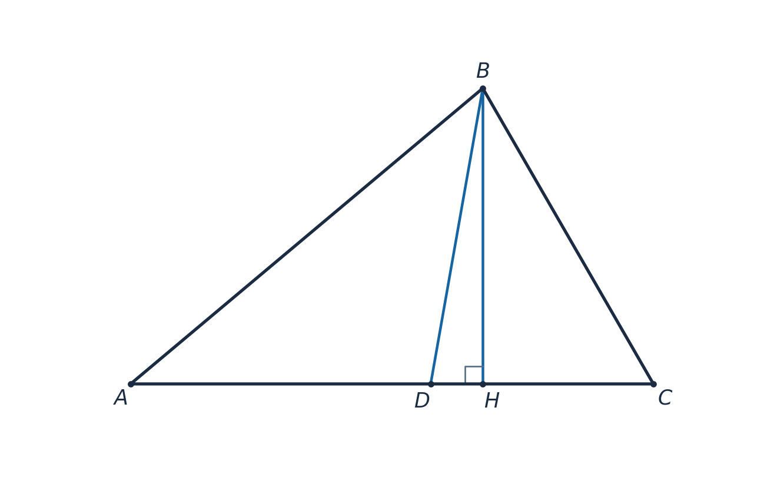

Подсказка 1

Запиши угол при вершине как разность 180° и суммы двух данных углов.

Подсказка 2

Отсчитай углы высоты и биссектрисы от одного луча.

Ответ для самопроверки

$10^\circ$.

Разбор и критерии

1. Сумма углов треугольника даёт $\angle ABC=80^\circ$, поэтому $\angle ABD=40^\circ$.
2. Так как $BH\perp AC$, в прямоугольном треугольнике $ABH$ имеем $\angle ABH=90^\circ-40^\circ=50^\circ$.
3. Искомый угол образуют два луча, расположенные внутри $\angle ABC$ по одну сторону от луча $BA$, поэтому $\angle HBD=50^\circ-40^\circ=10^\circ$.

**Критерии**

- **2 балла.** Обосновано верное решение, получен правильный ответ. Оба угла отсчитаны от BA, их разность вычислена верно.
- **1 балл.** Решение в целом верное, есть несущественный недостаток или вычислительная ошибка. Верная угловая схема с единичной вычислительной ошибкой.
- **0 баллов.** Решение не удовлетворяет условиям для 1 или 2 баллов. Углы от одного и того же луча сложены без основания и другого доказательства нет.

[Источник карточки](https://math-oge.sdamgia.ru/problem?id=315053)

### Задача 2 · 154

В треугольнике ABC углы при A и C равны 20° и 60°. Из B к стороне AC проведены высота BH и биссектриса BD. Найдите угол HBD.

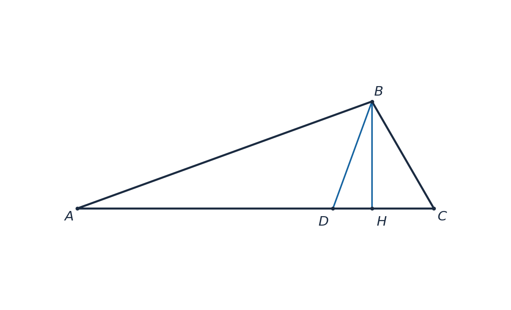

Подсказка 1

Запиши угол при вершине как разность 180° и суммы двух данных углов.

Подсказка 2

Отсчитай углы высоты и биссектрисы от одного луча.

Ответ для самопроверки

$20$°

Разбор и критерии

1. Угол ABC равен 100°, поэтому ∠ABD = 50°.
2. Из BH ⟂ AC следует ∠ABH = 90° − 20° = 70°. Лучи BH и BD лежат внутри одного угла ABC. Искомый угол равен модулю разности $20$°.

**Критерии**

- **2 балла.** Обосновано верное решение, получен правильный ответ. Сопоставить направления лучей через углы при основании и половину угла вершины
- **1 балл.** Решение в целом верное, есть несущественный недостаток или вычислительная ошибка. Геометрический ход и основное равенство установлены, но есть вычислительный сбой или малая неточность оформления.
- **0 баллов.** Решение не удовлетворяет условиям для 1 или 2 баллов. Требуемый переход не доказан или взята величина, которую нельзя считать известной из условия.

[Источник карточки](https://math-oge.sdamgia.ru/problem?id=154)

### Задача 3 · 315025

В треугольнике ABC углы при A и C равны 20° и 50°. Из B к стороне AC проведены высота BH и биссектриса BD. Найдите угол HBD.

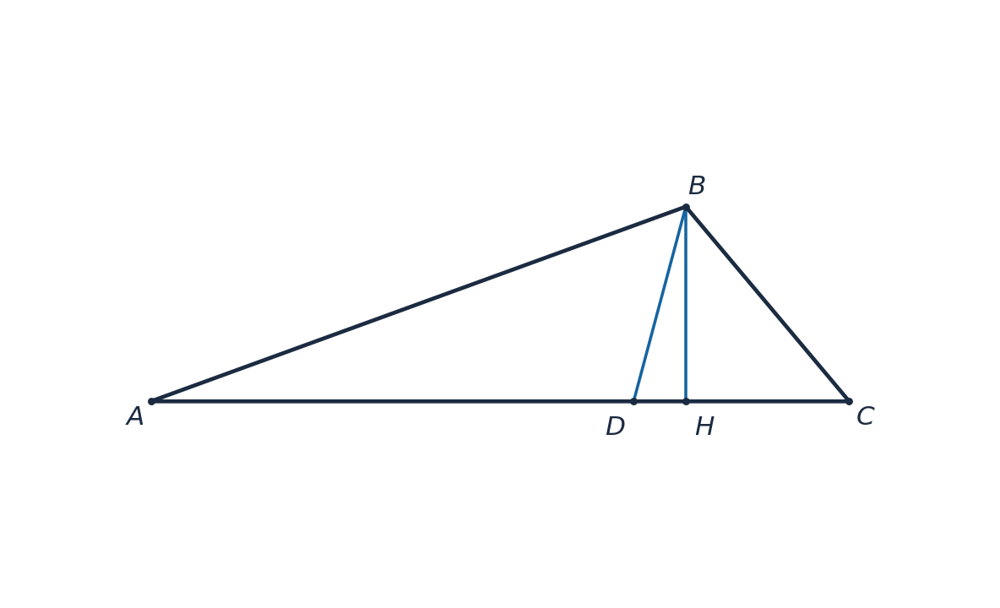

Подсказка 1

Запиши угол при вершине как разность 180° и суммы двух данных углов.

Подсказка 2

Отсчитай углы высоты и биссектрисы от одного луча.

Ответ для самопроверки

$15$°

Разбор и критерии

1. Угол ABC равен 110°, поэтому ∠ABD = 55°.
2. Из BH ⟂ AC следует ∠ABH = 90° − 20° = 70°. Лучи BH и BD лежат внутри одного угла ABC. Искомый угол равен модулю разности $15$°.

**Критерии**

- **2 балла.** Обосновано верное решение, получен правильный ответ. Сопоставить направления лучей через углы при основании и половину угла вершины
- **1 балл.** Решение в целом верное, есть несущественный недостаток или вычислительная ошибка. Геометрический ход и основное равенство установлены, но есть вычислительный сбой или малая неточность оформления.
- **0 баллов.** Решение не удовлетворяет условиям для 1 или 2 баллов. Требуемый переход не доказан или взята величина, которую нельзя считать известной из условия.

[Источник карточки](https://math-oge.sdamgia.ru/problem?id=315025)

### Задача 4 · 315125

В треугольнике ABC углы при A и C равны 30° и 50°. Из B к стороне AC проведены высота BH и биссектриса BD. Найдите угол HBD.

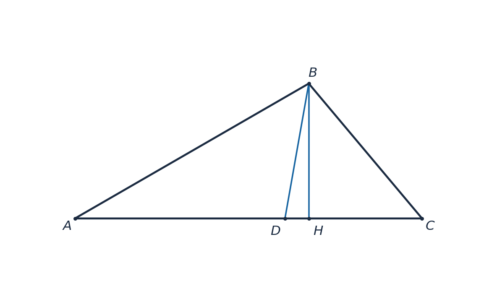

Подсказка 1

Запиши угол при вершине как разность 180° и суммы двух данных углов.

Подсказка 2

Отсчитай углы высоты и биссектрисы от одного луча.

Ответ для самопроверки

$10$°

Разбор и критерии

1. Угол ABC равен 100°, поэтому ∠ABD = 50°.
2. Из BH ⟂ AC следует ∠ABH = 90° − 30° = 60°. Лучи BH и BD лежат внутри одного угла ABC. Искомый угол равен модулю разности $10$°.

**Критерии**

- **2 балла.** Обосновано верное решение, получен правильный ответ. Сопоставить направления лучей через углы при основании и половину угла вершины
- **1 балл.** Решение в целом верное, есть несущественный недостаток или вычислительная ошибка. Геометрический ход и основное равенство установлены, но есть вычислительный сбой или малая неточность оформления.
- **0 баллов.** Решение не удовлетворяет условиям для 1 или 2 баллов. Требуемый переход не доказан или взята величина, которую нельзя считать известной из условия.

[Источник карточки](https://math-oge.sdamgia.ru/problem?id=315125)

### Задача 5 · авторская тренировка

В треугольнике ABC углы при A и C равны 37° и 71°. Из B к стороне AC проведены высота BH и биссектриса BD. Найдите угол HBD.

Подсказка 1

Запиши угол при вершине как разность 180° и суммы двух данных углов.

Подсказка 2

Отсчитай углы высоты и биссектрисы от одного луча.

Ответ для самопроверки

$17$°

Разбор и критерии

1. Угол ABC равен 72°, поэтому ∠ABD = 36°.
2. Из BH ⟂ AC следует ∠ABH = 90° − 37° = 53°. Лучи BH и BD лежат внутри одного угла ABC. Искомый угол равен модулю разности $17$°.

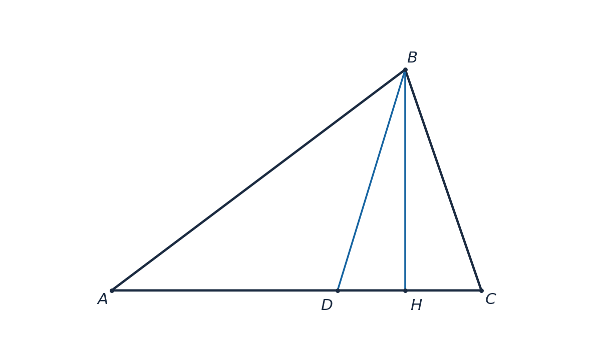

**Критерии**

- **2 балла.** Обосновано верное решение, получен правильный ответ. Сопоставить направления лучей через углы при основании и половину угла вершины
- **1 балл.** Решение в целом верное, есть несущественный недостаток или вычислительная ошибка. Геометрический ход и основное равенство установлены, но есть вычислительный сбой или малая неточность оформления.
- **0 баллов.** Решение не удовлетворяет условиям для 1 или 2 баллов. Требуемый переход не доказан или взята величина, которую нельзя считать известной из условия.

[Пример семейства](https://math-oge.sdamgia.ru/problem?id=315053)

### Задача 6 · авторская тренировка

В треугольнике ABC углы при A и C равны 63° и 29°. Из B к стороне AC проведены высота BH и биссектриса BD. Найдите угол HBD.

Подсказка 1

Запиши угол при вершине как разность 180° и суммы двух данных углов.

Подсказка 2

Отсчитай углы высоты и биссектрисы от одного луча.

Ответ для самопроверки

$17$°

Разбор и критерии

1. Угол ABC равен 88°, поэтому ∠ABD = 44°.
2. Из BH ⟂ AC следует ∠ABH = 90° − 63° = 27°. Лучи BH и BD лежат внутри одного угла ABC. Искомый угол равен модулю разности $17$°.

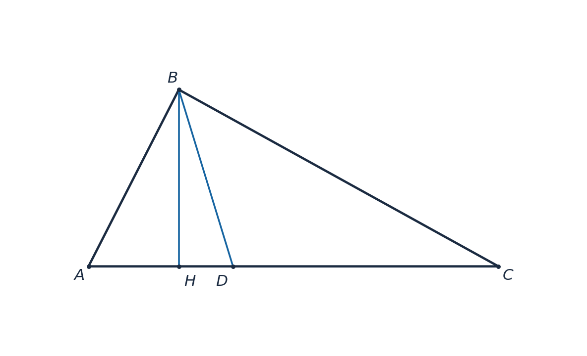

**Критерии**

- **2 балла.** Обосновано верное решение, получен правильный ответ. Сопоставить направления лучей через углы при основании и половину угла вершины
- **1 балл.** Решение в целом верное, есть несущественный недостаток или вычислительная ошибка. Геометрический ход и основное равенство установлены, но есть вычислительный сбой или малая неточность оформления.
- **0 баллов.** Решение не удовлетворяет условиям для 1 или 2 баллов. Требуемый переход не доказан или взята величина, которую нельзя считать известной из условия.

[Пример семейства](https://math-oge.sdamgia.ru/problem?id=315053)

## Углы · Касательная, радиус и дуга

`OGE23-angle-tangent-arc`

### Задача 1 · 76

Луч CA касается окружности с центром O в точке A. Точка D — дальнее от C пересечение луча CO с окружностью. Дуга AD внутри угла ACO равна 100°. Найдите угол ACO.

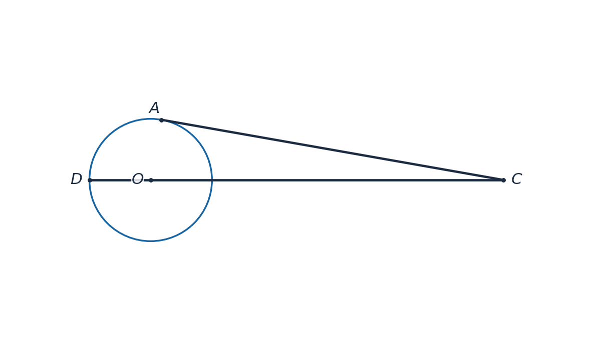

Подсказка 1

Проведи радиус в точку касания.

Подсказка 2

Вырази угол при центре через дугу и воспользуйся прямоугольным треугольником.

Ответ для самопроверки

$10$°

Разбор и критерии

1. Дуга AD задаёт центральный угол AOD = 100°. Лучи OD и OC противоположны, поэтому ∠AOC = 80°.
2. Радиус OA перпендикулярен касательной CA. В прямоугольном треугольнике AOC третий угол равен 90° − 80° = 10°.

**Критерии**

- **2 балла.** Обосновано верное решение, получен правильный ответ. Восстановить центральный угол и применить перпендикулярность радиуса касательной
- **1 балл.** Решение в целом верное, есть несущественный недостаток или вычислительная ошибка. Геометрический ход и основное равенство установлены, но есть вычислительный сбой или малая неточность оформления.
- **0 баллов.** Решение не удовлетворяет условиям для 1 или 2 баллов. Требуемый переход не доказан или взята величина, которую нельзя считать известной из условия.

[Источник карточки](https://math-oge.sdamgia.ru/problem?id=76)

### Задача 2 · 206

Луч CA касается окружности с центром O в точке A. Точка D — дальнее от C пересечение луча CO с окружностью. Дуга AD внутри угла ACO равна 140°. Найдите угол ACO.

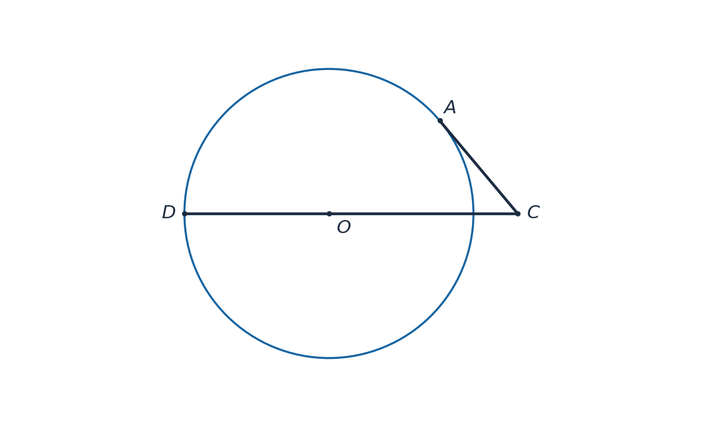

Подсказка 1

Проведи радиус в точку касания.

Подсказка 2

Вырази угол при центре через дугу и воспользуйся прямоугольным треугольником.

Ответ для самопроверки

$50$°

Разбор и критерии

1. Дуга AD задаёт центральный угол AOD = 140°. Лучи OD и OC противоположны, поэтому ∠AOC = 40°.
2. Радиус OA перпендикулярен касательной CA. В прямоугольном треугольнике AOC третий угол равен 90° − 40° = 50°.

**Критерии**

- **2 балла.** Обосновано верное решение, получен правильный ответ. Восстановить центральный угол и применить перпендикулярность радиуса касательной
- **1 балл.** Решение в целом верное, есть несущественный недостаток или вычислительная ошибка. Геометрический ход и основное равенство установлены, но есть вычислительный сбой или малая неточность оформления.
- **0 баллов.** Решение не удовлетворяет условиям для 1 или 2 баллов. Требуемый переход не доказан или взята величина, которую нельзя считать известной из условия.

[Источник карточки](https://math-oge.sdamgia.ru/problem?id=206)

### Задача 3 · 315034

Луч CA касается окружности с центром O в точке A. Точка D — дальнее от C пересечение луча CO с окружностью. Дуга AD внутри угла ACO равна 110°. Найдите угол ACO.

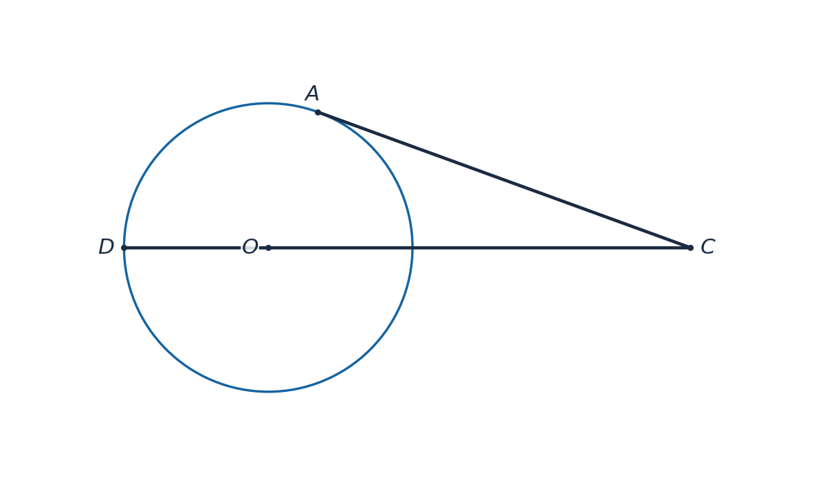

Подсказка 1

Проведи радиус в точку касания.

Подсказка 2

Вырази угол при центре через дугу и воспользуйся прямоугольным треугольником.

Ответ для самопроверки

$20$°

Разбор и критерии

1. Дуга AD задаёт центральный угол AOD = 110°. Лучи OD и OC противоположны, поэтому ∠AOC = 70°.
2. Радиус OA перпендикулярен касательной CA. В прямоугольном треугольнике AOC третий угол равен 90° − 70° = 20°.

**Критерии**

- **2 балла.** Обосновано верное решение, получен правильный ответ. Восстановить центральный угол и применить перпендикулярность радиуса касательной
- **1 балл.** Решение в целом верное, есть несущественный недостаток или вычислительная ошибка. Геометрический ход и основное равенство установлены, но есть вычислительный сбой или малая неточность оформления.
- **0 баллов.** Решение не удовлетворяет условиям для 1 или 2 баллов. Требуемый переход не доказан или взята величина, которую нельзя считать известной из условия.

[Источник карточки](https://math-oge.sdamgia.ru/problem?id=315034)

### Задача 4 · 315059

Луч CA касается окружности с центром O в точке A. Точка D — дальнее от C пересечение луча CO с окружностью. Дуга AD внутри угла ACO равна 130°. Найдите угол ACO.

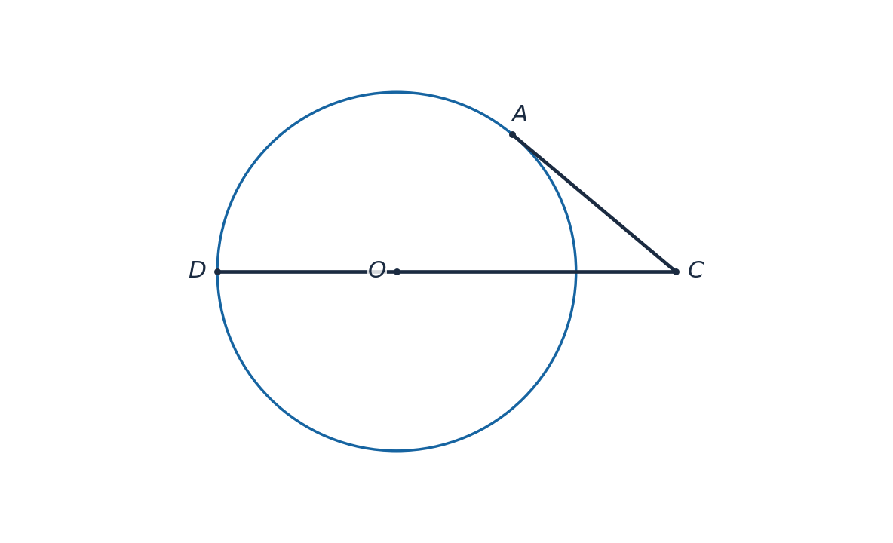

Подсказка 1

Проведи радиус в точку касания.

Подсказка 2

Вырази угол при центре через дугу и воспользуйся прямоугольным треугольником.

Ответ для самопроверки

$40$°

Разбор и критерии

1. Дуга AD задаёт центральный угол AOD = 130°. Лучи OD и OC противоположны, поэтому ∠AOC = 50°.
2. Радиус OA перпендикулярен касательной CA. В прямоугольном треугольнике AOC третий угол равен 90° − 50° = 40°.

**Критерии**

- **2 балла.** Обосновано верное решение, получен правильный ответ. Восстановить центральный угол и применить перпендикулярность радиуса касательной
- **1 балл.** Решение в целом верное, есть несущественный недостаток или вычислительная ошибка. Геометрический ход и основное равенство установлены, но есть вычислительный сбой или малая неточность оформления.
- **0 баллов.** Решение не удовлетворяет условиям для 1 или 2 баллов. Требуемый переход не доказан или взята величина, которую нельзя считать известной из условия.

[Источник карточки](https://math-oge.sdamgia.ru/problem?id=315059)

### Задача 5 · авторская тренировка

Луч CA касается окружности с центром O в точке A. Точка D — дальнее от C пересечение луча CO с окружностью. Дуга AD внутри угла ACO равна 123°. Найдите угол ACO.

Подсказка 1

Проведи радиус в точку касания.

Подсказка 2

Вырази угол при центре через дугу и воспользуйся прямоугольным треугольником.

Ответ для самопроверки

$33$°

Разбор и критерии

1. Дуга AD задаёт центральный угол AOD = 123°. Лучи OD и OC противоположны, поэтому ∠AOC = 57°.
2. Радиус OA перпендикулярен касательной CA. В прямоугольном треугольнике AOC третий угол равен 90° − 57° = 33°.

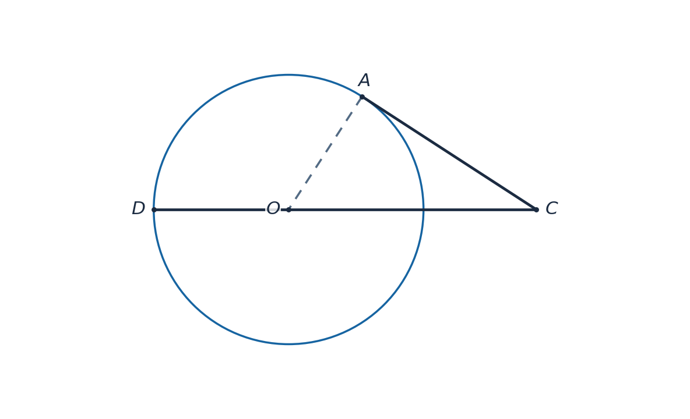

**Критерии**

- **2 балла.** Обосновано верное решение, получен правильный ответ. Восстановить центральный угол и применить перпендикулярность радиуса касательной
- **1 балл.** Решение в целом верное, есть несущественный недостаток или вычислительная ошибка. Геометрический ход и основное равенство установлены, но есть вычислительный сбой или малая неточность оформления.
- **0 баллов.** Решение не удовлетворяет условиям для 1 или 2 баллов. Требуемый переход не доказан или взята величина, которую нельзя считать известной из условия.

[Пример семейства](https://math-oge.sdamgia.ru/problem?id=76)

### Задача 6 · авторская тренировка

Луч CA касается окружности с центром O в точке A. Луч CO впервые пересекает окружность в D. Меньшая дуга AD равна 52°. Найдите угол ACO.

Подсказка 1

Проведи радиус в точку касания.

Подсказка 2

Вырази угол при центре через дугу и воспользуйся прямоугольным треугольником.

Ответ для самопроверки

38°

Разбор и критерии

1. D находится на луче OC, поэтому угол AOC равен центральному углу AOD, то есть 52°.
2. Радиус OA перпендикулярен касательной CA. Поэтому угол при C равен 90°−52° = 38°.

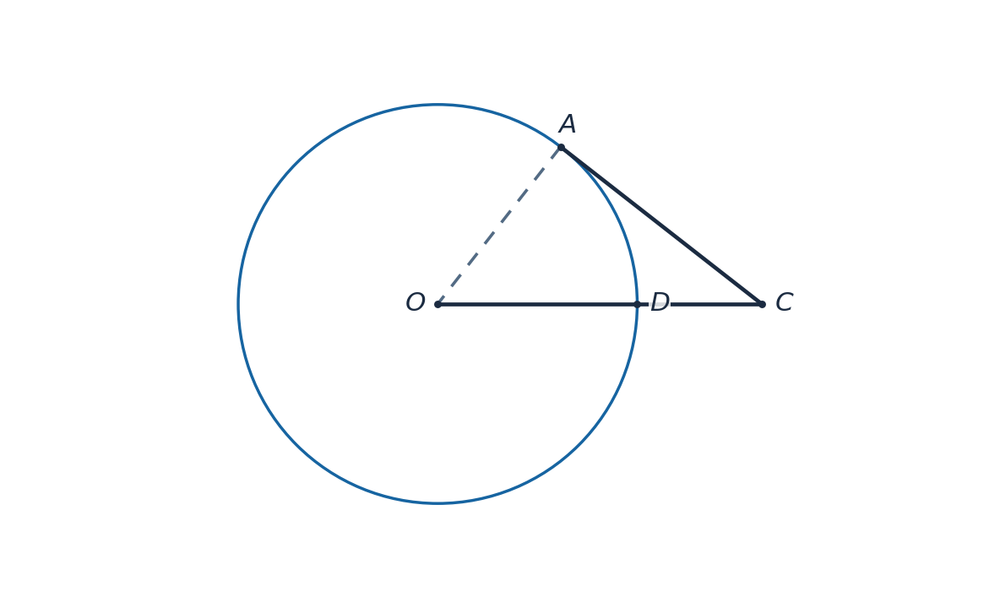

**Критерии**

- **2 балла.** Обосновано верное решение, получен правильный ответ. Восстановить центральный угол и применить перпендикулярность радиуса касательной
- **1 балл.** Решение в целом верное, есть несущественный недостаток или вычислительная ошибка. Геометрический ход и основное равенство установлены, но есть вычислительный сбой или малая неточность оформления.
- **0 баллов.** Решение не удовлетворяет условиям для 1 или 2 баллов. Требуемый переход не доказан или взята величина, которую нельзя считать известной из условия.

[Пример семейства](https://math-oge.sdamgia.ru/problem?id=76)

## Прямоугольная конфигурация · Медиана к гипотенузе

`OGE23-right-median`

### Задача 1 · 50

Катеты прямоугольного треугольника ABC равны AC = 6 и BC = 8. Найдите длину медианы CK к гипотенузе.

Подсказка 1

Найди длину гипотенузы.

Подсказка 2

В прямоугольном треугольнике середина гипотенузы равноудалена от трёх вершин.

Ответ для самопроверки

$5$

Разбор и критерии

1. По теореме Пифагора гипотенуза AB равна $10=10$.
2. К — середина гипотенузы и центр описанной окружности. Поэтому CK = AB/2 = $5$.

**Критерии**

- **2 балла.** Обосновано верное решение, получен правильный ответ. Пифагор вычисляет гипотенузу, медиана равна её половине
- **1 балл.** Решение в целом верное, есть несущественный недостаток или вычислительная ошибка. Геометрический ход и основное равенство установлены, но есть вычислительный сбой или малая неточность оформления.
- **0 баллов.** Решение не удовлетворяет условиям для 1 или 2 баллов. Требуемый переход не доказан или взята величина, которую нельзя считать известной из условия.

[Источник карточки](https://math-oge.sdamgia.ru/problem?id=50)

### Задача 2 · авторская тренировка

Катеты прямоугольного треугольника ABC равны AC = 9 и BC = 12. Найдите длину медианы CK к гипотенузе.

Подсказка 1

Найди длину гипотенузы.

Подсказка 2

В прямоугольном треугольнике середина гипотенузы равноудалена от трёх вершин.

Ответ для самопроверки

$\frac{15}{2}$

Разбор и критерии

1. По теореме Пифагора гипотенуза AB равна $15=15$.
2. К — середина гипотенузы и центр описанной окружности. Поэтому CK = AB/2 = $\frac{15}{2}$.

**Критерии**

- **2 балла.** Обосновано верное решение, получен правильный ответ. Пифагор вычисляет гипотенузу, медиана равна её половине
- **1 балл.** Решение в целом верное, есть несущественный недостаток или вычислительная ошибка. Геометрический ход и основное равенство установлены, но есть вычислительный сбой или малая неточность оформления.
- **0 баллов.** Решение не удовлетворяет условиям для 1 или 2 баллов. Требуемый переход не доказан или взята величина, которую нельзя считать известной из условия.

[Пример семейства](https://math-oge.sdamgia.ru/problem?id=50)

### Задача 3 · авторская тренировка

Катеты прямоугольного треугольника ABC равны AC = 5 и BC = 7. Найдите длину медианы CK к гипотенузе.

Подсказка 1

Найди длину гипотенузы.

Подсказка 2

В прямоугольном треугольнике середина гипотенузы равноудалена от трёх вершин.

Ответ для самопроверки

$\frac{\sqrt{74}}{2}$

Разбор и критерии

1. По теореме Пифагора гипотенуза AB равна $\sqrt{74}=\sqrt{74}$.
2. К — середина гипотенузы и центр описанной окружности. Поэтому CK = AB/2 = $\frac{\sqrt{74}}{2}$.

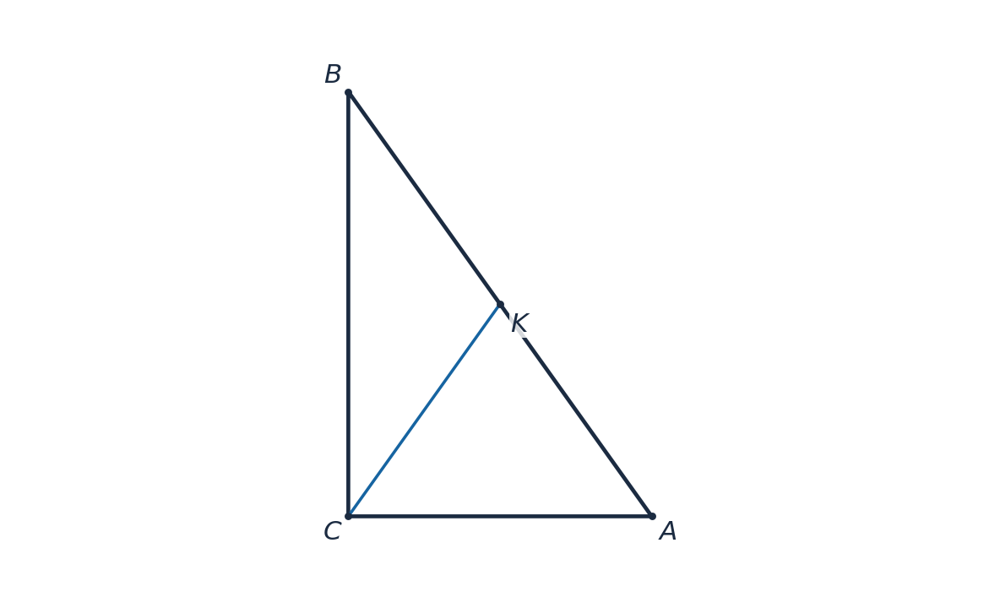

**Критерии**

- **2 балла.** Обосновано верное решение, получен правильный ответ. Пифагор вычисляет гипотенузу, медиана равна её половине
- **1 балл.** Решение в целом верное, есть несущественный недостаток или вычислительная ошибка. Геометрический ход и основное равенство установлены, но есть вычислительный сбой или малая неточность оформления.
- **0 баллов.** Решение не удовлетворяет условиям для 1 или 2 баллов. Требуемый переход не доказан или взята величина, которую нельзя считать известной из условия.

[Пример семейства](https://math-oge.sdamgia.ru/problem?id=50)

### Задача 4 · авторская тренировка

В треугольнике ABC угол C прямой. Медиана CK к гипотенузе равна 6,5, а катет BC равен 5. Найдите AC.

Подсказка 1

Найди длину гипотенузы.

Подсказка 2

В прямоугольном треугольнике середина гипотенузы равноудалена от трёх вершин.

Ответ для самопроверки

$12$

Разбор и критерии

1. Медиана из прямого угла равна половине гипотенузы. Поэтому AB = 2·6,5 = 13.
2. По теореме Пифагора AC² = 13²−5² = 144. Отсюда AC = 12.

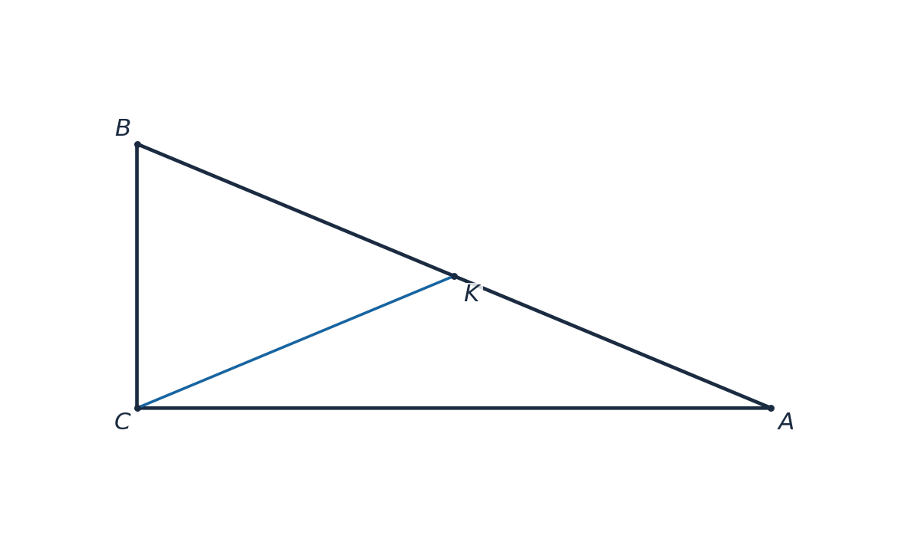

**Критерии**

- **2 балла.** Обосновано верное решение, получен правильный ответ. Пифагор вычисляет гипотенузу, медиана равна её половине
- **1 балл.** Решение в целом верное, есть несущественный недостаток или вычислительная ошибка. Геометрический ход и основное равенство установлены, но есть вычислительный сбой или малая неточность оформления.
- **0 баллов.** Решение не удовлетворяет условиям для 1 или 2 баллов. Требуемый переход не доказан или взята величина, которую нельзя считать известной из условия.

[Пример семейства](https://math-oge.sdamgia.ru/problem?id=50)

### Задача 5 · авторская тренировка

Площадь треугольника ABC с прямым углом C равна 40. Катет AC равен 8. Найдите длину медианы CK к гипотенузе.

Подсказка 1

Найди длину гипотенузы.

Подсказка 2

В прямоугольном треугольнике середина гипотенузы равноудалена от трёх вершин.

Ответ для самопроверки

$\sqrt{41}$

Разбор и критерии

1. У катетов AC и BC прямой угол, значит площадь равна AC·BC/2. Отсюда BC = 2·40/8 = 10.
2. Тогда AB = √(8²+10²) = 2√41. Медиана CK равна половине гипотенузы, то есть √41.

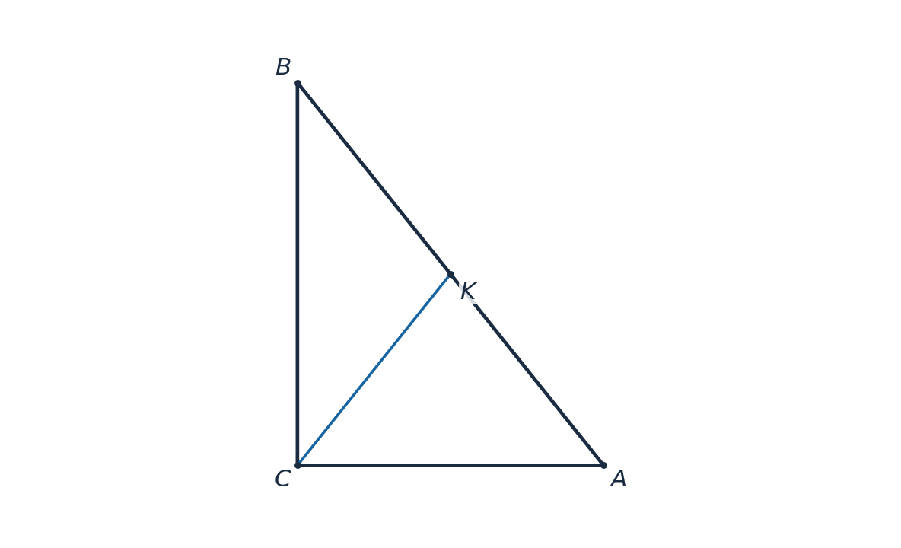

**Критерии**

- **2 балла.** Обосновано верное решение, получен правильный ответ. Пифагор вычисляет гипотенузу, медиана равна её половине
- **1 балл.** Решение в целом верное, есть несущественный недостаток или вычислительная ошибка. Геометрический ход и основное равенство установлены, но есть вычислительный сбой или малая неточность оформления.
- **0 баллов.** Решение не удовлетворяет условиям для 1 или 2 баллов. Требуемый переход не доказан или взята величина, которую нельзя считать известной из условия.

[Пример семейства](https://math-oge.sdamgia.ru/problem?id=50)

### Задача 6 · авторская тренировка

Катеты прямоугольного треугольника ABC с углом C относятся как 3:4. Периметр треугольника равен 60. Найдите медиану CK к гипотенузе.

Подсказка 1

Найди длину гипотенузы.

Подсказка 2

В прямоугольном треугольнике середина гипотенузы равноудалена от трёх вершин.

Ответ для самопроверки

$\frac{25}{2}$

Разбор и критерии

1. Пусть катеты равны 3t и 4t. Теорема Пифагора даёт гипотенузу 5t.
2. Периметр 12t = 60, поэтому t = 5, а AB = 25. Медиана к гипотенузе равна 25/2.

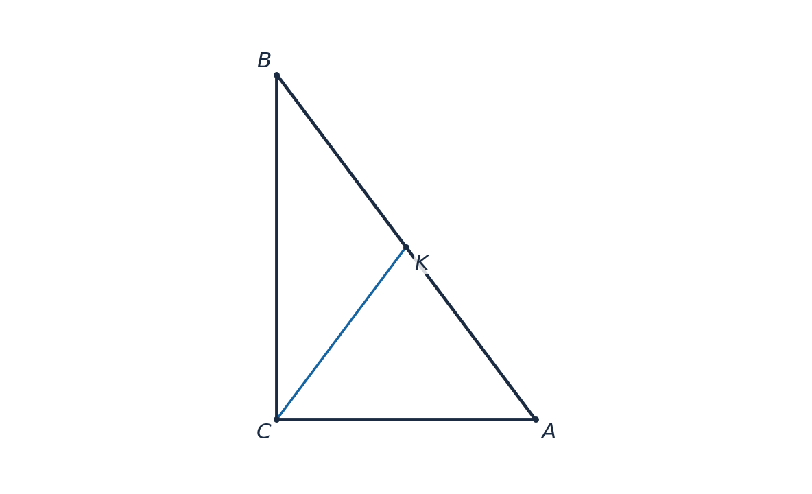

**Критерии**

- **2 балла.** Обосновано верное решение, получен правильный ответ. Пифагор вычисляет гипотенузу, медиана равна её половине
- **1 балл.** Решение в целом верное, есть несущественный недостаток или вычислительная ошибка. Геометрический ход и основное равенство установлены, но есть вычислительный сбой или малая неточность оформления.
- **0 баллов.** Решение не удовлетворяет условиям для 1 или 2 баллов. Требуемый переход не доказан или взята величина, которую нельзя считать известной из условия.

[Пример семейства](https://math-oge.sdamgia.ru/problem?id=50)

## Прямоугольная конфигурация · Катет и его проекция

`OGE23-right-projection`

### Задача 1 · 324708

В треугольнике $ABC$ угол $B$ прямой. Высота $BH$ падает на гипотенузу $AC$. Найдите $AB$, если $AH=6$ и $AC=24$.

Подсказка 1

Сравни прямоугольный треугольник со стороной, которую нужно найти, и весь треугольник.

Подсказка 2

Квадрат катета равен произведению гипотенузы на его проекцию.

Ответ для самопроверки

$12$.

Разбор и критерии

1. Прямоугольные треугольники $AHB$ и $ABC$ имеют общий угол $A$ и подобны.
2. В первом гипотенуза $AB$, во втором $AC$, а катеты, прилежащие к $A$, равны $AH$ и $AB$.
3. Получаем $AH/AB=AB/AC$.
4. Отсюда $AB=\sqrt{6\cdot24}=12$.

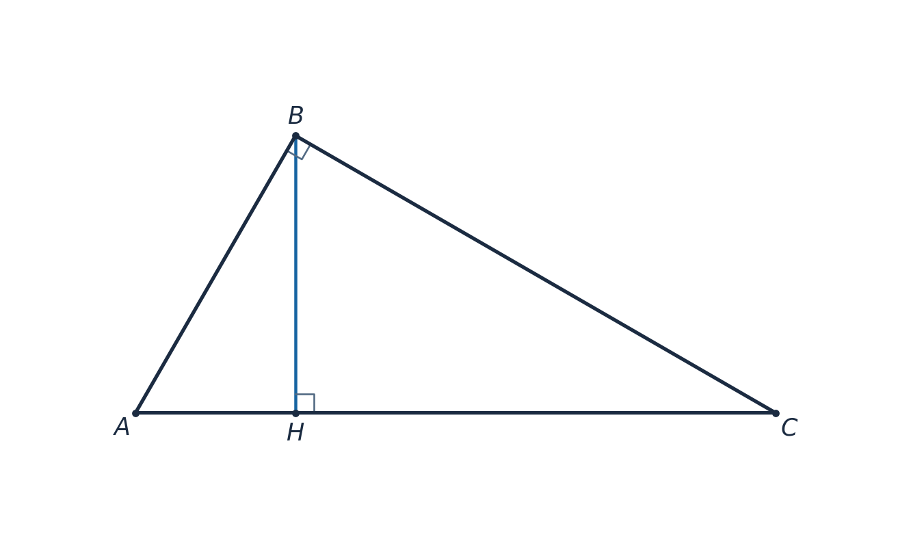

**Критерии**

- **2 балла.** Обосновано верное решение, получен правильный ответ. Обоснована формула AB²=AH·AC или приведено корректное эквивалентное решение, ответ 12.
- **1 балл.** Решение в целом верное, есть несущественный недостаток или вычислительная ошибка. Соотношение получено правильно, вычисление ошибочно.
- **0 баллов.** Решение не удовлетворяет условиям для 1 или 2 баллов. Перепутаны проекция катета и высота, верного пути нет.

[Источник карточки](https://math-oge.sdamgia.ru/problem?id=324708)

### Задача 2 · 353514

У треугольника ABC угол B прямой. Высота BH опущена на гипотенузу AC. Найдите AB, если AH = 8, AC = 32.

Подсказка 1

Сравни прямоугольный треугольник со стороной, которую нужно найти, и весь треугольник.

Подсказка 2

Квадрат катета равен произведению гипотенузы на его проекцию.

Ответ для самопроверки

$16$

Разбор и критерии

1. Треугольники AHB и ABC прямоугольные и имеют общий угол A. Они подобны. Соответствующие гипотенузы — AB и AC, прилежащие катеты — AH и AB.
2. Из AH/AB = AB/AC выходит $AB^2=8\cdot 32$. Положительное значение AB равно $16$.

**Критерии**

- **2 балла.** Обосновано верное решение, получен правильный ответ. Подобие малого и исходного треугольников даёт квадрат катета
- **1 балл.** Решение в целом верное, есть несущественный недостаток или вычислительная ошибка. Геометрический ход и основное равенство установлены, но есть вычислительный сбой или малая неточность оформления.
- **0 баллов.** Решение не удовлетворяет условиям для 1 или 2 баллов. Требуемый переход не доказан или взята величина, которую нельзя считать известной из условия.

[Источник карточки](https://math-oge.sdamgia.ru/problem?id=353514)

### Задача 3 · 352999

У треугольника ABC угол B прямой. Высота BH опущена на гипотенузу AC. Найдите AB, если AH = 9, AC = 36.

Подсказка 1

Сравни прямоугольный треугольник со стороной, которую нужно найти, и весь треугольник.

Подсказка 2

Квадрат катета равен произведению гипотенузы на его проекцию.

Ответ для самопроверки

$18$

Разбор и критерии

1. Треугольники AHB и ABC прямоугольные и имеют общий угол A. Они подобны. Соответствующие гипотенузы — AB и AC, прилежащие катеты — AH и AB.
2. Из AH/AB = AB/AC выходит $AB^2=9\cdot 36$. Положительное значение AB равно $18$.

**Критерии**

- **2 балла.** Обосновано верное решение, получен правильный ответ. Подобие малого и исходного треугольников даёт квадрат катета
- **1 балл.** Решение в целом верное, есть несущественный недостаток или вычислительная ошибка. Геометрический ход и основное равенство установлены, но есть вычислительный сбой или малая неточность оформления.
- **0 баллов.** Решение не удовлетворяет условиям для 1 или 2 баллов. Требуемый переход не доказан или взята величина, которую нельзя считать известной из условия.

[Источник карточки](https://math-oge.sdamgia.ru/problem?id=352999)

### Задача 4 · 6380F3

У треугольника ABC угол B прямой. Высота BH опущена на гипотенузу AC. Найдите AB, если AH = 7, AC = 28.

Подсказка 1

Сравни прямоугольный треугольник со стороной, которую нужно найти, и весь треугольник.

Подсказка 2

Квадрат катета равен произведению гипотенузы на его проекцию.

Ответ для самопроверки

$14$

Разбор и критерии

1. Треугольники AHB и ABC прямоугольные и имеют общий угол A. Они подобны. Соответствующие гипотенузы — AB и AC, прилежащие катеты — AH и AB.
2. Из AH/AB = AB/AC выходит $AB^2=7\cdot 28$. Положительное значение AB равно $14$.

**Критерии**

- **2 балла.** Обосновано верное решение, получен правильный ответ. Подобие малого и исходного треугольников даёт квадрат катета
- **1 балл.** Решение в целом верное, есть несущественный недостаток или вычислительная ошибка. Геометрический ход и основное равенство установлены, но есть вычислительный сбой или малая неточность оформления.
- **0 баллов.** Решение не удовлетворяет условиям для 1 или 2 баллов. Требуемый переход не доказан или взята величина, которую нельзя считать известной из условия.

[Источник карточки](https://sdamgia.online/oge/matematika/zadanie-23/katet-po-gipotenuze-i-proekcii-fipi-6380f3) · Код 6380F3 по каталогу sdamgia.online

### Задача 5 · C3F608

У треугольника ABC угол B прямой. Высота BH опущена на гипотенузу AC. Найдите AB, если AH = 4, AC = 16.

Подсказка 1

Сравни прямоугольный треугольник со стороной, которую нужно найти, и весь треугольник.

Подсказка 2

Квадрат катета равен произведению гипотенузы на его проекцию.

Ответ для самопроверки

$8$

Разбор и критерии

1. Треугольники AHB и ABC прямоугольные и имеют общий угол A. Они подобны. Соответствующие гипотенузы — AB и AC, прилежащие катеты — AH и AB.
2. Из AH/AB = AB/AC выходит $AB^2=4\cdot 16$. Положительное значение AB равно $8$.

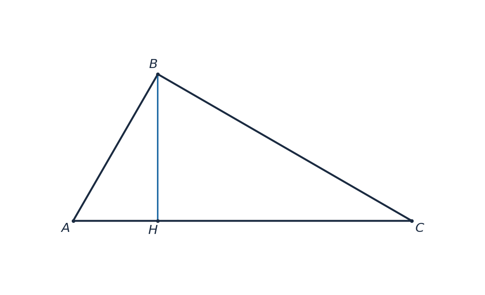

**Критерии**

- **2 балла.** Обосновано верное решение, получен правильный ответ. Подобие малого и исходного треугольников даёт квадрат катета
- **1 балл.** Решение в целом верное, есть несущественный недостаток или вычислительная ошибка. Геометрический ход и основное равенство установлены, но есть вычислительный сбой или малая неточность оформления.
- **0 баллов.** Решение не удовлетворяет условиям для 1 или 2 баллов. Требуемый переход не доказан или взята величина, которую нельзя считать известной из условия.

[Источник карточки](https://sdamgia.online/oge/matematika/zadanie-23/katet-po-gipotenuze-i-proekcii-fipi-c3f608) · Код C3F608 по каталогу sdamgia.online

### Задача 6 · D35E73

У треугольника ABC угол B прямой. Высота BH опущена на гипотенузу AC. Найдите AB, если AH = 5, AC = 45.

Подсказка 1

Сравни прямоугольный треугольник со стороной, которую нужно найти, и весь треугольник.

Подсказка 2

Квадрат катета равен произведению гипотенузы на его проекцию.

Ответ для самопроверки

$15$

Разбор и критерии

1. Треугольники AHB и ABC прямоугольные и имеют общий угол A. Они подобны. Соответствующие гипотенузы — AB и AC, прилежащие катеты — AH и AB.
2. Из AH/AB = AB/AC выходит $AB^2=5\cdot 45$. Положительное значение AB равно $15$.

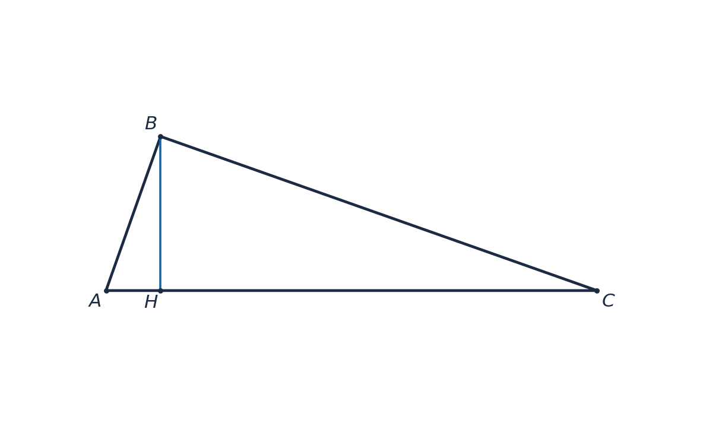

**Критерии**

- **2 балла.** Обосновано верное решение, получен правильный ответ. Подобие малого и исходного треугольников даёт квадрат катета
- **1 балл.** Решение в целом верное, есть несущественный недостаток или вычислительная ошибка. Геометрический ход и основное равенство установлены, но есть вычислительный сбой или малая неточность оформления.
- **0 баллов.** Решение не удовлетворяет условиям для 1 или 2 баллов. Требуемый переход не доказан или взята величина, которую нельзя считать известной из условия.

[Источник карточки](https://sdamgia.online/oge/matematika/zadanie-23/katet-po-gipotenuze-i-proekcii-fipi-d35e73) · Код D35E73 по каталогу sdamgia.online

## Прямоугольная конфигурация · Две биссектрисы при боковой стороне

`OGE23-right-bisectors`

### Задача 1 · D23-2027

В трапеции $ABCD$ с основаниями $AD,BC$ биссектрисы углов $A$ и $B$ при боковой стороне $AB$ пересекаются в $F$. Известно, что $AF=12$, $BF=5$. Найдите $AB$.

Подсказка 1

Найди сумму углов трапеции у одной боковой стороны.

Подсказка 2

Сложи их половины, установи прямой угол и примени теорему Пифагора.

Ответ для самопроверки

$13$.

Разбор и критерии

1. Из параллельности $AD$ и $BC$ внутренние односторонние углы $A$ и $B$ дают в сумме $180^\circ$.
2. В треугольнике $AFB$ углы при $A$ и $B$ равны половинам этих углов, их сумма $90^\circ$.
3. Значит, $\angle AFB=90^\circ$, а $AB$ — гипотенуза.
4. По теореме Пифагора $AB=\sqrt{12^2+5^2}=13$.

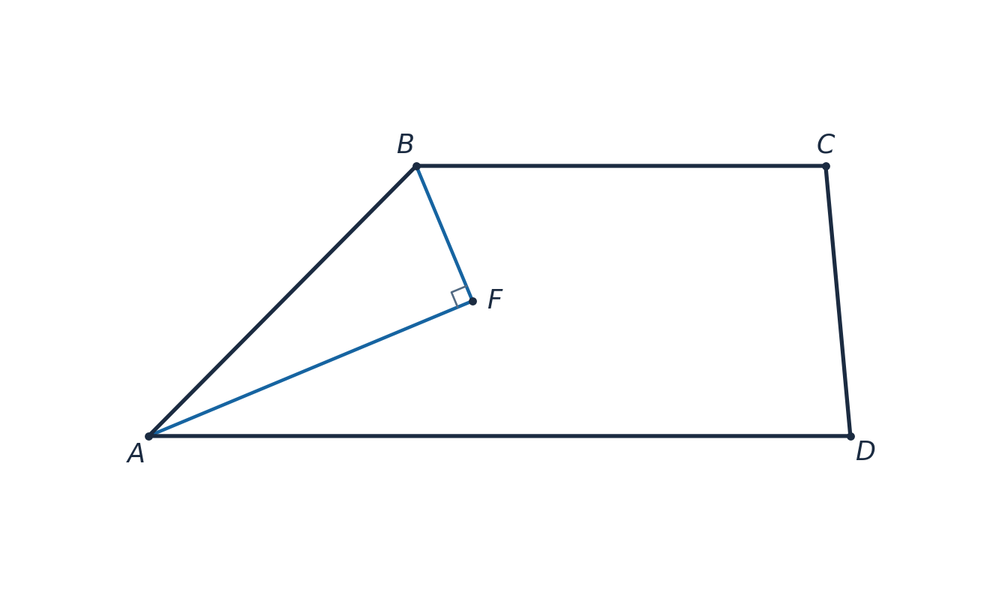

**Критерии**

- **2 балла.** Обосновано верное решение, получен правильный ответ. Обоснован прямой угол при F, затем верно найдена гипотенуза.
- **1 балл.** Решение в целом верное, есть несущественный недостаток или вычислительная ошибка. Обоснована прямоугольность и применена правильная формула, но допущена несущественная описка или арифметическая ошибка.
- **0 баллов.** Решение не удовлетворяет условиям для 1 или 2 баллов. Пифагор применён без установления прямого угла и отсутствует равноценное обоснование.

[Источник карточки](https://doc.fipi.ru/oge/demoversii-specifikacii-kodifikatory/2027/ma_9_2027.zip) · МА-9 ОГЭ 2027_ДЕМО.pdf, печатная стр. 14, решение и шкала на стр. 19

### Задача 2 · 324798

В трапеции ABCD основания AD и BC. Внутренние биссектрисы углов при боковой стороне AB пересекаются в F. Если AF = 24, BF = 32, найдите AB.

Подсказка 1

Найди сумму углов трапеции у одной боковой стороны.

Подсказка 2

Сложи их половины, установи прямой угол и примени теорему Пифагора.

Ответ для самопроверки

$40$

Разбор и критерии

1. Углы при A и B в трапеции в сумме дают 180°. Соответствующие углы треугольника AFB — их половины. Значит, угол при F прямой.
2. AB — гипотенуза этого треугольника. По теореме Пифагора $AB=\sqrt{24^2+32^2}=40$.

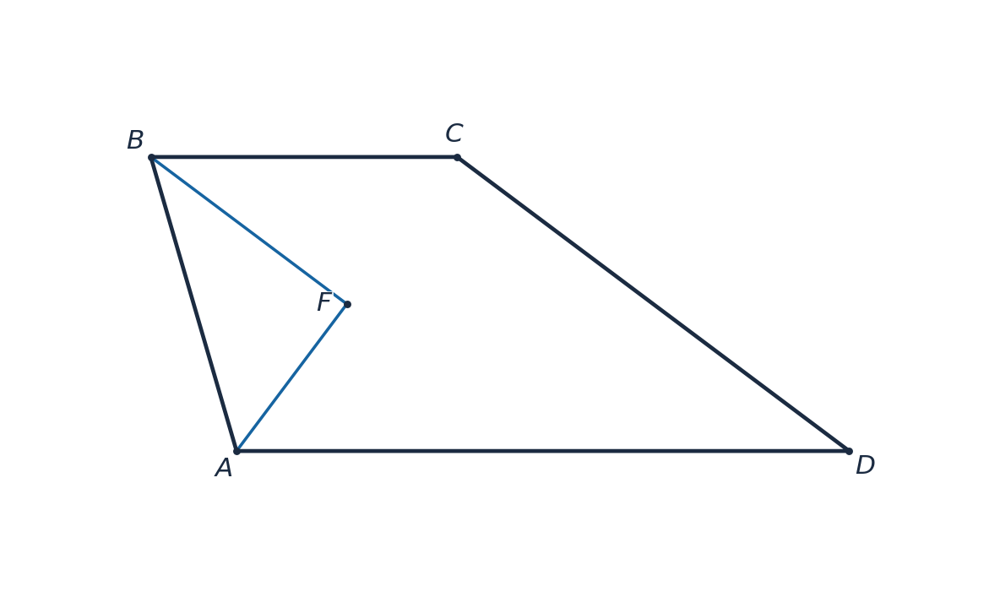

**Критерии**

- **2 балла.** Обосновано верное решение, получен правильный ответ. Половины дополнительных углов дают прямой угол, затем Пифагор
- **1 балл.** Решение в целом верное, есть несущественный недостаток или вычислительная ошибка. Геометрический ход и основное равенство установлены, но есть вычислительный сбой или малая неточность оформления.
- **0 баллов.** Решение не удовлетворяет условиям для 1 или 2 баллов. Требуемый переход не доказан или взята величина, которую нельзя считать известной из условия.

[Источник карточки](https://math-oge.sdamgia.ru/problem?id=324798)

### Задача 3 · 352568

В трапеции ABCD основания AD и BC. Внутренние биссектрисы углов при боковой стороне AB пересекаются в F. Если AF = 20, BF = 15, найдите AB.

Подсказка 1

Найди сумму углов трапеции у одной боковой стороны.

Подсказка 2

Сложи их половины, установи прямой угол и примени теорему Пифагора.

Ответ для самопроверки

$25$

Разбор и критерии

1. Углы при A и B в трапеции в сумме дают 180°. Соответствующие углы треугольника AFB — их половины. Значит, угол при F прямой.
2. AB — гипотенуза этого треугольника. По теореме Пифагора $AB=\sqrt{20^2+15^2}=25$.

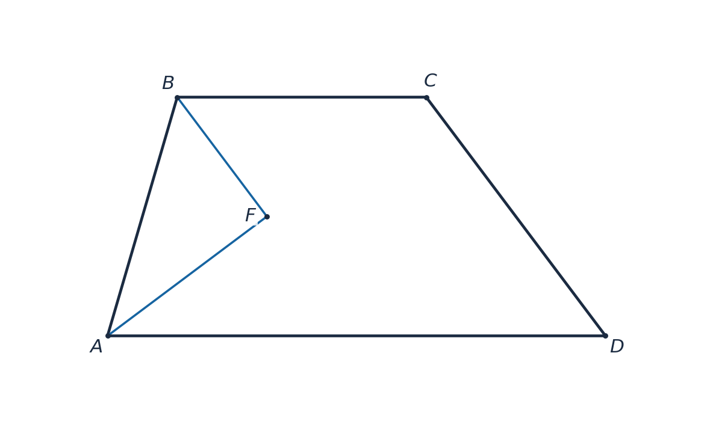

**Критерии**

- **2 балла.** Обосновано верное решение, получен правильный ответ. Половины дополнительных углов дают прямой угол, затем Пифагор
- **1 балл.** Решение в целом верное, есть несущественный недостаток или вычислительная ошибка. Геометрический ход и основное равенство установлены, но есть вычислительный сбой или малая неточность оформления.
- **0 баллов.** Решение не удовлетворяет условиям для 1 или 2 баллов. Требуемый переход не доказан или взята величина, которую нельзя считать известной из условия.

[Источник карточки](https://math-oge.sdamgia.ru/problem?id=352568)

### Задача 4 · 333130

В трапеции ABCD основания AD и BC. Внутренние биссектрисы углов при боковой стороне AB пересекаются в F. Если AF = 24, BF = 10, найдите AB.

Подсказка 1

Найди сумму углов трапеции у одной боковой стороны.

Подсказка 2

Сложи их половины, установи прямой угол и примени теорему Пифагора.

Ответ для самопроверки

$26$

Разбор и критерии

1. Углы при A и B в трапеции в сумме дают 180°. Соответствующие углы треугольника AFB — их половины. Значит, угол при F прямой.
2. AB — гипотенуза этого треугольника. По теореме Пифагора $AB=\sqrt{24^2+10^2}=26$.

**Критерии**

- **2 балла.** Обосновано верное решение, получен правильный ответ. Половины дополнительных углов дают прямой угол, затем Пифагор
- **1 балл.** Решение в целом верное, есть несущественный недостаток или вычислительная ошибка. Геометрический ход и основное равенство установлены, но есть вычислительный сбой или малая неточность оформления.
- **0 баллов.** Решение не удовлетворяет условиям для 1 или 2 баллов. Требуемый переход не доказан или взята величина, которую нельзя считать известной из условия.

[Источник карточки](https://math-oge.sdamgia.ru/problem?id=333130)

### Задача 5 · 333157

В трапеции ABCD основания AD и BC. Внутренние биссектрисы углов при боковой стороне AB пересекаются в F. Если AF = 12, BF = 5, найдите AB.

Подсказка 1

Найди сумму углов трапеции у одной боковой стороны.

Подсказка 2

Сложи их половины, установи прямой угол и примени теорему Пифагора.

Ответ для самопроверки

$13$

Разбор и критерии

1. Углы при A и B в трапеции в сумме дают 180°. Соответствующие углы треугольника AFB — их половины. Значит, угол при F прямой.
2. AB — гипотенуза этого треугольника. По теореме Пифагора $AB=\sqrt{12^2+5^2}=13$.

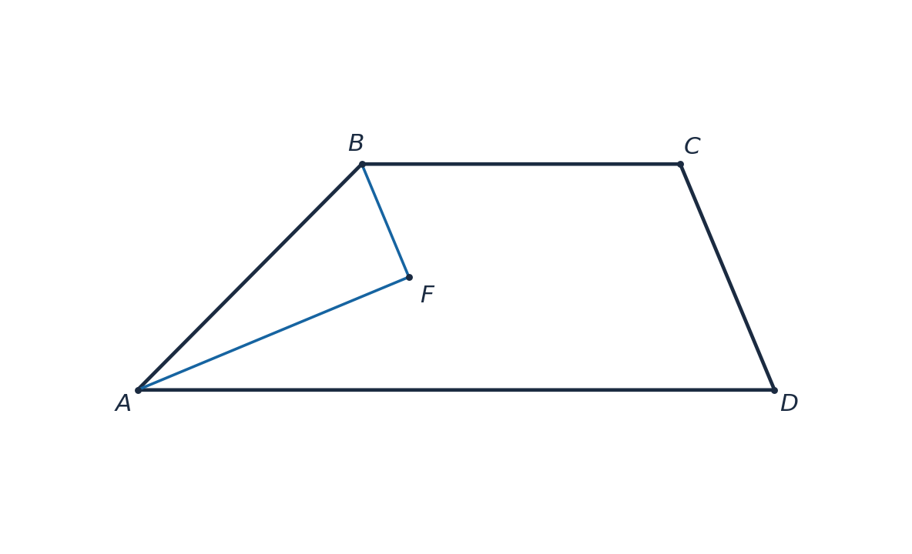

**Критерии**

- **2 балла.** Обосновано верное решение, получен правильный ответ. Половины дополнительных углов дают прямой угол, затем Пифагор
- **1 балл.** Решение в целом верное, есть несущественный недостаток или вычислительная ошибка. Геометрический ход и основное равенство установлены, но есть вычислительный сбой или малая неточность оформления.
- **0 баллов.** Решение не удовлетворяет условиям для 1 или 2 баллов. Требуемый переход не доказан или взята величина, которую нельзя считать известной из условия.

[Источник карточки](https://math-oge.sdamgia.ru/problem?id=333157)

### Задача 6 · 424983

В трапеции ABCD основания AD и BC. Внутренние биссектрисы углов при боковой стороне AB пересекаются в F. Если AF = 24, BF = 7, найдите AB.

Подсказка 1

Найди сумму углов трапеции у одной боковой стороны.

Подсказка 2

Сложи их половины, установи прямой угол и примени теорему Пифагора.

Ответ для самопроверки

$25$

Разбор и критерии

1. Углы при A и B в трапеции в сумме дают 180°. Соответствующие углы треугольника AFB — их половины. Значит, угол при F прямой.
2. AB — гипотенуза этого треугольника. По теореме Пифагора $AB=\sqrt{24^2+7^2}=25$.

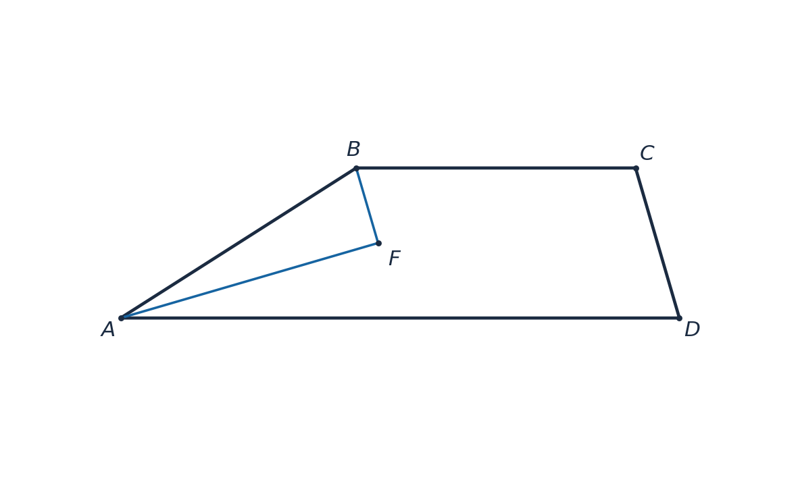

**Критерии**

- **2 балла.** Обосновано верное решение, получен правильный ответ. Половины дополнительных углов дают прямой угол, затем Пифагор
- **1 балл.** Решение в целом верное, есть несущественный недостаток или вычислительная ошибка. Геометрический ход и основное равенство установлены, но есть вычислительный сбой или малая неточность оформления.
- **0 баллов.** Решение не удовлетворяет условиям для 1 или 2 баллов. Требуемый переход не доказан или взята величина, которую нельзя считать известной из условия.

[Источник карточки](https://math-oge.sdamgia.ru/problem?id=424983)

## Прямоугольная конфигурация · Окружность на высоте как диаметре

`OGE23-right-circle-rectangle`

### Задача 1 · 324878

Из вершины прямого угла $B$ треугольника $ABC$ проведена высота $BH$. Окружность с диаметром $BH$ снова пересекает $AB$ в $P$, а $CB$ в $K$. Найдите $BH$, если $PK=14$.

Подсказка 1

Какие углы опираются на диаметр?

Подсказка 2

Определи вид четырёхугольника из основания высоты, вершины и точек пересечения.

Ответ для самопроверки

$14$.

Разбор и критерии

1. Точки $P,K$ лежат на окружности с диаметром $BH$, поэтому $\angle BPH=\angle BKH=90^\circ$.
2. Кроме того, $\angle PBK=90^\circ$ по условию.
3. Значит, четырёхугольник $BPHK$ — прямоугольник.
4. Диагонали прямоугольника равны, поэтому $BH=PK=14$.

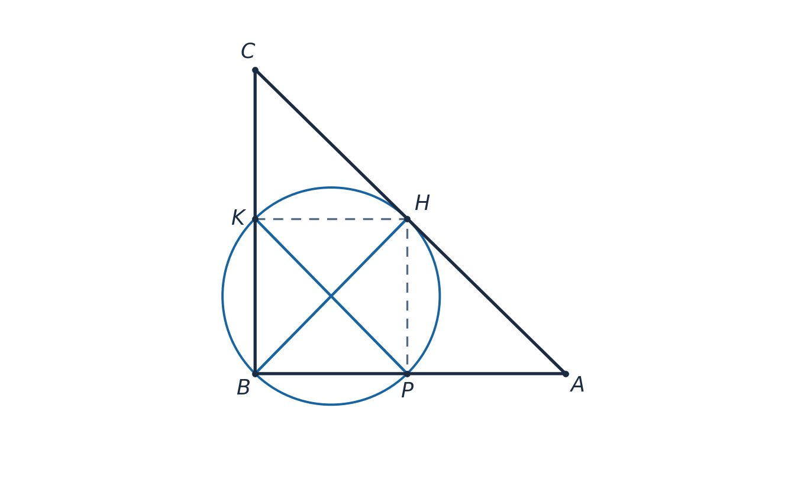

**Критерии**

- **2 балла.** Обосновано верное решение, получен правильный ответ. Обоснованы прямые углы и прямоугольник, затем использовано равенство его диагоналей.
- **1 балл.** Решение в целом верное, есть несущественный недостаток или вычислительная ошибка. Доказано основное свойство и вывод в целом верен, но есть несущественный пробел в записи.
- **0 баллов.** Решение не удовлетворяет условиям для 1 или 2 баллов. Равенство BH=PK заявлено по внешнему виду рисунка без доказательства.

[Источник карточки](https://math-oge.sdamgia.ru/problem?id=324878)

### Задача 2 · 353441

Из вершины прямого угла B треугольника ABC к AC проведена высота BH. Окружность с диаметром BH пересекает BA и BC, кроме B, в точках P и K соответственно. Найдите PK, если BH = 11.

Подсказка 1

Какие углы опираются на диаметр?

Подсказка 2

Определи вид четырёхугольника из основания высоты, вершины и точек пересечения.

Ответ для самопроверки

$11$

Разбор и критерии

1. Углы BPH и BKH прямые, так как опираются на диаметр BH. Угол PBK — прямой угол исходного треугольника.
2. Значит, BPHK — прямоугольник. Его диагонали равны, то есть PK = BH = 11.

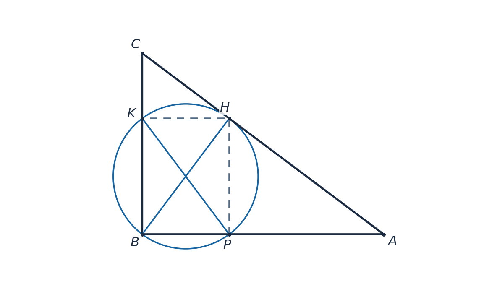

**Критерии**

- **2 балла.** Обосновано верное решение, получен правильный ответ. Два прямых вписанных угла дают прямоугольник с равными диагоналями
- **1 балл.** Решение в целом верное, есть несущественный недостаток или вычислительная ошибка. Геометрический ход и основное равенство установлены, но есть вычислительный сбой или малая неточность оформления.
- **0 баллов.** Решение не удовлетворяет условиям для 1 или 2 баллов. Требуемый переход не доказан или взята величина, которую нельзя считать известной из условия.

[Источник карточки](https://math-oge.sdamgia.ru/problem?id=353441)

### Задача 3 · 339395

Из вершины прямого угла B треугольника ABC к AC проведена высота BH. Окружность с диаметром BH пересекает BA и BC, кроме B, в точках P и K соответственно. Найдите PK, если BH = 16.

Подсказка 1

Какие углы опираются на диаметр?

Подсказка 2

Определи вид четырёхугольника из основания высоты, вершины и точек пересечения.

Ответ для самопроверки

$16$

Разбор и критерии

1. Углы BPH и BKH прямые, так как опираются на диаметр BH. Угол PBK — прямой угол исходного треугольника.
2. Значит, BPHK — прямоугольник. Его диагонали равны, то есть PK = BH = 16.

**Критерии**

- **2 балла.** Обосновано верное решение, получен правильный ответ. Два прямых вписанных угла дают прямоугольник с равными диагоналями
- **1 балл.** Решение в целом верное, есть несущественный недостаток или вычислительная ошибка. Геометрический ход и основное равенство установлены, но есть вычислительный сбой или малая неточность оформления.
- **0 баллов.** Решение не удовлетворяет условиям для 1 или 2 баллов. Требуемый переход не доказан или взята величина, которую нельзя считать известной из условия.

[Источник карточки](https://math-oge.sdamgia.ru/problem?id=339395)

### Задача 4 · 339512

Из вершины прямого угла B треугольника ABC к AC проведена высота BH. Окружность с диаметром BH пересекает BA и BC, кроме B, в точках P и K соответственно. Найдите PK, если BH = 19.

Подсказка 1

Какие углы опираются на диаметр?

Подсказка 2

Определи вид четырёхугольника из основания высоты, вершины и точек пересечения.

Ответ для самопроверки

$19$

Разбор и критерии

1. Углы BPH и BKH прямые, так как опираются на диаметр BH. Угол PBK — прямой угол исходного треугольника.
2. Значит, BPHK — прямоугольник. Его диагонали равны, то есть PK = BH = 19.

**Критерии**

- **2 балла.** Обосновано верное решение, получен правильный ответ. Два прямых вписанных угла дают прямоугольник с равными диагоналями
- **1 балл.** Решение в целом верное, есть несущественный недостаток или вычислительная ошибка. Геометрический ход и основное равенство установлены, но есть вычислительный сбой или малая неточность оформления.
- **0 баллов.** Решение не удовлетворяет условиям для 1 или 2 баллов. Требуемый переход не доказан или взята величина, которую нельзя считать известной из условия.

[Источник карточки](https://math-oge.sdamgia.ru/problem?id=339512)

### Задача 5 · 339570

Из вершины прямого угла B треугольника ABC к AC проведена высота BH. Окружность с диаметром BH пересекает BA и BC, кроме B, в точках P и K соответственно. Найдите BH, если PK = 13.

Подсказка 1

Какие углы опираются на диаметр?

Подсказка 2

Определи вид четырёхугольника из основания высоты, вершины и точек пересечения.

Ответ для самопроверки

$13$

Разбор и критерии

1. Углы BPH и BKH прямые, так как опираются на диаметр BH. Угол PBK — прямой угол исходного треугольника.
2. Значит, BPHK — прямоугольник. Его диагонали равны, то есть BH = PK = 13.

**Критерии**

- **2 балла.** Обосновано верное решение, получен правильный ответ. Два прямых вписанных угла дают прямоугольник с равными диагоналями
- **1 балл.** Решение в целом верное, есть несущественный недостаток или вычислительная ошибка. Геометрический ход и основное равенство установлены, но есть вычислительный сбой или малая неточность оформления.
- **0 баллов.** Решение не удовлетворяет условиям для 1 или 2 баллов. Требуемый переход не доказан или взята величина, которую нельзя считать известной из условия.

[Источник карточки](https://math-oge.sdamgia.ru/problem?id=339570)

### Задача 6 · 339729

Из вершины прямого угла B треугольника ABC к AC проведена высота BH. Окружность с диаметром BH пересекает BA и BC, кроме B, в точках P и K соответственно. Найдите PK, если BH = 18.

Подсказка 1

Какие углы опираются на диаметр?

Подсказка 2

Определи вид четырёхугольника из основания высоты, вершины и точек пересечения.

Ответ для самопроверки

$18$

Разбор и критерии

1. Углы BPH и BKH прямые, так как опираются на диаметр BH. Угол PBK — прямой угол исходного треугольника.
2. Значит, BPHK — прямоугольник. Его диагонали равны, то есть PK = BH = 18.

**Критерии**

- **2 балла.** Обосновано верное решение, получен правильный ответ. Два прямых вписанных угла дают прямоугольник с равными диагоналями
- **1 балл.** Решение в целом верное, есть несущественный недостаток или вычислительная ошибка. Геометрический ход и основное равенство установлены, но есть вычислительный сбой или малая неточность оформления.
- **0 баллов.** Решение не удовлетворяет условиям для 1 или 2 баллов. Требуемый переход не доказан или взята величина, которую нельзя считать известной из условия.

[Источник карточки](https://math-oge.sdamgia.ru/problem?id=339729)

## Подобие при параллельных прямых · Сечение треугольника

`OGE23-parallel-segment`

### Задача 1 · 322806

Отрезок $MN$ соединяет точки $M$ на стороне $AB$ и $N$ на $BC$ треугольника $ABC$ и параллелен $AC$. Найдите $BN$, если $MN=17$, $AC=51$, $NC=32$.

Подсказка 1

Найди подобные треугольники по параллельному сечению.

Подсказка 2

Запиши пропорцию с полной стороной, а не только с оставшимся отрезком.

Ответ для самопроверки

$16$.

Разбор и критерии

1. У треугольников $BMN$ и $BAC$ угол $B$ общий, а углы при $M$ и $A$ равны из-за параллельности.
2. Значит, они подобны и $BN/BC=MN/AC=1/3$.
3. Так как $BC=BN+32$, получаем $3BN=BN+32$, откуда $BN=16$.

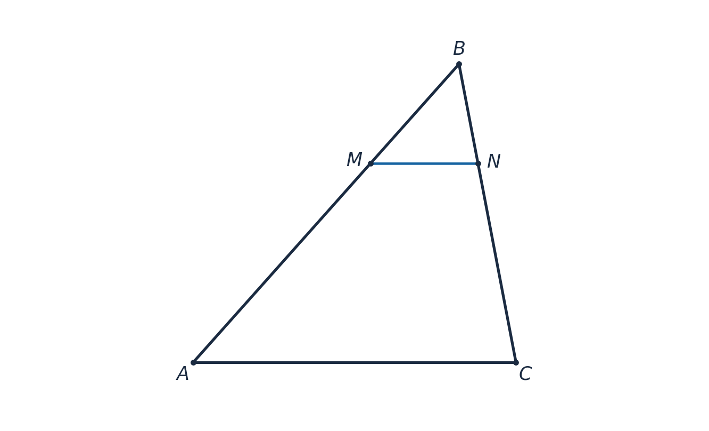

**Критерии**

- **2 балла.** Обосновано верное решение, получен правильный ответ. Доказано подобие, BN соотнесён со всей стороной BC, верный ответ.
- **1 балл.** Решение в целом верное, есть несущественный недостаток или вычислительная ошибка. Подобие и пропорция верны, при их использовании допущена вычислительная ошибка.
- **0 баллов.** Решение не удовлетворяет условиям для 1 или 2 баллов. BN/NC прямо приравнено MN/AC без обоснования.

[Источник карточки](https://math-oge.sdamgia.ru/problem?id=322806)

### Задача 2 · 339505

В треугольнике ABC на сторонах AB и BC лежат M и N. Отрезок MN параллелен AC. Найдите BN, если MN = 12, AC = 42, NC = 25.

Подсказка 1

Найди подобные треугольники по параллельному сечению.

Подсказка 2

Запиши пропорцию с полной стороной, а не только с оставшимся отрезком.

Ответ для самопроверки

$10$

Разбор и критерии

1. У треугольников BMN и BAC общий угол при B. Углы при M и A равны из-за параллельности, поэтому треугольники подобны.
2. В пропорции BN/BC = MN/AC заменяем BC на BN+25. Получаем $BN/(BN+25)=12/42$. Отсюда $(42-12)BN=300$, значит BN = $10$.

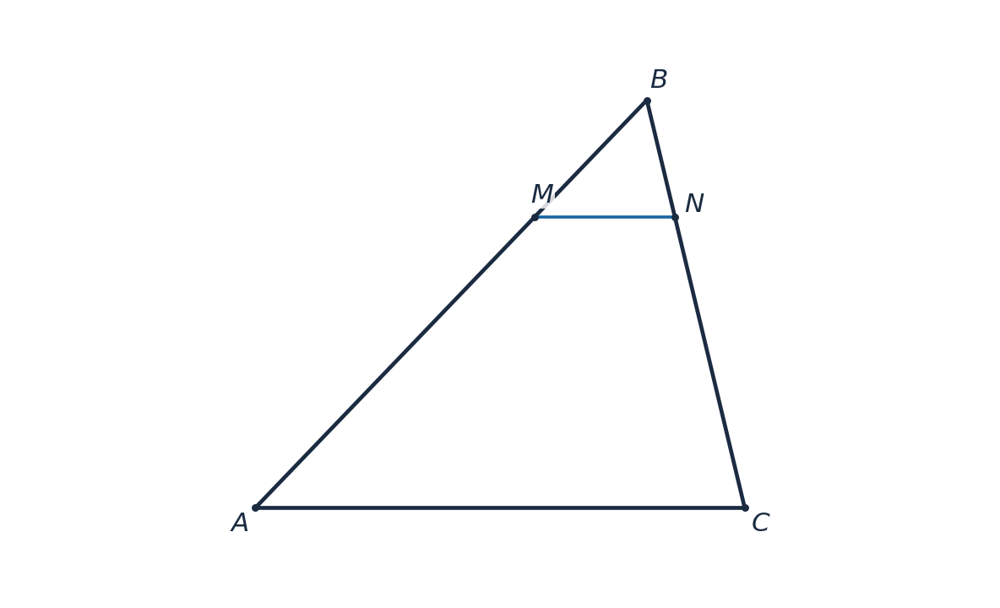

**Критерии**

- **2 балла.** Обосновано верное решение, получен правильный ответ. Вычислить коэффициент подобия по параллельным сторонам и выразить искомый отрезок
- **1 балл.** Решение в целом верное, есть несущественный недостаток или вычислительная ошибка. Геометрический ход и основное равенство установлены, но есть вычислительный сбой или малая неточность оформления.
- **0 баллов.** Решение не удовлетворяет условиям для 1 или 2 баллов. Требуемый переход не доказан или взята величина, которую нельзя считать известной из условия.

[Источник карточки](https://math-oge.sdamgia.ru/problem?id=339505)

### Задача 3 · 339656

В треугольнике ABC на сторонах AB и BC лежат M и N. Отрезок MN параллелен AC. Найдите BN, если MN = 13, AC = 65, NC = 28.

Подсказка 1

Найди подобные треугольники по параллельному сечению.

Подсказка 2

Запиши пропорцию с полной стороной, а не только с оставшимся отрезком.

Ответ для самопроверки

$7$

Разбор и критерии

1. У треугольников BMN и BAC общий угол при B. Углы при M и A равны из-за параллельности, поэтому треугольники подобны.
2. В пропорции BN/BC = MN/AC заменяем BC на BN+28. Получаем $BN/(BN+28)=13/65$. Отсюда $(65-13)BN=364$, значит BN = $7$.

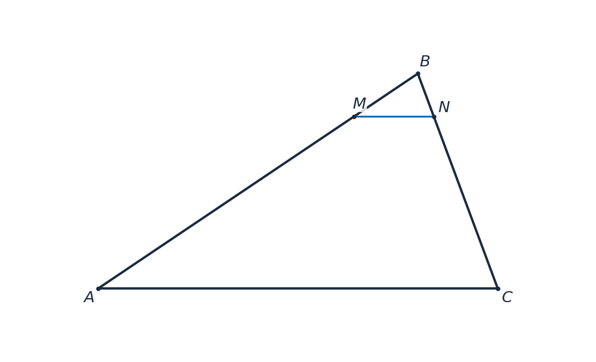

**Критерии**

- **2 балла.** Обосновано верное решение, получен правильный ответ. Вычислить коэффициент подобия по параллельным сторонам и выразить искомый отрезок
- **1 балл.** Решение в целом верное, есть несущественный недостаток или вычислительная ошибка. Геометрический ход и основное равенство установлены, но есть вычислительный сбой или малая неточность оформления.
- **0 баллов.** Решение не удовлетворяет условиям для 1 или 2 баллов. Требуемый переход не доказан или взята величина, которую нельзя считать известной из условия.

[Источник карточки](https://math-oge.sdamgia.ru/problem?id=339656)

### Задача 4 · 350157

В треугольнике ABC на сторонах AB и BC лежат M и N. Отрезок MN параллелен AC. Найдите BN, если MN = 20, AC = 35, NC = 39.

Подсказка 1

Найди подобные треугольники по параллельному сечению.

Подсказка 2

Запиши пропорцию с полной стороной, а не только с оставшимся отрезком.

Ответ для самопроверки

$52$

Разбор и критерии

1. У треугольников BMN и BAC общий угол при B. Углы при M и A равны из-за параллельности, поэтому треугольники подобны.
2. В пропорции BN/BC = MN/AC заменяем BC на BN+39. Получаем $BN/(BN+39)=20/35$. Отсюда $(35-20)BN=780$, значит BN = $52$.

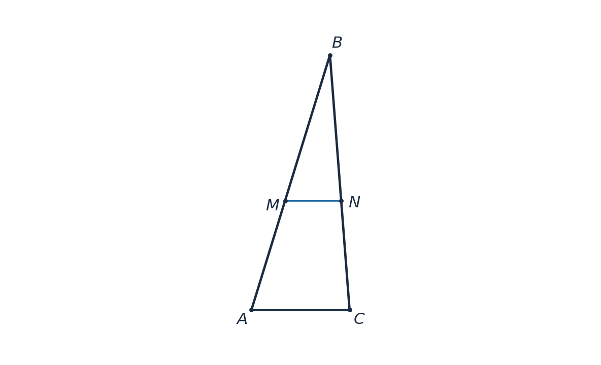

**Критерии**

- **2 балла.** Обосновано верное решение, получен правильный ответ. Вычислить коэффициент подобия по параллельным сторонам и выразить искомый отрезок
- **1 балл.** Решение в целом верное, есть несущественный недостаток или вычислительная ошибка. Геометрический ход и основное равенство установлены, но есть вычислительный сбой или малая неточность оформления.
- **0 баллов.** Решение не удовлетворяет условиям для 1 или 2 баллов. Требуемый переход не доказан или взята величина, которую нельзя считать известной из условия.

[Источник карточки](https://math-oge.sdamgia.ru/problem?id=350157)

### Задача 5 · 350726

В треугольнике ABC на сторонах AB и BC лежат M и N. Отрезок MN параллелен AC. Найдите BN, если MN = 14, AC = 21, NC = 10.

Подсказка 1

Найди подобные треугольники по параллельному сечению.

Подсказка 2

Запиши пропорцию с полной стороной, а не только с оставшимся отрезком.

Ответ для самопроверки

$20$

Разбор и критерии

1. У треугольников BMN и BAC общий угол при B. Углы при M и A равны из-за параллельности, поэтому треугольники подобны.
2. В пропорции BN/BC = MN/AC заменяем BC на BN+10. Получаем $BN/(BN+10)=14/21$. Отсюда $(21-14)BN=140$, значит BN = $20$.

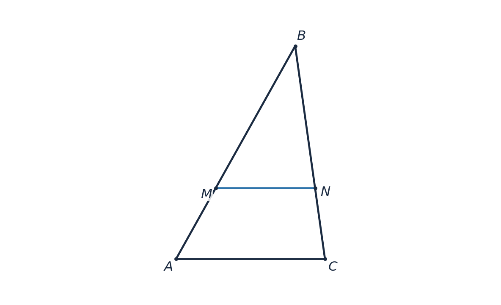

**Критерии**

- **2 балла.** Обосновано верное решение, получен правильный ответ. Вычислить коэффициент подобия по параллельным сторонам и выразить искомый отрезок
- **1 балл.** Решение в целом верное, есть несущественный недостаток или вычислительная ошибка. Геометрический ход и основное равенство установлены, но есть вычислительный сбой или малая неточность оформления.
- **0 баллов.** Решение не удовлетворяет условиям для 1 или 2 баллов. Требуемый переход не доказан или взята величина, которую нельзя считать известной из условия.

[Источник карточки](https://math-oge.sdamgia.ru/problem?id=350726)

### Задача 6 · 351460

В треугольнике ABC на сторонах AB и BC лежат M и N. Отрезок MN параллелен AC. Найдите BN, если MN = 11, AC = 44, NC = 18.

Подсказка 1

Найди подобные треугольники по параллельному сечению.

Подсказка 2

Запиши пропорцию с полной стороной, а не только с оставшимся отрезком.

Ответ для самопроверки

$6$

Разбор и критерии

1. У треугольников BMN и BAC общий угол при B. Углы при M и A равны из-за параллельности, поэтому треугольники подобны.
2. В пропорции BN/BC = MN/AC заменяем BC на BN+18. Получаем $BN/(BN+18)=11/44$. Отсюда $(44-11)BN=198$, значит BN = $6$.

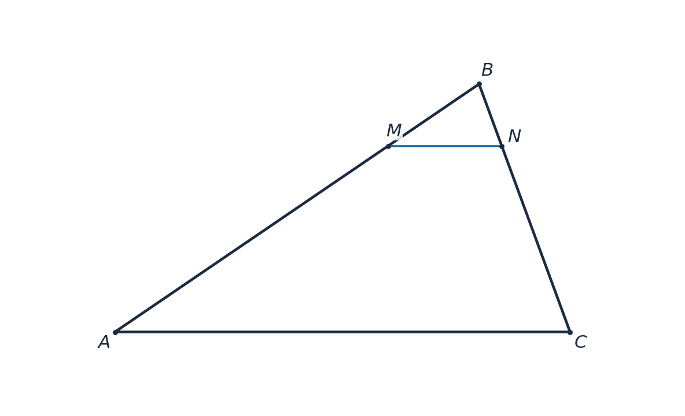

**Критерии**

- **2 балла.** Обосновано верное решение, получен правильный ответ. Вычислить коэффициент подобия по параллельным сторонам и выразить искомый отрезок
- **1 балл.** Решение в целом верное, есть несущественный недостаток или вычислительная ошибка. Геометрический ход и основное равенство установлены, но есть вычислительный сбой или малая неточность оформления.
- **0 баллов.** Решение не удовлетворяет условиям для 1 или 2 баллов. Требуемый переход не доказан или взята величина, которую нельзя считать известной из условия.

[Источник карточки](https://math-oge.sdamgia.ru/problem?id=351460)

## Подобие при параллельных прямых · Пересекающиеся диагонали между параллелями

`OGE23-parallel-diagonals`

### Задача 1 · 324748

Отрезки AB и DC параллельны, а AC и BD пересекаются в M. Дано AB = 16, DC = 24, AC = 25. Найдите MC.

Подсказка 1

Найди пару подобных треугольников по параллельным основаниям.

Подсказка 2

Точка их общей вершины делит диагональ в том же отношении.

Ответ для самопроверки

$15$

Разбор и критерии

1. Треугольники AMB и CMD подобны: углы при M вертикальны, остальные соответствующие углы равны при AB ∥ DC.
2. Значит, AM:MC = 16:24. Длина AC равна сумме двух частей, поэтому MC = $25\cdot \frac{3}{5}=15$.

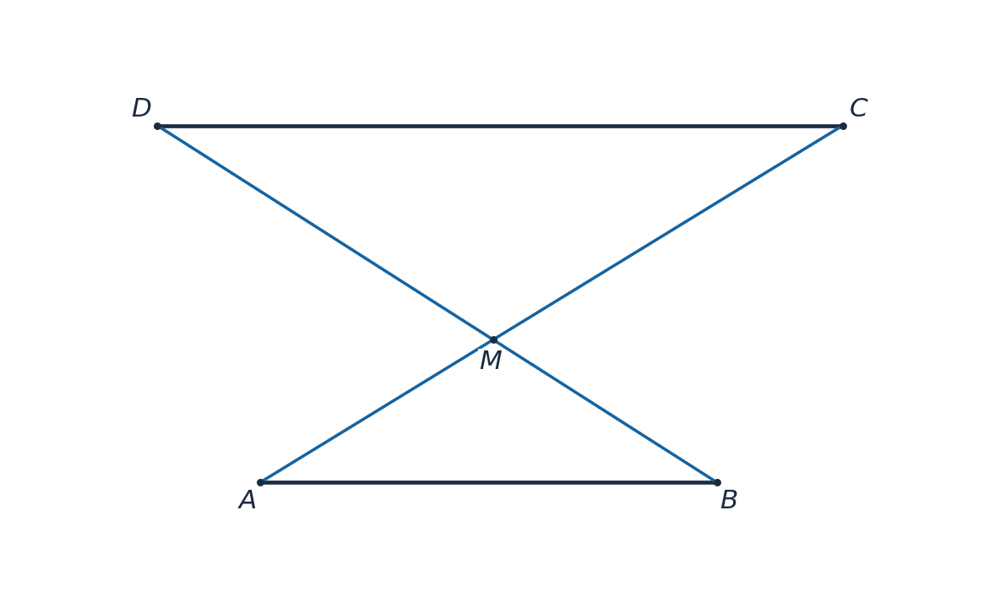

**Критерии**

- **2 балла.** Обосновано верное решение, получен правильный ответ. Разделить всю диагональ по отношению параллельных отрезков
- **1 балл.** Решение в целом верное, есть несущественный недостаток или вычислительная ошибка. Геометрический ход и основное равенство установлены, но есть вычислительный сбой или малая неточность оформления.
- **0 баллов.** Решение не удовлетворяет условиям для 1 или 2 баллов. Требуемый переход не доказан или взята величина, которую нельзя считать известной из условия.

[Источник карточки](https://math-oge.sdamgia.ru/problem?id=324748)

### Задача 2 · 352582

Отрезки AB и DC параллельны, а AC и BD пересекаются в M. Дано AB = 13, DC = 65, AC = 42. Найдите MC.

Подсказка 1

Найди пару подобных треугольников по параллельным основаниям.

Подсказка 2

Точка их общей вершины делит диагональ в том же отношении.

Ответ для самопроверки

$35$

Разбор и критерии

1. Треугольники AMB и CMD подобны: углы при M вертикальны, остальные соответствующие углы равны при AB ∥ DC.
2. Значит, AM:MC = 13:65. Длина AC равна сумме двух частей, поэтому MC = $42\cdot \frac{5}{6}=35$.

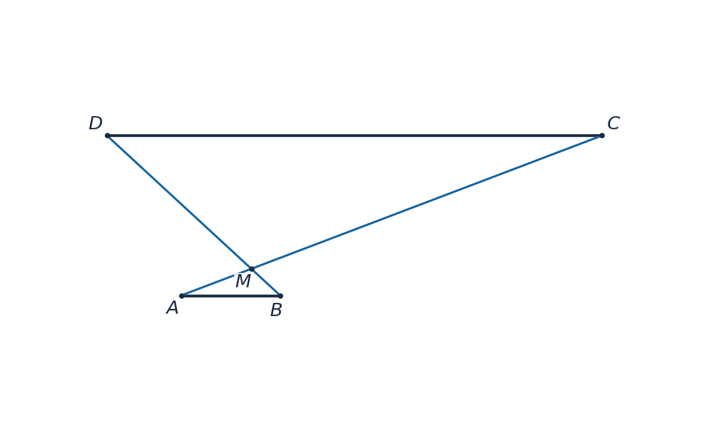

**Критерии**

- **2 балла.** Обосновано верное решение, получен правильный ответ. Разделить всю диагональ по отношению параллельных отрезков
- **1 балл.** Решение в целом верное, есть несущественный недостаток или вычислительная ошибка. Геометрический ход и основное равенство установлены, но есть вычислительный сбой или малая неточность оформления.
- **0 баллов.** Решение не удовлетворяет условиям для 1 или 2 баллов. Требуемый переход не доказан или взята величина, которую нельзя считать известной из условия.

[Источник карточки](https://math-oge.sdamgia.ru/problem?id=352582)

### Задача 3 · 333321

Отрезки AB и DC параллельны, а AC и BD пересекаются в M. Дано AB = 10, DC = 25, AC = 56. Найдите MC.

Подсказка 1

Найди пару подобных треугольников по параллельным основаниям.

Подсказка 2

Точка их общей вершины делит диагональ в том же отношении.

Ответ для самопроверки

$40$

Разбор и критерии

1. Треугольники AMB и CMD подобны: углы при M вертикальны, остальные соответствующие углы равны при AB ∥ DC.
2. Значит, AM:MC = 10:25. Длина AC равна сумме двух частей, поэтому MC = $56\cdot \frac{5}{7}=40$.

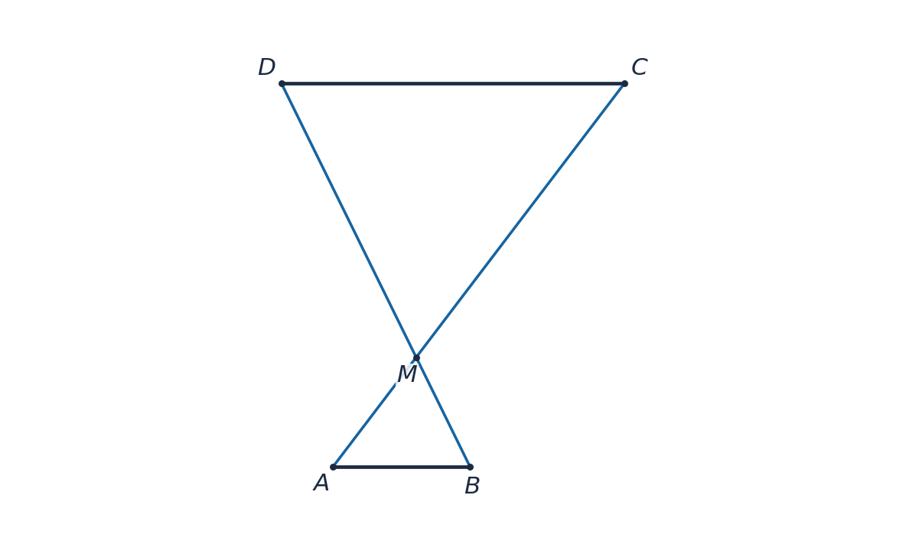

**Критерии**

- **2 балла.** Обосновано верное решение, получен правильный ответ. Разделить всю диагональ по отношению параллельных отрезков
- **1 балл.** Решение в целом верное, есть несущественный недостаток или вычислительная ошибка. Геометрический ход и основное равенство установлены, но есть вычислительный сбой или малая неточность оформления.
- **0 баллов.** Решение не удовлетворяет условиям для 1 или 2 баллов. Требуемый переход не доказан или взята величина, которую нельзя считать известной из условия.

[Источник карточки](https://math-oge.sdamgia.ru/problem?id=333321)

### Задача 4 · 339501

Отрезки AB и DC параллельны, а AC и BD пересекаются в M. Дано AB = 12, DC = 48, AC = 35. Найдите MC.

Подсказка 1

Найди пару подобных треугольников по параллельным основаниям.

Подсказка 2

Точка их общей вершины делит диагональ в том же отношении.

Ответ для самопроверки

$28$

Разбор и критерии

1. Треугольники AMB и CMD подобны: углы при M вертикальны, остальные соответствующие углы равны при AB ∥ DC.
2. Значит, AM:MC = 12:48. Длина AC равна сумме двух частей, поэтому MC = $35\cdot \frac{4}{5}=28$.

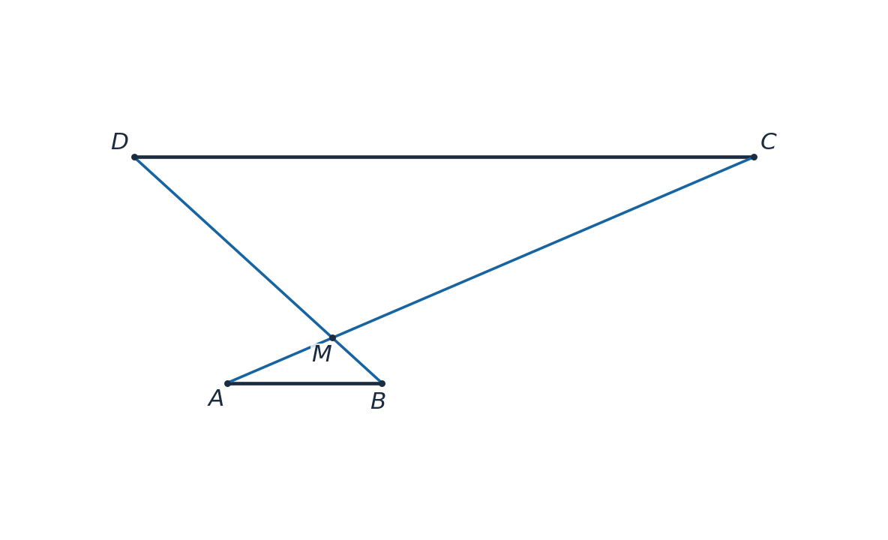

**Критерии**

- **2 балла.** Обосновано верное решение, получен правильный ответ. Разделить всю диагональ по отношению параллельных отрезков
- **1 балл.** Решение в целом верное, есть несущественный недостаток или вычислительная ошибка. Геометрический ход и основное равенство установлены, но есть вычислительный сбой или малая неточность оформления.
- **0 баллов.** Решение не удовлетворяет условиям для 1 или 2 баллов. Требуемый переход не доказан или взята величина, которую нельзя считать известной из условия.

[Источник карточки](https://math-oge.sdamgia.ru/problem?id=339501)

### Задача 5 · 339567

Отрезки AB и DC параллельны, а AC и BD пересекаются в M. Дано AB = 15, DC = 30, AC = 39. Найдите MC.

Подсказка 1

Найди пару подобных треугольников по параллельным основаниям.

Подсказка 2

Точка их общей вершины делит диагональ в том же отношении.

Ответ для самопроверки

$26$

Разбор и критерии

1. Треугольники AMB и CMD подобны: углы при M вертикальны, остальные соответствующие углы равны при AB ∥ DC.
2. Значит, AM:MC = 15:30. Длина AC равна сумме двух частей, поэтому MC = $39\cdot \frac{2}{3}=26$.

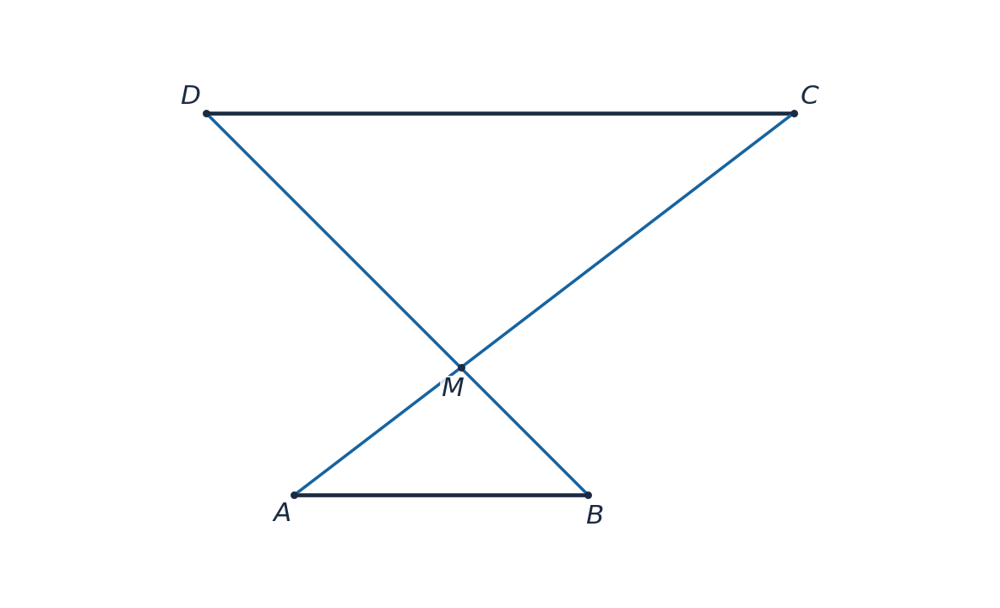

**Критерии**

- **2 балла.** Обосновано верное решение, получен правильный ответ. Разделить всю диагональ по отношению параллельных отрезков
- **1 балл.** Решение в целом верное, есть несущественный недостаток или вычислительная ошибка. Геометрический ход и основное равенство установлены, но есть вычислительный сбой или малая неточность оформления.
- **0 баллов.** Решение не удовлетворяет условиям для 1 или 2 баллов. Требуемый переход не доказан или взята величина, которую нельзя считать известной из условия.

[Источник карточки](https://math-oge.sdamgia.ru/problem?id=339567)

### Задача 6 · 339593

Отрезки AB и DC параллельны, а AC и BD пересекаются в M. Дано AB = 14, DC = 42, AC = 52. Найдите MC.

Подсказка 1

Найди пару подобных треугольников по параллельным основаниям.

Подсказка 2

Точка их общей вершины делит диагональ в том же отношении.

Ответ для самопроверки

$39$

Разбор и критерии

1. Треугольники AMB и CMD подобны: углы при M вертикальны, остальные соответствующие углы равны при AB ∥ DC.
2. Значит, AM:MC = 14:42. Длина AC равна сумме двух частей, поэтому MC = $52\cdot \frac{3}{4}=39$.

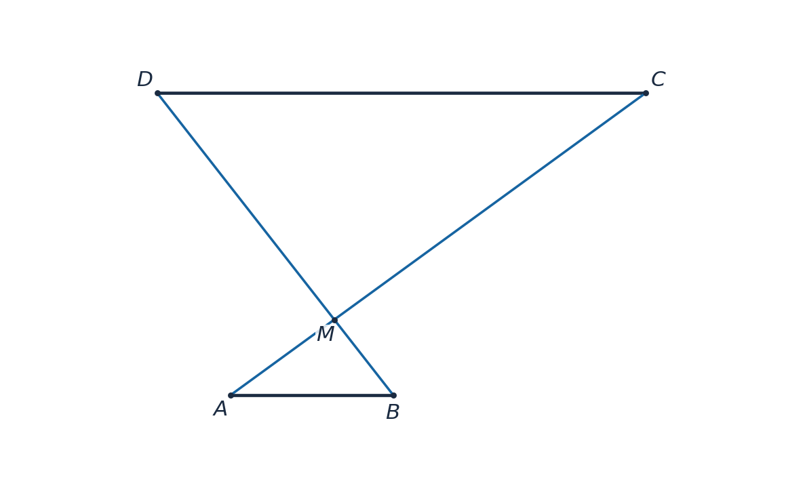

**Критерии**

- **2 балла.** Обосновано верное решение, получен правильный ответ. Разделить всю диагональ по отношению параллельных отрезков
- **1 балл.** Решение в целом верное, есть несущественный недостаток или вычислительная ошибка. Геометрический ход и основное равенство установлены, но есть вычислительный сбой или малая неточность оформления.
- **0 баллов.** Решение не удовлетворяет условиям для 1 или 2 баллов. Требуемый переход не доказан или взята величина, которую нельзя считать известной из условия.

[Источник карточки](https://math-oge.sdamgia.ru/problem?id=339593)

## Четырёхугольники · Площадь равнобедренной трапеции

`OGE23-trapezoid-area`

### Задача 1 · 311249

Основания равнобедренной трапеции имеют длины 8 и 18, периметр равен 56. Найдите её площадь.

Подсказка 1

Выдели боковую сторону из периметра.

Подсказка 2

Опусти две высоты: крайние отрезки равны половине разности оснований.

Ответ для самопроверки

$130\sqrt2$.

Разбор и критерии

1. Сумма боковых сторон $56-8-18=30$, поэтому каждая равна $15$.
2. Опустим высоты из концов меньшего основания.
3. Между их основаниями останется 8, а по краям большого основания получатся равные отрезки по $(18-8)/2=5$.
4. Тогда высота $h=\sqrt{15^2-5^2}=10\sqrt2$.
5. Площадь равна $\frac{18+8}{2}h=130\sqrt2$.

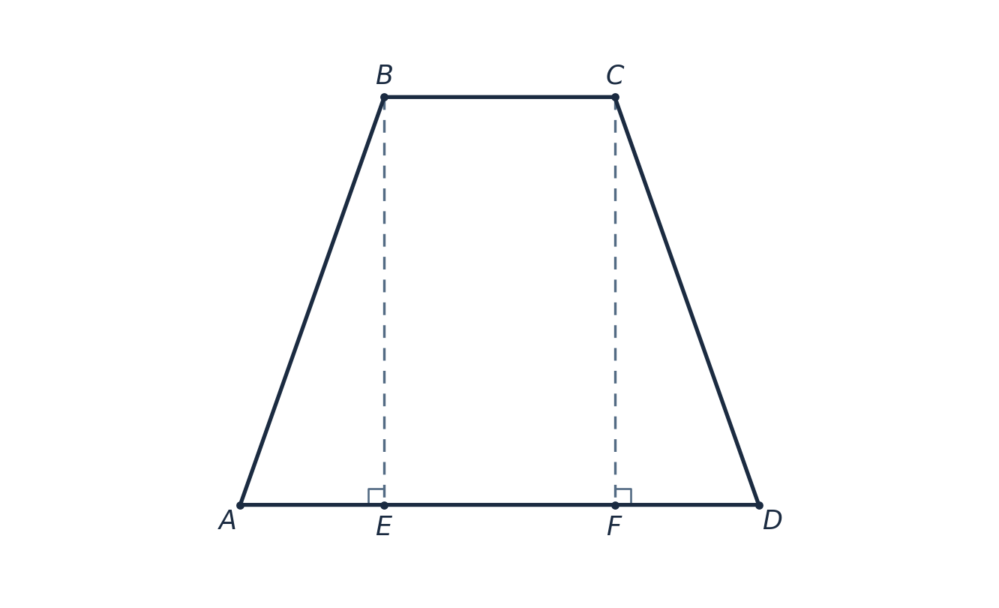

**Критерии**

- **2 балла.** Обосновано верное решение, получен правильный ответ. Верно получены боковая сторона и высота, вычислена точная площадь.
- **1 балл.** Решение в целом верное, есть несущественный недостаток или вычислительная ошибка. Геометрическая схема и формула площади верны, но есть арифметическая ошибка.
- **0 баллов.** Решение не удовлетворяет условиям для 1 или 2 баллов. В качестве катета взята вся разность оснований без разбора равнобедренности.

[Источник карточки](https://math-oge.sdamgia.ru/problem?id=311249)

### Задача 2 · 311560

У равнобедренной трапеции основания 8 и 18, периметр 52. Вычислите площадь.

Подсказка 1

Выдели боковую сторону из периметра.

Подсказка 2

Опусти две высоты: крайние отрезки равны половине разности оснований.

Ответ для самопроверки

$156$

Разбор и критерии

1. Обе боковые стороны равны. Каждая имеет длину $(52-8-18)/2=13$.
2. Опустим высоты из концов меньшего основания. Край каждого прямоугольного треугольника имеет длину $(18-8)/2=5$. Пифагор даёт высоту $12$.
3. Площадь равна полусумме оснований, умноженной на высоту, то есть $156$.

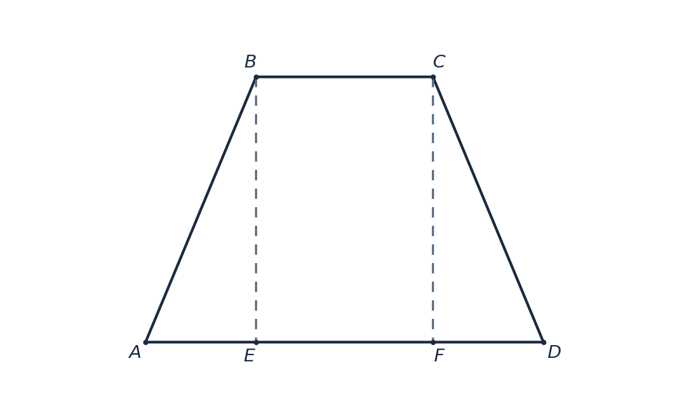

**Критерии**

- **2 балла.** Обосновано верное решение, получен правильный ответ. Из периметра получить боковую сторону, из полуразности оснований и Пифагора — высоту
- **1 балл.** Решение в целом верное, есть несущественный недостаток или вычислительная ошибка. Геометрический ход и основное равенство установлены, но есть вычислительный сбой или малая неточность оформления.
- **0 баллов.** Решение не удовлетворяет условиям для 1 или 2 баллов. Требуемый переход не доказан или взята величина, которую нельзя считать известной из условия.

[Источник карточки](https://math-oge.sdamgia.ru/problem?id=311560)

### Задача 3 · авторская тренировка

У равнобедренной трапеции основания 10 и 22, периметр 72. Вычислите площадь.

Подсказка 1

Выдели боковую сторону из периметра.

Подсказка 2

Опусти две высоты: крайние отрезки равны половине разности оснований.

Ответ для самопроверки

$32 \sqrt{91}$

Разбор и критерии

1. Обе боковые стороны равны. Каждая имеет длину $(72-10-22)/2=20$.
2. Опустим высоты из концов меньшего основания. Край каждого прямоугольного треугольника имеет длину $(22-10)/2=6$. Пифагор даёт высоту $2 \sqrt{91}$.
3. Площадь равна полусумме оснований, умноженной на высоту, то есть $32 \sqrt{91}$.

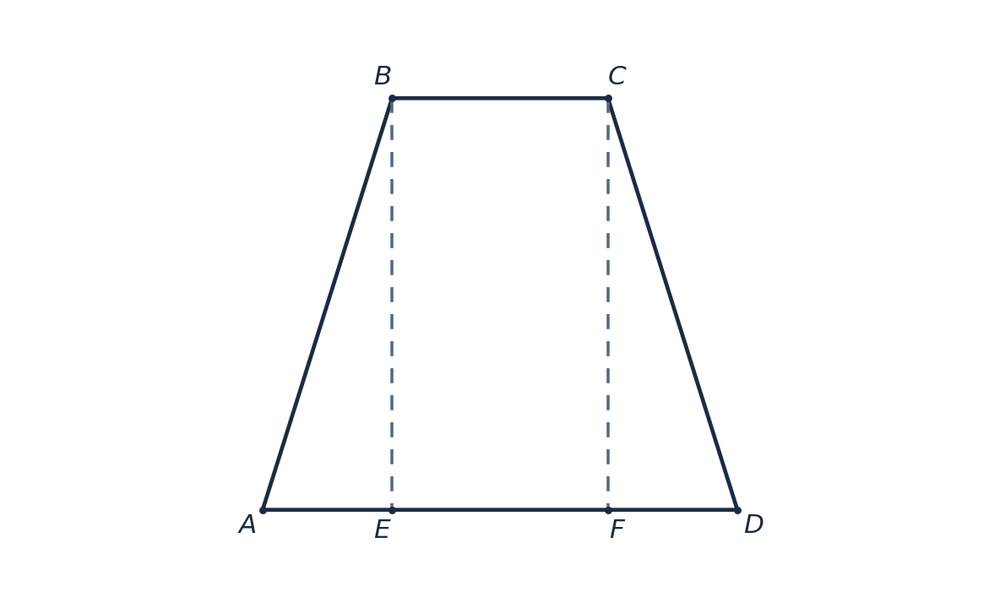

**Критерии**

- **2 балла.** Обосновано верное решение, получен правильный ответ. Из периметра получить боковую сторону, из полуразности оснований и Пифагора — высоту
- **1 балл.** Решение в целом верное, есть несущественный недостаток или вычислительная ошибка. Геометрический ход и основное равенство установлены, но есть вычислительный сбой или малая неточность оформления.
- **0 баллов.** Решение не удовлетворяет условиям для 1 или 2 баллов. Требуемый переход не доказан или взята величина, которую нельзя считать известной из условия.

[Пример семейства](https://math-oge.sdamgia.ru/problem?id=311249)

### Задача 4 · авторская тренировка

У равнобедренной трапеции основания 11 и 23, периметр 60. Вычислите площадь.

Подсказка 1

Выдели боковую сторону из периметра.

Подсказка 2

Опусти две высоты: крайние отрезки равны половине разности оснований.

Ответ для самопроверки

$17 \sqrt{133}$

Разбор и критерии

1. Обе боковые стороны равны. Каждая имеет длину $(60-11-23)/2=13$.
2. Опустим высоты из концов меньшего основания. Край каждого прямоугольного треугольника имеет длину $(23-11)/2=6$. Пифагор даёт высоту $\sqrt{133}$.
3. Площадь равна полусумме оснований, умноженной на высоту, то есть $17 \sqrt{133}$.

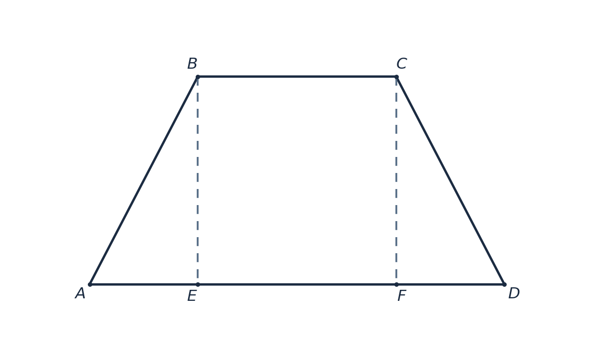

**Критерии**

- **2 балла.** Обосновано верное решение, получен правильный ответ. Из периметра получить боковую сторону, из полуразности оснований и Пифагора — высоту
- **1 балл.** Решение в целом верное, есть несущественный недостаток или вычислительная ошибка. Геометрический ход и основное равенство установлены, но есть вычислительный сбой или малая неточность оформления.
- **0 баллов.** Решение не удовлетворяет условиям для 1 или 2 баллов. Требуемый переход не доказан или взята величина, которую нельзя считать известной из условия.

[Пример семейства](https://math-oge.sdamgia.ru/problem?id=311249)

### Задача 5 · авторская тренировка

У равнобедренной трапеции основания 7 и 23, периметр 64. Вычислите площадь.

Подсказка 1

Выдели боковую сторону из периметра.

Подсказка 2

Опусти две высоты: крайние отрезки равны половине разности оснований.

Ответ для самопроверки

$225$

Разбор и критерии

1. Обе боковые стороны равны. Каждая имеет длину $(64-7-23)/2=17$.
2. Опустим высоты из концов меньшего основания. Край каждого прямоугольного треугольника имеет длину $(23-7)/2=8$. Пифагор даёт высоту $15$.
3. Площадь равна полусумме оснований, умноженной на высоту, то есть $225$.

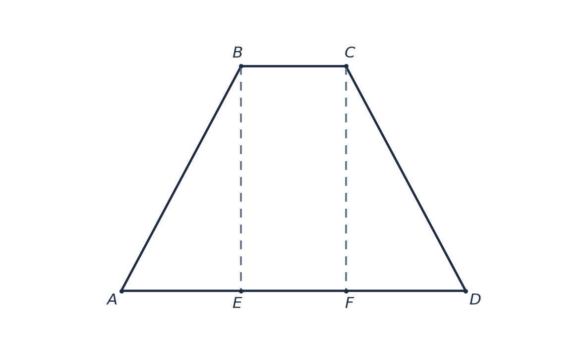

**Критерии**

- **2 балла.** Обосновано верное решение, получен правильный ответ. Из периметра получить боковую сторону, из полуразности оснований и Пифагора — высоту
- **1 балл.** Решение в целом верное, есть несущественный недостаток или вычислительная ошибка. Геометрический ход и основное равенство установлены, но есть вычислительный сбой или малая неточность оформления.
- **0 баллов.** Решение не удовлетворяет условиям для 1 или 2 баллов. Требуемый переход не доказан или взята величина, которую нельзя считать известной из условия.

[Пример семейства](https://math-oge.sdamgia.ru/problem?id=311249)

### Задача 6 · авторская тренировка

У равнобедренной трапеции основания 12 и 18, периметр 56. Вычислите площадь.

Подсказка 1

Выдели боковую сторону из периметра.

Подсказка 2

Опусти две высоты: крайние отрезки равны половине разности оснований.

Ответ для самопроверки

$60 \sqrt{10}$

Разбор и критерии

1. Обе боковые стороны равны. Каждая имеет длину $(56-12-18)/2=13$.
2. Опустим высоты из концов меньшего основания. Край каждого прямоугольного треугольника имеет длину $(18-12)/2=3$. Пифагор даёт высоту $4 \sqrt{10}$.
3. Площадь равна полусумме оснований, умноженной на высоту, то есть $60 \sqrt{10}$.

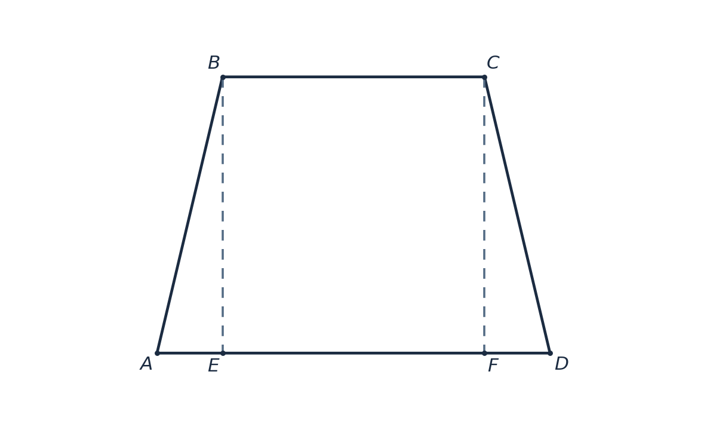

**Критерии**

- **2 балла.** Обосновано верное решение, получен правильный ответ. Из периметра получить боковую сторону, из полуразности оснований и Пифагора — высоту
- **1 балл.** Решение в целом верное, есть несущественный недостаток или вычислительная ошибка. Геометрический ход и основное равенство установлены, но есть вычислительный сбой или малая неточность оформления.
- **0 баллов.** Решение не удовлетворяет условиям для 1 или 2 баллов. Требуемый переход не доказан или взята величина, которую нельзя считать известной из условия.

[Пример семейства](https://math-oge.sdamgia.ru/problem?id=311249)

## Четырёхугольники · Отрезок между серединами диагоналей

`OGE23-trapezoid-midpoints`

### Задача 1 · 311828

Основания трапеции имеют длины 9 и 15. Найдите расстояние между серединами её диагоналей.

Подсказка 1

Отметь середину одной боковой стороны.

Подсказка 2

Проведи две средние линии соответствующих треугольников и сравни их длины.

Ответ для самопроверки

$3$.

Разбор и критерии

1. Обозначим большее основание $AD=15$, меньшее $BC=9$, середины $AC$, $BD$, $AB$ через $K,L,E$.
2. Отрезок $EK$ — средняя линия $ABC$, поэтому $EK=BC/2=4{,}5$, а $EL$ — средняя линия $ABD$, поэтому $EL=AD/2=7{,}5$.
3. Оба идут из $E$ по одному лучу, параллельному основаниям.
4. Следовательно, $KL=7{,}5-4{,}5=3$.

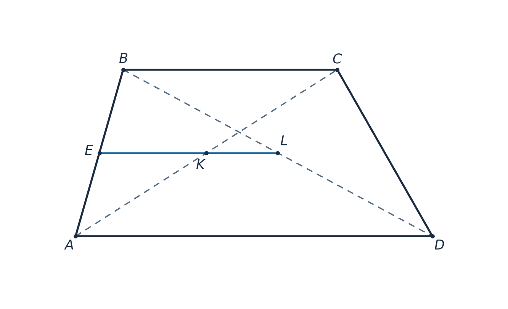

**Критерии**

- **2 балла.** Обосновано верное решение, получен правильный ответ. Показано, почему берётся разность половин, и получена длина 3.
- **1 балл.** Решение в целом верное, есть несущественный недостаток или вычислительная ошибка. Метод средних линий верен, при вычислении допущена арифметическая ошибка или есть малый пробел в оформлении.
- **0 баллов.** Решение не удовлетворяет условиям для 1 или 2 баллов. Использована формула средней линии трапеции (полусумма оснований) для другого отрезка.

[Источник карточки](https://math-oge.sdamgia.ru/problem?id=311828)

### Задача 2 · 311860

Основания трапеции имеют длины 16 и 34. Чему равна длина отрезка между серединами диагоналей?

Подсказка 1

Отметь середину одной боковой стороны.

Подсказка 2

Проведи две средние линии соответствующих треугольников и сравни их длины.

Ответ для самопроверки

$9$

Разбор и критерии

1. Выберем середину E одной боковой стороны и обозначим K, L середины диагоналей. Отрезки EK и EL — средние линии двух треугольников.
2. Они направлены по одному лучу и имеют длины $8$ и $17$. Поэтому между K и L расстояние $9$.

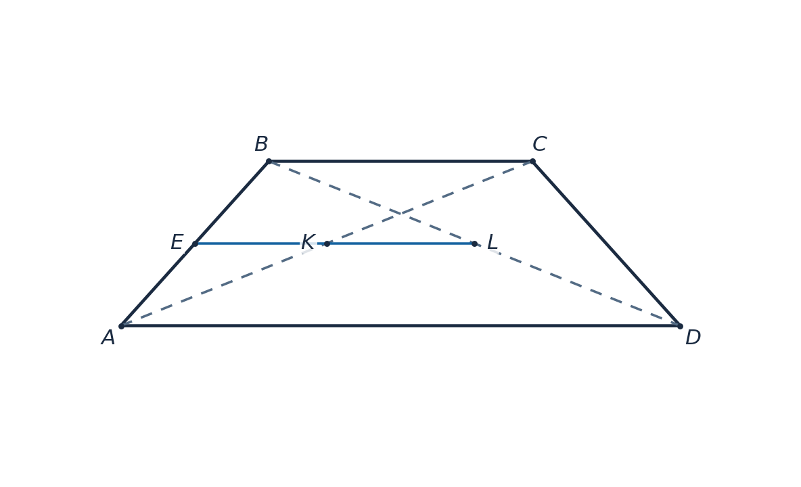

**Критерии**

- **2 балла.** Обосновано верное решение, получен правильный ответ. Две средние линии дают половину разности оснований
- **1 балл.** Решение в целом верное, есть несущественный недостаток или вычислительная ошибка. Геометрический ход и основное равенство установлены, но есть вычислительный сбой или малая неточность оформления.
- **0 баллов.** Решение не удовлетворяет условиям для 1 или 2 баллов. Требуемый переход не доказан или взята величина, которую нельзя считать известной из условия.

[Источник карточки](https://math-oge.sdamgia.ru/problem?id=311860)

### Задача 3 · 316296

Основания трапеции имеют длины 4 и 9. Чему равна длина отрезка между серединами диагоналей?

Подсказка 1

Отметь середину одной боковой стороны.

Подсказка 2

Проведи две средние линии соответствующих треугольников и сравни их длины.

Ответ для самопроверки

$\frac{5}{2}$

Разбор и критерии

1. Выберем середину E одной боковой стороны и обозначим K, L середины диагоналей. Отрезки EK и EL — средние линии двух треугольников.
2. Они направлены по одному лучу и имеют длины $2$ и $\frac{9}{2}$. Поэтому между K и L расстояние $\frac{5}{2}$.

**Критерии**

- **2 балла.** Обосновано верное решение, получен правильный ответ. Две средние линии дают половину разности оснований
- **1 балл.** Решение в целом верное, есть несущественный недостаток или вычислительная ошибка. Геометрический ход и основное равенство установлены, но есть вычислительный сбой или малая неточность оформления.
- **0 баллов.** Решение не удовлетворяет условиям для 1 или 2 баллов. Требуемый переход не доказан или взята величина, которую нельзя считать известной из условия.

[Источник карточки](https://math-oge.sdamgia.ru/problem?id=316296)

### Задача 4 · авторская тренировка

Основания трапеции имеют длины 17 и 28. Чему равна длина отрезка между серединами диагоналей?

Подсказка 1

Отметь середину одной боковой стороны.

Подсказка 2

Проведи две средние линии соответствующих треугольников и сравни их длины.

Ответ для самопроверки

$\frac{11}{2}$

Разбор и критерии

1. Выберем середину E одной боковой стороны и обозначим K, L середины диагоналей. Отрезки EK и EL — средние линии двух треугольников.
2. Они направлены по одному лучу и имеют длины $\frac{17}{2}$ и $14$. Поэтому между K и L расстояние $\frac{11}{2}$.

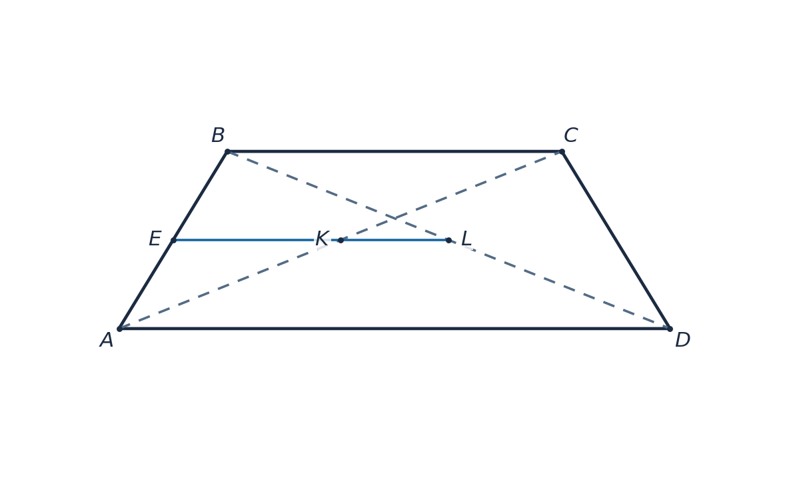

**Критерии**

- **2 балла.** Обосновано верное решение, получен правильный ответ. Две средние линии дают половину разности оснований
- **1 балл.** Решение в целом верное, есть несущественный недостаток или вычислительная ошибка. Геометрический ход и основное равенство установлены, но есть вычислительный сбой или малая неточность оформления.
- **0 баллов.** Решение не удовлетворяет условиям для 1 или 2 баллов. Требуемый переход не доказан или взята величина, которую нельзя считать известной из условия.

[Пример семейства](https://math-oge.sdamgia.ru/problem?id=311828)

### Задача 5 · авторская тренировка

Основания трапеции имеют длины 11 и 24. Чему равна длина отрезка между серединами диагоналей?

Подсказка 1

Отметь середину одной боковой стороны.

Подсказка 2

Проведи две средние линии соответствующих треугольников и сравни их длины.

Ответ для самопроверки

$\frac{13}{2}$

Разбор и критерии

1. Выберем середину E одной боковой стороны и обозначим K, L середины диагоналей. Отрезки EK и EL — средние линии двух треугольников.
2. Они направлены по одному лучу и имеют длины $\frac{11}{2}$ и $12$. Поэтому между K и L расстояние $\frac{13}{2}$.

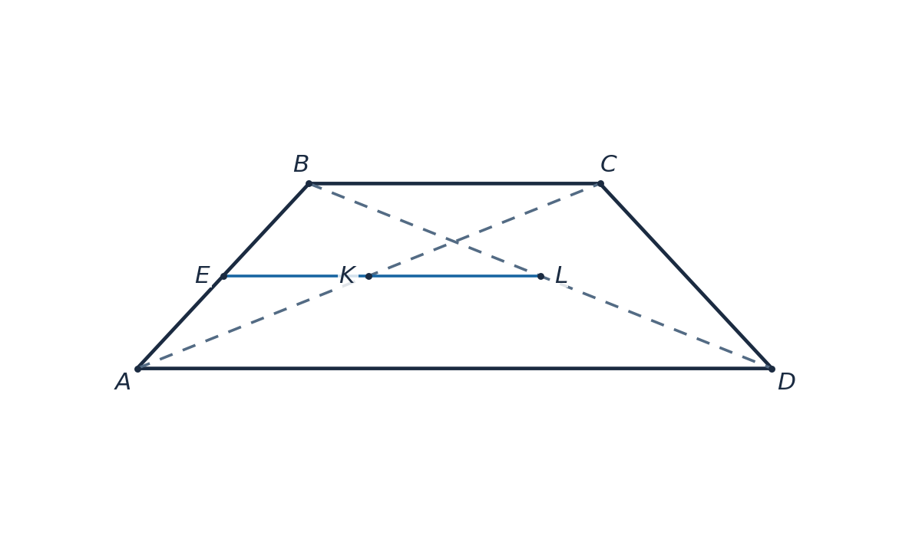

**Критерии**

- **2 балла.** Обосновано верное решение, получен правильный ответ. Две средние линии дают половину разности оснований
- **1 балл.** Решение в целом верное, есть несущественный недостаток или вычислительная ошибка. Геометрический ход и основное равенство установлены, но есть вычислительный сбой или малая неточность оформления.
- **0 баллов.** Решение не удовлетворяет условиям для 1 или 2 баллов. Требуемый переход не доказан или взята величина, которую нельзя считать известной из условия.

[Пример семейства](https://math-oge.sdamgia.ru/problem?id=311828)

### Задача 6 · авторская тренировка

Меньшее основание трапеции равно 12. Середины диагоналей удалены друг от друга на 7,5. Найдите большее основание.

Подсказка 1

Отметь середину одной боковой стороны.

Подсказка 2

Проведи две средние линии соответствующих треугольников и сравни их длины.

Ответ для самопроверки

$27$

Разбор и критерии

1. Возьмём середину E боковой стороны и обозначим K и L середины диагоналей. Отрезки EK и EL — средние линии двух треугольников, поэтому они лежат на одном луче и равны половинам оснований.
2. Их разность KL равна 7,5. Следовательно, основания отличаются на 15, а большее основание равно 12+15=27.

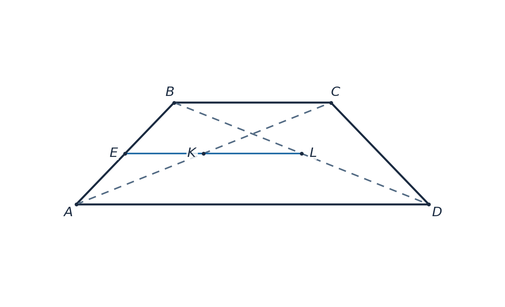

**Критерии**

- **2 балла.** Обосновано верное решение, получен правильный ответ. Две средние линии дают половину разности оснований
- **1 балл.** Решение в целом верное, есть несущественный недостаток или вычислительная ошибка. Геометрический ход и основное равенство установлены, но есть вычислительный сбой или малая неточность оформления.
- **0 баллов.** Решение не удовлетворяет условиям для 1 или 2 баллов. Требуемый переход не доказан или взята величина, которую нельзя считать известной из условия.

[Пример семейства](https://math-oge.sdamgia.ru/problem?id=311828)

## Четырёхугольники · Ромб и прямоугольный вспомогательный треугольник

`OGE23-rhombus`

### Задача 1 · 324778

Расстояние от пересечения диагоналей ромба до его стороны равно 19. Одна из диагоналей равна 76. Найдите углы ромба.

Подсказка 1

Выдели прямоугольный треугольник с высотой или расстоянием до стороны.

Подсказка 2

Используй равенство сторон и то, что диагональ ромба делит угол пополам.

Ответ для самопроверки

$60^\circ,\ 120^\circ$

Разбор и критерии

1. Пусть O — пересечение диагоналей, A — конец известной диагонали. Тогда OA = $38$. Из O опустим на сторону AD перпендикуляр OH длиной 19.
2. В прямоугольном треугольнике AOH синус угла OAH равен OH/OA = $\frac{1}{2}$. Диагональ ромба делит угол при A пополам, значит он равен $60^\circ$. Соседний угол дополняет его до 180°.

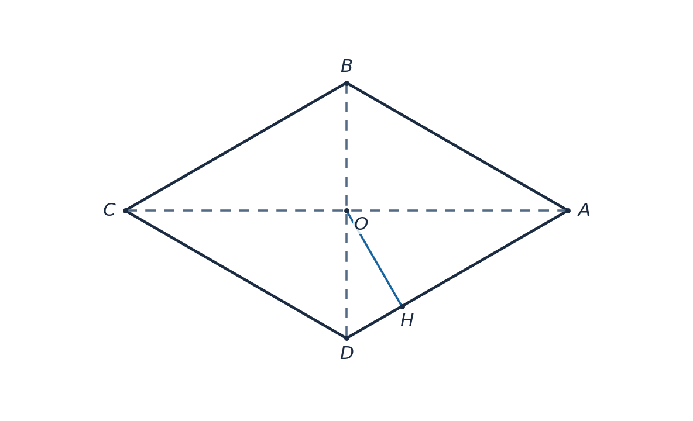

**Критерии**

- **2 балла.** Обосновано верное решение, получен правильный ответ. Диагональ-биссектриса и расстояние до стороны или разложение стороны/высота
- **1 балл.** Решение в целом верное, есть несущественный недостаток или вычислительная ошибка. Геометрический ход и основное равенство установлены, но есть вычислительный сбой или малая неточность оформления.
- **0 баллов.** Решение не удовлетворяет условиям для 1 или 2 баллов. Требуемый переход не доказан или взята величина, которую нельзя считать известной из условия.

[Источник карточки](https://math-oge.sdamgia.ru/problem?id=324778)

### Задача 2 · 324788

В ромбе ABCD высота AH делит сторону CD на отрезки DH = 21 и CH = 8. Найдите высоту AH.

Подсказка 1

Выдели прямоугольный треугольник с высотой или расстоянием до стороны.

Подсказка 2

Используй равенство сторон и то, что диагональ ромба делит угол пополам.

Ответ для самопроверки

$20$

Разбор и критерии

1. Сторона CD равна 21+8=29. Все стороны ромба равны, значит AD = 29.
2. В прямоугольном треугольнике ADH гипотенуза AD и катет DH. Отсюда $20=AH$.

**Критерии**

- **2 балла.** Обосновано верное решение, получен правильный ответ. Диагональ-биссектриса и расстояние до стороны или разложение стороны/высота
- **1 балл.** Решение в целом верное, есть несущественный недостаток или вычислительная ошибка. Геометрический ход и основное равенство установлены, но есть вычислительный сбой или малая неточность оформления.
- **0 баллов.** Решение не удовлетворяет условиям для 1 или 2 баллов. Требуемый переход не доказан или взята величина, которую нельзя считать известной из условия.

[Источник карточки](https://math-oge.sdamgia.ru/problem?id=324788)

### Задача 3 · 324779

Расстояние от пересечения диагоналей ромба до его стороны равно 14. Одна из диагоналей равна 56. Найдите углы ромба.

Подсказка 1

Выдели прямоугольный треугольник с высотой или расстоянием до стороны.

Подсказка 2

Используй равенство сторон и то, что диагональ ромба делит угол пополам.

Ответ для самопроверки

$60^\circ,\ 120^\circ$

Разбор и критерии

1. Пусть O — пересечение диагоналей, A — конец известной диагонали. Тогда OA = $28$. Из O опустим на сторону AD перпендикуляр OH длиной 14.
2. В прямоугольном треугольнике AOH синус угла OAH равен OH/OA = $\frac{1}{2}$. Диагональ ромба делит угол при A пополам, значит он равен $60^\circ$. Соседний угол дополняет его до 180°.

**Критерии**

- **2 балла.** Обосновано верное решение, получен правильный ответ. Диагональ-биссектриса и расстояние до стороны или разложение стороны/высота
- **1 балл.** Решение в целом верное, есть несущественный недостаток или вычислительная ошибка. Геометрический ход и основное равенство установлены, но есть вычислительный сбой или малая неточность оформления.
- **0 баллов.** Решение не удовлетворяет условиям для 1 или 2 баллов. Требуемый переход не доказан или взята величина, которую нельзя считать известной из условия.

[Источник карточки](https://math-oge.sdamgia.ru/problem?id=324779)

### Задача 4 · 324787

Расстояние от пересечения диагоналей ромба до его стороны равно 11. Одна из диагоналей равна 44. Найдите углы ромба.

Подсказка 1

Выдели прямоугольный треугольник с высотой или расстоянием до стороны.

Подсказка 2

Используй равенство сторон и то, что диагональ ромба делит угол пополам.

Ответ для самопроверки

$60^\circ,\ 120^\circ$

Разбор и критерии

1. Пусть O — пересечение диагоналей, A — конец известной диагонали. Тогда OA = $22$. Из O опустим на сторону AD перпендикуляр OH длиной 11.
2. В прямоугольном треугольнике AOH синус угла OAH равен OH/OA = $\frac{1}{2}$. Диагональ ромба делит угол при A пополам, значит он равен $60^\circ$. Соседний угол дополняет его до 180°.

**Критерии**

- **2 балла.** Обосновано верное решение, получен правильный ответ. Диагональ-биссектриса и расстояние до стороны или разложение стороны/высота
- **1 балл.** Решение в целом верное, есть несущественный недостаток или вычислительная ошибка. Геометрический ход и основное равенство установлены, но есть вычислительный сбой или малая неточность оформления.
- **0 баллов.** Решение не удовлетворяет условиям для 1 или 2 баллов. Требуемый переход не доказан или взята величина, которую нельзя считать известной из условия.

[Источник карточки](https://math-oge.sdamgia.ru/problem?id=324787)

### Задача 5 · 339549

В ромбе ABCD высота AH делит сторону CD на отрезки DH = 12 и CH = 3. Найдите высоту AH.

Подсказка 1

Выдели прямоугольный треугольник с высотой или расстоянием до стороны.

Подсказка 2

Используй равенство сторон и то, что диагональ ромба делит угол пополам.

Ответ для самопроверки

$9$

Разбор и критерии

1. Сторона CD равна 12+3=15. Все стороны ромба равны, значит AD = 15.
2. В прямоугольном треугольнике ADH гипотенуза AD и катет DH. Отсюда $9=AH$.

**Критерии**

- **2 балла.** Обосновано верное решение, получен правильный ответ. Диагональ-биссектриса и расстояние до стороны или разложение стороны/высота
- **1 балл.** Решение в целом верное, есть несущественный недостаток или вычислительная ошибка. Геометрический ход и основное равенство установлены, но есть вычислительный сбой или малая неточность оформления.
- **0 баллов.** Решение не удовлетворяет условиям для 1 или 2 баллов. Требуемый переход не доказан или взята величина, которую нельзя считать известной из условия.

[Источник карточки](https://math-oge.sdamgia.ru/problem?id=339549)

### Задача 6 · 339641

В ромбе ABCD высота AH делит сторону CD на отрезки DH = 15 и CH = 2. Найдите высоту AH.

Подсказка 1

Выдели прямоугольный треугольник с высотой или расстоянием до стороны.

Подсказка 2

Используй равенство сторон и то, что диагональ ромба делит угол пополам.

Ответ для самопроверки

$8$

Разбор и критерии

1. Сторона CD равна 15+2=17. Все стороны ромба равны, значит AD = 17.
2. В прямоугольном треугольнике ADH гипотенуза AD и катет DH. Отсюда $8=AH$.

**Критерии**

- **2 балла.** Обосновано верное решение, получен правильный ответ. Диагональ-биссектриса и расстояние до стороны или разложение стороны/высота
- **1 балл.** Решение в целом верное, есть несущественный недостаток или вычислительная ошибка. Геометрический ход и основное равенство установлены, но есть вычислительный сбой или малая неточность оформления.
- **0 баллов.** Решение не удовлетворяет условиям для 1 или 2 баллов. Требуемый переход не доказан или взята величина, которую нельзя считать известной из условия.

[Источник карточки](https://math-oge.sdamgia.ru/problem?id=339641)

## Четырёхугольники · Вычисление с биссектрисой параллелограмма

`OGE23-parallelogram-bisectors`

### Задача 1 · 316359

Биссектриса угла A параллелограмма ABCD встречает BC в точке K. Известно, что BK = 7 и KC = 3. Угол ABC равен 150°. Найдите площадь.

Подсказка 1

Отметь параллельные стороны и углы, образованные биссектрисой.

Подсказка 2

Найди равнобедренный треугольник или свяжи равные расстояния до параллельных сторон.

Ответ для самопроверки

$35$

Разбор и критерии

1. Из AD ∥ BC следует ∠DAK = ∠AKB. Так как AK делит угол A пополам, то ∠BAK = ∠AKB. Поэтому треугольник ABK равнобедренный и AB = BK.
2. Получаем AB = 7, BC = 10. Площадь равна AB·BC·sin ABC. После подстановки получаем $35$.

**Критерии**

- **2 балла.** Обосновано верное решение, получен правильный ответ. Равнобедренный треугольник на параллельной стороне или равные расстояния от точки пересечения
- **1 балл.** Решение в целом верное, есть несущественный недостаток или вычислительная ошибка. Геометрический ход и основное равенство установлены, но есть вычислительный сбой или малая неточность оформления.
- **0 баллов.** Решение не удовлетворяет условиям для 1 или 2 баллов. Требуемый переход не доказан или взята величина, которую нельзя считать известной из условия.

[Источник карточки](https://math-oge.sdamgia.ru/problem?id=316359)

### Задача 2 · 339709

В параллелограмме ABCD биссектрисы углов A и B пересеклись в K. Если BC = 19, а расстояние от K до AB равно 7, найдите площадь.

Подсказка 1

Отметь параллельные стороны и углы, образованные биссектрисой.

Подсказка 2

Найди равнобедренный треугольник или свяжи равные расстояния до параллельных сторон.

Ответ для самопроверки

$266$

Разбор и критерии

1. Точка K одинаково удалена от AB и AD, так как лежит на биссектрисе угла A. По биссектрисе угла B её расстояния до AB и BC тоже равны.
2. K находится между AD и BC. Обе высоты от K до этих параллельных сторон равны 7. Расстояние между прямыми равно 14, а площадь параллелограмма 19·14 = $266$.

**Критерии**

- **2 балла.** Обосновано верное решение, получен правильный ответ. Равнобедренный треугольник на параллельной стороне или равные расстояния от точки пересечения
- **1 балл.** Решение в целом верное, есть несущественный недостаток или вычислительная ошибка. Геометрический ход и основное равенство установлены, но есть вычислительный сбой или малая неточность оформления.
- **0 баллов.** Решение не удовлетворяет условиям для 1 или 2 баллов. Требуемый переход не доказан или взята величина, которую нельзя считать известной из условия.

[Источник карточки](https://math-oge.sdamgia.ru/problem?id=339709)

### Задача 3 · 352796

Биссектриса угла A параллелограмма ABCD встречает BC в точке K. Известно, что BK = 6 и KC = 10. Найдите периметр.

Подсказка 1

Отметь параллельные стороны и углы, образованные биссектрисой.

Подсказка 2

Найди равнобедренный треугольник или свяжи равные расстояния до параллельных сторон.

Ответ для самопроверки

$44$

Разбор и критерии

1. Из AD ∥ BC следует ∠DAK = ∠AKB. Так как AK делит угол A пополам, то ∠BAK = ∠AKB. Поэтому треугольник ABK равнобедренный и AB = BK.
2. Получаем AB = 6, BC = 16. Периметр равен удвоенной сумме этих сторон, то есть $44$.

**Критерии**

- **2 балла.** Обосновано верное решение, получен правильный ответ. Равнобедренный треугольник на параллельной стороне или равные расстояния от точки пересечения
- **1 балл.** Решение в целом верное, есть несущественный недостаток или вычислительная ошибка. Геометрический ход и основное равенство установлены, но есть вычислительный сбой или малая неточность оформления.
- **0 баллов.** Решение не удовлетворяет условиям для 1 или 2 баллов. Требуемый переход не доказан или взята величина, которую нельзя считать известной из условия.

[Источник карточки](https://math-oge.sdamgia.ru/problem?id=352796)

### Задача 4 · 316385

Биссектриса угла A параллелограмма ABCD встречает BC в точке K. Известно, что BK = 5 и KC = 2. Угол ABC равен 150°. Найдите площадь.

Подсказка 1

Отметь параллельные стороны и углы, образованные биссектрисой.

Подсказка 2

Найди равнобедренный треугольник или свяжи равные расстояния до параллельных сторон.

Ответ для самопроверки

$\frac{35}{2}$

Разбор и критерии

1. Из AD ∥ BC следует ∠DAK = ∠AKB. Так как AK делит угол A пополам, то ∠BAK = ∠AKB. Поэтому треугольник ABK равнобедренный и AB = BK.
2. Получаем AB = 5, BC = 7. Площадь равна AB·BC·sin ABC. После подстановки получаем $\frac{35}{2}$.

**Критерии**

- **2 балла.** Обосновано верное решение, получен правильный ответ. Равнобедренный треугольник на параллельной стороне или равные расстояния от точки пересечения
- **1 балл.** Решение в целом верное, есть несущественный недостаток или вычислительная ошибка. Геометрический ход и основное равенство установлены, но есть вычислительный сбой или малая неточность оформления.
- **0 баллов.** Решение не удовлетворяет условиям для 1 или 2 баллов. Требуемый переход не доказан или взята величина, которую нельзя считать известной из условия.

[Источник карточки](https://math-oge.sdamgia.ru/problem?id=316385)

### Задача 5 · 339430

Биссектриса угла A параллелограмма ABCD встречает BC в точке K. Известно, что BK = 7 и KC = 12. Найдите периметр.

Подсказка 1

Отметь параллельные стороны и углы, образованные биссектрисой.

Подсказка 2

Найди равнобедренный треугольник или свяжи равные расстояния до параллельных сторон.

Ответ для самопроверки

$52$

Разбор и критерии

1. Из AD ∥ BC следует ∠DAK = ∠AKB. Так как AK делит угол A пополам, то ∠BAK = ∠AKB. Поэтому треугольник ABK равнобедренный и AB = BK.
2. Получаем AB = 7, BC = 19. Периметр равен удвоенной сумме этих сторон, то есть $52$.

**Критерии**

- **2 балла.** Обосновано верное решение, получен правильный ответ. Равнобедренный треугольник на параллельной стороне или равные расстояния от точки пересечения
- **1 балл.** Решение в целом верное, есть несущественный недостаток или вычислительная ошибка. Геометрический ход и основное равенство установлены, но есть вычислительный сбой или малая неточность оформления.
- **0 баллов.** Решение не удовлетворяет условиям для 1 или 2 баллов. Требуемый переход не доказан или взята величина, которую нельзя считать известной из условия.

[Источник карточки](https://math-oge.sdamgia.ru/problem?id=339430)

### Задача 6 · 350064

Биссектриса угла A параллелограмма ABCD встречает BC в точке K. Известно, что BK = 8 и KC = 13. Найдите периметр.

Подсказка 1

Отметь параллельные стороны и углы, образованные биссектрисой.

Подсказка 2

Найди равнобедренный треугольник или свяжи равные расстояния до параллельных сторон.

Ответ для самопроверки

$58$

Разбор и критерии

1. Из AD ∥ BC следует ∠DAK = ∠AKB. Так как AK делит угол A пополам, то ∠BAK = ∠AKB. Поэтому треугольник ABK равнобедренный и AB = BK.
2. Получаем AB = 8, BC = 21. Периметр равен удвоенной сумме этих сторон, то есть $58$.

**Критерии**

- **2 балла.** Обосновано верное решение, получен правильный ответ. Равнобедренный треугольник на параллельной стороне или равные расстояния от точки пересечения
- **1 балл.** Решение в целом верное, есть несущественный недостаток или вычислительная ошибка. Геометрический ход и основное равенство установлены, но есть вычислительный сбой или малая неточность оформления.
- **0 баллов.** Решение не удовлетворяет условиям для 1 или 2 баллов. Требуемый переход не доказан или взята величина, которую нельзя считать известной из условия.

[Источник карточки](https://math-oge.sdamgia.ru/problem?id=350064)

## Четырёхугольники · Боковая сторона трапеции через общую высоту

`OGE23-trapezoid-trig`

### Задача 1 · 351992

В трапеции ABCD основания AD и BC, углы ABC и BCD равны 60° и 150°, сторона CD = 33. Найдите длину AB.

Подсказка 1

Проведи высоты от концов верхнего основания.

Подсказка 2

Вырази одну и ту же высоту через обе боковые стороны и синусы углов.

Ответ для самопроверки

$11 \sqrt{3}$

Разбор и критерии

1. Проведём из A и D перпендикуляры к прямой BC. Обе высоты равны расстоянию между параллельными основаниями. Обозначим эту длину h.
2. У C угол 150°. Острый угол между CD и прямой BC равен 180° − 150° = 30°. В прямоугольном треугольнике синус — отношение противолежащего катета h к гипотенузе CD. Поэтому $h=33\sin 30^\circ$.
3. У B так же получаем h = AB · sin 60°. Разделим первую высоту на синус этого угла: $AB=\frac{33\sin 30^\circ}{\sin 60^\circ}=11 \sqrt{3}$.

**Критерии**

- **2 балла.** Обосновано верное решение, получен правильный ответ. Приравнять две формулы для высоты, взять синус острого или дополнительного угла
- **1 балл.** Решение в целом верное, есть несущественный недостаток или вычислительная ошибка. Геометрический ход и основное равенство установлены, но есть вычислительный сбой или малая неточность оформления.
- **0 баллов.** Решение не удовлетворяет условиям для 1 или 2 баллов. Требуемый переход не доказан или взята величина, которую нельзя считать известной из условия.

[Источник карточки](https://math-oge.sdamgia.ru/problem?id=351992)

### Задача 2 · 339432

В трапеции ABCD основания AD и BC, углы ABC и BCD равны 30° и 120°, сторона CD = 25. Найдите длину AB.

Подсказка 1

Проведи высоты от концов верхнего основания.

Подсказка 2

Вырази одну и ту же высоту через обе боковые стороны и синусы углов.

Ответ для самопроверки

$25 \sqrt{3}$

Разбор и критерии

1. Проведём из A и D перпендикуляры к прямой BC. Обе высоты равны расстоянию между параллельными основаниями. Обозначим эту длину h.
2. У C угол 120°. Острый угол между CD и прямой BC равен 180° − 120° = 60°. В прямоугольном треугольнике синус — отношение противолежащего катета h к гипотенузе CD. Поэтому $h=25\sin 60^\circ$.
3. У B так же получаем h = AB · sin 30°. Разделим первую высоту на синус этого угла: $AB=\frac{25\sin 60^\circ}{\sin 30^\circ}=25 \sqrt{3}$.

**Критерии**

- **2 балла.** Обосновано верное решение, получен правильный ответ. Приравнять две формулы для высоты, взять синус острого или дополнительного угла
- **1 балл.** Решение в целом верное, есть несущественный недостаток или вычислительная ошибка. Геометрический ход и основное равенство установлены, но есть вычислительный сбой или малая неточность оформления.
- **0 баллов.** Решение не удовлетворяет условиям для 1 или 2 баллов. Требуемый переход не доказан или взята величина, которую нельзя считать известной из условия.

[Источник карточки](https://math-oge.sdamgia.ru/problem?id=339432)

### Задача 3 · 339454

В трапеции ABCD основания AD и BC, углы ABC и BCD равны 60° и 135°, сторона CD = 36. Найдите длину AB.

Подсказка 1

Проведи высоты от концов верхнего основания.

Подсказка 2

Вырази одну и ту же высоту через обе боковые стороны и синусы углов.

Ответ для самопроверки

$12 \sqrt{6}$

Разбор и критерии

1. Проведём из A и D перпендикуляры к прямой BC. Обе высоты равны расстоянию между параллельными основаниями. Обозначим эту длину h.
2. У C угол 135°. Острый угол между CD и прямой BC равен 180° − 135° = 45°. В прямоугольном треугольнике синус — отношение противолежащего катета h к гипотенузе CD. Поэтому $h=36\sin 45^\circ$.
3. У B так же получаем h = AB · sin 60°. Разделим первую высоту на синус этого угла: $AB=\frac{36\sin 45^\circ}{\sin 60^\circ}=12 \sqrt{6}$.

**Критерии**

- **2 балла.** Обосновано верное решение, получен правильный ответ. Приравнять две формулы для высоты, взять синус острого или дополнительного угла
- **1 балл.** Решение в целом верное, есть несущественный недостаток или вычислительная ошибка. Геометрический ход и основное равенство установлены, но есть вычислительный сбой или малая неточность оформления.
- **0 баллов.** Решение не удовлетворяет условиям для 1 или 2 баллов. Требуемый переход не доказан или взята величина, которую нельзя считать известной из условия.

[Источник карточки](https://math-oge.sdamgia.ru/problem?id=339454)

### Задача 4 · 348741

В трапеции ABCD основания AD и BC, углы ABC и BCD равны 45° и 150°, сторона CD = 32. Найдите длину AB.

Подсказка 1

Проведи высоты от концов верхнего основания.

Подсказка 2

Вырази одну и ту же высоту через обе боковые стороны и синусы углов.

Ответ для самопроверки

$16 \sqrt{2}$

Разбор и критерии

1. Проведём из A и D перпендикуляры к прямой BC. Обе высоты равны расстоянию между параллельными основаниями. Обозначим эту длину h.
2. У C угол 150°. Острый угол между CD и прямой BC равен 180° − 150° = 30°. В прямоугольном треугольнике синус — отношение противолежащего катета h к гипотенузе CD. Поэтому $h=32\sin 30^\circ$.
3. У B так же получаем h = AB · sin 45°. Разделим первую высоту на синус этого угла: $AB=\frac{32\sin 30^\circ}{\sin 45^\circ}=16 \sqrt{2}$.

**Критерии**

- **2 балла.** Обосновано верное решение, получен правильный ответ. Приравнять две формулы для высоты, взять синус острого или дополнительного угла
- **1 балл.** Решение в целом верное, есть несущественный недостаток или вычислительная ошибка. Геометрический ход и основное равенство установлены, но есть вычислительный сбой или малая неточность оформления.
- **0 баллов.** Решение не удовлетворяет условиям для 1 или 2 баллов. Требуемый переход не доказан или взята величина, которую нельзя считать известной из условия.

[Источник карточки](https://math-oge.sdamgia.ru/problem?id=348741)

### Задача 5 · 349618

В трапеции ABCD основания AD и BC, углы ABC и BCD равны 45° и 120°, сторона CD = 34. Найдите длину AB.

Подсказка 1

Проведи высоты от концов верхнего основания.

Подсказка 2

Вырази одну и ту же высоту через обе боковые стороны и синусы углов.

Ответ для самопроверки

$17 \sqrt{6}$

Разбор и критерии

1. Проведём из A и D перпендикуляры к прямой BC. Обе высоты равны расстоянию между параллельными основаниями. Обозначим эту длину h.
2. У C угол 120°. Острый угол между CD и прямой BC равен 180° − 120° = 60°. В прямоугольном треугольнике синус — отношение противолежащего катета h к гипотенузе CD. Поэтому $h=34\sin 60^\circ$.
3. У B так же получаем h = AB · sin 45°. Разделим первую высоту на синус этого угла: $AB=\frac{34\sin 60^\circ}{\sin 45^\circ}=17 \sqrt{6}$.

**Критерии**

- **2 балла.** Обосновано верное решение, получен правильный ответ. Приравнять две формулы для высоты, взять синус острого или дополнительного угла
- **1 балл.** Решение в целом верное, есть несущественный недостаток или вычислительная ошибка. Геометрический ход и основное равенство установлены, но есть вычислительный сбой или малая неточность оформления.
- **0 баллов.** Решение не удовлетворяет условиям для 1 или 2 баллов. Требуемый переход не доказан или взята величина, которую нельзя считать известной из условия.

[Источник карточки](https://math-oge.sdamgia.ru/problem?id=349618)

### Задача 6 · 349709

В трапеции ABCD основания AD и BC, углы ABC и BCD равны 45° и 120°, сторона CD = 40. Найдите длину AB.

Подсказка 1

Проведи высоты от концов верхнего основания.

Подсказка 2

Вырази одну и ту же высоту через обе боковые стороны и синусы углов.

Ответ для самопроверки

$20 \sqrt{6}$

Разбор и критерии

1. Проведём из A и D перпендикуляры к прямой BC. Обе высоты равны расстоянию между параллельными основаниями. Обозначим эту длину h.
2. У C угол 120°. Острый угол между CD и прямой BC равен 180° − 120° = 60°. В прямоугольном треугольнике синус — отношение противолежащего катета h к гипотенузе CD. Поэтому $h=40\sin 60^\circ$.
3. У B так же получаем h = AB · sin 45°. Разделим первую высоту на синус этого угла: $AB=\frac{40\sin 60^\circ}{\sin 45^\circ}=20 \sqrt{6}$.

**Критерии**

- **2 балла.** Обосновано верное решение, получен правильный ответ. Приравнять две формулы для высоты, взять синус острого или дополнительного угла
- **1 балл.** Решение в целом верное, есть несущественный недостаток или вычислительная ошибка. Геометрический ход и основное равенство установлены, но есть вычислительный сбой или малая неточность оформления.
- **0 баллов.** Решение не удовлетворяет условиям для 1 или 2 баллов. Требуемый переход не доказан или взята величина, которую нельзя считать известной из условия.

[Источник карточки](https://math-oge.sdamgia.ru/problem?id=349709)

## Описанная окружность · Вычисление хорды или радиуса по теореме синусов

`OGE23-sine-rule`

### Задача 1 · 311650

В треугольнике $ABC$ угол $B$ равен $72^\circ$, угол $C$ — $63^\circ$, сторона $BC=2\sqrt2$. Найдите радиус описанной окружности.

Подсказка 1

Найди угол напротив указанной стороны.

Подсказка 2

Используй соотношение между стороной, синусом противолежащего угла и диаметром окружности.

Ответ для самопроверки

$2$.

Разбор и критерии

1. Напротив стороны $BC$ находится угол $A=180^\circ-72^\circ-63^\circ=45^\circ$.
2. По расширенной теореме синусов $BC=2R\sin A$.
3. Тогда $R=2\sqrt2/(2\cdot\sqrt2/2)=2$.

**Критерии**

- **2 балла.** Обосновано верное решение, получен правильный ответ. Найден угол напротив BC и правильно применена формула BC=2R sin A.
- **1 балл.** Решение в целом верное, есть несущественный недостаток или вычислительная ошибка. Теорема применена к правильному углу, но допущена вычислительная ошибка.
- **0 баллов.** Решение не удовлетворяет условиям для 1 или 2 баллов. Сторона BC сопоставлена углу B или C без другой верной схемы.

[Источник карточки](https://math-oge.sdamgia.ru/problem?id=311650)

### Задача 2 · 448904

В треугольнике ABC углы B и C равны 67° и 83°. Радиус описанной окружности равен $16$. Найдите BC.

Подсказка 1

Найди угол напротив указанной стороны.

Подсказка 2

Используй соотношение между стороной, синусом противолежащего угла и диаметром окружности.

Ответ для самопроверки

$16$

Разбор и критерии

1. Угол A напротив BC равен 180° − 67° − 83° = 30°.
2. Расширенная теорема синусов даёт $BC=2R\sin 30^\circ$. Подставляем радиус и вычисляем сторону $16$.

**Критерии**

- **2 балла.** Обосновано верное решение, получен правильный ответ. Сначала найти угол напротив заданной стороны, затем применить a=2R sin α
- **1 балл.** Решение в целом верное, есть несущественный недостаток или вычислительная ошибка. Геометрический ход и основное равенство установлены, но есть вычислительный сбой или малая неточность оформления.
- **0 баллов.** Решение не удовлетворяет условиям для 1 или 2 баллов. Требуемый переход не доказан или взята величина, которую нельзя считать известной из условия.

[Источник карточки](https://math-oge.sdamgia.ru/problem?id=448904)

### Задача 3 · 311651

В треугольнике ABC углы B и C равны 56° и 64°. Сторона BC = $3 \sqrt{3}$. Найдите радиус описанной окружности.

Подсказка 1

Найди угол напротив указанной стороны.

Подсказка 2

Используй соотношение между стороной, синусом противолежащего угла и диаметром окружности.

Ответ для самопроверки

$3$

Разбор и критерии

1. Угол A напротив BC равен 180° − 56° − 64° = 60°.
2. Расширенная теорема синусов даёт $BC=2R\sin 60^\circ$. Выражаем R и подставляем длину BC, получаем $3$.

**Критерии**

- **2 балла.** Обосновано верное решение, получен правильный ответ. Сначала найти угол напротив заданной стороны, затем применить a=2R sin α
- **1 балл.** Решение в целом верное, есть несущественный недостаток или вычислительная ошибка. Геометрический ход и основное равенство установлены, но есть вычислительный сбой или малая неточность оформления.
- **0 баллов.** Решение не удовлетворяет условиям для 1 или 2 баллов. Требуемый переход не доказан или взята величина, которую нельзя считать известной из условия.

[Источник карточки](https://math-oge.sdamgia.ru/problem?id=311651)

### Задача 4 · AE3B14

В треугольнике ABC углы B и C равны 65° и 85°. Радиус описанной окружности равен $14$. Найдите BC.

Подсказка 1

Найди угол напротив указанной стороны.

Подсказка 2

Используй соотношение между стороной, синусом противолежащего угла и диаметром окружности.

Ответ для самопроверки

$14$

Разбор и критерии

1. Угол A напротив BC равен 180° − 65° − 85° = 30°.
2. Расширенная теорема синусов даёт $BC=2R\sin 30^\circ$. Подставляем радиус и вычисляем сторону $14$.

**Критерии**

- **2 балла.** Обосновано верное решение, получен правильный ответ. Сначала найти угол напротив заданной стороны, затем применить a=2R sin α
- **1 балл.** Решение в целом верное, есть несущественный недостаток или вычислительная ошибка. Геометрический ход и основное равенство установлены, но есть вычислительный сбой или малая неточность оформления.
- **0 баллов.** Решение не удовлетворяет условиям для 1 или 2 баллов. Требуемый переход не доказан или взята величина, которую нельзя считать известной из условия.

[Источник карточки](https://sdamgia.online/oge/matematika/zadanie-23/storona-treugolnika-i-radius-okruzhnosti-fipi-ae3b14) · Код AE3B14 по каталогу sdamgia.online

### Задача 5 · CF802A

В треугольнике ABC углы B и C равны 72° и 78°. Радиус описанной окружности равен $17$. Найдите BC.

Подсказка 1

Найди угол напротив указанной стороны.

Подсказка 2

Используй соотношение между стороной, синусом противолежащего угла и диаметром окружности.

Ответ для самопроверки

$17$

Разбор и критерии

1. Угол A напротив BC равен 180° − 72° − 78° = 30°.
2. Расширенная теорема синусов даёт $BC=2R\sin 30^\circ$. Подставляем радиус и вычисляем сторону $17$.

**Критерии**

- **2 балла.** Обосновано верное решение, получен правильный ответ. Сначала найти угол напротив заданной стороны, затем применить a=2R sin α
- **1 балл.** Решение в целом верное, есть несущественный недостаток или вычислительная ошибка. Геометрический ход и основное равенство установлены, но есть вычислительный сбой или малая неточность оформления.
- **0 баллов.** Решение не удовлетворяет условиям для 1 или 2 баллов. Требуемый переход не доказан или взята величина, которую нельзя считать известной из условия.

[Источник карточки](https://sdamgia.online/oge/matematika/zadanie-23/storona-treugolnika-i-radius-okruzhnosti-fipi-cf802a) · Код CF802A по каталогу sdamgia.online

### Задача 6 · 6AFB28

В треугольнике ABC углы B и C равны 71° и 79°. Радиус описанной окружности равен $8$. Найдите BC.

Подсказка 1

Найди угол напротив указанной стороны.

Подсказка 2

Используй соотношение между стороной, синусом противолежащего угла и диаметром окружности.

Ответ для самопроверки

$8$

Разбор и критерии

1. Угол A напротив BC равен 180° − 71° − 79° = 30°.
2. Расширенная теорема синусов даёт $BC=2R\sin 30^\circ$. Подставляем радиус и вычисляем сторону $8$.

**Критерии**

- **2 балла.** Обосновано верное решение, получен правильный ответ. Сначала найти угол напротив заданной стороны, затем применить a=2R sin α
- **1 балл.** Решение в целом верное, есть несущественный недостаток или вычислительная ошибка. Геометрический ход и основное равенство установлены, но есть вычислительный сбой или малая неточность оформления.
- **0 баллов.** Решение не удовлетворяет условиям для 1 или 2 баллов. Требуемый переход не доказан или взята величина, которую нельзя считать известной из условия.

[Источник карточки](https://sdamgia.online/oge/matematika/zadanie-23/storona-treugolnika-i-radius-okruzhnosti-fipi-6afb28) · Код 6AFB28 по каталогу sdamgia.online
