# №24 · Доказательства

[К сводке](../README.md)

## Доказательства через вписанность · Подобие у внешней точки двух секущих

`OGE24-cyclic-external`

### Задача 1 · D24-2027

Четырёхугольник $ABCD$ вписан в окружность. Продолжения $AB$ и $CD$ пересекаются в точке $M$. Докажите, что $\triangle MBC\sim\triangle MDA$.

Подсказка 1

Найди две секущие из точки пересечения продолжений сторон.

Подсказка 2

Воспользуйся равенством произведений отрезков секущих и общим углом между ними.

Ответ для самопроверки

Доказано подобие в соответствии $M\leftrightarrow M$, $B\leftrightarrow D$, $C\leftrightarrow A$.

Разбор и критерии

1. Точка $M$ внешняя по отношению к окружности, так как она лежит на продолжениях обеих хорд.
2. По теореме о двух секущих $MA\cdot MB=MD\cdot MC$.
3. Отсюда $MB/MD=MC/MA$.
4. Лучи $MB$ и $MA$ совпадают, как и лучи $MC$ и $MD$, поэтому $\angle BMC=\angle DMA$.
5. По двум пропорциональным сторонам и углу между ними $\triangle MBC\sim\triangle MDA$.
6. Тот же результат можно доказать по двум углам с обоснованием расположения точек.

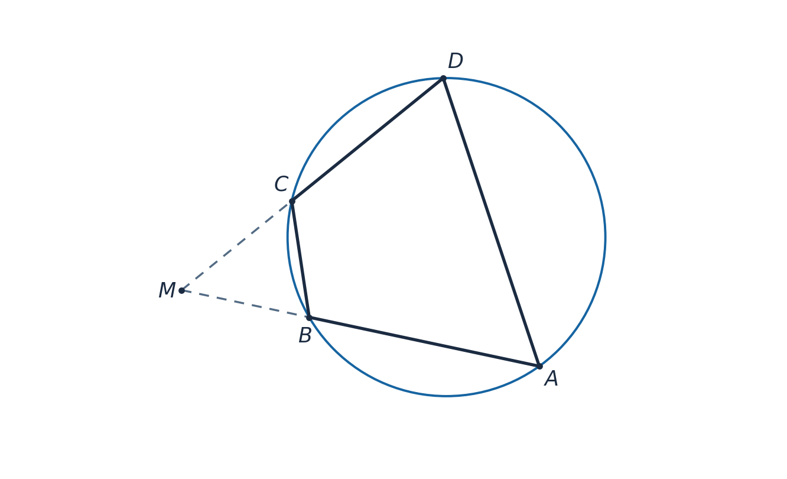

**Критерии**

- **2 балла.** Закончено правильное доказательство с обоснованием существенных шагов. Обоснованы равенство углов и именно нужные пары пропорциональных сторон, либо приведено верное доказательство по двум углам.
- **1 балл.** Доказательство по существу верно, есть несущественный недостаток. Доказательство в целом полно, но есть несущественная погрешность обозначений, которую можно однозначно восстановить.
- **0 баллов.** Доказательство не удовлетворяет условиям для 1 или 2 баллов. Указан один общий угол, но второй признак подобия ничем не подтверждён.

[Источник карточки](https://doc.fipi.ru/oge/demoversii-specifikacii-kodifikatory/2027/ma_9_2027.zip) · МА-9 ОГЭ 2027_ДЕМО.pdf, печатная стр. 14, решение и шкала на стр. 20

### Задача 2 · авторская тренировка

Из точки M проведены два луча, лежащие на разных прямых. На первом в порядке удаления от M лежат A и B, на втором C и D. Известно MA·MB = MC·MD. Докажите, что A, B, C и D лежат на одной окружности.

Подсказка 1

Начни с окружности через три точки.

Подсказка 2

Вторую точку на луче MC можно определить по произведению отрезков.

Ответ для самопроверки

A, B, C и D лежат на одной окружности.

Разбор и критерии

1. Проведём окружность через A, B и C. Точка M находится вне неё, поскольку обе точки пересечения прямой MAB лежат по одну сторону от M.
2. Пусть второе пересечение прямой MC с окружностью — D′. Точка M внешняя, поэтому оба пересечения лежат на луче MC. Теорема о секущих даёт MC·MD′ = MA·MB. Касание дало бы MC² вместо MC·MD, но по порядку точек MC < MD, поэтому оно исключено.
3. По условию MC·MD′ = MC·MD, откуда MD′ = MD. Точки на одном луче с одинаковым расстоянием от начала совпадают. Поэтому D лежит на той же окружности.

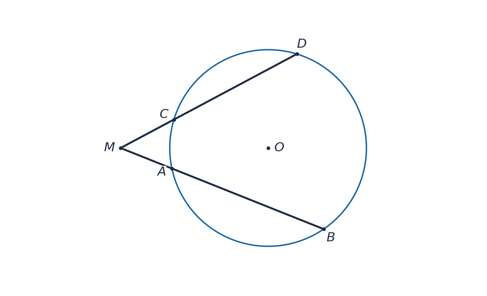

**Критерии**

- **2 балла.** Закончено правильное доказательство с обоснованием существенных шагов. Полностью обоснован вывод: A, B, C и D лежат на одной окружности.
- **1 балл.** Доказательство по существу верно, есть несущественный недостаток. Опорный переход с обоснованием есть. Неточность записи не меняет вывода.
- **0 баллов.** Доказательство не удовлетворяет условиям для 1 или 2 баллов. Пропущен ключевой аргумент либо утверждение принято по виду чертежа.

[Пример семейства](https://math-oge.sdamgia.ru/problem?id=333348)

### Задача 3 · авторская тренировка

Из внешней точки M к окружности с центром O проведены касательная MT и секущая, пересекающая окружность в A и B по порядку. Докажите равенство MT² = MA·MB с помощью теоремы Пифагора.

Подсказка 1

Опусти перпендикуляр из O на секущую.

Подсказка 2

Раскрой MA·MB как разность квадратов.

Ответ для самопроверки

MT² = MA·MB.

Разбор и критерии

1. Опустим OH на секущую. H — середина хорды AB, так что MA=MH−HA и MB=MH+HA.
2. Следовательно, MA·MB=MH²−HA². Если H ≠ O, из теоремы Пифагора для MHO и AHO следует MH²−HA² = MO²−OA². Если секущая проходит через центр, H = O и это равенство выполняется напрямую.
3. Радиус OT перпендикулярен MT, а OT=OA. Поэтому по Пифагору MO²−OA²=MT².

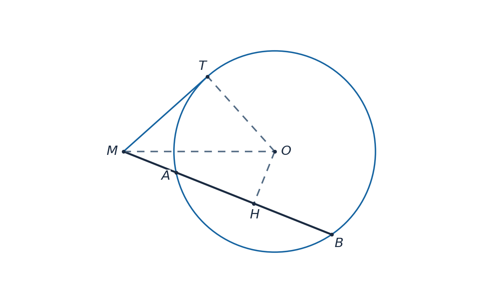

**Критерии**

- **2 балла.** Закончено правильное доказательство с обоснованием существенных шагов. Полностью обоснован вывод: MT² = MA·MB.
- **1 балл.** Доказательство по существу верно, есть несущественный недостаток. Опорный переход с обоснованием есть. Неточность записи не меняет вывода.
- **0 баллов.** Доказательство не удовлетворяет условиям для 1 или 2 баллов. Пропущен ключевой аргумент либо утверждение принято по виду чертежа.

[Пример семейства](https://math-oge.sdamgia.ru/problem?id=333348)

### Задача 4 · авторская тренировка

Точка M лежит вне окружности. Лучи из M пересекают её в A, B и C, D соответственно. Ближние к M точки A и C равноудалены от неё. Докажите AC ∥ BD.

Подсказка 1

Распространи MA = MC на вторую пару точек.

Подсказка 2

Сравни два треугольника с вершиной M.

Ответ для самопроверки

AC ∥ BD.

Разбор и критерии

1. Из равенства произведений MA·MB = MC·MD и условия MA = MC получаем MB = MD.
2. Следовательно, MA/MB = MC/MD. У треугольников MAC и MBD общий угол при M и пропорциональные стороны при нём. Они подобны.
3. Соответствующие углы при A и B равны. Поскольку A и B на одном луче из M, это означает AC ∥ BD.

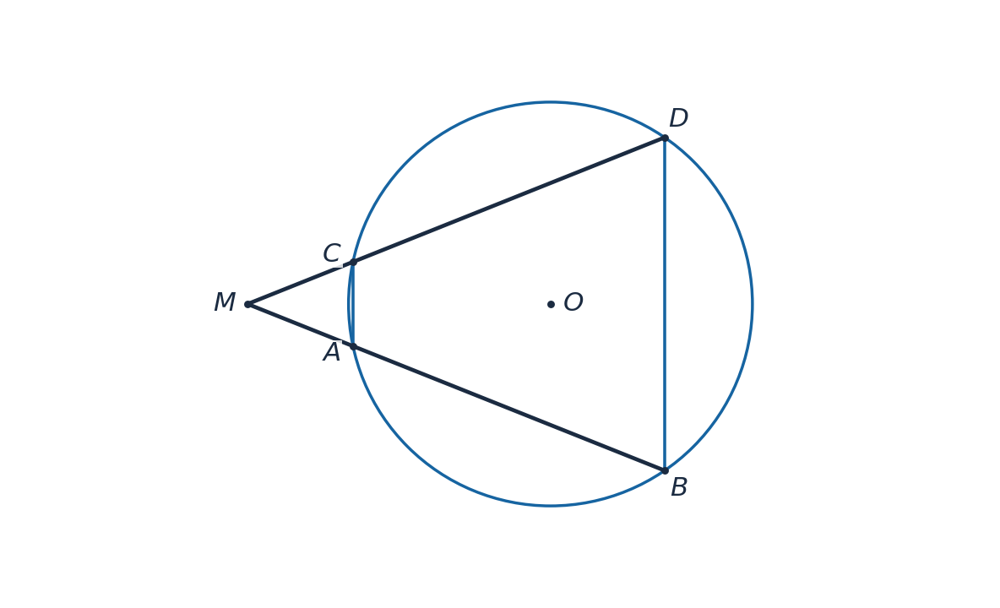

**Критерии**

- **2 балла.** Закончено правильное доказательство с обоснованием существенных шагов. Полностью обоснован вывод: AC ∥ BD.
- **1 балл.** Доказательство по существу верно, есть несущественный недостаток. Опорный переход с обоснованием есть. Неточность записи не меняет вывода.
- **0 баллов.** Доказательство не удовлетворяет условиям для 1 или 2 баллов. Пропущен ключевой аргумент либо утверждение принято по виду чертежа.

[Пример семейства](https://math-oge.sdamgia.ru/problem?id=333348)

### Задача 5 · авторская тренировка

Из внешней точки M проведены две секущие. На одной лежат A, B, на другой C, D, ближние точки A и C. Если MA+MB = MC+MD, докажите, что длины хорд AB и CD равны.

Подсказка 1

Сравни не только суммы, но и произведения расстояний.

Подсказка 2

Из суммы и произведения можно найти квадрат разности.

Ответ для самопроверки

AB = CD.

Разбор и критерии

1. Обозначим общую сумму через s, а общее произведение MA·MB=MC·MD через p. Произведения совпадают по теореме о секущих.
2. Квадрат разности двух положительных чисел равен квадрату их суммы минус четыре произведения. Поэтому (MB−MA)² = s²−4p = (MD−MC)².
3. Обе разности положительны. Значит, MB−MA = MD−MC, то есть AB = CD.

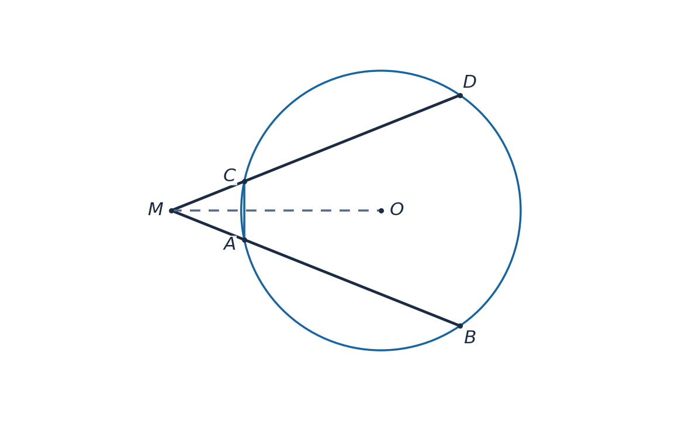

**Критерии**

- **2 балла.** Закончено правильное доказательство с обоснованием существенных шагов. Полностью обоснован вывод: AB = CD.
- **1 балл.** Доказательство по существу верно, есть несущественный недостаток. Опорный переход с обоснованием есть. Неточность записи не меняет вывода.
- **0 баллов.** Доказательство не удовлетворяет условиям для 1 или 2 баллов. Пропущен ключевой аргумент либо утверждение принято по виду чертежа.

[Пример семейства](https://math-oge.sdamgia.ru/problem?id=333348)

### Задача 6 · авторская тренировка

Из внешней точки M проведены секущие MAB и MCD к окружности с центром O. Точки A и C ближе к M. Известно MA/MB = MC/MD. Докажите, что MO делит угол AMC пополам.

Подсказка 1

Возведи расстояния дальних точек в квадрат через отношение и произведение.

Подсказка 2

У каких двух точек одинаковы расстояния до A и C?

Ответ для самопроверки

Луч MO — биссектриса угла AMC.

Разбор и критерии

1. Обозначим равные отношения через t. Тогда MA=t·MB и MC=t·MD. Теорема о двух секущих даёт t·MB²=t·MD², откуда MB=MD и MA=MC.
2. Точки M и O обе равноудалены от концов хорды AC: для M это только что получено, для O расстояния равны радиусу. Поэтому MO — серединный перпендикуляр к AC.
3. В равнобедренном треугольнике AMC эта прямая проходит через середину AC и делит угол при M. Луч MO направлен внутрь угла: проекции O на оба луча лежат между соответствующими точками пересечения и положительны.

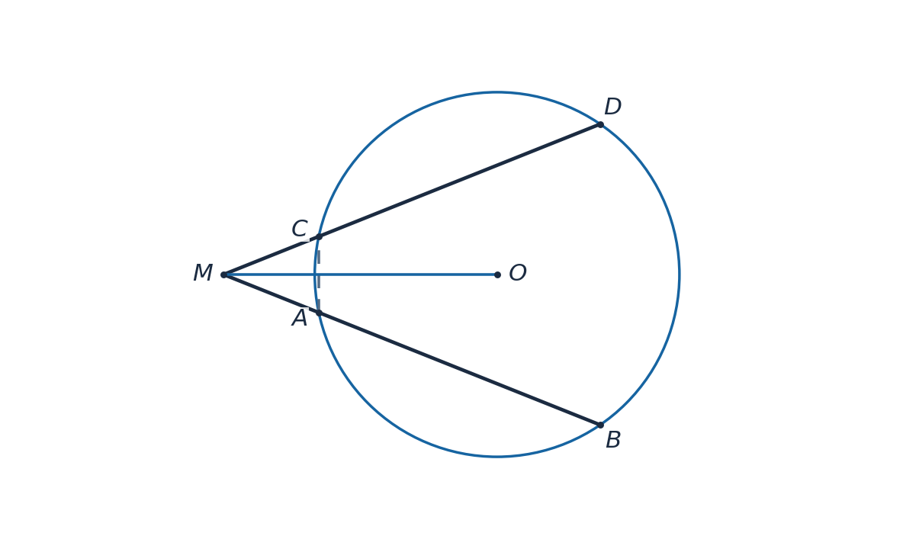

**Критерии**

- **2 балла.** Закончено правильное доказательство с обоснованием существенных шагов. Полностью обоснован вывод: Луч MO — биссектриса угла AMC.
- **1 балл.** Доказательство по существу верно, есть несущественный недостаток. Опорный переход с обоснованием есть. Неточность записи не меняет вывода.
- **0 баллов.** Доказательство не удовлетворяет условиям для 1 или 2 баллов. Пропущен ключевой аргумент либо утверждение принято по виду чертежа.

[Пример семейства](https://math-oge.sdamgia.ru/problem?id=333348)

## Доказательства через вписанность · Равные углы → вписанность → новые равные углы

`OGE24-cyclic-converse`

### Задача 1 · 340880

В выпуклом четырёхугольнике $ABCD$ равны углы $ABD$ и $ACD$. Докажите, что $\angle DAC=\angle DBC$.

Подсказка 1

Проверь, на какой отрезок смотрят данные равные углы.

Подсказка 2

Через признак вписанности перейди к новой паре углов, опирающихся на одну хорду.

Ответ для самопроверки

$\angle DAC=\angle DBC$.

Разбор и критерии

1. Точки $B,C$ лежат по одну сторону от стороны $AD$.
2. Из них отрезок $AD$ виден под равными углами по условию, поэтому $A,B,C,D$ лежат на одной окружности.
3. Теперь $A,B$ лежат с одной стороны от стороны $CD$, и углы $DAC$ и $DBC$ опираются на одну и ту же дугу $DC$.
4. Следовательно, они равны.

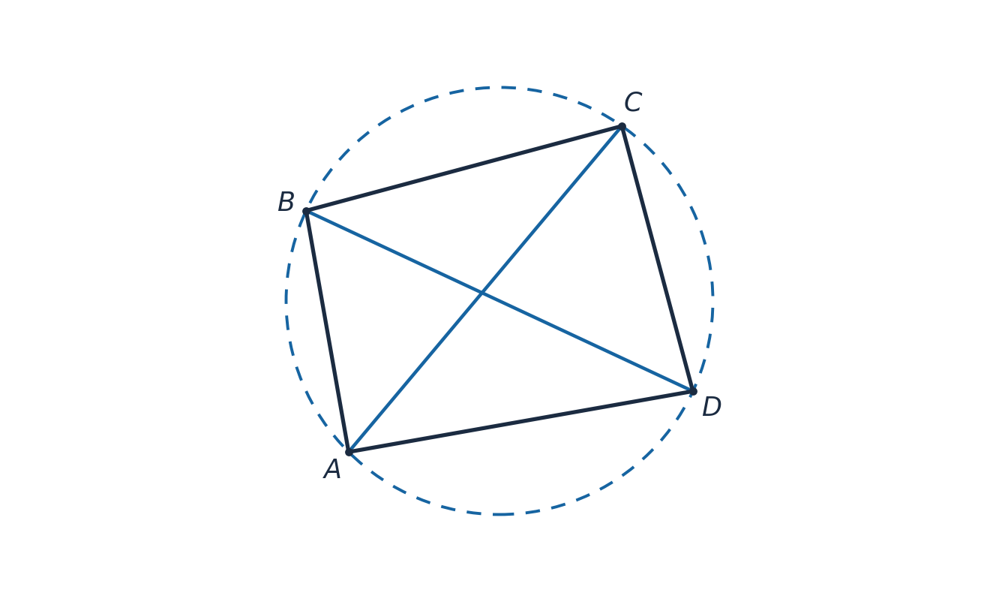

**Критерии**

- **2 балла.** Закончено правильное доказательство с обоснованием существенных шагов. Обоснованы обратное утверждение о вписанности и переход ко второй паре углов.
- **1 балл.** Доказательство по существу верно, есть несущественный недостаток. Вся цепочка прослеживается, но есть несущественная неточность в формулировке теоремы или обозначениях.
- **0 баллов.** Доказательство не удовлетворяет условиям для 1 или 2 баллов. Вписанность принята по рисунку или впервые заявлена после уже использованного вывода.

[Источник карточки](https://math-oge.sdamgia.ru/problem?id=340880)

### Задача 2 · авторская тренировка

В выпуклом четырёхугольнике ABCD сумма углов ABC и ADC равна 180°. Докажите, что ∠BAC = ∠BDC.

Подсказка 1

Что говорит сумма противоположных углов?

Подсказка 2

На какую хорду опираются два нужных угла?

Ответ для самопроверки

∠BAC = ∠BDC.

Разбор и критерии

1. У B и D противоположные вершины. Сумма этих углов равна 180°, поэтому четырёхугольник вписанный по обратному признаку.
2. Углы BAC и BDC опираются на одну хорду BC, причём A и D лежат по одну сторону от неё. Поэтому равные вписанные углы дают требуемое равенство.

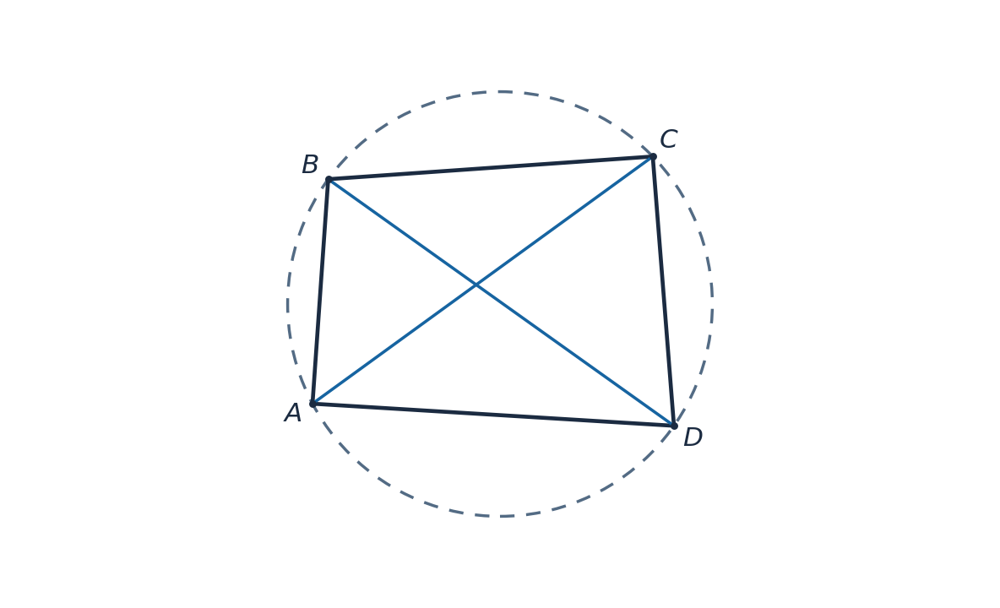

**Критерии**

- **2 балла.** Закончено правильное доказательство с обоснованием существенных шагов. Полностью обоснован вывод: ∠BAC = ∠BDC.
- **1 балл.** Доказательство по существу верно, есть несущественный недостаток. Опорный переход с обоснованием есть. Неточность записи не меняет вывода.
- **0 баллов.** Доказательство не удовлетворяет условиям для 1 или 2 баллов. Пропущен ключевой аргумент либо утверждение принято по виду чертежа.

[Пример семейства](https://math-oge.sdamgia.ru/problem?id=340880)

### Задача 3 · авторская тренировка

У выпуклого ABCD углы ABC и ADC в сумме дают 180°, а AB = BC. Докажите, что DB — биссектриса угла ADC.

Подсказка 1

Сначала установи вписанность.

Подсказка 2

Какие углы при D опираются на равные хорды?

Ответ для самопроверки

∠ADB = ∠BDC.

Разбор и критерии

1. Сумма противоположных углов означает, что через четыре вершины можно провести окружность.
2. Равные хорды AB и BC отсекают равные дуги, не содержащие D. Поэтому вписанные углы ADB и BDC равны. Диагональ DB лежит внутри угла ADC и делит его пополам.

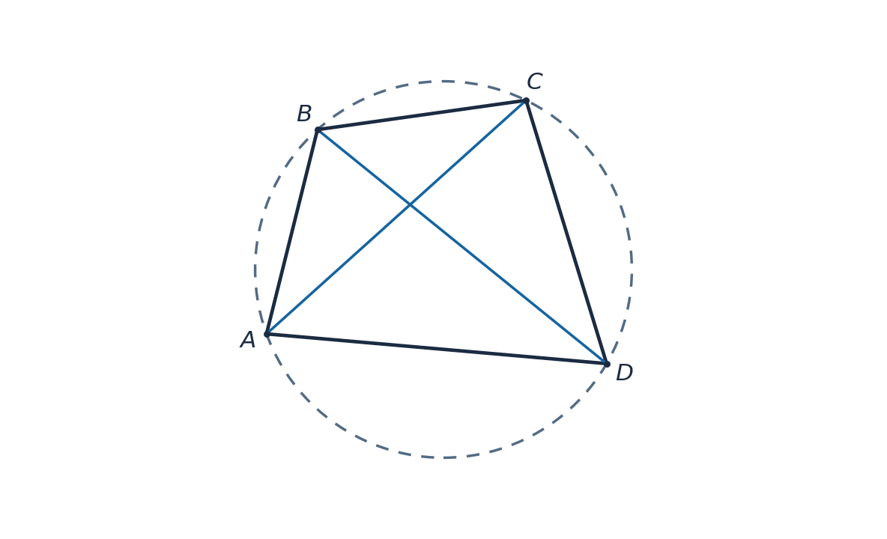

**Критерии**

- **2 балла.** Закончено правильное доказательство с обоснованием существенных шагов. Полностью обоснован вывод: ∠ADB = ∠BDC.
- **1 балл.** Доказательство по существу верно, есть несущественный недостаток. Опорный переход с обоснованием есть. Неточность записи не меняет вывода.
- **0 баллов.** Доказательство не удовлетворяет условиям для 1 или 2 баллов. Пропущен ключевой аргумент либо утверждение принято по виду чертежа.

[Пример семейства](https://math-oge.sdamgia.ru/problem?id=340880)

### Задача 4 · авторская тренировка

В выпуклом четырёхугольнике ABCD углы BAD и BCD прямые. Докажите ∠ABD = ∠ACD.

Подсказка 1

Найди общий отрезок, видимый под обоими прямыми углами.

Подсказка 2

Определи хорду, соответствующую углам ABD и ACD.

Ответ для самопроверки

∠ABD = ∠ACD.

Разбор и критерии

1. Из условия обе точки A и C входят в окружность с диаметром BD. Действительно, из каждой BD виден под прямым углом.
2. Получили вписанный четырёхугольник. Углы ABD и ACD опираются на дугу AD без B и C, поэтому равны.

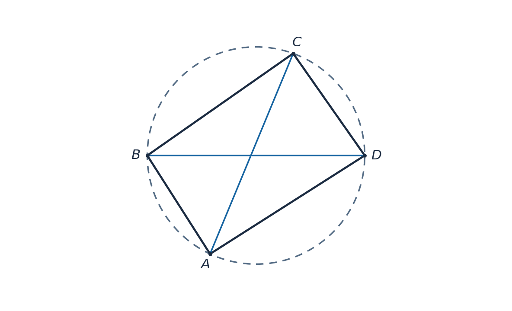

**Критерии**

- **2 балла.** Закончено правильное доказательство с обоснованием существенных шагов. Полностью обоснован вывод: ∠ABD = ∠ACD.
- **1 балл.** Доказательство по существу верно, есть несущественный недостаток. Опорный переход с обоснованием есть. Неточность записи не меняет вывода.
- **0 баллов.** Доказательство не удовлетворяет условиям для 1 или 2 баллов. Пропущен ключевой аргумент либо утверждение принято по виду чертежа.

[Пример семейства](https://math-oge.sdamgia.ru/problem?id=340880)

### Задача 5 · авторская тренировка

В выпуклом ABCD известно ∠ABD = ∠ACD и AB = CD. Докажите, что ∠ADB = ∠CAD.

Подсказка 1

Углы в условии сначала дают общую окружность.

Подсказка 2

Сравни дуги AB и CD, которые не содержат других вершин.

Ответ для самопроверки

∠ADB = ∠CAD.

Разбор и критерии

1. B и C лежат с одной стороны от AD и видят её под одинаковыми углами. По признаку вписанности A, B, C, D лежат на одной окружности.
2. Хордам AB и CD соответствуют равные дуги без остальных вершин. Эти две дуги не пересекаются, поэтому ни одна не может быть большей дугой, а другая — меньшей к такой же хорде: тогда они вместе заняли бы всю окружность.
3. Равным дугам соответствуют равные вписанные углы ADB и CAD.

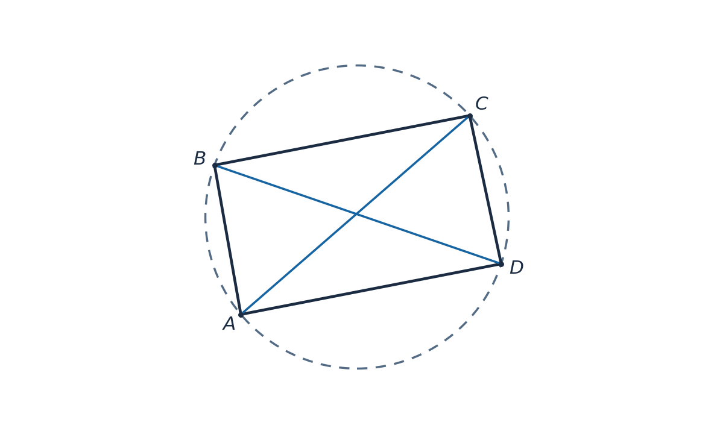

**Критерии**

- **2 балла.** Закончено правильное доказательство с обоснованием существенных шагов. Полностью обоснован вывод: ∠ADB = ∠CAD.
- **1 балл.** Доказательство по существу верно, есть несущественный недостаток. Опорный переход с обоснованием есть. Неточность записи не меняет вывода.
- **0 баллов.** Доказательство не удовлетворяет условиям для 1 или 2 баллов. Пропущен ключевой аргумент либо утверждение принято по виду чертежа.

[Пример семейства](https://math-oge.sdamgia.ru/problem?id=340880)

### Задача 6 · авторская тренировка

В выпуклом четырёхугольнике ABCD углы BAC и BDC равны. Докажите, что углы ABC и ADC в сумме дают 180°.

Подсказка 1

Найди сторону, на которую опираются данные углы.

Подсказка 2

Примени свойство противоположных углов только после установления вписанности.

Ответ для самопроверки

∠ABC + ∠ADC = 180°.

Разбор и критерии

1. Точки A и D расположены с одной стороны от BC, так как BC — сторона выпуклого четырёхугольника.
2. Углы BAC и BDC равны и опираются на BC. Следовательно, все четыре вершины лежат на одной окружности. Противоположные углы вписанного четырёхугольника в сумме равны 180°.

**Критерии**

- **2 балла.** Закончено правильное доказательство с обоснованием существенных шагов. Полностью обоснован вывод: ∠ABC + ∠ADC = 180°.
- **1 балл.** Доказательство по существу верно, есть несущественный недостаток. Опорный переход с обоснованием есть. Неточность записи не меняет вывода.
- **0 баллов.** Доказательство не удовлетворяет условиям для 1 или 2 баллов. Пропущен ключевой аргумент либо утверждение принято по виду чертежа.

[Пример семейства](https://math-oge.sdamgia.ru/problem?id=340880)

## Доказательства через вписанность · Окружность через основания высот

`OGE24-cyclic-altitudes`

### Задача 1 · 340341

В остроугольном треугольнике $ABC$ проведены высоты $AA_1$ и $BB_1$, которые пересеклись в точке $E$. Докажите равенство $\angle AA_1B_1$ и $\angle ABB_1$.

Подсказка 1

Отметь прямые углы в основаниях высот.

Подсказка 2

Помести подходящие четыре точки на одну окружность и сопоставь хорды.

Ответ для самопроверки

$\angle AA_1B_1=\angle ABB_1$.

Разбор и критерии

1. По определению высот $\angle AA_1B=\angle AB_1B=90^\circ$.
2. Значит, $A,A_1,B,B_1$ лежат на окружности с диаметром $AB$.
3. Точки $A_1$ и $B$ лежат с одной стороны от прямой $AB_1=AC$, так как треугольник остроугольный и $A_1$ лежит внутри $BC$.
4. Поэтому оба требуемых вписанных угла опираются на одну и ту же дугу $AB_1$ и равны.

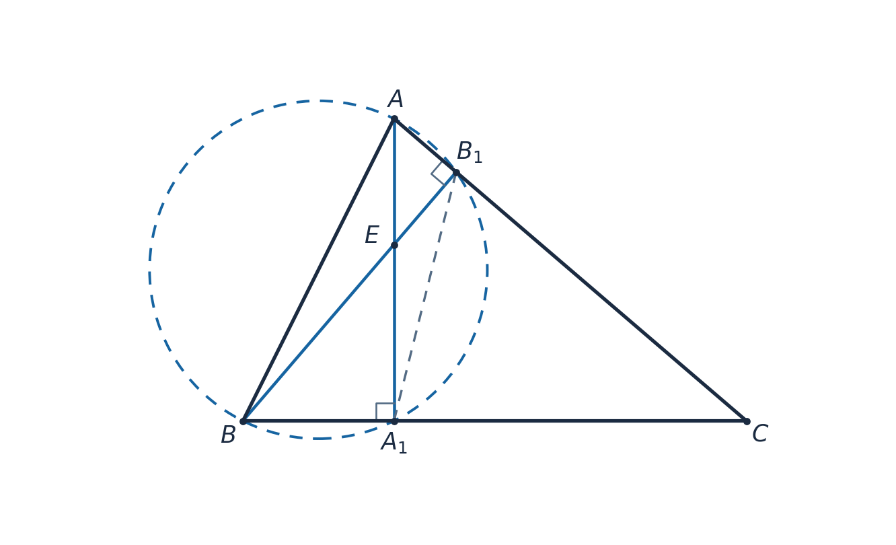

**Критерии**

- **2 балла.** Закончено правильное доказательство с обоснованием существенных шагов. Выведена вписанность по двум прямым углам, корректно сопоставлена общая дуга.
- **1 балл.** Доказательство по существу верно, есть несущественный недостаток. Рассуждение математически верно, но есть небольшая оговорка в обозначении дуги при ясной цепочке.
- **0 баллов.** Доказательство не удовлетворяет условиям для 1 или 2 баллов. Равенство углов заявлено на основании внешнего вида рисунка либо вписанность ничем не обоснована.

[Источник карточки](https://math-oge.sdamgia.ru/problem?id=340341)

### Задача 2 · 340854

У треугольника ABC угол ACB тупой. Высоты из A и B пересекают прямые BC и AC соответственно в A₁ и B₁. Докажите подобие треугольников A₁CB₁ и ACB.

Подсказка 1

Отметь прямые углы в основаниях высот.

Подсказка 2

Помести подходящие четыре точки на одну окружность и сопоставь хорды.

Ответ для самопроверки

$\triangle A_1CB_1\sim\triangle ACB$.

Разбор и критерии

1. Так как угол C тупой, обе проекции A₁ и B₁ лежат за C на продолжениях BC и AC. Лучи CA₁ и CB₁ противоположны CB и CA, поэтому ∠A₁CB₁ = ∠ACB.
2. Из прямоугольных треугольников CAA₁ и CBB₁: CA₁/CA = cos(180°−∠C) = CB₁/CB. Две стороны при равном угле пропорциональны. Следовательно, △A₁CB₁ ∼ △ACB.

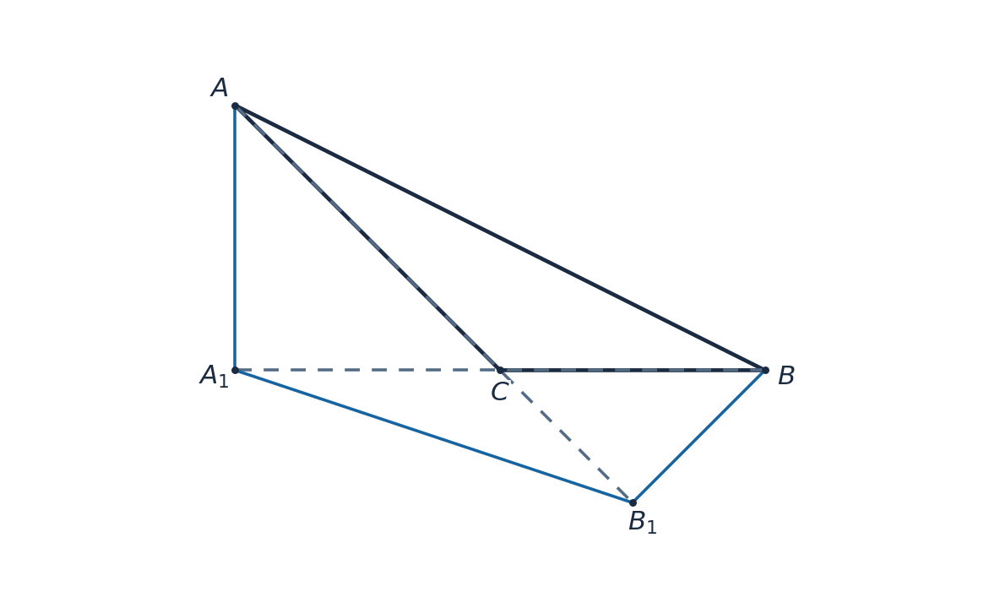

**Критерии**

- **2 балла.** Закончено правильное доказательство с обоснованием существенных шагов. Доказан сам вывод: $\triangle A_1CB_1\sim\triangle ACB$.
- **1 балл.** Доказательство по существу верно, есть несущественный недостаток. Опорный переход с обоснованием есть. Неточность записи не меняет вывода.
- **0 баллов.** Доказательство не удовлетворяет условиям для 1 или 2 баллов. Пропущен ключевой аргумент либо утверждение принято по виду чертежа.

[Источник карточки](https://math-oge.sdamgia.ru/problem?id=340854)

### Задача 3 · авторская тренировка

В остроугольном треугольнике ABC высоты AA₁ и BB₁ пересекаются в H. Докажите, что C, A₁, H, B₁ лежат на одной окружности.

Подсказка 1

Какие два угла прямые?

Подсказка 2

Какой отрезок является для них общим диаметром?

Ответ для самопроверки

C, A₁, H и B₁ лежат на окружности с диаметром CH.

Разбор и критерии

1. Из AA₁ ⟂ BC следует ∠CA₁H = 90°. Из BB₁ ⟂ AC следует ∠CB₁H = 90°.
2. Обе точки A₁ и B₁ видят отрезок CH под прямым углом, поэтому входят в окружность с диаметром CH.

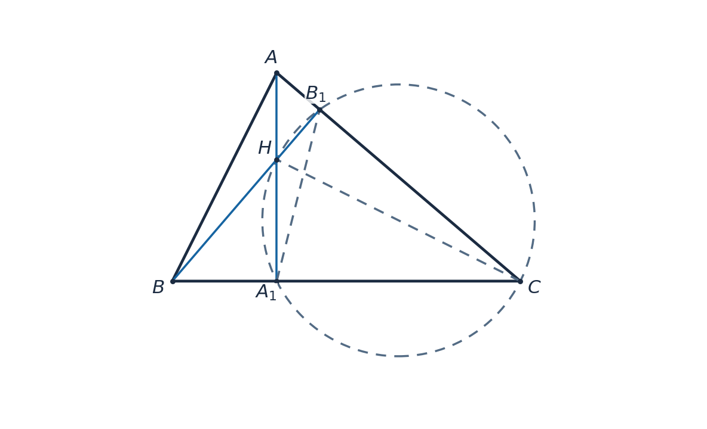

**Критерии**

- **2 балла.** Закончено правильное доказательство с обоснованием существенных шагов. Полностью обоснован вывод: C, A₁, H и B₁ лежат на окружности с диаметром CH.
- **1 балл.** Доказательство по существу верно, есть несущественный недостаток. Опорный переход с обоснованием есть. Неточность записи не меняет вывода.
- **0 баллов.** Доказательство не удовлетворяет условиям для 1 или 2 баллов. Пропущен ключевой аргумент либо утверждение принято по виду чертежа.

[Пример семейства](https://math-oge.sdamgia.ru/problem?id=340341)

### Задача 4 · авторская тренировка

В остроугольном треугольнике ABC высоты AA₁ и BB₁ пересекаются в H. Докажите CA₁·CB = CB₁·CA.

Подсказка 1

Проверь прямые углы над отрезком AB.

Подсказка 2

Выбери две секущие из C.

Ответ для самопроверки

CA₁·CB = CB₁·CA.

Разбор и критерии

1. Углы AA₁B и AB₁B прямые. Поэтому A, B, A₁ и B₁ лежат на окружности с диаметром AB.
2. Из C выходят две секущие к этой окружности: на одной лежат A₁ и B, на другой B₁ и A. Теорема о секущих даёт требуемое равенство произведений.

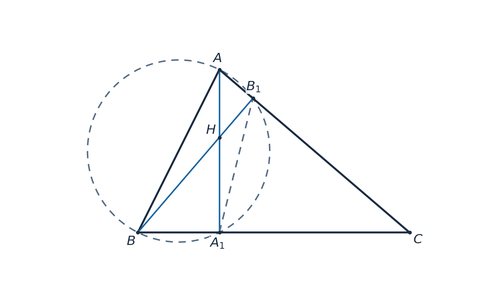

**Критерии**

- **2 балла.** Закончено правильное доказательство с обоснованием существенных шагов. Полностью обоснован вывод: CA₁·CB = CB₁·CA.
- **1 балл.** Доказательство по существу верно, есть несущественный недостаток. Опорный переход с обоснованием есть. Неточность записи не меняет вывода.
- **0 баллов.** Доказательство не удовлетворяет условиям для 1 или 2 баллов. Пропущен ключевой аргумент либо утверждение принято по виду чертежа.

[Пример семейства](https://math-oge.sdamgia.ru/problem?id=340341)

### Задача 5 · авторская тренировка

В остроугольном треугольнике ABC высоты AA₁ и BB₁ пересекаются в H. Докажите, что ∠HCA₁ = ∠HB₁A₁.

Подсказка 1

Установи вписанность оснований высот, H и C.

Подсказка 2

Относительно прямой HA₁ проверь положение двух вершин углов.

Ответ для самопроверки

∠HCA₁ = ∠HB₁A₁.

Разбор и критерии

1. Из двух прямых углов CA₁H и CB₁H следует, что точки C, A₁, H, B₁ вписаны в окружность с диаметром CH.
2. Оба искомых угла опираются на хорду HA₁. Точки C и B₁ лежат в одной открытой полуплоскости относительно AA₁: точки A и C задают луч AC, а B₁ является внутренней точкой AC. Значит, углы открывают одну дугу и равны.

**Критерии**

- **2 балла.** Закончено правильное доказательство с обоснованием существенных шагов. Полностью обоснован вывод: ∠HCA₁ = ∠HB₁A₁.
- **1 балл.** Доказательство по существу верно, есть несущественный недостаток. Опорный переход с обоснованием есть. Неточность записи не меняет вывода.
- **0 баллов.** Доказательство не удовлетворяет условиям для 1 или 2 баллов. Пропущен ключевой аргумент либо утверждение принято по виду чертежа.

[Пример семейства](https://math-oge.sdamgia.ru/problem?id=340341)

### Задача 6 · авторская тренировка

В остроугольном треугольнике ABC высоты AA₁ и BB₁ пересекаются в H. Докажите, что A₁B₁ = AB·cos ∠ACB.

Подсказка 1

Вырази две проекции через один косинус.

Подсказка 2

Сравни два треугольника по двум сторонам и углу.

Ответ для самопроверки

A₁B₁ = AB·cos ∠ACB.

Разбор и критерии

1. Из прямоугольных треугольников CAA₁ и CBB₁ получаем CA₁ = CA·cos ∠C и CB₁ = CB·cos ∠C.
2. Между CA₁ и CB₁ находится тот же угол, что между CB и CA. Две пары прилежащих сторон пропорциональны с коэффициентом cos ∠C. Поэтому △CA₁B₁ ∼ △CAB и A₁B₁/AB = cos ∠C.

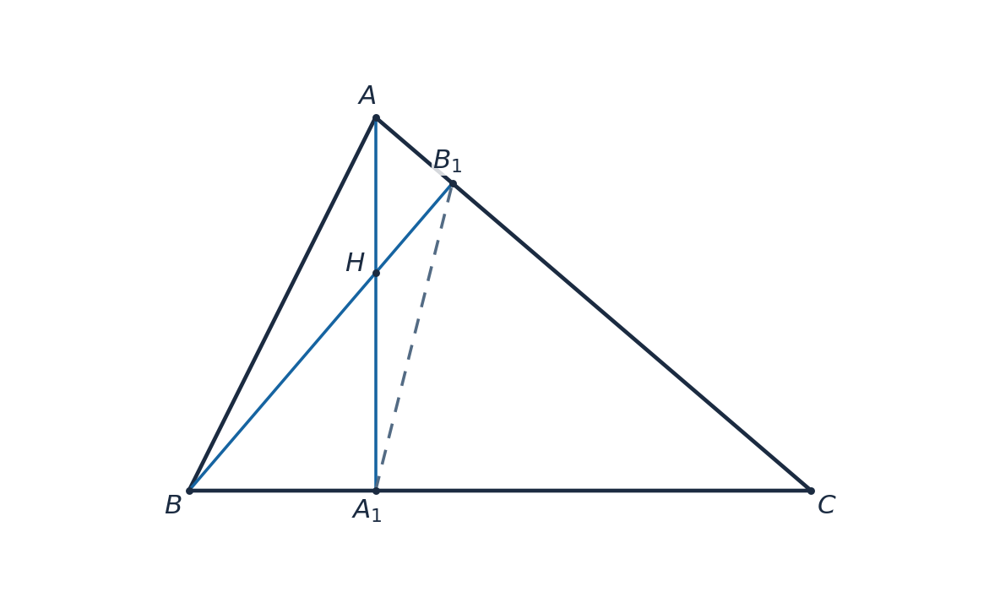

**Критерии**

- **2 балла.** Закончено правильное доказательство с обоснованием существенных шагов. Полностью обоснован вывод: A₁B₁ = AB·cos ∠ACB.
- **1 балл.** Доказательство по существу верно, есть несущественный недостаток. Опорный переход с обоснованием есть. Неточность записи не меняет вывода.
- **0 баллов.** Доказательство не удовлетворяет условиям для 1 или 2 баллов. Пропущен ключевой аргумент либо утверждение принято по виду чертежа.

[Пример семейства](https://math-oge.sdamgia.ru/problem?id=340341)

## Подобие и равенство · Подобие через параллельность / известные стороны

`OGE24-similar-parallels`

### Задача 1 · 340995

В трапеции ABCD основания BC = 4, AD = 64, диагональ BD = 16. Докажите, что треугольники CBD и BDA подобны.

Подсказка 1

Выдели соответствующие углы при параллельных прямых.

Подсказка 2

Если одного угла мало, проверь отношение включающих его сторон.

Ответ для самопроверки

$\triangle CBD\sim\triangle BDA$.

Разбор и критерии

1. Диагональ BD пересекает параллельные основания BC и AD. Поэтому ∠CBD = ∠BDA: это накрест лежащие углы.
2. Сравним стороны, которые образуют эти углы. В первом треугольнике это BC и BD, во втором — BD и DA. Получаем $\frac{BC}{BD}=\frac{4}{16}=\frac{1}{4}$ и $\frac{BD}{DA}=\frac{16}{64}=\frac{1}{4}$.
3. Две пары сторон пропорциональны, и углы между ними равны. По этому признаку треугольники CBD и BDA подобны. Вершине B первого соответствует D второго.

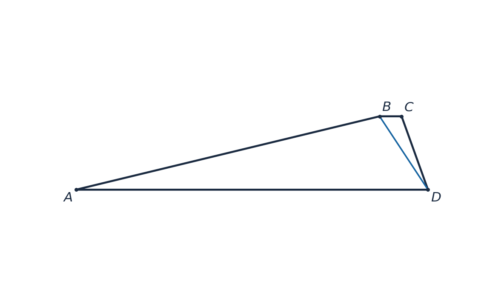

**Критерии**

- **2 балла.** Закончено правильное доказательство с обоснованием существенных шагов. Доказан сам вывод: $\triangle CBD\sim\triangle BDA$.
- **1 балл.** Доказательство по существу верно, есть несущественный недостаток. Опорный переход с обоснованием есть. Неточность записи не меняет вывода.
- **0 баллов.** Доказательство не удовлетворяет условиям для 1 или 2 баллов. Пропущен ключевой аргумент либо утверждение принято по виду чертежа.

[Источник карточки](https://math-oge.sdamgia.ru/problem?id=340995)

### Задача 2 · 341131

В трапеции ABCD основания BC = 6, AD = 24, диагональ BD = 12. Докажите, что треугольники CBD и BDA подобны.

Подсказка 1

Выдели соответствующие углы при параллельных прямых.

Подсказка 2

Если одного угла мало, проверь отношение включающих его сторон.

Ответ для самопроверки

$\triangle CBD\sim\triangle BDA$.

Разбор и критерии

1. Диагональ BD пересекает параллельные основания BC и AD. Поэтому ∠CBD = ∠BDA: это накрест лежащие углы.
2. Сравним стороны, которые образуют эти углы. В первом треугольнике это BC и BD, во втором — BD и DA. Получаем $\frac{BC}{BD}=\frac{6}{12}=\frac{1}{2}$ и $\frac{BD}{DA}=\frac{12}{24}=\frac{1}{2}$.
3. Две пары сторон пропорциональны, и углы между ними равны. По этому признаку треугольники CBD и BDA подобны. Вершине B первого соответствует D второго.

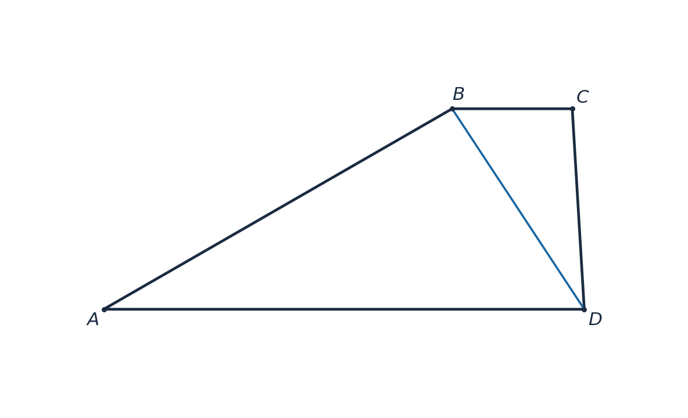

**Критерии**

- **2 балла.** Закончено правильное доказательство с обоснованием существенных шагов. Доказан сам вывод: $\triangle CBD\sim\triangle BDA$.
- **1 балл.** Доказательство по существу верно, есть несущественный недостаток. Опорный переход с обоснованием есть. Неточность записи не меняет вывода.
- **0 баллов.** Доказательство не удовлетворяет условиям для 1 или 2 баллов. Пропущен ключевой аргумент либо утверждение принято по виду чертежа.

[Источник карточки](https://math-oge.sdamgia.ru/problem?id=341131)

### Задача 3 · 348542

В трапеции ABCD основания BC = 5, AD = 45, диагональ BD = 15. Докажите, что треугольники CBD и BDA подобны.

Подсказка 1

Выдели соответствующие углы при параллельных прямых.

Подсказка 2

Если одного угла мало, проверь отношение включающих его сторон.

Ответ для самопроверки

$\triangle CBD\sim\triangle BDA$.

Разбор и критерии

1. Диагональ BD пересекает параллельные основания BC и AD. Поэтому ∠CBD = ∠BDA: это накрест лежащие углы.
2. Сравним стороны, которые образуют эти углы. В первом треугольнике это BC и BD, во втором — BD и DA. Получаем $\frac{BC}{BD}=\frac{5}{15}=\frac{1}{3}$ и $\frac{BD}{DA}=\frac{15}{45}=\frac{1}{3}$.
3. Две пары сторон пропорциональны, и углы между ними равны. По этому признаку треугольники CBD и BDA подобны. Вершине B первого соответствует D второго.

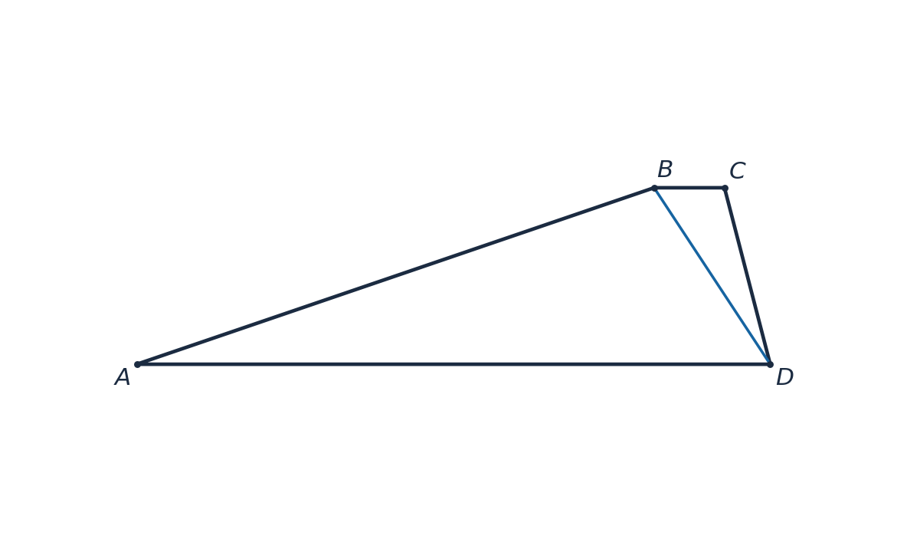

**Критерии**

- **2 балла.** Закончено правильное доказательство с обоснованием существенных шагов. Доказан сам вывод: $\triangle CBD\sim\triangle BDA$.
- **1 балл.** Доказательство по существу верно, есть несущественный недостаток. Опорный переход с обоснованием есть. Неточность записи не меняет вывода.
- **0 баллов.** Доказательство не удовлетворяет условиям для 1 или 2 баллов. Пропущен ключевой аргумент либо утверждение принято по виду чертежа.

[Источник карточки](https://math-oge.sdamgia.ru/problem?id=348542)

### Задача 4 · 311573

В параллелограмме ABCD высоты BE и BF опущены на стороны AD и CD. Точки E и F лежат внутри соответствующих сторон. Докажите, что треугольники ABE и CBF подобны.

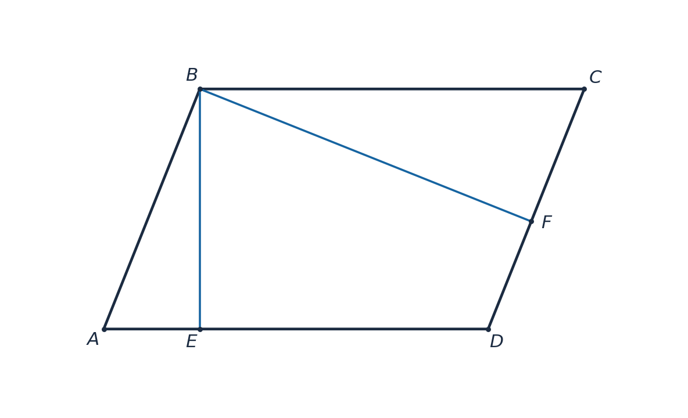

Подсказка 1

Выдели соответствующие углы при параллельных прямых.

Подсказка 2

Сравни прямые углы при E и F и противоположные углы параллелограмма.

Ответ для самопроверки

$\triangle ABE\sim\triangle CBF$.

Разбор и критерии

1. Углы BEA и BFC прямые по определению высоты. Углы BAE и BCF — противоположные углы параллелограмма, поэтому равны.
2. Две пары равных углов дают подобие. Вершины соответствуют как A↔C, B↔B, E↔F.

**Критерии**

- **2 балла.** Закончено правильное доказательство с обоснованием существенных шагов. Доказан сам вывод: $\triangle ABE\sim\triangle CBF$.
- **1 балл.** Доказательство по существу верно, есть несущественный недостаток. Опорный переход с обоснованием есть. Неточность записи не меняет вывода.
- **0 баллов.** Доказательство не удовлетворяет условиям для 1 или 2 баллов. Пропущен ключевой аргумент либо утверждение принято по виду чертежа.

[Источник карточки](https://math-oge.sdamgia.ru/problem?id=311573)

### Задача 5 · авторская тренировка

Точки M и N лежат на сторонах AB и AC треугольника ABC. Отрезок MN параллелен BC. Докажите BM:MA = CN:NA.

Подсказка 1

Начни со сравнения AMN и ABC.

Подсказка 2

Из отношений полных сторон получи доли оставшихся отрезков.

Ответ для самопроверки

BM:MA = CN:NA.

Разбор и критерии

1. Треугольники AMN и ABC подобны по углу A и углам при параллельных MN и BC. Значит, AB/AM = AC/AN.
2. Вычитаем по единице из обеих частей: (AB−AM)/AM = (AC−AN)/AN. Это BM/MA = CN/NA.

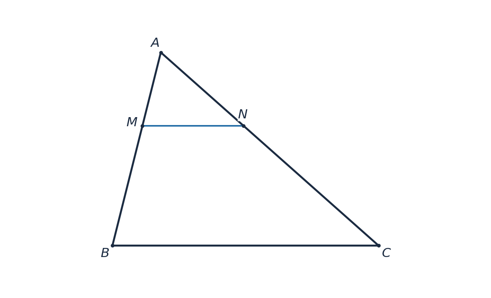

**Критерии**

- **2 балла.** Закончено правильное доказательство с обоснованием существенных шагов. Полностью обоснован вывод: BM:MA = CN:NA.
- **1 балл.** Доказательство по существу верно, есть несущественный недостаток. Опорный переход с обоснованием есть. Неточность записи не меняет вывода.
- **0 баллов.** Доказательство не удовлетворяет условиям для 1 или 2 баллов. Пропущен ключевой аргумент либо утверждение принято по виду чертежа.

[Пример семейства](https://math-oge.sdamgia.ru/problem?id=311573)

### Задача 6 · авторская тренировка

Диагонали трапеции ABCD с основаниями AD и BC пересекаются в O. Докажите, что AO:OC = DO:OB.

Подсказка 1

Выдели два треугольника по разные стороны от O.

Подсказка 2

Какие равные углы дают диагонали и параллельные основания?

Ответ для самопроверки

AO:OC = DO:OB.

Разбор и критерии

1. ∠AOD и ∠COB — вертикальные. ∠OAD и ∠OCB равны при параллельных AD и BC и секущей AC.
2. Получаем △AOD ∼ △COB. По соответствующим сторонам AO/CO = DO/BO, что и требовалось.

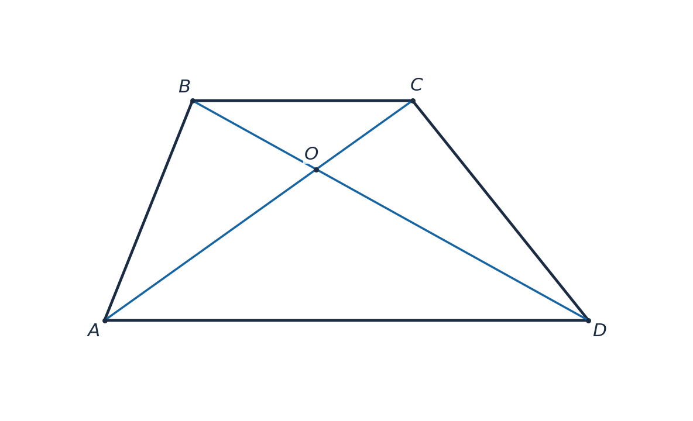

**Критерии**

- **2 балла.** Закончено правильное доказательство с обоснованием существенных шагов. Полностью обоснован вывод: AO:OC = DO:OB.
- **1 балл.** Доказательство по существу верно, есть несущественный недостаток. Опорный переход с обоснованием есть. Неточность записи не меняет вывода.
- **0 баллов.** Доказательство не удовлетворяет условиям для 1 или 2 баллов. Пропущен ключевой аргумент либо утверждение принято по виду чертежа.

[Пример семейства](https://math-oge.sdamgia.ru/problem?id=311573)

## Подобие и равенство · Равенство отрезков через равенство треугольников или симметрию

`OGE24-rigid-motion`

### Задача 1 · 311561

На AC треугольника ABC взяты точки D и E так, что AD = CE и D ≠ E. Известно, что BD = BE. Докажите AB = BC.

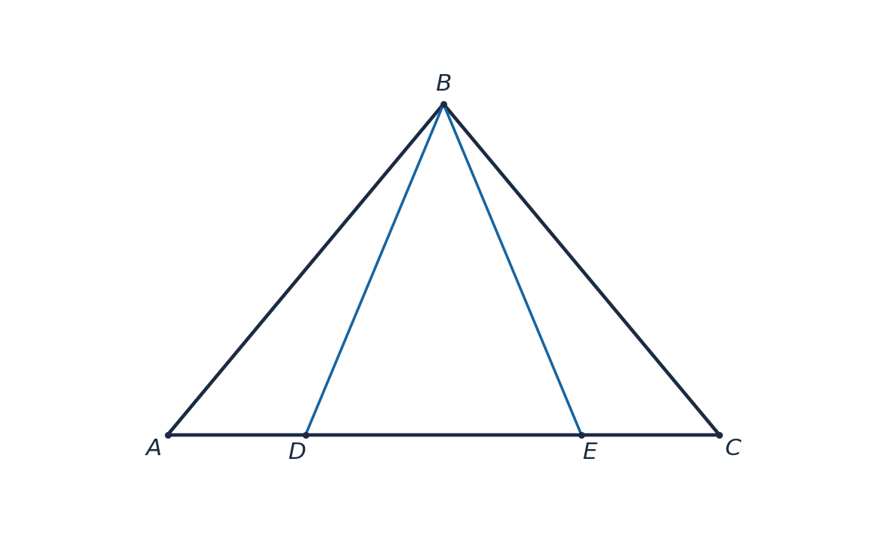

Подсказка 1

По условиям найди пару отрезков или треугольников, которые могут соответствовать.

Подсказка 2

Выбери признак равенства, поворот или симметрию и запиши соответствие.

Ответ для самопроверки

$AB=BC$.

Разбор и критерии

1. Из AD = CE следует, что середина AC одновременно является серединой DE. Это верно независимо от порядка D и E на стороне.
2. Поскольку BD = BE и D,E различны, B лежит на серединном перпендикуляре к DE. Он совпадает с серединным перпендикуляром к AC, так что AB = BC.

**Критерии**

- **2 балла.** Закончено правильное доказательство с обоснованием существенных шагов. Доказан сам вывод: $AB=BC$.
- **1 балл.** Доказательство по существу верно, есть несущественный недостаток. Опорный переход с обоснованием есть. Неточность записи не меняет вывода.
- **0 баллов.** Доказательство не удовлетворяет условиям для 1 или 2 баллов. Пропущен ключевой аргумент либо утверждение принято по виду чертежа.

[Источник карточки](https://math-oge.sdamgia.ru/problem?id=311561)

### Задача 2 · 311605

Равносторонние треугольники AOC и BOD имеют общую вершину O и расположены, как на рисунке. Докажите AB = CD.

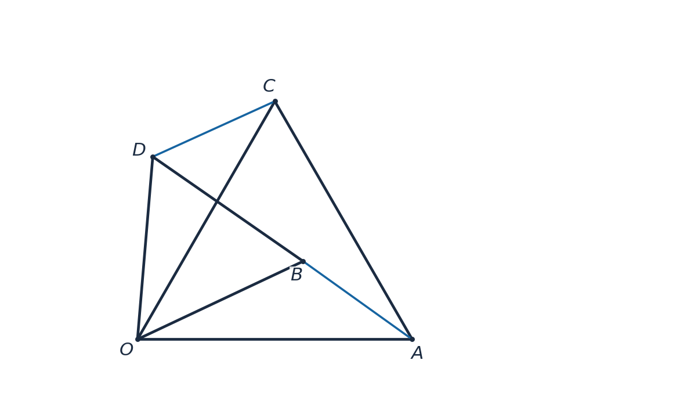

Подсказка 1

По условиям найди пару отрезков или треугольников, которые могут соответствовать.

Подсказка 2

Выбери признак равенства, поворот или симметрию и запиши соответствие.

Ответ для самопроверки

$AB=CD$

Разбор и критерии

1. Соответствующие стороны треугольников равны: OA = OC, OB = OD. По рисунку лучи OA и OB переходят в OC и OD поворотом в одну сторону вокруг O.
2. Оба поворота имеют один угол 60°. Значит, один поворот переводит одновременно A в C и B в D. Поворот сохраняет длины, поэтому AB = CD.

**Критерии**

- **2 балла.** Закончено правильное доказательство с обоснованием существенных шагов. Доказан сам вывод: $AB=CD$
- **1 балл.** Доказательство по существу верно, есть несущественный недостаток. Опорный переход с обоснованием есть. Неточность записи не меняет вывода.
- **0 баллов.** Доказательство не удовлетворяет условиям для 1 или 2 баллов. Пропущен ключевой аргумент либо утверждение принято по виду чертежа.

[Источник карточки](https://math-oge.sdamgia.ru/problem?id=311605)

### Задача 3 · 311604

Два квадрата имеют общую вершину O. Соседние с O вершины первого — A,C, второго — B,E. Они расположены, как на рисунке. Докажите AB = CE.

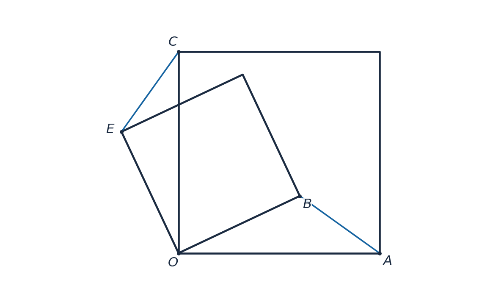

Подсказка 1

По условиям найди пару отрезков или треугольников, которые могут соответствовать.

Подсказка 2

Выбери признак равенства, поворот или симметрию и запиши соответствие.

Ответ для самопроверки

$AB=CE$

Разбор и критерии

1. Соответствующие стороны квадратов равны: OA = OC, OB = OE. По рисунку лучи OA и OB переходят в OC и OE поворотом в одну сторону вокруг O.
2. Оба поворота имеют один угол 90°. Значит, один поворот переводит одновременно A в C и B в E. Поворот сохраняет длины, поэтому AB = CE.

**Критерии**

- **2 балла.** Закончено правильное доказательство с обоснованием существенных шагов. Доказан сам вывод: $AB=CE$
- **1 балл.** Доказательство по существу верно, есть несущественный недостаток. Опорный переход с обоснованием есть. Неточность записи не меняет вывода.
- **0 баллов.** Доказательство не удовлетворяет условиям для 1 или 2 баллов. Пропущен ключевой аргумент либо утверждение принято по виду чертежа.

[Источник карточки](https://math-oge.sdamgia.ru/problem?id=311604)

### Задача 4 · 340104

Через пересечение O диагоналей параллелограмма ABCD проведена прямая. Она пересекает AB в P и CD в T. Докажите BP = DT.

Подсказка 1

По условиям найди пару отрезков или треугольников, которые могут соответствовать.

Подсказка 2

Выбери признак равенства, поворот или симметрию и запиши соответствие.

Ответ для самопроверки

$BP=DT$.

Разбор и критерии

1. Диагонали параллелограмма делятся в O пополам, поэтому поворот на 180° вокруг O переводит A в C, B в D и AB в CD.
2. Прямая через O переходит в себя. Следовательно, её пересечение P со стороной AB переходит в пересечение T со стороной CD. Получаем BP = DT, потому что поворот сохраняет длину.

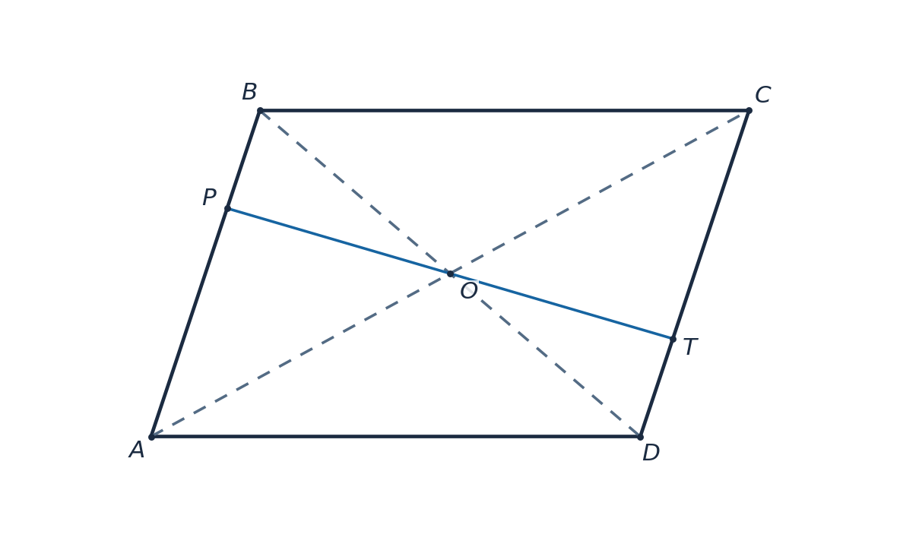

**Критерии**

- **2 балла.** Закончено правильное доказательство с обоснованием существенных шагов. Доказан сам вывод: $BP=DT$.
- **1 балл.** Доказательство по существу верно, есть несущественный недостаток. Опорный переход с обоснованием есть. Неточность записи не меняет вывода.
- **0 баллов.** Доказательство не удовлетворяет условиям для 1 или 2 баллов. Пропущен ключевой аргумент либо утверждение принято по виду чертежа.

[Источник карточки](https://math-oge.sdamgia.ru/problem?id=340104)

### Задача 5 · авторская тренировка

В треугольнике ABC стороны AB и AC равны. D лежит на AB, E на AC и AD = AE. Докажите BE = CD.

Подсказка 1

Сравни треугольники с вершиной A, содержащие искомые отрезки.

Подсказка 2

Используй две пары равных сторон и угол между ними.

Ответ для самопроверки

BE = CD.

Разбор и критерии

1. Если D = E = A, равенство BE = CD следует из AB = AC. В остальных случаях в треугольниках ABE и ACD равны AB и AC, AE и AD. Включённые углы BAE и CAD — один и тот же угол BAC.
2. По двум сторонам и углу между ними треугольники равны. Соответствующие им стороны BE и CD тоже равны.

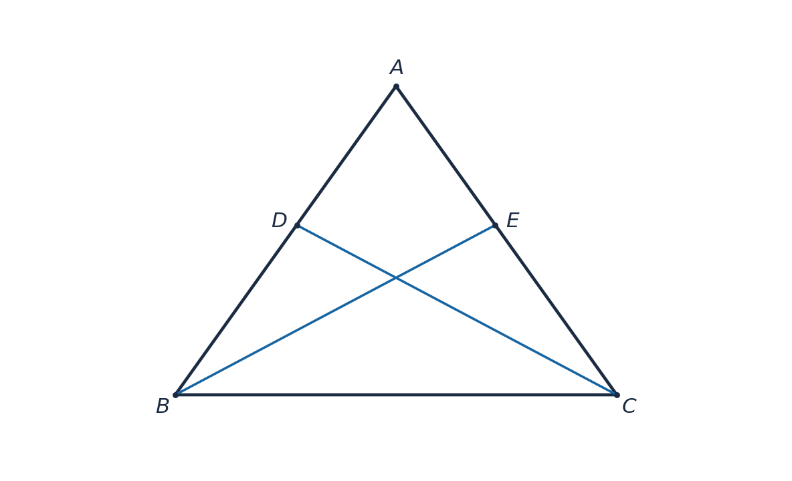

**Критерии**

- **2 балла.** Закончено правильное доказательство с обоснованием существенных шагов. Полностью обоснован вывод: BE = CD.
- **1 балл.** Доказательство по существу верно, есть несущественный недостаток. Опорный переход с обоснованием есть. Неточность записи не меняет вывода.
- **0 баллов.** Доказательство не удовлетворяет условиям для 1 или 2 баллов. Пропущен ключевой аргумент либо утверждение принято по виду чертежа.

[Пример семейства](https://math-oge.sdamgia.ru/problem?id=311561)

### Задача 6 · авторская тренировка

O — пересечение диагоналей прямоугольника ABCD. Внутри ABCD взяли P и Q, причём O — середина PQ. Докажите AP = CQ и BP = DQ.

Подсказка 1

Найди преобразование, которое меняет местами P и Q.

Подсказка 2

Проследи образы A и B при том же преобразовании.

Ответ для самопроверки

AP = CQ, BP = DQ.

Разбор и критерии

1. Поворот на 180° вокруг O переводит A в C, B в D и P в Q, поскольку O — середина всех трёх отрезков AC, BD и PQ.
2. Значит, образ AP — CQ, а образ BP — DQ. Поворот сохраняет длины, поэтому получаем обе пары равенств.

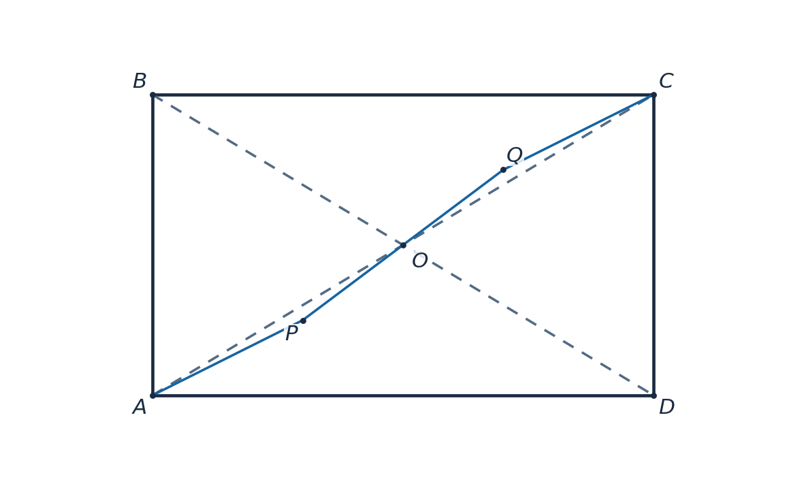

**Критерии**

- **2 балла.** Закончено правильное доказательство с обоснованием существенных шагов. Полностью обоснован вывод: AP = CQ, BP = DQ.
- **1 балл.** Доказательство по существу верно, есть несущественный недостаток. Опорный переход с обоснованием есть. Неточность записи не меняет вывода.
- **0 баллов.** Доказательство не удовлетворяет условиям для 1 или 2 баллов. Пропущен ключевой аргумент либо утверждение принято по виду чертежа.

[Пример семейства](https://math-oge.sdamgia.ru/problem?id=311561)

## Подобие и равенство · Средними линиями доказать равносторонность

`OGE24-midline-proof`

### Задача 1 · 129

В равностороннем треугольнике $ABC$ точки $M,N,K$ — середины $AB,BC,CA$ соответственно. Докажите, что $MNK$ равносторонний.

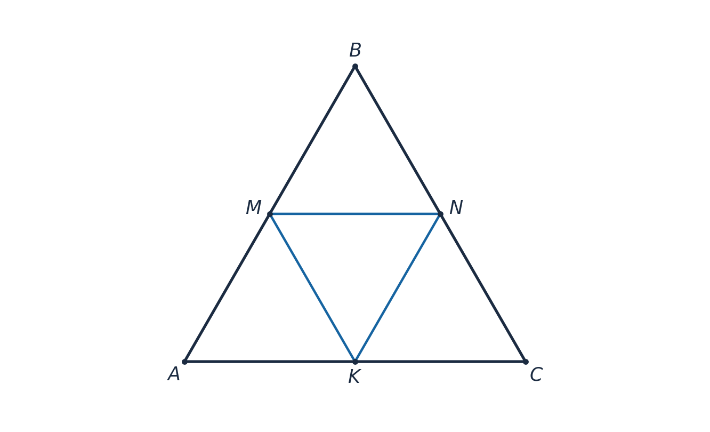

Подсказка 1

Проверь, какие отрезки являются средними линиями.

Подсказка 2

Вырази каждую из них через половину соответствующей стороны исходного треугольника.

Ответ для самопроверки

$MN=NK=KM$.

Разбор и критерии

1. $MN$, $NK$ и $KM$ — средние линии исходного треугольника.
2. По теореме о средней линии $MN=AC/2$, $NK=AB/2$, $KM=BC/2$.
3. Поскольку $AC=AB=BC$, все три стороны $MNK$ равны.

**Критерии**

- **2 балла.** Закончено правильное доказательство с обоснованием существенных шагов. Верно использована теорема о средней линии для всех трёх сторон.
- **1 балл.** Доказательство по существу верно, есть несущественный недостаток. Общий правильный переход виден, но есть несущественная неточность в одной буквенной записи.
- **0 баллов.** Доказательство не удовлетворяет условиям для 1 или 2 баллов. Равенство трёх сторон только прочитано с рисунка.

[Источник карточки](https://math-oge.sdamgia.ru/problem?id=129)

### Задача 2 · 315008

В равнобедренном треугольнике ABC известно AB = BC. Точки M, N и K — середины AB, BC и CA. Докажите, что MNK равнобедренный.

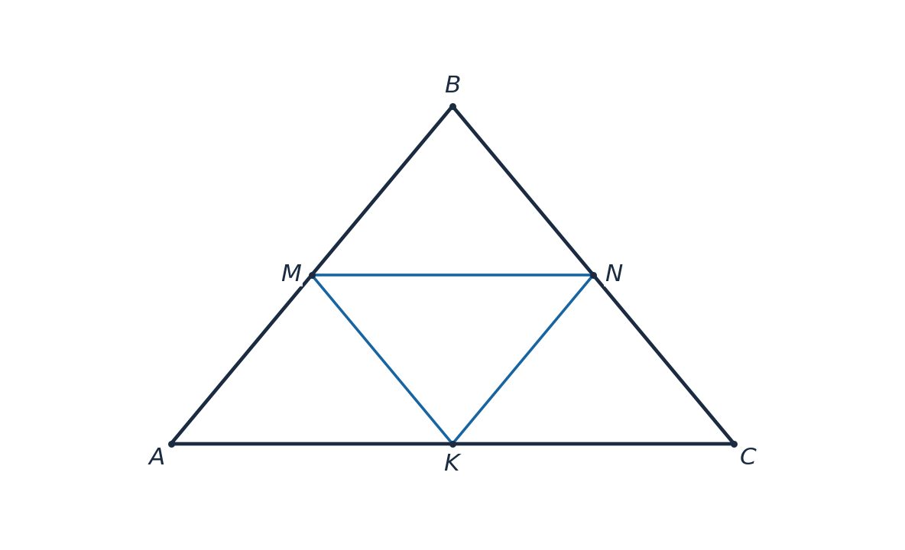

Подсказка 1

Проверь, какие отрезки являются средними линиями.

Подсказка 2

Вырази каждую из них через половину соответствующей стороны исходного треугольника.

Ответ для самопроверки

$MK=NK$.

Разбор и критерии

1. MK — средняя линия в треугольнике ABC, параллельная BC. Её длина равна BC/2.
2. NK параллельна AB и равна AB/2. Стороны AB и BC равны, поэтому MK = NK. Значит, MNK равнобедренный.

**Критерии**

- **2 балла.** Закончено правильное доказательство с обоснованием существенных шагов. Доказан сам вывод: $MK=NK$.
- **1 балл.** Доказательство по существу верно, есть несущественный недостаток. Опорный переход с обоснованием есть. Неточность записи не меняет вывода.
- **0 баллов.** Доказательство не удовлетворяет условиям для 1 или 2 баллов. Пропущен ключевой аргумент либо утверждение принято по виду чертежа.

[Источник карточки](https://math-oge.sdamgia.ru/problem?id=315008)

### Задача 3 · авторская тренировка

M, N, K — середины AB, BC, CA треугольника ABC. Докажите, что площадь MNK составляет четверть площади ABC.

Подсказка 1

Используй все три средние линии.

Подсказка 2

Как связаны площади подобных треугольников?

Ответ для самопроверки

S(MNK) = S(ABC)/4.

Разбор и критерии

1. Каждая из сторон MNK — средняя линия и равна половине соответствующей стороны ABC.
2. По трём сторонам треугольники подобны с коэффициентом 1/2. Площади относятся как квадрат этого коэффициента: 1/4.

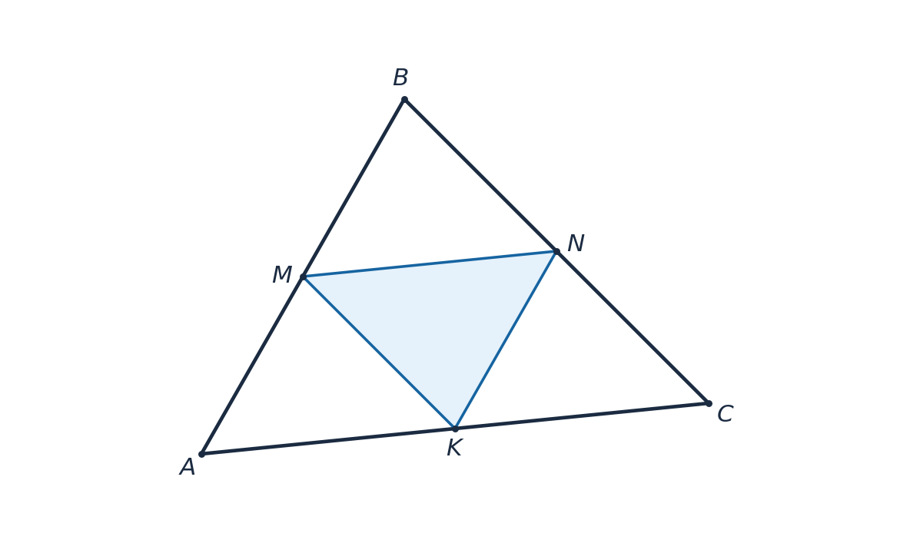

**Критерии**

- **2 балла.** Закончено правильное доказательство с обоснованием существенных шагов. Полностью обоснован вывод: S(MNK) = S(ABC)/4.
- **1 балл.** Доказательство по существу верно, есть несущественный недостаток. Опорный переход с обоснованием есть. Неточность записи не меняет вывода.
- **0 баллов.** Доказательство не удовлетворяет условиям для 1 или 2 баллов. Пропущен ключевой аргумент либо утверждение принято по виду чертежа.

[Пример семейства](https://math-oge.sdamgia.ru/problem?id=129)

### Задача 4 · авторская тренировка

M, N, K — середины AB, BC, CA треугольника ABC. Угол MNK прямой. Докажите, что угол BAC прямой.

Подсказка 1

Найди стороны ABC, параллельные MN и NK.

Подсказка 2

Перенеси перпендикулярность между параллельными направлениями.

Ответ для самопроверки

∠BAC = 90°.

Разбор и критерии

1. По теореме о средней линии MN ∥ AC, а NK ∥ AB.
2. Из MN ⟂ NK следует, что прямые, им соответственно параллельные, тоже перпендикулярны. Поэтому AC ⟂ AB.

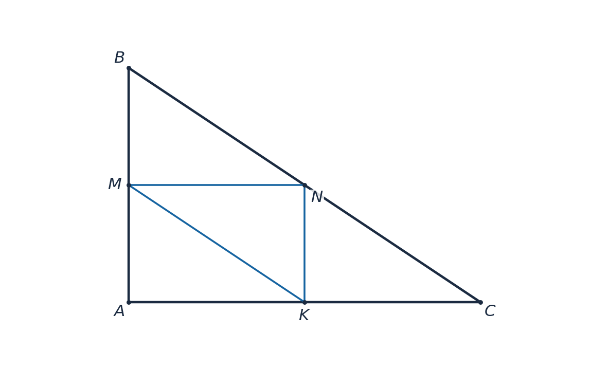

**Критерии**

- **2 балла.** Закончено правильное доказательство с обоснованием существенных шагов. Полностью обоснован вывод: ∠BAC = 90°.
- **1 балл.** Доказательство по существу верно, есть несущественный недостаток. Опорный переход с обоснованием есть. Неточность записи не меняет вывода.
- **0 баллов.** Доказательство не удовлетворяет условиям для 1 или 2 баллов. Пропущен ключевой аргумент либо утверждение принято по виду чертежа.

[Пример семейства](https://math-oge.sdamgia.ru/problem?id=129)

### Задача 5 · авторская тренировка

M, N, K — середины AB, BC, CA треугольника ABC. Треугольник MNK равносторонний. Докажите, что ABC тоже равносторонний.

Подсказка 1

Вырази каждую сторону ABC через соответствующую среднюю линию.

Подсказка 2

Равенство каких трёх отрезков дано?

Ответ для самопроверки

AB = BC = CA.

Разбор и критерии

1. Средние линии имеют длины MN = AC/2, NK = AB/2, KM = BC/2.
2. Стороны MNK равны по условию. Удвоив все три длины, получаем равенство сторон исходного треугольника.

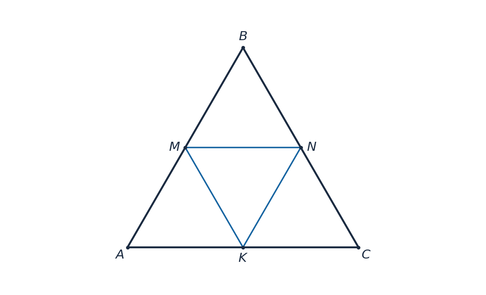

**Критерии**

- **2 балла.** Закончено правильное доказательство с обоснованием существенных шагов. Полностью обоснован вывод: AB = BC = CA.
- **1 балл.** Доказательство по существу верно, есть несущественный недостаток. Опорный переход с обоснованием есть. Неточность записи не меняет вывода.
- **0 баллов.** Доказательство не удовлетворяет условиям для 1 или 2 баллов. Пропущен ключевой аргумент либо утверждение принято по виду чертежа.

[Пример семейства](https://math-oge.sdamgia.ru/problem?id=129)

### Задача 6 · авторская тренировка

M, N, K — середины AB, BC, CA треугольника ABC. Докажите, что периметр ABC вдвое больше периметра MNK.

Подсказка 1

Сопоставь каждой стороне ABC параллельный ей отрезок.

Подсказка 2

Сложи длины всех трёх сторон.

Ответ для самопроверки

P(ABC) = 2P(MNK).

Разбор и критерии

1. По свойству средних линий AB = 2NK, BC = 2KM, CA = 2MN.
2. Складываем три равенства. По определению периметра получаем P(ABC)=2P(MNK).

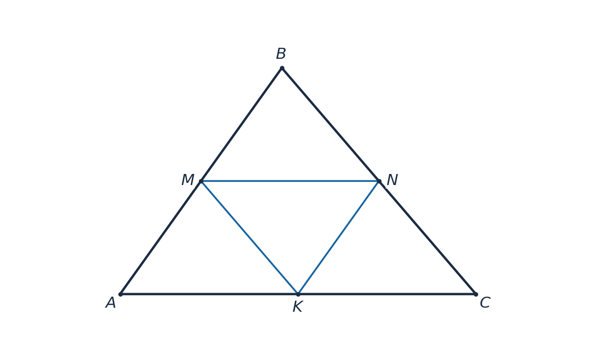

**Критерии**

- **2 балла.** Закончено правильное доказательство с обоснованием существенных шагов. Полностью обоснован вывод: P(ABC) = 2P(MNK).
- **1 балл.** Доказательство по существу верно, есть несущественный недостаток. Опорный переход с обоснованием есть. Неточность записи не меняет вывода.
- **0 баллов.** Доказательство не удовлетворяет условиям для 1 или 2 баллов. Пропущен ключевой аргумент либо утверждение принято по виду чертежа.

[Пример семейства](https://math-oge.sdamgia.ru/problem?id=129)

## Свойства четырёхугольников · Обоснование вида четырёхугольника

`OGE24-quadrilateral-test`

### Задача 1 · 315030

В равностороннем треугольнике ABC точки M, N и K — середины AB, BC, CA соответственно. Докажите, что BMKN — ромб.

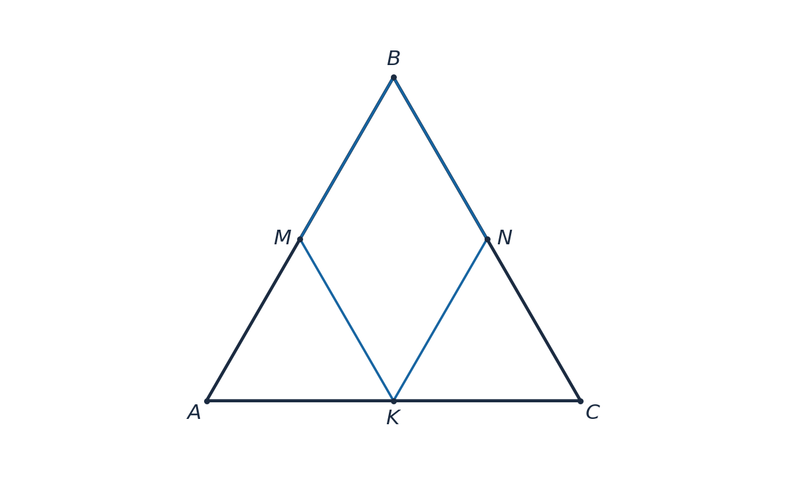

Подсказка 1

Вспомни достаточный признак фигуры из утверждения.

Подсказка 2

Свяжи данный отрезок, середину или симметрию с этим признаком.

Ответ для самопроверки

BMKN — ромб.

Разбор и критерии

1. BM и BN — половины равных сторон AB и BC, поэтому они равны.
2. MK и KN — средние линии, равные половинам BC и AB соответственно. Все четыре стороны BMKN равны. По признаку ромба это ромб.

**Критерии**

- **2 балла.** Закончено правильное доказательство с обоснованием существенных шагов. Доказан сам вывод: BMKN — ромб.
- **1 балл.** Доказательство по существу верно, есть несущественный недостаток. Опорный переход с обоснованием есть. Неточность записи не меняет вывода.
- **0 баллов.** Доказательство не удовлетворяет условиям для 1 или 2 баллов. Пропущен ключевой аргумент либо утверждение принято по виду чертежа.

[Источник карточки](https://math-oge.sdamgia.ru/problem?id=315030)

### Задача 2 · 155

В параллелограмме ABCD точки E, F, K, M лежат внутри сторон AB, BC, CD, DA соответственно. Известно, что AE = CK и BF = DM. Докажите, что EFKM — параллелограмм.

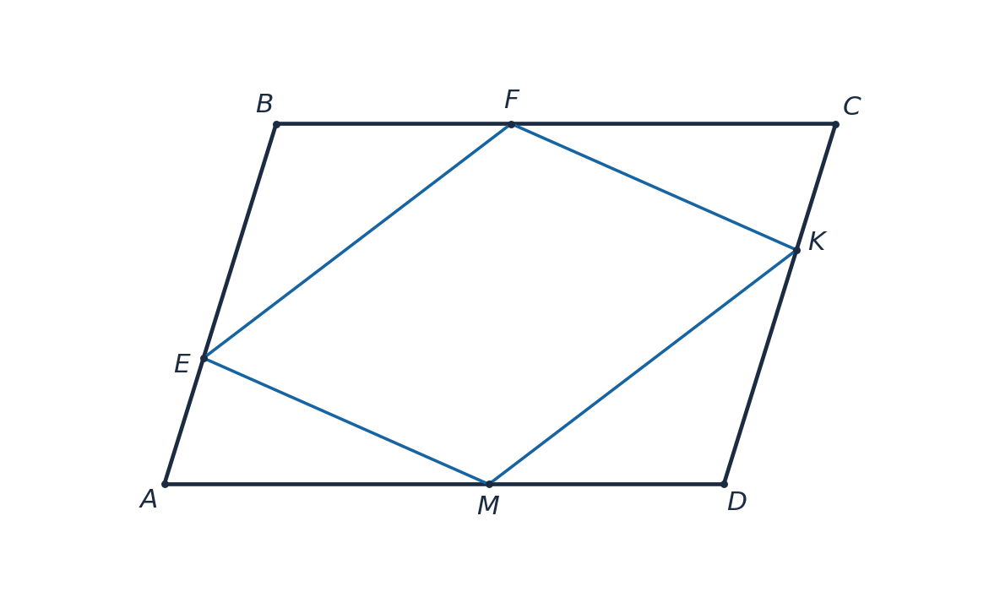

Подсказка 1

Вспомни достаточный признак фигуры из утверждения.

Подсказка 2

Свяжи данный отрезок, середину или симметрию с этим признаком.

Ответ для самопроверки

EFKM — параллелограмм.

Разбор и критерии

1. Поворот на 180° вокруг пересечения диагоналей ABCD переводит A в C и AB в CD. Поэтому точка E переходит в точку на CD на расстоянии AE от C. По условию это K.
2. Так же B переходит в D, BC — в DA, а F переходит в M. Диагонали EK и FM делятся общим центром пополам. По этому признаку EFKM — параллелограмм.

**Критерии**

- **2 балла.** Закончено правильное доказательство с обоснованием существенных шагов. Доказан сам вывод: EFKM — параллелограмм.
- **1 балл.** Доказательство по существу верно, есть несущественный недостаток. Опорный переход с обоснованием есть. Неточность записи не меняет вывода.
- **0 баллов.** Доказательство не удовлетворяет условиям для 1 или 2 баллов. Пропущен ключевой аргумент либо утверждение принято по виду чертежа.

[Источник карточки](https://math-oge.sdamgia.ru/problem?id=155)

### Задача 3 · 439915

В параллелограмме ABCD точка E — середина AB. Дано EC = ED. Докажите, что ABCD — прямоугольник.

Подсказка 1

Вспомни достаточный признак фигуры из утверждения.

Подсказка 2

Свяжи данный отрезок, середину или симметрию с этим признаком.

Ответ для самопроверки

ABCD — прямоугольник.

Разбор и критерии

1. Пусть F — середина CD. Из EC = ED следует, что E лежит на серединном перпендикуляре к CD. Поэтому EF ⟂ CD.
2. Перенос вектором AD переводит AB в DC и середину E в середину F, значит EF ∥ AD. Поэтому AD ⟂ CD, и параллелограмм с прямым углом является прямоугольником.

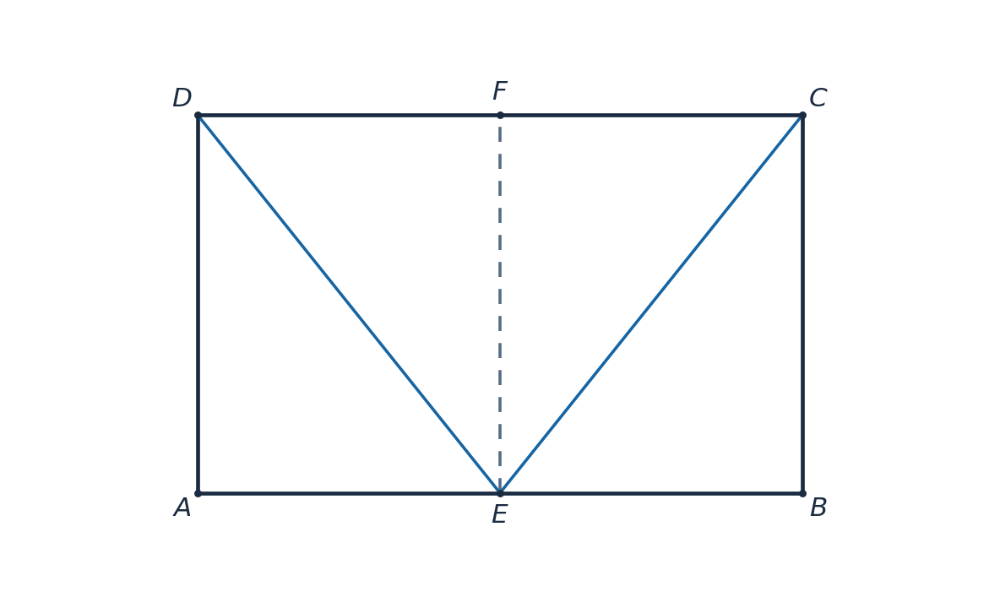

**Критерии**

- **2 балла.** Закончено правильное доказательство с обоснованием существенных шагов. Доказан сам вывод: ABCD — прямоугольник.
- **1 балл.** Доказательство по существу верно, есть несущественный недостаток. Опорный переход с обоснованием есть. Неточность записи не меняет вывода.
- **0 баллов.** Доказательство не удовлетворяет условиям для 1 или 2 баллов. Пропущен ключевой аргумент либо утверждение принято по виду чертежа.

[Источник карточки](https://math-oge.sdamgia.ru/problem?id=439915)

### Задача 4 · авторская тренировка

В выпуклом четырёхугольнике ABCD точки E, F, K, L — середины AB, BC, CD, DA. Докажите, что EFKL — параллелограмм.

Подсказка 1

Проведи диагональ AC.

Подсказка 2

Какие две противоположные стороны внутреннего четырёхугольника получаются средними линиями?

Ответ для самопроверки

EFKL — параллелограмм.

Разбор и критерии

1. Соединим A и C. В треугольнике ABC отрезок EF является средней линией, значит EF ∥ AC и EF = AC/2.
2. В треугольнике ADC отрезок LK тоже средняя линия, следовательно, LK ∥ AC и LK = AC/2. Одна пара противоположных сторон EFKL равна и параллельна. Это признак параллелограмма.

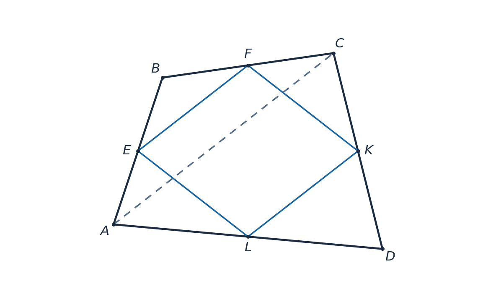

**Критерии**

- **2 балла.** Закончено правильное доказательство с обоснованием существенных шагов. Полностью обоснован вывод: EFKL — параллелограмм.
- **1 балл.** Доказательство по существу верно, есть несущественный недостаток. Опорный переход с обоснованием есть. Неточность записи не меняет вывода.
- **0 баллов.** Доказательство не удовлетворяет условиям для 1 или 2 баллов. Пропущен ключевой аргумент либо утверждение принято по виду чертежа.

[Пример семейства](https://math-oge.sdamgia.ru/problem?id=155)

### Задача 5 · авторская тренировка

Диагонали параллелограмма ABCD равны. Докажите, что ABCD — прямоугольник.

Подсказка 1

Сравни два треугольника с общей стороной AB.

Подсказка 2

Что даёт равенство двух соседних углов параллелограмма?

Ответ для самопроверки

ABCD — прямоугольник.

Разбор и критерии

1. В треугольниках DAB и CBA равны DA и CB, DB и CA, сторона AB общая. Поэтому треугольники равны по трём сторонам.
2. Из равенства треугольников ∠DAB = ∠CBA. Они прилежат к одной боковой стороне параллелограмма и в сумме равны 180°, поэтому оба прямые.

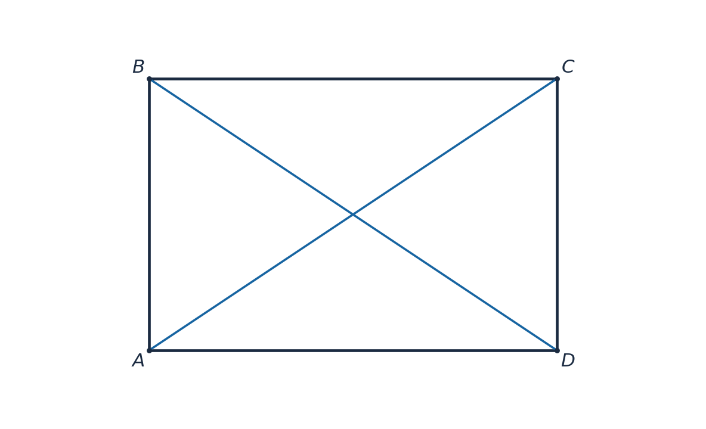

**Критерии**

- **2 балла.** Закончено правильное доказательство с обоснованием существенных шагов. Полностью обоснован вывод: ABCD — прямоугольник.
- **1 балл.** Доказательство по существу верно, есть несущественный недостаток. Опорный переход с обоснованием есть. Неточность записи не меняет вывода.
- **0 баллов.** Доказательство не удовлетворяет условиям для 1 или 2 баллов. Пропущен ключевой аргумент либо утверждение принято по виду чертежа.

[Пример семейства](https://math-oge.sdamgia.ru/problem?id=155)

### Задача 6 · авторская тренировка

В выпуклом четырёхугольнике ABCD диагонали пересекаются под прямым углом и точкой пересечения делятся пополам. Докажите, что ABCD — ромб.

Подсказка 1

Первое свойство диагоналей задаёт вид четырёхугольника.

Подсказка 2

Используй серединный перпендикуляр к AC.

Ответ для самопроверки

ABCD — ромб.

Разбор и критерии

1. Диагонали делятся общей точкой O пополам, значит ABCD — параллелограмм.
2. Диагональ BD перпендикулярна AC и проходит через её середину, следовательно, B равноудалена от A и C. Две соседние стороны параллелограмма равны. Поэтому все четыре стороны равны.

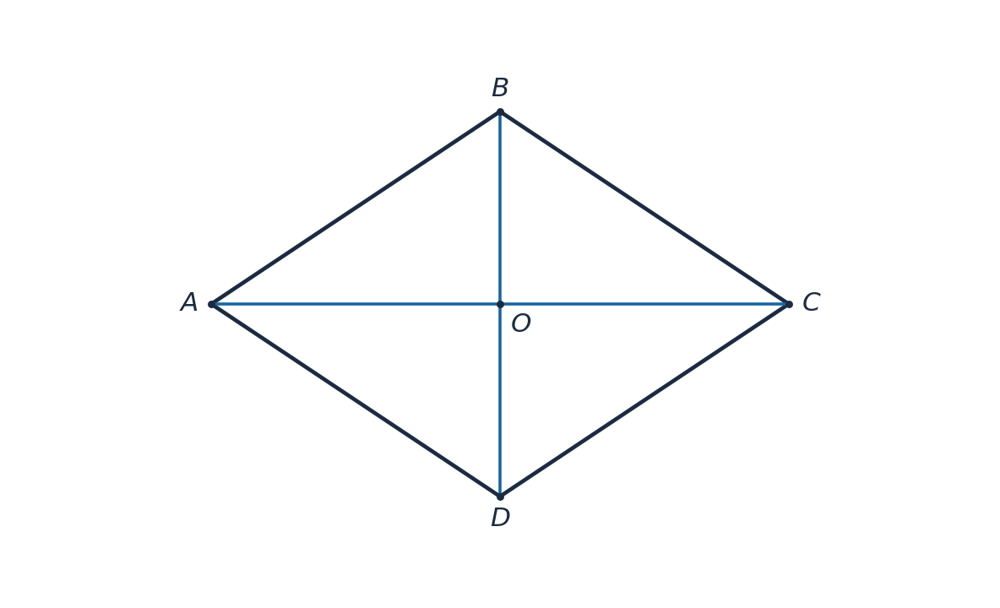

**Критерии**

- **2 балла.** Закончено правильное доказательство с обоснованием существенных шагов. Полностью обоснован вывод: ABCD — ромб.
- **1 балл.** Доказательство по существу верно, есть несущественный недостаток. Опорный переход с обоснованием есть. Неточность записи не меняет вывода.
- **0 баллов.** Доказательство не удовлетворяет условиям для 1 или 2 баллов. Пропущен ключевой аргумент либо утверждение принято по виду чертежа.

[Пример семейства](https://math-oge.sdamgia.ru/problem?id=155)

## Биссектрисы · Равноудалённость от трёх прямых

`OGE24-bisector-distance`

### Задача 1 · 341344

В трапеции ABCD основания AD и BC. Биссектрисы углов C и D встречаются в точке P, лежащей на AB. Докажите, что P равноудалена от прямых BC, CD и AD.

Подсказка 1

Подумай о расстояниях до сторон угла.

Подсказка 2

Для каждой биссектрисы получи равенство расстояний, затем объедини их через общую прямую.

Ответ для самопроверки

Расстояния от P до BC, CD и AD равны.

Разбор и критерии

1. По биссектрисе угла C расстояния от P до прямых BC и CD совпадают. Это следует из равенства прямоугольных треугольников, образованных перпендикулярами к сторонам угла.
2. По биссектрисе угла D расстояния от P до CD и AD совпадают. Через общее расстояние до CD получаем равенство всех трёх.

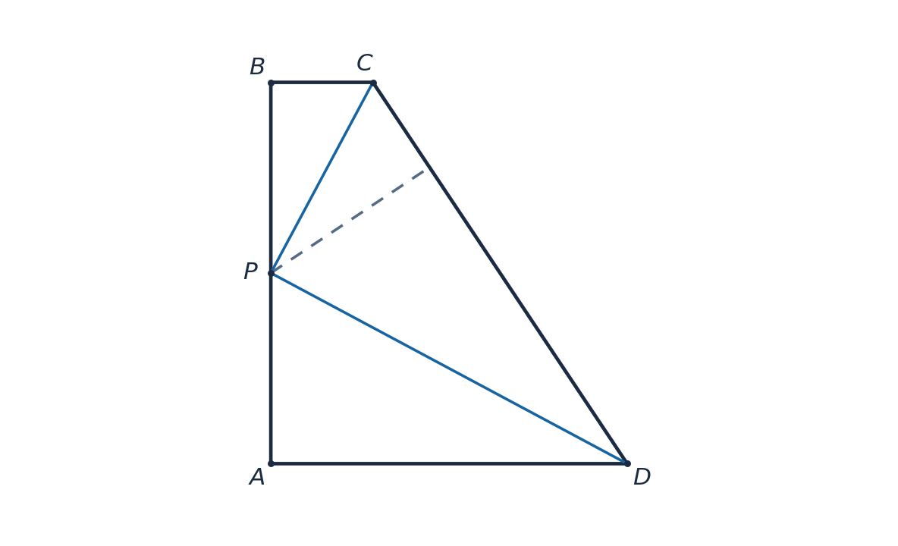

**Критерии**

- **2 балла.** Закончено правильное доказательство с обоснованием существенных шагов. Доказан сам вывод: Расстояния от P до BC, CD и AD равны.
- **1 балл.** Доказательство по существу верно, есть несущественный недостаток. Опорный переход с обоснованием есть. Неточность записи не меняет вывода.
- **0 баллов.** Доказательство не удовлетворяет условиям для 1 или 2 баллов. Пропущен ключевой аргумент либо утверждение принято по виду чертежа.

[Источник карточки](https://math-oge.sdamgia.ru/problem?id=341344)

### Задача 2 · авторская тренировка

Внутренние биссектрисы углов A и B треугольника ABC пересекаются в I. Докажите, что CI тоже биссектриса.

Подсказка 1

У двух биссектрис есть общая сторона AB.

Подсказка 2

Примени обратное свойство биссектрисы в угле C.

Ответ для самопроверки

CI — биссектриса угла ACB.

Разбор и критерии

1. Из биссектрисы A точка I одинаково удалена от прямых AB и AC. Из биссектрисы B она одинаково удалена от AB и BC.
2. Значит, расстояния от I до AC и BC равны. I лежит внутри угла ACB, а внутри угла равноудалённые точки лежат на внутренней биссектрисе.

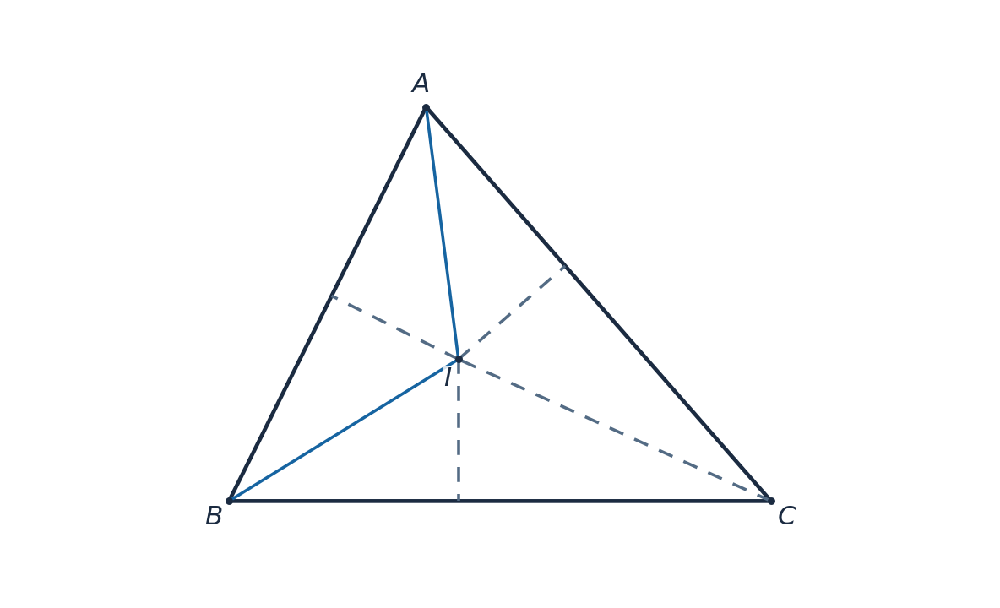

**Критерии**

- **2 балла.** Закончено правильное доказательство с обоснованием существенных шагов. Полностью обоснован вывод: CI — биссектриса угла ACB.
- **1 балл.** Доказательство по существу верно, есть несущественный недостаток. Опорный переход с обоснованием есть. Неточность записи не меняет вывода.
- **0 баллов.** Доказательство не удовлетворяет условиям для 1 или 2 баллов. Пропущен ключевой аргумент либо утверждение принято по виду чертежа.

[Пример семейства](https://math-oge.sdamgia.ru/problem?id=341344)

### Задача 3 · авторская тренировка

В треугольнике ABC внутренние биссектрисы A и B встретились в I. Радиус окружности с центром I равен расстоянию от I до AB. Докажите, что эта окружность вписана в ABC.

Подсказка 1

Выпиши три расстояния от I до сторон.

Подсказка 2

Проверь, почему касание прямой здесь относится к стороне.

Ответ для самопроверки

Окружность касается всех трёх сторон ABC.

Разбор и критерии

1. Биссектрисы A и B дают равенство расстояний от I до AB, AC и BC. Все они равны заданному радиусу.
2. Значит, окружность касается всех трёх прямых. Круг находится с той же стороны от каждой прямой, что и I, поскольку расстояние до прямой равно радиусу. Поэтому он целиком в треугольнике, и касания принадлежат сторонам.

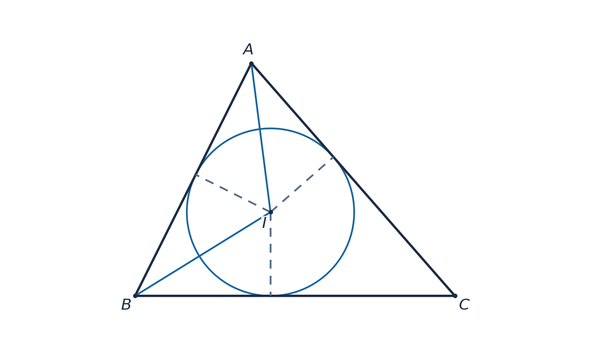

**Критерии**

- **2 балла.** Закончено правильное доказательство с обоснованием существенных шагов. Полностью обоснован вывод: Окружность касается всех трёх сторон ABC.
- **1 балл.** Доказательство по существу верно, есть несущественный недостаток. Опорный переход с обоснованием есть. Неточность записи не меняет вывода.
- **0 баллов.** Доказательство не удовлетворяет условиям для 1 или 2 баллов. Пропущен ключевой аргумент либо утверждение принято по виду чертежа.

[Пример семейства](https://math-oge.sdamgia.ru/problem?id=341344)

### Задача 4 · авторская тренировка

Точка J лежит на внутренней биссектрисе угла A треугольника ABC и на внешней биссектрисе угла B. J и A находятся по разные стороны от BC. Докажите, что J лежит на внешней биссектрисе угла C.

Подсказка 1

Сравни расстояния до трёх прямых.

Подсказка 2

Уточни, в каком секторе при C находится J.

Ответ для самопроверки

CJ делит один из внешних углов при C.

Разбор и критерии

1. Из обеих известных биссектрис следует равенство расстояний до AB, AC и BC. Для внешней биссектрисы используются расстояния до прямых, содержащих стороны угла.
2. J находится по ту же сторону от AC, что и B, поскольку лежит внутри угла A. Относительно BC она с противоположной A стороны. Это один из внешних углов при C. Равные расстояния до его сторон помещают J на внешнюю биссектрису.

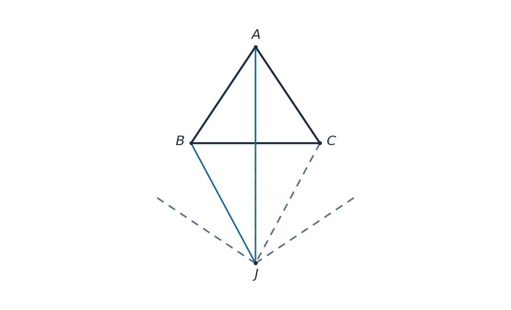

**Критерии**

- **2 балла.** Закончено правильное доказательство с обоснованием существенных шагов. Полностью обоснован вывод: CJ делит один из внешних углов при C.
- **1 балл.** Доказательство по существу верно, есть несущественный недостаток. Опорный переход с обоснованием есть. Неточность записи не меняет вывода.
- **0 баллов.** Доказательство не удовлетворяет условиям для 1 или 2 баллов. Пропущен ключевой аргумент либо утверждение принято по виду чертежа.

[Пример семейства](https://math-oge.sdamgia.ru/problem?id=341344)

### Задача 5 · авторская тренировка

Точка P внутри выпуклого ABCD равноудалена от прямых AB, BC и AD. Докажите, что AP и BP делят пополам углы A и B.

Подсказка 1

Для каждого угла назови две прямые, содержащие его стороны.

Подсказка 2

Используй свойство равноудалённых внутренних точек угла.

Ответ для самопроверки

AP и BP — внутренние биссектрисы.

Разбор и критерии

1. В угле A прямые его сторон — AB и AD. P внутри этого угла, и расстояния до его сторон равны. По обратному свойству биссектрисы AP делит угол A пополам.
2. Для угла B стороны лежат на AB и BC. Те же условия дают, что BP — внутренняя биссектриса угла B.

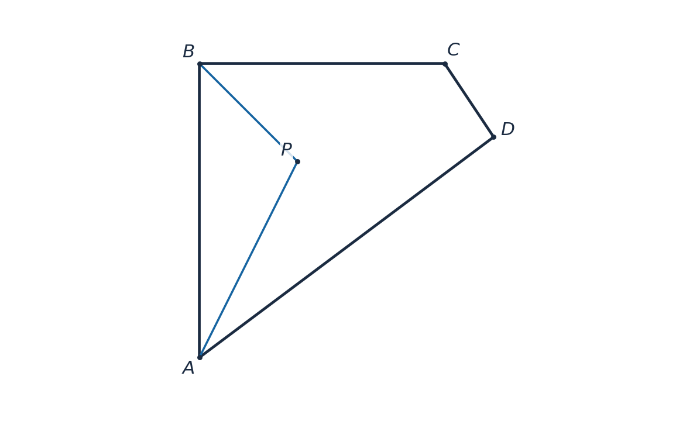

**Критерии**

- **2 балла.** Закончено правильное доказательство с обоснованием существенных шагов. Полностью обоснован вывод: AP и BP — внутренние биссектрисы.
- **1 балл.** Доказательство по существу верно, есть несущественный недостаток. Опорный переход с обоснованием есть. Неточность записи не меняет вывода.
- **0 баллов.** Доказательство не удовлетворяет условиям для 1 или 2 баллов. Пропущен ключевой аргумент либо утверждение принято по виду чертежа.

[Пример семейства](https://math-oge.sdamgia.ru/problem?id=341344)

### Задача 6 · авторская тренировка

Внутри выпуклого ABCD точка P лежит на биссектрисах углов A и C. Расстояния от P до AB и CD равны. Докажите, что в ABCD можно вписать окружность с центром P.

Подсказка 1

По каждой из двух биссектрис выпиши свою пару равных расстояний.

Подсказка 2

Объедини пары через заданное равенство.

Ответ для самопроверки

Существует вписанная окружность с центром P.

Разбор и критерии

1. Биссектриса угла A даёт равенство расстояний до AB и AD, биссектриса угла C — до BC и CD. Две пары связаны равенством расстояний до AB и CD из условия.
2. Тогда круг с центром P и найденным общим радиусом касается всех четырёх прямых. Так как P внутри и круг лежит в каждой внутренней полуплоскости, он целиком в четырёхугольнике. Касания лежат на его сторонах.

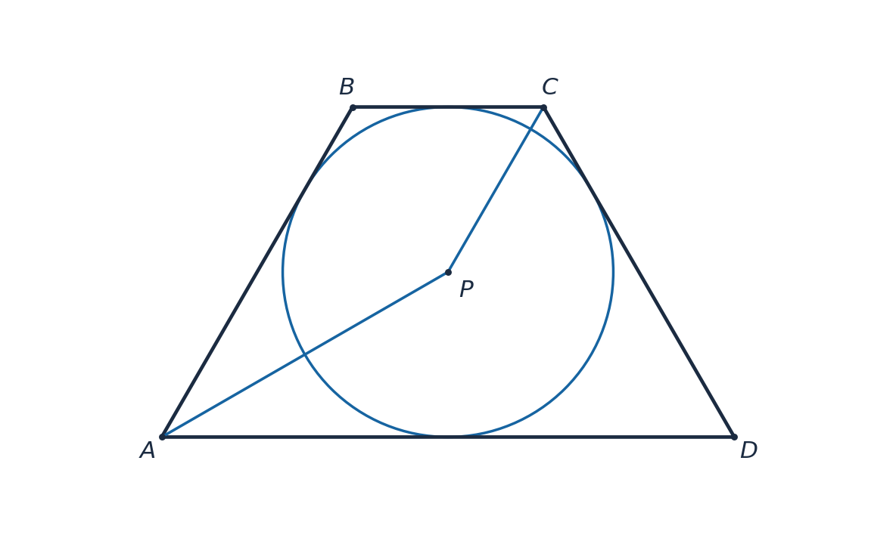

**Критерии**

- **2 балла.** Закончено правильное доказательство с обоснованием существенных шагов. Полностью обоснован вывод: Существует вписанная окружность с центром P.
- **1 балл.** Доказательство по существу верно, есть несущественный недостаток. Опорный переход с обоснованием есть. Неточность записи не меняет вывода.
- **0 баллов.** Доказательство не удовлетворяет условиям для 1 или 2 баллов. Пропущен ключевой аргумент либо утверждение принято по виду чертежа.

[Пример семейства](https://math-oge.sdamgia.ru/problem?id=341344)

## Биссектрисы · Биссектриса и равнобедренный треугольник при параллельных сторонах

`OGE24-bisector-isosceles`

### Задача 1 · 348892

В параллелограмме $ABCD$ сторона $CD=2BC$, а $N$ — середина $CD$. Докажите, что $BN$ делит угол $ABC$ пополам.

Подсказка 1

Поищи равнобедренный треугольник рядом с серединой стороны.

Подсказка 2

Сравни его углы с углами, образованными параллельными сторонами.

Ответ для самопроверки

$\angle ABN=\angle NBC$.

Разбор и критерии

1. Из условия $CN=CD/2=BC$.
2. Треугольник $BCN$ равнобедренный, поэтому $\angle CBN=\angle BNC$.
3. Из $AB\parallel CD$ и того, что $N$ лежит на $CD$, получаем $\angle ABN=\angle BNC$ как накрест лежащие при секущей $BN$.
4. Следовательно, $\angle ABN=\angle NBC$, как и требуется.

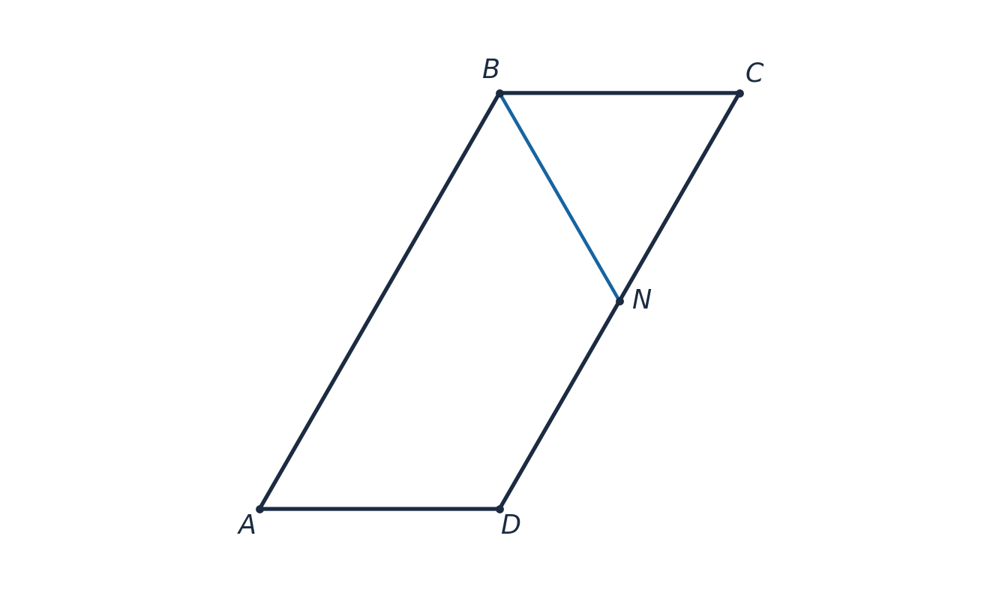

**Критерии**

- **2 балла.** Закончено правильное доказательство с обоснованием существенных шагов. Доказаны равнобедренность и равенство накрест лежащих углов.
- **1 балл.** Доказательство по существу верно, есть несущественный недостаток. Правильная цепочка с несущественной неточностью в обозначениях.
- **0 баллов.** Доказательство не удовлетворяет условиям для 1 или 2 баллов. Биссектриса использована как исходное допущение, хотя её требовалось доказать.

[Источник карточки](https://math-oge.sdamgia.ru/problem?id=348892)

### Задача 2 · 340387

Биссектрисы углов A и D параллелограмма ABCD пересекают сторону BC в одной точке E. Докажите, что E — середина BC.

Подсказка 1

Поищи равнобедренный треугольник рядом с серединой стороны.

Подсказка 2

Сравни его углы с углами, образованными параллельными сторонами.

Ответ для самопроверки

$BE=EC$.

Разбор и критерии

1. В треугольнике ABE углы BAE и AEB равны: первый равен DAE по биссектрисе, а DAE равен AEB по параллельности AD и BC. Значит, BE = AB.
2. Аналогично в треугольнике CDE по биссектрисе из D и параллельности оснований получаем CE = CD. Так как противоположные стороны AB и CD равны, BE = CE.

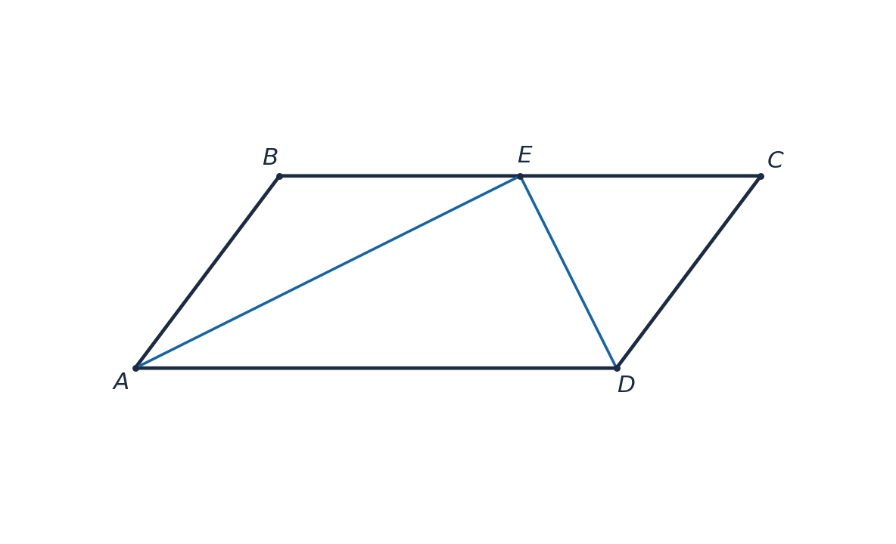

**Критерии**

- **2 балла.** Закончено правильное доказательство с обоснованием существенных шагов. Доказан сам вывод: $BE=EC$.
- **1 балл.** Доказательство по существу верно, есть несущественный недостаток. Опорный переход с обоснованием есть. Неточность записи не меняет вывода.
- **0 баллов.** Доказательство не удовлетворяет условиям для 1 или 2 баллов. Пропущен ключевой аргумент либо утверждение принято по виду чертежа.

[Источник карточки](https://math-oge.sdamgia.ru/problem?id=340387)

### Задача 3 · авторская тренировка

В параллелограмме ABCD биссектриса угла A пересекает сторону BC в E. Докажите AB = BE.

Подсказка 1

Сравни углы BAE и DAE.

Подсказка 2

Перенеси угол DAE в треугольник ABE при помощи параллельности.

Ответ для самопроверки

AB = BE.

Разбор и критерии

1. Из биссектрисы ∠BAE = ∠DAE. Так как AD ∥ BC, ∠DAE = ∠AEB.
2. Значит, углы при A и E треугольника ABE равны. Стороны, лежащие напротив, — BE и AB — тоже равны.

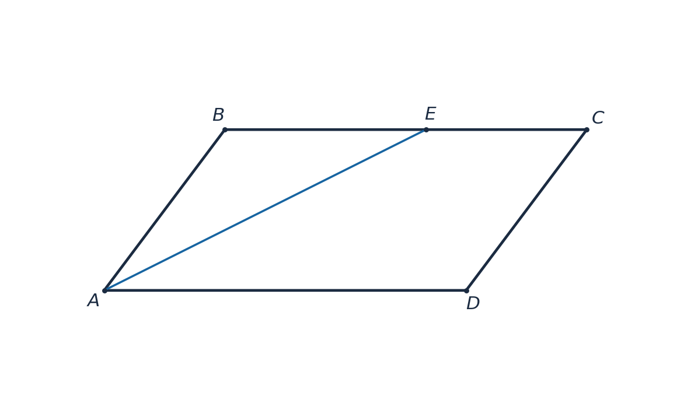

**Критерии**

- **2 балла.** Закончено правильное доказательство с обоснованием существенных шагов. Полностью обоснован вывод: AB = BE.
- **1 балл.** Доказательство по существу верно, есть несущественный недостаток. Опорный переход с обоснованием есть. Неточность записи не меняет вывода.
- **0 баллов.** Доказательство не удовлетворяет условиям для 1 или 2 баллов. Пропущен ключевой аргумент либо утверждение принято по виду чертежа.

[Пример семейства](https://math-oge.sdamgia.ru/problem?id=340387)

### Задача 4 · авторская тренировка

E — середина BC параллелограмма ABCD. Отрезок AE делит угол BAD пополам. Докажите AD = 2AB.

Подсказка 1

Выдели равные углы в треугольнике ABE.

Подсказка 2

Свяжи найденное равенство отрезков с серединой стороны.

Ответ для самопроверки

AD = 2AB.

Разбор и критерии

1. Биссектриса даёт ∠BAE = ∠EAD, а параллельность AD и BC даёт ∠EAD = ∠AEB. Значит, ∠BAE = ∠AEB, откуда AB = BE.
2. E — середина BC, поэтому BC = 2BE. По свойству параллелограмма AD = BC, значит AD = 2AB.

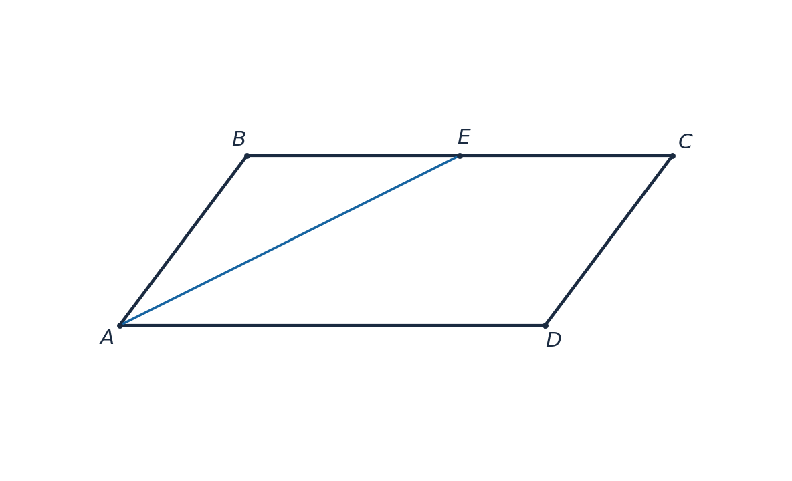

**Критерии**

- **2 балла.** Закончено правильное доказательство с обоснованием существенных шагов. Полностью обоснован вывод: AD = 2AB.
- **1 балл.** Доказательство по существу верно, есть несущественный недостаток. Опорный переход с обоснованием есть. Неточность записи не меняет вывода.
- **0 баллов.** Доказательство не удовлетворяет условиям для 1 или 2 баллов. Пропущен ключевой аргумент либо утверждение принято по виду чертежа.

[Пример семейства](https://math-oge.sdamgia.ru/problem?id=340387)

### Задача 5 · авторская тренировка

В параллелограмме ABCD стороны AB и BC равны. Докажите, что AC делит угол BAD пополам.

Подсказка 1

Какой треугольник равнобедренный?

Подсказка 2

Замени один из его углов равным углом при A через параллельные стороны.

Ответ для самопроверки

∠BAC = ∠CAD.

Разбор и критерии

1. В треугольнике ABC стороны AB и BC равны, значит ∠BAC = ∠BCA.
2. По параллельности BC и AD углы BCA и CAD равны. Получаем ∠BAC = ∠CAD, то есть диагональ делит угол при A пополам.

**Критерии**

- **2 балла.** Закончено правильное доказательство с обоснованием существенных шагов. Полностью обоснован вывод: ∠BAC = ∠CAD.
- **1 балл.** Доказательство по существу верно, есть несущественный недостаток. Опорный переход с обоснованием есть. Неточность записи не меняет вывода.
- **0 баллов.** Доказательство не удовлетворяет условиям для 1 или 2 баллов. Пропущен ключевой аргумент либо утверждение принято по виду чертежа.

[Пример семейства](https://math-oge.sdamgia.ru/problem?id=340387)

### Задача 6 · авторская тренировка

В трапеции ABCD основания AD и BC. Точка E лежит на BC, причём CE = CD. Докажите, что DE делит угол ADC пополам.

Подсказка 1

Сравни CE и CD в одном треугольнике.

Подсказка 2

Перенеси угол при E к вершине D.

Ответ для самопроверки

∠ADE = ∠EDC.

Разбор и критерии

1. Из CE = CD следует, что треугольник CDE равнобедренный и ∠CED = ∠EDC.
2. По параллельности оснований ∠CED и ∠ADE равны как накрест лежащие. Поэтому ∠ADE = ∠EDC, что и нужно было доказать.

**Критерии**

- **2 балла.** Закончено правильное доказательство с обоснованием существенных шагов. Полностью обоснован вывод: ∠ADE = ∠EDC.
- **1 балл.** Доказательство по существу верно, есть несущественный недостаток. Опорный переход с обоснованием есть. Неточность записи не меняет вывода.
- **0 баллов.** Доказательство не удовлетворяет условиям для 1 или 2 баллов. Пропущен ключевой аргумент либо утверждение принято по виду чертежа.

[Пример семейства](https://math-oge.sdamgia.ru/problem?id=340387)

## Площади · Доказательство равенства или отношения площадей

`OGE24-area-proof`

### Задача 1 · 340055

Диагонали трапеции $ABCD$ с основаниями $AD$ и $BC$ пересекаются в $O$. Докажите равенство площадей треугольников $AOB$ и $COD$.

Подсказка 1

Выбери общее основание или пару оснований одинаковой длины.

Подсказка 2

Сравни высоты либо выдели общую часть и вычти её.

Ответ для самопроверки

$S_{AOB}=S_{COD}$.

Разбор и критерии

1. У треугольников $ABC$ и $DBC$ общее основание $BC$.
2. Их вершины $A,D$ лежат на одной прямой, параллельной $BC$, поэтому высоты к $BC$ равны.
3. Значит, $S_{ABC}=S_{DBC}$.
4. В первом треугольнике вычитаем общую часть $BOC$, во втором — ту же часть $BOC$.
5. Остаются соответственно $AOB$ и $COD$, их площади равны.

**Критерии**

- **2 балла.** Закончено правильное доказательство с обоснованием существенных шагов. Обосновано равенство больших площадей и корректно вычтена одна и та же общая часть.
- **1 балл.** Доказательство по существу верно, есть несущественный недостаток. Ход доказательства верен с малым дефектом обозначений или изложения.
- **0 баллов.** Доказательство не удовлетворяет условиям для 1 или 2 баллов. Искомые треугольники объявлены равными без основания либо не установлено равенство площадей.

[Источник карточки](https://math-oge.sdamgia.ru/problem?id=340055)

### Задача 2 · 333026

Точка E — середина боковой стороны AB трапеции ABCD с основаниями AD и BC. Докажите, что площадь ECD равна половине площади трапеции.

Подсказка 1

Выбери общее основание или пару оснований одинаковой длины.

Подсказка 2

Сравни высоты либо выдели общую часть и вычти её.

Ответ для самопроверки

$S_{ECD}=S_{ABCD}/2$.

Разбор и критерии

1. Точка E находится посередине между параллельными основаниями. Если высота трапеции h, то расстояние от E до каждого основания h/2.
2. Из площади всей трапеции вычтем площади EAD и EBC. Сумма вычитаемых площадей равна (AD+BC)·h/4, то есть половине площади трапеции. Следовательно, оставшийся треугольник ECD также занимает половину.

**Критерии**

- **2 балла.** Закончено правильное доказательство с обоснованием существенных шагов. Доказан сам вывод: $S_{ECD}=S_{ABCD}/2$.
- **1 балл.** Доказательство по существу верно, есть несущественный недостаток. Опорный переход с обоснованием есть. Неточность записи не меняет вывода.
- **0 баллов.** Доказательство не удовлетворяет условиям для 1 или 2 баллов. Пропущен ключевой аргумент либо утверждение принято по виду чертежа.

[Источник карточки](https://math-oge.sdamgia.ru/problem?id=333026)

### Задача 3 · 333131

Внутри параллелограмма ABCD выбрана точка E. Докажите, что сумма площадей BEC и AED равна половине площади параллелограмма.

Подсказка 1

Выбери общее основание или пару оснований одинаковой длины.

Подсказка 2

Сравни высоты либо выдели общую часть и вычти её.

Ответ для самопроверки

$S_{BEC}+S_{AED}=S_{ABCD}/2$.

Разбор и критерии

1. Возьмём основания BC и AD, у них одна длина a. Расстояния от E до этих параллельных прямых в сумме дают высоту параллелограмма h.
2. По формуле площади треугольника сумма площадей равна a/2, умноженной на эту сумму расстояний, то есть ah/2. Площадь параллелограмма равна ah.

**Критерии**

- **2 балла.** Закончено правильное доказательство с обоснованием существенных шагов. Доказан сам вывод: $S_{BEC}+S_{AED}=S_{ABCD}/2$.
- **1 балл.** Доказательство по существу верно, есть несущественный недостаток. Опорный переход с обоснованием есть. Неточность записи не меняет вывода.
- **0 баллов.** Доказательство не удовлетворяет условиям для 1 или 2 баллов. Пропущен ключевой аргумент либо утверждение принято по виду чертежа.

[Источник карточки](https://math-oge.sdamgia.ru/problem?id=333131)

### Задача 4 · 348716

На средней линии трапеции ABCD с основаниями BC и AD взяли точку K. Докажите, что сумма площадей BKC и AKD равна половине площади трапеции.

Подсказка 1

Выбери общее основание или пару оснований одинаковой длины.

Подсказка 2

Сравни высоты либо выдели общую часть и вычти её.

Ответ для самопроверки

$S_{BKC}+S_{AKD}=S_{ABCD}/2$.

Разбор и критерии

1. Средняя линия лежит посередине между основаниями. Поэтому высоты из K к BC и AD обе равны h/2, где h — высота трапеции.
2. Складываем площади: BC·h/4 + AD·h/4 = (BC+AD)h/4. Это половина площади трапеции (BC+AD)h/2.

**Критерии**

- **2 балла.** Закончено правильное доказательство с обоснованием существенных шагов. Доказан сам вывод: $S_{BKC}+S_{AKD}=S_{ABCD}/2$.
- **1 балл.** Доказательство по существу верно, есть несущественный недостаток. Опорный переход с обоснованием есть. Неточность записи не меняет вывода.
- **0 баллов.** Доказательство не удовлетворяет условиям для 1 или 2 баллов. Пропущен ключевой аргумент либо утверждение принято по виду чертежа.

[Источник карточки](https://math-oge.sdamgia.ru/problem?id=348716)

### Задача 5 · авторская тренировка

Точка K лежит внутри диагонали AC параллелограмма ABCD. Докажите, что площади ABK и ADK равны.

Подсказка 1

Найди общее основание искомых треугольников.

Подсказка 2

Сравни высоты из B и D к прямой диагонали.

Ответ для самопроверки

S(ABK)=S(ADK).

Разбор и критерии

1. Треугольники ABC и ADC равны по трём сторонам. При общем основании AC их высоты к AC равны.
2. У треугольников ABK и ADK общее основание AK на той же прямой AC. Их высоты из B и D поэтому равны, значит и площади совпадают.

**Критерии**

- **2 балла.** Закончено правильное доказательство с обоснованием существенных шагов. Полностью обоснован вывод: S(ABK)=S(ADK).
- **1 балл.** Доказательство по существу верно, есть несущественный недостаток. Опорный переход с обоснованием есть. Неточность записи не меняет вывода.
- **0 баллов.** Доказательство не удовлетворяет условиям для 1 или 2 баллов. Пропущен ключевой аргумент либо утверждение принято по виду чертежа.

[Пример семейства](https://math-oge.sdamgia.ru/problem?id=333026)

### Задача 6 · авторская тренировка

В трапеции ABCD основания AD и BC, диагонали пересекаются в O. Докажите, что S(AOB):S(BOC) = AD:BC.

Подсказка 1

Выбери AO и OC как основания для сравнения площадей.

Подсказка 2

Найди это же отношение из подобия другой пары треугольников.

Ответ для самопроверки

S(AOB):S(BOC) = AD:BC.

Разбор и критерии

1. Треугольники AOB и BOC имеют одну высоту из B к прямой AC. Поэтому отношение площадей равно AO:OC.
2. По вертикальным и накрест лежащим углам треугольники AOD и COB подобны. Из их соответствующих сторон AO:OC = AD:BC. Получаем требуемое отношение.

**Критерии**

- **2 балла.** Закончено правильное доказательство с обоснованием существенных шагов. Полностью обоснован вывод: S(AOB):S(BOC) = AD:BC.
- **1 балл.** Доказательство по существу верно, есть несущественный недостаток. Опорный переход с обоснованием есть. Неточность записи не меняет вывода.
- **0 баллов.** Доказательство не удовлетворяет условиям для 1 или 2 баллов. Пропущен ключевой аргумент либо утверждение принято по виду чертежа.

[Пример семейства](https://math-oge.sdamgia.ru/problem?id=333026)

## Две окружности · Линия центров перпендикулярна общей хорде

`OGE24-common-chord`

### Задача 1 · 340906

Окружности с центрами $E$ и $F$ пересекаются в двух точках $C,D$. Оба центра лежат по одну сторону от прямой $CD$. Докажите, что $CD\perp EF$.

Подсказка 1

Сравни расстояния каждого центра до концов общей хорды.

Подсказка 2

Обе точки, равноудалённые от концов хорды, лежат на одном серединном перпендикуляре.

Ответ для самопроверки

$CD\perp EF$.

Разбор и критерии

1. В первой окружности $EC=ED$ как радиусы, поэтому $E$ лежит на серединном перпендикуляре к $CD$.
2. Аналогично $FC=FD$, поэтому на той же прямой лежит $F$.
3. Через две различные точки $E,F$ проходит одна прямая.
4. Следовательно, $EF$ и есть серединный перпендикуляр к $CD$.

**Критерии**

- **2 балла.** Закончено правильное доказательство с обоснованием существенных шагов. Оба центра отнесены к одному и тому же серединному перпендикуляру, вывод сделан явно.
- **1 балл.** Доказательство по существу верно, есть несущественный недостаток. Правильная цепочка с несущественным пропуском в записи равенства одной пары радиусов.
- **0 баллов.** Доказательство не удовлетворяет условиям для 1 или 2 баллов. Использовано только то, что один центр лежит на серединном перпендикуляре, но для второго ничего не доказано.

[Источник карточки](https://math-oge.sdamgia.ru/problem?id=340906)

### Задача 2 · авторская тренировка

Две окружности пересеклись в A и B. Их центры O₁ и O₂ находятся по разные стороны от AB. Докажите, что точка пересечения O₁O₂ с AB делит хорду пополам.

Подсказка 1

Отметь две пары равных радиусов.

Подсказка 2

Назови геометрическое место точек, равноудалённых от A и B.

Ответ для самопроверки

AH = HB, где H = AB ∩ O₁O₂.

Разбор и критерии

1. Оба центра равноудалены от A и B, поскольку эти расстояния — радиусы соответствующей окружности.
2. Поэтому прямая O₁O₂ совпадает с серединным перпендикуляром к AB. Она пересекает AB ровно в его середине.

**Критерии**

- **2 балла.** Закончено правильное доказательство с обоснованием существенных шагов. Полностью обоснован вывод: AH = HB, где H = AB ∩ O₁O₂.
- **1 балл.** Доказательство по существу верно, есть несущественный недостаток. Опорный переход с обоснованием есть. Неточность записи не меняет вывода.
- **0 баллов.** Доказательство не удовлетворяет условиям для 1 или 2 баллов. Пропущен ключевой аргумент либо утверждение принято по виду чертежа.

[Пример семейства](https://math-oge.sdamgia.ru/problem?id=340906)

### Задача 3 · авторская тренировка

Две окружности с равными радиусами и различными центрами O₁ и O₂ пересеклись в A и B. Докажите, что AB — серединный перпендикуляр к O₁O₂.

Подсказка 1

Рассмотри расстояния от A до двух центров.

Подсказка 2

Какое геометрическое место точек определяется равенством этих расстояний?

Ответ для самопроверки

AB — серединный перпендикуляр к O₁O₂.

Разбор и критерии

1. Точка A находится на обеих окружностях с равным радиусом, поэтому AO₁ = AO₂. Точно так же BO₁ = BO₂.
2. Значит, обе различные точки A и B лежат на одном серединном перпендикуляре к O₁O₂. Через них проходит только одна прямая, поэтому нужная прямая — AB.

**Критерии**

- **2 балла.** Закончено правильное доказательство с обоснованием существенных шагов. Полностью обоснован вывод: AB — серединный перпендикуляр к O₁O₂.
- **1 балл.** Доказательство по существу верно, есть несущественный недостаток. Опорный переход с обоснованием есть. Неточность записи не меняет вывода.
- **0 баллов.** Доказательство не удовлетворяет условиям для 1 или 2 баллов. Пропущен ключевой аргумент либо утверждение принято по виду чертежа.

[Пример семейства](https://math-oge.sdamgia.ru/problem?id=340906)

### Задача 4 · авторская тренировка

Окружности с центрами O₁ и O₂ и радиусами r₁ и r₂ пересекаются в A, B. H — середина AB. Докажите O₁H²−O₂H² = r₁²−r₂².

Подсказка 1

Установи, что углы при H прямые.

Подсказка 2

Вычти два равенства по теореме Пифагора.

Ответ для самопроверки

O₁H²−O₂H² = r₁²−r₂².

Разбор и критерии

1. Оба центра равноудалены от концов хорды, поэтому лежат на серединном перпендикуляре к AB. Для каждого центра, отличного от H, треугольник с вершинами в центре, H и A прямоугольный.
2. По теореме Пифагора r₁² = O₁H² + AH² и r₂² = O₂H² + AH². Если один из центров совпадает с H, соответствующее равенство выполняется, поскольку радиус равен AH. Вычитание убирает общий квадрат AH².

**Критерии**

- **2 балла.** Закончено правильное доказательство с обоснованием существенных шагов. Полностью обоснован вывод: O₁H²−O₂H² = r₁²−r₂².
- **1 балл.** Доказательство по существу верно, есть несущественный недостаток. Опорный переход с обоснованием есть. Неточность записи не меняет вывода.
- **0 баллов.** Доказательство не удовлетворяет условиям для 1 или 2 баллов. Пропущен ключевой аргумент либо утверждение принято по виду чертежа.

[Пример семейства](https://math-oge.sdamgia.ru/problem?id=340906)

### Задача 5 · авторская тренировка

Окружности с различными центрами O₁ и O₂ имеют общую точку A, не лежащую на O₁O₂. Докажите, что отражение A относительно O₁O₂ даёт вторую общую точку.

Подсказка 1

Какие точки остаются на месте при отражении?

Подсказка 2

Используй сохранение обоих расстояний до центров.

Ответ для самопроверки

Отражённая точка B принадлежит обеим окружностям.

Разбор и критерии

1. Осевая симметрия относительно O₁O₂ оставляет оба центра на месте и сохраняет расстояния. Если A перешла в B, то BO₁=AO₁ и BO₂=AO₂.
2. Эти расстояния равны радиусам обеих окружностей. B отлична от A, так как A не на оси. Две различные окружности имеют не более двух общих точек, поэтому B — вторая.

**Критерии**

- **2 балла.** Закончено правильное доказательство с обоснованием существенных шагов. Полностью обоснован вывод: Отражённая точка B принадлежит обеим окружностям.
- **1 балл.** Доказательство по существу верно, есть несущественный недостаток. Опорный переход с обоснованием есть. Неточность записи не меняет вывода.
- **0 баллов.** Доказательство не удовлетворяет условиям для 1 или 2 баллов. Пропущен ключевой аргумент либо утверждение принято по виду чертежа.

[Пример семейства](https://math-oge.sdamgia.ru/problem?id=340906)

### Задача 6 · авторская тренировка

Окружности с центрами O₁, O₂ радиусов r₁, r₂ пересекаются в A, B. Для любой точки P прямой AB докажите PO₁²−r₁² = PO₂²−r₂².

Подсказка 1

Опусти оба перпендикуляра на общую хорду.

Подсказка 2

Вычти квадрат радиуса из квадрата расстояния до P.

Ответ для самопроверки

PO₁²−r₁² = PO₂²−r₂².

Разбор и критерии

1. Пусть H — середина AB. Оба центра лежат на перпендикуляре к AB через H, так как их расстояния до A и B попарно равны.
2. Из Пифагора PO₁² = HO₁²+HP², а r₁² = HO₁²+HA². Поэтому PO₁²−r₁² = HP²−HA². Для O₂ получается то же выражение. Если P=H или один из центров совпадает с H, те же равенства верны с нулевым катетом.

**Критерии**

- **2 балла.** Закончено правильное доказательство с обоснованием существенных шагов. Полностью обоснован вывод: PO₁²−r₁² = PO₂²−r₂².
- **1 балл.** Доказательство по существу верно, есть несущественный недостаток. Опорный переход с обоснованием есть. Неточность записи не меняет вывода.
- **0 баллов.** Доказательство не удовлетворяет условиям для 1 или 2 баллов. Пропущен ключевой аргумент либо утверждение принято по виду чертежа.

[Пример семейства](https://math-oge.sdamgia.ru/problem?id=340906)

## Две окружности · Отношение радиусов через внутреннюю касательную

`OGE24-common-tangent-ratio`

### Задача 1 · 340324

Две окружности с центрами $O_1,O_2$ лежат вне друг друга и не пересекаются. Их общая внутренняя касательная пересекает $O_1O_2$ в точке $P$, причём $O_1P:PO_2=m:n$. Докажите, что диаметры окружностей относятся как $m:n$ в том же порядке.

Подсказка 1

Соедини центры с точками касания.

Подсказка 2

Сравни два прямоугольных треугольника с вершиной в точке пересечения касательной и линии центров.

Ответ для самопроверки

$d_1:d_2=m:n$.

Разбор и критерии

1. Пусть $T_1,T_2$ — точки касания.
2. Радиусы $O_1T_1$ и $O_2T_2$ перпендикулярны касательной.
3. У прямоугольных треугольников $O_1T_1P$ и $O_2T_2P$ углы при $P$ равны как вертикальные.
4. По двум углам треугольники подобны, значит $O_1T_1/O_2T_2=O_1P/O_2P=m/n$.
5. При удвоении обоих радиусов отношение сохраняется.

**Критерии**

- **2 балла.** Закончено правильное доказательство с обоснованием существенных шагов. Доказано подобие через перпендикулярность и углы при P, соблюдён порядок отношения.
- **1 балл.** Доказательство по существу верно, есть несущественный недостаток. Доказательство в целом правильное, но несущественный дефект записи не мешает восстановить отношение.
- **0 баллов.** Доказательство не удовлетворяет условиям для 1 или 2 баллов. Отношение радиусов заявлено по картинке или продемонстрировано только на частном числовом примере.

[Источник карточки](https://math-oge.sdamgia.ru/problem?id=340324)

### Задача 2 · авторская тренировка

Две окружности не пересекаются. Общая внешняя касательная касается их в T₁ и T₂ и пересекает прямую центров в P. Докажите, что PO₁:PO₂ равно отношению радиусов этих окружностей.

Подсказка 1

Проведи к касательной оба радиуса.

Подсказка 2

При внешней касательной углы двух прямоугольных треугольников при P совпадают.

Ответ для самопроверки

PO₁:PO₂ = r₁:r₂.

Разбор и критерии

1. Радиусы O₁T₁ и O₂T₂ перпендикулярны одной касательной. Так как P вне отрезка центров, лучи PO₁ и PO₂ совпадают. Лучи PT₁ и PT₂ также совпадают: T₁ и T₂ — проекции центров на касательную.
2. У двух прямоугольных треугольников общий угол при P, значит они подобны. Отношение гипотенуз PO₁ и PO₂ равно отношению соответствующих радиусов.

**Критерии**

- **2 балла.** Закончено правильное доказательство с обоснованием существенных шагов. Полностью обоснован вывод: PO₁:PO₂ = r₁:r₂.
- **1 балл.** Доказательство по существу верно, есть несущественный недостаток. Опорный переход с обоснованием есть. Неточность записи не меняет вывода.
- **0 баллов.** Доказательство не удовлетворяет условиям для 1 или 2 баллов. Пропущен ключевой аргумент либо утверждение принято по виду чертежа.

[Пример семейства](https://math-oge.sdamgia.ru/problem?id=340324)

### Задача 3 · авторская тренировка

Окружности с центрами O₁,O₂ имеют радиусы r₁,r₂. Точка P внутри O₁O₂, причём PO₁:PO₂ = r₁:r₂. Прямая ℓ через P касается первой окружности. Докажите, что она касается второй.

Подсказка 1

Опусти на ℓ перпендикуляр из второго центра.

Подсказка 2

Докажи, что он равен радиусу второй окружности.

Ответ для самопроверки

ℓ касается второй окружности.

Разбор и критерии

1. Опустим перпендикуляры O₁T₁, O₂T₂ на ℓ. Первый равен r₁ по условию. Если ℓ перпендикулярна линии центров, то расстояния до неё равны PO₁ и PO₂ и утверждение сразу следует из отношения.
2. В остальных случаях прямоугольные треугольники O₁T₁P и O₂T₂P подобны по вертикальным углам при P. Следовательно, O₂T₂/ O₁T₁ = PO₂/PO₁ = r₂/r₁. Поэтому O₂T₂ = r₂, а равенство расстояния от центра до прямой радиусу означает касание.

**Критерии**

- **2 балла.** Закончено правильное доказательство с обоснованием существенных шагов. Полностью обоснован вывод: ℓ касается второй окружности.
- **1 балл.** Доказательство по существу верно, есть несущественный недостаток. Опорный переход с обоснованием есть. Неточность записи не меняет вывода.
- **0 баллов.** Доказательство не удовлетворяет условиям для 1 или 2 баллов. Пропущен ключевой аргумент либо утверждение принято по виду чертежа.

[Пример семейства](https://math-oge.sdamgia.ru/problem?id=340324)

### Задача 4 · авторская тренировка

Общая внутренняя касательная двух окружностей проходит через середину P отрезка между центрами. Докажите, что окружности имеют равные радиусы.

Подсказка 1

Какой поворот вокруг P переставляет центры?

Подсказка 2

Проверь, куда этот поворот переводит прямую касательной.

Ответ для самопроверки

r₁ = r₂.

Разбор и критерии

1. Проведём поворот на 180° вокруг P. Первый центр переходит во второй, а касательная через P — в саму себя.
2. Расстояние от точки до этой прямой сохраняется. До и после поворота эти расстояния равны соответствующим радиусам, значит радиусы одинаковы.

**Критерии**

- **2 балла.** Закончено правильное доказательство с обоснованием существенных шагов. Полностью обоснован вывод: r₁ = r₂.
- **1 балл.** Доказательство по существу верно, есть несущественный недостаток. Опорный переход с обоснованием есть. Неточность записи не меняет вывода.
- **0 баллов.** Доказательство не удовлетворяет условиям для 1 или 2 баллов. Пропущен ключевой аргумент либо утверждение принято по виду чертежа.

[Пример семейства](https://math-oge.sdamgia.ru/problem?id=340324)

### Задача 5 · авторская тренировка

У двух окружностей одинаковые радиусы. Общая внешняя касательная касается их в T₁ и T₂. Докажите, что линия центров параллельна касательной.

Подсказка 1

Проверь направление радиусов к точкам касания.

Подсказка 2

Какой четырёхугольник получился из центров и точек касания?

Ответ для самопроверки

O₁O₂ ∥ T₁T₂.

Разбор и критерии

1. Радиусы O₁T₁ и O₂T₂ перпендикулярны касательной, имеют одну длину и направлены одинаково, поскольку центры на одной стороне.
2. Четырёхугольник O₁T₁T₂O₂ — параллелограмм по равенству и параллельности пары противоположных сторон. Значит, O₁O₂ ∥ T₁T₂.

**Критерии**

- **2 балла.** Закончено правильное доказательство с обоснованием существенных шагов. Полностью обоснован вывод: O₁O₂ ∥ T₁T₂.
- **1 балл.** Доказательство по существу верно, есть несущественный недостаток. Опорный переход с обоснованием есть. Неточность записи не меняет вывода.
- **0 баллов.** Доказательство не удовлетворяет условиям для 1 или 2 баллов. Пропущен ключевой аргумент либо утверждение принято по виду чертежа.

[Пример семейства](https://math-oge.sdamgia.ru/problem?id=340324)

### Задача 6 · авторская тренировка

Общая внутренняя касательная касается двух непересекающихся окружностей в T₁ и T₂. Она пересекает линию центров в P и не перпендикулярна ей. Докажите, что PT₁:PT₂ равно отношению радиусов.

Подсказка 1

Отметь перпендикулярные касательной радиусы.

Подсказка 2

Рассмотри отношение двух разных пар соответствующих катетов.

Ответ для самопроверки

PT₁:PT₂ = r₁:r₂.

Разбор и критерии

1. В треугольниках O₁T₁P и O₂T₂P углы при точках касания прямые. Углы при P равны как вертикальные: центры на разных сторонах касательной, а T₁ и T₂ являются их проекциями.
2. По двум углам треугольники подобны. Катетам PT₁, PT₂ соответствуют радиусы O₁T₁, O₂T₂, поэтому отношения равны.

**Критерии**

- **2 балла.** Закончено правильное доказательство с обоснованием существенных шагов. Полностью обоснован вывод: PT₁:PT₂ = r₁:r₂.
- **1 балл.** Доказательство по существу верно, есть несущественный недостаток. Опорный переход с обоснованием есть. Неточность записи не меняет вывода.
- **0 баллов.** Доказательство не удовлетворяет условиям для 1 или 2 баллов. Пропущен ключевой аргумент либо утверждение принято по виду чертежа.

[Пример семейства](https://math-oge.sdamgia.ru/problem?id=340324)
