# №25 · Многошаговые задачи по геометрии

[К сводке](../README.md)

## Трапеции и параллелограммы · Биссектриса через середину боковой стороны

`OGE25-trapezoid-bisector-area`

### Задача 1 · D25-2027

В трапеции $ABCD$ основания $AD$ и $BC$. Известно, что $AB=16$, $CD=34$, $BC=2$. Биссектриса $\angle ADC$ проходит через середину $M$ стороны $AB$. Найдите площадь трапеции.

Подсказка 1

Продли биссектрису до прямой второго основания.

Подсказка 2

Середина боковой стороны и параллельность дадут равные отрезки. Затем восстанови высоту.

Ответ для самопроверки

$272$.

Разбор и критерии

1. Продлим $DM$ до пересечения с прямой $BC$ в точке $K$.
2. Поворот на $180^\circ$ вокруг $M$ переводит $A$ в $B$, прямую $AD$ в прямую $BC$, а $D$ в $K$.
3. Поэтому $AD=BK$, причём $B$ лежит между $K,C$.
4. Из параллельности оснований $\angle CKD=\angle ADK$, а по биссектрисе $\angle ADK=\angle KDC$.
5. Тогда $KC=CD=34$, и $AD=BK=34-2=32$.
6. Проведём через $C$ прямую, параллельную $AB$, до пересечения с основанием $AD$ в $P$.
7. В параллелограмме $ABCP$ имеем $CP=AB=16$, $AP=BC=2$, значит $PD=32-2=30$.
8. Из $16^2+30^2=34^2$ следует $CP\perp AD$, высота равна 16.
9. Площадь $(32+2)\cdot16/2=272$.

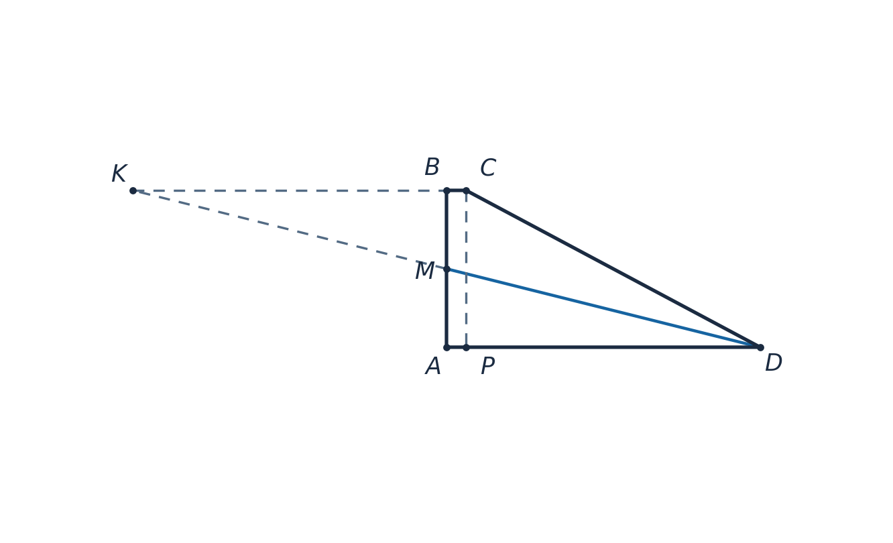

**Критерии**

- **2 балла.** Ход решения обоснован, получен правильный ответ. Найдены большее основание и высота с обоснованием, площадь равна 272.
- **1 балл.** Решение в целом верное, есть несущественный недостаток или вычислительная ошибка. Восстановление основания и высоты обосновано, но есть несущественный пробел или вычислительная ошибка.
- **0 баллов.** Решение не удовлетворяет условиям для 1 или 2 баллов. AB объявлена высотой по рисунку либо площадь найдена из необоснованных длин.

[Источник карточки](https://doc.fipi.ru/oge/demoversii-specifikacii-kodifikatory/2027/ma_9_2027.zip) · МА-9 ОГЭ 2027_ДЕМО.pdf, печатная стр. 14, решение и шкала на стр. 21

### Задача 2 · 339398

В трапеции ABCD основания AD и BC. Дано AB = 20, CD = 25, BC = 5. Биссектриса угла ADC проходит через середину M стороны AB. Найдите площадь трапеции.

Подсказка 1

Продли биссектрису до прямой второго основания.

Подсказка 2

Середина боковой стороны и параллельность дадут равные отрезки. Затем восстанови высоту.

Ответ для самопроверки

$250$

Разбор и критерии

1. Продлим DM до встречи с прямой BC в K. Центральная симметрия относительно M переводит A в B и D в K. Поэтому BK = AD. B лежит между K и C.
2. Из AD ∥ BC получаем ∠CKD = ∠ADK. Последний угол равен ∠KDC по условию о биссектрисе. В равнобедренном треугольнике DKC имеем KC = CD = 25, откуда AD = 25 − 5 = 20.
3. Проведём CP ∥ AB до основания AD. Тогда CP = 20, PD = 15, CD = 25. Равенство 20² + 15² = 25² даёт по обратной теореме Пифагора CP ⟂ AD. Значит, высота 20, площадь $250$.

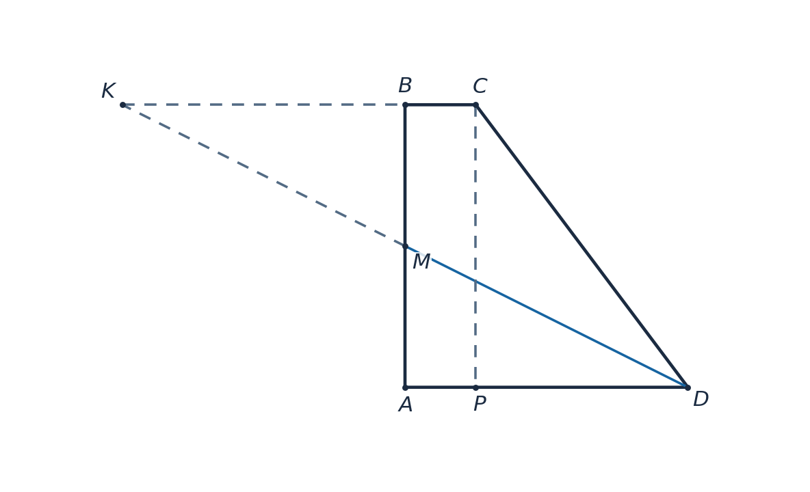

**Критерии**

- **2 балла.** Ход решения обоснован, получен правильный ответ. Продлить биссектрису, получить равенство отрезков, затем вычислить высоту и площадь
- **1 балл.** Решение в целом верное, есть несущественный недостаток или вычислительная ошибка. Связь между построениями и основными промежуточными величинами верна, итог содержит малую неточность.
- **0 баллов.** Решение не удовлетворяет условиям для 1 или 2 баллов. Получено промежуточное равенство без обоснования и правильного продолжения нет.

[Источник карточки](https://math-oge.sdamgia.ru/problem?id=339398)

### Задача 3 · 339408

В трапеции ABCD основания AD и BC. Дано AB = 18, CD = 30, BC = 3. Биссектриса угла ADC проходит через середину M стороны AB. Найдите площадь трапеции.

Подсказка 1

Продли биссектрису до прямой второго основания.

Подсказка 2

Середина боковой стороны и параллельность дадут равные отрезки. Затем восстанови высоту.

Ответ для самопроверки

$270$

Разбор и критерии

1. Продлим DM до встречи с прямой BC в K. Центральная симметрия относительно M переводит A в B и D в K. Поэтому BK = AD. B лежит между K и C.
2. Из AD ∥ BC получаем ∠CKD = ∠ADK. Последний угол равен ∠KDC по условию о биссектрисе. В равнобедренном треугольнике DKC имеем KC = CD = 30, откуда AD = 30 − 3 = 27.
3. Проведём CP ∥ AB до основания AD. Тогда CP = 18, PD = 24, CD = 30. Равенство 18² + 24² = 30² даёт по обратной теореме Пифагора CP ⟂ AD. Значит, высота 18, площадь $270$.

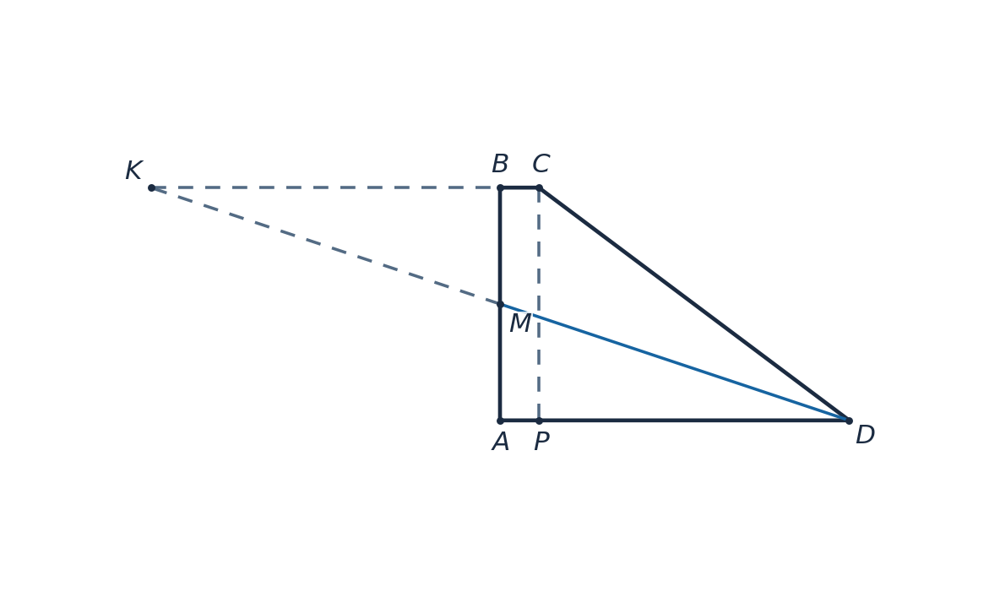

**Критерии**

- **2 балла.** Ход решения обоснован, получен правильный ответ. Продлить биссектрису, получить равенство отрезков, затем вычислить высоту и площадь
- **1 балл.** Решение в целом верное, есть несущественный недостаток или вычислительная ошибка. Связь между построениями и основными промежуточными величинами верна, итог содержит малую неточность.
- **0 баллов.** Решение не удовлетворяет условиям для 1 или 2 баллов. Получено промежуточное равенство без обоснования и правильного продолжения нет.

[Источник карточки](https://math-oge.sdamgia.ru/problem?id=339408)

### Задача 4 · 339455

В трапеции ABCD основания AD и BC. Дано AB = 12, CD = 15, BC = 3. Биссектриса угла ADC проходит через середину M стороны AB. Найдите площадь трапеции.

Подсказка 1

Продли биссектрису до прямой второго основания.

Подсказка 2

Середина боковой стороны и параллельность дадут равные отрезки. Затем восстанови высоту.

Ответ для самопроверки

$90$

Разбор и критерии

1. Продлим DM до встречи с прямой BC в K. Центральная симметрия относительно M переводит A в B и D в K. Поэтому BK = AD. B лежит между K и C.
2. Из AD ∥ BC получаем ∠CKD = ∠ADK. Последний угол равен ∠KDC по условию о биссектрисе. В равнобедренном треугольнике DKC имеем KC = CD = 15, откуда AD = 15 − 3 = 12.
3. Проведём CP ∥ AB до основания AD. Тогда CP = 12, PD = 9, CD = 15. Равенство 12² + 9² = 15² даёт по обратной теореме Пифагора CP ⟂ AD. Значит, высота 12, площадь $90$.

**Критерии**

- **2 балла.** Ход решения обоснован, получен правильный ответ. Продлить биссектрису, получить равенство отрезков, затем вычислить высоту и площадь
- **1 балл.** Решение в целом верное, есть несущественный недостаток или вычислительная ошибка. Связь между построениями и основными промежуточными величинами верна, итог содержит малую неточность.
- **0 баллов.** Решение не удовлетворяет условиям для 1 или 2 баллов. Получено промежуточное равенство без обоснования и правильного продолжения нет.

[Источник карточки](https://math-oge.sdamgia.ru/problem?id=339455)

### Задача 5 · 339631

В трапеции ABCD основания AD и BC. Дано AB = 8, CD = 10, BC = 2. Биссектриса угла ADC проходит через середину M стороны AB. Найдите площадь трапеции.

Подсказка 1

Продли биссектрису до прямой второго основания.

Подсказка 2

Середина боковой стороны и параллельность дадут равные отрезки. Затем восстанови высоту.

Ответ для самопроверки

$40$

Разбор и критерии

1. Продлим DM до встречи с прямой BC в K. Центральная симметрия относительно M переводит A в B и D в K. Поэтому BK = AD. B лежит между K и C.
2. Из AD ∥ BC получаем ∠CKD = ∠ADK. Последний угол равен ∠KDC по условию о биссектрисе. В равнобедренном треугольнике DKC имеем KC = CD = 10, откуда AD = 10 − 2 = 8.
3. Проведём CP ∥ AB до основания AD. Тогда CP = 8, PD = 6, CD = 10. Равенство 8² + 6² = 10² даёт по обратной теореме Пифагора CP ⟂ AD. Значит, высота 8, площадь $40$.

**Критерии**

- **2 балла.** Ход решения обоснован, получен правильный ответ. Продлить биссектрису, получить равенство отрезков, затем вычислить высоту и площадь
- **1 балл.** Решение в целом верное, есть несущественный недостаток или вычислительная ошибка. Связь между построениями и основными промежуточными величинами верна, итог содержит малую неточность.
- **0 баллов.** Решение не удовлетворяет условиям для 1 или 2 баллов. Получено промежуточное равенство без обоснования и правильного продолжения нет.

[Источник карточки](https://math-oge.sdamgia.ru/problem?id=339631)

### Задача 6 · 339632

В трапеции ABCD основания AD и BC. Дано AB = 36, CD = 39, BC = 12. Биссектриса угла ADC проходит через середину M стороны AB. Найдите площадь трапеции.

Подсказка 1

Продли биссектрису до прямой второго основания.

Подсказка 2

Середина боковой стороны и параллельность дадут равные отрезки. Затем восстанови высоту.

Ответ для самопроверки

$702$

Разбор и критерии

1. Продлим DM до встречи с прямой BC в K. Центральная симметрия относительно M переводит A в B и D в K. Поэтому BK = AD. B лежит между K и C.
2. Из AD ∥ BC получаем ∠CKD = ∠ADK. Последний угол равен ∠KDC по условию о биссектрисе. В равнобедренном треугольнике DKC имеем KC = CD = 39, откуда AD = 39 − 12 = 27.
3. Проведём CP ∥ AB до основания AD. Тогда CP = 36, PD = 15, CD = 39. Равенство 36² + 15² = 39² даёт по обратной теореме Пифагора CP ⟂ AD. Значит, высота 36, площадь $702$.

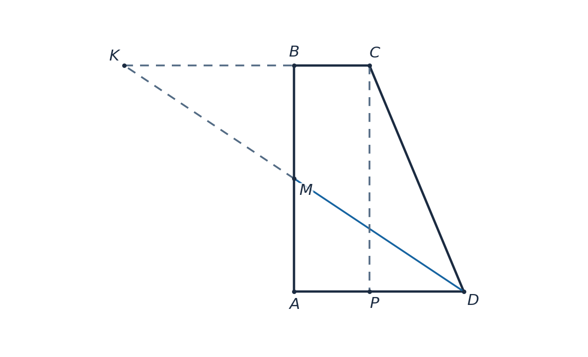

**Критерии**

- **2 балла.** Ход решения обоснован, получен правильный ответ. Продлить биссектрису, получить равенство отрезков, затем вычислить высоту и площадь
- **1 балл.** Решение в целом верное, есть несущественный недостаток или вычислительная ошибка. Связь между построениями и основными промежуточными величинами верна, итог содержит малую неточность.
- **0 баллов.** Решение не удовлетворяет условиям для 1 или 2 баллов. Получено промежуточное равенство без обоснования и правильного продолжения нет.

[Источник карточки](https://math-oge.sdamgia.ru/problem?id=339632)

### Задача 7 · авторская тренировка

В трапеции ABCD основание BC равно 2, высота равна 16, а площадь равна 272. Биссектриса угла ADC проходит через середину M боковой стороны AB. Найдите CD.

Подсказка 1

Найди сумму оснований по площади.

Подсказка 2

Продли DM до пересечения с прямой BC и используй симметрию относительно M.

Ответ для самопроверки

$34$

Разбор и критерии

1. Площадь равна произведению высоты на полусумму оснований. Поэтому $AD+BC=2\cdot272/16=34$, откуда AD = 32.
2. Продлим DM за M до прямой BC, получим K. Поворот на 180° вокруг M переводит A в B, D в K, поэтому BK = AD. Луч BK направлен противоположно BC, так что CK = BC + BK.
3. Из параллельности оснований угол CKD равен ADK. По свойству биссектрисы ADK равен KDC, значит, треугольник CKD равнобедренный и CD = CK = 34.

**Критерии**

- **2 балла.** Ход решения обоснован, получен правильный ответ. Из параллельности оснований угол CKD равен ADK. По свойству биссектрисы ADK равен KDC, значит, треугольник CKD равнобедренный и CD = CK = 34.
- **1 балл.** Решение в целом верное, есть несущественный недостаток или вычислительная ошибка. Обоснован основной переход: Площадь равна произведению высоты на полусумму оснований. Поэтому $AD+BC=2\cdot272/16=34$, откуда AD = 32. В завершении допущена ошибка в вычислениях или оформлении в пределах критерия.
- **0 баллов.** Решение не удовлетворяет условиям для 1 или 2 баллов. Указан результат без требуемого обоснования либо применена модель, не соответствующая условию.

[Пример семейства](https://doc.fipi.ru/oge/demoversii-specifikacii-kodifikatory/2027/ma_9_2027.zip)

## Трапеции и параллелограммы · Сечение, параллельное основаниям

`OGE25-trapezoid-parallel-section`

### Задача 1 · 324718

В трапеции $ABCD$ с основаниями $AD=42$ и $BC=14$ прямая $EF$ параллельна основаниям, $E\in AB$, $F\in CD$. Если $CF:FD=4:3$, найдите $EF$.

Подсказка 1

Рассмотри, как меняется длина параллельного сечения с высотой.

Подсказка 2

Если сечение проходит через диагонали, подобные треугольники дают отношение двух частей высоты.

Ответ для самопроверки

$30$.

Разбор и критерии

1. Проведём через $C$ прямую, параллельную $AB$, до встречи с $AD$ в $G$ и с $EF$ в $J$.
2. Тогда $EJ=BC=14$, $GD=AD-BC=28$.
3. В треугольнике $CGD$ отрезок $JF\parallel GD$, поэтому $JF/GD=CF/CD=4/7$.
4. Выходит $JF=16$, а $EF=14+16=30$.
5. Эквивалентно можно применить линейную интерполяцию длин сечений с обоснованием.

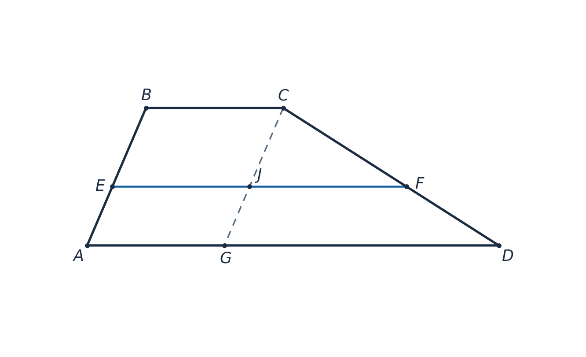

**Критерии**

- **2 балла.** Ход решения обоснован, получен правильный ответ. Обоснована доля 4/7 от разности оснований и получена длина 30.
- **1 балл.** Решение в целом верное, есть несущественный недостаток или вычислительная ошибка. Подобие или линейная зависимость выбраны правильно, но есть арифметическая ошибка.
- **0 баллов.** Решение не удовлетворяет условиям для 1 или 2 баллов. В качестве доли всей боковой стороны использовано 4/3 или усреднены основания без учёта положения F.

[Источник карточки](https://math-oge.sdamgia.ru/problem?id=324718)

### Задача 2 · 340359

Основания трапеции относятся как $1:3$. Через точку пересечения её диагоналей проведена прямая, параллельная основаниям. В каком отношении она делит площадь трапеции? Укажите отношение площади у меньшего основания к площади у большего.

Подсказка 1

Рассмотри, как меняется длина параллельного сечения с высотой.

Подсказка 2

Если сечение проходит через диагонали, подобные треугольники дают отношение двух частей высоты.

Ответ для самопроверки

$5:27$.

Разбор и критерии

1. Пусть основания равны $a$ и $3a$, а высота $h$.
2. Треугольники с вершиной в точке пересечения диагоналей и основаниями на двух параллельных сторонах подобны с отношением $1:3$.
3. Поэтому расстояние от этой точки до меньшего основания равно $h/4$.
4. Длина параллельного сечения линейно меняется с высотой: на уровне $h/4$ от меньшего основания она равна $a+(3a-a)/4=3a/2$.
5. Это следует, например, из подобия после проведения из одного конца меньшего основания прямой, параллельной противоположной боковой стороне.
6. Площадь малой части $(a+3a/2)h/8=5ah/16$.
7. Общая площадь $2ah$, большая часть $27ah/16$.
8. Отношение равно $5:27$.

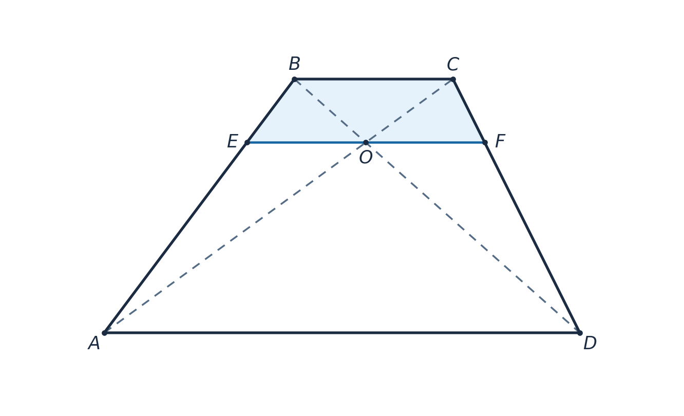

**Критерии**

- **2 балла.** Ход решения обоснован, получен правильный ответ. Доказано отношение высот, найдено сечение и получено отношение площадей в оговорённом порядке.
- **1 балл.** Решение в целом верное, есть несущественный недостаток или вычислительная ошибка. Основная геометрия верна, но вычисление площади или отношения содержит малую ошибку.
- **0 баллов.** Решение не удовлетворяет условиям для 1 или 2 баллов. Отношение площадей приравнено отношению оснований или квадрату отношения высот без проверки фигур.

[Источник карточки](https://math-oge.sdamgia.ru/problem?id=340359)

### Задача 3 · 341292

Основания трапеции относятся как 2:3. Через пересечение диагоналей проведена прямая, параллельная основаниям. Найдите отношение площади части у меньшего основания к площади части у большего.

Подсказка 1

Рассмотри, как меняется длина параллельного сечения с высотой.

Подсказка 2

Если сечение проходит через диагонали, подобные треугольники дают отношение двух частей высоты.

Ответ для самопроверки

$44:81$

Разбор и критерии

1. Обозначим основания через 2u и 3u, высоту через h. Треугольники от пересечения диагоналей до оснований подобны, поэтому расстояние до меньшего основания равно $\frac{2}{5}$h.
2. Длина сечения меняется линейно с высотой. На этой доле высоты она равна $\frac{12}{5}$u. Это можно получить из подобия, проведя через конец верхнего основания прямую, параллельную противоположной боковой стороне.
3. Площадь верхней части $\frac{22}{25}$uh. Общая площадь $\frac{5}{2}$uh, нижняя часть $\frac{81}{50}$uh. Отношение равно $44:81$.

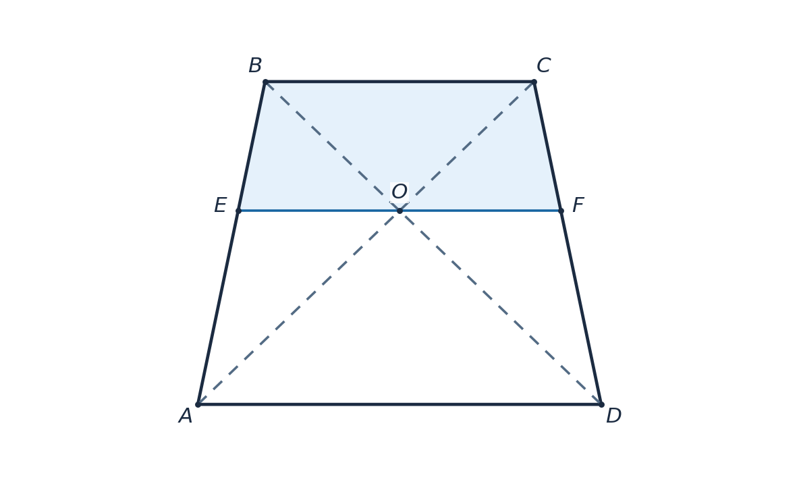

**Критерии**

- **2 балла.** Ход решения обоснован, получен правильный ответ. Линейное изменение длины сечения; для площади нужно ещё найти уровни диагоналей
- **1 балл.** Решение в целом верное, есть несущественный недостаток или вычислительная ошибка. Связь между построениями и основными промежуточными величинами верна, итог содержит малую неточность.
- **0 баллов.** Решение не удовлетворяет условиям для 1 или 2 баллов. Получено промежуточное равенство без обоснования и правильного продолжения нет.

[Источник карточки](https://math-oge.sdamgia.ru/problem?id=341292)

### Задача 4 · 349617

В трапеции ABCD основания AD = 25, BC = 15. Сечение EF параллельно основаниям, E лежит на AB, F — на CD. Найдите EF, если CF:FD = 3:2.

Подсказка 1

Рассмотри, как меняется длина параллельного сечения с высотой.

Подсказка 2

Если сечение проходит через диагонали, подобные треугольники дают отношение двух частей высоты.

Ответ для самопроверки

$21$

Разбор и критерии

1. Через C проводим прямую, параллельную AB, до AD в G. Пусть J — точка пересечения этой прямой с EF. Тогда EJ = BC = 15, GD = AD−BC = 10.
2. Из подобия треугольников CJF и CGD следует $JF/GD=CF/CD=\frac{3}{5}$. Поэтому $JF=6$, а EF = EJ + JF = $21$.

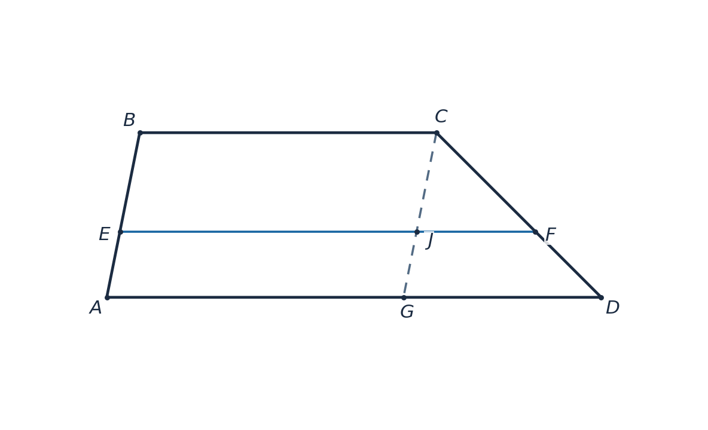

**Критерии**

- **2 балла.** Ход решения обоснован, получен правильный ответ. Линейное изменение длины сечения; для площади нужно ещё найти уровни диагоналей
- **1 балл.** Решение в целом верное, есть несущественный недостаток или вычислительная ошибка. Связь между построениями и основными промежуточными величинами верна, итог содержит малую неточность.
- **0 баллов.** Решение не удовлетворяет условиям для 1 или 2 баллов. Получено промежуточное равенство без обоснования и правильного продолжения нет.

[Источник карточки](https://math-oge.sdamgia.ru/problem?id=349617)

### Задача 5 · 349893

В трапеции ABCD основания AD = 45, BC = 27. Сечение EF параллельно основаниям, E лежит на AB, F — на CD. Найдите EF, если CF:FD = 5:4.

Подсказка 1

Рассмотри, как меняется длина параллельного сечения с высотой.

Подсказка 2

Если сечение проходит через диагонали, подобные треугольники дают отношение двух частей высоты.

Ответ для самопроверки

$37$

Разбор и критерии

1. Через C проводим прямую, параллельную AB, до AD в G. Пусть J — точка пересечения этой прямой с EF. Тогда EJ = BC = 27, GD = AD−BC = 18.
2. Из подобия треугольников CJF и CGD следует $JF/GD=CF/CD=\frac{5}{9}$. Поэтому $JF=10$, а EF = EJ + JF = $37$.

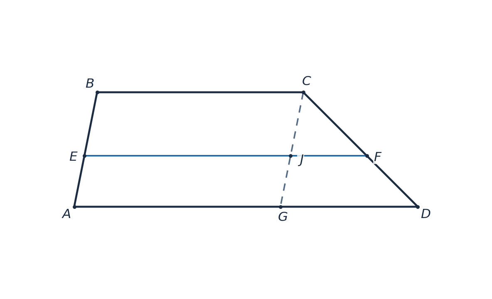

**Критерии**

- **2 балла.** Ход решения обоснован, получен правильный ответ. Линейное изменение длины сечения; для площади нужно ещё найти уровни диагоналей
- **1 балл.** Решение в целом верное, есть несущественный недостаток или вычислительная ошибка. Связь между построениями и основными промежуточными величинами верна, итог содержит малую неточность.
- **0 баллов.** Решение не удовлетворяет условиям для 1 или 2 баллов. Получено промежуточное равенство без обоснования и правильного продолжения нет.

[Источник карточки](https://math-oge.sdamgia.ru/problem?id=349893)

### Задача 6 · 350682

В трапеции ABCD основания AD = 48, BC = 16. Сечение EF параллельно основаниям, E лежит на AB, F — на CD. Найдите EF, если CF:FD = 5:3.

Подсказка 1

Рассмотри, как меняется длина параллельного сечения с высотой.

Подсказка 2

Если сечение проходит через диагонали, подобные треугольники дают отношение двух частей высоты.

Ответ для самопроверки

$36$

Разбор и критерии

1. Через C проводим прямую, параллельную AB, до AD в G. Пусть J — точка пересечения этой прямой с EF. Тогда EJ = BC = 16, GD = AD−BC = 32.
2. Из подобия треугольников CJF и CGD следует $JF/GD=CF/CD=\frac{5}{8}$. Поэтому $JF=20$, а EF = EJ + JF = $36$.

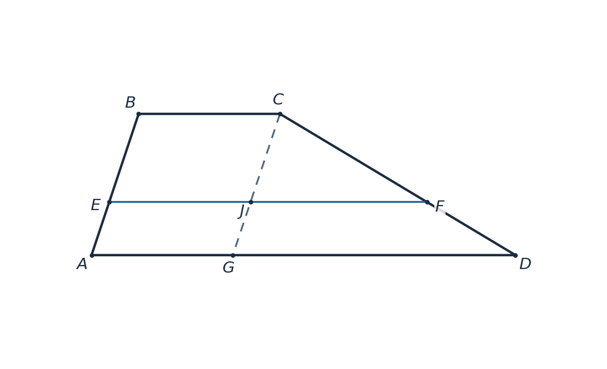

**Критерии**

- **2 балла.** Ход решения обоснован, получен правильный ответ. Линейное изменение длины сечения; для площади нужно ещё найти уровни диагоналей
- **1 балл.** Решение в целом верное, есть несущественный недостаток или вычислительная ошибка. Связь между построениями и основными промежуточными величинами верна, итог содержит малую неточность.
- **0 баллов.** Решение не удовлетворяет условиям для 1 или 2 баллов. Получено промежуточное равенство без обоснования и правильного продолжения нет.

[Источник карточки](https://math-oge.sdamgia.ru/problem?id=350682)

## Трапеции и параллелограммы · Восстановить основания через середины сторон

`OGE25-trapezoid-midpoint-segments`

### Задача 1 · 353565

При одном основании трапеции углы 85° и 5°. Отрезки, соединяющие середины противоположных сторон, равны 11 и 1. Найдите длины обоих оснований.

Подсказка 1

Соедини нужные середины и вспомни средние линии.

Подсказка 2

Переведи условие в сумму и разность оснований.

Ответ для самопроверки

$10,\ 12$

Разбор и критерии

1. Продлим боковые стороны до встречи в точке O. С большим основанием они образуют треугольник. Два его угла в сумме дают 90°, значит, угол при O тоже прямой.
2. Меньшее основание параллельно большему и отсекает у O ещё один прямоугольный треугольник. Основания трапеции — гипотенузы этих двух треугольников.
3. Обозначим середины оснований M и N. Треугольники подобны с центром подобия O, поэтому M и N лежат на одном луче из O. В прямоугольном треугольнике середина гипотенузы равноудалена от трёх вершин. Значит, OM и ON равны половинам соответствующих оснований, а MN — половине их разности.
4. Отрезок между серединами боковых сторон — средняя линия трапеции. Она равна полусумме оснований.
5. Полусумма больше полуразности. Поэтому полусумма 11, полуразность 1. Основания 11−1=10 и 11+1=12.

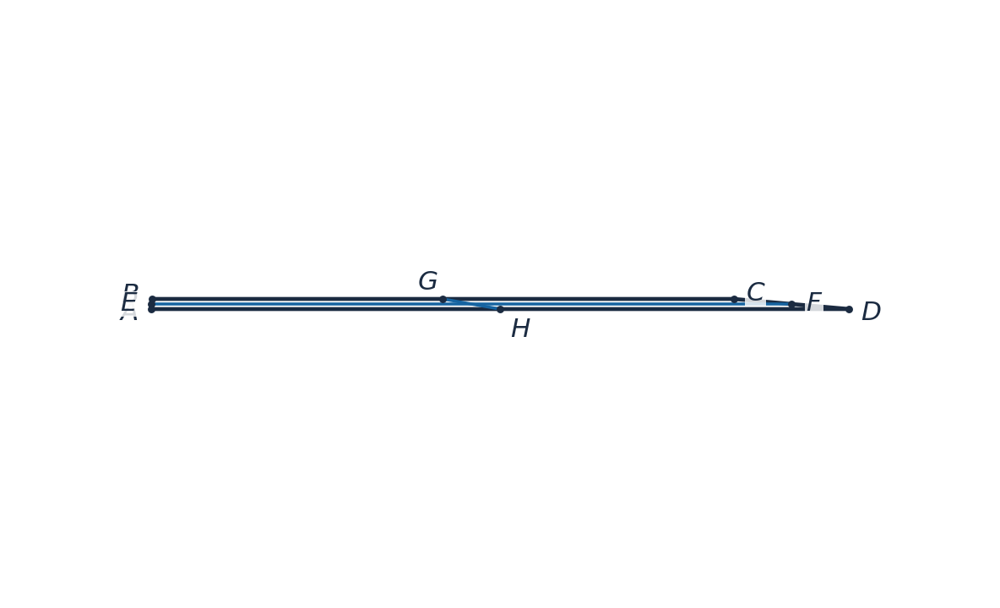

**Критерии**

- **2 балла.** Ход решения обоснован, получен правильный ответ. Использовать перпендикулярность боковых сторон и отношения средних линий
- **1 балл.** Решение в целом верное, есть несущественный недостаток или вычислительная ошибка. Связь между построениями и основными промежуточными величинами верна, итог содержит малую неточность.
- **0 баллов.** Решение не удовлетворяет условиям для 1 или 2 баллов. Получено промежуточное равенство без обоснования и правильного продолжения нет.

[Источник карточки](https://math-oge.sdamgia.ru/problem?id=353565)

### Задача 2 · 339730

При одном основании трапеции углы 77° и 13°. Отрезки, соединяющие середины противоположных сторон, равны 11 и 10. Найдите длины обоих оснований.

Подсказка 1

Соедини нужные середины и вспомни средние линии.

Подсказка 2

Переведи условие в сумму и разность оснований.

Ответ для самопроверки

$1,\ 21$

Разбор и критерии

1. Продлим боковые стороны до встречи в точке O. С большим основанием они образуют треугольник. Два его угла в сумме дают 90°, значит, угол при O тоже прямой.
2. Меньшее основание параллельно большему и отсекает у O ещё один прямоугольный треугольник. Основания трапеции — гипотенузы этих двух треугольников.
3. Обозначим середины оснований M и N. Треугольники подобны с центром подобия O, поэтому M и N лежат на одном луче из O. В прямоугольном треугольнике середина гипотенузы равноудалена от трёх вершин. Значит, OM и ON равны половинам соответствующих оснований, а MN — половине их разности.
4. Отрезок между серединами боковых сторон — средняя линия трапеции. Она равна полусумме оснований.
5. Полусумма больше полуразности. Поэтому полусумма 11, полуразность 10. Основания 11−10=1 и 11+10=21.

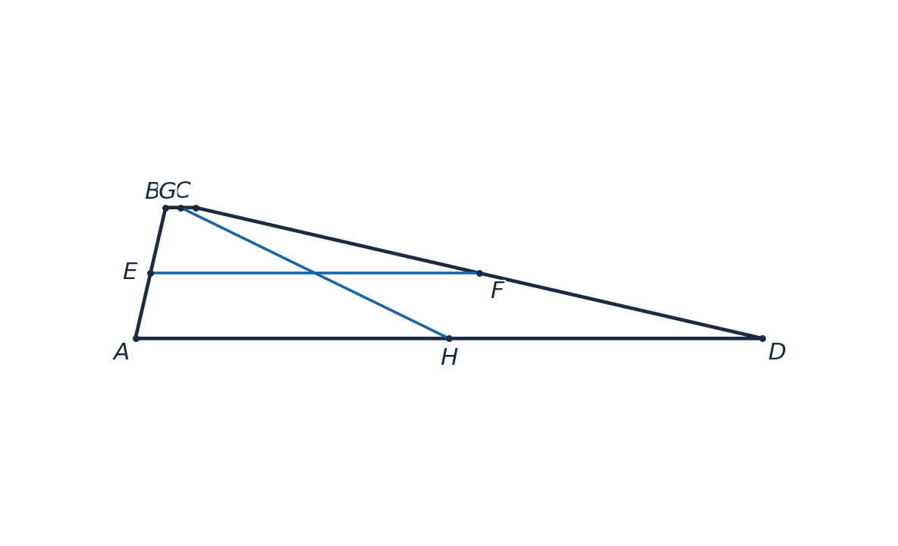

**Критерии**

- **2 балла.** Ход решения обоснован, получен правильный ответ. Использовать перпендикулярность боковых сторон и отношения средних линий
- **1 балл.** Решение в целом верное, есть несущественный недостаток или вычислительная ошибка. Связь между построениями и основными промежуточными величинами верна, итог содержит малую неточность.
- **0 баллов.** Решение не удовлетворяет условиям для 1 или 2 баллов. Получено промежуточное равенство без обоснования и правильного продолжения нет.

[Источник карточки](https://math-oge.sdamgia.ru/problem?id=339730)

### Задача 3 · 341060

При одном основании трапеции углы 50° и 40°. Отрезки, соединяющие середины противоположных сторон, равны 15 и 13. Найдите длины обоих оснований.

Подсказка 1

Соедини нужные середины и вспомни средние линии.

Подсказка 2

Переведи условие в сумму и разность оснований.

Ответ для самопроверки

$2,\ 28$

Разбор и критерии

1. Продлим боковые стороны до встречи в точке O. С большим основанием они образуют треугольник. Два его угла в сумме дают 90°, значит, угол при O тоже прямой.
2. Меньшее основание параллельно большему и отсекает у O ещё один прямоугольный треугольник. Основания трапеции — гипотенузы этих двух треугольников.
3. Обозначим середины оснований M и N. Треугольники подобны с центром подобия O, поэтому M и N лежат на одном луче из O. В прямоугольном треугольнике середина гипотенузы равноудалена от трёх вершин. Значит, OM и ON равны половинам соответствующих оснований, а MN — половине их разности.
4. Отрезок между серединами боковых сторон — средняя линия трапеции. Она равна полусумме оснований.
5. Полусумма больше полуразности. Поэтому полусумма 15, полуразность 13. Основания 15−13=2 и 15+13=28.

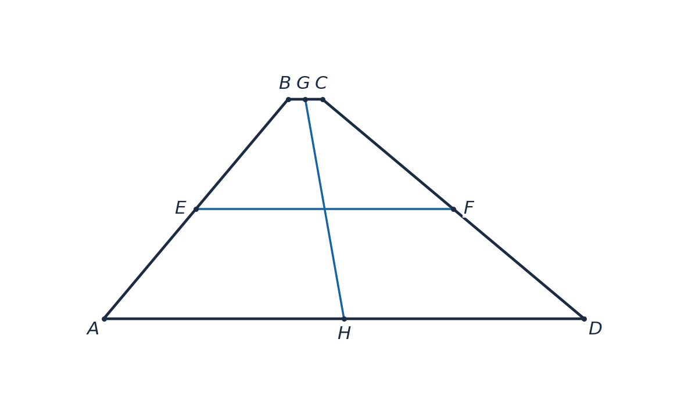

**Критерии**

- **2 балла.** Ход решения обоснован, получен правильный ответ. Использовать перпендикулярность боковых сторон и отношения средних линий
- **1 балл.** Решение в целом верное, есть несущественный недостаток или вычислительная ошибка. Связь между построениями и основными промежуточными величинами верна, итог содержит малую неточность.
- **0 баллов.** Решение не удовлетворяет условиям для 1 или 2 баллов. Получено промежуточное равенство без обоснования и правильного продолжения нет.

[Источник карточки](https://math-oge.sdamgia.ru/problem?id=341060)

### Задача 4 · 348839

При одном основании трапеции углы 47° и 43°. Отрезки, соединяющие середины противоположных сторон, равны 16 и 14. Найдите длины обоих оснований.

Подсказка 1

Соедини нужные середины и вспомни средние линии.

Подсказка 2

Переведи условие в сумму и разность оснований.

Ответ для самопроверки

$2,\ 30$

Разбор и критерии

1. Продлим боковые стороны до встречи в точке O. С большим основанием они образуют треугольник. Два его угла в сумме дают 90°, значит, угол при O тоже прямой.
2. Меньшее основание параллельно большему и отсекает у O ещё один прямоугольный треугольник. Основания трапеции — гипотенузы этих двух треугольников.
3. Обозначим середины оснований M и N. Треугольники подобны с центром подобия O, поэтому M и N лежат на одном луче из O. В прямоугольном треугольнике середина гипотенузы равноудалена от трёх вершин. Значит, OM и ON равны половинам соответствующих оснований, а MN — половине их разности.
4. Отрезок между серединами боковых сторон — средняя линия трапеции. Она равна полусумме оснований.
5. Полусумма больше полуразности. Поэтому полусумма 16, полуразность 14. Основания 16−14=2 и 16+14=30.

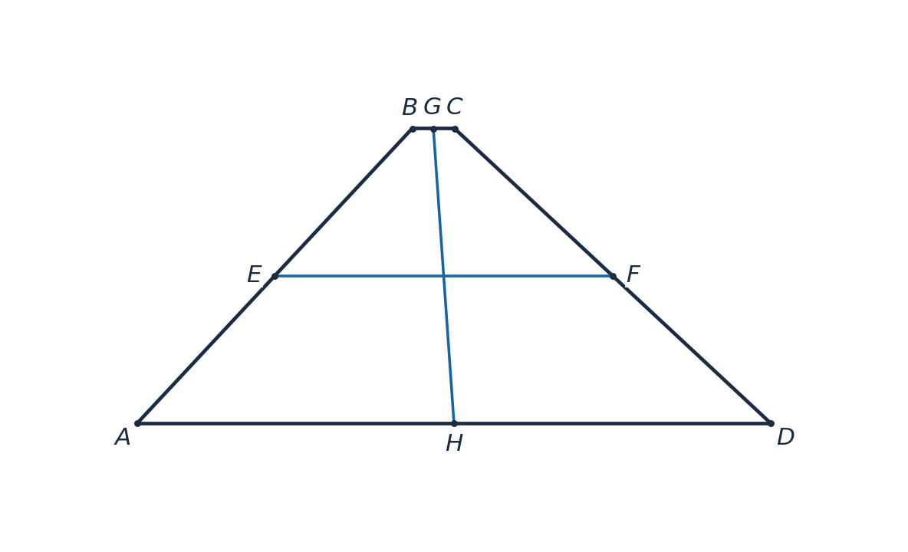

**Критерии**

- **2 балла.** Ход решения обоснован, получен правильный ответ. Использовать перпендикулярность боковых сторон и отношения средних линий
- **1 балл.** Решение в целом верное, есть несущественный недостаток или вычислительная ошибка. Связь между построениями и основными промежуточными величинами верна, итог содержит малую неточность.
- **0 баллов.** Решение не удовлетворяет условиям для 1 или 2 баллов. Получено промежуточное равенство без обоснования и правильного продолжения нет.

[Источник карточки](https://math-oge.sdamgia.ru/problem?id=348839)

### Задача 5 · 349860

При одном основании трапеции углы 53° и 37°. Отрезки, соединяющие середины противоположных сторон, равны 6 и 2. Найдите длины обоих оснований.

Подсказка 1

Соедини нужные середины и вспомни средние линии.

Подсказка 2

Переведи условие в сумму и разность оснований.

Ответ для самопроверки

$4,\ 8$

Разбор и критерии

1. Продлим боковые стороны до встречи в точке O. С большим основанием они образуют треугольник. Два его угла в сумме дают 90°, значит, угол при O тоже прямой.
2. Меньшее основание параллельно большему и отсекает у O ещё один прямоугольный треугольник. Основания трапеции — гипотенузы этих двух треугольников.
3. Обозначим середины оснований M и N. Треугольники подобны с центром подобия O, поэтому M и N лежат на одном луче из O. В прямоугольном треугольнике середина гипотенузы равноудалена от трёх вершин. Значит, OM и ON равны половинам соответствующих оснований, а MN — половине их разности.
4. Отрезок между серединами боковых сторон — средняя линия трапеции. Она равна полусумме оснований.
5. Полусумма больше полуразности. Поэтому полусумма 6, полуразность 2. Основания 6−2=4 и 6+2=8.

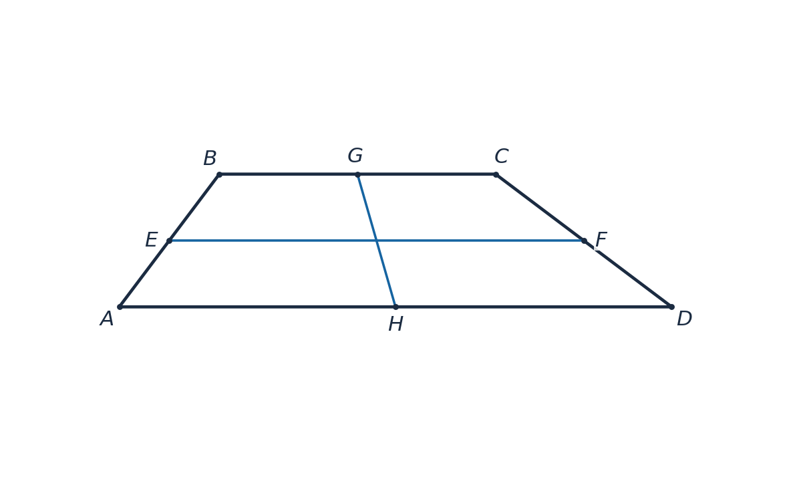

**Критерии**

- **2 балла.** Ход решения обоснован, получен правильный ответ. Использовать перпендикулярность боковых сторон и отношения средних линий
- **1 балл.** Решение в целом верное, есть несущественный недостаток или вычислительная ошибка. Связь между построениями и основными промежуточными величинами верна, итог содержит малую неточность.
- **0 баллов.** Решение не удовлетворяет условиям для 1 или 2 баллов. Получено промежуточное равенство без обоснования и правильного продолжения нет.

[Источник карточки](https://math-oge.sdamgia.ru/problem?id=349860)

### Задача 6 · 349968

При одном основании трапеции углы 7° и 83°. Отрезки, соединяющие середины противоположных сторон, равны 14 и 11. Найдите длины обоих оснований.

Подсказка 1

Соедини нужные середины и вспомни средние линии.

Подсказка 2

Переведи условие в сумму и разность оснований.

Ответ для самопроверки

$3,\ 25$

Разбор и критерии

1. Продлим боковые стороны до встречи в точке O. С большим основанием они образуют треугольник. Два его угла в сумме дают 90°, значит, угол при O тоже прямой.
2. Меньшее основание параллельно большему и отсекает у O ещё один прямоугольный треугольник. Основания трапеции — гипотенузы этих двух треугольников.
3. Обозначим середины оснований M и N. Треугольники подобны с центром подобия O, поэтому M и N лежат на одном луче из O. В прямоугольном треугольнике середина гипотенузы равноудалена от трёх вершин. Значит, OM и ON равны половинам соответствующих оснований, а MN — половине их разности.
4. Отрезок между серединами боковых сторон — средняя линия трапеции. Она равна полусумме оснований.
5. Полусумма больше полуразности. Поэтому полусумма 14, полуразность 11. Основания 14−11=3 и 14+11=25.

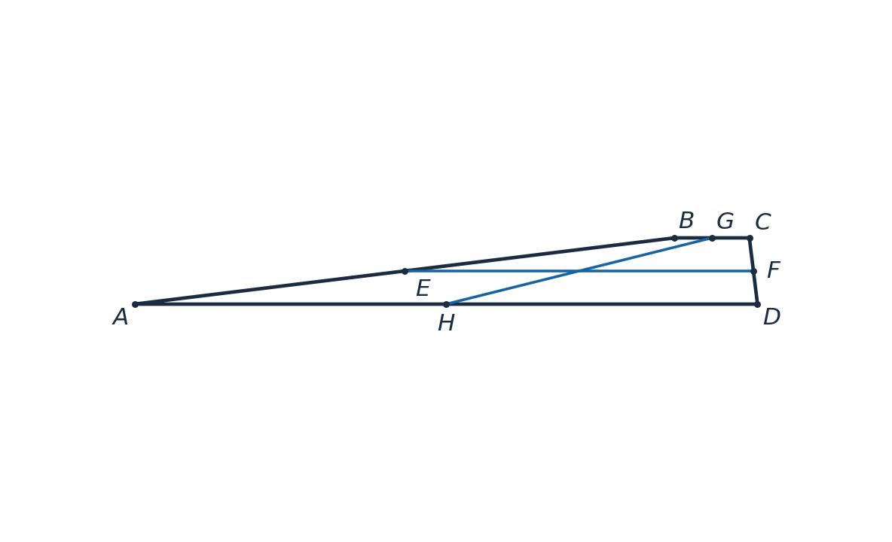

**Критерии**

- **2 балла.** Ход решения обоснован, получен правильный ответ. Использовать перпендикулярность боковых сторон и отношения средних линий
- **1 балл.** Решение в целом верное, есть несущественный недостаток или вычислительная ошибка. Связь между построениями и основными промежуточными величинами верна, итог содержит малую неточность.
- **0 баллов.** Решение не удовлетворяет условиям для 1 или 2 баллов. Получено промежуточное равенство без обоснования и правильного продолжения нет.

[Источник карточки](https://math-oge.sdamgia.ru/problem?id=349968)

### Задача 7 · авторская тренировка

В трапеции углы при большем основании равны 85° и 5°. Средняя линия равна 11, а отрезок между серединами оснований равен 1. Продолжения боковых сторон встречаются в O. Найдите отношение площади треугольника с вершиной O и меньшим основанием к площади трапеции.

Подсказка 1

Почему треугольники с вершиной O прямоугольные?

Подсказка 2

Свяжи полуразность оснований с расстоянием между их серединами.

Ответ для самопроверки

$25/11$

Разбор и критерии

1. Сумма углов при большем основании равна 90°, значит, при O прямой угол. Середины параллельных гипотенуз лежат на одном луче из O по подобию, а расстояние от O до каждой равно половине её длины.
2. Получаем полуразность оснований 1 и полусумму 11. Значит, основания равны 10 и 12. Площади треугольников с вершиной O относятся как $10^2:12^2=25:36$.
3. Трапеция занимает разность 36 − 25 = 11 долей. Отношение площади малого треугольника к площади трапеции равно 25:11.

**Критерии**

- **2 балла.** Ход решения обоснован, получен правильный ответ. Трапеция занимает разность 36 − 25 = 11 долей. Отношение площади малого треугольника к площади трапеции равно 25:11.
- **1 балл.** Решение в целом верное, есть несущественный недостаток или вычислительная ошибка. Обоснован основной переход: Сумма углов при большем основании равна 90°, значит, при O прямой угол. Середины параллельных гипотенуз лежат на одном луче из O по подобию, а расстояние от O до каждой равно половине её длины. В завершении допущена ошибка в вычислениях или оформлении в пределах критерия.
- **0 баллов.** Решение не удовлетворяет условиям для 1 или 2 баллов. Указан результат без требуемого обоснования либо применена модель, не соответствующая условию.

[Пример семейства](https://math-oge.sdamgia.ru/problem?id=353565)

## Трапеции и параллелограммы · Площадь параллелограмма с биссектрисами

`OGE25-parallelogram-bisectors`

### Задача 1 · 457286

В параллелограмме ABCD биссектрисы углов A и B пересекаются в K. Дано BC = 6, расстояние от K до прямой AB равно 6. Найдите площадь.

Подсказка 1

Вспомни, какие расстояния равны у точки на биссектрисе.

Подсказка 2

Сложи расстояния до пары параллельных сторон и получи высоту.

Ответ для самопроверки

$72$

Разбор и критерии

1. По биссектрисе угла A расстояние от K до AD равно расстоянию до AB. По биссектрисе угла B расстояние от K до BC тоже равно расстоянию до AB.
2. K находится в полосе между параллельными BC и AD, значит расстояние между этими прямыми 6+6=12. Площадь равна произведению этой высоты на BC = 6, то есть 72.

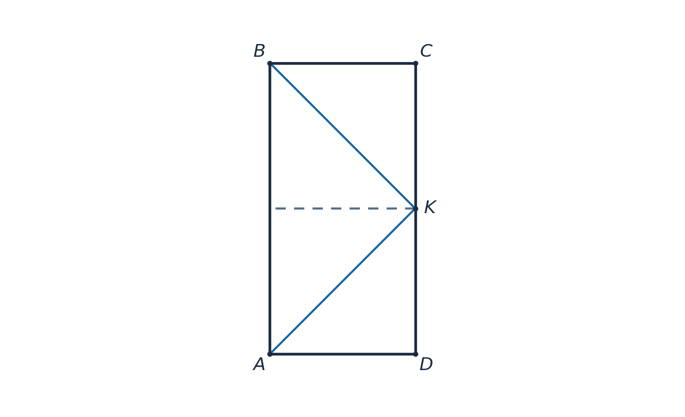

**Критерии**

- **2 балла.** Ход решения обоснован, получен правильный ответ. Два равных расстояния до параллелей, высота и площадь; может встречаться и под №23
- **1 балл.** Решение в целом верное, есть несущественный недостаток или вычислительная ошибка. Связь между построениями и основными промежуточными величинами верна, итог содержит малую неточность.
- **0 баллов.** Решение не удовлетворяет условиям для 1 или 2 баллов. Получено промежуточное равенство без обоснования и правильного продолжения нет.

[Источник карточки](https://math-oge.sdamgia.ru/problem?id=457286)

### Задача 2 · 457314

В параллелограмме ABCD биссектрисы углов A и B пересекаются в K. Дано BC = 2, расстояние от K до прямой AB равно 1. Найдите площадь.

Подсказка 1

Вспомни, какие расстояния равны у точки на биссектрисе.

Подсказка 2

Сложи расстояния до пары параллельных сторон и получи высоту.

Ответ для самопроверки

$4$

Разбор и критерии

1. По биссектрисе угла A расстояние от K до AD равно расстоянию до AB. По биссектрисе угла B расстояние от K до BC тоже равно расстоянию до AB.
2. K находится в полосе между параллельными BC и AD, значит расстояние между этими прямыми 1+1=2. Площадь равна произведению этой высоты на BC = 2, то есть 4.

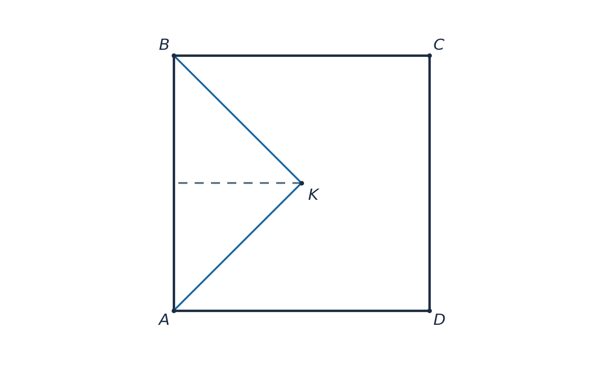

**Критерии**

- **2 балла.** Ход решения обоснован, получен правильный ответ. Два равных расстояния до параллелей, высота и площадь; может встречаться и под №23
- **1 балл.** Решение в целом верное, есть несущественный недостаток или вычислительная ошибка. Связь между построениями и основными промежуточными величинами верна, итог содержит малую неточность.
- **0 баллов.** Решение не удовлетворяет условиям для 1 или 2 баллов. Получено промежуточное равенство без обоснования и правильного продолжения нет.

[Источник карточки](https://math-oge.sdamgia.ru/problem?id=457314)

### Задача 3 · E097F7

В параллелограмме ABCD биссектрисы углов A и B пересекаются в K. Дано BC = 18, расстояние от K до прямой AB равно 1. Найдите площадь.

Подсказка 1

Вспомни, какие расстояния равны у точки на биссектрисе.

Подсказка 2

Сложи расстояния до пары параллельных сторон и получи высоту.

Ответ для самопроверки

$36$

Разбор и критерии

1. По биссектрисе угла A расстояние от K до AD равно расстоянию до AB. По биссектрисе угла B расстояние от K до BC тоже равно расстоянию до AB.
2. K находится в полосе между параллельными BC и AD, значит расстояние между этими прямыми 1+1=2. Площадь равна произведению этой высоты на BC = 18, то есть 36.

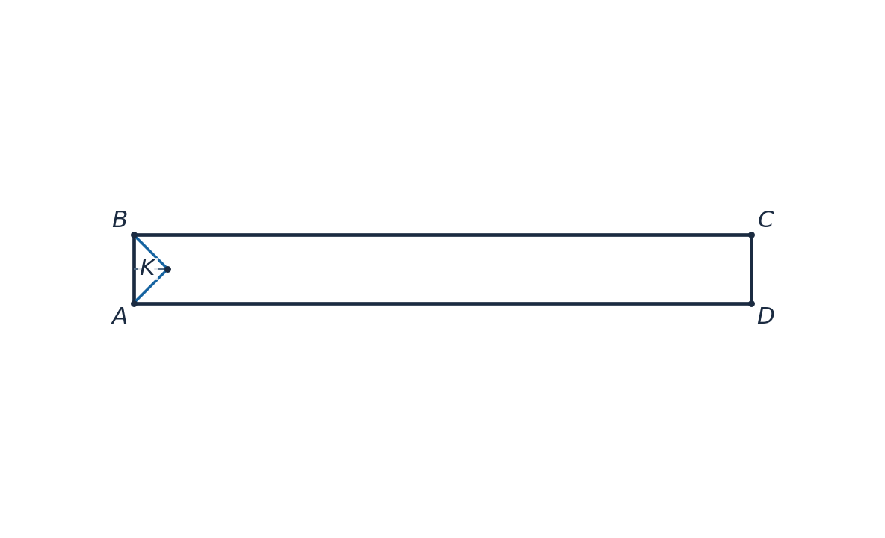

**Критерии**

- **2 балла.** Ход решения обоснован, получен правильный ответ. Два равных расстояния до параллелей, высота и площадь; может встречаться и под №23
- **1 балл.** Решение в целом верное, есть несущественный недостаток или вычислительная ошибка. Связь между построениями и основными промежуточными величинами верна, итог содержит малую неточность.
- **0 баллов.** Решение не удовлетворяет условиям для 1 или 2 баллов. Получено промежуточное равенство без обоснования и правильного продолжения нет.

[Источник карточки](https://sdamgia.online/oge/matematika/zadanie-25/ploshchad-parallelogramma-cherez-bissektrisy-fipi-e097f7) · Код E097F7 по каталогу sdamgia.online

### Задача 4 · 569075

В параллелограмме ABCD биссектрисы углов A и B пересекаются в K. Дано BC = 2, расстояние от K до прямой AB равно 8. Найдите площадь.

Подсказка 1

Вспомни, какие расстояния равны у точки на биссектрисе.

Подсказка 2

Сложи расстояния до пары параллельных сторон и получи высоту.

Ответ для самопроверки

$32$

Разбор и критерии

1. По биссектрисе угла A расстояние от K до AD равно расстоянию до AB. По биссектрисе угла B расстояние от K до BC тоже равно расстоянию до AB.
2. K находится в полосе между параллельными BC и AD, значит расстояние между этими прямыми 8+8=16. Площадь равна произведению этой высоты на BC = 2, то есть 32.

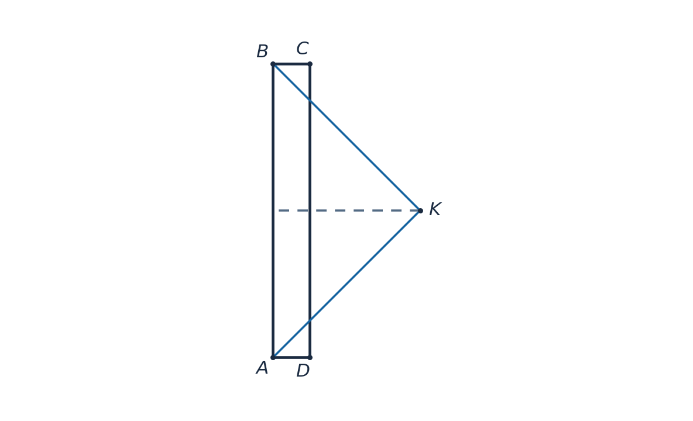

**Критерии**

- **2 балла.** Ход решения обоснован, получен правильный ответ. Два равных расстояния до параллелей, высота и площадь; может встречаться и под №23
- **1 балл.** Решение в целом верное, есть несущественный недостаток или вычислительная ошибка. Связь между построениями и основными промежуточными величинами верна, итог содержит малую неточность.
- **0 баллов.** Решение не удовлетворяет условиям для 1 или 2 баллов. Получено промежуточное равенство без обоснования и правильного продолжения нет.

[Источник карточки](https://sdamgia.online/oge/matematika/zadanie-25/ploshchad-parallelogramma-cherez-bissektrisy-fipi-569075) · Код 569075 по каталогу sdamgia.online

### Задача 5 · 97C87B

В параллелограмме ABCD биссектрисы углов A и B пересекаются в K. Дано BC = 19, расстояние от K до прямой AB равно 7. Найдите площадь.

Подсказка 1

Вспомни, какие расстояния равны у точки на биссектрисе.

Подсказка 2

Сложи расстояния до пары параллельных сторон и получи высоту.

Ответ для самопроверки

$266$

Разбор и критерии

1. По биссектрисе угла A расстояние от K до AD равно расстоянию до AB. По биссектрисе угла B расстояние от K до BC тоже равно расстоянию до AB.
2. K находится в полосе между параллельными BC и AD, значит расстояние между этими прямыми 7+7=14. Площадь равна произведению этой высоты на BC = 19, то есть 266.

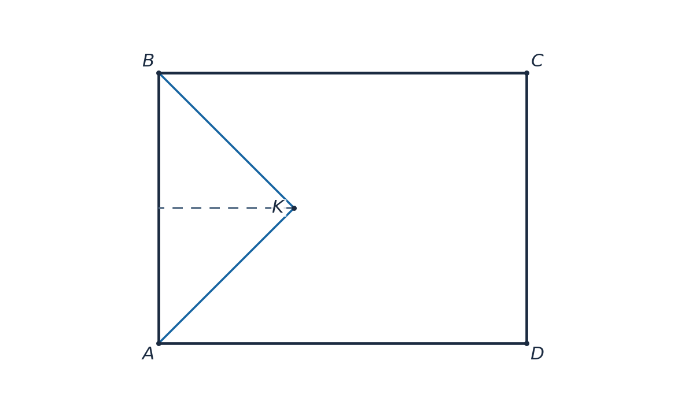

**Критерии**

- **2 балла.** Ход решения обоснован, получен правильный ответ. Два равных расстояния до параллелей, высота и площадь; может встречаться и под №23
- **1 балл.** Решение в целом верное, есть несущественный недостаток или вычислительная ошибка. Связь между построениями и основными промежуточными величинами верна, итог содержит малую неточность.
- **0 баллов.** Решение не удовлетворяет условиям для 1 или 2 баллов. Получено промежуточное равенство без обоснования и правильного продолжения нет.

[Источник карточки](https://sdamgia.online/oge/matematika/zadanie-25/ploshchad-parallelogramma-cherez-bissektrisy-fipi-97c87b) · Код 97C87B по каталогу sdamgia.online

### Задача 6 · B435D4

В параллелограмме ABCD биссектрисы углов A и B пересекаются в K. Дано BC = 17, расстояние от K до прямой AB равно 10. Найдите площадь.

Подсказка 1

Вспомни, какие расстояния равны у точки на биссектрисе.

Подсказка 2

Сложи расстояния до пары параллельных сторон и получи высоту.

Ответ для самопроверки

$340$

Разбор и критерии

1. По биссектрисе угла A расстояние от K до AD равно расстоянию до AB. По биссектрисе угла B расстояние от K до BC тоже равно расстоянию до AB.
2. K находится в полосе между параллельными BC и AD, значит расстояние между этими прямыми 10+10=20. Площадь равна произведению этой высоты на BC = 17, то есть 340.

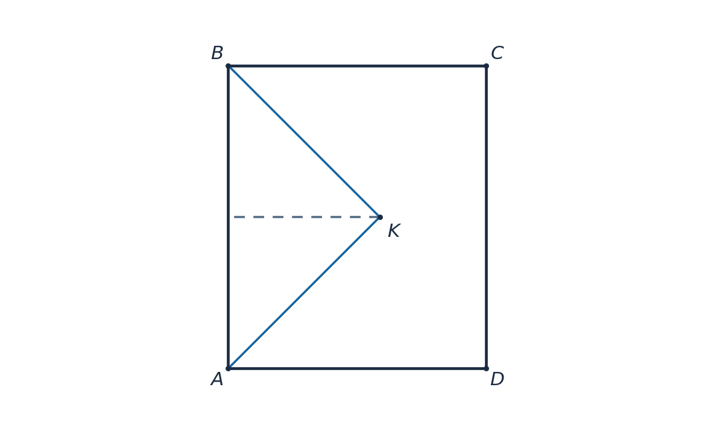

**Критерии**

- **2 балла.** Ход решения обоснован, получен правильный ответ. Два равных расстояния до параллелей, высота и площадь; может встречаться и под №23
- **1 балл.** Решение в целом верное, есть несущественный недостаток или вычислительная ошибка. Связь между построениями и основными промежуточными величинами верна, итог содержит малую неточность.
- **0 баллов.** Решение не удовлетворяет условиям для 1 или 2 баллов. Получено промежуточное равенство без обоснования и правильного продолжения нет.

[Источник карточки](https://sdamgia.online/oge/matematika/zadanie-25/ploshchad-parallelogramma-cherez-bissektrisy-fipi-b435d4) · Код B435D4 по каталогу sdamgia.online

### Задача 7 · авторская тренировка

В параллелограмме ABCD биссектрисы углов A и B пересекаются в K. Периметр равен 36, сторона AB равна 12, площадь равна 72. Найдите расстояние от K до прямой AB.

Подсказка 1

Вычисли сторону BC по периметру и найди высоту к ней.

Подсказка 2

Сравни расстояния от K до трёх прямых AB, BC и AD.

Ответ для самопроверки

$6$

Разбор и критерии

1. Сумма соседних сторон равна 18, значит, BC = 6. Высота между параллельными прямыми BC и AD равна $72/6=12$.
2. Точка K на внутренних биссектрисах равноудалена от AB и AD, а также от AB и BC. Она расположена в полосе между AD и BC, поэтому сумма двух равных расстояний до них равна 12. Каждое равно 6, как и расстояние до AB.

**Критерии**

- **2 балла.** Ход решения обоснован, получен правильный ответ. Точка K на внутренних биссектрисах равноудалена от AB и AD, а также от AB и BC. Она расположена в полосе между AD и BC, поэтому сумма двух равных расстояний до них равна 12. Каждое равно 6, как и расстояние до AB.
- **1 балл.** Решение в целом верное, есть несущественный недостаток или вычислительная ошибка. Обоснован основной переход: Сумма соседних сторон равна 18, значит, BC = 6. Высота между параллельными прямыми BC и AD равна $72/6=12$. В завершении допущена ошибка в вычислениях или оформлении в пределах критерия.
- **0 баллов.** Решение не удовлетворяет условиям для 1 или 2 баллов. Указан результат без требуемого обоснования либо применена модель, не соответствующая условию.

[Пример семейства](https://math-oge.sdamgia.ru/problem?id=457286)

## Вписанные и вневписанные окружности · Трапеция, описанная около окружности

`OGE25-tangent-trapezoid`

### Задача 1 · 340054

Периметр равнобедренной трапеции с вписанной окружностью равен 120, площадь равна 540. Чему равно расстояние от пересечения диагоналей до меньшего основания?

Подсказка 1

Сравни суммы противоположных сторон описанного четырёхугольника.

Подсказка 2

Найди высоту по площади, затем используй подобие при пересечении диагоналей.

Ответ для самопроверки

$9/5$ ($1{,}8$).

Разбор и критерии

1. Сумма оснований равна сумме боковых сторон по свойству описанного четырёхугольника, то есть обе суммы равны 60.
2. Каждая боковая сторона равна 30, высота $h=540/(60/2)=18$.
3. Полуразность оснований равна $\sqrt{30^2-18^2}=24$, поэтому основания длиной $6$ и $54$.
4. Треугольники у пересечения диагоналей с основаниями на этих сторонах подобны.
5. Их высоты относятся как $6:54=1:9$ и вместе составляют 18.
6. Искомая высота $18/10=9/5$.

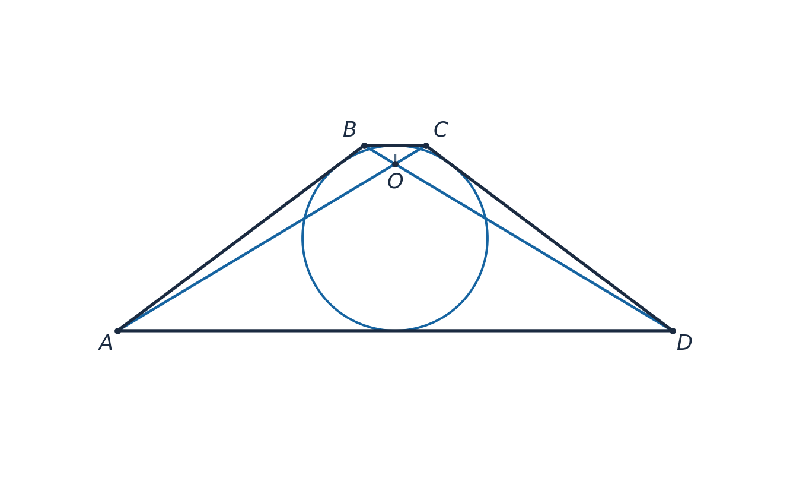

**Критерии**

- **2 балла.** Ход решения обоснован, получен правильный ответ. Обоснованы суммы противоположных сторон, размеры оснований и отношение высот у диагоналей.
- **1 балл.** Решение в целом верное, есть несущественный недостаток или вычислительная ошибка. Верный геометрический план с несущественной вычислительной ошибкой.
- **0 баллов.** Решение не удовлетворяет условиям для 1 или 2 баллов. Расстояние до меньшего основания принято равным половине высоты без основания.

[Источник карточки](https://math-oge.sdamgia.ru/problem?id=340054)

### Задача 2 · 352987

Периметр равнобедренной трапеции равен 160, площадь равна 1280. В неё можно вписать окружность. Найдите расстояние от пересечения диагоналей до меньшего основания.

Подсказка 1

Сравни суммы противоположных сторон описанного четырёхугольника.

Подсказка 2

Найди высоту по площади, затем используй подобие при пересечении диагоналей.

Ответ для самопроверки

$\frac{32}{5}$

Разбор и критерии

1. Сумма оснований равна сумме боковых сторон по свойству четырёхугольника с вписанной окружностью. Каждая из сумм 80, поэтому боковая сторона 40. Высота из формулы площади равна $32$.
2. По теореме Пифагора полуразность оснований $24$. Вместе с известной суммой это даёт основания $16$ и $64$.
3. Треугольники с вершиной в пересечении диагоналей подобны. Их высоты относятся как основания. Доля высоты у меньшего основания $\frac{1}{5}$. Умножаем на h и получаем $\frac{32}{5}$.

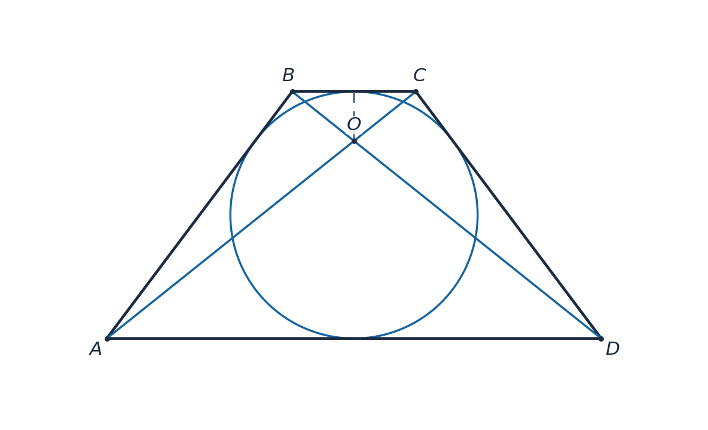

**Критерии**

- **2 балла.** Ход решения обоснован, получен правильный ответ. Суммы противоположных сторон, высота из площади и подобие у пересечения диагоналей
- **1 балл.** Решение в целом верное, есть несущественный недостаток или вычислительная ошибка. Связь между построениями и основными промежуточными величинами верна, итог содержит малую неточность.
- **0 баллов.** Решение не удовлетворяет условиям для 1 или 2 баллов. Получено промежуточное равенство без обоснования и правильного продолжения нет.

[Источник карточки](https://math-oge.sdamgia.ru/problem?id=352987)

### Задача 3 · 51A343

Периметр равнобедренной трапеции равен 200, площадь равна 2000. В неё можно вписать окружность. Найдите расстояние от пересечения диагоналей до меньшего основания.

Подсказка 1

Сравни суммы противоположных сторон описанного четырёхугольника.

Подсказка 2

Найди высоту по площади, затем используй подобие при пересечении диагоналей.

Ответ для самопроверки

$8$

Разбор и критерии

1. Сумма оснований равна сумме боковых сторон по свойству четырёхугольника с вписанной окружностью. Каждая из сумм 100, поэтому боковая сторона 50. Высота из формулы площади равна $40$.
2. По теореме Пифагора полуразность оснований $30$. Вместе с известной суммой это даёт основания $20$ и $80$.
3. Треугольники с вершиной в пересечении диагоналей подобны. Их высоты относятся как основания. Доля высоты у меньшего основания $\frac{1}{5}$. Умножаем на h и получаем $8$.

**Критерии**

- **2 балла.** Ход решения обоснован, получен правильный ответ. Суммы противоположных сторон, высота из площади и подобие у пересечения диагоналей
- **1 балл.** Решение в целом верное, есть несущественный недостаток или вычислительная ошибка. Связь между построениями и основными промежуточными величинами верна, итог содержит малую неточность.
- **0 баллов.** Решение не удовлетворяет условиям для 1 или 2 баллов. Получено промежуточное равенство без обоснования и правильного продолжения нет.

[Источник карточки](https://sdamgia.online/oge/matematika/zadanie-25/vpisannaya-okruzhnost-i-diagonali-trapecii-fipi-51a343) · Код 51A343 по каталогу sdamgia.online

### Задача 4 · AA39FE

Периметр равнобедренной трапеции равен 100, площадь равна 500. В неё можно вписать окружность. Найдите расстояние от пересечения диагоналей до меньшего основания.

Подсказка 1

Сравни суммы противоположных сторон описанного четырёхугольника.

Подсказка 2

Найди высоту по площади, затем используй подобие при пересечении диагоналей.

Ответ для самопроверки

$4$

Разбор и критерии

1. Сумма оснований равна сумме боковых сторон по свойству четырёхугольника с вписанной окружностью. Каждая из сумм 50, поэтому боковая сторона 25. Высота из формулы площади равна $20$.
2. По теореме Пифагора полуразность оснований $15$. Вместе с известной суммой это даёт основания $10$ и $40$.
3. Треугольники с вершиной в пересечении диагоналей подобны. Их высоты относятся как основания. Доля высоты у меньшего основания $\frac{1}{5}$. Умножаем на h и получаем $4$.

**Критерии**

- **2 балла.** Ход решения обоснован, получен правильный ответ. Суммы противоположных сторон, высота из площади и подобие у пересечения диагоналей
- **1 балл.** Решение в целом верное, есть несущественный недостаток или вычислительная ошибка. Связь между построениями и основными промежуточными величинами верна, итог содержит малую неточность.
- **0 баллов.** Решение не удовлетворяет условиям для 1 или 2 баллов. Получено промежуточное равенство без обоснования и правильного продолжения нет.

[Источник карточки](https://sdamgia.online/oge/matematika/zadanie-25/vpisannaya-okruzhnost-i-diagonali-trapecii-fipi-aa39fe) · Код AA39FE по каталогу sdamgia.online

### Задача 5 · 1EE527

Периметр равнобедренной трапеции равен 180, площадь равна 1620. В неё можно вписать окружность. Найдите расстояние от пересечения диагоналей до меньшего основания.

Подсказка 1

Сравни суммы противоположных сторон описанного четырёхугольника.

Подсказка 2

Найди высоту по площади, затем используй подобие при пересечении диагоналей.

Ответ для самопроверки

$\frac{36}{5}$

Разбор и критерии

1. Сумма оснований равна сумме боковых сторон по свойству четырёхугольника с вписанной окружностью. Каждая из сумм 90, поэтому боковая сторона 45. Высота из формулы площади равна $36$.
2. По теореме Пифагора полуразность оснований $27$. Вместе с известной суммой это даёт основания $18$ и $72$.
3. Треугольники с вершиной в пересечении диагоналей подобны. Их высоты относятся как основания. Доля высоты у меньшего основания $\frac{1}{5}$. Умножаем на h и получаем $\frac{36}{5}$.

**Критерии**

- **2 балла.** Ход решения обоснован, получен правильный ответ. Суммы противоположных сторон, высота из площади и подобие у пересечения диагоналей
- **1 балл.** Решение в целом верное, есть несущественный недостаток или вычислительная ошибка. Связь между построениями и основными промежуточными величинами верна, итог содержит малую неточность.
- **0 баллов.** Решение не удовлетворяет условиям для 1 или 2 баллов. Получено промежуточное равенство без обоснования и правильного продолжения нет.

[Источник карточки](https://sdamgia.online/oge/matematika/zadanie-25/vpisannaya-okruzhnost-i-diagonali-trapecii-fipi-1ee527) · Код 1EE527 по каталогу sdamgia.online

### Задача 6 · F311D0

Периметр равнобедренной трапеции равен 40, площадь равна 80. В неё можно вписать окружность. Найдите расстояние от пересечения диагоналей до меньшего основания.

Подсказка 1

Сравни суммы противоположных сторон описанного четырёхугольника.

Подсказка 2

Найди высоту по площади, затем используй подобие при пересечении диагоналей.

Ответ для самопроверки

$\frac{8}{5}$

Разбор и критерии

1. Сумма оснований равна сумме боковых сторон по свойству четырёхугольника с вписанной окружностью. Каждая из сумм 20, поэтому боковая сторона 10. Высота из формулы площади равна $8$.
2. По теореме Пифагора полуразность оснований $6$. Вместе с известной суммой это даёт основания $4$ и $16$.
3. Треугольники с вершиной в пересечении диагоналей подобны. Их высоты относятся как основания. Доля высоты у меньшего основания $\frac{1}{5}$. Умножаем на h и получаем $\frac{8}{5}$.

**Критерии**

- **2 балла.** Ход решения обоснован, получен правильный ответ. Суммы противоположных сторон, высота из площади и подобие у пересечения диагоналей
- **1 балл.** Решение в целом верное, есть несущественный недостаток или вычислительная ошибка. Связь между построениями и основными промежуточными величинами верна, итог содержит малую неточность.
- **0 баллов.** Решение не удовлетворяет условиям для 1 или 2 баллов. Получено промежуточное равенство без обоснования и правильного продолжения нет.

[Источник карточки](https://sdamgia.online/oge/matematika/zadanie-25/vpisannaya-okruzhnost-i-diagonali-trapecii-fipi-f311d0) · Код F311D0 по каталогу sdamgia.online

### Задача 7 · авторская тренировка

В равнобедренную трапецию вписана окружность радиуса 9. Расстояния от точки пересечения диагоналей до меньшего и большего оснований относятся как 1:9. Найдите площадь трапеции.

Подсказка 1

Какие треугольники образуют диагонали у параллельных оснований?

Подсказка 2

Используй равенство сумм противоположных сторон описанного четырёхугольника.

Ответ для самопроверки

$540$

Разбор и критерии

1. Высота трапеции равна диаметру, то есть 18. Треугольники при её основаниях с вершиной в пересечении диагоналей подобны, поэтому основания относятся как их высоты, 1:9. Обозначим основания через t и 9t.
2. Сумма оснований равна сумме боковых сторон по равенству касательных из каждой вершины. Каждая боковая сторона равна 5t. Её проекция на большее основание равна полуразности оснований, то есть 4t.
3. В прямоугольном треугольнике с гипотенузой 5t и катетом 4t второй катет равен 3t. Это высота, значит, t = 6. Площадь равна $5t\cdot18=540$.

**Критерии**

- **2 балла.** Ход решения обоснован, получен правильный ответ. В прямоугольном треугольнике с гипотенузой 5t и катетом 4t второй катет равен 3t. Это высота, значит, t = 6. Площадь равна $5t\cdot18=540$.
- **1 балл.** Решение в целом верное, есть несущественный недостаток или вычислительная ошибка. Обоснован основной переход: Высота трапеции равна диаметру, то есть 18. Треугольники при её основаниях с вершиной в пересечении диагоналей подобны, поэтому основания относятся как их высоты, 1:9. Обозначим основания через t и 9t. В завершении допущена ошибка в вычислениях или оформлении в пределах критерия.
- **0 баллов.** Решение не удовлетворяет условиям для 1 или 2 баллов. Указан результат без требуемого обоснования либо применена модель, не соответствующая условию.

[Пример семейства](https://math-oge.sdamgia.ru/problem?id=340054)

## Вписанные и вневписанные окружности · Вписанная и вневписанная окружности

`OGE25-incircle-excircle`

### Задача 1 · 439916

Основание $AC$ равнобедренного треугольника $ABC$ равно 12. Окружность радиуса 8, расположенная с центром вне треугольника, касается основания $AC$ и продолжений боковых сторон. Найдите радиус вписанной окружности треугольника.

Подсказка 1

Отличи вписанную окружность от вневписанной.

Подсказка 2

Вырази оба радиуса через одну площадь и полупериметр.

Ответ для самопроверки

$9/2$ ($4{,}5$).

Разбор и критерии

1. Пусть $h$ — высота к $AC$, $l=AB=BC$.
2. Площадь треугольника $S=6h$, полупериметр $s=l+6$.
3. Вписанный радиус $r=S/s$, а вневписанный радиус напротив $B$ равен $r_B=S/(s-AC)=6h/(l-6)$.
4. Последнюю формулу можно получить, вычтя из суммы площадей треугольников с вершиной в центре окружности и основаниями $AB,BC$ площадь треугольника с основанием $AC$.
5. Поэтому $rr_B=(6h)^2/(l^2-36)=36$, так как $l^2-36=h^2$.
6. При $r_B=8$ получаем $r=36/8=9/2$.

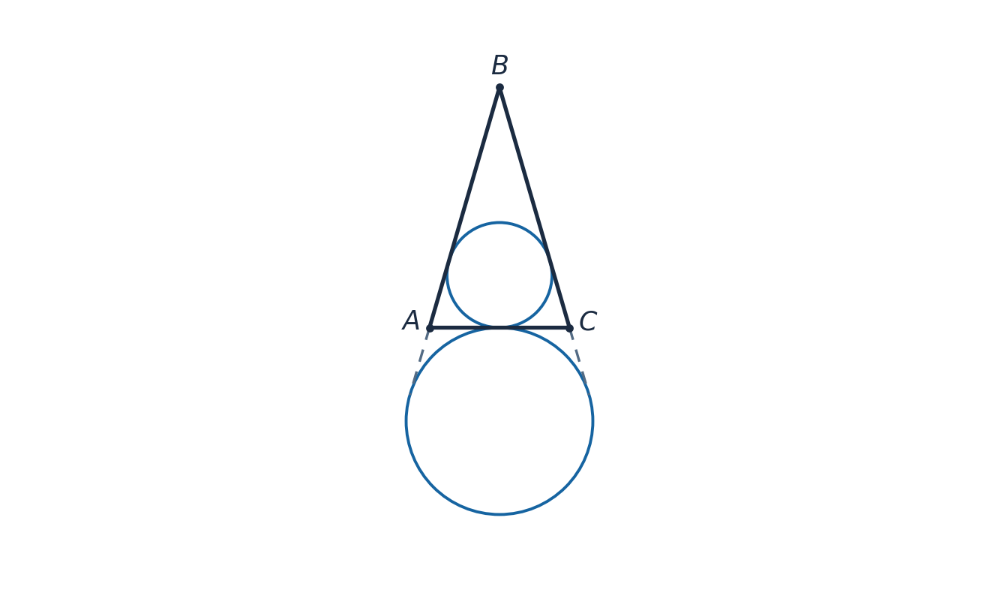

**Критерии**

- **2 балла.** Ход решения обоснован, получен правильный ответ. Правильно отличены радиусы вписанной и вневписанной окружностей, обоснованы формулы и получено 9/2.
- **1 балл.** Решение в целом верное, есть несущественный недостаток или вычислительная ошибка. Оба радиуса выражены корректно, но есть малая вычислительная ошибка либо пробел в записи.
- **0 баллов.** Решение не удовлетворяет условиям для 1 или 2 баллов. Радиус 8 без обоснования принят за радиус вписанной окружности или применена одна формула к двум окружностям.

[Источник карточки](https://math-oge.sdamgia.ru/problem?id=439916)

### Задача 2 · авторская тренировка

Основание AC равнобедренного треугольника ABC равно 18. Вневписанная окружность напротив B касается AC и продолжений боковых сторон. Её радиус равен 15. Найдите радиус вписанной окружности.

Подсказка 1

Отличи вписанную окружность от вневписанной.

Подсказка 2

Вырази оба радиуса через одну площадь и полупериметр.

Ответ для самопроверки

$\frac{27}{5}$

Разбор и критерии

1. Пусть h — высота, l — боковая сторона. Площадь равна $9$h, полупериметр l+9. Деление площади на полупериметр даёт вписанный радиус r.
2. У вневписанной окружности радиус R равен площади, делённой на l−9. Это следует из суммы площадей двух треугольников с основаниями AB и BC за вычетом треугольника с основанием AC.
3. Перемножаем формулы. Получаем $rR=81h^2/(l^2-81)$. По Пифагору l²−81=h². Значит, rR=81 и r=$\frac{27}{5}$.

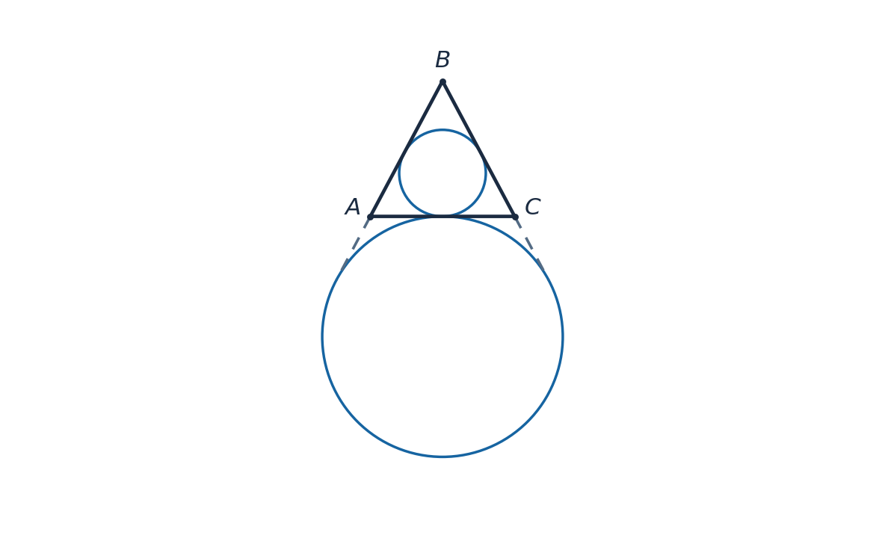

**Критерии**

- **2 балла.** Ход решения обоснован, получен правильный ответ. Связать касания, высоты и полупериметр; положение центра снаружи фиксирует вневписанную окружность
- **1 балл.** Решение в целом верное, есть несущественный недостаток или вычислительная ошибка. Связь между построениями и основными промежуточными величинами верна, итог содержит малую неточность.
- **0 баллов.** Решение не удовлетворяет условиям для 1 или 2 баллов. Получено промежуточное равенство без обоснования и правильного продолжения нет.

[Пример семейства](https://math-oge.sdamgia.ru/problem?id=439916)

### Задача 3 · авторская тренировка

Основание AC равнобедренного треугольника ABC равно 14. Вневписанная окружность напротив B касается AC и продолжений боковых сторон. Её радиус равен 10. Найдите радиус вписанной окружности.

Подсказка 1

Отличи вписанную окружность от вневписанной.

Подсказка 2

Вырази оба радиуса через одну площадь и полупериметр.

Ответ для самопроверки

$\frac{49}{10}$

Разбор и критерии

1. Пусть h — высота, l — боковая сторона. Площадь равна $7$h, полупериметр l+7. Деление площади на полупериметр даёт вписанный радиус r.
2. У вневписанной окружности радиус R равен площади, делённой на l−7. Это следует из суммы площадей двух треугольников с основаниями AB и BC за вычетом треугольника с основанием AC.
3. Перемножаем формулы. Получаем $rR=49h^2/(l^2-49)$. По Пифагору l²−49=h². Значит, rR=49 и r=$\frac{49}{10}$.

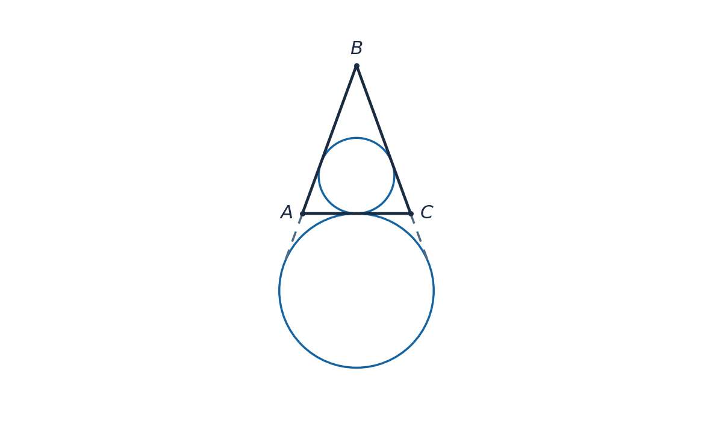

**Критерии**

- **2 балла.** Ход решения обоснован, получен правильный ответ. Связать касания, высоты и полупериметр; положение центра снаружи фиксирует вневписанную окружность
- **1 балл.** Решение в целом верное, есть несущественный недостаток или вычислительная ошибка. Связь между построениями и основными промежуточными величинами верна, итог содержит малую неточность.
- **0 баллов.** Решение не удовлетворяет условиям для 1 или 2 баллов. Получено промежуточное равенство без обоснования и правильного продолжения нет.

[Пример семейства](https://math-oge.sdamgia.ru/problem?id=439916)

### Задача 4 · авторская тренировка

Основание AC равнобедренного треугольника ABC равно 20. Вневписанная окружность напротив B касается AC и продолжений боковых сторон. Её радиус равен 26. Найдите радиус вписанной окружности.

Подсказка 1

Отличи вписанную окружность от вневписанной.

Подсказка 2

Вырази оба радиуса через одну площадь и полупериметр.

Ответ для самопроверки

$\frac{50}{13}$

Разбор и критерии

1. Пусть h — высота, l — боковая сторона. Площадь равна $10$h, полупериметр l+10. Деление площади на полупериметр даёт вписанный радиус r.
2. У вневписанной окружности радиус R равен площади, делённой на l−10. Это следует из суммы площадей двух треугольников с основаниями AB и BC за вычетом треугольника с основанием AC.
3. Перемножаем формулы. Получаем $rR=100h^2/(l^2-100)$. По Пифагору l²−100=h². Значит, rR=100 и r=$\frac{50}{13}$.

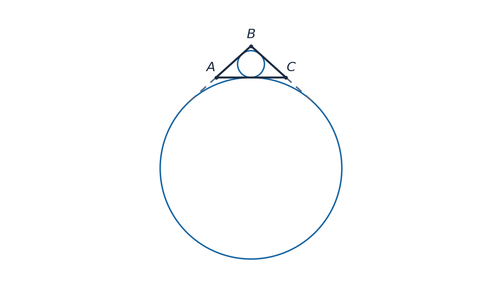

**Критерии**

- **2 балла.** Ход решения обоснован, получен правильный ответ. Связать касания, высоты и полупериметр; положение центра снаружи фиксирует вневписанную окружность
- **1 балл.** Решение в целом верное, есть несущественный недостаток или вычислительная ошибка. Связь между построениями и основными промежуточными величинами верна, итог содержит малую неточность.
- **0 баллов.** Решение не удовлетворяет условиям для 1 или 2 баллов. Получено промежуточное равенство без обоснования и правильного продолжения нет.

[Пример семейства](https://math-oge.sdamgia.ru/problem?id=439916)

### Задача 5 · авторская тренировка

Основание AC равнобедренного треугольника ABC равно 8. Радиус вписанной окружности $2$. Найдите радиус вневписанной окружности, касающейся AC и продолжений боковых сторон.

Подсказка 1

Отличи вписанную окружность от вневписанной.

Подсказка 2

Вырази оба радиуса через одну площадь и полупериметр.

Ответ для самопроверки

$8$

Разбор и критерии

1. Пусть h — высота, l — боковая сторона. Площадь равна $4$h, полупериметр l+4. Деление площади на полупериметр даёт вписанный радиус r.
2. У вневписанной окружности радиус R равен площади, делённой на l−4. Это следует из суммы площадей двух треугольников с основаниями AB и BC за вычетом треугольника с основанием AC.
3. Произведение радиусов равно квадрату половины основания: $rR=16$. Это получается после умножения двух формул и применения теоремы Пифагора. Подставляем известный вписанный радиус и получаем R = 8.

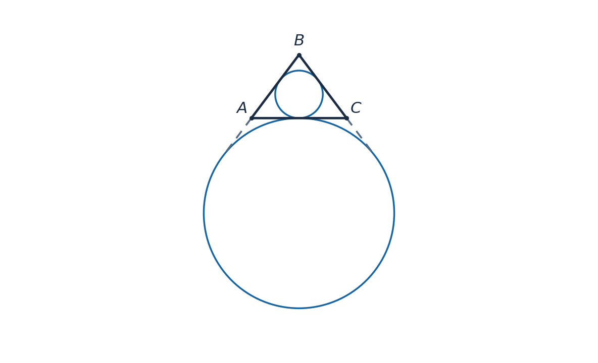

**Критерии**

- **2 балла.** Ход решения обоснован, получен правильный ответ. Связать касания, высоты и полупериметр; положение центра снаружи фиксирует вневписанную окружность
- **1 балл.** Решение в целом верное, есть несущественный недостаток или вычислительная ошибка. Связь между построениями и основными промежуточными величинами верна, итог содержит малую неточность.
- **0 баллов.** Решение не удовлетворяет условиям для 1 или 2 баллов. Получено промежуточное равенство без обоснования и правильного продолжения нет.

[Пример семейства](https://math-oge.sdamgia.ru/problem?id=439916)

### Задача 6 · авторская тренировка

Окружность, вписанная в равнобедренный треугольник ABC, имеет радиус $\frac{144}{25}$. Вневписанный радиус напротив вершины B равен 25. Найдите основание AC.

Подсказка 1

Отличи вписанную окружность от вневписанной.

Подсказка 2

Вырази оба радиуса через одну площадь и полупериметр.

Ответ для самопроверки

$24$

Разбор и критерии

1. Пусть половина основания a, боковая сторона l и высота h. Тогда площадь равна ah, полупериметр l+a, а разность полупериметра и основания l−a.
2. Вписанный и вневписанный радиусы равны ah/(l+a) и ah/(l−a). Их произведение равно a², так как l²−a²=h².
3. Подставляем радиусы и находим a = 12. Длина основания 2a=24.

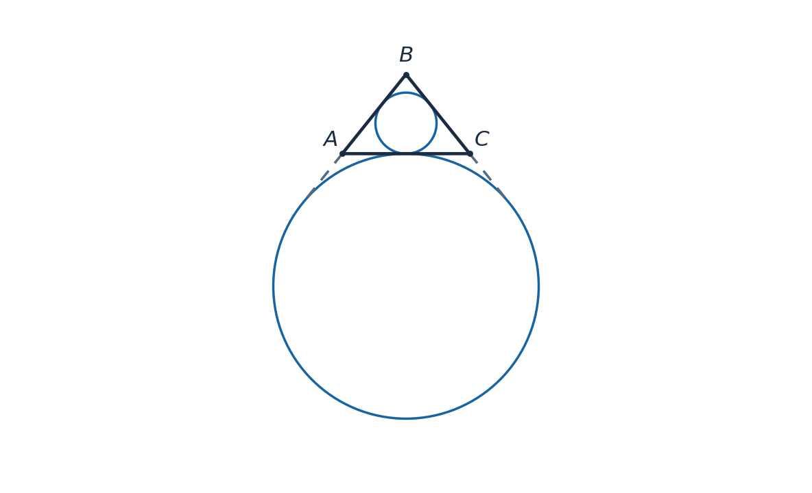

**Критерии**

- **2 балла.** Ход решения обоснован, получен правильный ответ. Связать касания, высоты и полупериметр; положение центра снаружи фиксирует вневписанную окружность
- **1 балл.** Решение в целом верное, есть несущественный недостаток или вычислительная ошибка. Связь между построениями и основными промежуточными величинами верна, итог содержит малую неточность.
- **0 баллов.** Решение не удовлетворяет условиям для 1 или 2 баллов. Получено промежуточное равенство без обоснования и правильного продолжения нет.

[Пример семейства](https://math-oge.sdamgia.ru/problem?id=439916)

## Вписанные и вневписанные окружности · Радиусы вписанных окружностей подобных треугольников

`OGE25-incircle-similarity`

### Задача 1 · 341397

В прямоугольном треугольнике $ABC$ с прямым углом $C$ высота $CP$ проведена к гипотенузе. Радиус окружности, вписанной в $BCP$, равен 96. Известно, что $\tan\angle BAC=8/15$. Найдите радиус окружности, вписанной в $ABC$.

Подсказка 1

Найди малый и большой подобные треугольники.

Подсказка 2

Радиусы вписанных окружностей относятся как соответствующие стороны.

Ответ для самопроверки

$204$.

Разбор и критерии

1. Треугольники $BCP$ и $BAC$ подобны по прямому углу и общему углу при $B$.
2. Гипотенуза меньшего — $BC$, исходного — $AB$.
3. Из $BC/AC=8/15$ и теоремы Пифагора следует $BC/AB=8/17$.
4. При подобии радиусы вписанных окружностей меняются с тем же коэффициентом, что и стороны, поэтому $96/r=8/17$.
5. Получаем $r=204$.

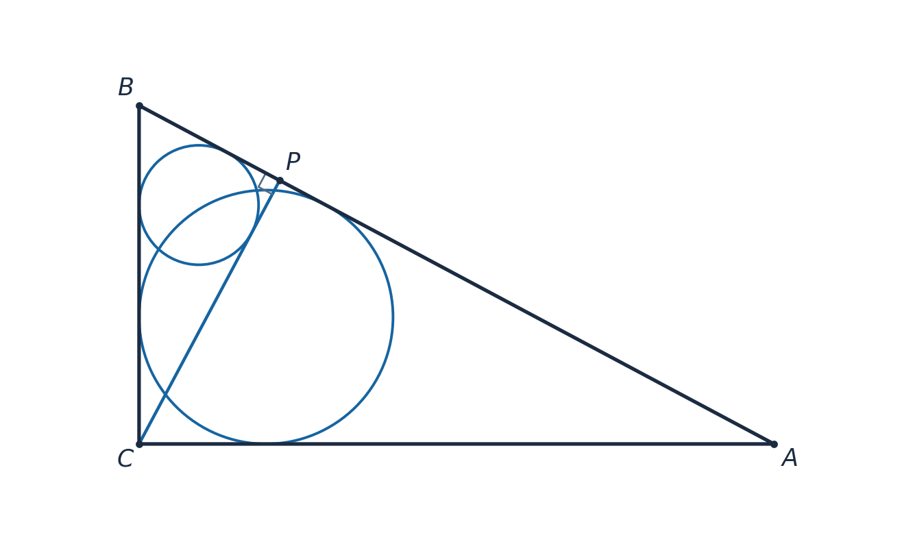

**Критерии**

- **2 балла.** Ход решения обоснован, получен правильный ответ. Обоснованы подобие и масштаб радиусов, гипотенузы сопоставлены в правильном порядке.
- **1 балл.** Решение в целом верное, есть несущественный недостаток или вычислительная ошибка. Основное подобие и масштаб выбраны верно, но есть арифметическая ошибка.
- **0 баллов.** Решение не удовлетворяет условиям для 1 или 2 баллов. Радиус масштабирован непосредственно коэффициентом тангенса 8/15 без сопоставления сторон.

[Источник карточки](https://math-oge.sdamgia.ru/problem?id=341397)

### Задача 2 · авторская тренировка

В треугольнике ABC угол C прямой, CP — высота к гипотенузе. Радиус вписанной окружности треугольника BCP равен 30. Тангенс угла BAC равен $\frac{3}{4}$. Найдите вписанный радиус треугольника ABC.

Подсказка 1

Найди малый и большой подобные треугольники.

Подсказка 2

Радиусы вписанных окружностей относятся как соответствующие стороны.

Ответ для самопроверки

$50$

Разбор и критерии

1. Прямоугольные треугольники BCP и BCA подобны по общему углу B. Их гипотенузы соответственно BC и AB.
2. Из отношения катетов 3:4 получаем отношение BC/AB = $\frac{3}{5}$ по теореме Пифагора. Радиусы вписанных окружностей относятся так же. Поэтому больший радиус $50$.

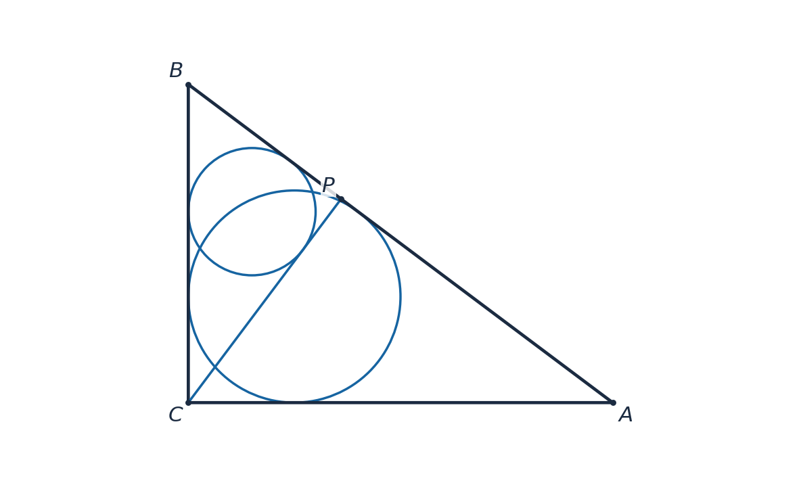

**Критерии**

- **2 балла.** Ход решения обоснован, получен правильный ответ. Доказать подобие и перенести масштаб на радиус, получить коэффициент из тригонометрии
- **1 балл.** Решение в целом верное, есть несущественный недостаток или вычислительная ошибка. Связь между построениями и основными промежуточными величинами верна, итог содержит малую неточность.
- **0 баллов.** Решение не удовлетворяет условиям для 1 или 2 баллов. Получено промежуточное равенство без обоснования и правильного продолжения нет.

[Пример семейства](https://math-oge.sdamgia.ru/problem?id=341397)

### Задача 3 · авторская тренировка

В треугольнике ABC угол C прямой, CP — высота к гипотенузе. Радиус вписанной окружности треугольника BCP равен 105. Тангенс угла BAC равен $\frac{5}{12}$. Найдите вписанный радиус треугольника ABC.

Подсказка 1

Найди малый и большой подобные треугольники.

Подсказка 2

Радиусы вписанных окружностей относятся как соответствующие стороны.

Ответ для самопроверки

$273$

Разбор и критерии

1. Прямоугольные треугольники BCP и BCA подобны по общему углу B. Их гипотенузы соответственно BC и AB.
2. Из отношения катетов 5:12 получаем отношение BC/AB = $\frac{5}{13}$ по теореме Пифагора. Радиусы вписанных окружностей относятся так же. Поэтому больший радиус $273$.

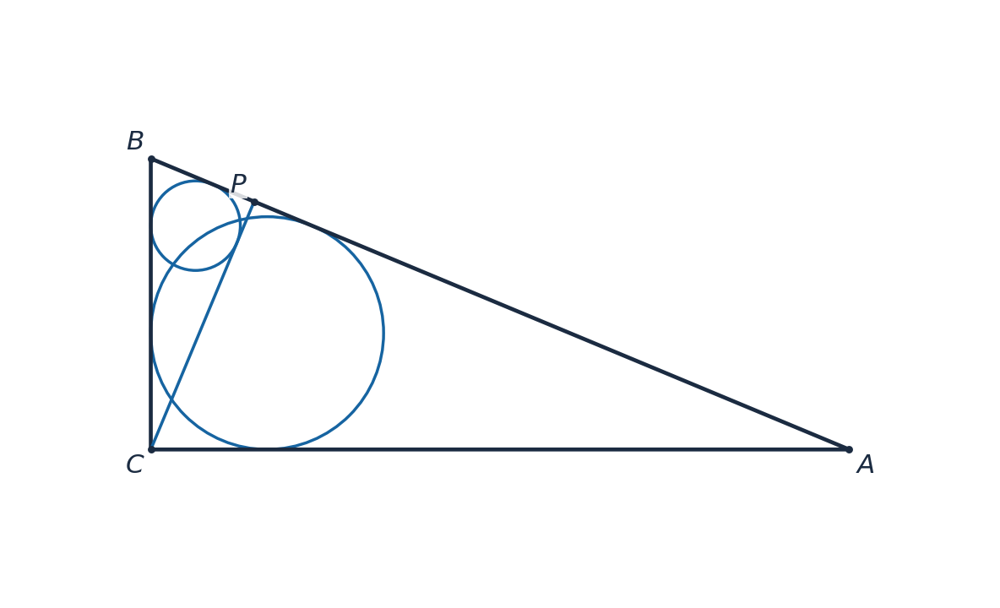

**Критерии**

- **2 балла.** Ход решения обоснован, получен правильный ответ. Доказать подобие и перенести масштаб на радиус, получить коэффициент из тригонометрии
- **1 балл.** Решение в целом верное, есть несущественный недостаток или вычислительная ошибка. Связь между построениями и основными промежуточными величинами верна, итог содержит малую неточность.
- **0 баллов.** Решение не удовлетворяет условиям для 1 или 2 баллов. Получено промежуточное равенство без обоснования и правильного продолжения нет.

[Пример семейства](https://math-oge.sdamgia.ru/problem?id=341397)

### Задача 4 · авторская тренировка

В треугольнике ABC угол C прямой, CP — высота к гипотенузе. Радиус вписанной окружности треугольника BCP равен 49. Тангенс угла BAC равен $\frac{7}{24}$. Найдите вписанный радиус треугольника ABC.

Подсказка 1

Найди малый и большой подобные треугольники.

Подсказка 2

Радиусы вписанных окружностей относятся как соответствующие стороны.

Ответ для самопроверки

$175$

Разбор и критерии

1. Прямоугольные треугольники BCP и BCA подобны по общему углу B. Их гипотенузы соответственно BC и AB.
2. Из отношения катетов 7:24 получаем отношение BC/AB = $\frac{7}{25}$ по теореме Пифагора. Радиусы вписанных окружностей относятся так же. Поэтому больший радиус $175$.

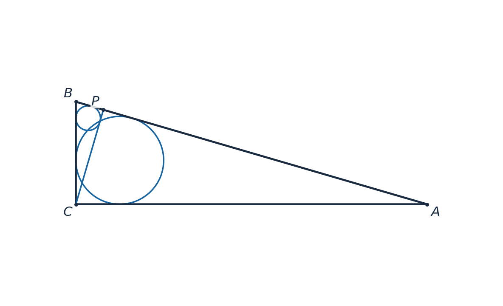

**Критерии**

- **2 балла.** Ход решения обоснован, получен правильный ответ. Доказать подобие и перенести масштаб на радиус, получить коэффициент из тригонометрии
- **1 балл.** Решение в целом верное, есть несущественный недостаток или вычислительная ошибка. Связь между построениями и основными промежуточными величинами верна, итог содержит малую неточность.
- **0 баллов.** Решение не удовлетворяет условиям для 1 или 2 баллов. Получено промежуточное равенство без обоснования и правильного продолжения нет.

[Пример семейства](https://math-oge.sdamgia.ru/problem?id=341397)

### Задача 5 · авторская тренировка

В прямоугольном треугольнике ABC угол C прямой, CP — высота к AB. Радиус вписанной окружности ABC равен $87$. Если тангенс угла BAC равен $\frac{20}{21}$, найдите радиус вписанной окружности BCP.

Подсказка 1

Найди малый и большой подобные треугольники.

Подсказка 2

Радиусы вписанных окружностей относятся как соответствующие стороны.

Ответ для самопроверки

$60$

Разбор и критерии

1. Прямоугольные треугольники BCP и BCA подобны по общему углу B. Их гипотенузы соответственно BC и AB.
2. Гипотенузы меньшего и большего треугольников — BC и AB. По тангенсу и теореме Пифагора BC/AB=$\frac{20}{29}$. У подобных треугольников таким же будет отношение радиусов.
3. Умножаем радиус треугольника ABC на коэффициент $\frac{20}{29}$. Получаем $60$.

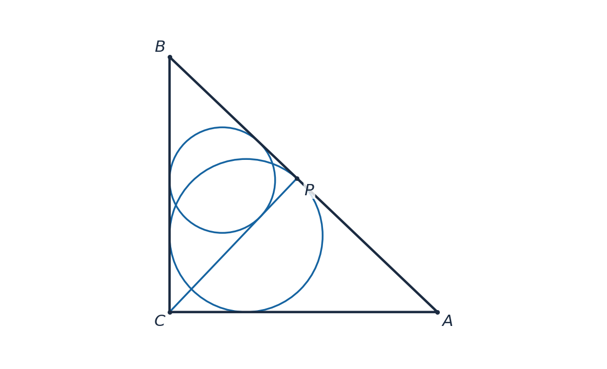

**Критерии**

- **2 балла.** Ход решения обоснован, получен правильный ответ. Доказать подобие и перенести масштаб на радиус, получить коэффициент из тригонометрии
- **1 балл.** Решение в целом верное, есть несущественный недостаток или вычислительная ошибка. Связь между построениями и основными промежуточными величинами верна, итог содержит малую неточность.
- **0 баллов.** Решение не удовлетворяет условиям для 1 или 2 баллов. Получено промежуточное равенство без обоснования и правильного продолжения нет.

[Пример семейства](https://math-oge.sdamgia.ru/problem?id=341397)

### Задача 6 · авторская тренировка

В прямоугольном треугольнике ABC угол C прямой, CP — высота к AB. Радиус вписанной окружности ABC равен $259$. Если тангенс угла BAC равен $\frac{12}{35}$, найдите радиус вписанной окружности BCP.

Подсказка 1

Найди малый и большой подобные треугольники.

Подсказка 2

Радиусы вписанных окружностей относятся как соответствующие стороны.

Ответ для самопроверки

$84$

Разбор и критерии

1. Прямоугольные треугольники BCP и BCA подобны по общему углу B. Их гипотенузы соответственно BC и AB.
2. Гипотенузы меньшего и большего треугольников — BC и AB. По тангенсу и теореме Пифагора BC/AB=$\frac{12}{37}$. У подобных треугольников таким же будет отношение радиусов.
3. Умножаем радиус треугольника ABC на коэффициент $\frac{12}{37}$. Получаем $84$.

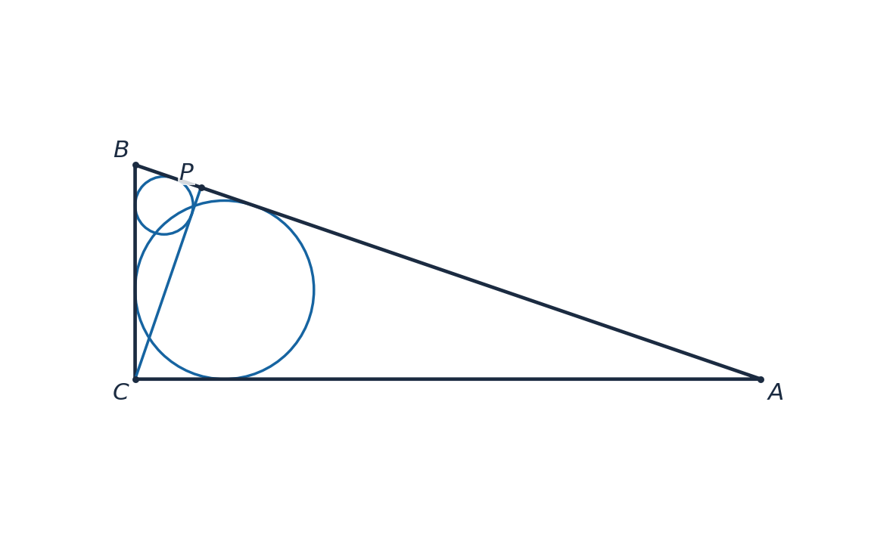

**Критерии**

- **2 балла.** Ход решения обоснован, получен правильный ответ. Доказать подобие и перенести масштаб на радиус, получить коэффициент из тригонометрии
- **1 балл.** Решение в целом верное, есть несущественный недостаток или вычислительная ошибка. Связь между построениями и основными промежуточными величинами верна, итог содержит малую неточность.
- **0 баллов.** Решение не удовлетворяет условиям для 1 или 2 баллов. Получено промежуточное равенство без обоснования и правильного продолжения нет.

[Пример семейства](https://math-oge.sdamgia.ru/problem?id=341397)

## Вписанные и вневписанные окружности · Инцентр, расстояния и высота

`OGE25-incenter-distance`

### Задача 1 · 339825

Проведена диагональ AC параллелограмма ABCD. Точка O — центр вписанной окружности треугольника ABC. Даны AO = 5, расстояние от O до AD равно 4, а до AC равно 3. Найдите площадь параллелограмма.

Подсказка 1

Используй равенство расстояний от инцентра до сторон треугольника.

Подсказка 2

Проверь, какие из этих сторон параллельны сторонам параллелограмма или совпадают с ними.

Ответ для самопроверки

$168$

Разбор и критерии

1. Радиус окружности равен расстоянию от O до AC, то есть 3. До BC от O тоже 3. Поскольку AD ∥ BC, высота параллелограмма равна 4+3=7.
2. Пусть K — касание с AC. Из прямоугольного треугольника AOK получаем AK = $4$. Касательные из каждой вершины треугольника попарно равны. Поэтому полупериметр ABC равен AK+BC.
3. Обозначим длину BC через x. Площадь ABC равна и $3(x+4)$, и $\frac{7}{2}x$. Приравниваем, получаем BC = $24$, площадь параллелограмма $168$.

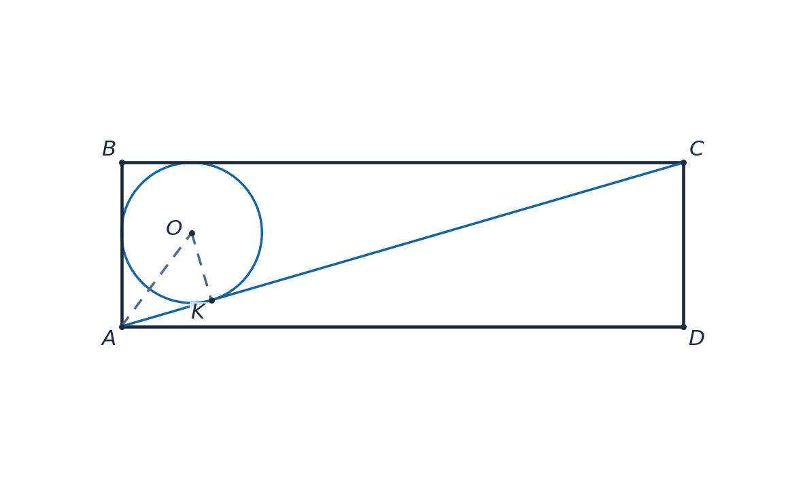

**Критерии**

- **2 балла.** Ход решения обоснован, получен правильный ответ. Равные расстояния до сторон исходного треугольника в связке с параллелями
- **1 балл.** Решение в целом верное, есть несущественный недостаток или вычислительная ошибка. Связь между построениями и основными промежуточными величинами верна, итог содержит малую неточность.
- **0 баллов.** Решение не удовлетворяет условиям для 1 или 2 баллов. Получено промежуточное равенство без обоснования и правильного продолжения нет.

[Источник карточки](https://math-oge.sdamgia.ru/problem?id=339825)

### Задача 2 · 350304

Проведена диагональ AC параллелограмма ABCD. Точка O — центр вписанной окружности треугольника ABC. Даны AO = 25, расстояние от O до AD равно 14, а до AC равно 7. Найдите площадь параллелограмма.

Подсказка 1

Используй равенство расстояний от инцентра до сторон треугольника.

Подсказка 2

Проверь, какие из этих сторон параллельны сторонам параллелограмма или совпадают с ними.

Ответ для самопроверки

$1008$

Разбор и критерии

1. Радиус окружности равен расстоянию от O до AC, то есть 7. До BC от O тоже 7. Поскольку AD ∥ BC, высота параллелограмма равна 14+7=21.
2. Пусть K — касание с AC. Из прямоугольного треугольника AOK получаем AK = $24$. Касательные из каждой вершины треугольника попарно равны. Поэтому полупериметр ABC равен AK+BC.
3. Обозначим длину BC через x. Площадь ABC равна и $7(x+24)$, и $\frac{21}{2}x$. Приравниваем, получаем BC = $48$, площадь параллелограмма $1008$.

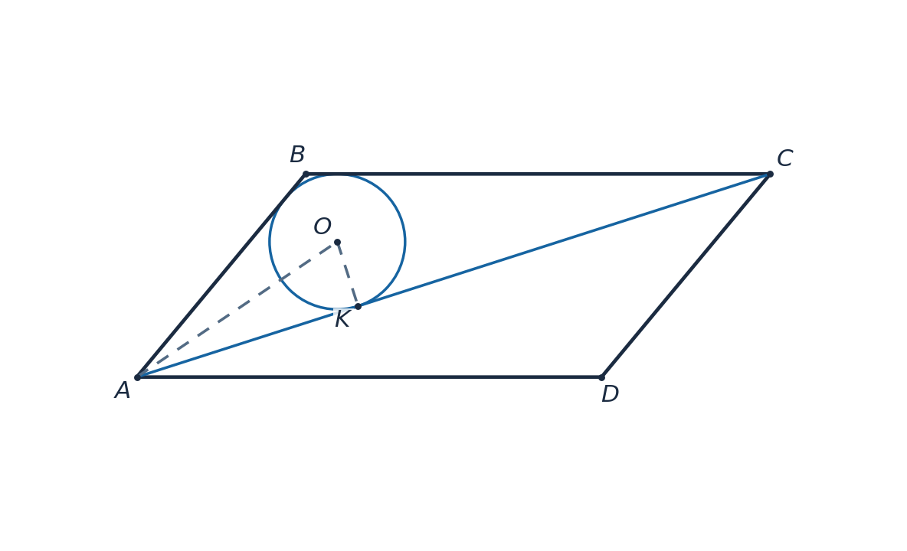

**Критерии**

- **2 балла.** Ход решения обоснован, получен правильный ответ. Равные расстояния до сторон исходного треугольника в связке с параллелями
- **1 балл.** Решение в целом верное, есть несущественный недостаток или вычислительная ошибка. Связь между построениями и основными промежуточными величинами верна, итог содержит малую неточность.
- **0 баллов.** Решение не удовлетворяет условиям для 1 или 2 баллов. Получено промежуточное равенство без обоснования и правильного продолжения нет.

[Источник карточки](https://math-oge.sdamgia.ru/problem?id=350304)

### Задача 3 · 350839

Проведена диагональ AC параллелограмма ABCD. Точка O — центр вписанной окружности треугольника ABC. Даны AO = 25, расстояние от O до AD равно 15, а до AC равно 7. Найдите площадь параллелограмма.

Подсказка 1

Используй равенство расстояний от инцентра до сторон треугольника.

Подсказка 2

Проверь, какие из этих сторон параллельны сторонам параллелограмма или совпадают с ними.

Ответ для самопроверки

$924$

Разбор и критерии

1. Радиус окружности равен расстоянию от O до AC, то есть 7. До BC от O тоже 7. Поскольку AD ∥ BC, высота параллелограмма равна 15+7=22.
2. Пусть K — касание с AC. Из прямоугольного треугольника AOK получаем AK = $24$. Касательные из каждой вершины треугольника попарно равны. Поэтому полупериметр ABC равен AK+BC.
3. Обозначим длину BC через x. Площадь ABC равна и $7(x+24)$, и $11x$. Приравниваем, получаем BC = $42$, площадь параллелограмма $924$.

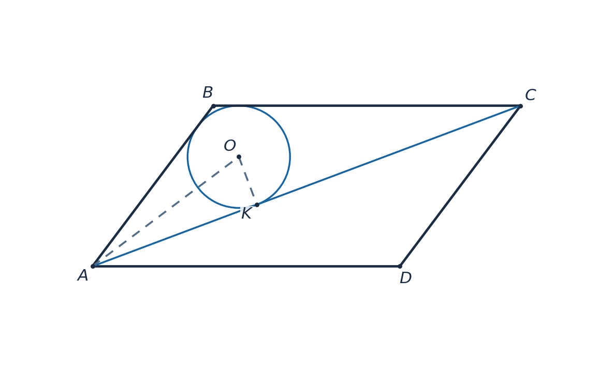

**Критерии**

- **2 балла.** Ход решения обоснован, получен правильный ответ. Равные расстояния до сторон исходного треугольника в связке с параллелями
- **1 балл.** Решение в целом верное, есть несущественный недостаток или вычислительная ошибка. Связь между построениями и основными промежуточными величинами верна, итог содержит малую неточность.
- **0 баллов.** Решение не удовлетворяет условиям для 1 или 2 баллов. Получено промежуточное равенство без обоснования и правильного продолжения нет.

[Источник карточки](https://math-oge.sdamgia.ru/problem?id=350839)

### Задача 4 · 351109

Проведена диагональ AC параллелограмма ABCD. Точка O — центр вписанной окружности треугольника ABC. Даны AO = 13, расстояние от O до AD равно 7, а до AC равно 5. Найдите площадь параллелограмма.

Подсказка 1

Используй равенство расстояний от инцентра до сторон треугольника.

Подсказка 2

Проверь, какие из этих сторон параллельны сторонам параллелограмма или совпадают с ними.

Ответ для самопроверки

$720$

Разбор и критерии

1. Радиус окружности равен расстоянию от O до AC, то есть 5. До BC от O тоже 5. Поскольку AD ∥ BC, высота параллелограмма равна 7+5=12.
2. Пусть K — касание с AC. Из прямоугольного треугольника AOK получаем AK = $12$. Касательные из каждой вершины треугольника попарно равны. Поэтому полупериметр ABC равен AK+BC.
3. Обозначим длину BC через x. Площадь ABC равна и $5(x+12)$, и $6x$. Приравниваем, получаем BC = $60$, площадь параллелограмма $720$.

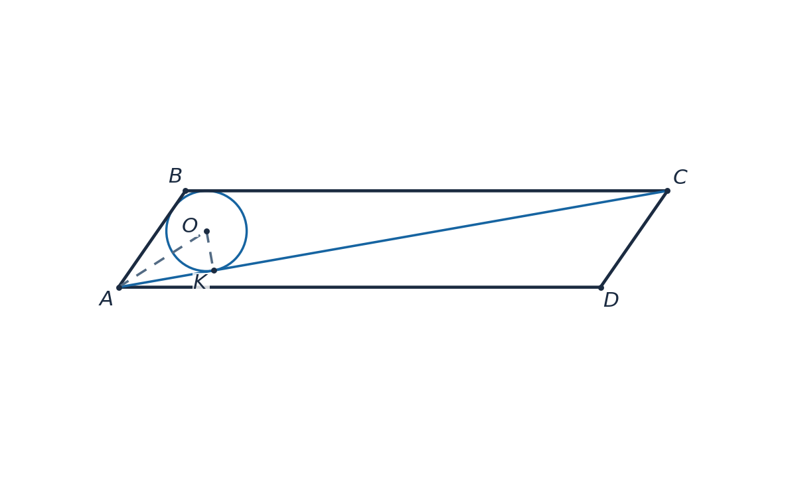

**Критерии**

- **2 балла.** Ход решения обоснован, получен правильный ответ. Равные расстояния до сторон исходного треугольника в связке с параллелями
- **1 балл.** Решение в целом верное, есть несущественный недостаток или вычислительная ошибка. Связь между построениями и основными промежуточными величинами верна, итог содержит малую неточность.
- **0 баллов.** Решение не удовлетворяет условиям для 1 или 2 баллов. Получено промежуточное равенство без обоснования и правильного продолжения нет.

[Источник карточки](https://math-oge.sdamgia.ru/problem?id=351109)

### Задача 5 · 351158

Проведена диагональ AC параллелограмма ABCD. Точка O — центр вписанной окружности треугольника ABC. Даны AO = 13, расстояние от O до AD равно 9, а до AC равно 5. Найдите площадь параллелограмма.

Подсказка 1

Используй равенство расстояний от инцентра до сторон треугольника.

Подсказка 2

Проверь, какие из этих сторон параллельны сторонам параллелограмма или совпадают с ними.

Ответ для самопроверки

$420$

Разбор и критерии

1. Радиус окружности равен расстоянию от O до AC, то есть 5. До BC от O тоже 5. Поскольку AD ∥ BC, высота параллелограмма равна 9+5=14.
2. Пусть K — касание с AC. Из прямоугольного треугольника AOK получаем AK = $12$. Касательные из каждой вершины треугольника попарно равны. Поэтому полупериметр ABC равен AK+BC.
3. Обозначим длину BC через x. Площадь ABC равна и $5(x+12)$, и $7x$. Приравниваем, получаем BC = $30$, площадь параллелограмма $420$.

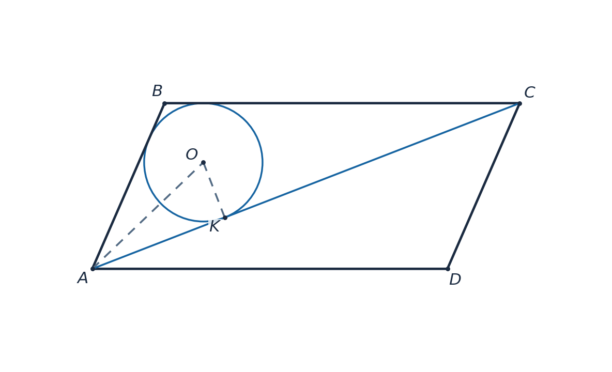

**Критерии**

- **2 балла.** Ход решения обоснован, получен правильный ответ. Равные расстояния до сторон исходного треугольника в связке с параллелями
- **1 балл.** Решение в целом верное, есть несущественный недостаток или вычислительная ошибка. Связь между построениями и основными промежуточными величинами верна, итог содержит малую неточность.
- **0 баллов.** Решение не удовлетворяет условиям для 1 или 2 баллов. Получено промежуточное равенство без обоснования и правильного продолжения нет.

[Источник карточки](https://math-oge.sdamgia.ru/problem?id=351158)

### Задача 6 · 352193

Проведена диагональ AC параллелограмма ABCD. Точка O — центр вписанной окружности треугольника ABC. Даны AO = 25, расстояние от O до AD равно 13, а до AC равно 7. Найдите площадь параллелограмма.

Подсказка 1

Используй равенство расстояний от инцентра до сторон треугольника.

Подсказка 2

Проверь, какие из этих сторон параллельны сторонам параллелограмма или совпадают с ними.

Ответ для самопроверки

$1120$

Разбор и критерии

1. Радиус окружности равен расстоянию от O до AC, то есть 7. До BC от O тоже 7. Поскольку AD ∥ BC, высота параллелограмма равна 13+7=20.
2. Пусть K — касание с AC. Из прямоугольного треугольника AOK получаем AK = $24$. Касательные из каждой вершины треугольника попарно равны. Поэтому полупериметр ABC равен AK+BC.
3. Обозначим длину BC через x. Площадь ABC равна и $7(x+24)$, и $10x$. Приравниваем, получаем BC = $56$, площадь параллелограмма $1120$.

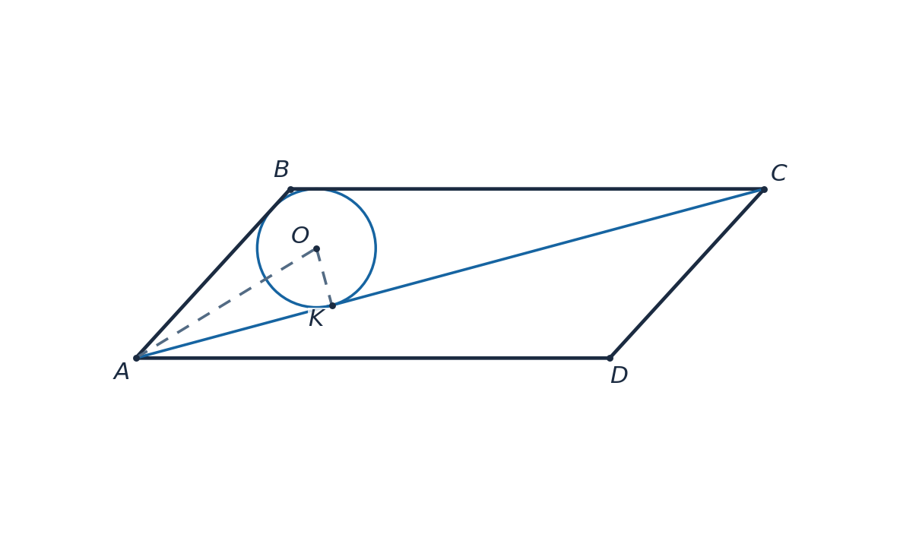

**Критерии**

- **2 балла.** Ход решения обоснован, получен правильный ответ. Равные расстояния до сторон исходного треугольника в связке с параллелями
- **1 балл.** Решение в целом верное, есть несущественный недостаток или вычислительная ошибка. Связь между построениями и основными промежуточными величинами верна, итог содержит малую неточность.
- **0 баллов.** Решение не удовлетворяет условиям для 1 или 2 баллов. Получено промежуточное равенство без обоснования и правильного продолжения нет.

[Источник карточки](https://math-oge.sdamgia.ru/problem?id=352193)

### Задача 7 · авторская тренировка

Диагональ AC параллелограмма ABCD образует треугольник ABC, в который вписана окружность с центром O. Площадь параллелограмма равна 168. Расстояния от O до AD и AC равны 4 и 3 соответственно. Найдите AO.

Подсказка 1

Найди радиус, высоту параллелограмма и длину стороны BC.

Подсказка 2

Вырази длину касательной из A через полупериметр треугольника и BC.

Ответ для самопроверки

$5$

Разбор и критерии

1. Радиус равен 3, значит, до BC от O тоже 3. Высота между BC и AD равна 3+4=7. Тогда BC = 168/7 = 24.
2. Площадь ABC равна 84 и равна радиусу, умноженному на полупериметр. Полупериметр равен 28. Касательные из каждой вершины равны попарно, поэтому касательная AK из A имеет длину 28 − 24 = 4.
3. Радиус OK перпендикулярен касательной. По теореме Пифагора $AO=\sqrt{4^2+3^2}=5$.

**Критерии**

- **2 балла.** Ход решения обоснован, получен правильный ответ. Радиус OK перпендикулярен касательной. По теореме Пифагора $AO=\sqrt{4^2+3^2}=5$.
- **1 балл.** Решение в целом верное, есть несущественный недостаток или вычислительная ошибка. Обоснован основной переход: Радиус равен 3, значит, до BC от O тоже 3. Высота между BC и AD равна 3+4=7. Тогда BC = 168/7 = 24. В завершении допущена ошибка в вычислениях или оформлении в пределах критерия.
- **0 баллов.** Решение не удовлетворяет условиям для 1 или 2 баллов. Указан результат без требуемого обоснования либо применена модель, не соответствующая условию.

[Пример семейства](https://math-oge.sdamgia.ru/problem?id=339825)

## Вписанные фигуры и описанные окружности · Диагонали вписанного четырёхугольника

`OGE25-cyclic-diagonals`

### Задача 1 · 339675

Четырёхугольник ABCD вписан в окружность. Известно, что AB = 25, CD = 16. Диагонали пересекаются в K, ∠AKB = 60°. Найдите радиус окружности.

Подсказка 1

Отметь вписанные углы, опирающиеся на одни хорды.

Подсказка 2

Свяжи отрезки диагоналей через подобие, их произведения или теорему косинусов.

Ответ для самопроверки

$\sqrt{427}$

Разбор и критерии

1. При пересечении хорд угол ∠AKB равен полусумме дуг AB и CD, которые отсекают этот угол и вертикальный ему. Обозначим половины этих дуг через α и β. Тогда α+β=60°.
2. Длины хорд равны $a=2R\sin\alpha,\ b=2R\sin\beta$, где a=25, b=16. Выразим sin β = sin(t−α), перенесём слагаемое с sin α и возведём в квадрат. Получим $(b+a\cos t)^2=(4R^2-a^2)\sin^2t$.
3. Раскрываем скобки и используем sin²t+cos²t=1. Отсюда $4R^2\sin^2t=a^2+b^2+2ab\cos t$. Подстановка чисел даёт $\sqrt{427}$.

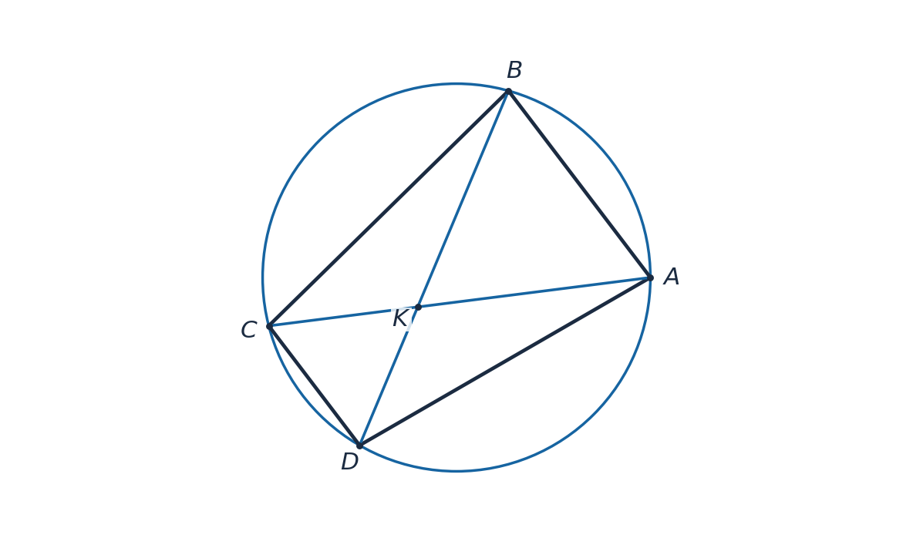

**Критерии**

- **2 балла.** Ход решения обоснован, получен правильный ответ. Подобие и произведения отрезков или теорема косинусов для хорд
- **1 балл.** Решение в целом верное, есть несущественный недостаток или вычислительная ошибка. Связь между построениями и основными промежуточными величинами верна, итог содержит малую неточность.
- **0 баллов.** Решение не удовлетворяет условиям для 1 или 2 баллов. Получено промежуточное равенство без обоснования и правильного продолжения нет.

[Источник карточки](https://math-oge.sdamgia.ru/problem?id=339675)

### Задача 2 · 341371

Вписанный четырёхугольник NPQM имеет диагонали NQ и PM, пересекающиеся в S. NQ делит угол PNM пополам. Если PQ = 14 и SQ = 4, найдите NS.

Подсказка 1

Отметь вписанные углы, опирающиеся на одни хорды.

Подсказка 2

Свяжи отрезки диагоналей через подобие, их произведения или теорему косинусов.

Ответ для самопроверки

$45$

Разбор и критерии

1. Вписанные углы QPM и QNM опираются на одну дугу QM. По условию ∠QNM = ∠PNQ. Поскольку S лежит на PM, получаем ∠QPS = ∠PNQ.
2. У треугольников PQS и NQP общий угол Q. Из подобия следует SQ/PQ = PQ/NQ. Поэтому NQ = $49$ и NS = NQ−SQ = $45$.

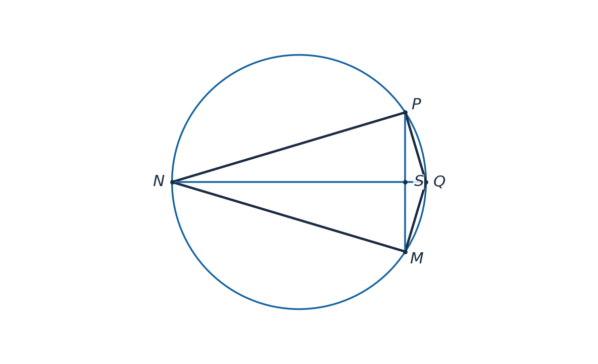

**Критерии**

- **2 балла.** Ход решения обоснован, получен правильный ответ. Подобие и произведения отрезков или теорема косинусов для хорд
- **1 балл.** Решение в целом верное, есть несущественный недостаток или вычислительная ошибка. Связь между построениями и основными промежуточными величинами верна, итог содержит малую неточность.
- **0 баллов.** Решение не удовлетворяет условиям для 1 или 2 баллов. Получено промежуточное равенство без обоснования и правильного продолжения нет.

[Источник карточки](https://math-oge.sdamgia.ru/problem?id=341371)

### Задача 3 · 348801

Четырёхугольник ABCD вписан в окружность. Известно, что AB = 40, CD = 10. Диагонали пересекаются в K, ∠AKB = 60°. Найдите радиус окружности.

Подсказка 1

Отметь вписанные углы, опирающиеся на одни хорды.

Подсказка 2

Свяжи отрезки диагоналей через подобие, их произведения или теорему косинусов.

Ответ для самопроверки

$10 \sqrt{7}$

Разбор и критерии

1. При пересечении хорд угол ∠AKB равен полусумме дуг AB и CD, которые отсекают этот угол и вертикальный ему. Обозначим половины этих дуг через α и β. Тогда α+β=60°.
2. Длины хорд равны $a=2R\sin\alpha,\ b=2R\sin\beta$, где a=40, b=10. Выразим sin β = sin(t−α), перенесём слагаемое с sin α и возведём в квадрат. Получим $(b+a\cos t)^2=(4R^2-a^2)\sin^2t$.
3. Раскрываем скобки и используем sin²t+cos²t=1. Отсюда $4R^2\sin^2t=a^2+b^2+2ab\cos t$. Подстановка чисел даёт $10 \sqrt{7}$.

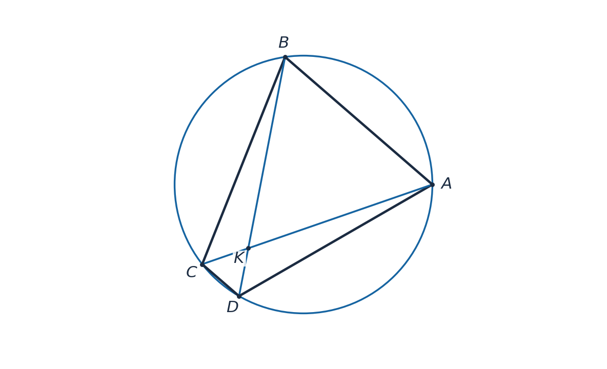

**Критерии**

- **2 балла.** Ход решения обоснован, получен правильный ответ. Подобие и произведения отрезков или теорема косинусов для хорд
- **1 балл.** Решение в целом верное, есть несущественный недостаток или вычислительная ошибка. Связь между построениями и основными промежуточными величинами верна, итог содержит малую неточность.
- **0 баллов.** Решение не удовлетворяет условиям для 1 или 2 баллов. Получено промежуточное равенство без обоснования и правильного продолжения нет.

[Источник карточки](https://math-oge.sdamgia.ru/problem?id=348801)

### Задача 4 · 348869

Четырёхугольник ABCD вписан в окружность. Известно, что AB = 5, CD = 17. Диагонали пересекаются в K, ∠AKB = 60°. Найдите радиус окружности.

Подсказка 1

Отметь вписанные углы, опирающиеся на одни хорды.

Подсказка 2

Свяжи отрезки диагоналей через подобие, их произведения или теорему косинусов.

Ответ для самопроверки

$\sqrt{133}$

Разбор и критерии

1. При пересечении хорд угол ∠AKB равен полусумме дуг AB и CD, которые отсекают этот угол и вертикальный ему. Обозначим половины этих дуг через α и β. Тогда α+β=60°.
2. Длины хорд равны $a=2R\sin\alpha,\ b=2R\sin\beta$, где a=5, b=17. Выразим sin β = sin(t−α), перенесём слагаемое с sin α и возведём в квадрат. Получим $(b+a\cos t)^2=(4R^2-a^2)\sin^2t$.
3. Раскрываем скобки и используем sin²t+cos²t=1. Отсюда $4R^2\sin^2t=a^2+b^2+2ab\cos t$. Подстановка чисел даёт $\sqrt{133}$.

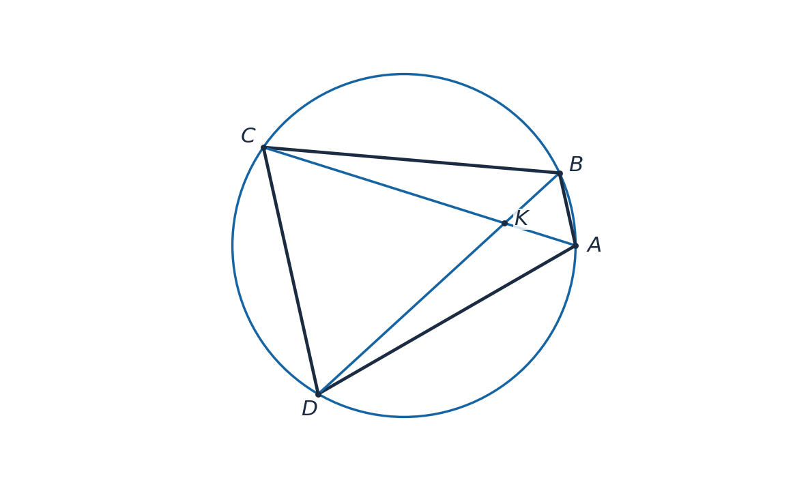

**Критерии**

- **2 балла.** Ход решения обоснован, получен правильный ответ. Подобие и произведения отрезков или теорема косинусов для хорд
- **1 балл.** Решение в целом верное, есть несущественный недостаток или вычислительная ошибка. Связь между построениями и основными промежуточными величинами верна, итог содержит малую неточность.
- **0 баллов.** Решение не удовлетворяет условиям для 1 или 2 баллов. Получено промежуточное равенство без обоснования и правильного продолжения нет.

[Источник карточки](https://math-oge.sdamgia.ru/problem?id=348869)

### Задача 5 · 349161

Четырёхугольник ABCD вписан в окружность. Известно, что AB = 43, CD = 4. Диагонали пересекаются в K, ∠AKB = 60°. Найдите радиус окружности.

Подсказка 1

Отметь вписанные углы, опирающиеся на одни хорды.

Подсказка 2

Свяжи отрезки диагоналей через подобие, их произведения или теорему косинусов.

Ответ для самопроверки

$\sqrt{679}$

Разбор и критерии

1. При пересечении хорд угол ∠AKB равен полусумме дуг AB и CD, которые отсекают этот угол и вертикальный ему. Обозначим половины этих дуг через α и β. Тогда α+β=60°.
2. Длины хорд равны $a=2R\sin\alpha,\ b=2R\sin\beta$, где a=43, b=4. Выразим sin β = sin(t−α), перенесём слагаемое с sin α и возведём в квадрат. Получим $(b+a\cos t)^2=(4R^2-a^2)\sin^2t$.
3. Раскрываем скобки и используем sin²t+cos²t=1. Отсюда $4R^2\sin^2t=a^2+b^2+2ab\cos t$. Подстановка чисел даёт $\sqrt{679}$.

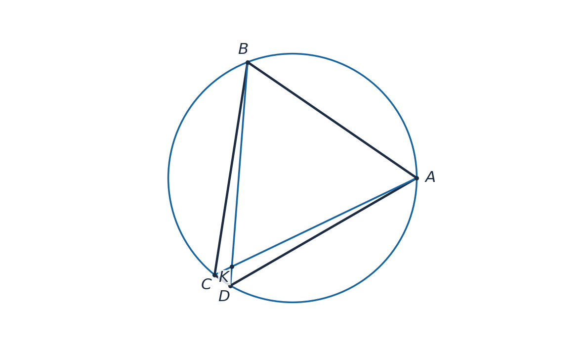

**Критерии**

- **2 балла.** Ход решения обоснован, получен правильный ответ. Подобие и произведения отрезков или теорема косинусов для хорд
- **1 балл.** Решение в целом верное, есть несущественный недостаток или вычислительная ошибка. Связь между построениями и основными промежуточными величинами верна, итог содержит малую неточность.
- **0 баллов.** Решение не удовлетворяет условиям для 1 или 2 баллов. Получено промежуточное равенство без обоснования и правильного продолжения нет.

[Источник карточки](https://math-oge.sdamgia.ru/problem?id=349161)

### Задача 6 · 349370

Четырёхугольник ABCD вписан в окружность. Известно, что AB = 39, CD = 12. Диагонали пересекаются в K, ∠AKB = 60°. Найдите радиус окружности.

Подсказка 1

Отметь вписанные углы, опирающиеся на одни хорды.

Подсказка 2

Свяжи отрезки диагоналей через подобие, их произведения или теорему косинусов.

Ответ для самопроверки

$3 \sqrt{79}$

Разбор и критерии

1. При пересечении хорд угол ∠AKB равен полусумме дуг AB и CD, которые отсекают этот угол и вертикальный ему. Обозначим половины этих дуг через α и β. Тогда α+β=60°.
2. Длины хорд равны $a=2R\sin\alpha,\ b=2R\sin\beta$, где a=39, b=12. Выразим sin β = sin(t−α), перенесём слагаемое с sin α и возведём в квадрат. Получим $(b+a\cos t)^2=(4R^2-a^2)\sin^2t$.
3. Раскрываем скобки и используем sin²t+cos²t=1. Отсюда $4R^2\sin^2t=a^2+b^2+2ab\cos t$. Подстановка чисел даёт $3 \sqrt{79}$.

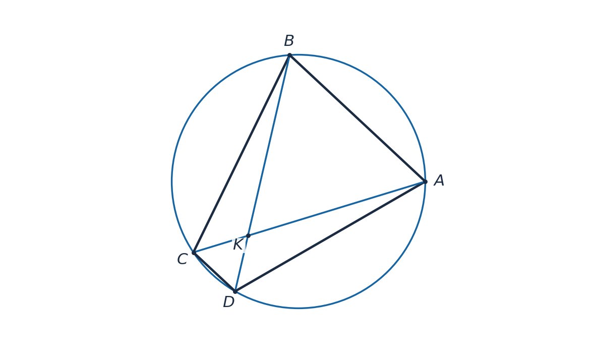

**Критерии**

- **2 балла.** Ход решения обоснован, получен правильный ответ. Подобие и произведения отрезков или теорема косинусов для хорд
- **1 балл.** Решение в целом верное, есть несущественный недостаток или вычислительная ошибка. Связь между построениями и основными промежуточными величинами верна, итог содержит малую неточность.
- **0 баллов.** Решение не удовлетворяет условиям для 1 или 2 баллов. Получено промежуточное равенство без обоснования и правильного продолжения нет.

[Источник карточки](https://math-oge.sdamgia.ru/problem?id=349370)

## Вписанные фигуры и описанные окружности · Восстановление хорды или радиуса через углы

`OGE25-circumradius-hidden`

### Задача 1 · 340107

В выпуклом четырёхугольнике ABCD середина M стороны AD равноудалена от всех вершин. Дано BC = 10, углы B и C равны 112° и 113°. Найдите AD.

Подсказка 1

Ищи способ вычислить синус угла напротив известной хорды.

Подсказка 2

Когда угол найден, вырази радиус через расширенную теорему синусов.

Ответ для самопроверки

$10 \sqrt{2}$

Разбор и критерии

1. Все вершины лежат на окружности с центром M, а AD — диаметр. На другой стороне диаметра от B и C лежит полуокружность AD с дугой 180°.
2. Вписанные углы при B и C отсекают каждый эту полуокружность и ещё часть дуги. Отсюда дуги CD и AB равны 44° и 46°. На оставшуюся дугу BC приходится 90°.
3. Длина хорды BC равна AD·sin 45°. Отсюда AD = $10 \sqrt{2}$.

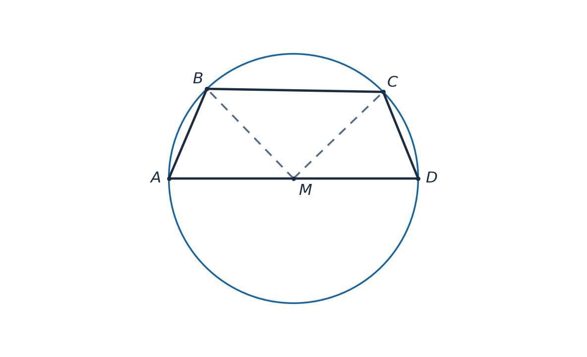

**Критерии**

- **2 балла.** Ход решения обоснован, получен правильный ответ. Восстановить угол из геометрии фигуры или из отношения биссектрисы и высоты, затем теорема синусов
- **1 балл.** Решение в целом верное, есть несущественный недостаток или вычислительная ошибка. Связь между построениями и основными промежуточными величинами верна, итог содержит малую неточность.
- **0 баллов.** Решение не удовлетворяет условиям для 1 или 2 баллов. Получено промежуточное равенство без обоснования и правильного продолжения нет.

[Источник карточки](https://math-oge.sdamgia.ru/problem?id=340107)

### Задача 2 · 348521

В треугольнике ABC биссектриса угла A делит высоту из B в отношении 17:15, считая от B. Известно, что BC = 16. Найдите радиус описанной окружности.

Подсказка 1

Ищи способ вычислить синус угла напротив известной хорды.

Подсказка 2

Когда угол найден, вырази радиус через расширенную теорему синусов.

Ответ для самопроверки

$17$

Разбор и критерии

1. Пусть H — основание высоты, J — точка пересечения с биссектрисой. Тогда J внутри BH, а AH направлен по лучу AC. В прямоугольном треугольнике ABH по теореме о биссектрисе AB/AH = BJ/JH = 17/15.
2. Следовательно, косинус угла A равен $\frac{15}{17}$, синус $\frac{8}{17}$. Сторона BC лежит напротив угла A. По теореме синусов радиус равен $17$.

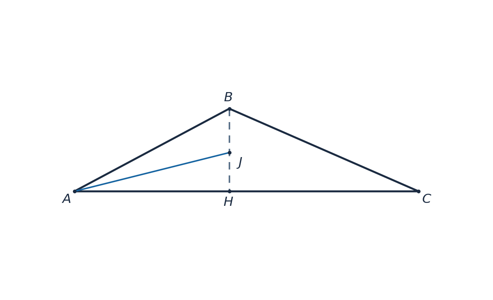

**Критерии**

- **2 балла.** Ход решения обоснован, получен правильный ответ. Восстановить угол из геометрии фигуры или из отношения биссектрисы и высоты, затем теорема синусов
- **1 балл.** Решение в целом верное, есть несущественный недостаток или вычислительная ошибка. Связь между построениями и основными промежуточными величинами верна, итог содержит малую неточность.
- **0 баллов.** Решение не удовлетворяет условиям для 1 или 2 баллов. Получено промежуточное равенство без обоснования и правильного продолжения нет.

[Источник карточки](https://math-oge.sdamgia.ru/problem?id=348521)

### Задача 3 · 311713

В треугольнике ABC биссектриса угла A делит высоту из B в отношении 13:12, считая от B. Известно, что BC = 10. Найдите радиус описанной окружности.

Подсказка 1

Ищи способ вычислить синус угла напротив известной хорды.

Подсказка 2

Когда угол найден, вырази радиус через расширенную теорему синусов.

Ответ для самопроверки

$13$

Разбор и критерии

1. Пусть H — основание высоты, J — точка пересечения с биссектрисой. Тогда J внутри BH, а AH направлен по лучу AC. В прямоугольном треугольнике ABH по теореме о биссектрисе AB/AH = BJ/JH = 13/12.
2. Следовательно, косинус угла A равен $\frac{12}{13}$, синус $\frac{5}{13}$. Сторона BC лежит напротив угла A. По теореме синусов радиус равен $13$.

**Критерии**

- **2 балла.** Ход решения обоснован, получен правильный ответ. Восстановить угол из геометрии фигуры или из отношения биссектрисы и высоты, затем теорема синусов
- **1 балл.** Решение в целом верное, есть несущественный недостаток или вычислительная ошибка. Связь между построениями и основными промежуточными величинами верна, итог содержит малую неточность.
- **0 баллов.** Решение не удовлетворяет условиям для 1 или 2 баллов. Получено промежуточное равенство без обоснования и правильного продолжения нет.

[Источник карточки](https://math-oge.sdamgia.ru/problem?id=311713)

### Задача 4 · 311715

В треугольнике ABC биссектриса угла A делит высоту из B в отношении 17:15, считая от B. Известно, что BC = 24. Найдите радиус описанной окружности.

Подсказка 1

Ищи способ вычислить синус угла напротив известной хорды.

Подсказка 2

Когда угол найден, вырази радиус через расширенную теорему синусов.

Ответ для самопроверки

$\frac{51}{2}$

Разбор и критерии

1. Пусть H — основание высоты, J — точка пересечения с биссектрисой. Тогда J внутри BH, а AH направлен по лучу AC. В прямоугольном треугольнике ABH по теореме о биссектрисе AB/AH = BJ/JH = 17/15.
2. Следовательно, косинус угла A равен $\frac{15}{17}$, синус $\frac{8}{17}$. Сторона BC лежит напротив угла A. По теореме синусов радиус равен $\frac{51}{2}$.

**Критерии**

- **2 балла.** Ход решения обоснован, получен правильный ответ. Восстановить угол из геометрии фигуры или из отношения биссектрисы и высоты, затем теорема синусов
- **1 балл.** Решение в целом верное, есть несущественный недостаток или вычислительная ошибка. Связь между построениями и основными промежуточными величинами верна, итог содержит малую неточность.
- **0 баллов.** Решение не удовлетворяет условиям для 1 или 2 баллов. Получено промежуточное равенство без обоснования и правильного продолжения нет.

[Источник карточки](https://math-oge.sdamgia.ru/problem?id=311715)

### Задача 5 · 340344

В треугольнике ABC биссектриса угла A делит высоту из B в отношении 5:3, считая от B. Известно, что BC = 8. Найдите радиус описанной окружности.

Подсказка 1

Ищи способ вычислить синус угла напротив известной хорды.

Подсказка 2

Когда угол найден, вырази радиус через расширенную теорему синусов.

Ответ для самопроверки

$5$

Разбор и критерии

1. Пусть H — основание высоты, J — точка пересечения с биссектрисой. Тогда J внутри BH, а AH направлен по лучу AC. В прямоугольном треугольнике ABH по теореме о биссектрисе AB/AH = BJ/JH = 5/3.
2. Следовательно, косинус угла A равен $\frac{3}{5}$, синус $\frac{4}{5}$. Сторона BC лежит напротив угла A. По теореме синусов радиус равен $5$.

**Критерии**

- **2 балла.** Ход решения обоснован, получен правильный ответ. Восстановить угол из геометрии фигуры или из отношения биссектрисы и высоты, затем теорема синусов
- **1 балл.** Решение в целом верное, есть несущественный недостаток или вычислительная ошибка. Связь между построениями и основными промежуточными величинами верна, итог содержит малую неточность.
- **0 баллов.** Решение не удовлетворяет условиям для 1 или 2 баллов. Получено промежуточное равенство без обоснования и правильного продолжения нет.

[Источник карточки](https://math-oge.sdamgia.ru/problem?id=340344)

### Задача 6 · 348736

В выпуклом четырёхугольнике ABCD середина M стороны AD равноудалена от всех вершин. Дано BC = 8, углы B и C равны 92° и 148°. Найдите AD.

Подсказка 1

Ищи способ вычислить синус угла напротив известной хорды.

Подсказка 2

Когда угол найден, вырази радиус через расширенную теорему синусов.

Ответ для самопроверки

$16$

Разбор и критерии

1. Все вершины лежат на окружности с центром M, а AD — диаметр. На другой стороне диаметра от B и C лежит полуокружность AD с дугой 180°.
2. Вписанные углы при B и C отсекают каждый эту полуокружность и ещё часть дуги. Отсюда дуги CD и AB равны 4° и 116°. На оставшуюся дугу BC приходится 60°.
3. Длина хорды BC равна AD·sin 30°. Отсюда AD = $16$.

**Критерии**

- **2 балла.** Ход решения обоснован, получен правильный ответ. Восстановить угол из геометрии фигуры или из отношения биссектрисы и высоты, затем теорема синусов
- **1 балл.** Решение в целом верное, есть несущественный недостаток или вычислительная ошибка. Связь между построениями и основными промежуточными величинами верна, итог содержит малую неточность.
- **0 баллов.** Решение не удовлетворяет условиям для 1 или 2 баллов. Получено промежуточное равенство без обоснования и правильного продолжения нет.

[Источник карточки](https://math-oge.sdamgia.ru/problem?id=348736)

## Вписанные фигуры и описанные окружности · Центр описанной окружности и дополнительный перпендикуляр

`OGE25-circumcenter-chord`

### Задача 1 · 340133

В треугольнике ABC известны AB = 84, AC = 98. Точка O — центр описанной окружности. Прямая через B перпендикулярна AO и пересекает AC в D. Найдите CD.

Подсказка 1

Проведи радиус из центра к подходящей точке.

Подсказка 2

Сравни направление перпендикуляра к радиусу с касательной и углами к хорде.

Ответ для самопроверки

$26$

Разбор и критерии

1. Проведём диаметр AE и обозначим F пересечение AO и BD. Вписанные углы ABE и ACE прямые.
2. Треугольники ABE и AFB подобны по общему углу при A и прямому углу. Значит, $AB^2=AE\cdot AF$. Треугольники ACE и AFD также подобны. Отсюда $AC\cdot AD=AE\cdot AF$.
3. Приравниваем произведения и получаем AD = AB²/AC = $72$. Тогда CD = AC − AD = $26$.

**Критерии**

- **2 балла.** Ход решения обоснован, получен правильный ответ. Связать перпендикуляр к радиусу с касательной и углами; доказать подобие
- **1 балл.** Решение в целом верное, есть несущественный недостаток или вычислительная ошибка. Связь между построениями и основными промежуточными величинами верна, итог содержит малую неточность.
- **0 баллов.** Решение не удовлетворяет условиям для 1 или 2 баллов. Получено промежуточное равенство без обоснования и правильного продолжения нет.

[Источник карточки](https://math-oge.sdamgia.ru/problem?id=340133)

### Задача 2 · 341162

В треугольнике ABC известны AB = 36, AC = 48. Точка O — центр описанной окружности. Прямая через B перпендикулярна AO и пересекает AC в D. Найдите CD.

Подсказка 1

Проведи радиус из центра к подходящей точке.

Подсказка 2

Сравни направление перпендикуляра к радиусу с касательной и углами к хорде.

Ответ для самопроверки

$21$

Разбор и критерии

1. Проведём диаметр AE и обозначим F пересечение AO и BD. Вписанные углы ABE и ACE прямые.
2. Треугольники ABE и AFB подобны по общему углу при A и прямому углу. Значит, $AB^2=AE\cdot AF$. Треугольники ACE и AFD также подобны. Отсюда $AC\cdot AD=AE\cdot AF$.
3. Приравниваем произведения и получаем AD = AB²/AC = $27$. Тогда CD = AC − AD = $21$.

**Критерии**

- **2 балла.** Ход решения обоснован, получен правильный ответ. Связать перпендикуляр к радиусу с касательной и углами; доказать подобие
- **1 балл.** Решение в целом верное, есть несущественный недостаток или вычислительная ошибка. Связь между построениями и основными промежуточными величинами верна, итог содержит малую неточность.
- **0 баллов.** Решение не удовлетворяет условиям для 1 или 2 баллов. Получено промежуточное равенство без обоснования и правильного продолжения нет.

[Источник карточки](https://math-oge.sdamgia.ru/problem?id=341162)

### Задача 3 · 349275

В треугольнике ABC известны AB = 15, AC = 25. Точка O — центр описанной окружности. Прямая через B перпендикулярна AO и пересекает AC в D. Найдите CD.

Подсказка 1

Проведи радиус из центра к подходящей точке.

Подсказка 2

Сравни направление перпендикуляра к радиусу с касательной и углами к хорде.

Ответ для самопроверки

$16$

Разбор и критерии

1. Проведём диаметр AE и обозначим F пересечение AO и BD. Вписанные углы ABE и ACE прямые.
2. Треугольники ABE и AFB подобны по общему углу при A и прямому углу. Значит, $AB^2=AE\cdot AF$. Треугольники ACE и AFD также подобны. Отсюда $AC\cdot AD=AE\cdot AF$.
3. Приравниваем произведения и получаем AD = AB²/AC = $9$. Тогда CD = AC − AD = $16$.

**Критерии**

- **2 балла.** Ход решения обоснован, получен правильный ответ. Связать перпендикуляр к радиусу с касательной и углами; доказать подобие
- **1 балл.** Решение в целом верное, есть несущественный недостаток или вычислительная ошибка. Связь между построениями и основными промежуточными величинами верна, итог содержит малую неточность.
- **0 баллов.** Решение не удовлетворяет условиям для 1 или 2 баллов. Получено промежуточное равенство без обоснования и правильного продолжения нет.

[Источник карточки](https://math-oge.sdamgia.ru/problem?id=349275)

### Задача 4 · 349590

В треугольнике ABC известны AB = 18, AC = 36. Точка O — центр описанной окружности. Прямая через B перпендикулярна AO и пересекает AC в D. Найдите CD.

Подсказка 1

Проведи радиус из центра к подходящей точке.

Подсказка 2

Сравни направление перпендикуляра к радиусу с касательной и углами к хорде.

Ответ для самопроверки

$27$

Разбор и критерии

1. Проведём диаметр AE и обозначим F пересечение AO и BD. Вписанные углы ABE и ACE прямые.
2. Треугольники ABE и AFB подобны по общему углу при A и прямому углу. Значит, $AB^2=AE\cdot AF$. Треугольники ACE и AFD также подобны. Отсюда $AC\cdot AD=AE\cdot AF$.
3. Приравниваем произведения и получаем AD = AB²/AC = $9$. Тогда CD = AC − AD = $27$.

**Критерии**

- **2 балла.** Ход решения обоснован, получен правильный ответ. Связать перпендикуляр к радиусу с касательной и углами; доказать подобие
- **1 балл.** Решение в целом верное, есть несущественный недостаток или вычислительная ошибка. Связь между построениями и основными промежуточными величинами верна, итог содержит малую неточность.
- **0 баллов.** Решение не удовлетворяет условиям для 1 или 2 баллов. Получено промежуточное равенство без обоснования и правильного продолжения нет.

[Источник карточки](https://math-oge.sdamgia.ru/problem?id=349590)

### Задача 5 · 351184

В треугольнике ABC известны AB = 36, AC = 54. Точка O — центр описанной окружности. Прямая через B перпендикулярна AO и пересекает AC в D. Найдите CD.

Подсказка 1

Проведи радиус из центра к подходящей точке.

Подсказка 2

Сравни направление перпендикуляра к радиусу с касательной и углами к хорде.

Ответ для самопроверки

$30$

Разбор и критерии

1. Проведём диаметр AE и обозначим F пересечение AO и BD. Вписанные углы ABE и ACE прямые.
2. Треугольники ABE и AFB подобны по общему углу при A и прямому углу. Значит, $AB^2=AE\cdot AF$. Треугольники ACE и AFD также подобны. Отсюда $AC\cdot AD=AE\cdot AF$.
3. Приравниваем произведения и получаем AD = AB²/AC = $24$. Тогда CD = AC − AD = $30$.

**Критерии**

- **2 балла.** Ход решения обоснован, получен правильный ответ. Связать перпендикуляр к радиусу с касательной и углами; доказать подобие
- **1 балл.** Решение в целом верное, есть несущественный недостаток или вычислительная ошибка. Связь между построениями и основными промежуточными величинами верна, итог содержит малую неточность.
- **0 баллов.** Решение не удовлетворяет условиям для 1 или 2 баллов. Получено промежуточное равенство без обоснования и правильного продолжения нет.

[Источник карточки](https://math-oge.sdamgia.ru/problem?id=351184)

### Задача 6 · 351826

В треугольнике ABC известны AB = 60, AC = 80. Точка O — центр описанной окружности. Прямая через B перпендикулярна AO и пересекает AC в D. Найдите CD.

Подсказка 1

Проведи радиус из центра к подходящей точке.

Подсказка 2

Сравни направление перпендикуляра к радиусу с касательной и углами к хорде.

Ответ для самопроверки

$35$

Разбор и критерии

1. Проведём диаметр AE и обозначим F пересечение AO и BD. Вписанные углы ABE и ACE прямые.
2. Треугольники ABE и AFB подобны по общему углу при A и прямому углу. Значит, $AB^2=AE\cdot AF$. Треугольники ACE и AFD также подобны. Отсюда $AC\cdot AD=AE\cdot AF$.
3. Приравниваем произведения и получаем AD = AB²/AC = $45$. Тогда CD = AC − AD = $35$.

**Критерии**

- **2 балла.** Ход решения обоснован, получен правильный ответ. Связать перпендикуляр к радиусу с касательной и углами; доказать подобие
- **1 балл.** Решение в целом верное, есть несущественный недостаток или вычислительная ошибка. Связь между построениями и основными промежуточными величинами верна, итог содержит малую неточность.
- **0 баллов.** Решение не удовлетворяет условиям для 1 или 2 баллов. Получено промежуточное равенство без обоснования и правильного продолжения нет.

[Источник карточки](https://math-oge.sdamgia.ru/problem?id=351826)

### Задача 7 · авторская тренировка

В треугольнике ABC точка O — центр описанной окружности. Прямая через B, перпендикулярная AO, пересекает сторону AC в D. Известно, что AC = 98 и CD = 26. Найдите AB.

Подсказка 1

Проведи диаметр через A и обозначь его второй конец E.

Подсказка 2

Какие два произведения равны произведению AE на проекцию AB на AE?

Ответ для самопроверки

$84$

Разбор и критерии

1. Пусть F — пересечение BD и AO, E — вторая точка диаметра через A. Углы ABE и ACE прямые, так как опираются на диаметр. Треугольники AFB и ABE подобны по двум углам, откуда $AB^2=AE\cdot AF$.
2. По тем же признакам AFD и ACE подобны, откуда $AC\cdot AD=AE\cdot AF$. Значит, $AB^2=AC\cdot AD$. Так как AD = 98 − 26 = 72, получаем $AB=\sqrt{98\cdot72}=84$.

**Критерии**

- **2 балла.** Ход решения обоснован, получен правильный ответ. По тем же признакам AFD и ACE подобны, откуда $AC\cdot AD=AE\cdot AF$. Значит, $AB^2=AC\cdot AD$. Так как AD = 98 − 26 = 72, получаем $AB=\sqrt{98\cdot72}=84$.
- **1 балл.** Решение в целом верное, есть несущественный недостаток или вычислительная ошибка. Обоснован основной переход: Пусть F — пересечение BD и AO, E — вторая точка диаметра через A. Углы ABE и ACE прямые, так как опираются на диаметр. Треугольники AFB и ABE подобны по двум углам, откуда $AB^2=AE\cdot AF$. В завершении допущена ошибка в вычислениях или оформлении в пределах критерия.
- **0 баллов.** Решение не удовлетворяет условиям для 1 или 2 баллов. Указан результат без требуемого обоснования либо применена модель, не соответствующая условию.

[Пример семейства](https://math-oge.sdamgia.ru/problem?id=340133)

## Касание, секущие и две окружности · Касательная и секущая / хорда

`OGE25-secant-tangent`

### Задача 1 · 340855

В трапеции ABCD основания AD = 14, BC = 12, а AB ⟂ BC. Окружность проходит через C и D и касается прямой AB в E. Найдите расстояние от E до прямой CD.

Подсказка 1

Отметь точку касания и радиус к ней.

Подсказка 2

Свяжи секущую с касательной через степень точки или подходящие подобные треугольники.

Ответ для самопроверки

$2 \sqrt{42}$

Разбор и критерии

1. Выберем A=(0;0), B=(0;h), C=(b;h), D=(a;0) и E=(0;t). Центр окружности имеет координаты (r;t), поскольку радиус к точке касания перпендикулярен AB. Введём a=AD и b=BC.
2. Из принадлежности D и C окружности получаем $2ar=a^2+t^2$ и $2br=b^2+(h-t)^2$. Исключаем r, получается $ah^2-2aht+(a-b)t^2=ab(a-b)$.
3. Расстояние от E до CD равно $d=\frac{|ah-(a-b)t|}{\sqrt{h^2+(a-b)^2}}$. Умножим полученное равенство на a−b и подставим в квадрат числителя. Он равен $ab(h^2+(a-b)^2)$. Поэтому d=√(ab)=$2 \sqrt{42}$.

**Критерии**

- **2 балла.** Ход решения обоснован, получен правильный ответ. Степень точки, подобие или сравнение расстояний до касательной и хорды
- **1 балл.** Решение в целом верное, есть несущественный недостаток или вычислительная ошибка. Связь между построениями и основными промежуточными величинами верна, итог содержит малую неточность.
- **0 баллов.** Решение не удовлетворяет условиям для 1 или 2 баллов. Получено промежуточное равенство без обоснования и правильного продолжения нет.

[Источник карточки](https://math-oge.sdamgia.ru/problem?id=340855)

### Задача 2 · 340907

В трапеции ABCD основания AD = 15, BC = 14, а AB ⟂ BC. Окружность проходит через C и D и касается прямой AB в E. Найдите расстояние от E до прямой CD.

Подсказка 1

Отметь точку касания и радиус к ней.

Подсказка 2

Свяжи секущую с касательной через степень точки или подходящие подобные треугольники.

Ответ для самопроверки

$\sqrt{210}$

Разбор и критерии

1. Выберем A=(0;0), B=(0;h), C=(b;h), D=(a;0) и E=(0;t). Центр окружности имеет координаты (r;t), поскольку радиус к точке касания перпендикулярен AB. Введём a=AD и b=BC.
2. Из принадлежности D и C окружности получаем $2ar=a^2+t^2$ и $2br=b^2+(h-t)^2$. Исключаем r, получается $ah^2-2aht+(a-b)t^2=ab(a-b)$.
3. Расстояние от E до CD равно $d=\frac{|ah-(a-b)t|}{\sqrt{h^2+(a-b)^2}}$. Умножим полученное равенство на a−b и подставим в квадрат числителя. Он равен $ab(h^2+(a-b)^2)$. Поэтому d=√(ab)=$\sqrt{210}$.

**Критерии**

- **2 балла.** Ход решения обоснован, получен правильный ответ. Степень точки, подобие или сравнение расстояний до касательной и хорды
- **1 балл.** Решение в целом верное, есть несущественный недостаток или вычислительная ошибка. Связь между построениями и основными промежуточными величинами верна, итог содержит малую неточность.
- **0 баллов.** Решение не удовлетворяет условиям для 1 или 2 баллов. Получено промежуточное равенство без обоснования и правильного продолжения нет.

[Источник карточки](https://math-oge.sdamgia.ru/problem?id=340907)

### Задача 3 · 340936

В трапеции ABCD основания AD = 16, BC = 8, а AB ⟂ BC. Окружность проходит через C и D и касается прямой AB в E. Найдите расстояние от E до прямой CD.

Подсказка 1

Отметь точку касания и радиус к ней.

Подсказка 2

Свяжи секущую с касательной через степень точки или подходящие подобные треугольники.

Ответ для самопроверки

$8 \sqrt{2}$

Разбор и критерии

1. Выберем A=(0;0), B=(0;h), C=(b;h), D=(a;0) и E=(0;t). Центр окружности имеет координаты (r;t), поскольку радиус к точке касания перпендикулярен AB. Введём a=AD и b=BC.
2. Из принадлежности D и C окружности получаем $2ar=a^2+t^2$ и $2br=b^2+(h-t)^2$. Исключаем r, получается $ah^2-2aht+(a-b)t^2=ab(a-b)$.
3. Расстояние от E до CD равно $d=\frac{|ah-(a-b)t|}{\sqrt{h^2+(a-b)^2}}$. Умножим полученное равенство на a−b и подставим в квадрат числителя. Он равен $ab(h^2+(a-b)^2)$. Поэтому d=√(ab)=$8 \sqrt{2}$.

**Критерии**

- **2 балла.** Ход решения обоснован, получен правильный ответ. Степень точки, подобие или сравнение расстояний до касательной и хорды
- **1 балл.** Решение в целом верное, есть несущественный недостаток или вычислительная ошибка. Связь между построениями и основными промежуточными величинами верна, итог содержит малую неточность.
- **0 баллов.** Решение не удовлетворяет условиям для 1 или 2 баллов. Получено промежуточное равенство без обоснования и правильного продолжения нет.

[Источник карточки](https://math-oge.sdamgia.ru/problem?id=340936)

### Задача 4 · 341132

В трапеции ABCD основания AD = 6, BC = 5, а AB ⟂ BC. Окружность проходит через C и D и касается прямой AB в E. Найдите расстояние от E до прямой CD.

Подсказка 1

Отметь точку касания и радиус к ней.

Подсказка 2

Свяжи секущую с касательной через степень точки или подходящие подобные треугольники.

Ответ для самопроверки

$\sqrt{30}$

Разбор и критерии

1. Выберем A=(0;0), B=(0;h), C=(b;h), D=(a;0) и E=(0;t). Центр окружности имеет координаты (r;t), поскольку радиус к точке касания перпендикулярен AB. Введём a=AD и b=BC.
2. Из принадлежности D и C окружности получаем $2ar=a^2+t^2$ и $2br=b^2+(h-t)^2$. Исключаем r, получается $ah^2-2aht+(a-b)t^2=ab(a-b)$.
3. Расстояние от E до CD равно $d=\frac{|ah-(a-b)t|}{\sqrt{h^2+(a-b)^2}}$. Умножим полученное равенство на a−b и подставим в квадрат числителя. Он равен $ab(h^2+(a-b)^2)$. Поэтому d=√(ab)=$\sqrt{30}$.

**Критерии**

- **2 балла.** Ход решения обоснован, получен правильный ответ. Степень точки, подобие или сравнение расстояний до касательной и хорды
- **1 балл.** Решение в целом верное, есть несущественный недостаток или вычислительная ошибка. Связь между построениями и основными промежуточными величинами верна, итог содержит малую неточность.
- **0 баллов.** Решение не удовлетворяет условиям для 1 или 2 баллов. Получено промежуточное равенство без обоснования и правильного продолжения нет.

[Источник карточки](https://math-oge.sdamgia.ru/problem?id=341132)

### Задача 5 · 348471

В трапеции ABCD основания AD = 8, BC = 4, а AB ⟂ BC. Окружность проходит через C и D и касается прямой AB в E. Найдите расстояние от E до прямой CD.

Подсказка 1

Отметь точку касания и радиус к ней.

Подсказка 2

Свяжи секущую с касательной через степень точки или подходящие подобные треугольники.

Ответ для самопроверки

$4 \sqrt{2}$

Разбор и критерии

1. Выберем A=(0;0), B=(0;h), C=(b;h), D=(a;0) и E=(0;t). Центр окружности имеет координаты (r;t), поскольку радиус к точке касания перпендикулярен AB. Введём a=AD и b=BC.
2. Из принадлежности D и C окружности получаем $2ar=a^2+t^2$ и $2br=b^2+(h-t)^2$. Исключаем r, получается $ah^2-2aht+(a-b)t^2=ab(a-b)$.
3. Расстояние от E до CD равно $d=\frac{|ah-(a-b)t|}{\sqrt{h^2+(a-b)^2}}$. Умножим полученное равенство на a−b и подставим в квадрат числителя. Он равен $ab(h^2+(a-b)^2)$. Поэтому d=√(ab)=$4 \sqrt{2}$.

**Критерии**

- **2 балла.** Ход решения обоснован, получен правильный ответ. Степень точки, подобие или сравнение расстояний до касательной и хорды
- **1 балл.** Решение в целом верное, есть несущественный недостаток или вычислительная ошибка. Связь между построениями и основными промежуточными величинами верна, итог содержит малую неточность.
- **0 баллов.** Решение не удовлетворяет условиям для 1 или 2 баллов. Получено промежуточное равенство без обоснования и правильного продолжения нет.

[Источник карточки](https://math-oge.sdamgia.ru/problem?id=348471)

### Задача 6 · 350018

В трапеции ABCD основания AD = 8, BC = 7, а AB ⟂ BC. Окружность проходит через C и D и касается прямой AB в E. Найдите расстояние от E до прямой CD.

Подсказка 1

Отметь точку касания и радиус к ней.

Подсказка 2

Свяжи секущую с касательной через степень точки или подходящие подобные треугольники.

Ответ для самопроверки

$2 \sqrt{14}$

Разбор и критерии

1. Выберем A=(0;0), B=(0;h), C=(b;h), D=(a;0) и E=(0;t). Центр окружности имеет координаты (r;t), поскольку радиус к точке касания перпендикулярен AB. Введём a=AD и b=BC.
2. Из принадлежности D и C окружности получаем $2ar=a^2+t^2$ и $2br=b^2+(h-t)^2$. Исключаем r, получается $ah^2-2aht+(a-b)t^2=ab(a-b)$.
3. Расстояние от E до CD равно $d=\frac{|ah-(a-b)t|}{\sqrt{h^2+(a-b)^2}}$. Умножим полученное равенство на a−b и подставим в квадрат числителя. Он равен $ab(h^2+(a-b)^2)$. Поэтому d=√(ab)=$2 \sqrt{14}$.

**Критерии**

- **2 балла.** Ход решения обоснован, получен правильный ответ. Степень точки, подобие или сравнение расстояний до касательной и хорды
- **1 балл.** Решение в целом верное, есть несущественный недостаток или вычислительная ошибка. Связь между построениями и основными промежуточными величинами верна, итог содержит малую неточность.
- **0 баллов.** Решение не удовлетворяет условиям для 1 или 2 баллов. Получено промежуточное равенство без обоснования и правильного продолжения нет.

[Источник карточки](https://math-oge.sdamgia.ru/problem?id=350018)

### Задача 7 · авторская тренировка

В прямоугольной трапеции ABCD основания AD и BC, AB перпендикулярна основаниям. Окружность через C и D касается прямой AB в E. Основание AD на 2 длиннее BC. Квадрат расстояния от E до прямой CD равен 168. Найдите длину большего основания.

Подсказка 1

Возьми AB за вертикальную ось, запиши равенство расстояний от центра до E, C и D.

Подсказка 2

Вырази квадрат расстояния от E до прямой CD через основания.

Ответ для самопроверки

$14$

Разбор и критерии

1. Пусть $A=(0;0), B=(0;h), C=(b;h), D=(a;0), E=(0;t)$. Центр лежит на горизонтали через E, его абсциссу обозначим r. Из равенства расстояний до E и D получаем $2ar=a^2+t^2$, а до E и C — $2br=b^2+(h-t)^2$.
2. Умножим первое равенство на b, второе на a и исключим r. Тогда $ah^2-2aht+(a-b)t^2=ab(a-b)$. Прямая CD имеет уравнение $hx+(a-b)y-ah=0$. По формуле расстояния квадрат расстояния равен $(ah-(a-b)t)^2/(h^2+(a-b)^2)$.
3. Раскроем квадрат числителя. Он равен сумме $abh^2$ и произведения предыдущего равенства на $a-b$, то есть $ab(h^2+(a-b)^2)$. После сокращения получаем ab = 168. Теперь $b(b+2)=168$, откуда b = 12 (отрицательный корень −14 не подходит). Большее основание равно 14.

**Критерии**

- **2 балла.** Ход решения обоснован, получен правильный ответ. Раскроем квадрат числителя. Он равен сумме $abh^2$ и произведения предыдущего равенства на $a-b$, то есть $ab(h^2+(a-b)^2)$. После сокращения получаем ab = 168. Теперь $b(b+2)=168$, откуда b = 12 (отрицательный корень −14 не подходит). Большее основание равно 14.
- **1 балл.** Решение в целом верное, есть несущественный недостаток или вычислительная ошибка. Обоснован основной переход: Пусть $A=(0;0), B=(0;h), C=(b;h), D=(a;0), E=(0;t)$. Центр лежит на горизонтали через E, его абсциссу обозначим r. Из равенства расстояний до E и D получаем $2ar=a^2+t^2$, а до E и C — $2br=b^2+(h-t)^2$. В завершении допущена ошибка в вычислениях или оформлении в пределах критерия.
- **0 баллов.** Решение не удовлетворяет условиям для 1 или 2 баллов. Указан результат без требуемого обоснования либо применена модель, не соответствующая условию.

[Пример семейства](https://math-oge.sdamgia.ru/problem?id=340855)

## Касание, секущие и две окружности · Две касающиеся окружности и общие касательные

`OGE25-two-circle-tangents`

### Задача 1 · 333132

Окружности радиусов 14 и 35 касаются внешним образом. A и B — точки касания двух общих внешних касательных на первой окружности, C и D — соответствующие точки на второй. Найдите расстояние между прямыми AB и CD.

Подсказка 1

Продли две касательные до их пересечения.

Подсказка 2

Используй подобие радиусных треугольников и проверь параллельность хорд между точками касания.

Ответ для самопроверки

$40$

Разбор и критерии

1. Линия центров — ось симметрии двух касательных. Поэтому AB и CD перпендикулярны этой оси. Расстояние между центрами 14+35=49.
2. Пусть α — острый угол между касательной и линией центров. Перпендикулярная к касательной составляющая отрезка между центрами равна разности радиусов. Поэтому sin α=$\frac{3}{7}$.
3. Радиусы в точки касания перпендикулярны касательной. Их проекции на линию центров отодвигают каждую хорду в одну сторону от соответствующего центра. Разность смещений равна разности радиусов, умноженной на sin α. В итоге искомое расстояние $49-9=40$.

**Критерии**

- **2 балла.** Ход решения обоснован, получен правильный ответ. Внешний центр подобия задаёт точки касания и расстояние между параллельными хордами
- **1 балл.** Решение в целом верное, есть несущественный недостаток или вычислительная ошибка. Связь между построениями и основными промежуточными величинами верна, итог содержит малую неточность.
- **0 баллов.** Решение не удовлетворяет условиям для 1 или 2 баллов. Получено промежуточное равенство без обоснования и правильного продолжения нет.

[Источник карточки](https://math-oge.sdamgia.ru/problem?id=333132)

### Задача 2 · 333159

Окружности радиусов 60 и 90 касаются внешним образом. A и B — точки касания двух общих внешних касательных на первой окружности, C и D — соответствующие точки на второй. Найдите расстояние между прямыми AB и CD.

Подсказка 1

Продли две касательные до их пересечения.

Подсказка 2

Используй подобие радиусных треугольников и проверь параллельность хорд между точками касания.

Ответ для самопроверки

$144$

Разбор и критерии

1. Линия центров — ось симметрии двух касательных. Поэтому AB и CD перпендикулярны этой оси. Расстояние между центрами 60+90=150.
2. Пусть α — острый угол между касательной и линией центров. Перпендикулярная к касательной составляющая отрезка между центрами равна разности радиусов. Поэтому sin α=$\frac{1}{5}$.
3. Радиусы в точки касания перпендикулярны касательной. Их проекции на линию центров отодвигают каждую хорду в одну сторону от соответствующего центра. Разность смещений равна разности радиусов, умноженной на sin α. В итоге искомое расстояние $150-6=144$.

**Критерии**

- **2 балла.** Ход решения обоснован, получен правильный ответ. Внешний центр подобия задаёт точки касания и расстояние между параллельными хордами
- **1 балл.** Решение в целом верное, есть несущественный недостаток или вычислительная ошибка. Связь между построениями и основными промежуточными величинами верна, итог содержит малую неточность.
- **0 баллов.** Решение не удовлетворяет условиям для 1 или 2 баллов. Получено промежуточное равенство без обоснования и правильного продолжения нет.

[Источник карточки](https://math-oge.sdamgia.ru/problem?id=333159)

### Задача 3 · 340323

Окружности радиусов 25 и 100 касаются внешним образом. A и B — точки касания двух общих внешних касательных на первой окружности, C и D — соответствующие точки на второй. Найдите расстояние между прямыми AB и CD.

Подсказка 1

Продли две касательные до их пересечения.

Подсказка 2

Используй подобие радиусных треугольников и проверь параллельность хорд между точками касания.

Ответ для самопроверки

$80$

Разбор и критерии

1. Линия центров — ось симметрии двух касательных. Поэтому AB и CD перпендикулярны этой оси. Расстояние между центрами 25+100=125.
2. Пусть α — острый угол между касательной и линией центров. Перпендикулярная к касательной составляющая отрезка между центрами равна разности радиусов. Поэтому sin α=$\frac{3}{5}$.
3. Радиусы в точки касания перпендикулярны касательной. Их проекции на линию центров отодвигают каждую хорду в одну сторону от соответствующего центра. Разность смещений равна разности радиусов, умноженной на sin α. В итоге искомое расстояние $125-45=80$.

**Критерии**

- **2 балла.** Ход решения обоснован, получен правильный ответ. Внешний центр подобия задаёт точки касания и расстояние между параллельными хордами
- **1 балл.** Решение в целом верное, есть несущественный недостаток или вычислительная ошибка. Связь между построениями и основными промежуточными величинами верна, итог содержит малую неточность.
- **0 баллов.** Решение не удовлетворяет условиям для 1 или 2 баллов. Получено промежуточное равенство без обоснования и правильного продолжения нет.

[Источник карточки](https://math-oge.sdamgia.ru/problem?id=340323)

### Задача 4 · 348722

Окружности радиусов 45 и 90 касаются внешним образом. A и B — точки касания двух общих внешних касательных на первой окружности, C и D — соответствующие точки на второй. Найдите расстояние между прямыми AB и CD.

Подсказка 1

Продли две касательные до их пересечения.

Подсказка 2

Используй подобие радиусных треугольников и проверь параллельность хорд между точками касания.

Ответ для самопроверки

$120$

Разбор и критерии

1. Линия центров — ось симметрии двух касательных. Поэтому AB и CD перпендикулярны этой оси. Расстояние между центрами 45+90=135.
2. Пусть α — острый угол между касательной и линией центров. Перпендикулярная к касательной составляющая отрезка между центрами равна разности радиусов. Поэтому sin α=$\frac{1}{3}$.
3. Радиусы в точки касания перпендикулярны касательной. Их проекции на линию центров отодвигают каждую хорду в одну сторону от соответствующего центра. Разность смещений равна разности радиусов, умноженной на sin α. В итоге искомое расстояние $135-15=120$.

**Критерии**

- **2 балла.** Ход решения обоснован, получен правильный ответ. Внешний центр подобия задаёт точки касания и расстояние между параллельными хордами
- **1 балл.** Решение в целом верное, есть несущественный недостаток или вычислительная ошибка. Связь между построениями и основными промежуточными величинами верна, итог содержит малую неточность.
- **0 баллов.** Решение не удовлетворяет условиям для 1 или 2 баллов. Получено промежуточное равенство без обоснования и правильного продолжения нет.

[Источник карточки](https://math-oge.sdamgia.ru/problem?id=348722)

### Задача 5 · 349805

Окружности радиусов 33 и 99 касаются внешним образом. A и B — точки касания двух общих внешних касательных на первой окружности, C и D — соответствующие точки на второй. Найдите расстояние между прямыми AB и CD.

Подсказка 1

Продли две касательные до их пересечения.

Подсказка 2

Используй подобие радиусных треугольников и проверь параллельность хорд между точками касания.

Ответ для самопроверки

$99$

Разбор и критерии

1. Линия центров — ось симметрии двух касательных. Поэтому AB и CD перпендикулярны этой оси. Расстояние между центрами 33+99=132.
2. Пусть α — острый угол между касательной и линией центров. Перпендикулярная к касательной составляющая отрезка между центрами равна разности радиусов. Поэтому sin α=$\frac{1}{2}$.
3. Радиусы в точки касания перпендикулярны касательной. Их проекции на линию центров отодвигают каждую хорду в одну сторону от соответствующего центра. Разность смещений равна разности радиусов, умноженной на sin α. В итоге искомое расстояние $132-33=99$.

**Критерии**

- **2 балла.** Ход решения обоснован, получен правильный ответ. Внешний центр подобия задаёт точки касания и расстояние между параллельными хордами
- **1 балл.** Решение в целом верное, есть несущественный недостаток или вычислительная ошибка. Связь между построениями и основными промежуточными величинами верна, итог содержит малую неточность.
- **0 баллов.** Решение не удовлетворяет условиям для 1 или 2 баллов. Получено промежуточное равенство без обоснования и правильного продолжения нет.

[Источник карточки](https://math-oge.sdamgia.ru/problem?id=349805)

### Задача 6 · 350396

Окружности радиусов 42 и 84 касаются внешним образом. A и B — точки касания двух общих внешних касательных на первой окружности, C и D — соответствующие точки на второй. Найдите расстояние между прямыми AB и CD.

Подсказка 1

Продли две касательные до их пересечения.

Подсказка 2

Используй подобие радиусных треугольников и проверь параллельность хорд между точками касания.

Ответ для самопроверки

$112$

Разбор и критерии

1. Линия центров — ось симметрии двух касательных. Поэтому AB и CD перпендикулярны этой оси. Расстояние между центрами 42+84=126.
2. Пусть α — острый угол между касательной и линией центров. Перпендикулярная к касательной составляющая отрезка между центрами равна разности радиусов. Поэтому sin α=$\frac{1}{3}$.
3. Радиусы в точки касания перпендикулярны касательной. Их проекции на линию центров отодвигают каждую хорду в одну сторону от соответствующего центра. Разность смещений равна разности радиусов, умноженной на sin α. В итоге искомое расстояние $126-14=112$.

**Критерии**

- **2 балла.** Ход решения обоснован, получен правильный ответ. Внешний центр подобия задаёт точки касания и расстояние между параллельными хордами
- **1 балл.** Решение в целом верное, есть несущественный недостаток или вычислительная ошибка. Связь между построениями и основными промежуточными величинами верна, итог содержит малую неточность.
- **0 баллов.** Решение не удовлетворяет условиям для 1 или 2 баллов. Получено промежуточное равенство без обоснования и правильного продолжения нет.

[Источник карточки](https://math-oge.sdamgia.ru/problem?id=350396)

### Задача 7 · авторская тренировка

Две внешне касающиеся окружности имеют различные радиусы. Обе общие внешние касательные отмечают на каждой окружности по две точки касания. Расстояние между центрами равно 49, а между прямыми, соединяющими точки касания каждой окружности, равно 40. Найдите меньший радиус.

Подсказка 1

Проекция разности двух радиусов на перпендикуляр к касательной связана с наклоном линии центров.

Подсказка 2

Найди разность радиусов по смещениям хорд относительно центров.

Ответ для самопроверки

$14$

Разбор и критерии

1. Обозначим меньший радиус r, больший R, сумму s = R+r = 49, разность u = R−r. Центры находятся по одну сторону внешней касательной, поэтому для угла между ней и линией центров $\sin\alpha=u/s$.
2. Обе хорды перпендикулярны линии центров по симметрии. От каждого центра соответствующая хорда смещена вдоль оси в сторону меньшей окружности на радиус, умноженный на $\sin\alpha$. Поэтому расстояние между хордами равно $s-(R-r)\sin\alpha=s-u^2/s$.
3. Получаем $40=49-u^2/49$, значит, u = 21. Меньший радиус равен $(49-21)/2=14$.

**Критерии**

- **2 балла.** Ход решения обоснован, получен правильный ответ. Получаем $40=49-u^2/49$, значит, u = 21. Меньший радиус равен $(49-21)/2=14$.
- **1 балл.** Решение в целом верное, есть несущественный недостаток или вычислительная ошибка. Обоснован основной переход: Обозначим меньший радиус r, больший R, сумму s = R+r = 49, разность u = R−r. Центры находятся по одну сторону внешней касательной, поэтому для угла между ней и линией центров $\sin\alpha=u/s$. В завершении допущена ошибка в вычислениях или оформлении в пределах критерия.
- **0 баллов.** Решение не удовлетворяет условиям для 1 или 2 баллов. Указан результат без требуемого обоснования либо применена модель, не соответствующая условию.

[Пример семейства](https://math-oge.sdamgia.ru/problem?id=333132)

## Комбинированные конструкции в треугольнике · Ортоцентр и полуокружность на стороне

`OGE25-orthocenter-semicircle`

### Задача 1 · 339402

В остроугольном треугольнике $ABC$ стороны $AB$ и $AC$ различны. Полуокружность на диаметре $BC$ пересекает высоту $AD$ в $M$. Известно, что $AD=27$, $MD=18$. Если $H$ — ортоцентр треугольника, найдите $AH$.

Подсказка 1

Выдели прямой угол, опирающийся на диаметр.

Подсказка 2

Два способа выразить произведение частей основания связывают высоту с ортоцентром.

Ответ для самопроверки

$15$.

Разбор и критерии

1. В треугольнике $BMC$ угол при $M$ прямой, потому что он опирается на диаметр $BC$.
2. Высота $MD$ к гипотенузе даёт $BD\cdot DC=MD^2=324$.
3. В исходном треугольнике $BH\perp AC$ и $AD\perp BC$, поэтому острые углы $DBH$ и $DAC$ равны, как углы с попарно перпендикулярными сторонами.
4. Прямоугольные треугольники $BDH$ и $ADC$ подобны, откуда $DH/DC=BD/AD$.
5. Значит, $DH=324/27=12$.
6. Ортоцентр внутри остроугольного треугольника и лежит между $A$ и $D$, поэтому $AH=27-12=15$.

**Критерии**

- **2 балла.** Ход решения обоснован, получен правильный ответ. Обоснованы оба равенства для BD·DC, определён порядок точек и получено AH=15.
- **1 балл.** Решение в целом верное, есть несущественный недостаток или вычислительная ошибка. Обе геометрические связи установлены, но допущена единичная вычислительная ошибка.
- **0 баллов.** Решение не удовлетворяет условиям для 1 или 2 баллов. Точки M и H отождествлены либо их положение принято за доказательство.

[Источник карточки](https://math-oge.sdamgia.ru/problem?id=339402)

### Задача 2 · 339426

В остроугольном треугольнике ABC на диаметре BC построена полуокружность, которая пересекает высоту AD в M. Стороны AB и AC различны. Дано AD = 15, MD = 3. H — точка пересечения высот. Найдите AH.

Подсказка 1

Выдели прямой угол, опирающийся на диаметр.

Подсказка 2

Два способа выразить произведение частей основания связывают высоту с ортоцентром.

Ответ для самопроверки

$\frac{72}{5}$

Разбор и критерии

1. Угол BMC прямой как вписанный угол, опирающийся на диаметр. Высота MD к гипотенузе BC даёт $BD\cdot DC=MD^2=9$.
2. В треугольнике ABC высота BH перпендикулярна AC, а AD перпендикулярна BC. Прямоугольные треугольники BDH и ADC подобны, так как ∠DBH = ∠DAC. Значит, $DH=BD\cdot DC/AD=\frac{3}{5}$.
3. Ортоцентр внутри остроугольного треугольника. Точка H лежит между A и D, поэтому AH = AD−DH = $\frac{72}{5}$.

**Критерии**

- **2 балла.** Ход решения обоснован, получен правильный ответ. Полуокружность даёт произведение проекций, подобие высот даёт второе равенство; исключить вырождение
- **1 балл.** Решение в целом верное, есть несущественный недостаток или вычислительная ошибка. Связь между построениями и основными промежуточными величинами верна, итог содержит малую неточность.
- **0 баллов.** Решение не удовлетворяет условиям для 1 или 2 баллов. Получено промежуточное равенство без обоснования и правильного продолжения нет.

[Источник карточки](https://math-oge.sdamgia.ru/problem?id=339426)

### Задача 3 · 339457

В остроугольном треугольнике ABC на диаметре BC построена полуокружность, которая пересекает высоту AD в M. Стороны AB и AC различны. Дано AD = 32, MD = 8. H — точка пересечения высот. Найдите AH.

Подсказка 1

Выдели прямой угол, опирающийся на диаметр.

Подсказка 2

Два способа выразить произведение частей основания связывают высоту с ортоцентром.

Ответ для самопроверки

$30$

Разбор и критерии

1. Угол BMC прямой как вписанный угол, опирающийся на диаметр. Высота MD к гипотенузе BC даёт $BD\cdot DC=MD^2=64$.
2. В треугольнике ABC высота BH перпендикулярна AC, а AD перпендикулярна BC. Прямоугольные треугольники BDH и ADC подобны, так как ∠DBH = ∠DAC. Значит, $DH=BD\cdot DC/AD=2$.
3. Ортоцентр внутри остроугольного треугольника. Точка H лежит между A и D, поэтому AH = AD−DH = $30$.

**Критерии**

- **2 балла.** Ход решения обоснован, получен правильный ответ. Полуокружность даёт произведение проекций, подобие высот даёт второе равенство; исключить вырождение
- **1 балл.** Решение в целом верное, есть несущественный недостаток или вычислительная ошибка. Связь между построениями и основными промежуточными величинами верна, итог содержит малую неточность.
- **0 баллов.** Решение не удовлетворяет условиям для 1 или 2 баллов. Получено промежуточное равенство без обоснования и правильного продолжения нет.

[Источник карточки](https://math-oge.sdamgia.ru/problem?id=339457)

### Задача 4 · 339719

В остроугольном треугольнике ABC на диаметре BC построена полуокружность, которая пересекает высоту AD в M. Стороны AB и AC различны. Дано AD = 90, MD = 69. H — точка пересечения высот. Найдите AH.

Подсказка 1

Выдели прямой угол, опирающийся на диаметр.

Подсказка 2

Два способа выразить произведение частей основания связывают высоту с ортоцентром.

Ответ для самопроверки

$\frac{371}{10}$

Разбор и критерии

1. Угол BMC прямой как вписанный угол, опирающийся на диаметр. Высота MD к гипотенузе BC даёт $BD\cdot DC=MD^2=4761$.
2. В треугольнике ABC высота BH перпендикулярна AC, а AD перпендикулярна BC. Прямоугольные треугольники BDH и ADC подобны, так как ∠DBH = ∠DAC. Значит, $DH=BD\cdot DC/AD=\frac{529}{10}$.
3. Ортоцентр внутри остроугольного треугольника. Точка H лежит между A и D, поэтому AH = AD−DH = $\frac{371}{10}$.

**Критерии**

- **2 балла.** Ход решения обоснован, получен правильный ответ. Полуокружность даёт произведение проекций, подобие высот даёт второе равенство; исключить вырождение
- **1 балл.** Решение в целом верное, есть несущественный недостаток или вычислительная ошибка. Связь между построениями и основными промежуточными величинами верна, итог содержит малую неточность.
- **0 баллов.** Решение не удовлетворяет условиям для 1 или 2 баллов. Получено промежуточное равенство без обоснования и правильного продолжения нет.

[Источник карточки](https://math-oge.sdamgia.ru/problem?id=339719)

### Задача 5 · 339746

В остроугольном треугольнике ABC на диаметре BC построена полуокружность, которая пересекает высоту AD в M. Стороны AB и AC различны. Дано AD = 49, MD = 42. H — точка пересечения высот. Найдите AH.

Подсказка 1

Выдели прямой угол, опирающийся на диаметр.

Подсказка 2

Два способа выразить произведение частей основания связывают высоту с ортоцентром.

Ответ для самопроверки

$13$

Разбор и критерии

1. Угол BMC прямой как вписанный угол, опирающийся на диаметр. Высота MD к гипотенузе BC даёт $BD\cdot DC=MD^2=1764$.
2. В треугольнике ABC высота BH перпендикулярна AC, а AD перпендикулярна BC. Прямоугольные треугольники BDH и ADC подобны, так как ∠DBH = ∠DAC. Значит, $DH=BD\cdot DC/AD=36$.
3. Ортоцентр внутри остроугольного треугольника. Точка H лежит между A и D, поэтому AH = AD−DH = $13$.

**Критерии**

- **2 балла.** Ход решения обоснован, получен правильный ответ. Полуокружность даёт произведение проекций, подобие высот даёт второе равенство; исключить вырождение
- **1 балл.** Решение в целом верное, есть несущественный недостаток или вычислительная ошибка. Связь между построениями и основными промежуточными величинами верна, итог содержит малую неточность.
- **0 баллов.** Решение не удовлетворяет условиям для 1 или 2 баллов. Получено промежуточное равенство без обоснования и правильного продолжения нет.

[Источник карточки](https://math-oge.sdamgia.ru/problem?id=339746)

### Задача 6 · 349858

В остроугольном треугольнике ABC на диаметре BC построена полуокружность, которая пересекает высоту AD в M. Стороны AB и AC различны. Дано AD = 15, MD = 12. H — точка пересечения высот. Найдите AH.

Подсказка 1

Выдели прямой угол, опирающийся на диаметр.

Подсказка 2

Два способа выразить произведение частей основания связывают высоту с ортоцентром.

Ответ для самопроверки

$\frac{27}{5}$

Разбор и критерии

1. Угол BMC прямой как вписанный угол, опирающийся на диаметр. Высота MD к гипотенузе BC даёт $BD\cdot DC=MD^2=144$.
2. В треугольнике ABC высота BH перпендикулярна AC, а AD перпендикулярна BC. Прямоугольные треугольники BDH и ADC подобны, так как ∠DBH = ∠DAC. Значит, $DH=BD\cdot DC/AD=\frac{48}{5}$.
3. Ортоцентр внутри остроугольного треугольника. Точка H лежит между A и D, поэтому AH = AD−DH = $\frac{27}{5}$.

**Критерии**

- **2 балла.** Ход решения обоснован, получен правильный ответ. Полуокружность даёт произведение проекций, подобие высот даёт второе равенство; исключить вырождение
- **1 балл.** Решение в целом верное, есть несущественный недостаток или вычислительная ошибка. Связь между построениями и основными промежуточными величинами верна, итог содержит малую неточность.
- **0 баллов.** Решение не удовлетворяет условиям для 1 или 2 баллов. Получено промежуточное равенство без обоснования и правильного продолжения нет.

[Источник карточки](https://math-oge.sdamgia.ru/problem?id=349858)

### Задача 7 · авторская тренировка

В остроугольном треугольнике ABC с различными AB и AC высота AD равна 27. Ортоцентр H находится на расстоянии 15 от A. Полуокружность на диаметре BC, лежащая со стороны A, пересекает AD в M. Найдите MD.

Подсказка 1

Вырази произведение BD и DC двумя способами.

Подсказка 2

Используй подобие треугольников с ортоцентром и свойство высоты в прямоугольном треугольнике.

Ответ для самопроверки

$18$

Разбор и критерии

1. Ортоцентр остроугольного треугольника внутри него, поэтому DH = 27 − 15 = 12. У прямоугольных треугольников BDH и ADC углы DBH и DAC равны, так как их стороны соответственно перпендикулярны. По подобию $BD\cdot DC=AD\cdot DH$.
2. Угол BMC прямой, поскольку BC — диаметр. В треугольнике BMC высота MD даёт $MD^2=BD\cdot DC$. Тогда $MD=\sqrt{27\cdot12}=18$.

**Критерии**

- **2 балла.** Ход решения обоснован, получен правильный ответ. Угол BMC прямой, поскольку BC — диаметр. В треугольнике BMC высота MD даёт $MD^2=BD\cdot DC$. Тогда $MD=\sqrt{27\cdot12}=18$.
- **1 балл.** Решение в целом верное, есть несущественный недостаток или вычислительная ошибка. Обоснован основной переход: Ортоцентр остроугольного треугольника внутри него, поэтому DH = 27 − 15 = 12. У прямоугольных треугольников BDH и ADC углы DBH и DAC равны, так как их стороны соответственно перпендикулярны. По подобию $BD\cdot DC=AD\cdot DH$. В завершении допущена ошибка в вычислениях или оформлении в пределах критерия.
- **0 баллов.** Решение не удовлетворяет условиям для 1 или 2 баллов. Указан результат без требуемого обоснования либо применена модель, не соответствующая условию.

[Пример семейства](https://math-oge.sdamgia.ru/problem?id=339402)

## Комбинированные конструкции в треугольнике · Медиана и биссектриса перпендикулярны

`OGE25-median-bisector`

### Задача 1 · 333323

В треугольнике ABC биссектриса BE и медиана AD имеют одинаковую длину 96 и перпендикулярны. Найдите AB, BC и AC.

Подсказка 1

Отрази подходящий отрезок относительно биссектрисы.

Подсказка 2

Используй перпендикулярную медиану и условие её середины.

Ответ для самопроверки

$24 \sqrt{13},\ 48 \sqrt{13},\ 72 \sqrt{5}$

Разбор и критерии

1. Возьмём BE за ось x и B за начало координат. Так как AD перпендикулярна BE, положим A=(t;a), D=(t;−a). Здесь D — отражённая точка A: отражение луча BA относительно биссектрисы даёт BC, а перпендикуляр AD пересекает этот луч в D.
2. Тогда a=$48$, поскольку AD=96. Так как D — середина BC, имеем C=(2t;−2a). Точка E=(l;0) лежит на AC. Она делит отрезок AC в отношении 1:2 по вертикальным координатам, поэтому её абсцисса 4t/3. Отсюда t=$72$.
3. По теореме Пифагора AB=$24 \sqrt{13}$, BC=2AB=$48 \sqrt{13}$, AC=$72 \sqrt{5}$.

**Критерии**

- **2 балла.** Ход решения обоснован, получен правильный ответ. Использовать симметрию относительно биссектрисы и восстановить стороны треугольника
- **1 балл.** Решение в целом верное, есть несущественный недостаток или вычислительная ошибка. Связь между построениями и основными промежуточными величинами верна, итог содержит малую неточность.
- **0 баллов.** Решение не удовлетворяет условиям для 1 или 2 баллов. Получено промежуточное равенство без обоснования и правильного продолжения нет.

[Источник карточки](https://math-oge.sdamgia.ru/problem?id=333323)

### Задача 2 · 353380

В треугольнике ABC биссектриса BE и медиана AD имеют одинаковую длину 84 и перпендикулярны. Найдите AB, BC и AC.

Подсказка 1

Отрази подходящий отрезок относительно биссектрисы.

Подсказка 2

Используй перпендикулярную медиану и условие её середины.

Ответ для самопроверки

$21 \sqrt{13},\ 42 \sqrt{13},\ 63 \sqrt{5}$

Разбор и критерии

1. Возьмём BE за ось x и B за начало координат. Так как AD перпендикулярна BE, положим A=(t;a), D=(t;−a). Здесь D — отражённая точка A: отражение луча BA относительно биссектрисы даёт BC, а перпендикуляр AD пересекает этот луч в D.
2. Тогда a=$42$, поскольку AD=84. Так как D — середина BC, имеем C=(2t;−2a). Точка E=(l;0) лежит на AC. Она делит отрезок AC в отношении 1:2 по вертикальным координатам, поэтому её абсцисса 4t/3. Отсюда t=$63$.
3. По теореме Пифагора AB=$21 \sqrt{13}$, BC=2AB=$42 \sqrt{13}$, AC=$63 \sqrt{5}$.

**Критерии**

- **2 балла.** Ход решения обоснован, получен правильный ответ. Использовать симметрию относительно биссектрисы и восстановить стороны треугольника
- **1 балл.** Решение в целом верное, есть несущественный недостаток или вычислительная ошибка. Связь между построениями и основными промежуточными величинами верна, итог содержит малую неточность.
- **0 баллов.** Решение не удовлетворяет условиям для 1 или 2 баллов. Получено промежуточное равенство без обоснования и правильного продолжения нет.

[Источник карточки](https://math-oge.sdamgia.ru/problem?id=353380)

### Задача 3 · 333349

В треугольнике ABC биссектриса BE и медиана AD имеют одинаковую длину 168 и перпендикулярны. Найдите AB, BC и AC.

Подсказка 1

Отрази подходящий отрезок относительно биссектрисы.

Подсказка 2

Используй перпендикулярную медиану и условие её середины.

Ответ для самопроверки

$42 \sqrt{13},\ 84 \sqrt{13},\ 126 \sqrt{5}$

Разбор и критерии

1. Возьмём BE за ось x и B за начало координат. Так как AD перпендикулярна BE, положим A=(t;a), D=(t;−a). Здесь D — отражённая точка A: отражение луча BA относительно биссектрисы даёт BC, а перпендикуляр AD пересекает этот луч в D.
2. Тогда a=$84$, поскольку AD=168. Так как D — середина BC, имеем C=(2t;−2a). Точка E=(l;0) лежит на AC. Она делит отрезок AC в отношении 1:2 по вертикальным координатам, поэтому её абсцисса 4t/3. Отсюда t=$126$.
3. По теореме Пифагора AB=$42 \sqrt{13}$, BC=2AB=$84 \sqrt{13}$, AC=$126 \sqrt{5}$.

**Критерии**

- **2 балла.** Ход решения обоснован, получен правильный ответ. Использовать симметрию относительно биссектрисы и восстановить стороны треугольника
- **1 балл.** Решение в целом верное, есть несущественный недостаток или вычислительная ошибка. Связь между построениями и основными промежуточными величинами верна, итог содержит малую неточность.
- **0 баллов.** Решение не удовлетворяет условиям для 1 или 2 баллов. Получено промежуточное равенство без обоснования и правильного продолжения нет.

[Источник карточки](https://math-oge.sdamgia.ru/problem?id=333349)

### Задача 4 · 339435

В треугольнике ABC биссектриса BE и медиана AD имеют одинаковую длину 208 и перпендикулярны. Найдите AB, BC и AC.

Подсказка 1

Отрази подходящий отрезок относительно биссектрисы.

Подсказка 2

Используй перпендикулярную медиану и условие её середины.

Ответ для самопроверки

$52 \sqrt{13},\ 104 \sqrt{13},\ 156 \sqrt{5}$

Разбор и критерии

1. Возьмём BE за ось x и B за начало координат. Так как AD перпендикулярна BE, положим A=(t;a), D=(t;−a). Здесь D — отражённая точка A: отражение луча BA относительно биссектрисы даёт BC, а перпендикуляр AD пересекает этот луч в D.
2. Тогда a=$104$, поскольку AD=208. Так как D — середина BC, имеем C=(2t;−2a). Точка E=(l;0) лежит на AC. Она делит отрезок AC в отношении 1:2 по вертикальным координатам, поэтому её абсцисса 4t/3. Отсюда t=$156$.
3. По теореме Пифагора AB=$52 \sqrt{13}$, BC=2AB=$104 \sqrt{13}$, AC=$156 \sqrt{5}$.

**Критерии**

- **2 балла.** Ход решения обоснован, получен правильный ответ. Использовать симметрию относительно биссектрисы и восстановить стороны треугольника
- **1 балл.** Решение в целом верное, есть несущественный недостаток или вычислительная ошибка. Связь между построениями и основными промежуточными величинами верна, итог содержит малую неточность.
- **0 баллов.** Решение не удовлетворяет условиям для 1 или 2 баллов. Получено промежуточное равенство без обоснования и правильного продолжения нет.

[Источник карточки](https://math-oge.sdamgia.ru/problem?id=339435)

### Задача 5 · 339458

В треугольнике ABC биссектриса BE и медиана AD имеют одинаковую длину 92 и перпендикулярны. Найдите AB, BC и AC.

Подсказка 1

Отрази подходящий отрезок относительно биссектрисы.

Подсказка 2

Используй перпендикулярную медиану и условие её середины.

Ответ для самопроверки

$23 \sqrt{13},\ 46 \sqrt{13},\ 69 \sqrt{5}$

Разбор и критерии

1. Возьмём BE за ось x и B за начало координат. Так как AD перпендикулярна BE, положим A=(t;a), D=(t;−a). Здесь D — отражённая точка A: отражение луча BA относительно биссектрисы даёт BC, а перпендикуляр AD пересекает этот луч в D.
2. Тогда a=$46$, поскольку AD=92. Так как D — середина BC, имеем C=(2t;−2a). Точка E=(l;0) лежит на AC. Она делит отрезок AC в отношении 1:2 по вертикальным координатам, поэтому её абсцисса 4t/3. Отсюда t=$69$.
3. По теореме Пифагора AB=$23 \sqrt{13}$, BC=2AB=$46 \sqrt{13}$, AC=$69 \sqrt{5}$.

**Критерии**

- **2 балла.** Ход решения обоснован, получен правильный ответ. Использовать симметрию относительно биссектрисы и восстановить стороны треугольника
- **1 балл.** Решение в целом верное, есть несущественный недостаток или вычислительная ошибка. Связь между построениями и основными промежуточными величинами верна, итог содержит малую неточность.
- **0 баллов.** Решение не удовлетворяет условиям для 1 или 2 баллов. Получено промежуточное равенство без обоснования и правильного продолжения нет.

[Источник карточки](https://math-oge.sdamgia.ru/problem?id=339458)

### Задача 6 · 339507

В треугольнике ABC биссектриса BE и медиана AD имеют одинаковую длину 28 и перпендикулярны. Найдите AB, BC и AC.

Подсказка 1

Отрази подходящий отрезок относительно биссектрисы.

Подсказка 2

Используй перпендикулярную медиану и условие её середины.

Ответ для самопроверки

$7 \sqrt{13},\ 14 \sqrt{13},\ 21 \sqrt{5}$

Разбор и критерии

1. Возьмём BE за ось x и B за начало координат. Так как AD перпендикулярна BE, положим A=(t;a), D=(t;−a). Здесь D — отражённая точка A: отражение луча BA относительно биссектрисы даёт BC, а перпендикуляр AD пересекает этот луч в D.
2. Тогда a=$14$, поскольку AD=28. Так как D — середина BC, имеем C=(2t;−2a). Точка E=(l;0) лежит на AC. Она делит отрезок AC в отношении 1:2 по вертикальным координатам, поэтому её абсцисса 4t/3. Отсюда t=$21$.
3. По теореме Пифагора AB=$7 \sqrt{13}$, BC=2AB=$14 \sqrt{13}$, AC=$21 \sqrt{5}$.

**Критерии**

- **2 балла.** Ход решения обоснован, получен правильный ответ. Использовать симметрию относительно биссектрисы и восстановить стороны треугольника
- **1 балл.** Решение в целом верное, есть несущественный недостаток или вычислительная ошибка. Связь между построениями и основными промежуточными величинами верна, итог содержит малую неточность.
- **0 баллов.** Решение не удовлетворяет условиям для 1 или 2 баллов. Получено промежуточное равенство без обоснования и правильного продолжения нет.

[Источник карточки](https://math-oge.sdamgia.ru/problem?id=339507)

### Задача 7 · авторская тренировка

В треугольнике ABC биссектриса BE и медиана AD равны и перпендикулярны. Квадрат длины AB равен 7488. Найдите площадь треугольника.

Подсказка 1

Отрази точку A относительно прямой BE. Какая точка на луче BC получится?

Подсказка 2

Возьми BE за горизонтальную ось, найди положение E на AC из координат середины BC.

Ответ для самопроверки

$6912$

Разбор и критерии

1. Пусть B — начало координат, BE — горизонтальная ось. Отражение луча BA даёт BC, а AD перпендикулярна оси, поэтому D — образ A. Запишем $A=(t;a),\ D=(t;-a)$. Так как D — середина BC, $C=(2t;-2a)$.
2. Чтобы попасть с A на ось, надо пройти треть пути от A к C по вертикали. Абсцисса E равна $t+t/3=4t/3$. Из BE = AD получаем $4t/3=2a$, то есть $t=3a/2$. Тогда $AB^2=t^2+a^2=13a^2/4=7488$, откуда a = 48 и t = 72.
3. Площадь ABD равна $AD\cdot t/2=at$. Медиана делит треугольник на равновеликие части, поэтому площадь ABC равна $2at=2\cdot48\cdot72=6912$.

**Критерии**

- **2 балла.** Ход решения обоснован, получен правильный ответ. Площадь ABD равна $AD\cdot t/2=at$. Медиана делит треугольник на равновеликие части, поэтому площадь ABC равна $2at=2\cdot48\cdot72=6912$.
- **1 балл.** Решение в целом верное, есть несущественный недостаток или вычислительная ошибка. Обоснован основной переход: Пусть B — начало координат, BE — горизонтальная ось. Отражение луча BA даёт BC, а AD перпендикулярна оси, поэтому D — образ A. Запишем $A=(t;a),\ D=(t;-a)$. Так как D — середина BC, $C=(2t;-2a)$. В завершении допущена ошибка в вычислениях или оформлении в пределах критерия.
- **0 баллов.** Решение не удовлетворяет условиям для 1 или 2 баллов. Указан результат без требуемого обоснования либо применена модель, не соответствующая условию.

[Пример семейства](https://math-oge.sdamgia.ru/problem?id=333323)

## Комбинированные конструкции в треугольнике · Медиана, деление отрезка и отношение площадей

`OGE25-median-area`

### Задача 1 · 341345

В треугольнике $ABC$ точка $M$ — середина $AC$, а точка $K$ лежит на $BM$ и удовлетворяет $BK:KM=7:3$. Прямая $AK$ пересекает $BC$ в точке $P$. Найдите отношение площадей $BKP$ и $KPCM$.

Подсказка 1

Через середину стороны проведи отрезок, параллельный линии из условия.

Подсказка 2

Из подобия найди отношение оснований и высот, затем вырази площади.

Ответ для самопроверки

$49:81$.

Разбор и критерии

1. Пусть $T$ — середина $CP$.
2. В треугольнике $ACP$ отрезок $MT$ — средняя линия, поэтому $MT\parallel AP$.
3. Так как $K$ лежит на $AP$, в треугольнике $BMT$ имеем $KP\parallel MT$.
4. По подобию $BP/BT=BK/BM=7/10$.
5. Если $BP=p$, $BC=c$, то $BT=(p+c)/2$, откуда $20p=7(p+c)$ и $p/c=7/13$.
6. Высоты из $K$ и $M$ к прямой $BC$ тоже относятся как $7:10$, поскольку $B,K,M$ коллинеарны и $B$ лежит на $BC$.
7. Поэтому $S_{BKP}/S_{BMC}=(7/13)(7/10)=49/130$.
8. Четырёхугольник $KPCM$ — оставшаяся часть $BMC$, его доля $81/130$.
9. Искомое отношение $49:81$.

**Критерии**

- **2 балла.** Ход решения обоснован, получен правильный ответ. Обоснованы отношение оснований и отношение высот, верно выделен остаток BMC.
- **1 балл.** Решение в целом верное, есть несущественный недостаток или вычислительная ошибка. Подобие и разбиение площадей верны, но есть единичный просчёт при вычислении отношения.
- **0 баллов.** Решение не удовлетворяет условиям для 1 или 2 баллов. Площадь части приравнена отношению отрезков 7:3 без учёта разных оснований и высот.

[Источник карточки](https://math-oge.sdamgia.ru/problem?id=341345)

### Задача 2 · авторская тренировка

В треугольнике ABC точка M — середина AC. На медиане BM взяли K с отношением BK:KM = 1:1. Прямая AK пересекает BC в P. Найдите отношение площадей BKP и KPCM.

Подсказка 1

Через середину стороны проведи отрезок, параллельный линии из условия.

Подсказка 2

Из подобия найди отношение оснований и высот, затем вырази площади.

Ответ для самопроверки

$1:5$

Разбор и критерии

1. Пусть T — середина CP. В треугольнике ACP отрезок MT является средней линией и параллелен AP. Значит, KP ∥ MT, и треугольники BKP и BMT подобны.
2. По подобию BP/BT = BK/BM = $\frac{1}{2}$. При этом BT = (BP+BC)/2. После подстановки получаем BP/BC = $\frac{1}{3}$.
3. Высоты из K и M к BC относятся как BK/BM. Поэтому доля площади BMC, занимаемая BKP, равна $\frac{1}{3}$·$\frac{1}{2}$ = $\frac{1}{6}$. Доля KPCM остаётся $\frac{5}{6}$. Искомое отношение $1:5$.

**Критерии**

- **2 балла.** Ход решения обоснован, получен правильный ответ. Составить отношения площадей через высоты и основания или выбрать аффинные координаты
- **1 балл.** Решение в целом верное, есть несущественный недостаток или вычислительная ошибка. Связь между построениями и основными промежуточными величинами верна, итог содержит малую неточность.
- **0 баллов.** Решение не удовлетворяет условиям для 1 или 2 баллов. Получено промежуточное равенство без обоснования и правильного продолжения нет.

[Пример семейства](https://math-oge.sdamgia.ru/problem?id=341345)

### Задача 3 · авторская тренировка

В треугольнике ABC точка M — середина AC. На медиане BM взяли K с отношением BK:KM = 2:1. Прямая AK пересекает BC в P. Найдите отношение площадей BKP и KPCM.

Подсказка 1

Через середину стороны проведи отрезок, параллельный линии из условия.

Подсказка 2

Из подобия найди отношение оснований и высот, затем вырази площади.

Ответ для самопроверки

$1:2$

Разбор и критерии

1. Пусть T — середина CP. В треугольнике ACP отрезок MT является средней линией и параллелен AP. Значит, KP ∥ MT, и треугольники BKP и BMT подобны.
2. По подобию BP/BT = BK/BM = $\frac{2}{3}$. При этом BT = (BP+BC)/2. После подстановки получаем BP/BC = $\frac{1}{2}$.
3. Высоты из K и M к BC относятся как BK/BM. Поэтому доля площади BMC, занимаемая BKP, равна $\frac{1}{2}$·$\frac{2}{3}$ = $\frac{1}{3}$. Доля KPCM остаётся $\frac{2}{3}$. Искомое отношение $1:2$.

**Критерии**

- **2 балла.** Ход решения обоснован, получен правильный ответ. Составить отношения площадей через высоты и основания или выбрать аффинные координаты
- **1 балл.** Решение в целом верное, есть несущественный недостаток или вычислительная ошибка. Связь между построениями и основными промежуточными величинами верна, итог содержит малую неточность.
- **0 баллов.** Решение не удовлетворяет условиям для 1 или 2 баллов. Получено промежуточное равенство без обоснования и правильного продолжения нет.

[Пример семейства](https://math-oge.sdamgia.ru/problem?id=341345)

### Задача 4 · авторская тренировка

В треугольнике ABC точка M — середина AC. На медиане BM взяли K с отношением BK:KM = 3:4. Прямая AK пересекает BC в P. Найдите отношение площадей BKP и KPCM.

Подсказка 1

Через середину стороны проведи отрезок, параллельный линии из условия.

Подсказка 2

Из подобия найди отношение оснований и высот, затем вырази площади.

Ответ для самопроверки

$9:68$

Разбор и критерии

1. Пусть T — середина CP. В треугольнике ACP отрезок MT является средней линией и параллелен AP. Значит, KP ∥ MT, и треугольники BKP и BMT подобны.
2. По подобию BP/BT = BK/BM = $\frac{3}{7}$. При этом BT = (BP+BC)/2. После подстановки получаем BP/BC = $\frac{3}{11}$.
3. Высоты из K и M к BC относятся как BK/BM. Поэтому доля площади BMC, занимаемая BKP, равна $\frac{3}{11}$·$\frac{3}{7}$ = $\frac{9}{77}$. Доля KPCM остаётся $\frac{68}{77}$. Искомое отношение $9:68$.

**Критерии**

- **2 балла.** Ход решения обоснован, получен правильный ответ. Составить отношения площадей через высоты и основания или выбрать аффинные координаты
- **1 балл.** Решение в целом верное, есть несущественный недостаток или вычислительная ошибка. Связь между построениями и основными промежуточными величинами верна, итог содержит малую неточность.
- **0 баллов.** Решение не удовлетворяет условиям для 1 или 2 баллов. Получено промежуточное равенство без обоснования и правильного продолжения нет.

[Пример семейства](https://math-oge.sdamgia.ru/problem?id=341345)

### Задача 5 · авторская тренировка

В треугольнике ABC точка M — середина AC. Точка K делит BM в отношении BK:KM=5:4. Прямая AK пересекает BC в P. Какую долю треугольника BMC составляет четырёхугольник KPCM по площади?

Подсказка 1

Через середину стороны проведи отрезок, параллельный линии из условия.

Подсказка 2

Из подобия найди отношение оснований и высот, затем вырази площади.

Ответ для самопроверки

$\frac{92}{117}$

Разбор и критерии

1. Пусть T — середина CP. В треугольнике ACP отрезок MT является средней линией и параллелен AP. Значит, KP ∥ MT, и треугольники BKP и BMT подобны.
2. По подобию BP/BT = BK/BM = $\frac{5}{9}$. При этом BT = (BP+BC)/2. После подстановки получаем BP/BC = $\frac{5}{13}$.
3. Доля треугольника BKP равна произведению доли основания и доли высоты. Получаем $\frac{5}{13}$·$\frac{5}{9}$=$\frac{25}{117}$. У оставшегося четырёхугольника доля $\frac{92}{117}$.

**Критерии**

- **2 балла.** Ход решения обоснован, получен правильный ответ. Составить отношения площадей через высоты и основания или выбрать аффинные координаты
- **1 балл.** Решение в целом верное, есть несущественный недостаток или вычислительная ошибка. Связь между построениями и основными промежуточными величинами верна, итог содержит малую неточность.
- **0 баллов.** Решение не удовлетворяет условиям для 1 или 2 баллов. Получено промежуточное равенство без обоснования и правильного продолжения нет.

[Пример семейства](https://math-oge.sdamgia.ru/problem?id=341345)

### Задача 6 · авторская тренировка

В треугольнике ABC точка M — середина AC. Точка K делит BM в отношении BK:KM=7:2. Прямая AK пересекает BC в P. Какую долю треугольника BMC составляет четырёхугольник KPCM по площади?

Подсказка 1

Через середину стороны проведи отрезок, параллельный линии из условия.

Подсказка 2

Из подобия найди отношение оснований и высот, затем вырази площади.

Ответ для самопроверки

$\frac{50}{99}$

Разбор и критерии

1. Пусть T — середина CP. В треугольнике ACP отрезок MT является средней линией и параллелен AP. Значит, KP ∥ MT, и треугольники BKP и BMT подобны.
2. По подобию BP/BT = BK/BM = $\frac{7}{9}$. При этом BT = (BP+BC)/2. После подстановки получаем BP/BC = $\frac{7}{11}$.
3. Доля треугольника BKP равна произведению доли основания и доли высоты. Получаем $\frac{7}{11}$·$\frac{7}{9}$=$\frac{49}{99}$. У оставшегося четырёхугольника доля $\frac{50}{99}$.

**Критерии**

- **2 балла.** Ход решения обоснован, получен правильный ответ. Составить отношения площадей через высоты и основания или выбрать аффинные координаты
- **1 балл.** Решение в целом верное, есть несущественный недостаток или вычислительная ошибка. Связь между построениями и основными промежуточными величинами верна, итог содержит малую неточность.
- **0 баллов.** Решение не удовлетворяет условиям для 1 или 2 баллов. Получено промежуточное равенство без обоснования и правильного продолжения нет.

[Пример семейства](https://math-oge.sdamgia.ru/problem?id=341345)
