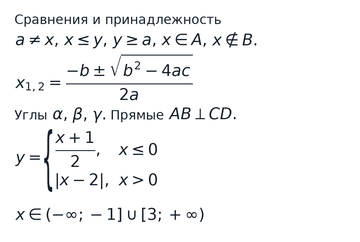
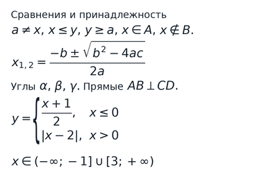

# Математика на мобильной ширине

| До, 360 px | После, 360 px | После, 390 px |
|---|---|---|
|  |  |  |

Слева локальный рендер версии 9ca826d. Все изображения используют одинаковый
исходный текст. В примере видны отдельные штрихи знаков, внешняя дробь,
нижние индексы, корень, две ветви с общей скобкой и интервалы.

Команда python -m scripts.math_mobile_audit проверяет условия, подсказки,
ответы и разборы по одному воспроизводимому экземпляру каждого из 40
практических и 163 обычных семейств или режимов, а также весь письменный банк.
В JSON записаны число проверенных экземпляров и классификация текстовых полей
в автоматическом режиме. Числа отражают локальную политику перед отправкой.
Тест пикселей измеряет ширину просвета между знаком и буквами, протяжённость
дробной черты и зазоры над и под ней на обеих ширинах.

На телефоне PNG остаётся одним растровым изображением с белым фоном. Превью
показывают его целиком. Нативный Rich в светлой и тёмной темах и при
увеличенном системном шрифте требует проверки в Telegram на iPhone.

[Чертёж №23 вместе с условием, 360 px](geometry-360.png) · [390 px](geometry-390.png).
В исходной версии числовая запись градуса через TeX оставляла интервал
шириной почти в две трети цифры. Локальный набор использует единый знак
градуса у числа и сохраняет отдельный знак композиции функций.

## Приёмка в Telegram на iPhone

Проверять на тестовом боте с той же сборкой. Для каждого примера записать версию
Telegram и iOS, модель телефона, оформление бота и сделать снимок экрана.
Пройти маршрут при ширине 360 и 390 логических пикселей, в светлой и тёмной темах,
с обычным шрифтом и после увеличения размера текста в настройках Telegram/iOS.

1. В обычном оформлении открыть «По номеру» → №13 → систему. Сопоставить обе
   строки с сохранённым условием. Проверить направление неравенств, общую скобку,
   открытую или закрашенную границу и совпадение подписи с рисунком.
2. В практическом сюжете «Шины» открыть данные, задачу, подсказку и разбор.
   Сравнить запись диаметра и произведение πD во всех четырёх сообщениях.
   После паузы открыть тот же вопрос из истории.
3. Открыть №20 с дробью и №22 с модулем или кусочной функцией. Увеличить
   сообщение. Проверить просвет у ≠, числитель и знаменатель, оба конца
   интервала, выколотую точку и положение ветвей относительно осей.
4. Открыть №23 с чертежом. Сопоставить буквы вершин, знак угла и градусы в
   условии и разборе. Затем включить оформление картинками и открыть тот же
   пример. Проверить край рисунка и концы длинных формул.
5. Для письменного результата открыть сохранённую обратную связь учебного
   аккаунта. Повторить переход из истории. Для проверки транспорта достаточно
   сохранённой работы. Новый запрос к модели не требуется.

Критерий для каждого кадра — видны оба штриха сравнения, минус отличим от
дробной черты, знак относится к нужному операнду, границы и подписи читаются
без увеличения. Превью выше подтверждают локальный PNG. Снимков нативного Rich
с физического iPhone для этой сборки пока нет.
