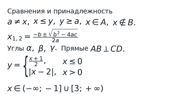

# Математика на мобильной ширине

| До, 360 px | После, 360 px | После, 390 px |
|---|---|---|
|  |  |  |

Слева локальный рендер версии 9ca826d. Все изображения используют одинаковый
исходный текст. В примере видны отдельные штрихи знаков, внешняя дробь,
нижние индексы, корень, две ветви с общей скобкой и интервалы.

Команда python -m scripts.math_mobile_audit проверяет условия, подсказки,
ответы и разборы по одному воспроизводимому экземпляру каждого из 40
практических и 163 обычных семейств или режимов, а также весь письменный банк.
В JSON записаны число проверенных экземпляров и классификация текстовых полей
в автоматическом режиме. Числа отражают локальную политику перед отправкой.
Тест пикселей измеряет ширину просвета между знаком и буквами, протяжённость
дробной черты и зазоры над и под ней на обеих ширинах.

На телефоне PNG остаётся одним растровым изображением с белым фоном. Превью
показывают его целиком. Нативный Rich в светлой и тёмной темах и при
увеличенном системном шрифте требует проверки в Telegram на iPhone.
