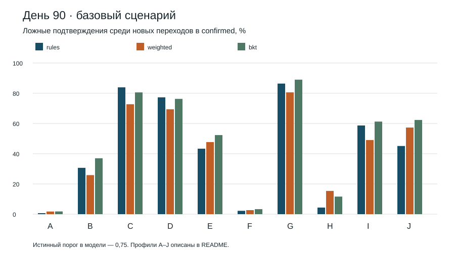

# Эксперимент и решение по алгоритмам

**Предложение для первой версии:** хранить самостоятельный ответ на новой задаче через неделю как наблюдаемый факт. Для очереди предварительной диагностики исследовать взвешенную модель в теневом режиме. Даже она объявляла подтверждение при скрытой силе ниже 0,75 в 36,3% переходов базового мира. Данных для надписи «ты освоил тему» или использования сигнала как школьной оценки эксперимент не дал.

Три алгоритма получили одну наблюдаемую историю до первого различия в выдаче и одинаковые экзогенные случайные числа далее. Всего 12 000 траекторий, 36 000 накопительных срезов, по 100 seed на каждую комбинацию. Сравнивали именно политику целиком: оценка состояния изменяет очередь, та меняет будущие данные. На 7-й день подтверждений у всех ноль, поскольку первичное доказательство нужно снова проверить спустя семь дней.

## Результаты за 90 дней

Базовый мир, 1 000 траекторий на политику. Доли агрегированы по событиям, средние по траекториям.

| Показатель | Правила | Взвешенная | BKT |
|---|---:|---:|---:|
| Ложные подтверждения среди переходов в confirmed | 37,1% | 36,3% | 41,3% |
| Всего переходов в confirmed с учётом повторного открытия | 7 577 | 4 723 | 7 193 |
| Истинные слабые места среди новых сигналов практики | 19,5% | 44,7% | 24,1% |
| Доля обнаруженных навыков среди хотя бы раз слабых | 41,4% | 36,7% | 40,3% |
| Среднее число сигналов практики за траекторию | 7,92 | 3,02 | 6,19 |
| Дней от начала до подтверждения, только состоявшиеся переходы | 43,4 | 36,0 | 39,1 |
| Дней до обнаружения, только выявленные слабые навыки | 15,6 | 14,8 | 15,3 |
| Новые задачи без помощи в обычной выдаче, верные | 76,3% | 76,4% | 76,5% |
| Новые самостоятельные задания в срок повторения, верные | 78,6% | 79,1% | 78,6% |
| Первый самостоятельный аналог после помощи, верные | 77,1% | 77,0% | 77,3% |
| Единая внешняя проверка на всех навыках, 8 000 ответов | 62,2% | 61,8% | 62,0% |
| Та же проверка среди текущих confirmed | 68,5% | 68,6% | 68,0% |
| Скрытая сила ≥0,75 на день 90, навыков из 8 | 4,96 | 4,87 | 4,94 |
| Получено разных одноразовых наград из 8 | 5,75 | 4,72 | 5,82 |
| Просроченных навыков на день 90, среднее | 1,51 | 1,70 | 1,13 |
| Получено ровно пять предложений за посещение | 72,8% | 70,9% | 73,6% |
| Продолжительность посещения по модельным временам, секунд | 310 | 307 | 311 |

Взвешенная модель уменьшает количество сигналов. Парный бутстрэп разности «взвешенная минус правила» даёт для точности обнаружения +25,13 п.п. (95% интервал Монте-Карло +23,97…+26,40), для полноты −4,70 п.п. (−5,71…−3,78). Для доли ложных подтверждений разность −0,84 п.п. (−2,14…+0,43). Для обычных свежих самостоятельных ответов +0,07 п.п. (−0,08…+0,22); для внешнего контроля −0,38 п.п. (−0,68…−0,09). Выигрыш в точности педагогического диагноза ограничен выбранными порогами. Второй алгоритм пропускает больше истинных затруднений. Преимущества по учебному эффекту не обнаружено.

| День | Внешний контроль rules / weighted / bkt | Наград rules / weighted / bkt, из 8 | Трактовка |
|---|---|---|---|
| 7 | 51,1 / 51,1 / 51,2% | 0 / 0 / 0 | Отложенная проверка ещё не созрела |
| 30 | 56,3 / 56,4 / 56,3% | 2,81 / 2,45 / 3,31 | Версия BKT чаще присваивает первое достижение |
| 90 | 62,2 / 61,8 / 62,0% | 5,75 / 4,72 / 5,82 | Разрыв в числе наград заметно крупнее разрыва во внешних ответах |

### По профилям

День 90, базовый мир. Тройки даны в порядке **правила / взвешенная / BKT**. Таблицы `results/summary.csv` включают все профили, дни, миры, числители через raw и знаменатели.

| Профиль | Внешний контроль, % (округлённо) | Ложные подтверждения, % (округлённо) | Что менять при внедрении |
|---|---|---|---|
| A сильный | 78 / 78 / 78 | 1 / 2 / 2 | Быстро исчерпывает восемь наград. Дать свободный выбор более сложного семейства; скуку измерить в пилоте. |
| B регулярный | 72 / 72 / 73 | 31 / 26 / 37 | Развести «сегодня получилось» и проверку спустя время. |
| C с трудностями | 64 / 63 / 64 | 84 / 73 / 81 | Давать короткий доступный следующий шаг. Правила выдали 7,7 из 8 наград в среднем. |
| D с перерывами | 58 / 57 / 57 | 77 / 69 / 76 | За один вход предложить максимум две просроченные проверки. |
| E часто получает помощь | 73 / 73 / 73 | 43 / 48 / 52 | У rules точность на самостоятельно выбранных ответах 92,9%. Важно периодически предлагать сопоставимую новую задачу, с возможностью попросить помощь. |
| F невнимательный | 60 / 59 / 60 | 2 / 3 / 3 | Описки создают сигналы при достаточной скрытой силе. В rules и базовом мире истинно слабых навыков у профиля не возникало, поэтому полнота не определена. |
| G запоминает | 56 / 55 / 56 | 86 / 81 / 89 | Запрет повторного зачёта необходим и недостаточен. Редкие независимые успехи всё равно создают ложные выводы. |
| H накручивает | 47 / 46 / 47 | 4 / 15 / 12 | Повтор одной цели ограничивает коллекцию примерно одним навыком. Значима отдельная проверка на случайное угадывание при малом пространстве ответов. |
| I новый | 65 / 65 / 65 | 59 / 49 / 61 | На старте нужна исследовательская выдача и факты по попыткам. |
| J перед экзаменом | 48 / 48 / 48 | 45 / 57 / 62 | J прекращает занятия после дня 14 по условию эксперимента. Отложенный результат на дне 90 описывает именно этот сценарий. |

## Чувствительность

| Мир | Прирост / забывание в день | Ложные подтверждения rules / weighted / bkt | Скрыто освоено из 8 rules / weighted / bkt |
|---|---|---|---|
| Базовый | 0,075 / 0,003 | 37,1 / 36,3 / 41,3% | 4,96 / 4,87 / 4,94 |
| Медленное обучение и быстрое забывание | 0,035 / 0,008 | 80,9 / 71,5 / 79,5% | 0,09 / 0,08 / 0,09 |
| Быстрое обучение и медленное забывание | 0,120 / 0,001 | 13,7 / 13,3 / 17,4% | 6,74 / 6,72 / 6,74 |
| Посещаемость умножена на 0,55 | 0,075 / 0,003 | 47,7 / 46,7 / 49,0% | 2,85 / 2,83 / 2,84 |

Чувствительность к условиям синтетического мира намного больше различий между алгоритмами. В двух мирах обучение и забывание меняются одновременно, поэтому приписать разницу любому из этих факторов по отдельности нельзя. Обучение с помощью, субъективная мотивация, скорость забывания, слоты, трудность/шанс угадывания, типы экзамена и порог «истинного освоения» требуют отдельной проверки.

## Что ограничивает интерпретацию

1. Внешняя проверка использует новую более сложную задачу на каждый навык с семидневной паузой; обычная самостоятельная точность исключает ответы с помощью. Результаты ожидаемо расходятся из-за сложности, задержки и отбора. Для E вероятность помощи связана с потенциальной ошибкой. Точный вклад этих трёх факторов эксперимент не разделяет.
2. Попытки с подсказкой полезны по заданному закону обучения. Из доли верных последующих самостоятельных ответов нельзя вычислить причинный эффект подсказок.
3. Наград за исправление или помощь нет, каждое первое подтверждение даёт одно достижение. Намеренная ошибка не создаёт валюту. Возможна случайная серия новых верных ответов. В основное сравнение не входил отдельный ограничитель для семейств с малым множеством ответов.
4. В модели восемь навыков с полноценным пулом и тремя разными семействами. Начальный холодный старт использует пустую историю у всех профилей. Подтверждение одиночных семейств, граф предпосылок, серийные задания №1–5, частичные результаты №20–25 и доказательство межконтекстного переноса требуют проверки на предметном материале.
5. Метрика пяти показов объединяет уход ученика и укороченный план из-за ограничения очереди. В реальном пилоте различать «запланировано», «предъявлено», «ответ получен», «добровольно закончил» и «вернулся». Вероятность посещения и пропусков здесь экзогенна. Эти числа нельзя интерпретировать как продуктовый retention или прогноз влияния награды.
6. Базовые условия дают в среднем 23,1–23,2 из 24 возможных пар навык–семейство; около 27% предъявлений знакомы. Сокращённый пул реального пилота изменит доступность новых аналогов. В симуляторе нет времени ответа Telegram, запросов PostgreSQL и себестоимости рендера. Веб-сервисы и персональные данные отсутствуют.
7. Ни один алгоритм не откалиброван на реальных решениях. Разбор причин требует диагностических заданий или письменных шагов. Сравнение не тестировало независимый причинный эффект самого планировщика против обычной практики. Реальную проверку этого различия следует проводить на сопоставимых заданиях в пилоте.

**Воспроизводимость.** Два независимых запуска с 6 и 2 процессами дали байт-в-байт одинаковую таблицу 36 000 срезов. SHA-256 несжатого `runs.csv`: `934292bd20f88e03381fc0a9a558fae44fcc4b70a242f9ac99043e6a5249029e`. Спецификация параметров и команды — в `README.md`. CSV содержит данные по одному seed в строке на профиль, политику, мир и срез; результаты поддаются независимой перепроверке без запуска симуляции.

